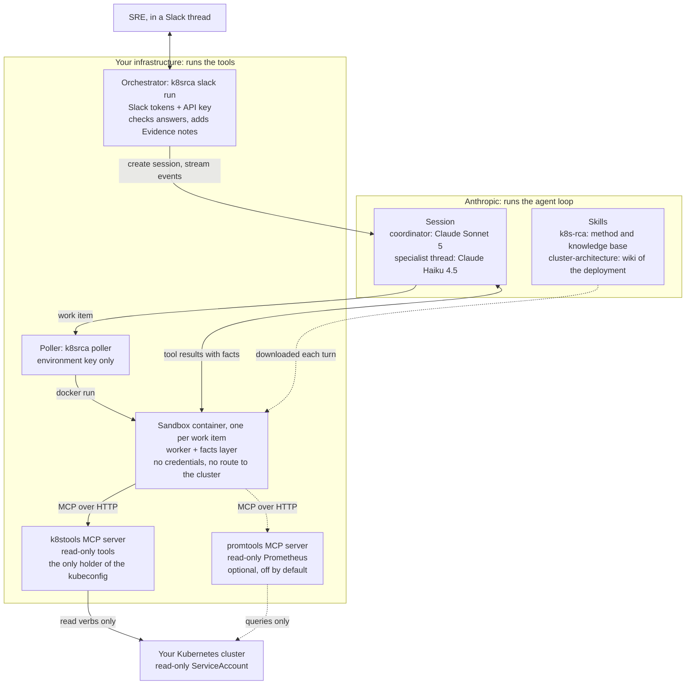

# k8srca

A Kubernetes root-cause analysis agent, built on Claude Managed Agents (Anthropic's hosted agent
platform).

An SRE asks in Slack why a workload is failing. The agent investigates the live cluster through
read-only tools and answers with the most likely cause and how sure it is, the facts behind it, the
causes it ruled out, and what to check next.

**It cannot change your cluster.** It observes and recommends; it has no way to apply a change.
That does not depend on the model following instructions: four independent controls enforce it,
described [below](#read-only-four-independent-controls) and in full in
[§8 of the architecture design](designs/001-architecture.md#8-read-only-guarantee-and-security).

Apache 2.0 licensed. Requires Python 3.12+, Docker, and an Anthropic API key. New to the project?
Read this page, then [design 001](designs/001-architecture.md); unfamiliar terms are in the
[glossary](docs/glossary.md).

---

## What an answer looks like

An illustrative answer, for a Java service that is killed for using too much memory as it starts
(from [design 010 §5.3](designs/010-facts-and-short-answers.md)):

> **@you** `@k8srca` the ad service is crash-looping, what's going on?
>
> **@k8srca** **Most likely:** the `ad` container's 300Mi memory limit is too
> low for the JVM it runs, so it is killed for memory as it starts (very
> likely).
>
> **Why:** every retained termination is OOMKilled[1], and in every sampled
> life memory is at the limit from the first sample or rises to it within
> seconds[2]. The limit equals the request, and the JVM has no heap
> sizing[3][4].
>
> **Ruled out:** an application crash — no exception is logged before the
> kills[5]. A liveness probe — none is configured[6].
>
> **Next steps:** raise `ad`'s memory limit, or cap the JVM's heap with
> `-XX:MaxRAMPercentage`. To rule out a leak, check whether memory keeps
> climbing after startup once it runs with more headroom.
>
> *Evidence*
> [1] ad: last 3 terminations OOMKilled, exit 137 (k8s_get_workload_report)
> [2] ad: memory at the 300Mi limit from the first sample in 182 of 214
> sampled lives; the other 32 reach it within 31s (prom_memory_report)
> …

Answers are at most 300 words. Each numbered note is a **fact**: a statement that code derived
from a tool result, not something the model wrote. The bot prints the cited facts as the Evidence
notes, and before posting it checks that every number in the prose appears in a fact the answer
cites. (A "sampled life" is one run of the container from start to kill, as Prometheus saw it.)

---

## Why it is built this way

### The problem

The first twenty minutes of a Kubernetes incident are mostly mechanical. Someone lists pods, checks
container statuses, reads events, pulls logs from the previous container, looks at the node, and
asks whether anything was deployed recently. It is a well-defined evidence-gathering loop, it is
tedious, and it is done by the person who can least spare the attention.

The judgment lies in two places: what to look at next, and when to stop. An agent is good at the
loop and adequate at the judgment, provided the method is written down rather than left to
instinct. That is the premise of this project. The method is
[design 002](designs/002-investigation-model.md), as revised by
[008](designs/008-conclusions-under-incomplete-evidence.md) (rank causes instead of proving one)
and [010](designs/010-facts-and-short-answers.md) (facts stated by code, short answers).

### Read-only: four independent controls

The obvious next step after "diagnose this" is "now fix it". We deliberately do not take it. An
agent that can restart a deployment needs a different level of trust, review and audit from one
that can only read. And during an incident you want a colleague who explains what they found, not
one who changes things while you are reading. So k8srca proposes changes as text and never
applies them.

The guarantee does not rest on the model choosing to behave. There are four controls, any one of
which would block a write on its own:

1. **No mutating tools exist.** The MCP server the agent uses offers reads only. There is no
   create, patch, delete or exec to call.
2. **The sandbox holds no credentials.** The container that runs agent-written commands has no
   kubeconfig, no `kubectl` and no cloud CLI. The credential is in a different container.
3. **The sandbox cannot reach the cluster.** Firewall rules block it from the Kubernetes API
   server, the host, private address ranges and cloud metadata endpoints. (It can still reach the
   public internet; [001 §8.3](designs/001-architecture.md#83-restricted-network-egress) explains
   this limitation.)
4. **RBAC is the last line.** The ServiceAccount the tool server uses has only read verbs, so even
   if the controls above failed, the API server would reject a write.

### k8stools: the only path to the Kubernetes API

All access to the Kubernetes API goes through one MCP server,
[k8stools](https://github.com/BenedatLLC/k8stools), a separate open-source project. No part of
k8srca imports the Kubernetes client, runs `kubectl`, or reads a kubeconfig, and a test that
parses every module enforces this.

There are three reasons. One credential has one holder, so the read-only property can be checked
in one place. k8stools' tool list is the security boundary, and code that goes around it is not
bound by it. And data read ahead of time goes stale, while the same data behind a tool can be read
during the investigation that needs it.

When a capability is missing, it is added to k8stools. For example, when the agent needed deploy
history, the fix was a new k8stools tool (`get_replicaset_summaries`), not code in k8srca that read
ReplicaSets directly.

The one other source of cluster data is metrics. promtools, our own read-only MCP server for
Prometheus ([design 009](designs/009-metrics.md)), queries Prometheus' HTTP API, not the
Kubernetes API, and holds no credential beyond Prometheus' address. It is built but off in
production; today it runs only in scenario replays.

### Two agents: a coordinator and a cheaper specialist

A coordinator on a stronger model (Claude Sonnet 5) plans and concludes; a specialist on a cheaper
one (Claude Haiku 4.5) does the high-volume reading and reports back.

The work is split by **how much data a task reads**, not by which source it comes from. Reading a
thousand lines of logs into the coordinator's context to find four relevant ones would leave it
little room to reason. So the specialist searches logs and returns findings, while the coordinator
keeps a handful of cheap, high-signal lookups for itself and does not have to delegate trivial
ones. Both models are set per agent in the config, because the trade-off between cost and context
size is a deployment decision.

### Ranking causes instead of confirming one

The agent never sees a system's whole history. Kubernetes keeps a container's last termination,
not the ones before it; events last hours to days; logs rotate. So the agent does not try to
*prove* a cause. It ranks the candidate causes on the facts it has, and says how strong the leader
is: *very likely*, *likely* or *possible*
([design 008](designs/008-conclusions-under-incomplete-evidence.md)).

A candidate is **ruled out** only by a fact that excludes it. A candidate that nothing decided is
not listed as ruled out: it appears as a next step, with the check that would settle it.

### Facts stated by code, judgment by the model

The agent made most of its mistakes when it worked out low-level facts by hand: counts, durations,
"every instance", how far back a record goes. That work moved into code
([design 010](designs/010-facts-and-short-answers.md)).

A **facts layer** reads each tool result and states facts with their scope, such as "events cover
the last 10 days" or "the last termination only: Kubernetes keeps no earlier ones". The model
chooses what to look at next, which cause the facts point to, and how to say it. It records only
facts that need reading text, such as a log that stops partway through startup, and those are
marked as its own.

### Why the tools run on your infrastructure

The cluster you want to investigate is almost certainly not reachable from the public internet,
and the tools that read it must run somewhere that can reach it. So tool execution is
**self-hosted**: Anthropic runs the agent loop (the model and the conversation), and you run the
containers that execute the tools. Tool results are still sent to Anthropic, because the model has
to read them ([001 §8.5](designs/001-architecture.md#85-data-flow-f3)).

This also separates privileges between the two processes you run. The orchestrator holds the Slack
tokens and the Anthropic API key but cannot claim tool work. The poller claims tool work but holds
no API key, because it starts containers that run model-written shell commands, and an API key
within their reach would be a key the agent could use.

---

## How it fits together

The diagram shows the components, where each runs, and what each holds. Dotted lines are present
only when metrics are enabled (off by default).



What happens when someone asks a question:

1. **The orchestrator** receives the mention over Slack's Socket Mode, finds or creates the session
   for that Slack thread, and posts a placeholder message that it keeps editing with progress.
2. **Anthropic runs the agent loop.** The coordinator plans, and may delegate high-volume reads to
   the specialist. When an agent calls a tool, a *work item* appears on your environment's queue.
3. **The poller** claims the work item and starts a sandbox container for it. One container serves
   a session's whole active period, plus 60 seconds of idle time, so a conversation with pauses uses
   several containers. A per-session workspace directory carries files from one to the next.
4. **Inside the sandbox**, the worker acts as an MCP client to k8stools (and promtools, where
   metrics are enabled) and serves those tools to the agent. The facts layer reads each result,
   states its facts, and puts them above the raw result.
5. **k8stools** is the only process holding a kubeconfig, and it only reads.
6. **The answer** comes back through the same event stream. Before posting it, the orchestrator
   checks it and turns its fact markers into numbered Evidence notes; a failed check sends it back
   for one revision. The answer then replaces the placeholder. A Slack thread is one investigation:
   follow-ups continue it with the earlier context.

### The agent, in layers

| Layer | What it is | Where |
| --- | --- | --- |
| **Tools** | Read-only MCP servers. k8stools' composite tools (`get_namespace_health`, `get_workload_report`) return a namespace's or a workload's state in one call; promtools' reports do the same for metrics | [k8stools](https://github.com/BenedatLLC/k8stools), [packages/promtools](packages/promtools) |
| **Facts** | Code that reads each kind of tool result and states facts. Each fact has a statement, a scope, and the knowledge-base terms it supports, and is logged to `evidence/facts.jsonl` in the session's workspace | [src/k8srca/facts/](src/k8srca/facts/) |
| **Knowledge** | Symptoms, their candidate causes, the facts that support or rule out each, and the actions that observe those facts. Written by hand, or mined from public debugging guides by a model and reviewed. `kb_query.py open` ranks the candidates from the facts so far | [docs/rca/](docs/rca/), [skills/k8s-rca/](skills/k8s-rca/) |
| **The agent** | A short coordinator prompt (routing, delegation, Slack formatting) and a `SKILL.md` holding the loop: look up the symptom, rank, check, stop, answer | [agents/](agents/), [skills/k8s-rca/SKILL.md](skills/k8s-rca/SKILL.md) |
| **Answer checks** | Before posting: every marker refers to a fact, the answer cites at least one, it is at most 300 words, and every number is in a cited fact | [src/k8srca/review.py](src/k8srca/review.py) |
| **Architecture** | What this deployment is made of and what calls what, with no live state, built by kubewiki from the cluster, the official Helm chart and the official docs | [packages/kubewiki](packages/kubewiki), `skills/cluster-architecture/` (generated) |

The knowledge base ranks causes for 13 symptoms in five families so far: pods restarting, pods
pending, images that cannot be pulled, slow requests, and storage
([design 007](designs/007-knowledge-representation.md)). It started from a third-party set of 81
alert records; 25 of them map to one of those symptoms so far. For the rest, `kb_query.py lookup` lists
candidate causes without a ranking, and the agent ranks them itself by the same rule.

---

## Documentation

| Guide | Covers |
| --- | --- |
| [Installation](docs/installation.md) | **Start here to run it.** From nothing to running, plus the full config reference |
| [Slack app setup](docs/slack-app-setup.md) | Creating the Slack app, scopes, events, verification |
| [Cluster setup](docs/cluster-setup.md) | The read-only ServiceAccount, minting a credential, troubleshooting |
| [Generators](docs/generators.md) | How the skills are built, and how each builder is evaluated |
| [How we change the agent](docs/process.md) | Planning measurements, the conditions that stop work for a review, and how reviews end |
| [Glossary](docs/glossary.md) | Project terms in plain words |
| [Current baseline](docs/baseline.md) | The agent's scores on the scenario suite |

The design documents explain the reasoning behind the code. Each one starts with a status line
saying what is built.

| Design | Covers | Status |
| --- | --- | --- |
| [001 — Architecture](designs/001-architecture.md) | The platform: processes, self-hosted sandboxes, MCP wiring, Slack, security | Implemented |
| [002 — Investigation model](designs/002-investigation-model.md) | How the agent reasons: candidate causes, evidence, when to stop | Implemented in part; partly replaced by 008 and 010 |
| [003 — Operations](designs/003-operations.md) | Observability, rolling out changes, deploying k8srca on Kubernetes | Implemented in part |
| [004 — Scenario testing](designs/004-scenario-testing.md) | How we find out whether it works: recorded faults, replay, checklist grading | Implemented in part |
| [005 — Modular architecture](designs/005-modular-architecture.md) | A proposed future structure with each part behind an interface | Draft; only the generator interface and component evals are built |
| [006 — Hold-out suite](designs/006-holdout-suite.md) | Scenarios we never tune against, written and run by a colleague | Implemented in part; on hold |
| [007 — Knowledge representation](designs/007-knowledge-representation.md) | The knowledge-base format: symptoms, causes, facts, actions, mined content | Implemented in part |
| [008 — Conclusions under incomplete evidence](designs/008-conclusions-under-incomplete-evidence.md) | Ranking instead of proof; strength words; facts scoped to what Kubernetes keeps | Implemented in part |
| [009 — Metrics](designs/009-metrics.md) | Prometheus: what a cluster must collect, promtools, scenarios with metrics | Implemented in part; off in production |
| [010 — Facts and short answers](designs/010-facts-and-short-answers.md) | The facts layer, the short answer with footnotes, checklist grading | Implemented |
| [011 — Decision models](designs/011-decision-models.md) | Small models for narrow judgments, such as reading a fact from a log | Draft, not started |
| [012 — Log evidence](designs/012-log-evidence.md) | Searching whole logs and many pods; what a log covers | Implemented in part |
| [013 — What changed](designs/013-what-changed.md) | Recent changes to cluster objects as evidence | Parked |
| [014 — SREGym](designs/014-sregym.md) | Running the external SREGym-Lite benchmark live | On hold |
| [015 — Knowledge-base evaluation](designs/015-kb-evaluation.md) | Measuring whether the knowledge base helps the agent | In progress |
| [kubewiki](packages/kubewiki/docs/design.md) | The generator behind the architecture wiki | |

---

## Setup

What you need first: Python 3.12+ and [`uv`](https://docs.astral.sh/uv/), Docker, an
`ANTHROPIC_API_KEY`, a Slack workspace you can install an app into, and `kubectl` access to the
cluster you want to investigate.

[docs/installation.md](docs/installation.md) is the complete version. This is the outline.

### 1. Create a least-privilege credential first

```bash
kubectl apply -f rbac/k8srca-readonly.yaml   # k8srca-reader: get/list/watch, no secrets
./rbac/make-reader-kubeconfig.sh             # -> ~/.kube/k8srca-reader.yaml
```

The script mints a bound, time-limited token rather than a permanent Secret, and prints a check in
which the `no` answers are the expected result:

```
  create  pods: no      delete  pods: no      patch   pods: no
  list    pods: yes     get     pods/log: yes get     secrets: no
```

`k8srca.yaml` already points `cluster_access.kubeconfig` at that path, so there is nothing to edit
unless you put it somewhere else. The credential is configured there rather than in `.env` because
`k8srca up` derives the copy the container uses from it.
[docs/cluster-setup.md](docs/cluster-setup.md) covers rotation, tunnelling to a cluster that only
listens on localhost, and failure modes.

> **Use a read-only kubeconfig.** k8stools has no mutating tools and the sandbox never sees the
> credential, so an over-privileged kubeconfig is not immediately exploitable. But it removes the
> RBAC control, which is what keeps the read-only guarantee if the other controls fail. If you
> bring your own kubeconfig, check it:
> `kubectl auth can-i create pods -A --kubeconfig <file>` must say `no`.

### 2. Configure and bring up the local pieces

```bash
uv sync
cp .env.example .env          # Anthropic keys and Slack tokens
uv run k8srca up              # network, tunnel, kubeconfig, k8stools; safe to re-run
./systemd/install.sh          # systemd user units for up, tunnel, egress, poller and orchestrator
```

The systemd units keep the two long-running processes (poller and orchestrator) alive across a
logout or reboot. `k8srca up` starts neither of them, so without the units `k8srca status` can
show everything else healthy while the bot ignores you.

`up` can be re-run safely and also works as a diagnostic. It works out what it can at run time
(the Docker gateway address, the TLS server name, your uid), so the only site-specific
configuration is the cluster access block in `k8srca.yaml` and the tunnel settings in `.env`.

### 3. Restrict the sandbox's network access

```bash
sudo ./docker/egress-rules.sh apply    # needs root; `k8srca status` reports if it is missing
./docker/verify-egress.sh              # confirms the sandbox cannot reach the API server
```

### 4. Build the skills and create the agents

```bash
uv run k8srca kb build        # build the knowledge base into the k8s-rca skill
uv run k8srca arch build      # build the wiki of your deployment (cluster, chart, docs)
uv run k8srca sync --dry-run  # resolve tool routing, write nothing
uv run k8srca sync            # create or update the environment and agents
```

`sync` does not build the skills; run the two build commands first.

Metrics are optional and off by default (`metrics.enabled` in `k8srca.yaml`). Turning them on
needs a Prometheus that collects what [design 009 §3](designs/009-metrics.md) lists, and a
promtools container pointed at it. `k8srca up` does not start promtools yet.
[docs/cluster-setup.md](docs/cluster-setup.md) covers the Prometheus side.

`sync` can be re-run safely: it creates on the first run and updates in place after, producing a
new agent version whenever something changes. Each session keeps the agent version it started
with, so investigations in progress are unaffected; restart the orchestrator to make new sessions
use the new version. Resolved ids are saved in `.k8srca/state.json`, which is gitignored because it
is specific to one deployment.

### 5. Run it

```bash
uv run k8srca sandbox build   # image tagged with the commit it was built from

# terminal 1: tool execution
uv run k8srca poller          # one sandbox container per work item

# terminal 2: Slack
uv run k8srca slack run
```

(With the systemd units installed, these run as services instead.)

Then `/invite @k8srca` into a channel and mention it. A Slack thread is one investigation;
follow-ups in that thread continue it. Set `SLACK_ALLOWED_CHANNELS` so it answers only in the
channels you expect; anyone in the workspace can also send it a direct message.

Useful while things are settling:

```bash
uv run k8srca status          # will a Slack mention be answered?
uv run k8srca slack check     # token, scopes, channel, event delivery
uv run k8srca sandbox show    # which image will a new session use?
uv run k8srca timing          # where the last session's time went
uv run k8srca down            # stop what `up` started
```

You can also drive a session without Slack:

```bash
uv run k8srca session "why is payment-api crash-looping in prod?"
uv run k8srca session --resume <id> "what changed recently?"
```

---

## Development

**No cluster is needed.** k8stools has a mock mode that serves realistic static data, which is
enough for everything except reasoning about a specific cluster.

**What to install.** On Linux, with bash at exactly `/bin/bash`:

| | What needs it |
| --- | --- |
| [uv](https://docs.astral.sh/uv/getting-started/installation/) | Everything. It installs Python and the dependencies. |
| [Docker Engine](https://docs.docker.com/engine/install/) with [Compose v2](https://docs.docker.com/compose/install/linux/) | The k8stools container (real or mock) and the sandbox image. Scenario replays and `eval arch` run k8stools and promtools in containers. |
| [git](https://git-scm.com/downloads) | The clone, and the worktrees measurements run from. |
| [kubectl](https://kubernetes.io/docs/tasks/tools/install-kubectl-linux/) | You use it, not k8srca: for the read-only credential, and to inject a scenario's fault. |
| [helm](https://helm.sh/docs/intro/install/) | kubewiki's `helm template` (the one exception to the rule against cluster tools; it renders charts offline), used by `arch build` and `scenario build-wiki`. |
| [GitHub CLI](https://cli.github.com/) (`gh`), optional | Filing issues. Changes to k8stools go through an issue on its repository. |
| OpenSSH client, optional | `k8srca up`'s tunnel, when the cluster's API server is reached over SSH. |

`uv run pytest` needs only uv. Anything that calls a model also needs an Anthropic API key in
`.env` ([installation](docs/installation.md)).

```bash
uv sync --extra dev

# A mock MCP server: no cluster, no kubeconfig
docker compose -f docker/compose.yaml --profile mock up -d k8stools-mock
sed -i 's|http://k8stools:8000/mcp|http://127.0.0.1:8009/mcp|' k8srca.yaml

uv run k8srca kb build        # build the knowledge base into the skill bundle
uv run k8srca tools list      # the tool list as the model will see it
uv run k8srca tools validate  # schema rules, name collisions, per-agent routing
uv run pytest                 # unit tests: hermetic, no credentials, no cluster
```

`tools validate` runs the same checks `sync` does without touching the Anthropic API: schema rules,
name collisions between servers, and whether each agent's tool groups resolve.

### Measuring a change to the agent

Changes to the agent are measured on the **scenario suite**: 15 faults injected into a test cluster
on purpose, recorded once, and replayed through k8stools (and promtools, for the ones with
metrics), so each run sees the same cluster. Each answer is graded by a model against a checklist
of statements a good answer should make ([design 004](designs/004-scenario-testing.md)). This costs
real money:

```bash
uv run k8srca scenario fetch                                   # download the recorded scenarios once
uv run k8srca scenario run <id> --local-skill k8s-rca --n 3    # graded on the scenario's checklist
uv run k8srca eval answer     # the answer writer alone, on fixed facts (~$0.10/answer)
uv run k8srca eval arch       # the architecture generator alone (Docker, no model)
```

Read [docs/process.md](docs/process.md) before planning a measurement. It sets out how each change
states its hypothesis and budget first, and the conditions that stop work for a review.

### Testing

`uv run pytest` is hermetic and needs nothing. Two suites are opt-in because they are not:

```bash
# against a live MCP server
K8SRCA_TEST_MCP_URL=http://127.0.0.1:8009/mcp uv run pytest tests/test_live_mcp.py

# end to end: real sessions, real containers, real money
# needs `k8srca up`, `k8srca sync`, and `k8srca poller` running
K8SRCA_TEST_LIVE=1 uv run pytest tests/test_e2e_slack.py -v -s
```

Concurrency is the part of this system that has broken most often (the poller handling container
starts one at a time, two Slack threads sharing a session), and none of it shows up in a
single-threaded test. Those regression tests are written so that reverting the fix makes them
fail; keep them that way rather than weakening them into smoke tests.

### A note on `k8srca worker`

`k8srca worker` runs the worker in-process on your host rather than in a container. It is for
development and it is **not isolated**: it runs agent-written shell commands directly on your
machine with your filesystem access. Credentials are removed from its environment, but that is an
extra precaution, not a sandbox. Use `k8srca poller` against anything real.

---

## Status

Running against a real OpenTelemetry demo cluster through the containerised path. All four
read-only controls have been checked by measurement, including that the sandbox cannot reach the
API server.

Built:

- [x] RBAC manifest, k8stools container, compose file
- [x] Config schema, tool declarations generated from the MCP servers, manifest hashes
- [x] Worker-side tool wrapper (prefixed name for the model, unprefixed call to the server)
- [x] `k8srca sync`: environment, skills and agents
- [x] Sandbox image, spawn script, `k8srca poller`: containerised, multi-turn
- [x] Network rules for the sandbox, applied and checked against a real cluster
- [x] Slack orchestrator, session map, concurrent threads
- [x] Cluster architecture skill: kubewiki's wiki of the deployment
- [x] Scenario suite: 15 recorded scenarios, replayed, graded on checklists, with a baseline ([004](designs/004-scenario-testing.md); scores in [docs/baseline.md](docs/baseline.md))
- [x] Facts layer, short answers with footnotes, answer checks ([010](designs/010-facts-and-short-answers.md))
- [x] Ranking instead of confirmation ([008](designs/008-conclusions-under-incomplete-evidence.md))
- [x] Knowledge format, build checks, `open`'s ranking, and the mining pipeline; five families mined ([007](designs/007-knowledge-representation.md))
- [x] promtools and metrics replay in the scenario suite ([009](designs/009-metrics.md)); off by default in production
- [x] Whole-log search and log-pattern counts as evidence ([012](designs/012-log-evidence.md))
- [x] Generators behind one interface, with component evals ([005](designs/005-modular-architecture.md), its first step)

Not built yet:

- [ ] The remaining vendored alerts converted (25 of 81 map to a symptom so far), and runbooks ([007](designs/007-knowledge-representation.md))
- [ ] Latency and CPU-throttling reports for metrics ([009](designs/009-metrics.md))
- [ ] Deleting a session's workspace when it ends; carrying context into a replacement session ([001 §7.4](designs/001-architecture.md#74-failure-handling))
- [ ] The rest of 005: plugins, deployment on Kubernetes, other agent runtimes and chat tools
- [ ] A durable investigation record ([002 §7](designs/002-investigation-model.md)), needed before k8srca can be deployed on Kubernetes
- [ ] Investigations started by alerts, and memory across sessions ([001 §11](designs/001-architecture.md#11-extension-points-for-deferred-work))

---

## License

Apache 2.0. See [LICENSE](LICENSE).
