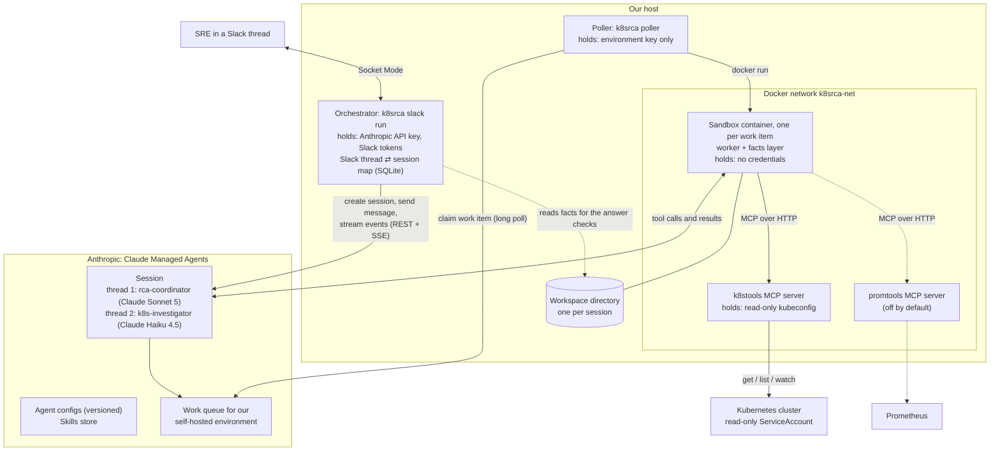
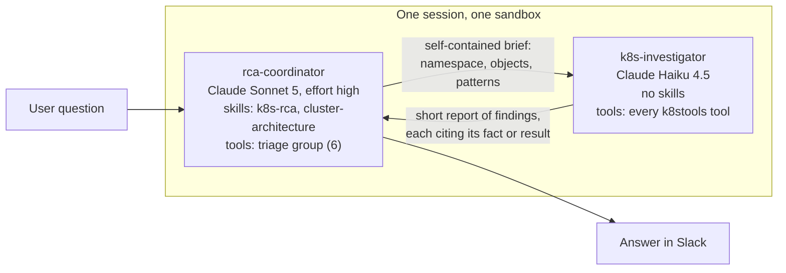
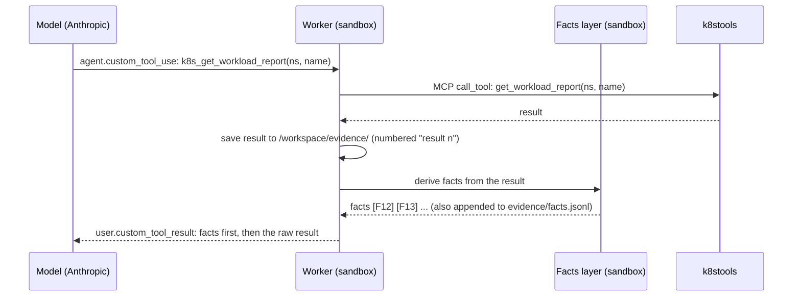
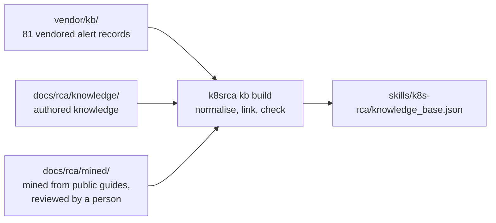
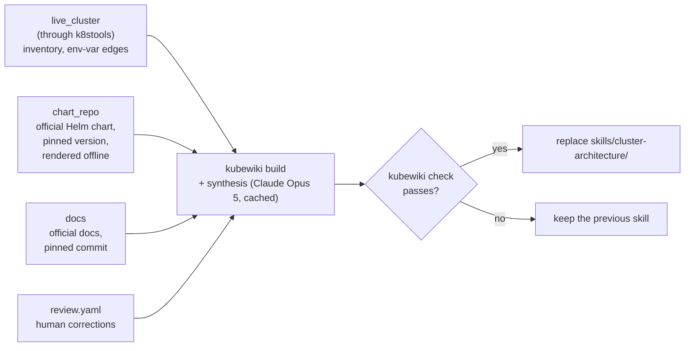
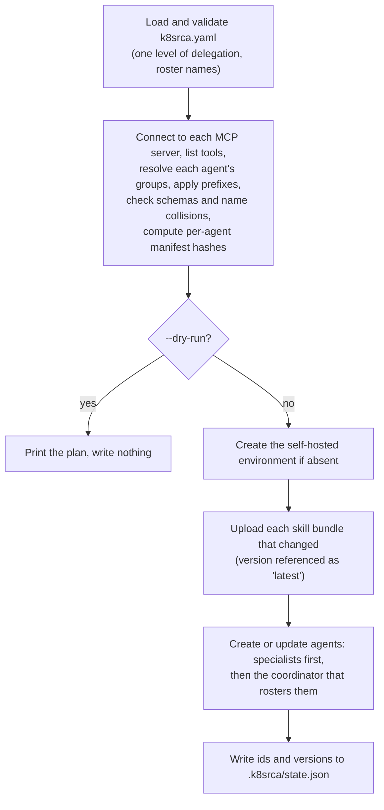
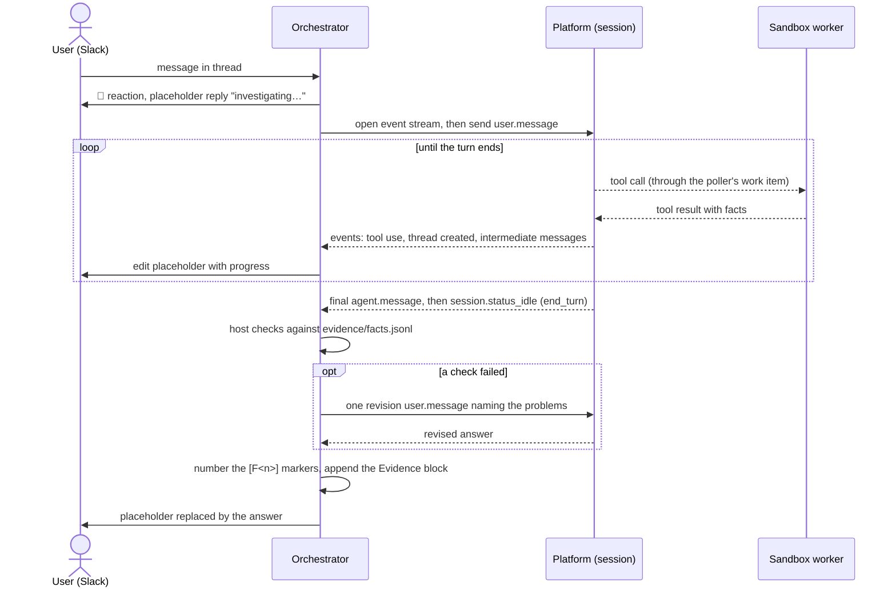
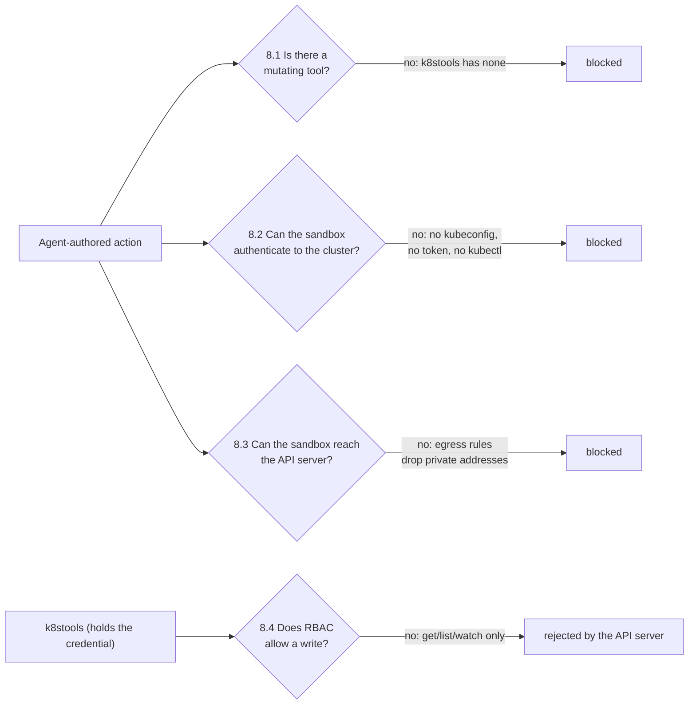
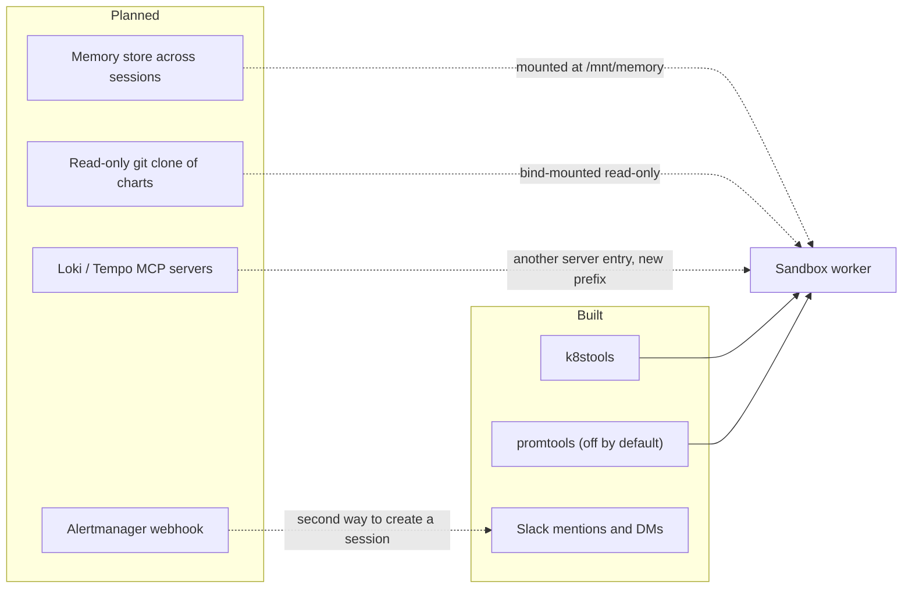

# 001 — Architecture

**Status:** implemented. This document describes the system as it runs today. Sections 11 and 12
describe planned work and open questions, and every other planned item is marked where it
appears. **Last updated:** 2026-11-14.

**Related:** [002 — Investigation model](002-investigation-model.md) (how the agent reasons) ·
[003 — Operations](003-operations.md) (running it) ·
[005 — Modular architecture](005-modular-architecture.md) (a proposed future structure) ·
[010 — Facts and short answers](010-facts-and-short-answers.md) (the facts layer and the answer's
shape) · [Glossary](../docs/glossary.md)

This is the platform design: which processes exist, where each one runs, how a question asked in
Slack becomes an investigation of a live cluster, and what stops the agent from changing that
cluster. Read it first. It assumes you know Kubernetes. It does not assume you know Claude Managed
Agents, Anthropic's hosted agent platform; section 2 explains the parts of it that matter here.
Terms specific to this project are in the [glossary](../docs/glossary.md).

> **This document and design 005.** 001 describes the running system, which has one choice for
> each part: Slack for chat, Claude Managed Agents for the agent loop, Docker for the sandbox.
> [Design 005](005-modular-architecture.md) proposes putting each part behind an interface so it
> can be replaced. Only a small part of 005 is built (see its status line). Until more is, this
> document is the description of what runs.

---

## 1. Purpose and scope

k8srca lets an SRE ask in Slack, *"why is `payment-api` crash-looping in `prod`?"*, and get back
a diagnosis: the most likely cause and how sure the agent is, the facts it rests on, the causes it
ruled out, and what to check or change next. Follow-up questions in the same Slack thread continue
the same investigation.

The agent is **read-only with respect to the cluster**. It observes, correlates and recommends; it
never applies a change. Section 8 describes the four independent controls that enforce this,
because an instruction in a prompt is not enforcement.

### What is in scope today, and what is not

| Built | Not built (planned or deferred) |
| --- | --- |
| Slack: `@k8srca` mentions in channels, and direct messages | Starting an investigation automatically from an Alertmanager alert (§11) |
| Read-only Kubernetes access through the k8stools MCP server | Memory across sessions (§11) |
| A coordinator agent and a specialist agent, each with its own model | Git access to Helm charts and change history (§11) |
| The RCA knowledge base, delivered as a skill (§5.1) | Loki (logs) and Tempo (traces) tool servers (§11) |
| A wiki of the deployment's architecture, delivered as a skill (§5.2) | More than one cluster per deployment |
| A facts layer that states facts from tool results in code (§4.2) | A durable investigation record in the workspace ([002 §7](002-investigation-model.md)) |
| Checks on the answer before it is posted (§7.2) | Deploying k8srca itself to Kubernetes ([003](003-operations.md), [005](005-modular-architecture.md)) |
| One declarative config file applied by one command (§6) | Deleting a session's workspace when it ends (§7.4) |
| Prometheus through promtools: built, but off by default (§11) | |

The deferred items were designed far enough that adding them should not need a rewrite. Section
11 names the place in the design where each one would attach.

---

## 2. Platform facts that shape the design

k8srca runs on **Claude Managed Agents** ("the platform"). The platform stores agent
configurations, runs the agent loop (model calls and conversation state), and streams events to a
client. A **self-hosted environment** lets the tools run on our machines instead of Anthropic's.
We need one because the cluster we investigate is almost never reachable from the internet.

Four properties of the platform drive most of the design. The first three contradict the summary in
`background/Claude-Self-Hosted-Sandboxes-Explained.md`, an early research note that is wrong on
these points; trust this section over it.

**F1: MCP servers declared on an agent are called from Anthropic's network, not from our
sandbox.** If an agent's configuration lists an MCP server by URL, Anthropic's servers make the
connection, so `http://localhost:8000/mcp` cannot work. The documented alternative for a private
server is to make our worker the MCP client and to declare the server's tools on the agent as
*custom tools*, which the worker then executes (§4.2). Anthropic also offers
[MCP tunnels](https://platform.claude.com/docs/en/agents-and-tools/mcp-tunnels/overview), a
research preview that needs `cloudflared`, an Anthropic proxy and a registered CA certificate. That
is a lot of moving parts for a local cluster, so we do not use them.

**F2: Self-hosted environments accept only memory-store resources.** File and GitHub-repository
resources are rejected with HTTP 400 (*"`resources` are not supported with self-hosted
environments"*). So the knowledge base and the architecture docs cannot be mounted as files. They
arrive as **skills**, bundles the worker downloads into `/workspace/skills/<name>/` (§5).

**F3: Tool inputs and outputs still go to Anthropic.** Self-hosting moves where tools *run*, not
where their results *go*: the model has to read the results to reason about them. Pod logs,
ConfigMap contents and events that the agent reads are sent to and processed by Anthropic. Section
8.5 states the consequences, because "self-hosted" suggests the opposite.

**F4: Agents in one session share a container but not a context.** A coordinator agent can
delegate to other agents (its *roster*) inside one session. Each delegate runs in its own
**thread**, with its own conversation, model, system prompt, tools and skills, but all threads
share the sandbox container and its filesystem. This is what allows a coordinator on one model and
a specialist on a cheaper one without a second sandbox: one session, one event stream, one worker,
two models. Each thread is billed at its own model's rates.

A consequence of F4 shapes how delegation is used: **a delegate sees none of the coordinator's
conversation.** Every delegated task has to carry its own context (names, namespaces, what to look
for, what to report). Delegation therefore costs a round trip plus a re-briefing, which is why
§3.3 divides work by data volume rather than by data source.

---

## 3. System architecture

The diagram shows the processes, where each runs, and which credential each holds. Solid lines are
always present; dotted lines are present only when metrics are enabled, or (for the workspace) only
when the orchestrator runs on the same host as the sandboxes.



### 3.1 Processes

| Process | Runs as | What it does | Credential it holds |
| --- | --- | --- | --- |
| **Orchestrator** (`k8srca slack run`, [src/k8srca/slack/](../src/k8srca/slack/)) | Host, long-lived | A Slack Bolt app in Socket Mode. Maps each Slack thread to a session, creates sessions, streams their events, shows progress, checks the answer and posts it. | Anthropic API key, Slack tokens |
| **Poller** (`k8srca poller`, [worker/poller.py](../src/k8srca/worker/poller.py)) | Host, long-lived | Claims work items from the platform with the SDK's work loop and runs [`docker/spawn.sh`](../docker/spawn.sh) for each, up to 4 at once (`max_concurrent`), so one session's idle container does not delay another session. Ignores a work item it is already running (the platform can hand the same item out twice when it reclaims one). Passes each agent's tool-manifest hash and the expected skill names to the sandbox (§4.3). | Environment key |
| **Sandbox** ([worker/entrypoint.py](../src/k8srca/worker/entrypoint.py)) | Container, one per work item | The SDK's `EnvironmentWorker` with the built-in tools (`bash`, `read`, `grep`, `glob`) plus every wrapped MCP tool. Serves every agent thread in the session. Exits when the work item ends. | None |
| **k8stools** ([BenedatLLC/k8stools](https://github.com/BenedatLLC/k8stools)) | Container, long-lived | The read-only Kubernetes MCP server, over streamable HTTP on port 8000. | The read-only kubeconfig; nothing else has it |
| **promtools** ([packages/promtools](../packages/promtools)) | Container, when enabled | A read-only Prometheus MCP server of our own ([design 009](009-metrics.md)). Off in the production config; the scenario runner starts it for scenarios that include metrics. | None beyond Prometheus' address |

**Why the orchestrator and the poller are separate processes.** The sandbox runs shell commands
the model writes. The Anthropic API key is scoped to the whole organisation, so it must never be
somewhere those commands could read it. The poller, which starts sandboxes, holds only the
environment key, which can claim work for this one environment and nothing more. Anthropic's
self-hosted-sandbox documentation recommends this split.

### 3.2 Containers per work item, workspace per session

A **work item** is the platform's unit of work for a self-hosted environment. It covers one
continuous active period of a session: neither exactly one turn nor the whole session.

The worker holds its container open while the session is active and for `max_idle` (60 seconds by
default) after the session goes idle. Then the container exits. The next message in the thread
creates a new work item, and the poller starts a new container for the same session. This was
measured on a three-turn session: turns 1 and 2 were served by one container; after a 60-second
pause it exited, and turn 3 started a second container with the same session id, workspace and
image.

The timeline below shows one Slack thread with a pause in it:

```
Slack thread:  Q1 ── answer ── Q2 ── answer ······ (pause > 60 s) ······ Q3 ── answer
Session:       |<──────────────────────── one session ──────────────────────────────>|
Work items:    |<──── work item 1 ────>|+60s idle                |<─ work item 2 ─>|+60s
Containers:    |<──── container A ────────────>|                 |<─ container B ──────>|
Workspace:     |<──── .k8srca/workspaces/<session id>, mounted at /workspace in both ─>|
```

Two consequences follow.

- **A container is not a unit of a turn or of a session.** A Slack thread with natural pauses
  crosses the idle boundary many times, so a long investigation uses several containers.
- **The workspace has to outlive the container.** Each session gets its own host directory,
  mounted into every container that serves it:

  ```
  -v "${K8SRCA_WORKSPACES}/${ANTHROPIC_SESSION_ID}:/workspace"
  ```

  Without this, everything the agent wrote (the evidence record and facts of §4.2, and anything
  else under `/workspace`) would be lost at the first pause, and the orchestrator could not read
  the facts it needs to check the answer (§7.2). Different Slack threads never share a workspace.

  Skills are the exception: the SDK deletes each downloaded skill directory at the end of every
  turn, so skills are downloaded again on each turn whatever the mount. This costs a little
  latency and nothing in correctness, but it means an empty `skills/` directory afterwards is not
  evidence of a failed download (§7.3).

| Property | Where it comes from |
| --- | --- |
| No state leaks between investigations | One host directory per session, never shared |
| Resource limits per container | `--memory`, `--cpus`, `--pids-limit` on each `docker run` (§7.3) |
| Evidence and facts available on later turns, and to the orchestrator | `/workspace/evidence/` survives between containers (§4.2) |
| Memory stores could be added later (§11) | The worker refuses a work item if a store's mount path already exists, so two sessions cannot mount one store at once; a fresh container per work item satisfies this |

**Cost.** A new container and a new MCP handshake with k8stools happen once per active period: on
the first turn, and on the first turn after a pause longer than `max_idle`. A quick follow-up costs
nothing extra. Raising `max_idle` trades containers sitting idle for fewer cold starts.

**Operational needs.** The workspace root is a persistent directory that agent-authored commands
can write to, so it should be on a volume with a quota. Workspaces are not yet deleted when a
session ends (§7.4).

### 3.3 Agent topology: a coordinator and a specialist

Two agents run in one session (F4): a coordinator that reasons and a specialist that reads.



| | `rca-coordinator` | `k8s-investigator` |
| --- | --- | --- |
| Model | `claude-sonnet-5`, effort `high` | `claude-haiku-4-5` |
| Skills | `k8s-rca`, `cluster-architecture` | None: the brief carries what it needs |
| Cluster tools | The `triage` group (below) | Every k8stools tool, including all log retrieval |
| Built-in tools | `read`, `grep`, `glob`, `bash` | `read`, `grep`, `glob`, `bash` |
| Job | Ranking candidate causes using the knowledge base and the architecture wiki, writing the answer, everything the user sees | Bulk reading: logs, sweeps across many pods or namespaces, per-pod detail |
| Roster (who it may delegate to) | `k8s-investigator`, and a copy of itself for an independent sub-investigation | Nobody: one level of delegation only |

The coordinator's `triage` group (in [`k8srca.yaml`](../k8srca.yaml)):

| Tool | What it returns |
| --- | --- |
| `get_cluster_info` | Which cluster the tools are answering from (a live cluster or a replayed capture), its API server and version |
| `get_namespace_health` | Every workload in a namespace grouped by health, in one call |
| `get_workload_report` | One workload's whole state in one call: spec, pods, terminations, events, rollout history, with Kubernetes' retention limits stated |
| `get_events` | Cluster events |
| `get_node_summaries` | Node conditions and capacity |
| `get_log_pattern_summary` | How often a pattern appears across a log's whole retained span, as one small result ([design 012](012-log-evidence.md)) |

The two composite tools, `get_namespace_health` and `get_workload_report`, each replace several raw
lookups, so the coordinator can answer most early questions in one or two calls.

**Why the work is divided by data volume, not by data source.** The obvious design gives the
coordinator no tools and delegates all data access. That is a poor fit for diagnosis, which is a
tight loop: check the workload, then the node, then the previous container's log. Because a
delegate shares no context (F4), every hop through the specialist costs a round trip and a full
re-briefing. A coordinator that cannot cheaply find out how many times a pod restarted reasons well
but moves slowly. So the coordinator keeps cheap, small, high-signal lookups, and the specialist
gets what would fill the coordinator's context: mainly logs, and anything that sweeps many objects.
Anthropic's multi-agent documentation describes this as where delegation pays: reading large
amounts of material without filling the coordinator's context.

**Why this may become a pure split later.** With one data source, the specialist is justified only
by volume. Once metrics, logs, traces and git history are all available (§11), one agent carrying
50 or more tools works less well, and the natural roster becomes one specialist per source. The
coordinator's own tool list would then shrink toward nothing. Today's design reflects having one
main source.

**Two constraints.**

- **Claude Haiku 4.5 has a 200K-token context window, not 1M.** It suits log scanning and is also
  the model most at risk from it. The platform moves any tool result over 100,000 characters into a
  file and gives the agent a preview and the path (§9.1), so the specialist's prompt requires it to
  `grep` that file and read only the matching parts. If that is not enough, the specialist can move
  to `claude-sonnet-5` with a one-line config change (§6).
- **One level of delegation.** An agent on a roster may not have a roster of its own. The config
  loader rejects it ([config.py](../src/k8srca/config.py)), and the platform would too.

---

## 4. Kubernetes access

### 4.1 k8stools: the only path to the Kubernetes API

[k8stools](https://github.com/BenedatLLC/k8stools) is a separate open-source MCP server with only
read-only tools: namespace and workload reports, container statuses, logs (one pod, many pods, and
pattern counts over a whole log), events, nodes, deployments, statefulsets, services, configmaps,
PVCs and ReplicaSet history. We run version 4.6.1 (pinned in
[`docker/compose.yaml`](../docker/compose.yaml)). Its secret redaction (AWS keys, JWTs, PEM
blocks, and values under names containing `key`, `secret`, `token`, `password` or `credential`)
is on by default, and we never turn it off.

k8stools runs in **its own container** on the Docker network `k8srca-net`, with the read-only
kubeconfig mounted into that container only. Sandboxes join the same network and reach it at
`http://k8stools:8000/mcp`. Running it in a container, rather than on the host, means the
kubeconfig is never on a filesystem the agent can read.

No other part of k8srca talks to the Kubernetes API. Nothing imports the Kubernetes client, runs
`kubectl`, or reads a kubeconfig, and a test checks every module for this
([`tests/test_no_direct_cluster_access.py`](../tests/test_no_direct_cluster_access.py)). The
reasons are in [CLAUDE.md](../CLAUDE.md): one credential has one holder, so the read-only property
can be checked in one place; k8stools' tool list is the security boundary, and code that goes
around it is not bound by it; and data read at build time goes stale, while the same data behind a
tool can be read during the investigation that needs it. When a capability is missing, it is added
to k8stools. The one exception is `helm template` in kubewiki, which renders a chart offline with
no cluster access (§5.2).

k8stools is not the only source of data about the cluster. promtools
([design 009](009-metrics.md)) is a second read-only MCP server that queries Prometheus' HTTP API
for metrics. It never talks to the Kubernetes API and holds no credential beyond Prometheus'
address. Its HTTP client can call only a fixed list of query endpoints, so it cannot reach
Prometheus' admin or reload endpoints. It is off in the production configuration (§11).

### 4.2 The worker as MCP client

Because of F1, the agents declare k8stools' tools as **custom tools**, and the worker in the
sandbox executes them. The orchestrator is not involved: the worker handles each call by itself,
which keeps the orchestrator simple. This differs from the usual custom-tool pattern, in which the
session waits for the client to respond.



**Declaration is per agent; execution is per session.** Two different lists matter:

- Each **agent** declares only the tools its model should see: the coordinator declares the
  `triage` group, the specialist declares every tool. The declaration controls what each model
  can call.
- The **worker** serves every thread in the session (F4), so it registers the **union** of the
  tools of every agent and every MCP server. Registration is what makes a call executable.

**At `sync` time** (§6), k8srca lists each configured MCP server's tools and emits one custom-tool
declaration per tool, filtered by each agent's configured groups
([tools.py](../src/k8srca/tools.py)).

**In the sandbox**, the worker connects to every configured server and registers the union
([worker/runner.py](../src/k8srca/worker/runner.py)). In outline:

```python
async with AsyncAnthropic(auth_token=os.environ["ANTHROPIC_ENVIRONMENT_KEY"]) as client:
    async with AsyncExitStack() as stack:
        mcp_tools = []
        for server in configured_servers:               # k8stools; promtools when enabled
            read, write = await stack.enter_async_context(streamable_http_client(server.url))
            mcp = await stack.enter_async_context(
                ClientSession(read, write, read_timeout_seconds=float(server.timeout_s)))
            await mcp.initialize()
            listed = await mcp.list_tools()
            mcp_tools += [wrap_mcp_tool(t, mcp, prefix=server.prefix) for t in listed.tools]

        worker = EnvironmentWorker(
            client, workdir="/workspace",
            tools=lambda env: [*beta_agent_toolset_20260401(env), *mcp_tools])
        await worker.handle_item()        # ids come from the forwarded ANTHROPIC_* variables
```

> **SDK details that differ from Anthropic's published example** (checked against `mcp` 2.2.0 and
> `anthropic` 1.4.0; each fails at run time, not at import): `streamable_http_client` yields two
> values, not three; the schema field is `input_schema`, not `inputSchema` (see
> `k8srca.tools.mcp_input_schema`); `read_timeout_seconds` takes a float, not a `timedelta`; and
> the `EnvironmentWorker` option is spelled `memory_sync_deletions`.

Signals stop the worker by *cancellation*, not by killing it, so that it finishes its teardown
(§7.3).

**Tool names are prefixed.** The worker registers all tools into one flat namespace. Two servers
that both have a `get_events` tool (k8stools and a future Loki server, say) could not both
register it. So each server has a `prefix` in the config (`k8s_`, `prom_`), and the agent sees
`k8s_get_events`. `sync` and the worker apply the same renaming function, so the names match.

**Why a custom wrapper instead of the SDK's `async_mcp_tool`.** That helper uses `tool.name` both
as the name the model sees and as the name it sends to the server. Renaming the tool before passing
it in would make it ask k8stools for `k8s_get_events`, which does not exist, and fail quietly.
`k8srca.tools.wrap_mcp_tool()` keeps the two names separate and reuses the SDK's own result
conversion, so content handling is unchanged. A live test checks the round trip: the exposed
`k8s_get_namespaces` calls the remote `get_namespaces`.

**The wrapper also records each result and states its facts** (`call_mcp` in
[tools.py](../src/k8srca/tools.py)). Every result is saved to the session's evidence record
(`/workspace/evidence/`, [evidence.py](../src/k8srca/evidence.py)) before the agent sees it, and
starts with its own number, `result <n>`. With `facts.enabled` (on), the facts layer
([src/k8srca/facts/](../src/k8srca/facts/)) derives facts from the result in code, appends them to
`evidence/facts.jsonl`, and puts them above the result as numbered statements, `[F<n>]`. The answer
cites those numbers. A fact the agent reads from a log itself (something code cannot state, such
as "the log stops mid-startup") is recorded with `kb_query.py fact` and cites the result number it
came from. The facts layer reads only MCP results, never the cluster.
[Design 010 §3](010-facts-and-short-answers.md) describes the facts layer in full.

**Schema clean-up.** The platform forbids `$ref` and top-level `oneOf`/`anyOf` in custom-tool
schemas. Many k8stools tools encode an optional string as `anyOf: [string, null]` nested inside a
property. That nesting is legal, but resting most of the tool list on a reading of the rules is an
avoidable risk, so `normalize_schema()` collapses these to the plain type (whether a field is
optional is already carried by `required`), drops the then-contradictory `default: null`, and
strips generated `title` keys, which only cost tokens. `sync` and `k8srca tools validate` check
every generated schema and fail before anything reaches the platform.

### 4.3 Keeping declarations and the live tool list in step

An agent's tool declarations (stored on the platform at `sync` time) and the worker's live tool
list (read from k8stools when the container starts) are two copies of one fact. If k8stools is
upgraded and a tool renamed, the model would call a tool the worker cannot run.

So `sync` stores a **tool-manifest hash** (the sorted prefixed names plus a digest of the schemas)
in each agent's metadata and in `.k8srca/state.json`, covering only the tools that agent declares.
The poller passes those hashes to the sandbox (`K8SRCA_MANIFESTS`). The sandbox recomputes them
from its live connections; on a mismatch it fails the work item with a clear log line and exit
code 3, instead of serving a partly broken tool set.

The hash is per agent rather than global so that the error names the agent that is stale, and so
that adding a new server for one agent does not invalidate the others. Upgrading a tool server
therefore requires a `sync`, and a check enforces it.

---

## 5. Knowledge delivery: skills

Because of F2, everything the agent should *know* arrives as **skills**, which the worker
downloads into `/workspace/skills/<name>/`. There are two (the platform allows 20 per agent). Both
are attached to the coordinator only.

### 5.1 `k8s-rca`: the investigation method and the knowledge base

> What the skill *says* (the loop, the answer's shape, how causes are ranked) is the subject of
> [design 002](002-investigation-model.md) as revised by
> [008](008-conclusions-under-incomplete-evidence.md) and [010](010-facts-and-short-answers.md).
> The knowledge base's format is [design 007](007-knowledge-representation.md). This section
> covers what the bundle contains and how it is built.

```
skills/k8s-rca/
  SKILL.md              # the investigation loop, the answer's shape, how to cite facts
  knowledge_base.json   # built: vendored alert records + authored and mined knowledge
  kb_query.py           # the command the agent runs to look things up and rank causes
  answer_check.py       # checks a draft's numbers and "every/none" claims against the evidence
```

**Why a query script instead of loading the knowledge base.** The full knowledge base would cost
tens of thousands of tokens of context in every session, almost all of it irrelevant to any one
incident. `kb_query.py` returns only what the current step needs:

```
kb_query.py search "pod restart"                    # find a symptom or alert
kb_query.py lookup CrashLoopBackOff                 # candidate causes, each with its quickest test
kb_query.py open CrashLoopBackOff --workload ad     # rank the candidates from the facts so far
kb_query.py claim oom-kill                          # one cause's full criteria and notes
kb_query.py facts                                   # the facts so far, with their ids
kb_query.py fact <workload> '<fact>' --says '…' --from <n>   # record a fact read from a log
```

**How the bundle is built** (`k8srca kb build`, [src/k8srca/kb/](../src/k8srca/kb/)):



The vendored source is a third-party knowledge base of 81 flat alert records with
`;`-separated multi-value fields. The build splits those fields into lists, builds the graph of
related alerts, and merges in the authored and reviewed mined knowledge of design 007. That newer
layer has 13 symptoms in five families: restarting pods, pending pods, image pulls, slow requests,
and storage. For those symptoms `open` ranks the candidate causes from the facts. 25 of the 81
vendored alerts map to one of these symptoms (the mined layers add 7 more alert names); for the rest, `lookup` lists candidate causes without
a ranking, and `SKILL.md` tells the agent to rank them itself by the same rule.

`SKILL.md` is short (about 1,100 words) and gives the loop: find the symptom, rank its candidates
with `open`, run the check that would most change the ranking, stop when the leading cause is
strong or no cheap check is left, and answer. It also says how to cite facts (§9.2) and how to
record a fact read from text. One rule ties it to the other skill: another failure in the cluster
counts as a cause only if the architecture wiki shows a path from it to the symptom.

### 5.2 `cluster-architecture`: what is deployed, and how it fits together

The skill is a **wiki of the deployment**: what each component is and is for, which components it
connects to and how, and what a failure of it takes down. It holds **no live state**. Replica
counts, readiness, the running image, restarts and events are asked of the cluster through k8stools
during the investigation. A snapshot of state would mislead: a scenario capture showed a crash loop
caught at one instant (`ready_replicas: 0`) being read as a permanent property of the service.

It is built by **kubewiki** ([packages/kubewiki](../packages/kubewiki),
[its design](../packages/kubewiki/docs/design.md)), a standalone package that never imports
k8srca. [`arch/generator.py`](../src/k8srca/arch/generator.py) is k8srca's whole side of it. The
diagram shows how a build combines its sources and when it replaces the skill.



Its sources, all configured under `architecture:` in `k8srca.yaml`:

| Source | What it contributes |
| --- | --- |
| `live_cluster` | The inventory: workloads grouped by their controlling owner (a Deployment through its ReplicaSet), and edges from environment variables and connection strings that name another Service (`*_ADDR`, `DB_CONNECTION_STRING=postgres://…@postgresql/…`). Variables with secret-like names are skipped, matching whole words, so `VALKEY_ADDR` is not mistaken for a key. |
| `chart_repo` | Declared configuration (images, resources, probes, with "none configured" recorded explicitly because an absent probe is a finding) and a second, independent source of edges, including a collector's exporters, which are configured in a ConfigMap rather than in environment variables. |
| `docs` | What each component is for. |
| `change_history` | Read but not put in the wiki: it is state, and the agent asks the cluster for it live (`get_replicaset_summaries`). |

**Synthesis** (model set by `architecture.model`) writes each component's purpose and the impact of
its failure, and classifies every component and edge (synchronous call, asynchronous event,
datastore, cache, feature flags, telemetry and others), citing the input behind each statement. It
is cached by a digest of its inputs, model and prompt (`.k8srca/synthesis/`), so rebuilding an
unchanged deployment is free and a changed one costs about $0.90. Corrections that must survive a
rebuild go in `review.yaml`; the pages themselves are rewritten by every build.

```
skills/cluster-architecture/      # generated, gitignored
  SKILL.md        # how to read it: index.md first, wiki.py for structure
  index.md        # the system on one page, with a diagram
  components/     # one page per component: purpose, connections, failure impact, declared config
  graph.json      # all of the above, for wiki.py
  wiki.py         # deps / blast / path / kind / list over graph.json
  sources.md      # what it was built from, with pinned versions
  log.md          # what changed between builds
```

`k8srca arch build` builds the wiki next to the current skill, runs `kubewiki check` on it
(inventory, graph, links, citations, guidance, synthesis errors), and replaces the skill only if
the check passes, so a failed build leaves the previous skill in place for `k8srca sync`.
`wiki.py blast <component>` lists the callers that show symptoms when a component fails, which is
the direction an investigation travels. It follows an edge unless the edge is soft (feature-flag
defaults, a cache the caller can bypass) or of a kind a failure does not travel over (telemetry,
asynchronous events, load, routes).

**Why the chart is rendered offline instead of read from the cluster.** Helm stores release
manifests in Secrets, and the read-only ClusterRole (§8.4) deliberately excludes Secrets. Granting
that access to read chart metadata would give up a real security boundary for information that is
available another way. So kubewiki fetches the publisher's chart at the installed version and
renders it with `helm template` (`fetch.py`, the only helm command either package runs, with no
cluster flags and `KUBECONFIG=/dev/null`).

**Why the declared and documented sources are official and pinned.** The chart comes from the
publisher's chart repository at the installed version; the docs are a sparse checkout of the
publisher's website source at the last commit before the install. Both are cached in
`.k8srca/sources/` and cannot change under a build. They replaced hand-written operator notes,
because nothing checks hand-written notes: one of them claimed that `ad` "never reaches readiness"
(it has no readiness probe), and five of six scenario runs repeated the claim. How to find the
installed versions from the live cluster is in [docs/generators.md §3](../docs/generators.md).

> **Trust boundary.** Skills are agent instructions: anything in `skills/` acts with the agent's
> full authority. The official docs are third-party content. They are allowed because they are
> pinned by commit to the publisher's own repository, so their content cannot change without a
> reviewed change to the config, and because they reach the agent as notes marked "documented",
> never as facts. Do not point a docs source at a branch, a live web page, or a repository you
> would not review.

---

## 6. Configuration and provisioning

The aim is one declarative, version-controlled file, applied by one command. Because there are two
agents on different models, the file's main job is to set each agent's model and tools, so cost
and context size can be traded off per role without code changes.

[`k8srca.yaml`](../k8srca.yaml), abridged (the real file has comments explaining each setting, and
the `architecture:`, `facts:` and `review:` blocks covered in §5.2 and §7.2):

```yaml
mcp:
  - name: k8stools
    url: http://k8stools:8000/mcp        # as the sandbox sees it, on k8srca-net
    sync_url: http://127.0.0.1:8000/mcp  # as the host sees it, for `sync`
    wrap: worker_custom_tools            # F1: the worker is the MCP client
    prefix: k8s_                         # namespaces the worker's flat tool registry
    timeout_s: 60
    groups:                              # routing labels, not permissions (§4.2)
      triage: [get_cluster_info, get_namespace_health, get_workload_report,
               get_events, get_node_summaries, get_log_pattern_summary]
      full: "*"

agents:
  rca-coordinator:
    role: coordinator
    model: {id: claude-sonnet-5, effort: high}
    system_prompt: agents/rca-coordinator.system.md
    skills: [skills/k8s-rca, skills/cluster-architecture]
    builtin_tools: [read, grep, glob, bash]
    mcp_tools: {k8stools: triage}
    roster: [k8s-investigator, self]
  k8s-investigator:
    role: specialist
    model: {id: claude-haiku-4-5}        # -> claude-sonnet-5 if the 200K window is too small
    system_prompt: agents/k8s-investigator.system.md
    builtin_tools: [read, grep, glob, bash]
    mcp_tools: {k8stools: full}

metrics:                                 # promtools, design 009; off in production
  enabled: false
  server: {name: promtools, url: http://promtools:8000/mcp, prefix: prom_, ...}
  agents: {rca-coordinator: triage, k8s-investigator: full}

cluster_access:                          # how the k8stools container reaches the API server
  mode: auto
  kubeconfig: ~/.kube/k8srca-reader.yaml

environment: {type: self_hosted}
sandbox: {image: k8srca/sandbox, network: k8srca-net, memory: 2g, cpus: "2",
          workspaces: .k8srca/workspaces}
session: {budget_usd: 5.00, idle_ttl_minutes: 120}
```

Each agent's model is set independently. Moving the specialist from Haiku 4.5 (200K context,
cheapest) to Sonnet 5 (1M context) is a one-line change and a `sync`; so is raising the
coordinator's `effort`. `effort` must be set here: an `effort` inside a per-session model override
is silently ignored by the platform.

**Tools left out on purpose.** `web_search` and `web_fetch` are omitted from every agent: the
cluster is the source of truth, and those tools run on Anthropic's servers whatever the
environment type, so local network rules cannot constrain them (§8.3). `write` and `edit` are
omitted too: the agents read and reason, they do not author files. (`bash` can still write files
in the workspace; `kb_query.py fact` relies on this.)

Site-specific values (the SSH tunnel host and remote address) live in `.env`, not in
`k8srca.yaml`, so the config file stays portable between sites.

### What `k8srca sync` does

`k8srca sync` ([sync.py](../src/k8srca/sync.py)) is the one command that writes to the platform.



Points worth knowing:

- **`sync` does not build the skills.** Run `k8srca kb build` and `k8srca arch build` first. If a
  skill directory is missing, `sync` warns and syncs the agents without it.
- **Order matters.** A roster entry refers to a specialist by id and version, so specialists are
  created or updated first (`cfg.sync_order()`).
- **Agents are updated in place, never recreated.** Each update creates a new immutable version
  (`POST /v1/agents/{id}`, passing the version we believe is current, so a concurrent update fails
  with 409 instead of being overwritten). Each new session pins the coordinator version recorded
  in `.k8srca/state.json` when the orchestrator started, so a `sync` reaches new sessions only
  after the orchestrator restarts; `k8srca status` warns when a running process is older than the
  last `sync`. Pinning gives rollback (point new sessions at the last good version) and safe iteration (running
  sessions keep their version). Recreating agents would lose both and leave orphaned objects.
- **Roster entries pin the specialist's version.** Updating a specialist therefore requires saving
  the coordinator again so it picks up the new version. Because `sync` always updates the
  coordinator after the specialists, this happens automatically.
- **Skill versions are always `"latest"`.** Pinning a specific skill version id looks right but
  breaks delivery: the platform rewrites the id into a numeric form when it snapshots the agent onto
  a session, and the skills endpoint rejects that form ([CLAUDE.md](../CLAUDE.md), "Things that
  bite").
- `k8srca tools validate` runs the same tool checks without touching the platform.

How configuration changes are rolled out (which changes need running sessions drained, and a
proposed GitOps watcher that runs `sync`) is in [003 §3](003-operations.md#3-change-management-gitops).

Anthropic's `ant` CLI can create agents from YAML directly. `k8srca sync` exists because the steps
before that (generating tool declarations from a live MCP handshake, and uploading skill bundles)
have no CLI equivalent.

### 6.1 Bring-up: `k8srca up`, `status`, `down`

Everything a reboot destroys is restored by one idempotent command, `k8srca up`
([bringup.py](../src/k8srca/bringup.py)). Each step checks before it acts, so `up` also works as a
diagnostic:

| Step | What it ensures |
| --- | --- |
| Docker network | `k8srca-net` exists; its gateway address is read, not configured |
| Cluster access mode | `direct` when the API server is reachable from a container; `ssh_tunnel` when it listens on loopback (an SSH forward, minikube, kind); `auto` decides from the kubeconfig |
| SSH tunnel | The forward is listening on the Docker gateway, when that mode applies |
| Container kubeconfig | A copy of the reader kubeconfig whose server address works from inside a container, keeping `tls-server-name` so the certificate still validates ([cluster.py](../src/k8srca/cluster.py)) |
| k8stools | The container runs the image `compose.yaml` pins, with that kubeconfig mounted; recreated when either differs |

`up` does not start the poller, the orchestrator or promtools. The poller and orchestrator run as
systemd user units (`systemd/install.sh`).

`k8srca status` reports all of the above plus the poller, the orchestrator, a live k8stools query,
the egress rules (§8.3) and boot persistence (systemd user units, which need lingering enabled). It
answers the question "will a Slack mention be answered?". `k8srca down` stops what `up` started.

---

## 7. Runtime flows

### 7.1 Mapping Slack threads to sessions

One Slack thread is one session. The map is a SQLite database, `.k8srca/sessions.db`
([slack/sessions.py](../src/k8srca/slack/sessions.py)):

| Table `threads` | Note |
| --- | --- |
| `channel_id`, `thread_ts` | Primary key: the Slack thread |
| `session_id` | The platform session |
| `agent_version` | The coordinator version the session pinned |
| `status` | `active` or `terminated` |
| `created_at`, `last_activity` | `last_activity` decides when a thread is stale (`idle_ttl_minutes`, 120) |

A second table, `seen_events`, records Slack event ids so that an event Slack delivers twice is
handled once.

When a message arrives in a thread with an active, non-stale session, the orchestrator checks that
the session still exists and continues it. If the session was terminated or deleted, or the thread
is stale, it starts a fresh session. The fresh session does not yet receive a summary of the
earlier conversation (planned, §7.4).

**Plain Slack messaging, not Slack's AI-assistant surface.** The agent is reached by `@k8srca` in a
channel or by direct message; a thread is a session either way. It does not use Slack's
Agents & AI Apps feature, for two reasons. That feature is a whole UI surface (suggested prompts,
thread titles, Slack's own session lifecycle) that we do not need, and enabling it means adopting
all of it. And its API was being replaced at the time of writing (`assistant_thread_started` giving
way to `agent_session_*` events), so building on it would have meant a migration. What is lost is
Slack's native "thinking…" indicator, which §7.5 replaces. The channel-mention path is also the
one a future alert responder would use (§11).

**Slack app configuration** (setup: [docs/slack-app-setup.md](../docs/slack-app-setup.md)):

| Item | Value |
| --- | --- |
| Connection | Socket Mode: no public endpoint, like the rest of the deployment |
| App-level token | `connections:write` (`xapp-…`) |
| Bot scopes, required | `app_mentions:read`, `chat:write`, `channels:history`, `im:history` |
| Bot scopes, optional | `reactions:write`, `files:write`, `users:read`, `groups:history` |
| Events | `app_mention`, `message.channels`, `message.im` |

`message.channels` delivers every message in channels the bot has joined, not only mentions. That
is what lets follow-ups in a thread work without mentioning the bot each time; the orchestrator
ignores any message whose thread is not in its map. If a workspace's policy forbids an app from
reading channel traffic, dropping `message.channels` and `channels:history` still works: users must
then mention the bot in every message. `SLACK_ALLOWED_CHANNELS` limits which channels it answers in.

### 7.2 A turn

The sequence below is one question and its answer.



How the orchestrator reads the event stream ([slack/relay.py](../src/k8srca/slack/relay.py)):

```
resolve or create the session; open the stream before sending (stream first)
send user.message (a new session starts from initial_events instead)
consume events:
  agent.tool_use / agent.custom_tool_use   -> progress in the placeholder
  session.thread_created                   -> count a delegation, progress
  agent.message                            -> intermediate: summarised in the placeholder;
                                              the last one of the turn is the answer
  session.error                            -> remembered; reported if there is no answer
  session.status_idle:
      stop_reason requires_action          -> keep reading (transient)
      stop_reason end_turn / budget_reached / retries_exhausted -> the turn is over
  session.status_terminated                -> the turn is over; the thread is marked terminated
```

**Only the coordinator's output reaches Slack.** The session's stream also carries the specialist
thread's lifecycle events and messages between threads. Posting the specialist's raw findings
would defeat the purpose of delegating: the user should see the conclusion, not the log dump behind
it. Intermediate messages from the coordinator (for example, narrating while it waits for the
specialist) are shown only as a one-line status in the placeholder and then replaced; only the
final message of the turn is the answer.

**A dropped stream is reconnected, not fatal** ([session.py](../src/k8srca/session.py),
`turn_events`). The event stream has no replay: a reopened stream starts from "now". So on a drop,
k8srca reopens the stream, reads the session's history for this turn's events, replays them, and
skips every event id already delivered. This turn's history is everything, for a first turn started
by `initial_events`, and otherwise only the events after the `user.message` this turn sent. It
never reads further back: the previous turn's final idle event is there, and it would end this turn
with the last turn's answer. A stream that ends before the turn's final event is treated as a drop.
Reconnect attempts are limited only while they make no progress, so a long turn is not cut off by
an occasional closed connection. Without this, one closed connection lost a Slack answer or stopped
a whole batch of scenario runs.

Rules from the platform documentation that are easy to get wrong:

- **Open the stream, then send.** The stream only delivers events emitted after it opens.
- **Do not stop on `session.status_idle` alone.** The session goes idle briefly while waiting for
  tool results (`requires_action`). Stop only on another stop reason, or on termination.
- **There is no replay.** On reconnect, read the history first and skip events already seen. The
  de-duplication must apply to *rendering only*: the end-of-turn checks still run on events seen
  before, or an end event found in the history is skipped and the loop waits forever.
- **The session's queryable status lags the stream.** The stream reports idle slightly before
  `sessions.retrieve()` does, so poll before archiving or deleting a session.

Streams are opened per turn and closed when the turn ends, not held open for the life of a Slack
thread. Threads are long-lived and mostly quiet; one connection per thread would grow with idle
threads instead of with active work.

#### Checking the answer before it is posted

Once a turn ends with an answer, the orchestrator checks it
([review.py](../src/k8srca/review.py), [design 010 §5.2](010-facts-and-short-answers.md))
against the session's facts in `evidence/facts.jsonl`:

1. every `[F<n>]` marker refers to a recorded fact;
2. the answer cites at least one fact;
3. the prose is 300 words or fewer;
4. every figure in the prose is in a fact the answer cites (figures under next steps are exempt).

If any check fails, the orchestrator sends one more `user.message` listing the problems and posts
that turn's answer instead. If the revision does not finish, it posts the first answer. Then it
renders the markers as numbered notes and appends an **Evidence** block that prints each cited
fact, in the same Slack message ([facts/render.py](../src/k8srca/facts/render.py)).

The checks need to read the session's workspace. When the orchestrator cannot see it (a cloud
environment, or a sandbox on another host), the checks are skipped and the answer is posted as
written. Two further checks exist but are off in `k8srca.yaml`: `review.completeness` (whether the
answer accounts for every candidate cause, which the short answer of design 010 no longer
attempts) and `review.light_reviewer` (a model call that reviews the answer against its cited
facts; it showed no measurable gain, [010 §9.8](010-facts-and-short-answers.md)). All checks read
only the workspace, never the cluster.

### 7.3 Sandbox lifecycle

The poller runs [`docker/spawn.sh`](../docker/spawn.sh) once per claimed work item, with the work
item's JSON on stdin and the session's ids, the image and the limits in its environment. The script
runs:

```bash
docker run --rm --name "k8srca-sbx-<work id>" \
  --user "<workspace owner uid:gid>" \
  --network k8srca-net --memory 2g --cpus 2 --pids-limit 512 \
  --cap-drop ALL --security-opt no-new-privileges \
  --read-only --tmpfs /tmp:rw,nosuid,nodev \
  -v "$K8SRCA_WORKSPACES/$ANTHROPIC_SESSION_ID:/workspace" \
  -e ANTHROPIC_SESSION_ID -e ANTHROPIC_WORK_ID -e ANTHROPIC_ENVIRONMENT_ID \
  -e ANTHROPIC_ENVIRONMENT_KEY -e ANTHROPIC_WORK_SECRET -e ANTHROPIC_BASE_URL \
  -e K8SRCA_MANIFESTS -e K8SRCA_SKILLS -e K8SRCA_CAPABILITIES -e K8SRCA_METRICS \
  -e K8SRCA_LOG_LEVEL \
  "$K8SRCA_SANDBOX_IMAGE"
```

| Variable | Why the sandbox needs it |
| --- | --- |
| `ANTHROPIC_*` | The ids and keys the SDK worker uses to serve this work item |
| `K8SRCA_MANIFESTS` | Each agent's tool-manifest hash, so a stale tool set fails the item (§4.3) |
| `K8SRCA_SKILLS` | The skills that should arrive, so the worker can check they did (below) |
| `K8SRCA_CAPABILITIES` | Which data sources this deployment has, so the knowledge base suggests only checks that can run here ([007 §4.1](007-knowledge-representation.md)) |
| `K8SRCA_METRICS` | Whether promtools is enabled for this run |

Design choices in the script, and why:

- **The image is pinned per session.** It is tagged with the commit it was built from
  (`k8srca/sandbox:<sha>`, built by `k8srca sandbox build`), and the poller records the image a
  session started with in its workspace (`.image`). A later container for the same session uses
  the same image, so a session never switches to newer code partway through. The image also
  contains `k8srca.yaml`, so the tag pins tool routing as well as code.
- **The container runs as the workspace's owner.** The bind mount replaces the image's
  `/workspace`, so ownership set in the Dockerfile does not apply. Running as another user made
  skill download fail without an error. The worker now checks that the skills named in
  `K8SRCA_SKILLS` appear during the turn and raises if none did. It has to check during the turn,
  because the SDK deletes each skill directory when the turn ends, so afterwards a successful and a
  failed download both leave an empty `skills/` directory.
- **The workspace is a bind mount, not `--tmpfs /workspace`.** A tmpfs workspace disappears with
  the container, and a container exits 60 seconds after the session goes quiet (§3.2). Everything
  in `/workspace` would be lost at the first pause longer than a minute. This would pass a one-shot
  test and a quick follow-up, and fail on the first turn after a coffee break.
- **`ANTHROPIC_WORK_SECRET` must reach the container.** The script takes it from the environment,
  or reads it from the work item's JSON on stdin. Leaving it out works today but would break memory
  stores (§11) when the work item is claimed.

The root filesystem is read-only; only `/workspace` and `/tmp` are writable.

**Sandbox image** ([`docker/Dockerfile.sandbox`](../docker/Dockerfile.sandbox)): `python:3.12-slim`
with `bash` (required at exactly `/bin/bash` by the SDK's worker helpers), `tar` and `unzip` (to
unpack skills), CA certificates, and k8srca with kubewiki installed. It deliberately contains no
`kubectl`, no `helm`, no kubeconfig and no cloud CLI.

### 7.4 Failure handling

> Logs, the session metadata index and how to diagnose these conditions are in
> [003 §2](003-operations.md#2-observability).

| Condition | What happens today |
| --- | --- |
| `session.error` event | Remembered; if the turn ends without an answer, the error is posted in the thread. The session is kept, since this is usually recoverable. |
| Stop reason `budget_reached` | The thread is told the investigation hit its cost cap (`session.budget_usd`, $5) and paused, and to start a new thread. |
| Stop reason `retries_exhausted`, or no answer for another reason | The thread is told the agent stopped without answering, with the stop reason and a link to the session in the Anthropic Console. |
| Session idle with `requires_action` and nothing pending | Specific to self-hosted environments: the worker failed the work item, and the only record is the worker's log on the host. The session emits no error. Diagnosing it is covered in [003 §2.3](003-operations.md#2-observability). |
| Manifest mismatch (§4.3) | The sandbox logs `manifest_mismatch` and exits with code 3. |
| k8stools unreachable, or any other sandbox failure | The sandbox logs `sandbox_failed` and exits with code 1. |
| Session terminated, deleted, or idle longer than `idle_ttl_minutes` | The next message in the thread starts a fresh session. **Planned:** seed it with a summary of the earlier conversation through `initial_events`, and tell the user. |
| Session ended | **Not built:** deleting `${K8SRCA_WORKSPACES}/<session id>` after archiving its evidence. Until then, workspaces accumulate and are the main source of disk growth (§3.2). |

### 7.5 Slack rendering

- **Progress without Slack's status indicator.** Because the assistant surface is not used (§7.1),
  progress uses two ordinary features: a 👀 reaction on the user's message as an immediate
  acknowledgement (needs `reactions:write`; skipped if not granted), and one placeholder reply that
  is edited in place with `chat.update` as the agent works, and finally replaced by the answer.
  `chat.update` needs only `chat:write`. One edited message keeps the thread readable during an
  incident and stays well within Slack's rate limits.
- **No token streaming.** Slack's rate limits make streaming partial text impractical, so only
  complete `agent.message` events are used.
- **Long answers are split** at 3,800 characters (Slack's limit is 4,000; the difference leaves
  room for continuation markers). The first part replaces the placeholder; the rest follow as
  replies.
- **Recommendations are phrased as suggestions** by the agent: the coordinator's prompt and
  `SKILL.md` require next steps to be written as suggestions for a person to act on. The
  orchestrator adds no separate label.

---

## 8. Read-only guarantee and security

The requirement is that the agent *cannot* change the cluster. Four independent controls enforce
it, so that no single failure, including a successful prompt injection through a hostile pod log,
results in a write. The diagram shows where each control stops an attempted write.



### 8.1 No mutating tools

k8stools has no tools that change state: no `apply`, `patch`, `delete` or `exec`. The model cannot
call what does not exist.

### 8.2 No credentials in the sandbox

The kubeconfig is mounted only into the k8stools container. The sandbox has no kubeconfig, no
service-account token and no `kubectl`, so even with full `bash` the agent has nothing to
authenticate with.

Both agents' system prompts say so, to save cost rather than for safety: without it, the agents
reach for `kubectl` out of habit and waste a call finding it missing. (In one batch of scenario
runs adapted from the ITBench benchmark, the specialist tried it 22 times across 12 runs.)

> **This control holds only in the containerised worker.** `k8srca worker` runs the worker
> in-process on the host, for development. It runs agent-authored `bash` as a subprocess of itself,
> which would inherit the host's environment: after `.env` is loaded, that includes `KUBECONFIG`,
> `ANTHROPIC_API_KEY` and the Slack tokens. In testing, an agent in this mode found and used
> `kubectl` directly, and `kubectl auth can-i delete pods -A` returned yes from that environment.
>
> `settings.scrub_environment()` now runs before the in-process worker starts. It removes the
> credential variables and points `KUBECONFIG` at `/dev/null` rather than unsetting it, because
> kubectl falls back to `~/.kube/config` when the variable is unset, which on a developer machine
> is usually cluster-admin. The worker also prints a warning that it is a development mode.
>
> Scrubbing is defence in depth, not isolation: the in-process worker still runs arbitrary
> commands with your filesystem access. **Use `k8srca poller` against any real cluster.**

### 8.3 Restricted network egress

The sandbox joins `k8srca-net`, which isolates it from the host's network namespace. That alone is
not enough: a Docker bridge network still forwards outbound traffic, so without rules the sandbox
could reach the host, the LAN, cloud metadata services and, on most setups, the Kubernetes API
server. [`docker/egress-rules.sh`](../docker/egress-rules.sh) adds rules that:

- **deny** the host itself and its gateway address, private address ranges (10/8, 172.16/12,
  192.168/16), link-local addresses including the cloud metadata address 169.254.169.254, and
  carrier-grade NAT addresses;
- **allow** traffic within `k8srca-net` (so the sandbox can reach k8stools and promtools);
- **exempt** the k8stools container as a source, because it is the one member of the network that
  must reach a private address: the API server;
- **allow** everything else, which means the public internet, including `api.anthropic.com`.

[`docker/verify-egress.sh`](../docker/verify-egress.sh) checks the result from inside a sandbox, and
`k8srca status` reports whether the rules are in place.

> **Limitation: this is a deny list, not an allow list.** The sandbox can still reach arbitrary
> public hosts, so the rules do not prevent data being sent to the internet. An allow list would
> need an egress proxy with a domain allow list, because `api.anthropic.com`'s addresses are not
> stable enough to pin in firewall rules. The rules address the threat that matters most here:
> agent-authored commands reaching the API server, the host, the LAN or a metadata service. If the
> API server has a **public** address, these rules do not block it; add an explicit drop rule for
> it.

Two details of the rules are easy to get wrong:

- **The credential holder must be exempt.** Denying every private destination from the whole
  subnet also cuts off k8stools, which sits on that subnet and must reach the API server. It is
  exempted by its source address.
- **Docker's `DOCKER-USER` chain does not cover traffic to the host.** That chain sits in
  `FORWARD`, which sees traffic from containers to elsewhere. A packet addressed to the bridge's
  gateway is delivered locally and goes through `INPUT` instead. When the API server is reached
  through the host (an SSH forward, or a local minikube, both common in development), the gateway
  *is* the API server's address. So the script adds matching `INPUT` rules; without them, the API
  server stayed reachable while every other probe was correctly blocked.

The verifier probes the API server first on purpose: it is a live, listening service, so "blocked"
cannot be confused with "nothing is there". A probe of a private range or a metadata address on a
host that has neither reads "blocked" whether a rule exists or not, so it cannot fail and proves
nothing.

`web_search` and `web_fetch` are disabled on every agent (§6). They run on Anthropic's servers, so
no local network rule could constrain them; leaving them out of the agent config is the only
control that works.

### 8.4 Least-privilege RBAC

The kubeconfig authenticates as a dedicated ServiceAccount bound to a read-only ClusterRole: `get`,
`list` and `watch` on the resources k8stools uses, plus `pods/log`, and no Secrets
([`rbac/k8srca-readonly.yaml`](../rbac/k8srca-readonly.yaml)). This is the last line of defence:
even if 8.1–8.3 all failed, the API server rejects the write. `rbac/make-reader-kubeconfig.sh`
mints a bound, time-limited token for it and prints a check whose "no" answers are the expected
result.

The system prompts also tell the agents to recommend rather than act, but that is a matter of how
answers read, not enforcement, and it is not counted among the controls.

### 8.5 Data flow (F3)

Tool inputs and results are sent to Anthropic so the model can reason over them. In practice, pod
logs, ConfigMap values, events and pod specs leave your network. k8stools' redaction removes common
secret patterns before results reach the worker, which reduces this but does not eliminate it. If a
namespace's logs must never leave your network, exclude that namespace in the RBAC role; that is
the only reliable control.

### 8.6 Who holds which credential

| Secret | Held by | Never present in |
| --- | --- | --- |
| `ANTHROPIC_API_KEY` (organisation-wide) | Orchestrator only | The poller's environment, the sandbox |
| `ANTHROPIC_ENVIRONMENT_KEY` | Poller, passed to each sandbox | The orchestrator |
| `ANTHROPIC_WORK_SECRET` | Per work item, passed to that sandbox only | Images, shared volumes, logs |
| Slack bot and app tokens | Orchestrator only | The sandbox |
| Kubeconfig | k8stools container only | The sandbox, the orchestrator |

Anthropic cannot revoke a leaked environment key quickly (rotation is manual), so protect it
accordingly.

---

## 9. What each agent must produce

> This section fixes the **form** of each agent's output. The reasoning *method* (candidate causes,
> evidence, which check to run next, when to stop) is in [design 002](002-investigation-model.md),
> as revised by [008](008-conclusions-under-incomplete-evidence.md) and
> [010](010-facts-and-short-answers.md).

The coordinator/specialist split only pays off if the specialist reports *findings* rather than
passing raw evidence back into the coordinator's context.

### 9.1 `k8s-investigator`: the specialist

Because a delegate shares no context (F4), the coordinator's brief must be self-contained and the
specialist's reply must be small. Its standing rules
([agents/k8s-investigator.system.md](../agents/k8s-investigator.system.md)):

- **Answer exactly the question asked.** Do not speculate about the root cause; that is the
  coordinator's job, and commentary spends the context the delegation was meant to save.
- **Search before reading.** The platform moves tool results over 100,000 characters into a file
  in the sandbox and gives the agent a preview and the path. Log retrieval often exceeds this. The
  specialist must `grep` the file for the patterns it was given and read only the matching parts,
  never load the whole file. On a 200K-context model this decides whether the task can be done.
- **Report findings with citations, briefly.** Each finding cites the fact ids behind it
  (`[F12]`), or the result number of anything read from a log, so the coordinator can cite them in
  turn. The report has a length cap; if there is more, it says so and summarises the rest.
- **Say what it could not find**, so the coordinator can tell "the evidence is not available"
  apart from "the signal is absent".

### 9.2 `rca-coordinator`: the diagnosis

The coordinator owns everything the user sees. The answer's shape is defined in the `k8s-rca`
skill's `SKILL.md`; the coordinator's prompt
([agents/rca-coordinator.system.md](../agents/rca-coordinator.system.md)) covers routing,
delegation and Slack formatting. Every answer is at most 300 words of prose, in four parts
([010 §5.1](010-facts-and-short-answers.md)):

1. **Most likely**: the cause in a sentence or two, with one strength word taken from the
   knowledge base's ranking: *very likely*, *likely* or *possible*. If two causes tie, there is no
   leading cause, and the answer names the check that would separate them.
2. **Why**: the two to four facts it rests on, as sentences with `[F<n>]` markers. No statement
   about the cluster without a fact behind it.
3. **Ruled out**: only candidates that a fact excludes, one line each, with the fact's marker.
4. **Next steps**: what the person should check or change, written as suggestions. A candidate
   that no fact decided appears here, as the check that would settle it.

The markers name facts that code derived from tool results, or that the agent recorded from a log.
The orchestrator numbers them and appends an Evidence block listing each cited fact (§7.2). The
model must not write figures that no cited fact contains. The README shows
[an example answer](../README.md#what-an-answer-looks-like).

Standing rules, from `SKILL.md` and the coordinator's prompt:

- A symptom's causes are **candidates**, ranked from the facts (`kb_query.py open`), not proven:
  Kubernetes keeps too little history to prove most causes
  ([design 008](008-conclusions-under-incomplete-evidence.md)).
- Another failure in the cluster counts as a cause only if the architecture wiki shows a path from
  it to the symptom.
- What changed recently is what the tools see least. When it matters, ask the person.
- When stuck, say which causes the evidence cannot separate, and the check that would. A confident
  guess is not a good answer, and neither is hedging about a cause the evidence clearly points to.
- A specialist's findings are evidence like any other, but a conclusion that rests on one the
  coordinator did not verify says where it came from.

**When to delegate.** Delegation is the model's choice, not a rule the platform enforces, so the
coordinator's prompt states it explicitly:

| Delegate to `k8s-investigator` | Do it yourself |
| --- | --- |
| Log retrieval or scanning beyond a pattern count | Namespace health, workload reports, node summaries, events |
| Sweeps across many pods or namespaces | One object's detail |
| Anything expected to return more than a few thousand tokens | Anything one triage call answers |

One self-contained task per delegation; several in parallel when the questions are independent.
Do not delegate a single lookup: the round trip and re-briefing cost more than the call.

**Waiting means ending the turn.** A delegated thread runs asynchronously; when it reports, the
platform delivers its message to the coordinator and wakes it. A coordinator that does not know
this keeps its turn open by running `sleep` in bash. In one ITBench-derived scenario that happened
33 times across six runs and pushed two runs over their 50-call budget. So the prompt says plainly:
when nothing is left but the specialist's findings, end the turn, and never sleep or poll.

---

## 10. Repository layout

The layout as it is today. [Design 005 §11](005-modular-architecture.md) proposes a different one
(not built).

```
k8srca/
├── designs/                        # design documents 001–015
├── k8srca.yaml                     # the single config file (§6); site-specific values in .env
├── agents/
│   ├── rca-coordinator.system.md   # system prompts, version-controlled
│   └── k8s-investigator.system.md
├── src/k8srca/
│   ├── cli.py                      # every `k8srca` command
│   ├── config.py                   # k8srca.yaml schema (pydantic)
│   ├── settings.py                 # secrets from .env; scrub_environment for the in-process worker
│   ├── state.py                    # .k8srca/state.json: platform object ids
│   ├── sync.py                     # writes to the platform: skills, agents, environment (§6)
│   ├── tools.py                    # MCP tools -> custom-tool declarations, prefixes, manifest hash
│   ├── mcp_client.py               # connecting to MCP servers
│   ├── session.py                  # creating sessions, reading turns, stream reconnect (§7.2)
│   ├── bringup.py                  # `k8srca up` / `status` / `down` (§6.1)
│   ├── cluster.py                  # derived values: Docker gateway, TLS names, tunnels
│   ├── sandbox.py                  # sandbox image build and tagging
│   ├── runtime.py                  # shared runtime helpers
│   ├── timing.py                   # where a session's wall-clock time went
│   ├── evidence.py                 # every MCP result saved to the workspace (§4.2)
│   ├── facts/                      # the facts layer: derive, log facts, render (§4.2, design 010)
│   ├── review.py                   # the answer checks and the revision turn (§7.2)
│   ├── core/                       # interfaces shared by components (design 005): generator.py
│   ├── kb/                         # knowledge base build and mining (§5.1, design 007)
│   ├── arch/generator.py           # kubewiki behind the generator interface (§5.2)
│   ├── evals/                      # component evals: architecture generator, answer writer
│   ├── scenario/                   # scenario suite (design 004) and hold-out kit (design 006)
│   ├── worker/
│   │   ├── poller.py               # host poller: claim, spawn one sandbox per work item (§3.1)
│   │   ├── entrypoint.py           # sandbox container entrypoint
│   │   └── runner.py               # serves a work item with the union of wrapped tools (§4.2)
│   └── slack/
│       ├── app.py                  # Bolt app, Socket Mode, mentions and DMs
│       ├── sessions.py             # Slack thread <-> session map (SQLite)
│       ├── relay.py                # turn events -> Slack rendering
│       └── check.py                # Slack health for `k8srca status` and `slack check`
├── skills/
│   ├── k8s-rca/                    # SKILL.md, kb_query.py, answer_check.py; knowledge_base.json is built
│   └── cluster-architecture/       # generated by `k8srca arch build`, gitignored
├── vendor/kb/                      # the vendored third-party alert knowledge base
├── docs/
│   ├── installation.md, cluster-setup.md, slack-app-setup.md, generators.md
│   ├── process.md                  # how changes to the agent are planned and measured
│   ├── baseline.md                 # current scenario-suite scores
│   ├── glossary.md
│   ├── rca/                        # authored knowledge, reviewed mined layers, mining sources (design 007)
│   ├── holdout/                    # the hold-out kit's documentation (design 006)
│   └── journal/                    # notes from measurement batches
├── docker/
│   ├── Dockerfile.sandbox, Dockerfile.k8stools, Dockerfile.promtools
│   ├── compose.yaml                # k8stools, and a mock profile for development
│   ├── spawn.sh                    # one sandbox per work item (§7.3)
│   └── egress-rules.sh, verify-egress.sh   # §8.3
├── rbac/
│   ├── k8srca-readonly.yaml        # ServiceAccount + read-only ClusterRole (§8.4)
│   └── make-reader-kubeconfig.sh
├── systemd/                        # user units: up, tunnel, egress, poller, orchestrator
├── packages/
│   ├── kubewiki/                   # the architecture-wiki generator, standalone (§5.2)
│   └── promtools/                  # the read-only Prometheus MCP server (design 009)
└── tests/                          # hermetic tests; scenarios/ holds each scenario's truth and checklist
```

---

## 11. Extension points for deferred work

> **Planned, not built**, except the Prometheus paragraph, which says what exists. Each item has a
> named place in the existing design where it would attach, so adding it should not require a
> rewrite.

The diagram shows where each planned source would connect (dashed) to what exists today (solid).



**Alert-driven sessions.** The channel-mention path already creates a session from a channel
message. An Alertmanager webhook receiver would be a second producer into the same session-creation
code, seeding `initial_events` with the alert. The vendored knowledge base is keyed by alert name,
so an Alertmanager alert name is already a lookup key.

**Memory across sessions.** Memory stores are the only resource type self-hosted environments
accept (F2). The SDK worker (Python, TypeScript or Go, but not the `ant` CLI) mounts them under
`/mnt/memory/<store-name>/` and syncs on an interval. Our worker is the SDK worker, and §7.3
already passes `ANTHROPIC_WORK_SECRET`, so this would need: `/mnt/memory` created on the host with
the right ownership, `resources: [{type: memory_store, ...}]` when a session is created, and a step
that writes what an investigation learned. Two host requirements: POSIX only (the worker opens
memory files with `O_NOFOLLOW`), and workers must be stopped by cancellation with at least 30
seconds before any hard kill, or unsynced edits are lost.

**Git access to Helm charts.** GitHub-repository resources are rejected on self-hosted
environments (F2). The route would be a read-only clone kept up to date by the poller on a shared
volume and bind-mounted into the sandbox read-only. The architecture wiki already describes what is
*declared*; git would add *history* ("what changed in the 20 minutes before this alert"), which is
one of the most useful signals in a diagnosis. [Design 013](013-what-changed.md) (parked) covers
reading change history from the cluster instead.

**More observability sources.** Adding a source is: a new entry in `k8srca.yaml`'s server list
(on `k8srca-net`, with its own prefix), optionally a new specialist agent block, and that agent's
name in the coordinator's roster. The worker picks up the new server from the same config and
registers its tools in the union (§4.2) with no code change. The coordinator's own tool list need
not grow, which keeps it from getting worse as sources are added. If an in-cluster observability
server is not reachable from the host, MCP tunnels (F1) become worth reconsidering: that is the
case they are designed for.

*Built in part: Prometheus* ([design 009](009-metrics.md)). promtools, our read-only Prometheus MCP
server, is configured under `metrics:` in `k8srca.yaml` with the prefix `prom_`. It is off by
default because no deployment runs it yet. The scenario runner turns it on (`K8SRCA_METRICS=1`)
for a scenario with a metrics capture and points it at that scenario's recorded data. Its tools
were added to the existing agents' groups (`metrics.agents`) rather than to a new metrics
specialist. Its two reports, `memory_report` and `restart_report`, feed the facts layer
([010 §3.3](010-facts-and-short-answers.md)).

**Toward a pure coordinator.** Each source added this way moves more evidence-gathering out of the
coordinator. At three or four sources, the coordinator's triage group should be reconsidered: if
the specialists cover the ground, it can be removed and the coordinator can become purely an
orchestrator (§3.3).

---

## 12. Open questions

1. **Tool-call timeout.** The background note claims the worker stops a tool call after 120
   seconds. This is not confirmed in the official documentation. Log retrieval across a large
   namespace can be slow, so this needs measuring before `read_timeout_seconds` (set from
   `timeout_s`, currently 60) is tuned.
2. **Session lifetime.** How long should a quiet Slack thread keep its session? Longer keeps
   context for follow-ups; shorter limits cost and the risk of reasoning on stale cluster state.
   The setting is `idle_ttl_minutes`, currently 120.
3. **Effort level.** The coordinator runs at `high`. `xhigh` might pay for itself on multi-step
   causal reasoning. This can now be measured on the scenario suite
   ([design 004](004-scenario-testing.md)).
4. **Knowledge-base coverage of the real cluster.** The knowledge base is generic Kubernetes.
   Some causes will never occur here, and some real failures are missing. An audit should follow
   real use, driven by what answers most often leave to their next steps.
5. *Resolved:* how to evaluate the agent. The scenario suite of
   [design 004](004-scenario-testing.md) is built: faults captured from a test cluster and replayed
   through k8stools, graded on checklists ([docs/baseline.md](../docs/baseline.md)).
6. **Do specialists see the coordinator's skills?** Delegation on a self-hosted environment works
   (Appendix A). Whether skills attached to the coordinator are visible in a specialist's thread,
   or must be attached to each agent, has not been tested. Today the specialist is given no skills
   and does not need them.
7. **Where the line between triage and delegation sits.** The triage group (§3.3) is a judgment.
   Too small, and the coordinator delegates trivial lookups; too large, and logs creep back into
   its context. It should be tuned against the scenario suite.

---

## 13. Build status

| Part | What it demonstrated | Status |
| --- | --- | --- |
| RBAC, k8stools container, compose file, egress rules (§8) | Read-only access works end to end and the sandbox cannot reach the cluster | Built and checked against a real cluster: k8stools has no mutating tools; the ServiceAccount cannot write (`can-i create pods` → no) and can do everything k8stools needs; the sandbox holds no credential; the sandbox is denied the API server, private ranges and cloud metadata while reaching k8stools and Anthropic |
| `sync`, self-hosted environment, worker | The worker can act as MCP client (F1), the riskiest assumption | Built |
| Coordinator, specialist, roster, per-agent manifest hashes | Delegation works on a self-hosted environment (F4) | Built (Appendix A) |
| `kb build` and the `k8s-rca` skill | Skills reach a self-hosted sandbox (F2) | Built; the worker checks they arrive (§7.3) |
| Slack orchestrator, session map, event relay with thread filtering | The product itself | Built; runs as a systemd user unit, with event de-duplication and one session per thread |
| Containerised sandbox per work item (§3.2, §7.3) | Isolation, the session workspace, `ANTHROPIC_WORK_SECRET` forwarding | Built |
| `arch build` and the `cluster-architecture` skill | Reasoning about this particular cluster | Built: kubewiki's wiki (§5.2) |
| Facts layer and answer checks | Figures in answers come from code, not the model | Built ([design 010](010-facts-and-short-answers.md)) |
| Scenario suite | Changes can be measured rather than guessed | Built in part: 15 scenarios with a baseline ([design 004](004-scenario-testing.md), [docs/baseline.md](../docs/baseline.md)) |
| promtools | Metrics as evidence | Built, off by default ([design 009](009-metrics.md)) |
| Workspace clean-up, session re-seeding (§7.4) | Disk use is bounded; a replaced session keeps context | Not built |
| Items in §11 | | Not built |

The riskiest assumptions (the first rows) were proven first with the in-process worker on the
host, with the least machinery around them. Containerisation came after; it is where the session
workspace, secret forwarding and egress rules were exercised. None of those decide whether the
architecture works; all of them decide whether it is safe.

---

## Appendix A. Early validation results

These results are kept because they are the evidence that the platform assumptions in §2 hold, and
a reference point for later measurements.

**Delegation on a self-hosted environment.** Checked end to end against the live platform: a
coordinator on `claude-sonnet-5` delegated to a `k8s-investigator` thread on `claude-haiku-4-5`,
and the worker served that thread's custom tool call. The proof is at the tool level: the
specialist called `k8s_get_logs_for_pod_and_container`, which was not in the coordinator's triage
group, so the call can only have come from the specialist's thread. `sessions.threads.list()`
showed both threads on their own models with the correct `parent_thread_id`.

**First run against a real cluster.** An OpenTelemetry demo cluster with 27 pods and two services
that are broken on purpose (`fraud-detection`, 1,481 restarts; `ad`, 1,307). Asked why
`fraud-detection` was crash-looping, the agent produced a diagnosis whose every checkable claim
held up when compared with `kubectl` output: exit code 137, the container alive for two seconds,
memory request equal to the limit at 300Mi, no JVM heap flags, and the node not under memory
pressure. Three things it did that the design intended but could not guarantee:

- **It noticed the pattern across services.** Two unrelated Java services on the same resource
  template failing the same way pointed it at the template rather than at application code.
- **It reported the evidence that did not fit.** The container's termination reason was `Error`,
  not the `OOMKilled` the hypothesis predicts, and it declined to claim the OOM killer was proven.
  Independent checking confirmed the discrepancy is real (a labelling quirk of the Docker runtime)
  and the hypothesis correct: neither pod has any probe configured, so nothing else could send
  SIGKILL.
- **It told "unavailable" apart from "absent".** "No exception logged" was reported as the process
  dying before it could log, not as evidence of no errors ([002 §5.1](002-investigation-model.md)).

That run used 30 tool calls and one delegation. The gap it named, no metrics to show memory use
over time, is what promtools later addressed ([design 009](009-metrics.md)).

**Baseline with no instructions.** With no system prompt and no skills, asked which pods were
unhealthy, the coordinator chained pod summaries, container statuses and events and found an
OOMKilled loop against a 300Mi limit unaided. One delegating turn cost $0.06 and 36 seconds of
active time. This is the floor that the maturity levels of [002 §9](002-investigation-model.md)
have to beat, and it was higher than expected.
