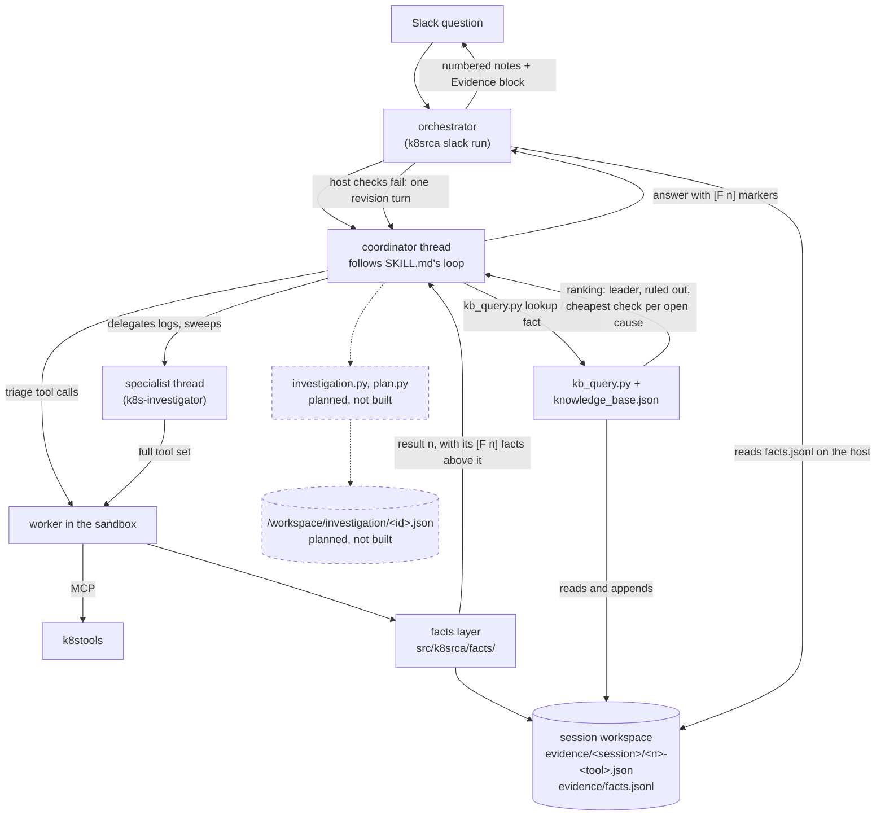
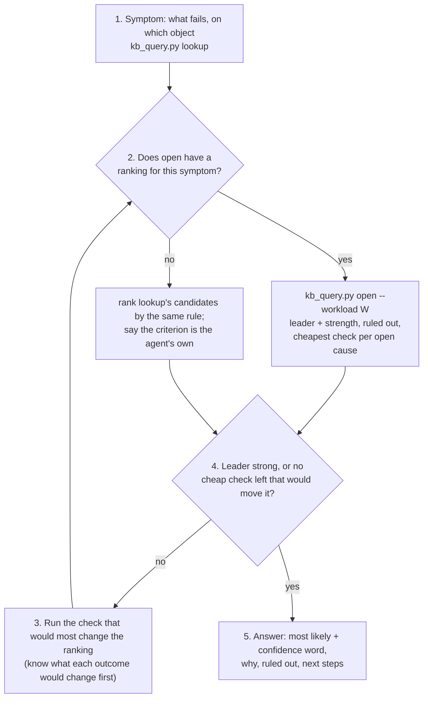

# 002 — Investigation model

**Status:** implemented in part. The method's principles run today: rival causes kept open until
evidence separates them, the check that would most change the ranking chosen next, ranked rather
than numeric confidence, and a source for every statement. They run through the `k8s-rca` skill's
loop, the knowledge base's ranking and the facts layer. The investigation record, its scripts and
the cross-session record this document planned (§3, §7, levels L1–L3 and L5 of §9) were never
built, and designs 007, 008 and 010 replaced the parts that describe statuses, stopping, the answer
and the knowledge format. **Last updated:** 2026-11-14.

**Related:** [001 — Architecture](001-architecture.md) ·
[003 — Operations](003-operations.md) · [004 — Scenario testing](004-scenario-testing.md) ·
[007 — Knowledge representation](007-knowledge-representation.md) ·
[008 — Conclusions under incomplete evidence](008-conclusions-under-incomplete-evidence.md) ·
[010 — Facts and short answers](010-facts-and-short-answers.md)

k8srca is an agent that diagnoses Kubernetes problems and answers in Slack. It runs on Claude
Managed Agents, Anthropic's hosted agent platform (called "the platform" below): the platform runs
the agent loop and keeps the conversation, and our code runs the tools. [Design 001](001-architecture.md)
describes that platform side. This document describes the **method**: how the agent forms
candidate causes and tells them apart, what counts as evidence, when it may stop, and what it keeps
between turns. It was written before most of the system existed, and later designs changed much of
it. The table below says, section by section, what runs today. The sections keep their original
reasoning because the designs that replaced them still rely on it. Project terms are defined in
the [glossary](../docs/glossary.md).

---

## 1. Purpose and relationship to 001

001 specifies the **platform**: Claude Managed Agents, self-hosted sandboxes (the Docker containers
our host runs the agent's tools in), the worker (the code in the sandbox that serves tool calls)
acting as an MCP client of k8stools (the read-only Kubernetes MCP server,
[BenedatLLC/k8stools](https://github.com/BenedatLLC/k8stools)), Slack, skills delivery, and the
read-only guarantee. It says little about how the agent should think, beyond the reasoning contracts
in its [§9](001-architecture.md#9-what-each-agent-must-produce).

This document specifies the **method**: how candidate causes (called hypotheses here) are formed
and told apart, what counts as evidence, when an investigation may conclude, and what persists
between turns.

| Question | Where it is answered today |
| --- | --- |
| Where does a tool call execute? | [001 §4](001-architecture.md#4-kubernetes-access) |
| Which model runs which thread? | [001 §3.3](001-architecture.md#33-agent-topology-a-coordinator-and-a-specialist), [§6](001-architecture.md#6-configuration-and-provisioning) |
| Can the agent change the cluster? | [001 §8](001-architecture.md#8-read-only-guarantee-and-security) |
| What shape does the answer take? | [010 §5](010-facts-and-short-answers.md#5-the-answer) (was 001 §9, then [008 §3](008-conclusions-under-incomplete-evidence.md#3-the-answer)) |
| How does the agent decide what to look at next? | §6 here; the loop in [`skills/k8s-rca/SKILL.md`](../skills/k8s-rca/SKILL.md) ([010 §4](010-facts-and-short-answers.md#4-the-agent-the-loop-and-its-instructions)) |
| What state survives a turn? | §7 here |
| When may it stop? | [010 §4](010-facts-and-short-answers.md#4-the-agent-the-loop-and-its-instructions) and [008 §3](008-conclusions-under-incomplete-evidence.md#3-the-answer); §5.4 here is the original rule |
| How does the vendored 81-alert knowledge base become usable? | [007](007-knowledge-representation.md); §8 here is the original plan |

### Where each part of this document stands

| Section | Topic | Today |
| --- | --- | --- |
| §2 | Principles | **Current**, except principle 7: no investigation record exists. The facts log is the nearest thing |
| §3 | The investigation record | **Not built.** The evidence record and facts log ([007 §6.1](007-knowledge-representation.md#61-checking-against-the-evidence-record), [010 §3.1](010-facts-and-short-answers.md#31-where-it-runs)) hold the evidence part of it |
| §4 | Hypotheses and their statuses | **Superseded.** Candidate causes live in the knowledge base; `kb_query.py open` ranks them ([008 §4.2–4.3](008-conclusions-under-incomplete-evidence.md#42-weighted-evidence-in-place-of-confirm)); the answer shows the leader with a strength word ([010 §5.1](010-facts-and-short-answers.md#51-shape)) |
| §5 | Evidence | **Superseded in part.** Facts derived in code replace hand-typed evidence items ([010 §3](010-facts-and-short-answers.md#3-the-facts-layer)). The distinction between "looked and found nothing" and "could not look" is current, as fact scopes and capability gaps. User statements are not recorded as evidence |
| §5.4 | Stopping criteria | **Superseded** by ranking ([008 §3](008-conclusions-under-incomplete-evidence.md#3-the-answer)) and the stop rule in SKILL.md ([010 §4](010-facts-and-short-answers.md#4-the-agent-the-loop-and-its-instructions)) |
| §5.5 | Causal chain | **Not built** as part of the answer. The knowledge base's sub-causes cover part of it |
| §6 | Choosing the next action | **Current** as a rule (step 3 of SKILL.md's loop). `plan.py` was not built |
| §6.1 | Investigation actions | **Superseded.** No `inspect_*` vocabulary exists; the knowledge base's actions ([007 §3.1](007-knowledge-representation.md#31-concepts)) name the checks |
| §7 | Persistence and scripts | **Not built**, apart from the session workspace that every turn of a session shares |
| §8 | Knowledge base to playbooks | **Superseded** by [007](007-knowledge-representation.md) |
| §9 | Maturity levels L0–L5 | L0 built. L1–L3 and L5 not built. L4's role is filled by 007's knowledge base and 008's ranking |
| §10 | Rejected alternatives | **Current** |
| §11 | Open questions | Item 0 resolved; items 1, 4 and 5 open; items 2 and 3 answered in part |

### How the method runs today

The diagram shows one investigation as it runs now: which component carries out each part of the
method, and where the planned record and scripts of §3 and §7.2 would have sat (dashed, not
built). The coordinator and the specialist are two threads of one session; the worker serves both
threads' tool calls from the same sandbox.



### Provenance

The core ideas here come from
[background/kubernetes_rca_design.md](../background/kubernetes_rca_design.md): investigating
rather than answering in one shot, competing hypotheses, an evidence ledger, discriminating
actions, a stopping policy, causal chains, and user input as evidence. Two of its structural
proposals are not adopted, for reasons in §10: numeric hypothesis probabilities, and a code-level
data abstraction layer over the backends.

---

## 2. Design principles

> **Current.** These still describe how the agent is meant to work. Principle 7 is the exception:
> the reasoning state was to be one inspectable file (§3), and that file was never built. Facts
> are a file (`evidence/facts.jsonl`, [010 §3.1](010-facts-and-short-answers.md#31-where-it-runs));
> the ranking is recomputed from them on demand by `kb_query.py open`.

1. **Investigate across turns.** Root-cause analysis (RCA) is a process that can span several turns
   of a Slack thread. A single model call is not the unit of work.
2. **Keep competing hypotheses.** Several explanations stay open until evidence separates them. An
   alert is a starting hypothesis, never a conclusion.
3. **Prefer checks that discriminate.** The next action should be the one that best separates the
   leading hypotheses, rather than the next generic health check.
4. **Give every statement a source.** No assertion without the tool call, thread or human statement
   that produced it.
5. **Keep absence and unavailability apart.** "Looked, found nothing" and "could not look" lead to
   different conclusions and must never collapse into silence.
6. **Treat human statements as evidence.** Recorded with who said them, and weighted differently
   from observations.
7. **Make the structure explicit.** The reasoning state is a file on disk, not something implied by
   the conversation.
8. **Use ordinal confidence, not invented numbers.** See §10.1.
9. **Diagnose before recommending.** Establish a causal explanation before recommending action, and
   never take one ([001 §8](001-architecture.md#8-read-only-guarantee-and-security)).

### What is *not* being built

The background design proposes an investigation *engine* outside the model: a planner, a hypothesis
manager, an evidence interpreter and a stopping policy. We do not build that. The platform already
supplies the agent loop, tool orchestration, context compaction and session state; an external
engine would reduce it to an expensive model endpoint and discard most of 001.

Instead, **the model reasons, and scripts enforce the structure.** The model decides what is
evidence and what it implies. The scripts make it record those decisions in a fixed shape and
refuse to let it conclude without meeting explicit criteria. The structure constrains the
reasoning; it does not replace it.

Today the scripts that do this are `kb_query.py` in the `k8s-rca` skill, which ranks candidate
causes from the facts (`open`), and the host checks in
[src/k8srca/review.py](../src/k8srca/review.py), which the orchestrator (the Slack bot process on
our host) runs on each answer before posting it. The validating record of §7.2 was not built.

---

## 3. The investigation record

> **Not built.** No file is written under `/workspace/investigation/`, and nothing in
> [src/k8srca/](../src/k8srca/), [skills/k8s-rca/](../skills/k8s-rca/) or
> [agents/](../agents/) refers to one. The evidence part of the record exists in another form: the
> worker saves every tool result to `evidence/<session id>/<n>-<tool>.json` in the session's
> workspace ([src/k8srca/evidence.py](../src/k8srca/evidence.py),
> [007 §6.1](007-knowledge-representation.md#61-checking-against-the-evidence-record)), and the
> facts layer appends what each result shows to `evidence/facts.jsonl`
> ([010 §3.1](010-facts-and-short-answers.md#31-where-it-runs)). Each run of `kb_query.py open`
> also saves the standings it computed to `evidence/open/<n>.json`, for the completeness check and
> the light reviewer, both of which are off. Questions, the reasons for each action, and the
> conclusion are recorded nowhere except the session's conversation. The design below is kept
> because 007 §6.1 and design 003 refer to it.

The design: one JSON document per investigation, at `/workspace/investigation/<id>.json`, kept
across turns by the session-scoped workspace that the host bind-mounts into each sandbox
([001 §3.2](001-architecture.md#32-containers-per-work-item-workspace-per-session)).

```jsonc
{
  "id": "inv-20260907-payment-api",
  "state": "gathering",
  "trigger": { "kind": "user_question", "text": "why is payment-api crash-looping in prod?" },
  "subject": { "kind": "pod", "namespace": "prod", "name": "payment-api-7d9f8c" },
  "opened_at": "2026-09-07T11:02:00Z",

  "hypotheses": [ /* §4 */ ],
  "evidence":   [ /* §5 */ ],
  "questions":  [ /* open questions for the user */ ],
  "actions":    [ /* what was run, and why — §6 */ ],
  "causal_chain": [ /* §5.5, populated at conclusion */ ],
  "conclusion": null
}
```

Only the coordinator (`rca-coordinator`, the agent that plans and writes the answer) would write
the record (§7.3). It was to serve three purposes: the answer rendered to Slack, the audit trail,
and, once memory stores were added (deferred work, [001 §11](001-architecture.md#11-extension-points-for-deferred-work)),
the content synthesised into a memory store.

### 3.1 Lifecycle

> **Not built**, with the record. Nothing today tracks an investigation's state; the orchestrator
> treats every Slack message in a thread the same way.

The planned states of one investigation (none of this runs):

```
   open ──▶ gathering ──▶ concluded
              │  ▲
              │  └── awaiting_user  (question posed; user's reply re-enters as evidence)
              │
              └────── abandoned     (superseded, or the user moved on)
```

This is flatter than the background design's seven-state machine. `assessing` and `reassessing`
are not separate states here: the coordinator re-ranks after every piece of evidence, so a state
meaning "currently re-ranking" would never be seen between turns. `awaiting_user` matters because
it changes what the orchestrator should do with the next Slack message.

---

## 4. Hypotheses

> **Superseded** by [008 §4.2–4.3](008-conclusions-under-incomplete-evidence.md#42-weighted-evidence-in-place-of-confirm)
> and [010 §5.1](010-facts-and-short-answers.md#51-shape). What runs is described at the end of
> this section. The original design follows because its reasoning (ranking over numbers, and a
> stated refutation for each hypothesis) carried over.

The design: each hypothesis is an entry in the record.

```jsonc
{
  "id": "memory_regression_from_release",
  "statement": "Release 2.4.1 introduced a memory regression that exceeds the container limit",
  "status": "supported",
  "rank": 1,
  "supported_by": ["ev-003", "ev-007"],
  "contradicted_by": [],
  "would_confirm": "Memory growth began at the 2.4.1 rollout and request rate was flat across it",
  "would_refute": "Memory growth predates the rollout, or scales with request rate",
  "source": "playbook:CrashLoopBackOff"
}
```

`would_confirm` and `would_refute` are what make §6 possible. A hypothesis that cannot say what
would refute it is not yet a hypothesis, and the script was to reject it.

Status was ordinal, not numeric:

| Status | Meaning |
| --- | --- |
| `candidate` | Proposed; no discriminating evidence either way |
| `supported` | Confirming evidence, no contradictions |
| `weakened` | Contradicting evidence, but not decisive |
| `refuted` | Decisive contradicting evidence: `would_refute` was observed |
| `confirmed` | `would_confirm` observed **and** every rival `weakened` or `refuted` |

`rank` is a total order the coordinator keeps over hypotheses that are not refuted. Ranking is a
comparison the model does well; assigning `0.72` is not (§10.1).

**What runs today.** Hypotheses are the knowledge base's candidate causes (a *claim* in the
knowledge-base format, [007 §3.1](007-knowledge-representation.md#31-concepts)). Each claim's
criteria are weighted conditions on facts: `for` and `against` with a weight, and `rules_out`,
which is decisive ([008 §4.2](008-conclusions-under-incomplete-evidence.md#42-weighted-evidence-in-place-of-confirm)).
`kb_query.py open <symptom> --workload <name>` computes each candidate's standing from the facts so
far: the most likely, the ruled out, and the rest, each with the cheapest check that would decide
it. The leader gets a strength of strong, moderate or weak
([008 §3.2](008-conclusions-under-incomplete-evidence.md#32-strength)). `confirmed` is gone:
everyone, the model included, read it as proven, which the cluster's short history can almost never
show. The mapping from the old statuses is in
[008 §4.3](008-conclusions-under-incomplete-evidence.md#43-what-happens-to-the-old-statuses).

The answer shows only what a fact decides
([010 §5.1](010-facts-and-short-answers.md#51-shape)):
- the most likely cause, with one confidence word from `open`'s strength: *very likely* for strong,
  *likely* for moderate, *possible* for weak;
- the candidates a fact rules out.

A candidate nothing decided appears only as a next step that would settle it. Nothing checks that
the answer places every candidate: the completeness check in `review.py` is off
(`review.completeness: false` in [k8srca.yaml](../k8srca.yaml)), and the ruled-out check 010
planned was not built ([010 §6](010-facts-and-short-answers.md#6-the-knowledge-base-and-the-light-reviewer)).

---

## 5. Evidence

> **Superseded in part** by the facts layer
> ([010 §3](010-facts-and-short-answers.md#3-the-facts-layer)). There are no hand-typed evidence
> items with `bears_on` links. Code in [src/k8srca/facts/](../src/k8srca/facts/) reads each tool
> result in the worker and states facts from it, each with a scope (what the record covers), the
> tool result it came from, and whether code or the agent stated it (`by: code` or `by: agent`).
> Each tool result reaches the agent numbered (`result <n>`), with its facts listed above it as
> `[F<n>]`. The agent cites them in the answer. Facts that need reading text, such as a log that
> stops partway through startup, the agent records with `kb_query.py fact … --from <n>`
> ([010 §3.4](010-facts-and-short-answers.md#34-what-the-agent-still-writes)). How a fact bears on
> each candidate is in the knowledge base, not on the fact. Subsections below say which parts of
> the original design still hold.

The design: each piece of evidence is an entry in the record.

```jsonc
{
  "id": "ev-003",
  "kind": "observation",
  "subject": { "kind": "pod", "namespace": "prod", "name": "payment-api-7d9f8c" },
  "statement": "Last termination reason OOMKilled; 15 restarts in 10 minutes",
  "observed_at": "2026-09-07T10:47:00Z",
  "collected_at": "2026-09-07T11:03:12Z",
  "provenance": { "via": "tool", "tool": "k8s_get_pod_container_statuses", "thread": "coordinator" },
  "bears_on": [
    { "hypothesis": "memory_regression_from_release", "direction": "supports", "decisive": false },
    { "hypothesis": "liveness_probe_misconfigured",   "direction": "contradicts", "decisive": true }
  ]
}
```

### 5.1 Evidence kinds

> **Current in substance.** The kinds below are not typed fields today, but the distinction they
> draw is kept in two places. A fact's scope states what the record covers, so "no OOM events" is
> stated as "none in the 3 days events are retained"
> ([008 §4.1](008-conclusions-under-incomplete-evidence.md#41-scoped-facts)). A check the
> deployment has no capability for (for example, metrics when Prometheus is not connected) is
> reported by `kb_query.py` as a gap, not as an absence
> ([007 §4.2](007-knowledge-representation.md#42-an-unavailable-check-is-a-gap)).

| Kind | Meaning | Weight |
| --- | --- | --- |
| `observation` | A tool returned a positive finding | Strongest |
| `absence` | Looked and found nothing: *"no OOMKilled events in the window"* | Strong for refutation |
| `unavailable` | Could not look: backend down, access denied, logs rotated | **Never** supports or contradicts; blocks `confirmed` |
| `user_statement` | A human asserted it | Provisional (§5.3) |
| `inference` | Derived from other evidence, not directly observed | Must cite its parents |

**Confusing `absence` with `unavailable` is the most common way this goes wrong**, and it produces
confident wrong answers. In the design, `unavailable` could appear in `bears_on` only with direction
`neither`, and every `unavailable` item went into the conclusion's *Not checked* field, so coverage
gaps were visible. The short answer of 010 has no *Not checked* field; a gap that matters appears
as a next step for the person.

### 5.2 Provenance

> **Current in part.** Every fact records the tool and the result number it came from, and whether
> code or the agent stated it. Facts do not record which thread made the call: a fact from the
> specialist's call is indistinguishable in the log from one the coordinator made. The coordinator's
> prompt ([agents/rca-coordinator.system.md](../agents/rca-coordinator.system.md)) asks it to say
> when a conclusion rests on a subagent's finding it did not verify.

In the design, `via` was one of `tool`, `subagent`, `user`, `skill`. Findings returned by the
specialist (`k8s-investigator`, the agent the coordinator delegates high-volume reads to) were
recorded with `via: "subagent"` and the thread id, so that a wrong answer could be traced to where
it was produced, and the coordinator's own checks could be told apart from a delegate's report.

### 5.3 User statements

> **Not built.** Nothing records what a person says as evidence. SKILL.md and the coordinator's
> prompt tell the agent to ask the person about recent deploys and configuration changes, which it
> largely cannot see; the reply reaches it as an ordinary message in the conversation. The rules
> below remain the intended treatment.

> *"We deployed 2.4.1 right before the restarts started."*

This is evidence and should be recorded: telemetry often cannot supply it, and without access to
git history (001 §1), change history often comes only from people. But it is **provisional**:
people misremember timing, conflate releases, and answer the question they expected. Rules:

- A `user_statement` may move a hypothesis to `supported` or `weakened`.
- It may **never** be `decisive`, and so can never by itself produce `confirmed` or `refuted`.
- Where a tool could corroborate it, the coordinator should try, and record the result separately.
- The conclusion states which findings rest on unverified human recollection.

### 5.4 Stopping criteria

> **Superseded** by [008 §3](008-conclusions-under-incomplete-evidence.md#3-the-answer) (rank
> instead of confirm) and [010 §4–5](010-facts-and-short-answers.md#4-the-agent-the-loop-and-its-instructions) (the stop rule
> and the short answer). What runs is described after the original criteria.

The design: an investigation may move to `concluded` when **all** of:

1. The top hypothesis is `confirmed`: its `would_confirm` was observed, not merely something
   compatible with it.
2. Every other hypothesis is `weakened` or `refuted`, each citing the evidence that did it.
3. No open question remains whose answer could reorder the top two.
4. No `unavailable` evidence bears on a check that criterion 1 depends on.

If those cannot be met, the investigation concludes anyway, as a **partial conclusion**: the
leading hypothesis, what would settle it, and why that could not be obtained. A partial conclusion
is a legitimate, useful outcome; a fabricated confident one is not.

The guard against concluding too early is criterion 1's wording. `OOMKilled` is compatible with
memory exhaustion but does not establish *why* memory was exhausted: a leak, workload growth, a
bad limit and a release regression all fit it. Requiring the declared `would_confirm` forces the
extra step. The knowledge base keeps this guard in another form: a cause that survives can open
sub-causes (`kb_query.py refine`), which the agent then ranks in turn.

**Why it was replaced.** The cluster keeps little history (events expire, logs rotate, previous
containers are garbage-collected), so criterion 1 can rarely be met honestly, and the partial
conclusion has to be the normal one. 008 made ranking the default: the most likely cause and its
strength, what is ruled out, and next steps for the person, who can see and change more.

**What runs today.** SKILL.md's loop stops "when the leader is strong, or when no cheap check is
left that would move it" ([010 §4](010-facts-and-short-answers.md#4-the-agent-the-loop-and-its-instructions)). The answer is at
most 300 words in four parts ([010 §5.1](010-facts-and-short-answers.md#51-shape)):
- the most likely cause, with one confidence word;
- why: two to four facts, as sentences with `[F<n>]` markers;
- what a fact rules out;
- next steps.

There is no candidate list. If two causes tie, the answer says there is no leading cause and names
the check that would separate them.

Before posting, the orchestrator turns the markers into numbered notes and an Evidence block, and
checks that ([010 §5.2](010-facts-and-short-answers.md#52-footnotes-and-the-host-checks),
`review.answer: true`):
- every marker resolves;
- the answer cites at least one fact;
- the prose is within 300 words;
- every figure outside the next steps appears in a cited fact.

Failures go back to the session as one revision turn. The light reviewer (a model that checks each
sentence against its cited facts) is built and off (`review.light_reviewer: false`,
[010 §6](010-facts-and-short-answers.md#6-the-knowledge-base-and-the-light-reviewer)).

### 5.5 Causal chain

> **Not built** as part of the answer. The answer of 010 has no causal-chain section. The knowledge
> base links causes to their sub-causes (`refined_by`), and a sub-cause's support lifts its parent
> to the same strength ([008 §4.2](008-conclusions-under-incomplete-evidence.md#42-weighted-evidence-in-place-of-confirm)),
> which covers the "root cause, not just symptom" part of the purpose below.

The design: at conclusion, the coordinator emits an ordered chain from root cause to observed
symptom:

```
release 2.4.1 → memory regression → working set exceeds limit → OOMKilled
              → container restart → CrashLoopBackOff
```

The chain is what distinguishes root cause from contributing factor from symptom, and it is the
part users find easiest to follow. The knowledge base's parent links (§8) were to supply candidate
links; evidence had to justify each one that appeared in the final chain.

---

## 6. Choosing the next action

> **Current** as a rule: it is step 3 of the loop in
> [SKILL.md](../skills/k8s-rca/SKILL.md). `plan.py`, which was to compute it, was not built; the
> ranking `kb_query.py open` prints, with the cheapest check for each open candidate, does that job.

The loop the agent follows today ([010 §4](010-facts-and-short-answers.md#4-the-agent-the-loop-and-its-instructions)):
1. **The symptom.** What fails, on which object. `kb_query.py lookup` gives its candidate causes.
2. **Rank.** `kb_query.py open` ranks the candidates from the facts so far. Where a symptom has no
   ranking in the knowledge base, the agent ranks `lookup`'s candidates by the same rule and says
   that it formed the criterion.
3. **Check.** Run the check that would most change the ranking, then rank again.
4. **Stop** when the leader is strong, or when no cheap check is left that would move it.
5. **Answer.**

The same loop as a decision flow. Every box is an instruction in SKILL.md; the agent carries it
out, and only the ranking is computed by code (`kb_query.py open`).



The rule behind step 3, as first written for the coordinator's prompt:

> **Prefer the action whose plausible outcomes would most change the ranking of your top two
> hypotheses. If no outcome of an action would change anything, do not run it.**

Before running anything, the coordinator asks: *if this returns X, what changes? If it returns Y?*
Two answers of "nothing" mean the action is not worth its cost. SKILL.md says the same in fewer
words: "Before you run one, know what each outcome would change."

The design for `plan.py` (§7.2) made this mechanical without making it numeric. Given the record,
it would:

- collect candidate actions from the playbooks of all hypotheses not refuted;
- drop any already in `actions`;
- flag those bearing on the `would_confirm` / `would_refute` of the **top two ranked** hypotheses as
  *discriminating*;
- flag those bearing on only one as *confirmatory* (weaker, and at risk of confirmation bias);
- list open questions whose answers would discriminate, as candidates for asking the user.

It was to suggest and rank, not decide. The coordinator could override it with a recorded reason.
That keeps the model's judgment in the loop while making the default behaviour seek
discrimination rather than confirmation.

### 6.1 Investigation actions

> **Superseded.** No `inspect_*` vocabulary was built. The knowledge base names the checks: each
> fact a claim turns on lists the actions that observe it and the capability each needs
> ([007 §3.1](007-knowledge-representation.md#31-concepts),
> [§4.1](007-knowledge-representation.md#41-capabilities)), and `open` prints the cheapest one per
> open candidate. The coordinator's own tools are a triage subset of k8stools (`get_cluster_info`,
> `get_namespace_health`, `get_workload_report`, `get_events`, `get_node_summaries`,
> `get_log_pattern_summary`); the specialist has the full set, including logs. Asking the person is
> an instruction in SKILL.md, not an action with a state behind it.

The design: semantic actions are **documented procedures in `SKILL.md`**, not code. They are
recipes the model carries out with the low-level k8stools tools. This gives the model the right
level of abstraction without an abstraction layer to build and maintain (§10.2).

| Action | Planned implementation | Notes |
| --- | --- | --- |
| `inspect_resource_health` | pod/deployment summaries, container statuses | Coordinator's triage set ([001 §3.3](001-architecture.md#33-agent-topology-a-coordinator-and-a-specialist)) |
| `inspect_recent_failures` | pod events, previous-container termination reasons | Coordinator |
| `inspect_resource_pressure` | node summaries, node conditions, evictions | Coordinator |
| `inspect_logs_for_pattern` | pod/job logs, grep-then-read | **Delegated** to the specialist, for volume |
| `inspect_dependencies` | services, endpoints, configmaps | Coordinator; thin without traces |
| `inspect_recent_changes` | replica and generation state only | A full answer needs git history (001 §11) |
| `ask_user` | Pose a question, set `awaiting_user` | Often the only route to change history |

`inspect_recent_changes` is the weak spot. "What changed just before this started?" is among the
most valuable RCA questions, and cluster state alone can barely answer it. That is still true:
k8stools now reports ReplicaSet history, and the facts layer states when a change came and when
failures began where the record shows it
([007 §3.4](007-knowledge-representation.md#34-timing-changes-and-onsets)), but object write times
and a recent-changes tool are parked in [design 013](013-what-changed.md). The fallback is asking
the person, and the knowledge base marks change-related checks so that the coordinator reaches for
them early rather than after exhausting telemetry.

---

## 7. Persistence and the scripts

### 7.1 Where state lives

> **Not built as designed.** The record, the orchestrator's snapshot of it and the memory store
> do not exist. What persists today is in the first table; the design is in the second.

**Today:**

| Horizon | Location | Notes |
| --- | --- | --- |
| Within a turn | The coordinator's context | Ordinary reasoning |
| Across turns of one session | The platform's session (the conversation), and the session's workspace on the host, `.k8srca/workspaces/<session id>/`, mounted at `/workspace` | The workspace holds the evidence record, `evidence/facts.jsonl` and `evidence/open/` (each `open` run's standings); fact ids continue across turns |
| Across sessions | Nothing | The orchestrator's SQLite store ([src/k8srca/slack/sessions.py](../src/k8srca/slack/sessions.py)) maps a Slack thread to its session and de-duplicates events. It holds no investigation content |

The orchestrator also reads the workspace directly, on the host, to number the fact markers and
run the answer checks before posting ([src/k8srca/facts/render.py](../src/k8srca/facts/render.py),
[src/k8srca/review.py](../src/k8srca/review.py)). If the workspace is not on the orchestrator's
host, both are skipped. That matters for any move off a single host (§9, and
[003 §4.4](003-operations.md#44-prerequisite-externalize-the-workspace-first)).

**As designed:**

| Horizon | Location | Notes |
| --- | --- | --- |
| Within a turn | The coordinator's context | Ordinary reasoning |
| Across turns | `/workspace/investigation/<id>.json` | Session-scoped host mount ([001 §3.2](001-architecture.md#32-containers-per-work-item-workspace-per-session)) |
| Across sessions | Orchestrator SQLite copy | Snapshot each time a turn settles |
| Across sessions, with memory stores | Memory store at `/mnt/memory/investigations/` | The natural content for [001 §11](001-architecture.md#11-extension-points-for-deferred-work) |

The orchestrator snapshot was not meant to be redundant. A session can terminate mid-thread
([001 §7.4](001-architecture.md#74-failure-handling)), and its workspace goes with it; the snapshot
would let a replacement session start from the investigation rather than from a lossy prose
summary. It would also be the only durable record if the host workspace were lost.

This was also the answer to "what should a memory store hold?": concluded investigations, synced
to a memory store and available to later sessions, such as *"this cluster has had three OOMKills in
`payment-api` this month, all after releases."* Cross-session memory is not started (§9, L5).

### 7.2 The scripts

> **Not built in this layout.** `investigation.py`, `plan.py` and `playbooks/` do not exist. Their
> jobs went elsewhere:
> - **The record:** the evidence record and its facts log
>   ([007 §6.1](007-knowledge-representation.md#61-checking-against-the-evidence-record),
>   [010 §3.1](010-facts-and-short-answers.md#31-where-it-runs)).
> - **The ranking:** `kb_query.py open`
>   ([007 §6](007-knowledge-representation.md#6-how-the-agent-uses-it),
>   [008 §4.2](008-conclusions-under-incomplete-evidence.md#42-weighted-evidence-in-place-of-confirm)).
> - **The playbooks:** the knowledge base ([007](007-knowledge-representation.md)).
> - **The refusals:** the host checks on the answer (§5.4), which test the answer against the
>   facts, not a record.
>
> The skill ships `SKILL.md`, `kb_query.py`, `knowledge_base.json` and `answer_check.py`.
> `answer_check.py` checks a draft answer against the evidence record; it has tests and was
> measured offline, but SKILL.md does not tell the agent to run it and nothing else runs it.

The design: shipped inside the `k8s-rca` skill
([001 §5.1](001-architecture.md#51-k8s-rca-the-investigation-method-and-the-knowledge-base)), alongside `kb_query.py`:

```
skills/k8s-rca/
  SKILL.md              # method, action recipes, output contract
  playbooks/*.yaml      # §8
  kb_query.py           # playbook lookup, causal-chain walk
  investigation.py      # open | hypothesize | evidence | rank | question | show | conclude
  plan.py               # rank candidate next actions by discrimination (§6)
```

`investigation.py` was to be a validator as much as a store. It would reject:

- a hypothesis without `would_confirm` and `would_refute`;
- evidence without provenance;
- an `unavailable` item claiming to support or contradict anything;
- a `user_statement` marked `decisive`;
- `conclude` when §5.4 is unmet, unless `--partial` with a stated reason.

Those five refusals were expected to carry most of the method's value. They are cheap and
deterministic, and they catch the failures a model is prone to under pressure to produce an answer.

### 7.3 Single-writer rule

> **Holds in a different form.** There is no record to write. Facts are written by code in the
> worker for every tool call, whichever thread made it, and by the agent through `kb_query.py
> fact`. The judgment the rule protects stays with the coordinator: only the coordinator has the
> `k8s-rca` skill, and the specialist's prompt
> ([agents/k8s-investigator.system.md](../agents/k8s-investigator.system.md)) tells it to report
> findings and not to speculate about causes.

The design: only the **coordinator** writes the record. Specialists return findings; the
coordinator decides what they mean and records the evidence. This follows from finding F4 in
[001 §2](001-architecture.md#2-platform-facts-that-shape-the-design): threads share the filesystem but not
the conversation, so a specialist writing `bears_on` would be guessing at a hypothesis set it
cannot see. Specialists may read the record if a brief points them at it.

---

## 8. From knowledge base to playbooks

> **Superseded by [007](007-knowledge-representation.md)**, which replaces the target format below
> with facts, actions, claims and weighted rules, adds availability per deployment, and adds
> runbooks as a layer. The vendored alert records are converted on demand, as this section
> proposed ([007 §8.5](007-knowledge-representation.md#85-converting-the-81-vendored-alerts)); the rest
> remain available through `kb_query.py lookup` in their original form. The bundle today holds the
> 81 vendored alert records plus an authored and mined layer of 13 symptoms and 239 candidate
> causes.

The vendored knowledge base has 81 records keyed by `alert_name`, with `;`-separated fields. It
works as a lookup but not as an investigation guide, because it names root causes without saying
how to tell them apart.

**Then:** `Alert → root causes → evidence → PromQL → solutions`
**Target:** `Alert → candidate hypotheses → {evidence for, evidence against, what would settle it, actions, questions} → causal links → remediation`

```yaml
alert: CrashLoopBackOff
resource_type: Pod
symptom: container repeatedly restarting
hypotheses:
  - id: memory_exhaustion
    statement: The container exceeded its memory limit
    evidence_for:    [ "termination reason OOMKilled", "working set at limit before restart" ]
    evidence_against: [ "exit code non-zero with no OOM event", "memory flat across restarts" ]
    would_confirm: "OOMKilled with working set at the limit immediately prior"
    would_refute:  "No OOM event and a non-zero application exit code"
    actions:   [ inspect_recent_failures, inspect_resource_pressure ]
    questions: [ "Did memory use grow steadily or spike?" ]
    causal_parents: [ memory_regression_from_release, workload_growth, limit_too_low, node_memory_pressure ]
    remediation: [ "investigate memory growth", "right-size the limit", "roll back if release-correlated" ]
    automation_safety: manual
```

The `causal_parents` field is what stops an investigation that reaches `OOMKilled` from treating
it as a conclusion: confirming memory exhaustion opens a second round over its parents. In 007 this
became `refined_by`.

Two rules for the transformation, both kept by 007:

- **Derive, don't invent.** `evidence_for`, `causal_parents`, `remediation` and `automation_safety`
  come from existing columns. `would_confirm`, `would_refute`, `evidence_against` and `questions`
  are new and must be authored.
- **Author on demand.** Do not convert all 81 up front. Convert the ones real sessions hit. Most of
  the 81 will never fire on one cluster, and authoring discriminators for alerts nobody sees is the
  largest avoidable cost in this design.

Unconverted records stay available through `kb_query.py` in their original form, so coverage never
shrinks: a converted entry improves the answer for that alert, and an unconverted one still answers.

---

## 9. Staging: from prompt to method

> **Where the ladder stands.**
> - **L0** is built: the method lives in SKILL.md and the system prompts, with `kb_query.py`.
> - **L1** (the answer as structured JSON) and **L2–L3** (the record and the planner script) were
>   not built (§7.2).
> - **L4**'s role is filled by the knowledge base and `open`'s ranking
>   ([007](007-knowledge-representation.md), [008](008-conclusions-under-incomplete-evidence.md)),
>   and L3's "most change the ranking" rule is step 3 of SKILL.md's loop
>   ([010 §4](010-facts-and-short-answers.md#4-the-agent-the-loop-and-its-instructions)).
> - **L5** (cross-session memory) is not started.
>
> L2 is still listed as the prerequisite for deploying k8srca on Kubernetes (below, and
> [003 §4.4](003-operations.md#44-prerequisite-externalize-the-workspace-first)).

The method is a maturity ladder, not a prerequisite. Each level is useful and shippable on its own,
and each is a superset of the last. The aim was to prove 001's pipeline with the cheapest possible
reasoning, then add structure where measurement showed the reasoning was thin.

| Level | Reasoning | Artifacts | Requirement to move to the next level |
| --- | --- | --- | --- |
| **L0 — Prompt only** | Method lives entirely in `SKILL.md` and the system prompt. Hypotheses and evidence are prose in the answer. No scripts, no record. | `SKILL.md`, `kb_query.py` over the *unmodified* knowledge base | End to end works: Slack → session → k8stools → answer |
| **L1 — Structured output** | Same, but the final answer is emitted as the §3 JSON shape (hypotheses with `would_refute`, typed evidence). Written once at turn end; not read back. | + output schema in `SKILL.md` | The model can produce the shape without struggling |
| **L2 — Durable record** | `investigation.py` with its five validations. State survives turns; follow-ups extend an investigation rather than restarting. | + `investigation.py`, orchestrator snapshot | Multi-turn threads demonstrably reuse earlier evidence |
| **L3 — Discriminating planner** | `plan.py`; the coordinator justifies each action against the top-two ranking. | + `plan.py`, action recipes in `SKILL.md` | A measurable drop in redundant tool calls per conclusion |
| **L4 — Playbooks** | Hypothesis sets come from converted playbooks rather than being invented per incident. | + `playbooks/*.yaml` for alerts actually seen | Converted alerts beat prompt-only on the scenario suite |
| **L5 — Cross-session memory** | Concluded investigations sync to a memory store; earlier investigations inform new ones. | + memory store ([001 §11](001-architecture.md#11-extension-points-for-deferred-work)) | — |

### Mapping onto 001's build order

The phases are those of [001 §13](001-architecture.md#13-build-status).

| 001 phase | 002 level |
| --- | --- |
| 0 — RBAC, k8stools, egress | — |
| 1a — worker as MCP client, single agent | — |
| 1b — coordinator + specialist | — |
| 2 — `kb build` + `k8s-rca` skill | **L0** |
| 3 — Slack orchestrator | **L0**, then **L1** once real questions flow |
| 4 — `arch build` | L1 |
| 5 — scenario suite | **L2**, then L3/L4 measured against it |

**L0 through 001 Phase 3.** Do not build `investigation.py` before Slack works end to end. The
riskiest assumptions in this project were platform assumptions (001 F1, F4 and §12), not reasoning
ones, and a prompt-only agent exercises the whole pipeline for a day of prompt writing. If L0
already gives useful answers on real incidents, that is worth knowing before building a ledger.

**L2 and beyond only after the scenario suite exists** ([design 004](004-scenario-testing.md)). L3
and L4 are optimisations, and optimising without measurement is how prompts accumulate rules nobody
can justify. The suite is what tells you whether a planner reduced tool calls or only added steps.

**Skip levels deliberately, not by accident.** If L1 shows the model already discriminates well
unprompted, go straight to L2 for durability and defer L3. The ladder orders the levels by risk; it
is not a mandatory sequence. In the event, the levels were replaced rather than climbed: 007's
knowledge base, 008's ranking and 010's facts layer delivered L3's and L4's purposes without L1 or
L2.

### L2 is a hard prerequisite for the Kubernetes move

> **Planned.** Neither L2 nor the Kubernetes deployment is built.

L2's value is not only continuity across turns. Without it, investigation state lives on the
session-scoped host workspace ([001 §3.2](001-architecture.md#32-containers-per-work-item-workspace-per-session)):
a directory shared by the successive sandbox containers of one session, on one host. **That
arrangement has no clean Kubernetes equivalent:** one Job per work item is scheduled on an arbitrary node,
so keeping it would mean a ReadWriteMany volume per session (see
[003 §4.3](003-operations.md#43-the-two-things-that-do-not-translate)).

L2 removes the dependency rather than satisfying it. With the record in the orchestrator's
snapshot, the workspace becomes disposable: skills are downloaded again for each container (which
already happens today, because the SDK deletes them when a container's work ends), costing a little
latency and nothing else. So **L2 must come before any Kubernetes deployment**
([003 §4.4](003-operations.md#44-prerequisite-externalize-the-workspace-first)), or you end up
building shared storage to preserve state you had already decided to move out.

Today the workspace holds more than this section assumed: the evidence record and facts log
(§7.1), which the orchestrator reads on the host to render and check each answer. Moving the
investigation record out would not on its own make the workspace disposable; the facts log would
have to move too. 003 §4.4 notes the same gap.

This is the one hard ordering constraint across 001, 002 and 003.

---

## 10. Rejected alternatives

> **Current.** These decisions stand. 008 and 010 refer to them.

### 10.1 Numeric hypothesis probabilities

[background/kubernetes_rca_design.md](../background/kubernetes_rca_design.md) §6, §9 and §15 carry
explicit probabilities updated with each piece of evidence (`0.33 → 0.72 → 0.54`), with a stopping
policy of `top ≥ 0.90 AND no competitor ≥ 0.20`. Not adopted.

Its §9 concedes that "the exact probability-update algorithm is an implementation detail", but
that algorithm is the hard part, and everything downstream depends on it. There are only two ways to
implement it:

- **A genuine Bayesian update** needs priors per hypothesis and likelihoods per evidence type,
  elicited across 81 alerts with several hypotheses each. That is a very large authoring effort
  producing numbers nobody can defend, on a cluster whose real base rates are unknown.
- **The model emits the numbers.** Then `0.72` is a token, not a measurement. Model confidence is
  poorly calibrated, and a threshold policy on uncalibrated output fires on noise while looking
  rigorous.

The false precision is the real hazard: `0.94` in a Slack message reads as a measurement to an SRE
at 3 a.m., and invites acting on it. Ordinal ranking with a stated condition for each cause gives
the behaviour the probabilities were meant to produce (competing hypotheses, no premature closure)
without inventing a number.

**Revisit if** the scenario suite ([design 004](004-scenario-testing.md)) grows enough labelled
incidents to *measure* calibration. Until then the numbers would carry no information.

[008 §5](008-conclusions-under-incomplete-evidence.md#5-probabilities) keeps this decision and
prepares for reversing it: its evidence weights are written as likelihood-ratio bands, so a
calibration could replace them with numbers without changing the format.

### 10.2 A code-level data abstraction layer

The background design's §12 proposes backend-neutral adapters (Prometheus, Kubernetes, Loki, Tempo,
Git) behind an `RCADataSource` interface. Not adopted, for two reasons:

- **MCP already is that boundary.** In 001 a new data source is one `mcp:` entry in
  [k8srca.yaml](../k8srca.yaml) plus, if needed, one specialist agent
  ([001 §11](001-architecture.md#11-extension-points-for-deferred-work)), with no adapter code. A
  hand-written adapter layer over MCP servers would be a second abstraction doing the first one's
  job.
- **Semantic actions don't need to be code.** Its stronger point, that raw tool calls are the wrong
  level of abstraction for the model, was addressed by §6.1's documented recipes, and is now
  addressed by the knowledge base's actions and k8stools' composite tools (`get_namespace_health`,
  `get_workload_report`), which return one namespace's or workload's state in a single call. The
  model keeps the freedom to deviate when an incident is unusual, which a fixed adapter would
  remove.

What *is* adopted from §12: **PromQL and other backend-specific queries stay in the knowledge
base**, never in the reasoning prompt.

The facts layer ([010 §3](010-facts-and-short-answers.md#3-the-facts-layer),
[src/k8srca/facts/](../src/k8srca/facts/)) is not this adapter layer. It sits behind MCP rather
than replacing it, and it does not abstract backends: it turns each tool result into short
statements with their scope, because deriving those by hand (horizons, counts, "every instance")
was where 55% of unsupported claims came from
([010 §1](010-facts-and-short-answers.md#1-why-what-the-measurements-showed)). The model still chooses what to call.

### 10.3 An external investigation engine

See §2. The platform supplies the loop, scripts supply the guardrails, and the model supplies the
reasoning. Building a planner and hypothesis manager as services outside the model would mean
paying for the platform's orchestration and not using it.

---

## 11. Open questions

0. **What does the knowledge base contribute?** *Resolved.* In the first test with the knowledge
   base actually delivered to the sandbox, the agent used `kb_query.py` unprompted and in the
   intended order, but discussed one of the three candidate causes it returned for `OOMKilled` and
   dropped the other two. That is a gap in the method, not in the knowledge, and the most dangerous
   kind: the conclusion reads as well supported *because* the alternatives go unmentioned. The
   lesson that stands: **the knowledge base's value is supplying the rival causes, not the answer.**
   The model usually has the leading cause already; what it lacks are the rivals it then has to rule
   out. Today `open` ranks those rivals and the answer names the ones a fact rules out
   ([010 §5.1](010-facts-and-short-answers.md#51-shape)). The run and the fix that followed it are in
   [Appendix A.1](#a1-the-first-test-of-the-knowledge-base).

1. **Does L1 structured output degrade reasoning?** Forcing a JSON shape can make a model optimise
   for filling fields over thinking. Compare L0 and L1 on the same scenarios before assuming L1 is
   better. *Open; L1 was not built.* The answer-writer eval
   ([src/k8srca/evals/answer.py](../src/k8srca/evals/answer.py)) is where such a comparison would
   now run.

2. **Playbook authoring cost.** If a good playbook takes an hour, converting the alerts one cluster
   actually sees is a week; if it takes a day, the on-demand policy of §8 becomes essential.
   *Answered in part* by 007: `pod-restarting` was authored by hand
   ([docs/rca/knowledge/pod-restarting.yaml](../docs/rca/knowledge/pod-restarting.yaml)), and five
   families (image-and-sandbox, pod-pending, pod-restarting, request-latency and storage) were
   mined from public debugging guides into reviewed layers in [docs/rca/mined/](../docs/rca/mined/)
   (`k8srca kb mine`, about $5 per family plus review,
   [007 §8](007-knowledge-representation.md#8-mining-public-debugging-guides)).

3. **Who writes `would_confirm` for an alert with no playbook?** *Answered in part.* The authored
   and mined knowledge (007) supplies the conditions that decide each candidate for the symptoms it
   covers. For the vendored alert records not yet converted, `kb_query.py lookup` prints "no
   authored discriminator -- you will have to form one, and should say so" against each candidate,
   and SKILL.md tells the agent to rank by the same rule and say that it formed the criterion. So
   an answer can state when its criterion is the model's own. Whether model-formed criteria hold up
   as well as authored ones is not measured. The measurement that led to authoring them is in
   [Appendix A.2](#a2-authored-discriminators).

4. **Does the coordinator keep the record faithfully across a long thread?** Record-keeping may
   decay as context grows; a per-turn reconciliation step ("re-read the record, confirm the
   rankings still follow from the evidence") may be needed. *Open, and moot while no record
   exists.* The facts log does not decay, since code writes it; whether the agent's use of it does
   over a long thread is not measured.

5. **Investigation identity.** One Slack thread is one session. A thread that drifts to a second,
   unrelated problem should probably start a new investigation; detecting that automatically is
   unsolved, and an explicit user command may be enough. *Open.*

---

## Appendix: history and results

### A.1 The first test of the knowledge base

At first, skills did not reach the sandbox at all, because of two delivery bugs
([001 §5](001-architecture.md#5-knowledge-delivery-skills)), so early results came from the model's own
knowledge and the system prompts. In the first run with the knowledge base delivered, the agent
read SKILL.md, searched by symptom and looked up the alert. Given three candidate causes for
`OOMKilled`, it discussed one, demoted *memory leak* to a follow-up action and never mentioned
*workload spike*, although a running `load-generator` made it plausible.

The fix was to require a disposition (confirmed, weakened, refuted, or could not check) for every
candidate the knowledge base returned, in both the skill and the coordinator's prompt, with "worth
checking later" explicitly not counting as one. On a re-run of the same question all three
candidates were dispositioned, workload spike was tied to the running load generator, and
candidates from correlated entries were dispositioned too.

The per-candidate rule was later removed. 008 replaced dispositions with standings, and 010 dropped
the per-candidate placement rules from SKILL.md because answers listing every candidate ran to
1,000–1,600 words ([010 §4](010-facts-and-short-answers.md#4-the-agent-the-loop-and-its-instructions),
[008 §3](008-conclusions-under-incomplete-evidence.md#3-the-answer)). Design 004 cites this result
as the failure mode its candidate-placement grading was built to catch.

### A.2 Authored discriminators

The authored `would_confirm` / `would_refute` layer was first a separate file,
`docs/rca/discriminators.yaml`, merged by `kb build` and kept apart from the vendored records so
that received and authored text stayed distinguishable. It covered 7 of 195 hypotheses. It was
folded into [docs/rca/knowledge/pod-restarting.yaml](../docs/rca/knowledge/pod-restarting.yaml)
when 007's format replaced it.

It was written because of a measurement: the `rivals` grading dimension (did the answer dispose of
every candidate cause) read 0 of 6 in four consecutive batches of six runs on scenario 1. The cause
was right every time and the alternatives were never dispositioned. Neither intent notes in the
cluster-architecture skill nor removing drift noise moved it.
