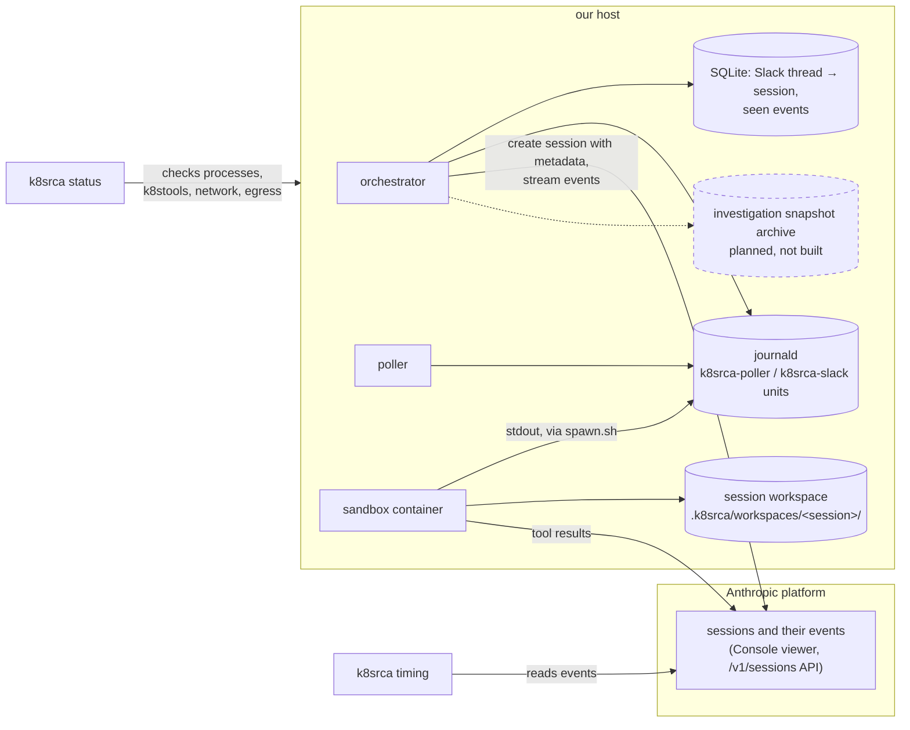
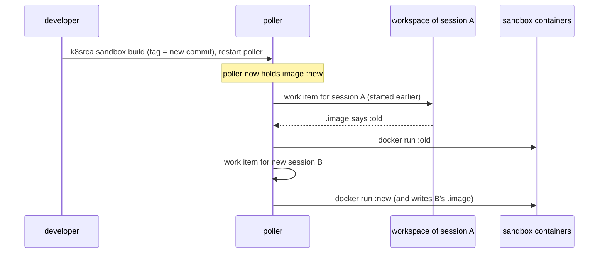
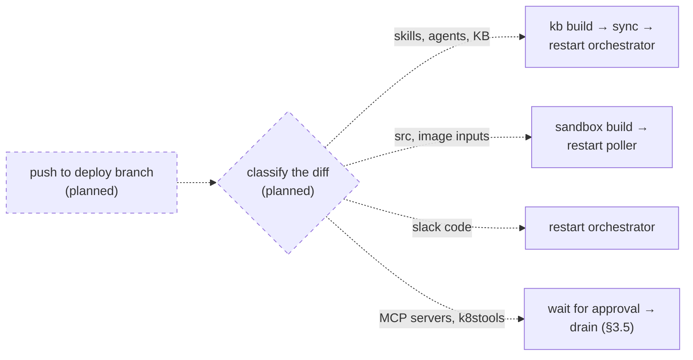
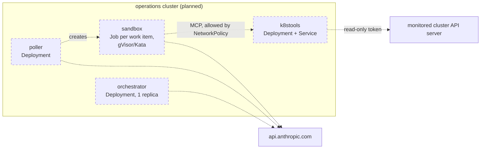
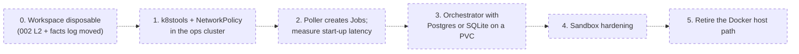

# 003 — Operations

k8srca is an agent that diagnoses Kubernetes problems and answers in Slack. It runs on Claude
Managed Agents, Anthropic's hosted agent platform ("the platform" below), which runs the agent loop
and keeps each conversation (a *session*); our host runs the tools. [Design 001](001-architecture.md)
describes the processes. This document covers running them: seeing what the agent did, changing it
without disrupting live conversations, and, later, moving the server components into Kubernetes.
You need 001 §3 (processes and the sandbox lifecycle) to follow it. Project terms are defined in the
[glossary](../docs/glossary.md).

The processes this document refers to, all on one host today:
- **orchestrator** (`k8srca slack run`): the Slack bot. Holds the Anthropic API key and Slack
  tokens, creates sessions and streams answers back.
- **poller** (`k8srca poller`): claims *work items* from the platform and starts one **sandbox**
  container per work item. A work item covers a session's continuous active period: several turns,
  until the session has been idle for 60 s. Holds only the environment key.
- **worker**: the code inside the sandbox that serves tool calls
  ([src/k8srca/worker/](../src/k8srca/worker/)).
- **k8stools**: the read-only Kubernetes MCP server
  ([BenedatLLC/k8stools](https://github.com/BenedatLLC/k8stools)), in its own container, the only
  component holding cluster credentials.

"v2" below means the deferred work in [001 §11](001-architecture.md#11-extension-points-for-deferred-work):
alert-driven sessions and memory stores. Neither is built.

---

## 1. Purpose

001 describes what runs; 002 describes how the agent reasons. This document covers operating it.

| Question | Section |
| --- | --- |
| How do I see a record of past conversations? | §2 |
| What does the platform give me, and what must we build? | §2.1 / §2.3 |
| How do I ship a skill change without breaking a live investigation? | §3 |
| What needs a drain, and what doesn't? | §3.1 |
| Can this run in Kubernetes? | §4 |
| What has to happen first? | §4.4 |

### What is built

| Section | Topic | State |
| --- | --- | --- |
| §2.1 | The platform's session viewer | Provided by the platform; we use it |
| §2.2 | Session metadata, Console link | **Built in part**: five keys, not the planned seven; the link is posted only when a turn fails |
| §2.3(a) | Host-side logs | **Built in part**: lifecycle events, no per-tool-call log |
| §2.3(b) | Detecting a failed work item | **Not built** in the orchestrator; the scenario runner has a watchdog |
| §2.3(c) | Investigation snapshot archive | **Not built** (needs 002's record) |
| §2.3(d) | Cross-session analytics | **Not built**; `k8srca timing` covers one session's latency |
| §3.1–3.2 | Version pinning per session | **Built**, with a restart needed after `sync` or a sandbox build |
| §3.3 | GitOps watcher | **Not built** |
| §3.4 | Restart behaviour | Sandbox cancellation **built**; orchestrator and poller drain **not built** |
| §3.5 | k8stools upgrade drain | Manual procedure; the maintenance reply is **not built** |
| §3.6 | Rollback command | **Not built** |
| §4 | Kubernetes deployment | **Planned**, not started |

---

## 2. Observability

The diagram shows where each kind of operational record lives today. The platform holds
everything that passes through the session (messages, tool inputs and results); our host holds what
the platform cannot see (container lifecycle, MCP connections, skill delivery) and the per-session
workspace. The snapshot archive is planned (dashed).



### 2.1 What the platform already provides

> **Provided by the platform.** Described as we read the platform's documentation when this was
> written; we have not checked every feature listed.

The Anthropic Console's session viewer (sidebar → **Managed Agents** → **Sessions**; Developer and
Admin roles) covers most of what a developer needs:

- the session list: ID, title, status, agent, tokens in and out, cost; filter by status and creation
  date, search by ID;
- the full transcript grouped by model request: thinking, tool calls **with inputs and results**,
  streamed text, with a filter box that steps between matches;
- a **Tools** tab: every configured tool with call count, failure count, median duration, and a link
  to each call;
- a **Threads** tab: status, context size and cost per thread. This is how to answer *"is the Haiku
  specialist actually saving anything?"* ([001 §3.3](001-architecture.md#33-agent-topology-a-coordinator-and-a-specialist));
- a **Resources** tab: mounted memory stores, session outputs, skills under `/workspace/skills`;
- a timeline with one lane per thread, which suits the coordinator/specialist shape;
- copy, download as JSON, and deep links via `?event={event_id}`.

Programmatic equivalents: `GET /v1/sessions` (paginated; the only endpoint with backward
pagination), `GET /v1/sessions/{id}` for `usage`, `list_cost` and `active_seconds`,
`GET /v1/sessions/{id}/events`, and per-thread history at
`/v1/sessions/{id}/threads/{tid}/events`. From a shell,
`ant beta:sessions list --transform '{id,title,status,created_at}' --format jsonl`.

**Decision: build no transcript UI.** Developers use the Console.

### 2.2 Session metadata: the index that makes sessions findable

> **Built in part.** The orchestrator sets five keys
> ([src/k8srca/slack/app.py](../src/k8srca/slack/app.py), `start_session`): `slack_channel`,
> `slack_thread_ts`, `slack_user`, `trigger` (`user_question`) and `config_rev`. `k8srca session`
> sets `trigger: cli`, and the scenario runner sets `k8srca_scenario`. `investigation_id` and
> `subject` are not set because there is no investigation record
> ([002 §3](002-investigation-model.md#3-the-investigation-record)); `sandbox_image` is not set
> because the image is pinned through the session workspace instead (§3.2). The Console link is
> posted only when a turn ends without an answer, not when the session is created.

The Console is useful once you know *which* session. Getting from *"that conversation in
#incidents on Tuesday"* to a session ID is the part the platform cannot do, because it knows
nothing about Slack.

Sessions accept `metadata` with a **maximum of 8 keys**, so the keys are allocated deliberately.
The planned allocation:

| Key | Value | Why | Set today |
| --- | --- | --- | --- |
| `slack_channel` | `C0123ABCD` | Join key from Slack | yes |
| `slack_thread_ts` | `1757246400.123456` | Identifies the thread | yes |
| `investigation_id` | `inv-20260907-payment-api` | Join key to 002's record | no (no record) |
| `subject` | `prod/payment-api` | Group all investigations of one workload | no |
| `config_rev` | git SHA at `sync` time | Which prompts and skills produced this (§3.2) | yes |
| `sandbox_image` | image tag | Which worker code ran (§3.2) | no; recorded in the workspace's `.image` file |
| `trigger` | `user_question` \| `alert` | Separates chat sessions from v2 alert sessions | yes |
| *(reserved)* | — | Keep one free; v2 will want `alert_name` | — |

`slack_user`, which the table did not plan, is also set. Metadata is set at `sessions.create()`. It
costs nothing and cannot be added afterwards.

**The Console link.** The plan was to post the session's Console link into the Slack thread when
the session is created. As built, the orchestrator includes it only in the message for a turn that
stopped without answering, and `k8srca session` prints it. The link needs the real workspace ID,
which the session response does not carry, so it comes from `K8SRCA_WORKSPACE_ID` in `.env`
([src/k8srca/session.py](../src/k8srca/session.py), `console_url`). `default` is right only if the
API key belongs to the organisation's Default workspace; a wrong value opens a "Session not
found" page rather than redirecting.

Agent objects carry their own `metadata` (maximum 16 keys). `sync` writes the tool-manifest hash
there ([001 §4.3](001-architecture.md#43-keeping-declarations-and-the-live-tool-list-in-step)) and `config_rev`.

### 2.3 What we must build

**(a) Host-side structured logs.**

> **Built in part.** The poller logs JSON events: `poller_start`, `spawn`, `container_exit` (with
> the exit code), `spawn_failed`, `skip_non_session`, `already_inflight`
> ([src/k8srca/worker/poller.py](../src/k8srca/worker/poller.py)). The sandbox entrypoint logs
> JSON-wrapped lines whose message carries `key=value` fields: `sandbox_start`, `mcp_connect`
> (server, URL, tool count), `manifest_mismatch` (exit code 3), `skills_delivered` /
> `skills_partial`, `evidence_disabled`, `facts_disabled`, `sandbox_failed`, `sandbox_done`
> ([src/k8srca/worker/entrypoint.py](../src/k8srca/worker/entrypoint.py),
> [runner.py](../src/k8srca/worker/runner.py)). Not logged: `work_claimed` (the poller's `spawn`
> stands in), `handle_item_start` / `handle_item_end`, per-call `tool_call`, and
> `memory_mount_failed` (no memory stores yet). The sandbox's output goes through `spawn.sh` to the
> poller's standard output, so under systemd both are in
> `journalctl --user -u k8srca-poller`.

The Console shows tool inputs and results because those flow to the platform (finding F3,
[001 §2](001-architecture.md#2-platform-facts-that-shape-the-design)). It shows **nothing** about our sandbox:
container exit codes, MCP handshake failures, manifest mismatches, skill download problems,
memory-mount errors. The platform's documentation says mount and background-sync failures are
*"logged, not reported to the session."*

The plan: JSON lines from the spawn script and the worker entrypoint, correlated on `session_id`
(the join key to everything in the Console):

```jsonc
{"ts":"2026-09-07T11:03:02.114Z","level":"info","event":"container_start",
 "session_id":"sess_01ab...","work_id":"work_01cd...","image":"k8srca/sandbox:9f3c1a2",
 "workspace":"/srv/k8srca/workspaces/sess_01ab..."}
```

Planned minimum event set: `work_claimed`, `container_start`, `mcp_connect` /
`mcp_connect_failed`, `manifest_mismatch`, `skills_ready`, `handle_item_start` /
`handle_item_end`, `tool_call` (name, duration and outcome, **not** arguments or results),
`memory_mount_failed`, `container_exit` (code and duration).

> **Do not log tool arguments or results.** They contain cluster state: ConfigMap values, log
> lines, pod specs. k8stools redacts common secret shapes, but a log is a second copy on our disk
> with different retention from everything else. Log the tool name, duration and outcome; the
> Console already has the content.

The logs follow this rule. The workspace does not: the evidence record
([src/k8srca/evidence.py](../src/k8srca/evidence.py),
[007 §6.1](007-knowledge-representation.md#61-checking-against-the-evidence-record)) deliberately
saves every tool result to the session's workspace so scripts can check answers against it. It
lives as long as the workspace, and nothing reaps workspaces today (§2.4).

**(b) The failure the Console cannot show.**

> **Not built** in the orchestrator. The sandbox logs `manifest_mismatch` and `sandbox_failed`
> with the session ID, so the evidence exists on the host. The orchestrator does not detect the
> shape below: its event loop treats idle with `requires_action` as transient and keeps waiting
> ([src/k8srca/slack/relay.py](../src/k8srca/slack/relay.py), `consume`), and it never sends
> `user.interrupt`. The scenario runner has a watchdog that interrupts a session that runs past a
> deadline ([src/k8srca/scenario/runner.py](../src/k8srca/scenario/runner.py), `Watchdog`).

One symptom cannot be diagnosed from the Console at all:

> Session `idle` with `stop_reason: requires_action`, no pending tool call to answer, no error event.

It means the worker **failed the claimed work item**: a manifest mismatch, a crashed entrypoint,
or in v2 a memory-mount error. The session emits nothing, and the only evidence is on our host. The
orchestrator should detect this shape (idle, `requires_action`, nothing pending), correlate it with
the host log by session ID, report it in Slack, and offer `user.interrupt` to re-queue the work.
[001 §7.4](001-architecture.md#74-failure-handling) lists the condition; this section is where the
plan to diagnose it lives.

**(c) Investigation snapshot archive.**

> **Not built.** It depends on 002's investigation record, which does not exist
> ([002 §3](002-investigation-model.md#3-the-investigation-record), [§7](002-investigation-model.md#7-persistence-and-the-scripts)).
> The nearest thing is the session workspace, which keeps the evidence record and facts log on the
> host until someone deletes it.

The plan: 002's record is ours and the Console will not render it, so snapshot it to the
orchestrator's store each time a turn settles. This is the record of *reasoning*, as opposed to the
Console's record of *activity*, and it would be the only durable copy if a session terminated or a
host workspace were reaped.

**(d) Cross-session analytics.**

> **Not built.** No digest or cross-session store exists. What exists: `k8srca timing [session]`
> breaks one session's wall clock into model time, tool time and the rest, with delegations and the
> slowest calls ([src/k8srca/timing.py](../src/k8srca/timing.py)); and the scenario suite records
> per-run tool calls and cost for test runs ([design 004](004-scenario-testing.md)).

The Console's Tools tab is per session. Most things worth measuring cross sessions, and the plan
was to draw them from the snapshot archive:

| Question | What it informs |
| --- | --- |
| Which alerts recur on this cluster? | Which alerts to convert next in the knowledge base ([007 §8.5](007-knowledge-representation.md#85-converting-the-81-vendored-alerts)) |
| What do answers most often leave to their next steps? | Gaps in the knowledge base; which metrics to add next ([009](009-metrics.md)) |
| Tool calls per conclusion, over time | Whether the investigation method reduces wasted calls |
| Coordinator vs. specialist token split | Whether the model split ([001 §3.3](001-architecture.md#33-agent-topology-a-coordinator-and-a-specialist)) pays |
| How often the leading cause is only *possible* | Whether the stop rule ([010 §4](010-facts-and-short-answers.md#4-the-agent-the-loop-and-its-instructions)) stops too early |

A weekly digest over the archive would be enough; this does not need a dashboard.

### 2.4 Retention

Session-event retention on Anthropic's side is **not documented** in the material we have. Confirm
it before treating the Console as a system of record. The snapshot archive (c) was to be
authoritative for anything we need to keep, under our control.

On our side, nothing deletes session workspaces (`.k8srca/workspaces/<session id>/`): `k8srca down`
leaves them deliberately, because a session may still be live on the platform, and no reaper
exists. They grow by one directory per session, and each holds a copy of every tool result.

---

## 3. Change management (GitOps)

### 3.1 Fast loop and slow loop

The platform's agent versioning provides most of what is needed. Each update to an agent creates a
new immutable version, and **a session is pinned to the version it was created with**. In-flight
sessions keep running on their version; sessions created later use whichever version they are
created with.

In k8srca the orchestrator creates each session with an explicit agent version, read from
`.k8srca/state.json` when the orchestrator starts
([src/k8srca/session.py](../src/k8srca/session.py), `create`). So after `k8srca sync`, new sessions
use the new version only once the orchestrator is restarted. `k8srca status` reports a poller or
orchestrator running on an older sync or sandbox image than the one on disk (`poller state`,
`orchestrator state`) and says to restart it. With that restart, `sync` changes the agent without
disturbing any live conversation.

The *fast loop* is the changes that disturb no one; the *slow loop* is the ones that need a drain.

| Change | Mechanism | Disruption | Loop |
| --- | --- | --- | --- |
| System prompts, skills, knowledge base | `sync` → new agent or skill version, then restart the orchestrator | **None**: platform pinning | **Fast** |
| Coordinator roster / tool routing | `sync` → new agent version, then restart the orchestrator | **None** | **Fast** |
| Sandbox image (worker code) | `k8srca sandbox build` → new tag, then restart the poller | **None**, given §3.2's pinning | **Fast** |
| Orchestrator code | Restart | Low in principle: Socket Mode reconnects, and streams are per turn with a reconnect path ([001 §7.2](001-architecture.md#72-a-turn)). A turn in flight loses its Slack reply (§3.4) | **Fast** |
| Poller | Restart | Not verified (§3.4) | **Fast** |
| k8stools version / tool surface | New image + `sync` | **Requires a drain** (§3.5) | **Slow** |
| Adding an MCP server or specialist | New image + `sync` | Requires a drain (the tool manifest changes) | **Slow** |

Keeping the two loops separate is what lets prompt and knowledge-base iteration, which is most of
the work, happen without disturbing anyone.

### 3.2 Version pinning at three layers

> **Built.** All three layers are pinned per session.

Changing nothing for a live session depends on every layer being fixed when the session starts, not
looked up again for each container.

| Layer | Pinned by | Notes |
| --- | --- | --- |
| **Agent config** | The platform. `sessions.create(agent={type:"agent", id, version})` | Pinned explicitly from `state.json`. The string shorthand would resolve to the latest version at creation, which also works; the explicit version makes sessions reproducible |
| **Skills** | `skills: [{type:"custom", skill_id, version: "latest"}]` | `"latest"`, not a number. Pinning the concrete version `sync` published breaks delivery without an error: the platform rewrites a pinned id to a numeric form when it snapshots the agent onto a session, and the skills endpoint rejects it ([CLAUDE.md](../CLAUDE.md), "Things that bite"). The snapshot taken at session creation still fixes a session's skills |
| **Sandbox image** | **Ours** | Containers are per work item ([001 §3.2](001-architecture.md#32-containers-per-work-item-workspace-per-session)), so a moving tag would swap code mid-conversation. The poller records the tag in the session's workspace on its first work item and reuses it for later ones |

The image pinning has no platform support, and it needs two halves. Recording the reference per
session is the first ([src/k8srca/worker/poller.py](../src/k8srca/worker/poller.py)):

```python
def session_image(cfg: SpawnConfig, workspace: Path) -> str:
    marker = workspace / ".image"          # <workspaces>/<session id>/.image
    if marker.exists():
        return marker.read_text().strip()  # later work items: the image the session started on
    workspace.mkdir(parents=True, exist_ok=True)
    marker.write_text(cfg.image)           # first work item: the poller's current image
    return cfg.image
```

The poller passes the result to [docker/spawn.sh](../docker/spawn.sh) as `K8SRCA_SANDBOX_IMAGE`.

The second half: **a fixed tag would make that recording meaningless.** `k8srca/sandbox:0.1.0`
recorded at session start could be rebuilt with different content under the same name, and the
session would pick up the new code on its next container while faithfully "pinned" to the tag. So
the tag carries the commit, for example `k8srca/sandbox:305ceaf4be11`, built by
`k8srca sandbox build` ([src/k8srca/sandbox.py](../src/k8srca/sandbox.py)).

Two refinements follow from the rule that the tag must change exactly when the image content does:

- **Only the files the Dockerfile copies count** (`IMAGE_INPUTS`: `pyproject.toml`, `README.md`,
  `LICENSE`, `src`, `packages/kubewiki`, `k8srca.yaml`). A documentation commit does not change the
  sandbox and must not change its tag, or every docs change would force a rebuild.
  [tests/test_sandbox_image.py](../tests/test_sandbox_image.py) asserts that `IMAGE_INPUTS` covers
  every `COPY` in [docker/Dockerfile.sandbox](../docker/Dockerfile.sandbox).
- **A dirty tree gets a content hash** (`<sha>-dirty.<hash>`), not a bare `-dirty` suffix. Two
  different uncommitted states sharing one tag would be the moving-tag problem again.

The poller works out the reference for the current tree and **refuses to start** if that image is
not built, naming the command, so a code change cannot reach a session without an explicit
rebuild. The systemd unit for the poller runs `k8srca sandbox build` before starting it
([systemd/k8srca-poller.service](../systemd/k8srca-poller.service)).

The effect matches agent versions: in-flight sessions finish on the code they started with, and new
sessions get the new build once the poller restarts. If the workspace is moved off the host for
Kubernetes (§4.4), the record would move to session metadata.

The sequence below shows a change to the worker code reaching new sessions while an existing
session keeps its image.



### 3.3 The watcher

> **Not built.** Changes are applied by hand: `k8srca kb build` / `arch build`, `k8srca sync`,
> `k8srca sandbox build`, and restarting the systemd units. Nothing watches a branch.

The plan: watch a `deploy` branch, **classify the diff and take the cheapest path that covers
it**. The paths below are corrected to the current repository layout.

| Changed paths | Path | Actions |
| --- | --- | --- |
| `skills/**`, `agents/*.md`, `docs/rca/**` (knowledge-base source) | **Fast** | `kb build` if the knowledge changed, `k8srca sync`, restart the orchestrator. No image build |
| `src/**`, `k8srca.yaml`, `packages/kubewiki/**`, `pyproject.toml`, `docker/Dockerfile.sandbox` | **Image** | `k8srca sandbox build`; the tag follows the commit, so this is also what the poller will demand. Restart the poller. In-flight sessions stay pinned |
| `src/k8srca/slack/**` | **Restart** | Restart the orchestrator |
| `k8srca.yaml` `mcp:` block, k8stools version, agent `mcp_tools` routing | **Slow** | **Requires approval** (§3.5) |

Order for a combined change: build images → `k8srca sync` → restart the poller → restart the
orchestrator.



The diagram shows the planned watcher; every step after classification exists today as a command
run by hand.

`config_rev` in session metadata (§2.2) is the git SHA at `sync` time. It lets us answer *"which
prompt produced this bad answer?"* weeks later.

For one developer's own loop none of this is needed: `k8srca sync` from a laptop takes seconds. The
watcher becomes useful for a shared or staging environment.

### 3.4 Restart semantics per process

| Process | Signal | Behaviour |
| --- | --- | --- |
| **Poller** | SIGTERM | **Graceful drain not built.** Our poller installs no signal handler, so it exits at once. The systemd unit sets `KillMode=mixed` and `TimeoutStopSec=60`; whether running containers finish their work items cleanly across a poller restart is not verified. The platform's documentation describes its own poller draining in-flight work; ours is a separate Python implementation ([src/k8srca/worker/poller.py](../src/k8srca/worker/poller.py)) |
| **Orchestrator** | SIGTERM | **Graceful drain not built.** The plan: stop accepting Slack events, let in-flight turns settle, exit. As built, the process exits at once; a turn in flight keeps running on the platform, but its Slack placeholder is never replaced, and the user has to reply in the thread to get the answer. On restart, Socket Mode reconnects. Thread-to-session state is in SQLite and on the platform, so nothing else is lost |
| **Sandbox** | SIGTERM → **cancellation** | **Built.** The worker cancels its task on SIGTERM or SIGINT rather than being killed ([src/k8srca/worker/runner.py](../src/k8srca/worker/runner.py)), which v2 memory uploads will need. Allow at least 30 s before any hard kill |
| **k8stools** | SIGTERM | Drops live MCP connections. The worker connects once per sandbox container, so a restart between work items is invisible; during one, it fails that container's tool calls |

### 3.5 The one procedure that needs a drain

> **Manual procedure; nothing automates it.** The orchestrator has no maintenance mode (step 1).

Upgrading k8stools changes the tool manifest. The per-agent manifest hashes
([001 §4.3](001-architecture.md#43-keeping-declarations-and-the-live-tool-list-in-step)) exist to refuse a mismatch rather than
serve a half-broken toolset: the sandbox fails the work item with exit code 3 and logs
`manifest_mismatch`. Agent declarations and the running server must therefore move together:

1. Announce; stop creating new sessions. (The plan was for the orchestrator to reply
   "maintenance" in Slack; that is not built, so today this means stopping the orchestrator.)
2. Wait for in-flight sessions to reach `idle` with a stop reason other than `requires_action`.
3. Roll k8stools (new image, restart its container), run `k8srca sync` (regenerates declarations
   and hashes), rebuild the sandbox image if needed.
4. Restart the poller and the orchestrator so they load the new state.

The alternative is blue/green: a new k8stools under a second network alias, a new sandbox image
pointing at it, and a new agent version, with old sessions keeping the old stack throughout. It is
correct, but a lot of machinery for an operation that is rare. Start with the drain.

### 3.6 Rollback

> **Planned, not built.** There is no `k8srca rollback` command. Today a bad prompt or skill change
> is undone by reverting it in git, running `k8srca sync` (which creates a new version with the old
> content) and restarting the orchestrator.

Agent versioning makes rollback cheap: pin new sessions to the last good version
(`{type:"agent", id, version: N}`) while debugging, without touching the agent object. Running
sessions are unaffected either way. The plan is a command,
`k8srca rollback --agent rca-coordinator --version N`, because it would be the fastest remedy for a
bad prompt change.

Do **not** archive agents as cleanup: archiving is permanent, cannot be undone, and stops new
sessions from referencing them.

---

## 4. Kubernetes deployment (follow-on)

> **Planned, not started.** No Kubernetes manifests for k8srca exist. ([rbac/](../rbac/) holds the
> read-only ClusterRole and kubeconfig script for the *monitored* cluster, which k8stools uses.)
> Everything runs on one host under Docker and systemd user units ([systemd/](../systemd/)).
> [Design 005](005-modular-architecture.md) treats the runtime as a replaceable slot and takes this
> section as its starting design for Kubernetes. §4.4 is a prerequisite that is also not built.

### 4.1 Topology

| Option | Verdict |
| --- | --- |
| **Separate operations cluster** | **Recommended.** No circular dependency; a natural boundary for multi-cluster |
| Same cluster, dedicated namespace | Acceptable for development or small installs only, with the caveats below |
| Outside Kubernetes (as built today) | Simplest; no circularity at all. Do not rush past this |

The main same-cluster risk is not blast radius but a **circular dependency at the worst moment**.
Node memory pressure evicts the pod that diagnoses node memory pressure. An overloaded API server
breaks both the workload and k8stools. The agent becomes least available exactly when it is most
needed, and it adds its own load to the pressure it is diagnosing.

A dedicated namespace limits blast radius but does *not* remove the circularity. If you go that
way, it needs its own node pool, Guaranteed QoS and a high `priorityClass`, or it is among the
first things evicted. Treat it as a development convenience, not a production setup.

A separate operations cluster is also the boundary for multi-cluster (deferred in 001): k8stools
connects outward to each monitored cluster's API server with a read-only ServiceAccount token, one
k8stools deployment per monitored cluster.

### 4.2 Component mapping

The diagram shows the planned layout in an operations cluster (all of it planned, not built).



| Component | Kubernetes shape | Notes |
| --- | --- | --- |
| Orchestrator | Deployment, **1 replica** | Socket Mode + SQLite. High availability needs Postgres and care with duplicate delivery; not worth it initially |
| Poller | Deployment, 1+ replicas | Creates Jobs instead of containers (§4.3) |
| Session sandbox | **Job per work item** | gVisor/Kata or GKE Agent Sandbox (§4.5) |
| k8stools | Deployment + Service | In its own namespace with the read-only credential |
| Secrets | Kubernetes Secrets / External Secrets | API key, environment key, Slack tokens, monitored-cluster kubeconfigs |
| Egress control | NetworkPolicy | Simpler than the iptables rules of [001 §8](001-architecture.md#8-read-only-guarantee-and-security) (`docker/egress-rules.sh`, applied by `k8srca-egress.service`): default-deny with explicit allows for `api.anthropic.com` and the k8stools Service |

### 4.3 The two things that do not translate

**(a) `docker run` → Kubernetes Jobs.** There is no Docker socket, and mounting containerd's socket
is out of the question for a sandbox running model-authored code. The poller would use the SDK's
mid-level work poller and create a **Job per work item**, injecting the same `ANTHROPIC_*`
environment.

Three details matter:

- **The work secret must not be a plain environment variable in the Job spec.** Anyone with read
  access to Jobs could see it. Create a short-lived Secret with an `ownerReference` to the Job, so
  it is garbage-collected with it, and mount it.
- Set `ttlSecondsAfterFinished` for cleanup; otherwise completed Jobs accumulate, one per work item.
- **Start-up latency gets worse.** Pod scheduling plus image pull can take 5–15 s against about
  1–2 s for `docker run`. It is paid once per work item, that is, on the first turn after any pause
  longer than the 60 s idle limit ([001 §3.2](001-architecture.md#32-containers-per-work-item-workspace-per-session)),
  which includes the first reply in every new thread. Mitigate with a pre-pulled image (a warming
  DaemonSet) and a small image. Measure before committing.

**(b) The per-session workspace bind-mount.**
[001 §3.2](001-architecture.md#32-containers-per-work-item-workspace-per-session) depends on a host
directory keyed by session ID, shared by the successive containers of one session. Jobs are
scheduled on arbitrary nodes, so this would need a ReadWriteMany volume (NFS, CephFS) per session:
heavy, fragile, and a new storage dependency.

### 4.4 Prerequisite: externalize the workspace first

> **Not built.** Neither 002's durable record nor any other move of workspace state off the host
> exists.

The right answer to (b) is not to build shared storage. It is to **stop depending on workspace
persistence**, which is what the durable investigation record
([002 §9, level L2](002-investigation-model.md#9-staging-from-prompt-to-method)) was to do: the
investigation record lives in the orchestrator's snapshot (and later a memory store), not on disk.
With L2 done, the workspace would become disposable. Skills are already downloaded again for each
container (the SDK deletes them when a container's work ends), so that costs nothing new.

Today the workspace holds more than the record would have: the evidence record, the facts log
(`evidence/facts.jsonl`) and `kb_query.py open`'s saved standings. Fact ids continue across a
session's turns because the facts log persists, and the orchestrator reads the facts log directly
on the host to number an answer's fact markers and run its checks before posting
([src/k8srca/facts/render.py](../src/k8srca/facts/render.py),
[src/k8srca/review.py](../src/k8srca/review.py)). Externalizing the workspace therefore also means
moving the facts log somewhere both the sandbox and the orchestrator can reach, which L2 as written
does not cover.

> **Do the durable record (002 L2) before the Kubernetes move, not after.** Otherwise you build a
> ReadWriteMany storage layer to preserve state you had already decided to move out.

This is the one hard ordering constraint across 001, 002 and 003.

### 4.5 Sandbox hardening in Kubernetes

The sandbox runs model-authored `bash`. In a cluster that needs more than `--cap-drop ALL`:

- a **gVisor or Kata** runtime class, or GKE Agent Sandbox (a target Anthropic supports);
- restricted PodSecurity admission on the sandbox namespace;
- `automountServiceAccountToken: false`. A mounted ServiceAccount token would hand the agent
  cluster credentials and break the "no credentials in the sandbox" layer of the read-only
  guarantee ([001 §8](001-architecture.md#8-read-only-guarantee-and-security)), one of its four
  layers;
- a default-deny NetworkPolicy allowing only the k8stools Service and Anthropic egress;
- non-root, read-only root filesystem, resource limits per Job.

The read-only guarantee survives the move intact, but its no-credentials layer depends entirely on
`automountServiceAccountToken: false`, which has no Docker equivalent and is easy to omit.

### 4.6 Staging

The plan, as a sequence of steps, each finished when its check passes. None has started; step 0
waits on 002's L2 and on moving the facts log (§4.4).



| Step | Done when |
| --- | --- |
| 0 | 002 L2 shipped and the facts log moved: the workspace is disposable (§4.4) |
| 1 | k8stools + NetworkPolicy run in the operations cluster; read-only access to the monitored cluster verified |
| 2 | The poller creates Jobs; start-up latency measured against the Docker baseline |
| 3 | The orchestrator runs with Postgres or SQLite on a PersistentVolumeClaim |
| 4 | Sandbox hardening (§4.5) is in place, verified by attempting a write from inside a sandbox |
| 5 | The Docker host path is retired |

---

## 5. Open questions

1. **Session-event retention on Anthropic's side** (§2.4). Unknown; confirm before relying on the
   Console as a record.
2. **Job start-up latency** (§4.3). If pod start plus image pull reaches 10 s or more, the
   Kubernetes move trades a noticeably slower first reply for better isolation. Measure at step 2
   and be willing to stop there.
3. **Orchestrator high availability.** One replica with SQLite is fine to start. If it must be
   highly available, Socket Mode with multiple connections plus Postgres needs checking against
   duplicate event delivery.
4. **How often is the slow loop actually hit?** If k8stools changes as often as the skills do, the
   drain in §3.5 will become a burden and blue/green worth building. Track it before deciding.
5. **Snapshot archive store.** SQLite alongside the session map is enough for one host; the
   analytics in §2.3(d) may eventually want something queryable. Not decided, and waiting on the
   archive itself.
6. **Workspace retention.** Nothing deletes session workspaces, and each holds a copy of every tool
   result (§2.3(a), §2.4). How long to keep them, and what reaps them, is not decided.
