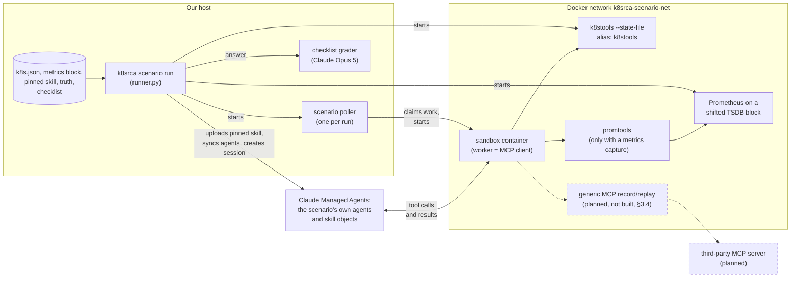
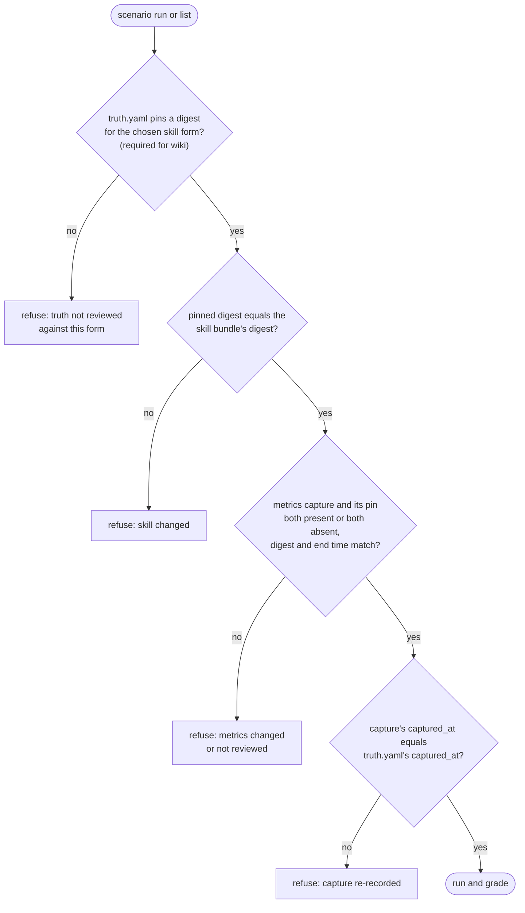
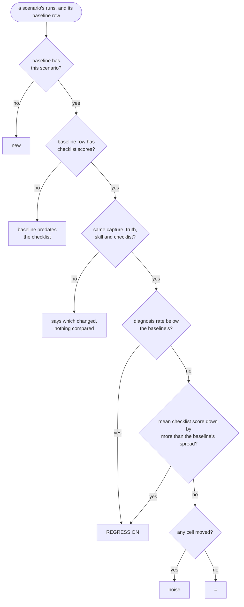
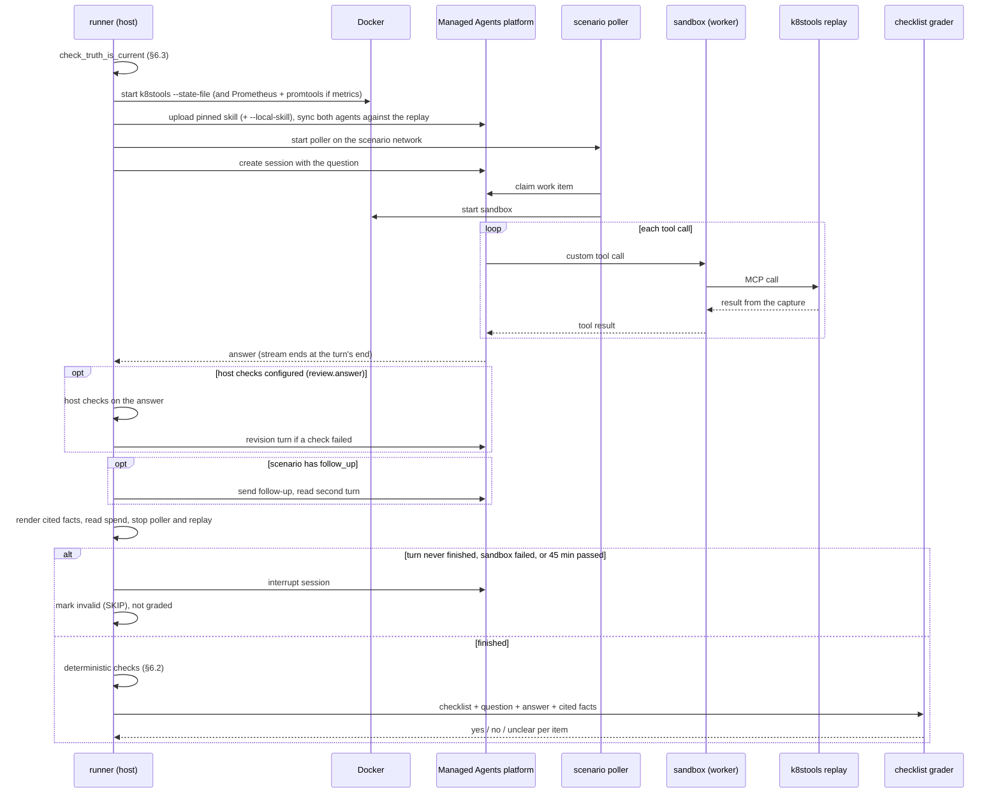
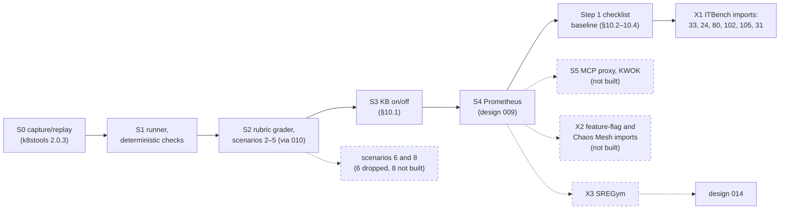

# 004 — Scenario testing

k8srca is an agent that diagnoses Kubernetes problems and answers in Slack. This document
describes how we find out whether a change to it (a prompt, a knowledge-base entry, a tool)
made it better or worse. We do that with a **scenario suite**
([glossary](../docs/glossary.md)): a fault injected into a test cluster, recorded once
(the **capture**), and played back through the read-only Kubernetes MCP server
[k8stools](https://github.com/BenedatLLC/k8stools) in its replay mode (the **replay**), so
that a run needs no live cluster. Each answer is graded against a **checklist** of
statements it should and should not make, and the scores are compared with a recorded
**baseline**. You need to know that the agent is two Claude agents running on Claude
Managed Agents (Anthropic's hosted agent platform): a **coordinator** that plans and writes
the answer and a **specialist** it delegates bulk reads to ([001 §3.3](001-architecture.md#33-agent-topology-a-coordinator-and-a-specialist)). Everything else is
explained where it is used.

Two later designs changed this one, and the text below describes the result:
[design 010](010-facts-and-short-answers.md) made the checklist the measurement
([010 §7](010-facts-and-short-answers.md#7-grading-checklists)) and recorded most of the current
scenarios; [design 008](008-conclusions-under-incomplete-evidence.md) replaced
"confirmed/refuted" verdicts with a ranking ([008 §6](008-conclusions-under-incomplete-evidence.md#6-grading)).
The older rubric grader is still in the code and runs only on request.

---

## 1. Why: what the suite must be able to show

Without a suite, every change to a system prompt, a knowledge-base entry or the tool split
is unfalsifiable. Running the agent against a real cluster a few times and reading the
answers shows that it *can* work. It does not show whether the next edit made it better.

Several open questions in the other designs ask for a measurement:
[001 §12](001-architecture.md#12-open-questions) items 3 (does `xhigh` effort pay for
itself), 4 (which knowledge-base rules ever fire) and 7 (where the line between the
coordinator's tools and the specialist's sits), and
[002 §11](002-investigation-model.md#11-open-questions) items 1 and 3.
[002 §9](002-investigation-model.md#9-staging-from-prompt-to-method) staged its later levels
of method after the suite for the same reason. Three properties matter more than those
questions.

**The suite must be able to show that our own machinery does not help.** With no system
prompt and no skills (002's level L0), the agent already chained pod summaries to container
statuses to events and found an `OOMKilled` loop unaided
([001 §13](001-architecture.md#13-build-status)). That is a high floor. The knowledge base,
the coordinator/specialist split and the architecture skill are each assumed to beat it. A
suite that cannot report "the knowledge base made no difference on six of eight scenarios"
cannot test that assumption.

**It must catch an answer that looks right and skips the alternatives.** In
[002 §11](002-investigation-model.md#11-open-questions) item 0, the agent retrieved three
candidate causes for `OOMKilled`, discussed one, and silently dropped the other two. The
answer read as well supported *because* the alternatives went unmentioned. No check on the
quality of the prose catches that; only a check that knows which rival causes existed can.
This is the main constraint on grading (§6), and why it scores how the answer handled each
candidate rather than only whether it named the cause.

**It is for regression detection, not a benchmark number.** The aim is to notice when an
edit meant to fix one scenario breaks three others, which is the ordinary way prompt-driven
systems degrade.

### What the suite is not for

It does not test the platform. Session plumbing, Slack handlers, the poller and session
reuse have hermetic tests, and the end-to-end path has `tests/test_e2e_slack.py`. The suite
creates sessions directly, not through Slack, so the agent's reasoning is the only thing
that varies.

---

## 2. What a scenario is

A scenario is a directory in `tests/scenarios/`: a question, the captured state needed to
answer it, and the truth.

```
tests/scenarios/jvm-oom-on-startup/
  scenario.yaml          # question, sources, budget, optional follow-up
  truth.yaml             # cause, candidate causes, traps, gaps; pins the capture and skills
  checklist.yaml         # statements the answer is graded on (010 §7)
  README.md              # how the cluster was broken, so it can be re-made
  results/               # recorded tool results, fixtures for the facts layer (`record-results`)
  k8s.json               # the k8stools capture            (fetched, gitignored)
  skill/                 # the pinned cluster-architecture skill (fetched, gitignored)
  metrics/manifest.json  # a metrics capture's window and intervals, when there is one
  metrics/block.tar.gz   # the metrics capture itself       (fetched, gitignored)
```

**Large files live in a separate repository** ([issue #7](https://github.com/BenedatLLC/k8srca/issues/7)):
the capture, the pinned skills and the metrics blocks are in
`BenedatLLC/k8srca-scenario-data`, as `captures/<digest>.json.gz`, `skills/<digest>.tar.gz`
and the metrics blocks of [009 §7.4](009-metrics.md#74-stored-as-blocks-in-a-data-repository-2026-10-19).
`scenario.yaml` pins the capture by the digest of its JSON (`sources.k8stools.digest`), and
`truth.yaml` pins each skill and the metrics block by digest. They are fetched on first use
to the paths above; `k8srca scenario fetch` fetches all of them, and `k8srca scenario
publish <id>` puts a new scenario's files there. Tests never fetch: a test that needs a
scenario's data skips, saying so, until it has been fetched.

`scenario.yaml` declares which sources the scenario needs, and the runner starts exactly
those ([src/k8srca/scenario/model.py](../src/k8srca/scenario/model.py)). An example, trimmed
of its comments:

```yaml
id: jvm-oom-with-metrics
question: |
  The ad service is crash-looping in the default namespace. Why?
sources:
  k8stools:
    state: k8s.json
    digest: b107097231ebbbdc
    clock: frozen          # every run sees the same ages; `advancing` is the alternative
  prometheus: {}           # a metrics capture, fetched by the digest truth.yaml pins
budget:
  max_tool_calls: 25       # exceeding it fails the run
  max_usd: 0.40            # reported only; see below
follow_up: |
  Was anything deployed recently that could explain it?
```

**The life of a scenario.** The diagram shows how a scenario is made once and then run many
times. The left half touches a live cluster and happens once per scenario; the right half needs
no cluster and runs on every measurement.

```mermaid
flowchart LR
  subgraph once["Once per scenario"]
    break["Break a real cluster<br/>(§4.1), or import an<br/>ITBench snapshot (§12)"]
    record["scenario record<br/>k8stools capture,<br/>skill, metrics"]
    truth["Write truth.yaml and<br/>checklist.yaml from the<br/>capture, then freeze"]
    publish["scenario publish<br/>to k8srca-scenario-data"]
    break --> record --> truth --> publish
  end
  subgraph every["Every measurement"]
    fetch["fetch by digest"]
    replay["replay through<br/>k8stools (+ Prometheus)"]
    run["agent session<br/>(scenario run)"]
    grade["deterministic checks<br/>+ checklist grading"]
    report["results table<br/>against baseline.json"]
    fetch --> replay --> run --> grade --> report
  end
  publish --> fetch
  report -- "scenario baseline<br/>(a deliberate step)" --> base[("tests/scenarios/<br/>baseline.json")]
  base --> report
```



`requires_tools` (tools the run must call), `authored` (the state was written by hand, §4.3),
`architecture` (what the scenario's wiki is built from, §12.1) and `record_calls` (extra
calls for `record-results`) are optional.

**Budgets are set from measurement.** The tool-call limit fails a run; the dollar limit is
only reported. Across 13 runs of one unchanged scenario, tool calls varied 2.3× (19–44)
while cost varied 3.4× ($0.25–$0.85), and the run with the narrowest call spread had the
widest cost spread: cost follows thinking and delegation, not tool use. A dollar cap
therefore failed correct answers on expensive days. Running away with tool calls is a real
failure, and it is what the stopping scenario (§5, scenario 3) is about.

**The scenario format is the extension point, not the replay mechanism.** Adding Prometheus
added one field to `Sources` and one container in
[src/k8srca/scenario/sources.py](../src/k8srca/scenario/sources.py). It did not change the
grader or any existing scenario. §3 describes the three source kinds the design allows for.

---

## 3. How a scenario is served

### 3.1 The replayability contract

A data source can back a scenario if it can do two things:

1. **Answer arbitrary queries from a captured artifact.** A recording of the calls one run
   happened to make is not enough: the agent's calls vary from run to run, and a recording
   that has no answer for a new call gives a false picture of the cluster.
2. **Move its time origin to the start of the run.** The agent reasons about relative time
   ("this pod restarted 30 seconds after that deploy"). A capture whose timestamps are
   three weeks old, replayed as is, shows a cluster where nothing happened recently.

A source that meets both can be added without changing anything else. A source that cannot
falls back to §3.4 and accepts its limits.

The diagram shows what runs during one scenario run and which network each part is on. The
sandbox reaches the replay by the same host name, `k8stools`, that it uses in production, so
neither the worker nor the agent can tell a replay from a live cluster. The dashed part is the
planned generic proxy of §3.4, which is not built.



### 3.2 k8stools: state capture and replay (built)

k8stools meets both. `k8s-capture-state` snapshots a live cluster to JSON; its mock state
answers the same queries the real tools do; and the MCP server takes `--state-file`. Ages
are stored relative to the capture time and rebuilt relative to server start, which is
requirement 2. `--state-time frozen` pins the replay clock. Three additions were made to
k8stools for this suite: ReplicaSets, previous-instance logs and the frozen clock; the
reasoning is in k8stools' `designs/mock-state-capture.md`. Since k8stools 4.4.0, anything a
capture did not record replays as "not recorded in this capture, so unknown rather than
absent", never as "none".

**k8srca needs no change to use it.** k8srca never touches the Kubernetes API directly; all
cluster access goes through k8stools (`CLAUDE.md`). That leaves one seam, and the replay
fits it: the runner starts a k8stools container with `--state-file` on its own Docker
network under the alias `k8stools`, which is the host name the sandbox already uses
([src/k8srca/scenario/sources.py](../src/k8srca/scenario/sources.py)). Nothing above the MCP
boundary can tell the difference. No kubeconfig is mounted, since a replay reads a file.

### 3.3 Prometheus: a real server on a captured block (built)

> Built by [design 009](009-metrics.md) ([009 §5](009-metrics.md#5-scenarios-capture-and-replay)).
> It captures by query (`promtools capture`), not by TSDB snapshot, because the snapshot
> needs Prometheus's admin API, which stays off.

Metrics were the first thing the agent asked for that it could not get: in the first
real-cluster diagnosis, the gap it named was the lack of a memory time series. So the suite
was shaped so a metrics source would not require reshaping it.

Prometheus meets the contract without a mock:

- **Arbitrary queries.** The capture is turned into a TSDB block with
  `promtool tsdb create-blocks-from openmetrics` and served by a real Prometheus, behind our
  read-only MCP server promtools (`packages/promtools`). Every PromQL expression works,
  because it is Prometheus.
- **Moving the time origin.** Sample timestamps, and the values of the few metrics whose
  value is itself a time, are shifted so the capture ends at run start
  (`shift_openmetrics` in [src/k8srca/scenario/sources.py](../src/k8srca/scenario/sources.py)).

Seven scenarios carry a metrics capture (§5). The runner turns promtools on for them; it is
off in the production config.

This is why "capture the real thing and serve it again" is the default approach for every
source, not a k8stools special case.

### 3.4 Third-party MCP servers: generic record and replay (not built)

> **Not built.** No scenario needs a third-party server yet. Staged as S5 (§10) and not
> scheduled.

For a server we do not control (an OpenSearch or Loki MCP server someone else ships), neither
property is available on our terms. The fallback would be a record/replay shim at the MCP
protocol layer. k8srca is well placed to host one: the worker in the sandbox is the MCP
client ([001 §4.2](001-architecture.md#42-the-worker-as-mcp-client)), and `tools.py` already
wraps every call, so one shim would cover every server.

|  | Captured state (§3.2, §3.3) | Generic transcript proxy (§3.4) |
| --- | --- | --- |
| A query not seen at record time | Answered from the state | Misses |
| Work per new server | A capture path each | None |
| Fidelity | A model of the domain | Byte-identical responses |
| Lives in | The server | k8srca, once |

Its weakness is the miss. A miss would be returned as an explicit *unavailable* result,
not an error or an empty success; [002 §5.1](002-investigation-model.md#51-evidence-kinds)
already gives the agent an "unavailable" kind of evidence to put it in. A run with many
misses measures the fixture rather than the agent, so the plan is for the runner to record
the miss rate per source and fail the run above a threshold (proposed: 10% of calls to that
source).

---

## 4. Where scenarios come from

### 4.1 Break a real cluster, then capture it

Scenarios are made by breaking a real cluster and capturing the result
(`k8srca scenario record <id>`, [src/k8srca/scenario/record.py](../src/k8srca/scenario/record.py)),
not by writing cluster state by hand.

This costs real effort, so the reason matters. **Someone who writes cluster state writes the
symptom and the truth together**, and can only encode failures they already understand. The
result tends to be a tidy cluster where the answer is over-determined and the agent scores
better than it deserves.

Real breakage produces evidence that is consistent without effort: restart counts, event
order, exit codes, log truncation and container ages agree because they happened. It also
produces things nobody would think to write. In the first real-cluster run, the container's
termination `reason` was `Error`, not the `OOMKilled` the hypothesis predicted, a quirk of the
container runtime. That is now scenario 1's designed trap (§5).

The ITBench imports (§12) are real breakage too, recorded by someone else.

### 4.2 minikube rather than kind

kind's advantages (fast create and destroy, CI-friendliness, easy multi-node) are about
provisioning clusters in CI. With captures, CI never provisions a cluster; it replays JSON,
and the cluster is used once per scenario to make it. minikube is what the OTel demo already
runs on, what the first k8stools capture came from, and what the team knows.
`minikube node add` covers multi-node if a scheduling or node-pressure scenario needs it.
Later scenarios were recorded on benben, the project's demo cluster
([009 §3.1](009-metrics.md#31-on-benben)).

### 4.3 KWOK for states a real cluster cannot produce (not built)

> **Not built.** No KWOK scenario exists. `scenario.yaml` has an `authored` flag for one.
> Staged as S5 (§10) and not scheduled.

Some states cannot be produced on demand: a ReplicaSet that is really 145 days old, a
400-pod cluster, sustained node memory pressure, a precisely ordered event flood. KWOK can
express these: `Stage` resources write arbitrary pod status, and `Logs`/`ClusterLogs` serve
container logs from files, including previous-instance logs.

KWOK is therefore a **last resort**, used where §4.1 is impossible rather than inconvenient.
Its scenarios would be marked `authored: true`, so their results are read with §4.1's caveat
in mind. SimKube was considered and rejected (§9).

---

## 5. The scenarios

Each scenario exists to tell apart something no other scenario does. A list of Kubernetes
failure modes alone would give eight ways of asking "did it find the broken pod"; the plan
below is organised by the *reasoning* each one stresses, with the failure as the vehicle.

**The original plan** of eight, and what became of each:

| # | Scenario | Vehicle | What it tells apart | Status |
| --- | --- | --- | --- | --- |
| 1 | `jvm-oom-on-startup` | JVM with `limit == request`, no heap flags | Evidence that contradicts the hypothesis: `reason: Error`, not `OOMKilled`. Does the answer flag the discrepancy or smooth it over? | Recorded |
| 2 | `probe-too-aggressive` | Readiness probe with a 1 s timeout on a slow starter | A broken app versus a broken *check* | Recorded as `liveness-probe-wrong-port`: a liveness probe on a port the app does not listen on |
| 3 | `image-pull-typo` | Misspelled image tag | **Stopping.** The answer is a few tool calls deep. Does the agent stop, or investigate for thirty? ([002 §5.4](002-investigation-model.md#54-stopping-criteria)) | Recorded |
| 4 | `pvc-pending-no-storageclass` | PVC naming a StorageClass that does not exist | Widening the search: the pod's events say only `FailedScheduling`; the answer is on another object | Recorded |
| 5 | `deploy-regression` | Deployment rolled to a broken revision, prior ReplicaSet intact | Change correlation: tying the failure to the revision that preceded it | Recorded |
| 6 | `innocent-bystander` | Service B fails *because* service A is down | Cause versus symptom | Not recorded: ITBench 24 and 105 (§12.3) already test it |
| 7 | `nothing-is-wrong` | Unrelated breakage beside a healthy path, asked about the healthy path | **Whether the agent can decline** | Recorded, asking about cart |
| 8 | `evidence-unavailable` | Crash loop whose previous-instance logs are gone | "No error was logged" versus "the logs are gone" ([002 §5.1](002-investigation-model.md#51-evidence-kinds)) | Not recorded; ITBench 34 is a candidate (§12.3) |

**The suite as it stands** is fifteen scenarios, all graded on checklists. Scenarios 2–5 and
7 were recorded by 010's step 5 on benben, each with a metrics window and a checklist from the
start ([010 §9.9](010-facts-and-short-answers.md#99-step-5-plan-batch-1-2026-10-22)–[§9.12](010-facts-and-short-answers.md#912-step-5-batch-2-result-2026-10-23)).
The current scores are in [docs/baseline.md](../docs/baseline.md).

| Scenario | Origin | Fault | What it tells apart | Metrics |
| --- | --- | --- | --- | --- |
| `jvm-oom-on-startup` | Scenario 1 | ad's JVM: 300Mi limit equal to its request, no heap flags | Evidence that contradicts the hypothesis | – |
| `jvm-oom-with-metrics` | 009 | The same fault, with a week of 15 s metrics | Whether the answer's strength follows the evidence available: the capture alone allows *moderate*, the memory series allows *strong* | yes |
| `liveness-probe-wrong-port` | Scenario 2 | shipping's liveness probe on 9090; it listens on 8080 | A healthy app killed by its check: the kill is the kubelet's, the log is clean | yes |
| `image-pull-typo` | Scenario 3 | email rolled to the tag `2.2.0-emial` | Stopping | yes |
| `pvc-pending-no-storageclass` | Scenario 4 | quote's new PVC names StorageClass `fast-ssd`, which does not exist | Widening the search | yes |
| `deploy-regression` | Scenario 5 | payment rolled to `PAYMENT_PORT=80800`; prior ReplicaSet kept | Change correlation; in the follow-up, what else fails | yes |
| `nothing-is-wrong` | Scenario 7 | None: cart is healthy | Restraint beside deliberate crash loops and recent rollouts | yes |
| `checkout-gc-pressure` | First recording of scenario 7 | checkout garbage-collecting constantly at its 20Mi limit | A quiet real cause beside loud unrelated breakage, stated at the confidence one usage sample supports | – |
| `downstream-latency` | 010 | product-catalog's CPU limit throttles it, so frontend is slow | Latency whose cause is a dependency's resources | yes |
| `itbench-33-invalid-node-selector` | ITBench (§12.1) | Two Deployments patched onto a nodeSelector no node satisfies | Severity: a blocked rollout behind a healthy previous revision is not an outage | – |
| `itbench-24-kafka-port-change` | ITBench (§12.3) | checkout's `KAFKA_ADDR` changed to port 9999 | Reading a caller's log; checkout is down | – |
| `itbench-80-kafka-two-brokers` | ITBench (§12.3) | Kafka at two replicas (two brokers behind one Service), then a network partition | Ranking two causes from a log and a replica count | – |
| `itbench-102-memory-quota` | ITBench (§12.3) | A namespace memory ResourceQuota blocks ad's new pod | A workload with no pods: the cause is a Deployment condition and events | – |
| `itbench-105-invalid-command` | ITBench (§12.3) | product-catalog's command changed to one that does not exist | One cause behind four alerting services | – |
| `itbench-31-network-policy-decoy` | ITBench (§12.4) | A NetworkPolicy named "block-all" whose empty rule allows all ingress | Reading a log's history before calling errors a burst; restraint about a decoy | – |

`jvm-oom-on-startup` is frozen: no change is tuned on it alone. Three scenarios carry a
`follow_up` (both jvm scenarios and `deploy-regression`), so they also exercise multi-turn
continuity, which [002 §9](002-investigation-model.md#9-staging-from-prompt-to-method) asks
for before its durable investigation record (L2).

**Scenario 7 is the most important one, and the one a naive suite leaves out.** Every other
scenario rewards finding something. Only this one rewards not finding something; without
it, the suite pushes toward an agent that invents a cause under pressure. It keeps unrelated
breakage in view on purpose. A pristine cluster only asks whether the agent can say "nothing
is wrong"; this asks whether it can say so *while looking at something plainly broken*,
which is the situation an SRE is in when they ask about one service during an unrelated
incident. The failure it catches is reaching for the nearest visible breakage and asserting
a causal link to the question.

The first recording of scenario 7 asked why checkout was slow, and the truth said nothing near
checkout was wrong. Every run of the first batch disagreed, and three were right: the truth
had been written without reading the capture's `metrics` section, which shows checkout above
its Go `GOMEMLIMIT` (19Mi against 16MiB, with a 20Mi limit) at 118m CPU while product-catalog,
with identical settings, idles at 7m. That recording became `checkout-gc-pressure`. Since
checkout is not healthy on that cluster at baseline, scenario 7 was recorded asking whether
cart is broken instead, with no fault injected. One hedge is allowed: shipping's recent outage
may explain the customer's report if the timing matches, because frontend's cart page fetches
shipping quotes ([010 §9.13](010-facts-and-short-answers.md#913-close-2026-10-23)).

**A trap can be wrong, and the capture settles it.** A *trap* is a tempting wrong reading the
truth file names. Scenario 1 shipped with a trap forbidding the agent from reading its two
crash loops as one shared condition. The capture disagrees: exactly two containers in the
cluster carry a 300Mi limit, they are exactly the two crash-looping, and every other container
has a different limit and is running. The neighbouring trap said `accounting`'s large restart
count was old history; the capture shows `last_state.reason: OOMKilled` and a lifetime of
about 15 minutes, in two captures a week apart. A hand-written note on the same service made
the same mistake. In each case a trap was written from a picture of what a good answer looks
like, and the capture disagreed. It was found by asking why a result was unstable (`traps`
read 1/3, 3/3 and 5/6 across batches) instead of assuming the agent was wrong. The rule that
follows: **when a result disagrees with itself, check the truth before the agent**, because a
wrong trap looks the same as a flaky one in the report and is much cheaper to fix. The
corrected traps forbid only what the capture contradicts.

---

## 6. Ground truth and grading

### 6.1 The closed world: what the agent could have seen

A capture is a *closed world*: every pod, container, event, image, restart count and log line
the agent could legitimately cite is in the file. So any concrete name in the answer can be
checked against it, and anything not there was invented. Against a live cluster you can only
ask whether an answer sounds right; against a capture you can ask whether every entity it
names exists.

**The capture is not the whole closed world.** The agent also reads the
`cluster-architecture` skill, a description of the deployment built by kubewiki
([001 §5.2](001-architecture.md#52-cluster-architecture-what-is-deployed-and-how-it-fits-together)),
and cites it often: declared images from charts, probe configuration, chart settings. None of
that is cluster state. Graded against the capture alone, scenario 1's first answer had nine
"fabrications", all real facts read from the skill; with the skill in the grader's reference,
three remained, and those were genuine.

**So each scenario pins the skill beside the capture.** The runner uploads the scenario's own
copy of the skill as a separate skill object and builds the scenario's agents against it, so
the agent reads exactly what the grader reads
([src/k8srca/scenario/runner.py](../src/k8srca/scenario/runner.py), `sync_scenario_agent`).
It never adds a version to production's skill: agents reference skills at "latest", so that
would repoint the Slack bot at a frozen test cluster.

**Two forms of the skill.** A scenario can carry the legacy snapshot
(`skill/cluster-architecture/`) and kubewiki's wiki (`skill/wiki/cluster-architecture/`),
which replaced it in production. `k8srca scenario build-wiki` builds the wiki from the
scenario's own capture, replayed. `truth.yaml` pins each form it was reviewed against
(`capture.skill_digests`), and a run against a form the truth was never read against is
refused, since a trap written for one may not hold for the other. `--arch wiki|legacy`
chooses; **the default is `wiki`**. All fifteen scenarios pin a wiki; only
`jvm-oom-on-startup` and `itbench-33` also pin a legacy snapshot. The `k8s-rca` skill (method
and knowledge base) is not pinned per scenario: a run uses production's unless
`--local-skill` says otherwise (§7).

### 6.2 How an answer is graded

Three things grade a run.

**1. The checklist** (the measurement since 010;
[src/k8srca/scenario/checklist.py](../src/k8srca/scenario/checklist.py)). Each scenario's
`checklist.yaml` lists statements an answer should make (`expect: present`) or should not
(`expect: absent`), grouped as cause, ruled out, traps, gaps and next steps.
- The grader (Claude Opus 5) answers yes, no or unclear per item. It is not told which way an
  item is expected, or which items state the diagnosis; whether the verdict meets the item is
  settled in code from the file.
- It reads the question, the posted answer and the facts the answer cites, plus the
  checklist. It does not read the capture: a few thousand tokens instead of about 190K.
- It is steady. The bar a checklist must pass is 97% agreement over three gradings of each
  answer, with no item split on more than one answer (`AGREEMENT_BAR`;
  [010 §9.2](010-facts-and-short-answers.md#92-step-2-checkpoint-2026-10-21)).
  `k8srca scenario checklist <runs> --grades 3` measures it. At the 2026-11-01 baseline,
  gradings agreed 99.2% over 2,028 verdicts.
- A grading costs about $0.07.

**2. Deterministic checks** ([src/k8srca/scenario/checks.py](../src/k8srca/scenario/checks.py))
run first, cost nothing and give the same result every time. They decide a run's PASS/FAIL
line, not its checklist score. Because a failure is reported against the agent, they must
fail on fabrication and pass on everything else: a check that fails correct answers gets
switched off, and then it catches nothing. Several checks set from estimates failed correct
answers before their thresholds were set from measurement. The checks:
- `closed_world`: every generated object name in the answer (a name with a controller hash,
  such as `ad-5547bd5bd9-v65gj`) and every image reference exists in the capture. Plain words
  like `ad` or `cart` are not checked, since they are ordinary English. Objects named in the
  capture's events count, so a pod deleted before the capture is not "fabricated"
  ([issue #4](https://github.com/BenedatLLC/k8srca/issues/4)). Images from earlier revisions
  count too.
- `numeric_claims`: a restart count attributed to a named object matches some container, pod
  or workload count in the capture. Only restart counts are checked, and only when an object
  is named near the number; with a metrics capture, a mismatch is a warning, since Prometheus
  can count restarts over any window.
- `must_identify`: the answer mentions each term in `truth.yaml`'s `cause.must_identify`.
- `required_tools`: the run called each tool in `requires_tools`. No scenario sets it today.
- `budget`: tool calls within `max_tool_calls`; cost is reported, never failed.

**3. The rubric** ([src/k8srca/scenario/grader.py](../src/k8srca/scenario/grader.py)), the
measurement before 010. It runs only with `--rubric`, or for a scenario that has no
checklist, such as the hold-out suite's ([design 006](006-holdout-suite.md)). A grader model
receives the answer, `truth.yaml`, a digest of the capture, the pinned skill and, where there
is one, promtools' reports on the metrics capture, and scores dimensions rather than giving an
overall impression:

| Dimension | Question |
| --- | --- |
| Cause | Is the stated root cause the one in `truth.yaml`? |
| Evidence | Is each claim tied to a tool result that supports it? |
| Standing | Was every candidate in `truth.yaml` placed (most likely, not ruled out, or ruled out) where the truth or an `also_accept` puts it? "Worth checking later" does not count |
| Calibration | Is the leading cause held as strongly as the capture allows, no more and no less? Is every candidate ruled out on a fact that excludes it? ([008 §6.2](008-conclusions-under-incomplete-evidence.md#62-dimensions)) |
| Traps | Was each designed trap handled as specified? |
| Gaps | Were things known to be unavailable reported as unavailable rather than asserted away? |
| Next steps | Does a next step bear on what would change the leading cause, or on a candidate not ruled out? |
| Restraint | For a scenario that is about declining: did the answer decline to invent a cause? |

The grader reports what the answer did with each candidate: its standing, its strength in the
answer's own words, and for one ruled out, whether a fact excludes it. `settle_candidates`
then compares that with `truth.yaml` in code, the same way every time.

Giving the grader the truth *and* the capture makes it check claims against a file rather
than give an opinion. Claude is grading Claude, and a grader asked for an opinion shares the
generator's blind spots; a grader asked "is this claim supported by this file" largely does
not. It also runs on a different model from the coordinator. One rule came from three rounds
of fixing it: **anything a tool can show the agent, the grader must be able to see.** Each
time the capture digest left something out (pod specs, the metrics-server sample, rollout
history), true claims were graded as invented (§11, question 3).

### 6.3 `truth.yaml` and `checklist.yaml`

`truth.yaml` is what the capture allows a good answer to say
([src/k8srca/scenario/model.py](../src/k8srca/scenario/model.py), `Truth`). An abridged
example from `jvm-oom-on-startup`:

```yaml
id: jvm-oom-on-startup
capture:
  captured_at: '2026-09-30T14:35:06.887261+00:00'   # must equal the capture's own
  skill_digest: 67948880870e892c                     # the legacy skill it was read against
  skill_digests: {wiki: 16b72e54266eb80f}            # other forms, by name
  # metrics: {end: <captured_at>, digest: <block digest>}   when there is a metrics capture
cause:
  summary: >-
    The ad container's memory limit equals its request (300Mi) with no JVM heap
    sizing, so the JVM's default heap exceeds the cgroup limit and the kernel kills it ...
  must_identify: [ad, memory, 300Mi]
  most_likely: memory-limit-too-low
  strength: [moderate, strong]      # the range of strength words the capture supports
candidates:                         # every candidate cause the answer must place
  - id: memory-leak
    standing: ruled_out
    also_accept: [not_ruled_out]
    note: ...                       # the argument for each accepted standing
traps:
  - id: reason-says-error
    expect: flagged
    note: >-
      lastState.terminated.reason is "Error", not "OOMKilled". Asserting the OOM
      killer fired without noting the discrepancy is a failure.
gaps:
  - id: no-metrics
    expect: reported_unavailable
```

A candidate's *standing* is where the capture puts it: most likely, not ruled out, or ruled
out ([008 §3](008-conclusions-under-incomplete-evidence.md#3-the-answer)). Truth files written
before 008 listed `rivals` with verdicts (confirmed, weakened, refuted, could not check); such a
file still reads, converted by
[008 §4.3](008-conclusions-under-incomplete-evidence.md#43-what-happens-to-the-old-statuses)'s
table with no strength ranges, so the hold-out suite's files keep working until their author
migrates them.

**`also_accept` is for candidates on a boundary**, where two standings each follow from a
sound reading of the capture and demanding one would grade the author's preference rather than
the agent. It is not a way to soften a candidate the agent keeps getting wrong: the note must
give the argument that leads to each. `memory-leak` above has it because a leak in a container
killed during startup is either not ruled out (there is no memory time series) or ruled out
(there is no operating period to leak over); four of six runs ruled it out on the second
argument and were marked wrong before it was added.

**Truth is versioned with the capture.** Re-recording moves restart counts and ages, and can
remove a trap. The runner refuses to grade when the capture's `captured_at` differs from the
one `truth.yaml` pins, when a pinned skill's digest differs, or when the metrics block's digest
or end time differs (`check_truth_is_current`). Comparing file times would not work, because
git does not keep them; pinning `captured_at` means any re-record, not only a newer one, sends
someone back through the truth file.

The checks `check_truth_is_current` makes before a run, in order. Any "no" stops the run with a
message saying what to re-review:



**`checklist.yaml`** is written from `truth.yaml` and only from it, never from runs
([010 §7](010-facts-and-short-answers.md#7-grading-checklists)). Each item has an `id`, `expect`,
`group`, a one-sentence `statement`, and optionally `accept` (phrasings that make it),
`tempting` (the wrong version an answer would write, for an absent item) and `allowed` (nearby
statements that do not make it). Items marked `diagnosis: true` state the diagnosis (§10.3);
the grader never sees that mark, `expect` or `group`. A checklist, like the truth file, is
frozen for the length of a design ([process.md §5](../docs/process.md#5-the-instrument-is-frozen-per-design)).

### 6.4 Sampling and the regression rule

**The current rule** (checklist grading; written at step 1, §10.3):
- **n=3 per scenario.** The baseline is one batch of every scenario, with each checklist past
  the agreement bar on that batch's answers. The 2026-11-01 baseline used n=5 for `itbench-31`
  and `itbench-80` ([docs/baseline.md](../docs/baseline.md)). `scenario run`'s `--n` and
  `holdout score`'s both default to 3.
- **The regression rule reads the diagnosis.** Each checklist marks the item or items stating
  its diagnosis. A scenario **regresses** when:
  - fewer of its runs meet every diagnosis item than in the baseline, as a rate; or
  - its mean checklist score is lower than the baseline's by more than the baseline's spread
    for that scenario (its highest run less its lowest).
- **Anything smaller is noise.** The results table prints `noise` and shows each moved cell as
  `was→now`. The groups (cause, ruled out, traps, gaps, next) show where to look; no rule reads
  them.
- **Resolution.** In the 2026-11-01 baseline the spreads are 0 to 4 items. A scenario with
  spread 0 (for example `deploy-regression`, `downstream-latency`) is flagged on any drop in
  its mean, and one with spread 4 (`itbench-80`, `itbench-102`) only on a drop of more than 4.
  That is what n=3 can resolve. A flag on a spread-0 scenario is read against its runs before
  it is believed.
- **The grader is the smaller source of noise.** About 1% of checklist gradings disagree with
  their answer's majority, against a spread of several items between runs of the agent.
- **Run only the scenarios a change can reach,** written down before the run from what the
  change touches. A rule about scheduler reasons reaches `itbench-33` but not jvm. A scenario
  left out is unmeasured, not unchanged. The full suite runs before a new baseline is recorded,
  and whenever the investigation changes (tools, knowledge-base output, the coordinator's
  method). [process.md §6](../docs/process.md#6-two-loops) governs when a live run happens at
  all.

The implementation is `checklist_delta` in
[src/k8srca/scenario/report.py](../src/k8srca/scenario/report.py). The diagram shows the verdict
it prints for one scenario:



**Why n=3 and not more.** Two n=3 runs of `jvm-oom-on-startup`, on the same capture and a
byte-identical grader, once read `traps` 1/3 and then 3/3. By the rule of three, *r* unanimous
runs put the 95% upper bound on the unseen outcome at 3/*r*; at n=3 that bound is 1.0, so a
unanimous reading excludes nothing. The rubric era therefore moved to n=5 to screen and 10 or
more for a baseline. The checklist made that unnecessary for its purpose: it is much steadier
than the rubric (about 1% of verdicts dissent, against 11–16% for the rubric's evidence
dimension), and the rule above reads only the diagnosis and a scenario's own spread. At n=3 it
sees a scenario the agent can no longer do and a drop larger than the scenario's spread; it
does not see a move of one item or one diagnosis in three. That limit is accepted and stated
in each step's plan ([process.md §1](../docs/process.md#1-plan-the-measurement-before-building)).

**The rubric-era rule** still governs runs graded with `--rubric`. Its reasoning, in short:
- The agent varies more than the grader. Repeating an unchanged agent at n=6 moved a dimension
  by up to three runs in six (Appendix A.4). So a single n=6 batch resolves a move of four or
  more; a smaller move is a lean until both arms (the change and the unchanged agent) are
  measured in the same sitting, pooled to n=12.
- The baseline is 10 or more runs, pooled across sittings while its skill and capture are
  unchanged.
- A change is screened at n=5: a move of three or more is a result; a move of two is extended
  to n=10; a move of one or none says there is no large effect.
- Under 010 this rule could not separate small effects from noise (two n=5 arms of an
  identical agent differ by 2 or more on evidence about 30% of the time), which is part of why
  010 replaced the rubric.

**Changes to how the answer is written have no offline shortcut.** Replaying a saved session up
to its answer and asking for the answer again under a changed skill was built and dropped. It
got the cause right in 7 of 11 answers where the live runs were 10 of 10, because the platform
records that the model reasoned but not what it reasoned, so the replay re-weighs the results
without the live run's reasoning; it also kept asking for evidence the live run never needed,
and cost about two thirds of a live run per answer. So answer changes are measured live, on the
scenarios they reach. 010's offline answer eval (`k8srca eval answer`,
[010 §8](010-facts-and-short-answers.md#8-testing-the-suite-and-the-component-evals)) avoids the problem by fixing the input at
the facts, not at a session.

---

## 7. Running it

```bash
k8srca scenario list                              # every scenario, and whether its truth matches its capture
k8srca scenario fetch [<id>...]                   # captures, skills and metrics from the data repository
k8srca scenario record <id>                       # capture the live cluster into a scenario directory
k8srca scenario publish <id>                      # put a scenario's capture, skills and metrics in the data repository
k8srca scenario backfill-histories <id>           # add workload histories to an older capture
k8srca scenario build-wiki [<id>...]              # build each scenario's wiki from its capture (§6.1)
k8srca scenario build-metrics-reference <id>      # promtools' reports on a metrics capture, for the rubric grader
k8srca scenario record-results <id>               # the composite tools' results on a replay: facts-layer fixtures
k8srca scenario run [<id>...] --n 3 --local-skill k8s-rca --save F   # stand up sources, run, grade
k8srca scenario checklist F --grades 3            # grade saved answers again on checklist.yaml; per-item agreement
k8srca scenario rescore F                         # saved checklist verdicts scored on today's checklists; no grader calls
k8srca scenario regrade F                         # the rubric again on saved answers, after a rubric-grader change
k8srca scenario compare F [G]                     # two saved runs side by side (G defaults to the last run)
k8srca scenario baseline --agreement G            # the last run becomes the baseline; G is `checklist --grades 3` on its answers
k8srca eval answer                                # the answer writer on fixed facts, graded on checklists (010 §8)
```

**One run, in sequence** (`run_once` and `run_session` in
[src/k8srca/scenario/runner.py](../src/k8srca/scenario/runner.py)). `--n 3` repeats this three
times per scenario. The host's checks and the follow-up turn happen only when the configuration
and the scenario call for them.



**What a run saves.** Each run appends full detail (answer, every grader note) to
`.k8srca/scenario/runs/<stamp>.jsonl`, writes its aggregate to `.k8srca/scenario/last-run.json`,
and with `--save F` writes the aggregate to F as well. Per scenario that includes each run's
checklist score, its runs that met the diagnosis, items met per group, the checklist's sha,
and the checklist grader's digest.

**The results table** has one row per scenario: diagnosis (runs that met every diagnosis
item), checklist (mean items met, out of the checklist's size), then the five groups (items
met summed over runs). Against a baseline, each moved cell shows `was→now` and the row ends
with the rule's verdict: `=`, `noise`, `REGRESSION`, or why nothing was compared (a new
scenario, a rewritten checklist, a re-recorded capture). A group's cell is read down its own
history, not across rows: groups differ in size between scenarios, and a group of one item
moves by a third on a single miss. `compare` prints a before row, an after row and a row of
moves.

**`scenario rescore`** scores saved verdicts against the current checklists without calling
the grader, for when only what the score reads (`diagnosis`, `expect`, `group`) has changed.
It refuses when an item's text the grader sees (statement, accept, tempting, allowed) differs
from what was graded.

**`scenario compare`** refuses across a checklist grader, and per scenario across a capture,
truth or checklist. A run graded on the rubric only compares on the rubric.

**`scenario baseline`** promotes what a run already measured instead of running the suite
again; the numbers would be the same and a second suite costs as much as the first. For a
checklist-graded run it refuses unless `--agreement` shows each checklist past the agreement
bar on that run's answers. For a rubric run it refuses when a dimension split within the run,
or the grader changed; `--force` records anyway. It writes the whole file, so adding rows for
new scenarios to an existing baseline is a hand merge.

**The baseline is committed, at `tests/scenarios/baseline.json`,** and summarised in
[docs/baseline.md](../docs/baseline.md). Kept out of the tree it would be per-machine: a
teammate's run would report every scenario as new, and CI would have nothing to compare
against. In the tree it is reviewable: a changed baseline appears in a diff as "we accepted a
new rate", which deserves a second pair of eyes. It records, per scenario, the capture time,
the skill digests, the truth digest and the checklist sha, and for the file, the grader
digests. Those identify the world, the truth and the instrument, so a later comparison across a
re-record reports "capture re-recorded" instead of a regression.

**A run that never finished is not a result**
([issue #2](https://github.com/BenedatLLC/k8srca/issues/2)). The event stream can close
mid-turn without a terminal event. A stream that ends without one is treated as a dropped
connection and reconnected. A run whose turn still did not finish, whose sandbox failed (the
poller logs `sandbox_failed`), or that passes 45 minutes is marked invalid, its session
interrupted, and it is neither graded nor counted: it is reported as `SKIP`, and its spend is
still counted. Production's Slack path delivers only a finished turn's answer for the same
reason.

**The scenario's agents are built against its replay.** Both agents are synced per scenario
against the replayed k8stools, not production's container: tool declarations are recorded at
sync time, and the sandbox refuses a server whose tools differ. Inherited from production, the
specialist once carried k8stools 2.3.0's tools into a 2.4.0 replay and every session failed. It
also means a newer k8stools can be measured before production runs it
(`K8SRCA_SCENARIO_K8STOOLS_IMAGE` picks the replay image). Scenarios run in their own
Managed Agents environment (`K8SRCA_SCENARIO_ENVIRONMENT_ID`).

**`--local-skill k8s-rca`** publishes the working tree's skill as the scenario's own copy,
never as a version of production's (which would repoint the Slack bot at an unmeasured
change), and folds its digest into the run's skill digest, so such a run reports "skill
re-pinned" against a baseline taken with a different skill. Without it a run uses production's
`k8s-rca`, which may be older than the baseline's; one batch was invalidated that way
(Appendix A.3).

**`backfill-histories`** adds k8stools 2.4.0's workload histories to a capture taken before
them, without re-recording: each history is read now, its ages shifted back to the capture
time, and the merge refused if any revision or ConfigMap write is newer than the capture.
Anything newer would mix two moments in one closed world (§6.1).

**`run` spends money on every invocation**, so it is a command, not a pytest target. The
grading logic is ordinary code with hermetic tests (`tests/test_scenario_*.py`,
`tests/test_checklist.py`): checklist and rubric parsing, the closed-world check, budgets, the
truth-matches-capture guard and the report.

**Cost** (from [docs/baseline.md](../docs/baseline.md) and
[010 §9.10](010-facts-and-short-answers.md#910-step-5-batch-1-result-2026-10-22)):
- Sessions: $0.08–0.66 a run, by scenario. The 2026-11-01 baseline's 49 runs cost $17.25.
- Checklist grading: about $0.07 a grading, so about $3.50 for one grading of 49 answers and
  three times that for the agreement check.
- The rubric, when asked for: about $0.70 an answer, since its reference is about 190K tokens.
  The reference sits behind a cache breakpoint and does not depend on the answer, so later runs
  of a scenario read it from cache.
- Grader calls record no cost; these figures were counted from tokens.

---

## 8. Anti-goals

- **Not a benchmark.** No headline score. The output is a comparison with a baseline.
  Importing scenarios from public benchmarks (§12) does not change this: we take their
  recordings, not their scoring, and grade them like our own.
- **Not a test of the platform** (§1).
- **Not a scenario per Kubernetes failure mode.** Scenarios are expensive to make, and each must
  tell apart something no other one does. Eight good scenarios are worth more than forty that
  all ask "find the broken pod".
- **Not a merge requirement, yet.** Until the baseline's variance is trusted, the suite reports;
  it does not block merges.

---

## 9. Rejected alternatives

**SimKube.** A record-and-replay simulator for the Kubernetes control plane, built on KWOK, for
testing autoscalers, schedulers and upgrades against recorded production traces. Its value is
fidelity over time (pod churn as a time series). We need a handful of static broken states, and
adopting its controller, tracer, driver and trace store for one feature is not justified. Worth
revisiting for one thing: recording the shape of a large real cluster to test the agent under
context-window pressure.

**KWOK as the foundation rather than the fallback.** It can fake container statuses, restart
counts, termination reasons and per-container logs including previous instances. Rejected as
the primary source because of §4.1: you write both the symptom and the truth, so the suite only
tests failures you already understood. Kept for §4.3.

**A live cluster per run.** Simplest to build. Rejected on three counts: restart counts climb
between runs, so assertions must tolerate drift; CI would need Docker and a cluster; and a suite
that needs infrastructure to run stops being run.

**A call transcript instead of captured state.** Record the agent's tool calls and responses
once and replay them. Rejected for the primary source: the agent makes 30 or more k8stools calls
per investigation and its path varies, so misses would be routine. Kept for third-party servers
(§3.4), where call volume is low.

**kind.** See §4.2.

**Exact-match answer checking.** It measures phrasing, not reasoning, and would fix the current
output format in place. §6.2 instead.

---

## 10. Staging

The design was built in steps S0–S5, with X1–X3 for external benchmarks (§12).

| Step | Deliverable | Done when | Status |
| --- | --- | --- | --- |
| S0 | k8stools capture and replay with the three additions | `--state-file` serves a captured OTel-demo cluster | Done (k8stools 2.0.3) |
| S1 | Runner, scenarios 1 and 7, deterministic checks | A scenario runs end to end and the closed-world check catches a fabricated pod name | Done |
| S2 | Rubric grader; scenarios 2–6 and 8 | Grading agrees with a human read on a scenario we already understand | Grader done, later replaced by the checklist (010). Scenarios 2–5 recorded under 010; 6 and 8 not recorded. The human comparison was never made (§11, question 1) |
| S3 | Baseline; knowledge base on and off | The first real measurement: does the knowledge base beat the L0 floor? | Done (§10.1) |
| S4 | Prometheus source (§3.3) | A scenario answers a question that needs a metric | Done, by design 009 |
| S5 | Generic MCP proxy (§3.4); KWOK scenarios (§4.3) | A third data source is added without reshaping the suite | Not built; nothing needs it yet |
| X1 | ITBench-Lite Kubernetes-native imports (§12.1) | Each import's truth re-derived from its capture, run under the same grader | Done: 33, 24, 80, 102, 105 and 31 (§12.3, §12.4) |
| X2 | ITBench-Lite feature-flag and Chaos Mesh imports (§12.1) | After S4: their symptoms are in metrics and traces | Not built |
| X3 | SREGym as a periodic live exam (§12.2) | A read-only diagnosis run against a live SREGym problem | Moved to [design 014](014-sregym.md) |
| Step 1 | The checklist baseline (§10.2–§10.4) | A committed baseline on the checklist, and §6.4's rule | Done |

The order the steps ran in, and where each stands. Solid boxes are done; dashed boxes are not
built; the arrow to 014 marks the step that moved to another design.



The design closed as implemented in part on 2026-10-24, with step 1; the ITBench imports
(§12.3, §12.4) were added afterwards as separate pieces of work. What was found and not done
here is design input elsewhere: why the agent misses evidence
([issue #10](https://github.com/BenedatLLC/k8srca/issues/10)), and two misses on
`jvm-oom-with-metrics` ([009 §7.7](009-metrics.md#77-the-full-week-re-recording-and-step-5-again-2026-10-30)):
dating the onset to a 193-day-old image change, and naming the limit but not the missing heap
flags. Not built and without a ticket: S5, X2 and scenario 8 (each its own work if wanted), and
the human-grading comparison, the frozen-clock comparison and a re-recording policy (§11,
questions 1, 4 and 5). Scenario 6 was dropped.

### 10.1 S3 result: the knowledge base on and off (2026-10-15)

**The knowledge base (KB) does not find causes; it makes the agent rule on alternatives.**
Measured on the three scenarios of the time at n=6 under the rubric, with the KB-off arm being
the `k8s-rca` skill with `kb_query.py`, `knowledge_base.json` and its "Knowledge base" section
removed (the method stayed: raise two or three candidates, rule on each).

- **Cause, traps and gaps did not move** on any scenario. On these scenarios the KB did not
  beat the L0 floor at finding the answer or at avoiding the designed mistakes.
- **Rivals fell from 5/6 to 0/6** on both scenarios where the KB had candidates. This is partly
  circular (the truth's candidate lists were written with the KB's candidates in view), but the
  per-candidate results show a real loss: without a list, the agent raised fewer alternatives
  and stopped at the first that fit, which is the failure of
  [002 §11](002-investigation-model.md#11-open-questions) item 0.
- `itbench-33` was the control: its alert is not in the KB, so both arms formed their own
  candidates, and both scored the same.
- Evidence on jvm moved 2/6 → 0/6 with the KB off; that is within noise, a lean.

**Decision: keep the KB.** Its measured value is the method 002 asks for, weighing and ruling on
alternatives, not accuracy on cause. Where it could add accuracy is coverage, which became
[design 007](007-knowledge-representation.md)'s work. The table is in Appendix A.1.

### 10.2 Step 1 plan: the checklist baseline

After 010, every scenario was graded on its checklist, but `scenario baseline` and `scenario
compare` still read only the rubric, and the committed baseline was a rubric baseline over three
scenarios. Step 1 made the checklist the baseline's measurement and recorded one, following
[process.md §1](../docs/process.md#1-plan-the-measurement-before-building):
- **Hypothesis.** One batch of the agent at n=3 on all ten scenarios of the time gives a
  baseline whose spread per scenario is small enough to screen later runs against mechanically.
- **The code.** Runs save checklist results (§7); a baseline compares on the checklist when its
  checklist grader digest matches, and each scenario is pinned to its checklist's sha;
  `run`, `baseline` and `compare` read the checklist; the rule of §6.4 is written after the
  batch and before anything is compared against it. No checklist, truth or grader changed.
- **n=3**, the owner's decision: every 010 result was read at that scale, and n=5 would have
  cost about $10 more. Budget $24.
- **Stop** if a checklist failed the agreement bar, a scenario's cause fell to 1/3 or less, or
  the budget was spent.

### 10.3 Step 1 checkpoint: marking the diagnosis

The second stop criterion fired: three scenarios (both jvm scenarios and
`liveness-probe-wrong-port`) read cause 1/3, against 3/3 in 010. Reading the answers showed the
measurement, not the agent, had changed:
- 010's "cause" asked whether the answer named the cause. Step 1's column counted a run only if
  it met *every* item in the checklist's cause group, which also holds supporting statements
  (mechanism, impact, contrasts).
- Most misses were supporting statements, such as jvm's `cause-no-heap-sizing`; each of those
  answers named the diagnosis. One run did lose it: a `pvc-pending` answer said the PVC was
  missing, when the PVC exists and its StorageClass does not.
- The strict column also counted a supporting miss twice: once in the checklist score and again
  by failing the run on cause.

**How other evaluations score.** None requires supporting detail:
[ITBench-AA](https://artificialanalysis.ai/articles/itbench-aa-launch) scores a list of
root-cause entities (all-or-nothing on the entities, not on any explanation);
[SREGym](https://arxiv.org/pdf/2605.07161) has an LLM judge answer nine yes/no questions in three
dimensions and passes at 7/9, which tolerates one miss inside a dimension;
[OpenRCA](https://proceedings.iclr.cc/paper_files/paper/2025/file/d29b8d53678015079e1d245c023e49d2-Paper-Conference.pdf)
gives full marks when the requested root-cause elements are right; and
[AIOpsLab](https://www.microsoft.com/en-us/research/publication/aiopslab-a-holistic-framework-to-evaluate-ai-agents-for-enabling-autonomous-cloud)
scores detection, localisation, analysis and mitigation as separate tasks. SREGym is closest to
this suite: a checklist, an LLM judge, a fraction score, and a pass requirement on the essential
part only.

**Decision (owner, 2026-10-24): change the plan.**
1. **Each checklist marks its diagnosis.** An item gains `diagnosis: true` when it states the
   diagnosis, following the truth's `cause.summary`; a diagnosis that takes two statements marks
   both. Only the score reads the mark. This was an instrument change, made once before the
   baseline ([process.md §5](../docs/process.md#5-the-instrument-is-frozen-per-design)): the
   grader's digest and its verdicts on saved answers did not move, and every checklist's sha
   did.
2. **The regression rule reads the diagnosis** (§6.4). The groups are shown, not read by a rule,
   and the strict "all cause items met" column was dropped.
3. **`scenario rescore`** was added (§7), and the batch was rescored rather than run again.
4. **The results table** became the one described in §7.

The marks chosen are recorded in Appendix A.2; the checklists themselves are the source.

### 10.4 Step 1 result: the first checklist baseline

Step 1 was done on 2026-10-24. The batch of §10.3, rescored on the marked checklists, became
the first checklist baseline: diagnosis met in 29 of 30 runs (the miss was the `pvc-pending`
run above), every checklist past the agreement bar at 98.8–100%, spreads of 0 to 2 items, about
$18 of the $24 budget. The weakest cells were the ruled-out groups of `downstream-latency`,
`image-pull-typo` and `itbench-33`, and both jvm scenarios dating the onset to a months-old
revision. The table is in Appendix A.2.

That baseline has since been replaced. `jvm-oom-with-metrics` was re-recorded with a full week
of metrics and re-baselined alone at n=10
([009 §7.7](009-metrics.md#77-the-full-week-re-recording-and-step-5-again-2026-10-30)); the
ITBench rows were added (§12.3, §12.4); and on 2026-11-01 all fifteen scenarios were re-baselined
together after [design 012](012-log-evidence.md) closed. The current baseline is
[docs/baseline.md](../docs/baseline.md).

---

## 11. Open questions

1. **Grader bias (open).** Claude grades Claude. §6.2 reduces this by making the grader check
   statements against a file, on a different model from the one under test, but it has not
   been compared with human grading. The proposal: hand-grade about ten saved answers and
   measure agreement with the checklist grader.
2. **Sample size against cost (answered).** n=3 per scenario on the checklist (§6.4). The
   rubric needed more: across 13 runs of one scenario, `cause` and `gaps` were steady while
   `traps` was 4/6 and `evidence` 1/6, and an n=3 reading of `traps` came back unanimous in
   both directions on different days.
3. **Whose fault is a failure (answered by pinning).** A scenario can fail because the agent got
   worse, the capture changed, or the grader is wrong. The capture, the skills and the metrics
   are pinned in `truth.yaml` (§6.3); the truth file and checklist are pinned by digest in the
   baseline; and the grader is pinned by a digest of its prompt, output schema, model and (for
   the rubric) what the capture digest includes. A baseline recorded under a different digest
   reports "grader changed" instead of deltas. This was needed in practice: three times a
   rubric-grader fix (adding pod specs, the metrics-server sample and rollout history to the
   capture digest) moved results on unchanged answers, and the first reading had been written up
   as an agent failure. `scenario regrade` lets such a fix be checked on runs already paid for.
   One source has no pin: the harness's own rules. Estimate-based budgets failed four correct
   answers, and `numeric_claims` failed a fifth for deriving a bound ("154 days at the 5-minute
   back-off cap would produce about 44,000 restarts") to argue the looping was intermittent.
   Hence §6.2's rule that deterministic checks fail only on fabrication, with thresholds from
   measurement. The rubric grader's measured spread is in Appendix A.4; it is why one grading
   per answer is the default and three (`--grades 3`) are kept for recorded results.
4. **Does the frozen clock change behaviour (open).** Freezing removes drift within a run, but an
   agent that sees identical ages across a five-minute session sees something no real cluster
   does. Probably harmless; worth one comparison against `clock: advancing` before assuming so.
5. **Re-recording cadence (open).** Captures encode a k8stools version and a cluster shape. When
   k8stools adds a tool, old captures cannot answer it. Since k8stools 4.4.0 they say "not
   recorded" rather than "none", which makes the safe reading the default, but there is no
   policy on whether captures are re-recorded on a k8stools release or pin a version.
6. **Skills as an unpinned input (resolved: pinned).** Each scenario's cluster-architecture skill
   is uploaded as its own skill object before a run (§6.1); each form is pinned separately.
7. **Where scenarios live (resolved).** Captures, skills and metrics blocks are in the data
   repository, fetched by digest (§2, [issue #7](https://github.com/BenedatLLC/k8srca/issues/7)).
   Captures are redacted by k8stools by default.

---

## 12. External benchmarks

Reviewed 2026-09-30: Cloud-OpsBench (arXiv 2603.00468), ITBench-AA and the ITBench-Lite dataset
behind it, SREGym (arXiv 2605.07161), and NOFire's AI SRE benchmark. None replaces this suite.
They grade whether the cause was named; §6 also grades whether candidates were placed, traps
handled, gaps reported and a non-answer given when one is right, and none has an equivalent of
scenario 7. What they offer is recordings of real breakage we did not have to make, and in
SREGym's case a live harness the agent reaches over MCP.

| Benchmark | Use | Why |
| --- | --- | --- |
| ITBench-Lite | **Import scenarios** (§12.1) | Same application (the OTel demo), Apache 2.0, raw API objects that convert without loss to a k8stools capture |
| SREGym | **Live exam**, now [design 014](014-sregym.md) (§12.2) | The only one where the agent pulls through MCP from a live system |
| Cloud-OpsBench | Coverage checklist only | 452 cases, but LLM-synthesised textbook misconfigurations on Online Boutique, and its snapshots are about 487 precomputed tool answers per case: the call-transcript design §9 rejected |
| NOFire / RCAEval | Not used | Vendor-run with the harness withheld; RCAEval is telemetry for resource faults with little Kubernetes object state for k8stools to serve |

Their leaderboards are not comparable with ours: they run bare models in a fixed harness, and
k8srca's value is the tools and skills around the model. The comparisons that mean something are
ablations on their scenarios, such as skills on and off (S3), or k8stools pulling from a capture
against the same data dumped into the workspace as ITBench-AA does.

### 12.1 ITBench-Lite

35 SRE scenarios, each a snapshot of a real fault injected into the OTel demo (2.1.3, chart
0.38.6) on a 5-node AWS cluster: `k8s_objects_raw.tsv` (raw API objects, pulled every 5 minutes),
`k8s_events_raw.tsv` (an event watch stream), OTel logs, traces, Prometheus metrics, alerts, and a
`ground_truth.yaml` of root-cause entities with a propagation chain.

**Conversion.** The raw objects are full API objects, so nothing has to be reconstructed. They are
served through fake Kubernetes clients, and k8stools' own `capture_state` runs against them with
its clock pinned to the chosen pull: one capture format, produced by the same code as every other
capture. The converter imports the `kubernetes` client, so it cannot live in k8srca (`CLAUDE.md`);
it is k8stools' import path (`--from-itbench`,
[k8stools#30](https://github.com/BenedatLLC/k8stools/issues/30)). `itbench-33` came from an
earlier one-off converter. What was learned:
- Pick one pull, do not merge pulls. Taking the last pull as "now" and cutting events and logs
  at it gives a consistent instant.
- The earlier pulls show the cluster before the fault. The legacy architecture skill is built
  from a replay of the last pre-fault pull, as in production, where the skill predates the
  incident. The wiki is built from the incident capture, since it holds no state and its inputs
  are the same as the pre-fault pull's. Both use only the cluster and its change history, not
  our charts and `docs/architecture/otel-demo` notes: those describe our install and already
  disagree with ITBench's (their `ad` limit is 450Mi, our note says 300Mi). `scenario.yaml`'s
  `architecture` field records this.
- Some events arrive in the `events.k8s.io/v1` shape (`regarding`/`note`) and are normalised to
  core/v1.
- Logs are OTel SDK records, not container stdout: about 40% of pods have none, and there are no
  previous-instance logs, so crash-loop scenarios lose evidence.

**Their ground truth cannot be adopted as is.** On the first scenario converted it was wrong
twice: it omitted `cart`, which carries the identical fault, and it described an outage the
capture shows did not happen (the previous revision kept serving). It was wrong again in 24
(checkout is down, which it denies), 80 (it leaves out the Kafka replicas behind most of
checkout's errors) and 31 (the policy blocked nothing). This is §5's lesson from the other side:
truth written from a picture of the fault rather than from the capture. Every import re-derives
`truth.yaml` from the capture, with the source's ground truth as an input to that review; allow
an hour or two per scenario on top of conversion.

**The 35, by what each would take:**

| Group | Scenarios | Status |
| --- | --- | --- |
| Kubernetes-native | 33 (invalid nodeSelector) | Imported: `itbench-33-invalid-node-selector` |
| | 24 (checkout `KAFKA_ADDR` port 9999), 102 (namespace ResourceQuota) | Imported (§12.3) |
| | 16 (shipping `QUOTE_ADDR` port 0000) | Dropped: no log states the cause (§12.3) |
| | 34 (valkey password enabled, cart not updated) | Held as a candidate for scenario 8 (§12.3) |
| | 38 (misconfigured HPA) | Needs an HPA tool in k8stools first |
| | 1 (load-generator users raised) | Dropped: the errors start before the only change (§12.3) |
| Feature flags (`flagd-config` ConfigMap) | 2, 4, 5, 6, 7, 8, 9, 11, 12, 13, 14, 15 | **Not built** (X2). The cause is a ConfigMap edit, with no ReplicaSet revision for the change history to show, and the symptoms (error rates, latency, consumer lag) are mostly in traces and metrics |
| Chaos Mesh | 17, 18, 19, 21, 22, 25, 29, 35, 81, 83, 91 | **Not built** (X2). The truth entity is a chaos resource k8stools does not expose, and a real incident would not have. Each would need its truth rewritten to the mechanism (checkout cannot reach Kafka), and most need metrics. 81 was checked and dropped (§12.3) |
| | 80 (partition, checkout → Kafka) | Imported, with truth rewritten to the mechanism (§12.3) |
| Empty ground truth | 31, 105 | Imported (§12.3, §12.4) |
| | 20 | Dropped: too close to `image-pull-typo` (§12.3) |
| | 23 | Not checked |

**A k8stools gap seen during the first import** (k8stools 2.x; not re-checked since):
`get_deployment_summaries` reported a stuck rollout as fully up to date and available, because the
up-to-date replica was the Pending pod and the available one the old revision. Only the
ReplicaSet pair showed it. `itbench-33` has it as a trap.

### 12.2 SREGym (not part of this suite)

> **Moved.** On 2026-10-25 the owner reserved SREGym as a hold-out candidate (scenarios we never
> tune against; [design 006](006-holdout-suite.md)), so this suite does not import, run or tune
> against it. [Design 014](014-sregym.md) now runs SREGym-Lite live, diagnosis only, as a
> one-use hold-out and later a tuning target, from a private repository.

What made it attractive here: about 90 problems over DeathStarBench, Train Ticket, the OTel demo
and others, built from 47 fault primitives at the application, Kubernetes, OS and hardware layers,
with injected noise and metastable and correlated failures. Agents connect over MCP to tools on a
live cluster, and an LLM judge grades the diagnosis on nine yes/no questions. It fits what makes
k8srca different (an agent that queries for what it needs rather than being handed a dump), and
connecting it needs only k8stools pointed at the SREGym cluster with the same read-only role. It
cannot be a regression suite: it needs a live cluster per run, which §9 rejects for the suite.
Most of its harder problems are visible only in metrics and traces, which is why it was staged
after S4.

### 12.3 Four more ITBench imports: 24, 80, 102 and 105

This work continued X1 after the design closed, tracked in
[issue #8](https://github.com/BenedatLLC/k8srca/issues/8). It added to the instrument without
changing any existing truth, checklist or baseline row.

**Why.** At the first checklist baseline, diagnosis was 29/30 and cause items 93/99: the suite
was near its ceiling, and a change can only show on a scenario the agent can still fail. Few
scenarios turned on reading a log, and those are what
[design 011](011-decision-models.md)'s first live step needs.

**Choosing them.** Eleven ITBench snapshots were checked by reading the TSV files as text (no
`kubernetes` import):

| ITBench | Fault | What the snapshot shows | Verdict |
| --- | --- | --- | --- |
| 16 | shipping's `QUOTE_ADDR` set to `quote:0000` | The revision shows it. Shipping logs `Requesting quote` 333 times and never a reply; no service logs an error | Dropped: no log states it |
| 24 | checkout's `KAFKA_ADDR` set to port 9999 | The revision shows it; checkout logs `Failed to connect to broker kafka:9999: i/o timeout`. Checkout is down by the last pull (new pod not ready, old revision scaled to 0, Deployment `Available=False`), though ITBench's truth says it keeps processing orders | **Taken** |
| 34 | valkey's password enabled, cart not updated | No revision and no restart: the password was set at runtime, outside anything Kubernetes records. Cart logs `Wasn't able to connect to redis`, not an auth error; valkey-cart has no logs | Held: a candidate for scenario 8 |
| 80 | Chaos Mesh partition, checkout → Kafka | **Two faults.** Only in this snapshot, Kafka runs `replicas: 2`: two separate single-node brokers behind one Service. From the first record, checkout logs about 30 failed writes a minute (`topic or partition that does not exist on this broker`). From 17:54:37 the partition adds `i/o timeout`. The chaos object is not recorded, but its events are (a Chaos Mesh `Schedule` creating a NetworkChaos each minute). Orders keep being placed, yet every checkout request times out at the proxy (`504 UT`, 15 s), before the partition as after | **Taken** |
| 102 | namespace memory ResourceQuota | `ad` has no pods; its Deployment shows `ReplicaFailure`, and FailedCreate events say `exceeded quota: otel-demo-memory`. The composites already report the condition, so no quota tool is needed | **Taken** |
| 105 | product-catalog `command: ["invalid-command"]` | The revision shows it; product-catalog crash-loops with exit 128 and is down. Checkout logs nothing about it. A bystander, fraud-detection, was OOMKilled once | **Taken** |
| 31 | NetworkPolicy `frontend-block-all-ports` | The policy's one empty ingress rule allows all ingress, and frontend-proxy's 5xx count is unchanged | Held until k8stools could show NetworkPolicies; imported later (§12.4) |
| 20 | product-catalog image changed to one that does not exist | ImagePullBackOff | Dropped: too close to `image-pull-typo` |
| 81 | Chaos Mesh partition, shipping → quote | Shipping logs nothing, as in 16 | Dropped |
| 1 | load-generator users raised | The only change is a rollout restart, and the 504s start 25 minutes before it | Dropped |

Across the snapshots, frontend-proxy logs a steady trickle of `503 UC`, about 0.15% of requests,
before and after every fault. Each scenario has it as a trap.

**What each tests:**

| ITBench | Read from | The likely misreading |
| --- | --- | --- |
| 24 | checkout's log and its revision | Blaming Kafka, or calling checkout healthy |
| 80 | checkout's log and Kafka's `replicas: 2` | Blaming the network alone, or Kafka's health; calling checkout down |
| 102 | a Deployment condition and FailedCreate events | Blaming `ad` itself, or looking for a crash |
| 105 | container status and the revision | Blaming checkout or frontend for product-catalog's outage |

24 and 80 are a log-reading pair: the same service and symptom, with a config change behind one
and something the cluster shows only in events behind the other. 80 also asks the answer to rank
two causes, and its "two brokers" cause is read from a log message and a replica count, so its
truth ranks it most likely at moderate strength. "Topic or partition does not exist on this
broker" has no knowledge-base entry, a gap recorded here and not fixed.

**How each was built:** the incident capture at the last pull; the legacy skill from the last
pull before the fault (in 80, before the partition, since no pull predates the Kafka replicas);
the wiki from `scenario build-wiki`; `record-results` fixtures; a README saying where ITBench's
ground truth differs from the capture; then truth and checklist written from the capture before
any run, reviewed, and frozen. A new k8stools release (4.4.0, with the import path and the "not
recorded" replay rule) was checked offline and live on the existing scenarios before it was used;
it did not move them.

**Results** at n=3 each: diagnosis 3/3 on 105, 24 and 102, and **0/3 on 80**. Every scenario has
room: each misses some item in every run (24's readiness probe, 102's scale to 0 and back, 105's
downstream impact). Each checklist passed the agreement bar except 80, at 96.8% with two items
split by grader noise, which was accepted and noted. Details and the per-step record are in
Appendix A.3; current scores are in [docs/baseline.md](../docs/baseline.md).

**What the misses show** (step 7, reading every miss's trace). Of 43 independent misses, 28 were
evidence never read (23) or misread (5); 7 were a cause read and not ranked; the rest were other
causes, including three lost to the host's revision turn. In 80, no run read checkout's log
further back than 60 lines, so every tail started after the partition; no run found the Chaos Mesh
events, which are Normal and named after the pods, so the Warning and exact-name filters the runs
used miss them; and Kafka's workload report showed one pod's log out of two, with long lines cut,
which hid `TOPIC_ALREADY_EXISTS`. These are design input, not fixed here, because a fix written
from these runs would trip [process.md §2](../docs/process.md#2-tripwires)'s tripwire 3 (a rule
written from one run): short default log tails, events the facts layer does not state, the
revision turn's cuts, and impact read from callers' logs rather than the call graph
([issue #10](https://github.com/BenedatLLC/k8srca/issues/10)). k8stools 4.6 later added
whole-log search across a workload's pods and a log pattern tool
([design 012](012-log-evidence.md)). A fact-ID collision between the host and `kb_query.py fact`
was a defect and was filed separately ([issue #9](https://github.com/BenedatLLC/k8srca/issues/9)).

### 12.4 ITBench 31, the NetworkPolicy decoy

`itbench-31-network-policy-decoy`, imported once k8stools 4.4 could show NetworkPolicies, on the
same steps as §12.3.

**The scenario.** The injector created `frontend-block-all-ports`, selecting frontend's one pod.
Its rule is `ingress: [{}]`, one empty rule, which allows all ingress, so it blocks nothing;
`get_networkpolicy_summaries` says so (`ingress_effect: allows all ingress`). frontend-proxy's log,
all 10,000 lines, shows about 670 requests a minute routed to frontend before and after the
policy, and its 15 `503 UC` come at the same rate on both sides (0.148% before, 0.154% after). The
alert appears to fire on any error rate above zero, so that trickle fires it by itself. ITBench's
ground truth says the policy blocked all ingress and frontend was down; the capture shows neither.

**The sharpest trap**, added in review: no 503 falls between 17:48:41 and 17:54:11, a gap that
spans the policy, so any log tail shorter than about 5,700 lines shows 503s only after the policy.
The default tail is 1,000 lines.

**First result** (n=3, before design 012): diagnosis 0/3. No run mentioned the policy or called
`get_networkpolicy_summaries`; every run read only the end of the proxy's log and called the last
three 503s a one-off burst, when the trickle runs from the log's first minute. So the scenario
tests something other than planned: reading a log's history before calling errors a burst, and
restraint about the decoy only once the agent finds the policy. Neither was fixed here (tripwire
3); both went to [issue #10](https://github.com/BenedatLLC/k8srca/issues/10) and
[k8stools#34](https://github.com/BenedatLLC/k8stools/issues/34), and
[design 012](012-log-evidence.md) took them up. At the 2026-11-01 baseline, after 012, it scores
diagnosis 3/5 ([docs/baseline.md](../docs/baseline.md)). Details are in Appendix A.3.

---

## Appendix: history and results

Run records that other documents cite. Per-run logs are in `docs/journal/` and in the saved run
files.

### A.1 The knowledge base on and off (§10.1)

n=6 per arm, rubric grader `0615f2080c506284`, against the rubric baseline of the time. None of
the KB-off arm's 18 sessions called `kb_query`. "unsup/run" is unsupported claims per run.

| scenario | | cause | evidence | rivals | traps | gaps | unsup/run | calls | $/run |
| --- | --- | --- | --- | --- | --- | --- | --- | --- | --- |
| checkout-gc-pressure | KB on | 4/6 | 0/6 | 5/6 | 3/6 | 5/6 | 3.5 | 45 | 0.66 |
| | KB off | 5/6 | 0/6 | 0/6 | 2/6 | 5/6 | 2.7 | 37 | 0.46 |
| itbench-33 | KB on | 6/6 | 4/6 | 0/6 | 6/6 | 6/6 | 0.5 | 23 | 0.21 |
| | KB off | 6/6 | 3/6 | 0/6 | 6/6 | 6/6 | 0.8 | 24 | 0.21 |
| jvm-oom-on-startup | KB on | 6/6 | 2/6 | 5/6 | 6/6 | 6/6 | 1.8 | 16 | 0.22 |
| | KB off | 6/6 | 0/6 | 0/6 | 6/6 | 6/6 | 3.2 | 20 | 0.26 |

On checkout, 14 of 24 candidate slots were never raised without the KB (CPU throttling, DNS and
storage almost never); on jvm, 12 of 42 were never raised and another 12 "confirmed" OOM and the
low limit rather than ruling between them. On `itbench-33`, without the KB the agent still ruled
on most candidates; rivals was 0/6 in both arms for the verdicts given. Checkout was cheaper
without the KB (37 calls against 45) because fewer alternatives were checked. Only
`CrashLoopBackOff` and `OOMKilled` had authored discriminators then, and `HighRequestLatency`'s
four generic candidates did not include GC pressure.

### A.2 The first checklist baseline (§10.3, §10.4)

Batch of 2026-10-24: 30 runs, one grading each, then three more gradings per answer for
agreement; checklist grader `da606073821551c6`. Sessions $9.83; gradings about $8.40.

**Diagnosis marks** chosen at the checkpoint:

| Scenario | Diagnosis (marked) | Supporting (scored, not read by the rule) |
| --- | --- | --- |
| checkout-gc-pressure | `cause-gc-pressure` | `cause-checkout-near-limit`, `cause-cpu-contrast`, `no-confirmed-cause` |
| deploy-regression | `cause-port-setting` | `cause-recent-revision`, `cause-payment-down`, `impact-checkout` |
| downstream-latency | `cause-cpu-limit` | `cause-recent-revision`, `cause-call-path` |
| image-pull-typo | `cause-bad-tag` | `cause-recent-revision`, `cause-old-pod-serving` |
| itbench-33-invalid-node-selector | `cause-node-selector` | `cause-recent-change`, `cause-old-pods-serving` |
| jvm-oom-on-startup | `cause-oom`, `cause-limit-too-low` | `cause-no-heap-sizing` |
| jvm-oom-with-metrics | `cause-oom`, `cause-limit-too-low` | `cause-no-heap-sizing`, `cause-at-limit-from-start` |
| liveness-probe-wrong-port | `cause-probe-wrong-port` | `cause-kubelet-kills`, `cause-recent-revision`, `cause-unavailable` |
| nothing-is-wrong | `cause-cart-healthy` | `cause-additem-succeeds` |
| pvc-pending-no-storageclass | `cause-missing-storage-class` | `cause-recent-revision`, `cause-old-pod-serving` |

**The baseline** (replaced on 2026-11-01; see [docs/baseline.md](../docs/baseline.md)):

| Scenario | Diagnosis | Checklist | Per run | Cause | Ruled out | Traps | Gaps | Next |
| --- | --- | --- | --- | --- | --- | --- | --- | --- |
| checkout-gc-pressure | 3/3 | 12.0/13 | 11, 12, 13 | 11/12 | 3/3 | 14/15 | 5/6 | 3/3 |
| deploy-regression | 3/3 | 13.7/14 | 13, 14, 14 | 12/12 | 6/6 | 14/15 | 6/6 | 3/3 |
| downstream-latency | 3/3 | 10.0/11 | 10, 10, 10 | 9/9 | 0/3 | 12/12 | 6/6 | 3/3 |
| image-pull-typo | 3/3 | 8.3/9 | 8, 9, 8 | 9/9 | 1/3 | 9/9 | 3/3 | 3/3 |
| itbench-33-invalid-node-selector | 3/3 | 10.0/12 | 10, 10, 10 | 9/9 | 6/9 | 9/9 | 4/6 | 2/3 |
| jvm-oom-on-startup | 3/3 | 12.3/14 | 12, 13, 12 | 7/9 | 9/9 | 15/18 | 3/3 | 3/3 |
| jvm-oom-with-metrics | 3/3 | 13.3/15 | 14, 13, 13 | 10/12 | 9/9 | 15/18 | 3/3 | 3/3 |
| liveness-probe-wrong-port | 3/3 | 8.3/9 | 8, 9, 8 | 10/12 | 3/3 | 6/6 | 3/3 | 3/3 |
| nothing-is-wrong | 3/3 | 7.3/8 | 8, 8, 6 | 6/6 | 3/3 | 8/9 | 3/3 | 2/3 |
| pvc-pending-no-storageclass | 2/3 | 9.3/10 | 10, 9, 9 | 8/9 | 2/3 | 9/9 | 6/6 | 3/3 |

Agreement: 99.4% of 1,035 gradings; six items split on one answer each, which the bar allows. In
the same batch the deterministic checks failed six runs: all three `itbench-33` runs on
`numeric_claims` ("2 restarts" for the new ad and cart pods, possibly a check defect like issue
#4), one `downstream-latency` run over 50 tool calls, and two `pvc-pending` runs on
`must_identify: fast-ssd`.

### A.3 The ITBench imports (§12.3, §12.4)

**k8stools 4.4.0 check (2026-10-28).** Offline, `record-results` on 4.3.0 against 4.4.0 on the
ten scenarios of the time: beyond time shifts, every composite result gained "Not recorded in
this capture: NetworkPolicies"; `itbench-33` and `jvm-oom-on-startup` also listed DaemonSets,
HPAs, Service endpoints and Ingresses; and `image-pull-typo`'s `email` log read "not recorded".
Live at n=3 on five scenarios, no answer mentioned NetworkPolicies. The first batch ran without
`--local-skill`, so it measured production's older `k8s-rca` skill and screened jvm as a
REGRESSION; an A/B on the same skill showed 4.4.0 did not move it (`cause-no-heap-sizing` 0/3 on
both), and a rerun on the baseline's skill read checklist 13, 12, 12 against 13, 13, 13, a move
below what n=3 resolves. The owner adopted 4.4.0. `cause-no-heap-sizing` is patchy because its
fact exists only when the agent calls `get_pod_spec`; recorded, not fixed (tripwire 3). 4.4.1
(k8stools#32) took requests and limits from the pod spec when the container status has none;
offline, two lines changed, both corrections, and no fact changed.

**Truth review (2026-10-29).** One review per scenario against ITBench's raw snapshot and the
capture; the owner accepted every finding. All four root causes held. One mechanism did not: 80's
draft had checkout waiting 15 s on its failed Kafka write, but before the partition each write
fails within 0.8 s, so the capture does not show why requests time out; 80's strength dropped to
moderate and its impact item became a diagnosis item. Other changes: count corrections, trap
wording that would have caught true statements, and new items (frontend ruled out in 24, 80 and
102; a load-generator trap in 105; downstream impact in 80 and 105; the readiness probe in 24; the
quota's time as a gap in 102).

**Live runs (2026-10-29),** n=3, main at 3dc2262, `--local-skill k8s-rca`, wiki skill. Sessions
$4.90. Checklist scores by majority of three gradings:

| Scenario | Checklist | Diagnosis | Cause items |
| --- | --- | --- | --- |
| 105 invalid command | 18, 18, 18 / 20 | 3/3 | 12/18 |
| 24 Kafka port | 14, 15, 15 / 16 | 3/3 | 12/15 |
| 102 memory quota | 11, 16, 14 / 17 | 3/3 | 7/12 |
| 80 two brokers | 10, 8, 10 / 21 | **0/3** | 5/21 |

Agreement: the first grading reached 98.2% overall, but three items split on more than one answer.
They were reworded to say plainly what the truth means and came back unanimous; three untouched
items then split. One (24's `no-shell-error`, whose tempting phrase was a footnote our own code
prints) was reworded; the other two (80's `cause-ad-restart` and `no-ad-checkout`) were grader
noise. 24 reached 99.3%; 80 stayed at 96.8% and was added with `--force`. With only three answers,
"no item split on more than one answer" catches noise as well as bad wording. These changes came
before the baseline rows, and every verdict above is on the final wording.

**Misses by label** (step 7). A miss that follows from another is counted once.

| Label | 105 | 24 | 102 | 80 | All |
| --- | --- | --- | --- | --- | --- |
| Log misread | 0 | 0 | 1 | 4 | 5 |
| Log never read | 5 | 2 | 4 | 12 | 23 |
| Cause read, not ranked | 0 | 2 | 3 | 2 | 7 |
| Something else | 0 | 2* | 2 | 4 | 8 |

\* Grader errors, removed by the rewording. The rest of "something else": three misses lost to
the revision turn (the 300-word limit, or derived figures flagged as uncited), and three of 80's
`rules-out-checkout-config`, a hypothesis no run raised.

**Baseline rows (2026-10-30).** The four rows were added to `baseline.json` by hand from the
majority verdicts above, scored with `scenario rescore` (no grader calls), with skill
`03f15100f6d8ae12`. Budget: $30 (raised from $20, because the first 4.4.0 batch had to be redone).

**ITBench 31 (2026-10-30).** n=3 with `--local-skill k8s-rca`: diagnosis 0/3; checklist 10.0/14
(cause 3/9, ruled out 3/6, traps 15/15, gaps 6/9, next 3/3); agreement 125 of 126 verdicts;
$3.66 in sessions at 29, 40 and 60 calls (the third over its 50-call budget). Misses:
`cause-background-trickle` and `cause-rate-unchanged`, 3/3, log never read (the workload report's
`grep` also searched only the last 1,000 lines); `rules-out-network-policy`, 3/3, the policy never
in front of the agent; `no-trickle-cause-as-observed`, 1/3, a run blaming a startup race between
pods that were 40 minutes old.

### A.4 Rubric-era measurements (§6.4, §11)

**The agent's own spread** (2026-10-16), n=6 against n=6 on unchanged or effectively unchanged
input:

| comparison | input | moves |
| --- | --- | --- |
| `jvm-oom-on-startup`, recorded baseline against a repeat | identical skill, prompts, capture, grader | evidence 2/6 → 0/6, **rivals 5/6 → 2/6**, traps 6/6 → 5/6 |
| `checkout-gc-pressure`, baseline against 007's stage-1 batch | `kb_query` output unchanged for every lookup the sessions made | **evidence 0/6 → 3/6, traps 3/6 → 6/6** |
| `itbench-33`, the same | likewise | evidence 4/6 → 2/6 |

**The rubric grader's spread** (2026-10-15): the same 18 saved answers graded four times by one
grader (`c469f59fd7b631e0`):

| dimension | answers whose verdict changed | widest swing in a scenario's total |
| --- | --- | --- |
| cause | 0 / 18 | 0 |
| traps | 0 / 18 | 0 |
| rivals | 1 / 18 | 1 |
| gaps | 1 / 18 | 1 |
| evidence | 4 / 18 | **2** (jvm: 2, 0, 1, 2 of 6) |

This led to grading every answer three times and taking the majority. Counting the panel's votes
over the 277 answers graded that way (2026-10-18) showed a single grading would have changed a
verdict on 24 answers (9%), about 0.6 runs in ten on evidence, several times smaller than the
agent's spread, so one grading became the default again:

| dimension | the three split | a single grading differs from the majority |
| --- | --- | --- |
| evidence | 36 (13%) | 17 (6%) |
| traps | 13 (5%) | 7 (3%) |
| gaps | 5 | 0 |
| cause | 2 | 1 |
| rivals | 2 of 229 | 1 |
| standing, calibration, next | 1 of 48 | 0 |

**Screening at n=5** (2026-10-18). At a 50% pass rate, five runs against a pooled ten leave a
standard deviation of about 27 points on the difference, against 29 for six against six, whose
largest noise move was 50 points. Arms of ten on checkout had cost about $25 and three hours.

**The answer-replay shortcut** (2026-10-18; built in commit 8b43852, then removed). It replayed each
session's history through the Messages API with the session's own tools, re-ran its bash in a
sandbox with no network and the current skills, served repeat cluster calls from the record and
refused new ones. On ten saved checkout runs, under the skill those runs used, it got the cause
right in 7 of 11 answers where the live runs were 10 of 10; the same run replayed twice gave
different causes. Two of ten sessions could not be replayed: they made a tool call while earlier
results were still outstanding.
