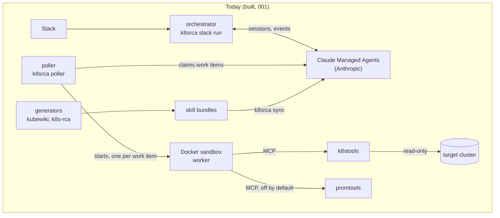
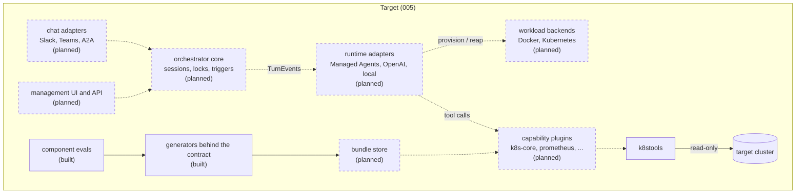
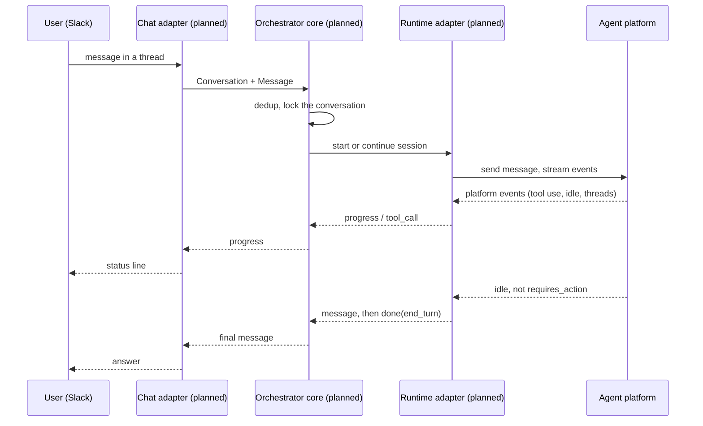
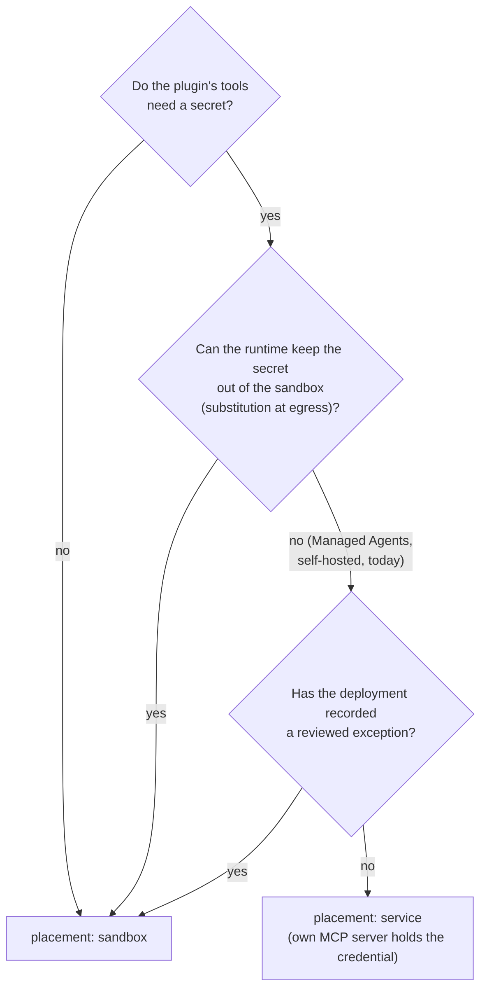
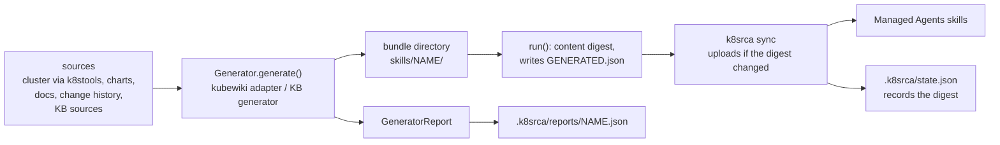
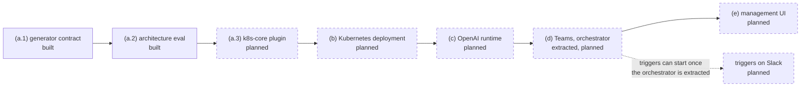

# 005 — Modular architecture (target)

**Status:** draft (in progress); implemented in part. This is a **target architecture**, not a
description of the running system. Built: the generator contract (§6.2) with both skill
generators behind it, and component evals for the architecture generator and the answer writer
(§8.1). That is items 1 and 2 of migration step (a) (§10). Not built, and not scheduled: the
`k8s-core` plugin (step a.3), steps (b) to (e), and every other contract this document
describes. **Last updated:** 2026-11-14.

**Related:** [001 — Architecture](001-architecture.md) (the system as built) ·
[003 — Operations](003-operations.md) · [004 — Scenario testing](004-scenario-testing.md) ·
[009 — Metrics](009-metrics.md) · [014 — SREGym](014-sregym.md) ·
[docs/generators.md](../docs/generators.md) ·
[kubewiki design](../packages/kubewiki/docs/design.md)

k8srca is an agent that diagnoses Kubernetes problems and answers in Slack. Today it has exactly
one implementation in each place where a different one could go (a **slot**): Slack for chat,
**Claude Managed Agents** (Anthropic's hosted agent platform, which runs the agent loop while we
run the tools) for the agent runtime, and Docker for the sandbox that runs tool calls.
[Design 001](001-architecture.md) describes that system, and it is the accurate account of what
runs. This document describes where we would like to take it: the same system with each slot
behind a contract, so that a slot can have several implementations, developed and tested by
different people, some outside this repository. 001 is updated section by section as pieces of
this migration are built; it is not rewritten up front. Project terms are defined in the
[glossary](../docs/glossary.md).

**What exists and what is proposed.** Read every section below as a proposal unless this table
or the section itself says otherwise.

| Section | Subject | State |
| --- | --- | --- |
| §1 | Goals | proposal |
| §2 | Where the coupling is today | **describes current code** |
| §3 | Orchestrator, turn events, chat adapters, triggers | not built |
| §4 | Runtime adapters, workload backends | not built |
| §5 | Capability plugins | not built (Prometheus exists as promtools, outside this plugin model) |
| §6.1–6.2 | Generators and their contract | **built** (`src/k8srca/core/generator.py`) |
| §6.3 | Generated skills as versioned artifacts | in part: bundle manifest and digest built; bundle store not built |
| §6.4 | Regeneration schedule | not built |
| §6.5 | Generators inside the cluster-access rule | **holds today**, enforced by a test |
| §7 | Security invariants for many plugins and backends | not built (today's rules are 001 §8) |
| §8.1 | Component evals | **built** for the architecture generator and the answer writer; not built for runbooks and plugins |
| §8.2–8.3 | Contract suites; scenarios across runtimes | not built |
| §8.4 | Imported scenarios and external benchmarks | in part: ITBench-Lite imports exist (004); SREGym is design 014 |
| §9 | Management UI | not built |
| §10 | Migration order | step (a) items 1–2 built; the rest not started |
| §11 | Repository layout | target only; today's layout is [001 §10](001-architecture.md#10-repository-layout) |
| §12 | Open questions | open |

**Today and the target, side by side.** The first picture is the running system as 001
describes it. The second is the target; dashed boxes and arrows are planned and do not exist.
Solid boxes in the target are the parts already built (the generators and their evals) or
carried over unchanged (k8stools, the cluster).





---

## 1. Goals

These are the goals of the target. None of them holds yet except where §6 and §8.1 say so.

1. **Components can be developed and tested in isolation.** Someone working on a Teams adapter
   would not need a cluster, Anthropic credentials or Slack. Someone working on the
   architecture generator does not need an agent (this part holds today: §8.1).
2. **Key slots have several implementations,** chosen per deployment: chat (Slack, Teams, A2A,
   the agent-to-agent protocol), agent runtime (Claude Managed Agents, OpenAI, a local loop),
   sandbox (Docker, Kubernetes), and observability capabilities (metrics, tracing, logs).
3. **Components can live outside this repo.** A developer can write a Discord adapter, another
   agent integration or an observability plugin in their own repo and plug it in without
   changing k8srca. That is the test of whether the boundaries between components are real.
4. **Evaluation at two levels:** components on their own terms (is the architecture skill
   accurate and complete?), and the system end to end on captured scenarios
   ([004](004-scenario-testing.md)), run through any runtime.

Decisions taken while drafting are listed in [Appendix A](#appendix-a-decisions-taken).

**Non-goals.** Running two runtimes in one deployment. Automatic discovery of which plugins a
cluster supports (declared for now, §5.4). Versioning in-repo components independently: k8srca
ships as one release whose parts are tested together (§11).

---

## 2. Where the coupling is today

This section describes the current code (checked 2026-11-14). The import graph of
`src/k8srca` shows one dependency running through nearly everything: the agent platform.

- **Platform calls are spread across seven modules.** Code that calls `client.beta.sessions`,
  `.agents`, `.environments` or the skills APIs sits in `slack/app.py`, `session.py`,
  `sync.py`, `kb/skills.py`, `worker/poller.py`, `scenario/runner.py` and `cli.py`. The Slack
  app opens platform sessions itself. The scenario runner can only evaluate a Managed Agents
  session.
- **Chat code reads platform events.** `slack/relay.consume` and `session.consume` each branch
  on Managed Agents event types (`agent.custom_tool_use`, `session.status_idle` with
  `requires_action`, `session.thread_created`). There is no k8srca-owned notion of a turn, so
  each consumer re-implements the same rules for when a turn is over, and a fix has to be made
  in each. The reconnect after a dropped event stream
  ([001 §7.2](001-architecture.md#72-a-turn)) had to be wired into four call sites.
- **Configuration and state are single global schemas.** `k8srca.yaml` mixes chat, platform,
  sandbox and capability settings. `.k8srca/state.json` holds platform object IDs.

Two parts are already well separated and serve as precedents:

- **Cluster access** goes through MCP (Model Context Protocol) to
  [k8stools](https://github.com/BenedatLLC/k8stools), a read-only Kubernetes MCP server in its
  own repo, with its own release cycle and other users. The rule that only k8stools holds the
  cluster credential is enforced by a test, `tests/test_no_direct_cluster_access.py`
  ([CLAUDE.md](../CLAUDE.md)).
- **The architecture generator** talks only to MCP and to files. It is now kubewiki, a separate
  package in this repo (§6.1).

---

## 3. The shape of the target

> **Not built.** Today the Slack app ([src/k8srca/slack/](../src/k8srca/slack/)) and
> [src/k8srca/session.py](../src/k8srca/session.py) talk to Managed Agents directly, as §2
> describes. Nothing in this section exists yet; it waits on steps (c) and (d) of §10.

The picture shows the target's components and how a conversation would flow through them.
Everything in it is planned except the generators and the component evals on the last two
lines.

```
                    ┌─────────────── chat adapters ────────────────┐
 people, channels → │ Slack · Teams · A2A server · (Discord, ext.) │
 and other agents   └──────────────────────┬───────────────────────┘
                                           │ conversations, triggers
                                           ▼
                    ┌──────────────── orchestrator (core) ──────────┐
                    │ conversation ⇄ session mapping, dedup, locks, │
                    │ trigger rules, rendering policy               │
                    └──────────────────────┬────────────────────────┘
                                           │ start/continue → TurnEvents
                                           ▼
                    ┌──────────────── runtime adapters ──────────────┐
                    │ Managed Agents · OpenAI Agents · local loop    │
                    │  control plane            executor (in sandbox)│
                    └───────────┬─────────────────────────────┬──────┘
                                │ provision / reap            │ tool calls
                                ▼                             ▼
                    ┌──────── workload backends ────────┐   ┌── capability plugins ──┐
                    │ Docker · Kubernetes               │   │ skills + MCP servers   │
                    │ sandboxes · MCP services · egress │   │ k8s-core · prometheus ·│
                    └───────────────────────────────────┘   │ tracing · logs · ext.  │
                                                            └────────────────────────┘
   build time:  generators ── sources ─▶ skill bundles ─▶ plugins
   evaluation:  component evals per generator/plugin · system scenarios via any runtime
   operation:   management API + web UI over the orchestrator's turn store (§9)
```

Five kinds of component, each behind a contract in a small core package
(`src/k8srca/core/`, which today holds only the generator contract):

| Kind | Contract (§) | Would be in this repo | Outside, for example | Built today |
|---|---|---|---|---|
| Chat adapter | §3.1–3.3 | Slack, Teams, A2A | Discord | no contract; Slack only, coupled to the platform |
| Runtime adapter | §4 | Managed Agents, OpenAI | another agent platform | no contract; Managed Agents only |
| Workload backend | §4.4 | Docker, Kubernetes | | no contract; Docker only |
| Capability plugin | §5 | k8s-core, the generated skills | prometheus, tracing, a vendor's logs | no |
| Generator | §6 | cluster-architecture, runbooks | | **yes**: cluster-architecture and k8s-rca |

The **orchestrator** in this design is not a slot. It is the core logic that today is spread
between `slack/app.py` and `session.py`: mapping conversations to sessions, de-duplicating
events, per-conversation locking, and the rules for when a turn is over. (Today the word
"orchestrator" also names the Slack bot process, `k8srca slack run`, which does all of this for
Slack.) These are where the concurrency bugs have been ([CLAUDE.md](../CLAUDE.md): the poller
serialising spawns, two Slack threads sharing a session). Moving them into one place that every
chat adapter shares means fixing them once.

### 3.1 The turn-event model

> **Not built.**

The central artifact of the target: a k8srca-owned, normalized stream of events that every
runtime adapter produces and every chat adapter and evaluator consumes.

| Event | Carries |
|---|---|
| `message` | text from the coordinating agent (not from delegated sub-agents) |
| `progress` | a status line: tool used, delegation, phase |
| `tool_call` | tool name, for evals and timing |
| `error` | a session error, with whether it is a billing error |
| `done` | why: `end_turn`, `budget`, `terminated`, or `error` |

Rules that today live in each consumer would move behind this boundary, into the runtime
adapter:

- **When a turn is over.** On Managed Agents, `session.status_idle` with `requires_action` is
  not the end of a turn. That is a platform detail and should not leak into chat code.
- **Reconnecting a dropped stream** and replaying missed events
  ([001 §7.2](001-architecture.md#72-a-turn)).
- **Event de-duplication** by platform event ID.

A chat adapter then cannot get a turn boundary wrong, and a second runtime cannot reintroduce a
bug the first one fixed.

The sequence below shows one turn in the target (all planned): the runtime adapter turns the
platform's events into `TurnEvent`s and decides when the turn is over, so the chat adapter only
renders.



### 3.2 Chat adapter contract

> **Not built.**

A chat adapter would connect one kind of conversation channel to the orchestrator:

- **Inbound:** emits `Conversation(id, origin)` + `Message(text, author)` into the
  orchestrator. The conversation ID is the adapter's own (Slack `channel/thread_ts`, Teams
  conversation ID, A2A task ID).
- **Outbound:** renders `TurnEvent`s for one conversation: progress as status, the final
  `message` as the answer. Rendering policy (only the coordinator's messages reach users,
  [001 §7.2](001-architecture.md#72-a-turn)) belongs to the orchestrator; how a status line looks
  belongs to the adapter.
- **Health:** answers `check()` for `k8srca status`.

Several adapters could be active in one deployment (Slack plus A2A). Each owns its own
conversation ID space, so the orchestrator keys sessions by `(adapter, conversation)`.

**A2A is a chat adapter** in the inbound direction: another agent sends k8srca a task, and gets
turn events back as task updates. k8srca calling *out* to other agents over A2A is a different
thing, a capability (§5), and is out of scope here.

### 3.3 Triggers: responding to alerts in a channel

> **Not built.** Today k8srca answers only when mentioned or messaged
> ([001 §1](001-architecture.md#1-purpose-and-scope) lists automatic response to Alertmanager
> alerts as deferred).

The chat slot must support watching a channel and starting an investigation on its own when a
message matches. The motivating case: Alertmanager posts to `#alerts`, and k8srca answers in
the alert's thread without being mentioned.

A trigger would be declarative and owned by the orchestrator, not the adapter:

```yaml
triggers:
  - adapter: slack
    channel: alerts
    match:                       # all must hold
      author: alertmanager       # bot or app identity
      text: 'FIRING.*\[(?P<alert>[A-Za-z]+)\]'
    prompt: "Alert {alert} fired: {text}. Why?"
    reply_in: thread
    dedup: { key: '{alert}', window: 15m }   # one investigation per alert storm
    max_concurrent: 3
```

The adapter only reports channel messages, with author and text. Matching, templating,
de-duplication and rate limiting are core, so they work the same for Slack, Teams or Discord
and are tested once against a fake adapter.

Two rules from operating alert channels:

- **De-duplication and concurrency limits are mandatory.** An alert storm is dozens of
  near-identical messages in a minute. Without a dedup key and a cap, each starts an
  investigation, and the bill and the channel are both flooded.
- **A resolved alert does not start an investigation.** `RESOLVED` messages should post to an
  existing investigation's thread if one exists, and do nothing otherwise.

The knowledge base's alert records are keyed by alert name
([001 §5.1](001-architecture.md#51-k8s-rca-the-investigation-method-and-the-knowledge-base); in the newer format
alerts map onto symptoms, [007 §5](007-knowledge-representation.md#5-entry-points-symptoms-and-alerts-mapped-to-them)),
so an extracted `{alert}` can be looked up directly.

---

## 4. Runtime adapters and sandboxes

> **Not built.** Today the runtime is Claude Managed Agents only, and the sandbox is a Docker
> container started by the poller for each work item
> ([001 §7.3](001-architecture.md#73-sandbox-lifecycle)). This section waits on steps (b) and
> (c) of §10.

### 4.1 Two halves

A runtime adapter would have a **control-plane half** (create agents, start and continue
sessions, stream events) and an **executor half** that runs inside the sandbox and carries out
tool calls. Both platforms we target work this way. They differ in who writes the executor.

### 4.2 The two platforms

The Managed Agents column describes what we run. The OpenAI column is read from OpenAI's
self-hosted environments guide (as of 2026-10-03) and has not been exercised. Verifying it is
the first task of §10 step (c).

| | Claude Managed Agents (in use) | OpenAI Agents API, self-hosted (unverified) |
|---|---|---|
| Who runs the agent loop | Anthropic | OpenAI |
| Executor | **ours**: `k8srca worker`, using the SDK worker | **theirs**: `codex exec-server` |
| How work reaches it | worker polls the environment for work items | executor connects out over WebSocket, receives commands |
| Executor lifetime | one container per work item ([001 §7.3](001-architecture.md#73-sandbox-lifecycle)) | one executor per session |
| Tools | MCP tools wrapped as custom tools by our worker ([001 §4.2](001-architecture.md#42-the-worker-as-mcp-client)) | shell, files and local MCP servers, run by their executor |
| Credential in the sandbox | environment key: can only connect the environment | environment key (`CODEX_API_KEY`): can only connect environments |
| Skills | platform skills, delivered into the sandbox | not described |
| Sub-agents (coordinator → specialist) | stored agents with a roster; each sub-agent its own thread ([001 §3.3](001-architecture.md#33-agent-topology-a-coordinator-and-a-specialist)) | declared per session (`multi_agent: {enabled: true}`, `max_concurrent_subagents`, default 6); harness-supplied tools create, message, wait for and interrupt them |
| What sub-agents can call | any tool given to their agent definition | the parent's MCP tools, credentials and allowed tools; **no function tools** |
| Secrets kept out of the sandbox | vaults substitute credentials at egress, but **not for self-hosted sandboxes** | vaults exist (`api.vaults.*`); whether they inject or substitute is not documented |
| Budgets | per-session spend cap | not described |

OpenAI's sub-agents share the parent's environment and filesystem: "Creating a subagent does
not create another environment." Their events arrive on the session stream as
`agent.session.subagent.created` and as turn items of type `create_subagent_call`,
`send_subagent_input_call`, `wait_for_subagents_call` and `interrupt_subagent_call`.

What follows from the table:

- **The workload backend must not assume an executor.** It runs whatever executor image and
  command the runtime adapter gives it, with the isolation rules of §7. Docker and Kubernetes
  then work for both runtimes.
- **The lifecycles differ.** Per work item for Managed Agents, per session for OpenAI, so the
  backend contract is `provision(spec) → handle` / `reap(handle)`, with the runtime adapter
  deciding when.
- **MCP placement differs.** Our worker is an MCP *client* that reaches k8stools over the
  sandbox network. OpenAI's executor uses MCP servers configured in its environment. Either way
  k8stools stays a separate container holding the only cluster credential. What changes is who
  opens the connection.
- **Tools must be MCP to reach OpenAI sub-agents.** Our Managed Agents worker presents MCP tools
  as *custom* tools, the platform's function-tool equivalent
  ([001 §4.2](001-architecture.md#42-the-worker-as-mcp-client)). OpenAI sub-agents do not support
  function tools, so on OpenAI the specialist only sees k8stools if the executor reaches it as
  an MCP server. That fits the service placement in §5.5. The custom-tool wrapping stays inside
  the Managed Agents adapter.
- **Both platforms can delegate, in different shapes.** Managed Agents stores agents and a
  roster; OpenAI declares sub-agents per session and supplies the delegation tools itself. The
  split between the **coordinator** (`rca-coordinator`, which plans and writes the answer) and
  the **specialist** (`k8s-investigator`, which does high-volume reads)
  ([001 §3.3](001-architecture.md#33-agent-topology-a-coordinator-and-a-specialist)) carries over in
  intent. Agent definitions (system prompts, tool groups, delegation) stay in runtime-specific
  configuration rather than a common shape one platform cannot express, and the turn-event model
  maps both platforms' delegation events to `progress`.
- **Skills stay portable as files.** If a runtime has no skills API, the adapter mounts skill
  bundles into the workspace and points the agent at them in its instructions. Skill bundles
  stay plain directories with `SKILL.md` either way.

### 4.3 A local runtime

"Locally hosted" means a k8srca-owned agent loop over a model API, with the same executor and
sandbox as the other runtimes. It would be the reference implementation of the runtime contract
and the one the test fakes are modelled on. Not scheduled (§10); listed so the contract is not
shaped around two hosted platforms only.

### 4.4 Workload backend contract: sandboxes and MCP services

```
provision(ExecutorSpec) -> Handle     # image, command, env, mounts, network
status(Handle) -> running | exited(code) | failed(reason)
reap(Handle)                          # stop, collect logs, delete
check() -> list[Finding]              # for `k8srca status`, incl. §7 checks

deploy_service(ServiceSpec) -> Endpoint   # a long-running MCP server: image,
                                          # secret mounts, network, health check
remove_service(name)
```

The same backend would run two kinds of workload. **Sandboxes** are short-lived, one per work
item or session. **MCP services** are long-running and hold credentials: k8stools today, and
any plugin whose tools need a secret the sandbox must not see (§5.5). Running both through one
backend is what lets a plugin's MCP server be "just an image" in its manifest, deployed the same
way on Docker and Kubernetes.

- **Docker** would wrap what exists today: `docker/spawn.sh`, the poller's `spawn()`
  ([src/k8srca/worker/poller.py](../src/k8srca/worker/poller.py)) and `docker/egress-rules.sh`
  for sandboxes; Compose services, like today's `k8stools` in `docker/compose.yaml`, for MCP
  services.
- **Kubernetes:** a Pod (or Job) per handle in a dedicated namespace, a NetworkPolicy instead of
  iptables egress rules, and resource limits from the spec. MCP services would each be a
  Deployment, a Service and a NetworkPolicy, admitting only the sandbox namespace. The
  orchestrator and the runtime control plane run as Deployments next to them (§10 step b).

---

## 5. Capability plugins

> **Not built.** There is no plugin manifest, loader or `k8srca plugins` command. Today the
> `k8s-rca` skill, the `cluster-architecture` skill, k8stools and promtools are each configured
> directly in `k8srca.yaml`. Prometheus support exists as promtools
> ([design 009](009-metrics.md), [packages/promtools](../packages/promtools/)), our read-only
> Prometheus MCP server, run as its own container (`docker/Dockerfile.promtools`; the scenario
> runner starts it for scenarios with a metrics capture) and configured as an ordinary MCP
> server entry with the `prom_` prefix, off by default in production. It follows §5.5's service placement but not
> this section's plugin format.

### 5.1 What a plugin is

A plugin would be a **capability bundle** the agent uses at run time:

- zero or more **skills** (directories with `SKILL.md` and files);
- zero or more **MCP servers**: image, tool allowlist and named tool groups, and how it receives
  its credential;
- a **config schema** for the deployment-specific values it needs (a Prometheus URL, a tenant);
- **agent wiring hints:** which tool groups a coordinator should hold, and whether it warrants
  its own specialist ([001 §11](001-architecture.md#11-extension-points-for-deferred-work),
  "Observability MCP");
- **its own evals** (§8.1).

`k8s-core` would be a plugin like any other, always enabled: the `k8s-rca` skill and knowledge
base, and k8stools. Observability sources would be plugins enabled per deployment.

### 5.2 Manifest

```yaml
# k8srca-plugin.yaml, at the root of the plugin's path
name: prometheus
version: 0.3.0
requires: { k8srca: ">=0.9" }
skills:
  - path: skills/promql-guide
mcp:
  - name: prometheus
    placement: service           # or sandbox; see §5.5
    image: ghcr.io/example/prom-mcp:1.4.2
    prefix: prom_
    groups:
      triage: [query_instant, list_alerts]
      full: "*"
    credential: { secret: prometheus-token, mount: /run/secrets/token }
    read_only: true              # asserted, and checked (§7)
config:
  url: { type: string, required: true }
evals:
  - path: evals/
```

### 5.3 Referencing external plugins

A deployment would name plugins by source: in-repo plugins by name, external ones by git repo,
path and ref.

```yaml
plugins:
  - k8s-core
  - name: prometheus
    git: https://github.com/example/k8srca-prometheus
    path: plugin/                # where k8srca-plugin.yaml lives
    ref: v0.3.0                  # tag or commit; never a branch in production
    config: { url: http://prometheus.monitoring:9090 }
```

`k8srca plugins sync` (planned, not built) would fetch each ref into a local cache, validate the
manifest and config, and record the resolved commit in a lockfile so a deployment is
reproducible. Fetching is a build step, never something that happens at run time.

**Code components are different from plugins.** A plugin is content and container images. A
chat adapter, runtime adapter or workload backend from outside this repo is Python code,
distributed as a package that registers under an entry-point group (`k8srca.chat`,
`k8srca.runtime`, `k8srca.workloads`) and is selected by name in configuration. Keeping the two
mechanisms separate keeps plugins free of code that runs in k8srca's own process.

### 5.4 Presence is declared

A deployment would list the plugins it enables. k8srca would not probe the cluster to discover
a Prometheus. A declared plugin whose MCP server does not answer would fail `k8srca status`, the
same way an unreachable k8stools does today.

### 5.5 Where a plugin's tools run

A plugin's tools would run in one of two places, and the deciding question is the credential.

| Placement | What runs where | When it is allowed |
|---|---|---|
| **In the sandbox** | a client library or MCP client inside the agent's sandbox (a Prometheus client, say) | the endpoint needs no secret, or the provider keeps the secret out of the sandbox (substituted at egress, never readable there) |
| **As a service** | the plugin's own MCP server, run by the workload backend as an MCP service (§4.4), holding the credential | any credential the sandbox must not see. k8stools is the model |

The decision, as a flow (planned; today promtools and k8stools both run as services):



The first is simpler and is what a plugin should use when it can. On our current setup it is not
available for anything that needs a secret: Managed Agents vaults keep secrets out of the
sandbox by substituting them at egress, and that is **not supported for self-hosted
sandboxes**. A secret placed in a self-hosted sandbox some other way is plain text to anything
the agent runs there, including under prompt injection. Until a provider offers substitution for
self-hosted sandboxes, a plugin that needs a secret runs as a service.

The manifest says which (`placement: sandbox | service`). Validation would reject a `sandbox`
plugin that declares a credential the active runtime cannot keep out of the sandbox, **unless
the deployment records an exception**:

```yaml
plugins:
  - name: prometheus
    placement: sandbox
    config: { url: http://prometheus.monitoring:9090 }
    secret_in_sandbox:
      secret: { name: prometheus-readonly, key: token }
      reason: query-only token; metrics are already visible to every SRE
      reviewed: <reviewer>, <date>
```

Exceptions are decided case by case, not by plugin default. The criteria:

- **The credential is read-only at its issuer**, scoped there (a query-only Prometheus token),
  not merely read-only because our tools happen only to read.
- **The data behind it is acceptable to disclose.** Assume a secret in the sandbox is disclosed
  to anyone who can read the conversation or the provider's session history: whatever the agent
  can read, it can write into an answer. Egress control (§7.2) limits where the secret can be
  *used* from the sandbox, not whether it can be *revealed*.
- **Rotation is cheap**, and its endpoint is on the egress allowlist.

Accepted exceptions would be listed by `k8srca status` and in the management UI, so they are
seen again rather than forgotten.

---

## 6. Generators

A **generator** is a build-time component that reads sources and writes a skill bundle (the
directory of instructions and files the platform downloads into the sandbox). This is the part
of 005 that is built. How to run and evaluate the generators is in
[docs/generators.md](../docs/generators.md).

### 6.1 Generators are not plugins

A generator reads sources and *produces* a skill bundle, which a plugin would then deliver. The
two have different lifecycles (a generator runs per deployment, on a schedule or on demand; a
plugin is loaded at run time), different inputs (a cluster, charts, runbooks), and different
evals (§8.1). Calling both "plugins" would blur the distinction that makes each testable.

Two generators exist, and one more is planned:

- **cluster-architecture** (built): **kubewiki**
  ([packages/kubewiki](../packages/kubewiki/docs/design.md)), a standalone package in this
  repository with its own version, runnable without k8srca (`kubewiki build`) and forbidden by a
  test from importing it. It reads the live cluster through MCP, rendered Helm charts, the
  application's documentation and the cluster's change history, and writes a wiki of the
  deployment: the `cluster-architecture` skill. k8srca's side is a thin adapter,
  [src/k8srca/arch/generator.py](../src/k8srca/arch/generator.py), that maps `k8srca.yaml` onto
  kubewiki's inputs and fits its output to the contract below. `k8srca arch build` runs it.
- **k8s-rca** (built): [src/k8srca/kb/generator.py](../src/k8srca/kb/generator.py) normalises the
  knowledge base (the vendored alert records plus the authored and mined knowledge of
  [design 007](007-knowledge-representation.md)) into `knowledge_base.json` inside the `k8s-rca`
  skill, whose `SKILL.md` and scripts are written by hand. `k8srca kb build` runs it.
- **runbooks** (planned, not built): would read a deployment's runbooks and write skills
  structured as debugging guides. [Design 007 §9](007-knowledge-representation.md#9-runbooks-not-built)
  defines a runbook format; nothing reads one yet.

### 6.2 The generator contract (built)

In [src/k8srca/core/generator.py](../src/k8srca/core/generator.py), with
[src/k8srca/arch/generator.py](../src/k8srca/arch/generator.py) and
[src/k8srca/kb/generator.py](../src/k8srca/kb/generator.py) behind it:

```
Generator:  name, format
            generate(cfg, dest) -> GeneratorReport
run(generator, cfg, dest) -> (SkillBundle, GeneratorReport)
```

The pipeline as built, from sources to the platform:



A generator only writes its bundle and says what it did. `run()` adds what every generated bundle
needs and no generator should have to remember:

- **A manifest in the bundle** (`GENERATED.json`): skill name, generator, output `format`,
  k8srca release, and a digest of the bundle's content. It holds no timestamp, because
  `k8srca sync` re-uploads a bundle whenever its digest changes; a timestamp would re-upload an
  unchanged skill on every build and churn committed bundles.
- **A report outside the bundle** (`.k8srca/reports/<name>.json`): summary lines, counts, the
  build time, and **warnings** for inputs that were skipped or could not be resolved. It is for
  people and for the generator's evals (§8.1), not for the agent, so it is not shipped.

Where each output fact came from (observed in the cluster, declared in a chart, or documented)
is part of the generator's own output, not the report's: the cluster-architecture wiki records
the source of every fact, which is what makes its evals possible.

### 6.3 Generated skills are versioned artifacts

> **Built in part.** Each bundle carries `GENERATED.json` with its content digest, generator and
> format (§6.2), and `k8srca sync` records the digest of each skill it uploads in
> `.k8srca/state.json`. Not built: a bundle store, and a record of the generator's own version
> separate from the k8srca release.

A generated skill should be versioned and stored like an external plugin's skill, not like
source. The `cluster-architecture` skill is gitignored and rebuilt ([CLAUDE.md](../CLAUDE.md));
the `k8s-rca` skill is committed. Scenarios pin a snapshot of each skill beside their capture,
in the separate repo `BenedatLLC/k8srca-scenario-data` ([004](004-scenario-testing.md)). The
target: each generation writes a content digest and the generator's own version into the
bundle, and a deployment records which bundle it serves. A regression can then be traced to a
generator change or a source change.

Where bundles are stored is open (§12). The options:

| Store | For | Against |
|---|---|---|
| The provider's skill store (the Managed Agents skills API, used today) | already used; versions built in | a delivery mechanism, not storage: provider-specific, and OpenAI has no equivalent described |
| An OCI registry (bundles pushed as artifacts) | content-addressed, signed, same registry as the images; natural on Kubernetes | one more artifact type to build tooling for; less natural on a laptop |
| An object store bucket, keyed by digest | simple, cheap | per-cloud; no history or metadata without a convention |
| A git repo per deployment | reviewable diffs of what the agent will be told; history; fits GitOps | generated content is large and noisy; a commit per regeneration |
| k8srca's own database | one place with the management UI (§9) | backups and migration become ours |

The leaning: store bundles content-addressed behind a small `BundleStore` interface, with a
local directory for development and an OCI registry for Kubernetes. Uploading to a provider's
skill store becomes a delivery step at sync time, not the place a bundle lives. A deployment
that wants to review what changed can additionally export to a git repo.

### 6.4 Regeneration schedule

> **Not built.** Today a skill is rebuilt only when someone runs `k8srca arch build` or
> `k8srca kb build`.

Generated skills go stale ([001 §5.2](001-architecture.md#52-cluster-architecture-what-is-deployed-and-how-it-fits-together)).
Each generator would have a schedule per deployment (on demand, or every N hours) set in
configuration or the management UI (§9). A regeneration that changes the bundle's digest would
be recorded with what changed, so the UI can show "architecture skill updated 2h ago: 3
workloads changed".

### 6.5 Generators stay inside the cluster-access rule

This holds today. The architecture generator reads the cluster only through k8stools, and
`tests/test_no_direct_cluster_access.py` (with kubewiki's own
`packages/kubewiki/tests/test_kubewiki_boundary.py`) fails on any direct use of the Kubernetes
API ([CLAUDE.md](../CLAUDE.md)). The same must hold for every future generator: one that needs
live data gets it through an MCP server, so it is bound by the same read-only tool surface as the
agent.

---

## 7. Security invariants, generalized

> **Not built.** Today's rules are [001 §8](001-architecture.md#8-read-only-guarantee-and-security):
> one cluster credential, held by the k8stools container; one kind of sandbox, a Docker
> container with no credentials and egress rules applied by `docker/egress-rules.sh`. This
> section restates them as contracts for many plugins and backends.

With several plugins and backends, today's rules would become contracts every component must
meet:

1. **One credential, one holder, per data source.** Each data source's credential is mounted
   into its own MCP server's container and nowhere else: not the orchestrator, not another
   plugin's server, and not the sandbox unless a reviewed exception says so (§5.5).
2. **Plugins are read-only, and that is checked.** `read_only: true` in a manifest is a claim.
   The plugin's evals (§8.1) include a check that no declared tool mutates state, and k8s-core
   keeps the AST test that bans direct cluster access.
3. **Every workload backend passes the same confinement suite** for its sandboxes: no kubeconfig
   or cloud CLI in the image, no route to the host or the API server, egress limited to the
   allowlist (§7.2), and credentials removed from the environment. `k8srca status` would run it
   on every backend. Today `k8srca status` runs one probe (can a container on the sandbox network
   reach the API server port), and `docker/verify-egress.sh` runs the fuller set of probes by
   hand.
4. **The executor's platform key can only connect environments.** That is true of both
   platforms as documented. A runtime adapter that needs a broader key in the sandbox does not
   meet the contract.

### 7.1 Secrets management

| Secret | Held by | Docker | Kubernetes |
|---|---|---|---|
| Provider API key (control plane) | orchestrator | `.env`, read by `settings.py` (today) | Secret, mounted into the orchestrator only |
| Executor key (environment key) | each sandbox | passed by the poller as an env var (today) | Secret, mounted into sandbox Pods |
| Chat tokens (Slack, Teams) | orchestrator | `.env` (today) | Secret, orchestrator only |
| Target-cluster credential | k8stools only | kubeconfig file bind-mounted read-only (today) | Secret mounted into k8stools only. k8srca runs in another cluster, so this is a token for the target, not an in-cluster ServiceAccount |
| Plugin data-source credentials | that plugin's MCP service (§5.5) | mounted into its container | Secret mounted into its Deployment |
| Model API keys (local runtime) | the runtime control plane | `.env` | Secret |

Configuration would never contain secret values, only references:

```yaml
secret: { name: prometheus-token, key: token }
```

The workload backend would resolve a reference to a mount: a file under a secrets directory on
Docker, a Kubernetes Secret (which an external-secrets operator or a cloud secret manager can
fill) on Kubernetes. Two rules hold on both:

- **Each secret is mounted into exactly one kind of workload.** The backend's `check()` lists
  every workload's mounts and fails if a secret appears in two, or in a sandbox when it is
  neither the executor key nor a recorded exception (§5.5). This is invariant 1 made testable.
- **Secrets are write-only from outside.** The management UI (§9) can set or rotate a secret and
  never displays one.

What differs between the backends is storage and delivery, not the rules. Docker has no secret
store of its own, so a `.env` file and a secrets directory with tight permissions are the floor.
Kubernetes Secrets are only base64-encoded unless etcd encryption is enabled. A production
deployment should use etcd encryption or an external secret manager, and the Helm chart should
support both.

### 7.2 Egress allowlist

> **Not built.** Today's sandbox egress is a **deny-list**: `docker/egress-rules.sh` blocks the
> host, private ranges, cloud metadata and the API server, and allows the rest of the public
> internet. Its header says so: "It is not an allowlist."

The target is an allowlist on both backends.

- **Granularity is host and port.** With HTTPS, a proxy sees the destination host (CONNECT, or
  the TLS SNI) but not the path. Filtering paths would mean intercepting TLS with our own CA,
  which breaks provider certificate checks and is fragile. Not planned.
- **No route out except the proxy.** The sandbox network has no external route
  (`internal: true` on Docker; a default-deny egress NetworkPolicy on Kubernetes). Its only exit
  is an egress proxy that allows listed hosts. MCP services are reached directly on the internal
  network. The network enforces this, so agent-run code that ignores `HTTPS_PROXY` has no route.
- **The allowlist is composed, never hand-written:** the runtime adapter's endpoints (the
  provider API, or the executor's WebSocket endpoint), the endpoints of plugins placed in the
  sandbox (§5.5), and nothing else. A plugin's manifest declares its endpoints; the deployment's
  configuration fills in its URL.
- **The confinement suite tests both directions:** every declared endpoint is reachable through
  the proxy, and an arbitrary public host, the host, private ranges and metadata are not.

One thing to verify per runtime: that its executor honours `HTTPS_PROXY`. The Managed Agents SDK
worker's HTTP client does. Whether OpenAI's `codex exec-server`, a WebSocket client, does is
unknown until the prototype (§10 step c).

What an allowlist does not stop: the agent writing what it has read into its own messages, which
reach session history and the chat. It bounds where data can be sent, not what the agent can
reveal (§5.5).

---

## 8. Evaluation

### 8.1 Component evals

Each generator and plugin should ship evals that run without an agent. Two exist.

- **cluster-architecture generator (built).** `k8srca eval arch`
  ([src/k8srca/evals/architecture.py](../src/k8srca/evals/architecture.py); how to run it:
  [docs/generators.md §5](../docs/generators.md#5-evaluating-a-generator)). The scoring is
  kubewiki's (`kubewiki.eval`); k8srca replays each case's capture through a k8stools container
  and builds the wiki through its adapter. Each case is a captured cluster with a hand-reviewed
  ground truth, under `tests/evals/architecture/`. Scores:
  - **completeness:** every workload, service, dependency edge and resource setting in the
    capture appears;
  - **accuracy:** every observed fact matches the capture, every declared fact matches the
    charts;
  - **no invention:** no fact without a source;
  - **drift detection:** conflicts between declared and observed values are reported.

  `k8srca eval arch --judge` adds free coverage (which workloads have a page) and a paid judge,
  one model call per case, that reports claims in the wiki's documentation which a recorded fact
  directly contradicts. The case that motivated it is a false operator note (a claim that `ad`
  never reaches readiness, repeated by five of six scenario runs): a *documented* fact that the
  *observed* state contradicts. Calibrated on planted claims, the judge catches those. The
  readiness note itself is false only through Kubernetes semantics, not through any recorded
  fact, and the judge is deliberately limited to recorded facts
  ([docs/generators.md §5](../docs/generators.md#5-evaluating-a-generator)).

  **The eval runs on two installs.** Scored only against our own OTel demo capture, the generator could
  be fitted to our install without anyone noticing. The two cases are
  `otel-demo-2026-10-03` (our OpenTelemetry demo install) and `itbench-33-pre-fault`, a third
  party's install of the same application imported from ITBench-Lite
  ([004 §12.1](004-scenario-testing.md#121-itbench-lite)), built from a pull taken before the
  fault with only the `live_cluster` and `change_history` sources. That is the generator's job
  in production, since the skill exists before the incident. The two installs disagree where
  they should: ITBench's `ad` memory limit is 450Mi, ours is 300Mi.
- **answer writer (built).** `k8srca eval answer`
  ([src/k8srca/evals/answer.py](../src/k8srca/evals/answer.py),
  [010 §8](010-facts-and-short-answers.md#8-testing-the-suite-and-the-component-evals)): a scenario's recorded facts in, one
  answer out, graded on the scenario's checklist. It fixes the input at the facts, not at a
  replayed session.
- **runbook generator (planned, not built).** Would be scored on faithfulness (every step in the
  output traces to the runbook), coverage (every runbook step appears), and structure (a
  debugging guide, not a copy).
- **Plugins (planned, not built).** A tool contract test against a recorded fixture (each tool
  answers with its declared schema), the read-only check from §7, and, for skills, a check that
  every referenced file exists.

### 8.2 Contract suites

> **Not built.**

Each contract would ship an in-memory fake and a test suite every implementation must pass:

| Contract | Suite covers |
|---|---|
| Runtime | turn boundaries, reconnect and replay, dedup, concurrent conversations, billing errors |
| Chat | rendering a turn, conversation identity, trigger reporting |
| Workload | provision/reap, MCP service deploy/health, confinement and secret placement (§7, §7.1) |
| Orchestrator | locking, dedup, triggers, against fake chat and fake runtime |

The tests [CLAUDE.md](../CLAUDE.md) asks to keep failing if their fix is reverted
(`tests/test_poller_concurrency.py`, `TestConcurrentThreads`,
`test_exactly_one_racing_caller_wins`) would move into the runtime and orchestrator suites. They
test concurrency, not Slack.

### 8.3 System scenarios across runtimes

> **Not built.** The scenario runner ([src/k8srca/scenario/runner.py](../src/k8srca/scenario/runner.py))
> drives Managed Agents sessions directly.

004's scenarios would run through the runtime contract, not through Managed Agents directly.
The same capture, skill snapshot and checklist could then compare runtimes and models. A
baseline already pins capture, skills, checklist and grader. It would also have to pin
**runtime and model**, or a comparison across runtimes would read as an agent regression.

### 8.4 Imported scenarios and external benchmarks

[004 §12](004-scenario-testing.md#12-external-benchmarks) reviewed four public benchmarks and
decided how each is used: ITBench-Lite scenarios are **imported**, Cloud-OpsBench is a coverage
checklist, and NOFire is not used. SREGym was planned as a periodic live exam, then set aside as
a candidate for the hold-out suite ([006](006-holdout-suite.md)); [design 014](014-sregym.md)
now runs SREGym-Lite live, diagnosis only. The points below are how those decisions fit this
architecture.

- **We import captures and re-derive the answer key.** An imported scenario is a capture plus a
  `truth.yaml` re-derived from it, graded the same way as our own: on a checklist written from
  the truth ([010 §7](010-facts-and-short-answers.md#7-grading-checklists)), as `itbench-33`'s is. The
  source's own scoring is not used. ITBench's ground truth for the first import was wrong twice
  (it omitted `cart`, which has the same fault, and described an outage the capture shows did
  not happen), so a source's answer key is an input to our review, never a substitute for it.
  This is how the ITBench imports in `tests/scenarios/` were made.
- **The converter is an external component.** It turns ITBench-Lite's raw API objects into a
  k8stools capture by running k8stools' own `capture_state` against them. It imports the
  `kubernetes` client, so it cannot live in k8srca ([CLAUDE.md](../CLAUDE.md)); it belongs beside
  k8stools' `k8s-capture-state`. That is goal 3 of §1 in practice: a component k8srca depends on,
  developed and released elsewhere.
- **Comparisons with other systems are ablations on our scenarios.** Public leaderboards run
  bare models in a fixed harness. k8srca is a system whose value is the tools and skills around
  the model, so the numbers are not comparable and we do not report them. The measurements that
  mean something are ablations on the same scenarios: skills on versus off; k8stools reading
  from a capture versus the same data dumped into the workspace (the direct test of having the
  agent fetch data through tools rather than receiving it all up front,
  [001 §2](001-architecture.md#2-platform-facts-that-shape-the-design)); and, with this design, **one
  runtime against another** (§8.3).
- **A live exam runs as an ordinary deployment.** A live benchmark such as SREGym injects
  faults into a live cluster, which the scenario suite deliberately avoids
  ([004 §9](004-scenario-testing.md#9-rejected-alternatives)). In this design it is an ordinary
  deployment pointed at the exam cluster: k8stools gets that cluster's read-only credential and
  nothing else does, the architecture generator runs **before** the fault is injected, and the
  conversation arrives through the runtime contract like any other. Diagnosis only: k8srca does
  not mitigate, so the mitigation phase is skipped. SREGym ships its own MCP servers, including
  a `kubectl` one; that one is not used, because cluster access is k8stools, read-only, by rule.
  Its Prometheus, Loki and Jaeger servers are a ready test bed for observability plugins (§5).
  [Design 014 §4](014-sregym.md#4-architecture) is the concrete plan.
- **Several imports wait on metrics and traces.** ITBench-Lite's feature-flag scenarios and
  SREGym's harder problems are visible mostly in metrics and traces. 004 scheduled a Prometheus
  source as its step S4. In this design the Prometheus source would be the first capability
  plugin after `k8s-core`, built against the plugin contract (§5.2) to prove that contract on a
  real case. What was built instead is promtools ([design 009](009-metrics.md)), an MCP server
  configured directly in `k8srca.yaml` (§5). Turning it into a plugin is not in §10's order.

---

## 9. Management UI

> **Not built.** It waits on the orchestrator owning conversation state (§10 step e).

A web UI for operating a deployment. It would talk to a **management API** served by the
orchestrator process, and that API is the only thing the UI uses, so everything it can do can
also be scripted or done from the CLI.

| Area | What it does |
|---|---|
| Configuration | edit trigger rules (§3.3), generator schedules (§6.4), plugin settings |
| Skills and plugins | add a plugin by git repo/path/ref (§5.3), enable or disable it, regenerate a generated skill and see what changed |
| Statistics | active conversations, conversations over a chosen window, errors, cost, turn latency, by adapter and by trigger |
| Drill-down | a conversation's turns and tool calls, with a link to the provider's console for the session (`session.console_url` already builds Managed Agents links) |
| Health | `k8srca status`, rendered: adapters, runtime, workloads, MCP services, confinement checks |
| Secrets | set and rotate (§7.1); values never shown |

What it needs underneath:

- **A store.** Today conversation state is SQLite in `slack/sessions.py`, and statistics do not
  exist. The orchestrator would record each turn (start, end, outcome, cost, tool count,
  trigger) in a store: SQLite for one-node Docker and PostgreSQL on Kubernetes. The same records
  would feed a Prometheus `/metrics` endpoint, so dashboards and alerts on k8srca itself do not
  need the UI.
- **Authentication and roles.** OIDC sign-in. Changing triggers or adding plugins changes what
  runs and what it costs, so viewing and editing are separate roles.
- **A decision about where configuration lives** (§12). Today it is `k8srca.yaml`. A UI that
  edits configuration either writes that file (or opens a pull request against it), or makes the
  store authoritative. The leaning: infrastructure choices (which adapters, runtime, backend)
  stay in the file; operational settings (triggers, schedules, enabled plugins) live in the
  store, are audited, and can be exported.

---

## 10. Migration, in order

Each step leaves the system working and has an exit test. Only step (a) items 1 and 2 are
built; [docs/todo.md](../docs/todo.md) lists the rest as not scheduled. The order, with built
steps solid and planned ones dashed:



### (a) Generators out, with their own evals

1. **Built.** Move the architecture and knowledge-base generators behind the generator contract
   (§6.2), each writing a versioned bundle and a report.
2. **Built.** Build the cluster-architecture component eval (§8.1) against two installs, our
   OTel demo capture and the `itbench-33-invalid-node-selector` pre-fault pull, each with a
   ground-truth file (`tests/evals/architecture/*/truth.yaml`).
3. **Not built.** Make `k8s-core` the first plugin (§5): the `k8s-rca` skill plus k8stools.

**Exit:** `k8srca arch build` output is scored by its own eval without an agent, and the scenario
suite still passes on the bundle it produces. The first half holds. For the second, scenario
runs use a wiki built from each capture through the same adapter (`k8srca scenario build-wiki`;
`--arch wiki` is the runner's default), and all 15 scenarios' `truth.yaml` files pin the digest
of a wiki built that way. The baseline ([docs/baseline.md](../docs/baseline.md)) is therefore
measured on the generator's output, replayed.

### (b) Kubernetes deployment

> **Not started.**

k8srca would run in a different cluster from the one it investigates, as
[003 §4.1](003-operations.md#41-topology) already recommends (a separate operations cluster,
because k8srca hosted in the cluster it diagnoses is least available exactly when it is needed).
For development, that is a local minikube hosting k8srca, investigating the existing target
cluster. [003 §4](003-operations.md#4-kubernetes-deployment-follow-on) is the starting design for
this step: its component mapping (§4.2), externalizing the workspace first (§4.4) and sandbox
hardening (§4.5) carry over, rebased onto the workload backend contract.

1. Extract the workload backend contract (§4.4) around today's Docker code. Replace the egress
   deny-list with the allowlist proxy (§7.2) on Docker first, where the confinement checks
   already run, so the Kubernetes backend implements a contract that is already tested.
2. Write the Kubernetes backend: a Pod per work item, a NetworkPolicy, a namespace of its own.
3. Package the orchestrator, poller and k8stools as Deployments (a Helm chart). k8stools gets the
   target cluster's read-only credential as a Secret (§7.1); the read-only ClusterRole
   ([001 §8](001-architecture.md#8-read-only-guarantee-and-security)) lives in the *target*
   cluster.

**Exit:** the confinement suite (§7) passes on both backends, and a Slack mention is answered
from an in-cluster deployment.

### (c) OpenAI

> **Not started.**

1. Verify §4.2's OpenAI column by prototype: an executor in a sandbox, one session, one tool call
   through k8stools.
2. Extract the turn-event model (§3.1) and the runtime contract around today's Managed Agents
   code: `session.py`, `sync.py`, the poller. Chat adapters and the scenario runner consume
   `TurnEvent`s.
3. Write the OpenAI runtime adapter.

**Exit:** `jvm-oom-on-startup` runs n=6 on both runtimes, against one capture and checklist, with
runtime and model pinned in each baseline.

Step (c) is where the runtime contract is most likely to change shape, which is why its first
task is a prototype, not the extraction.

### (d) Teams

> **Not started.**

1. Extract the chat contract (§3.2) and the orchestrator (§3) out of `slack/`, with triggers
   (§3.3).
2. Write the Teams adapter.

**Exit:** the orchestrator suite passes against fakes, and both adapters pass the chat suite.

Triggers (§3.3) can be built with (d) or earlier, on Slack alone. They need the orchestrator
extracted, not a second adapter.

### (e) Management UI

> **Not started.**

After the orchestrator owns conversation state (step d), since statistics come from its turn
records. The management API can start earlier, with `k8srca status` and statistics, and the UI
follows it.

---

## 11. Repository layout (target)

> **Target only.** Today's layout is in [001 §10](001-architecture.md#10-repository-layout) and
> [CLAUDE.md](../CLAUDE.md). Of the directories below, only `core/` (the generator contract) and
> `evals/` (the component evals, not yet split into `components/` and `scenarios/`) exist;
> generators live in `arch/` and `kb/` and in `packages/kubewiki`.

```
k8srca/
├── src/k8srca/
│   ├── core/                 # contracts, TurnEvent, config composition, fakes
│   ├── orchestrator/         # sessions, locks, dedup, triggers
│   ├── chat/{slack,teams,a2a}/
│   ├── runtime/{managed_agents,openai}/
│   ├── workloads/{docker,kubernetes}/   # sandboxes and MCP services
│   ├── management/           # management API, turn store, metrics
│   ├── ui/                   # web UI, built against the management API
│   ├── generators/{architecture,runbooks}/
│   ├── plugins/              # manifest loading, git fetch, lockfile
│   └── evals/{components,scenarios}/
├── plugins/k8s-core/         # the in-repo plugin: k8srca-plugin.yaml, skills/
├── deploy/{docker,helm}/
└── tests/contracts/          # suites every implementation runs
```

Boundaries inside the package would be enforced the way the cluster-access rule is: an AST test
that fails if `chat/` imports `runtime/` internals, or if anything but `runtime/managed_agents/`
imports `anthropic`'s agent APIs. A boundary that is only a directory name will not survive
several developers.

---

## 12. Open questions

Already settled, and recorded in [Appendix A](#appendix-a-decisions-taken): OpenAI supports
sub-agents (§4.2); k8srca runs in a separate cluster (§10 b); a plugin's tools run in the
sandbox only when no secret is exposed there (§5.5).

1. **Where trigger rules come from** (§3.3): the deployment's configuration, or the plugin whose
   alerts they are. Leaning toward the deployment's configuration; to revisit.
2. **Where generated skills are stored** (§6.3). Leaning toward a content-addressed store, a
   local directory plus an OCI registry.
3. **Where configuration lives once the UI edits it** (§9): the file, the store, or a split.
   Leaning toward the split.
4. **The rest of the OpenAI column** of §4.2: how the self-hosted executor is told about MCP
   servers, whether vaults substitute at egress, budgets, and whether the executor works through
   an egress proxy (§7.2). To be answered by the prototype in §10 (c).
5. **Third-party MCP service images** (§5.5) would run with a credential inside our deployment.
   What does a plugin have to provide to be trusted with one: a signed image, a pinned digest, a
   read-only test against a fixture (§8.1)?
6. **Provider-side secret substitution for self-hosted sandboxes.** If a provider adds it,
   plugins that need a secret could move into the sandbox. Worth asking Anthropic and OpenAI
   whether it is planned.

---

## Appendix A. Decisions taken

From the discussion that started this document (2026-10-01 to 2026-10-03). They are decisions
about the target; the "Built" column says which have been carried out.

| Question | Decision | Built |
|---|---|---|
| What counts as "the OpenAI equivalent" | OpenAI's Agents API with a self-hosted environment (§4.2) | no |
| Several chat frontends at once? | Yes: two of the same kind are unlikely, but Slack plus A2A is a real case | no |
| Channel monitoring | The chat slot must support watching a channel and responding to matching alerts automatically (§3.3) | no |
| Where components live | Core components in this repo, one release. External components (k8stools, third-party plugins, a Discord adapter) in their own repos, versioned independently | k8stools is external; kubewiki and promtools are packages in this repo |
| How external plugins are referenced | A git repo, a path inside it, and a ref (§5.3) | no |
| Plugin presence | Declared per deployment. Automatic configuration later, perhaps | no |
| Generated skills | Versioned independently of k8srca, like external plugins (§6.3) | in part (bundle manifest and digest) |
| Order | Generators and their evals, then Kubernetes deployment, then OpenAI, then Teams (§10) | step (a) items 1–2 |
| Where k8srca runs | In a cluster other than the one it investigates. Tested with k8srca in a local minikube investigating the existing target cluster | no |
| Where a plugin's tools run | In the sandbox when no secret is exposed there; otherwise as a credential-holding service, like k8stools (§5.5) | promtools runs as a service |
| Secrets in the sandbox | Only by a reviewed exception, decided case by case (for example a query-only Prometheus token) (§5.5) | no secrets in the sandbox today |
| Sandbox egress | An allowlist of hosts through an egress proxy, replacing today's deny-list (§7.2) | no |
| External benchmarks | Import ITBench-Lite captures with re-derived truth; SREGym as a periodic live exam after the first metrics source; Cloud-OpsBench as a checklist; NOFire not used. Decided in [004 §12](004-scenario-testing.md#12-external-benchmarks) (§8.4). SREGym was later set aside for the hold-out suite, then taken up by [design 014](014-sregym.md) | ITBench imports exist; SREGym is 014's |
| A management UI | In scope: configuration, skills and plugins, statistics, links to the provider console (§9) | no |
