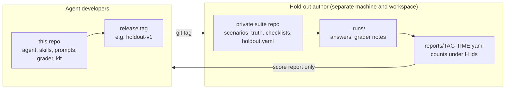
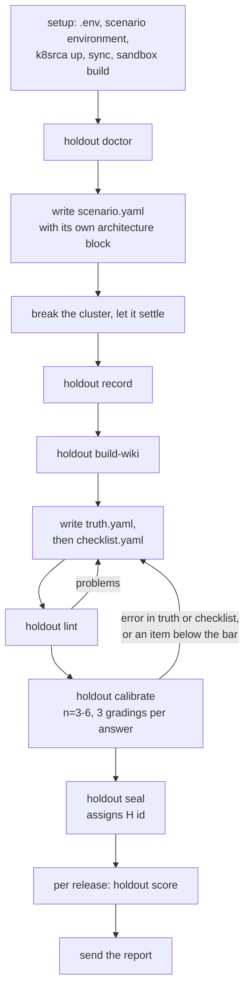

# 006 — Hold-out suite

**Status:** on hold (owner, 2026-10-23); built in part. The kit that lets a colleague
author and score a suite on their own machine is built (`k8srca holdout …`,
[src/k8srca/scenario/holdout.py](../src/k8srca/scenario/holdout.py)), and scores on checklists
like the targeted suite. The three documents for the author are written. Release `holdout-v1`
was tagged 2026-11-01 on commit `b1fff83`. Handing the kit to an author waits on the owner, so
no hold-out scores exist yet. **Last updated:** 2026-11-14.

**Related:** [004 — Scenario testing](004-scenario-testing.md) ·
[010 — Facts and short answers](010-facts-and-short-answers.md) ·
[014 — SREGym](014-sregym.md) · [docs/process.md](../docs/process.md) ·
[docs/holdout/](../docs/holdout/)

k8srca is an agent that diagnoses Kubernetes problems and answers in Slack. We measure it on
a suite of **scenarios** ([design 004](004-scenario-testing.md)): faults injected into a test
cluster, recorded once (a **capture**), played back through the read-only Kubernetes tool
server, and graded against a **checklist** of statements a good answer makes
([design 010 §7](010-facts-and-short-answers.md#7-grading-checklists)). Terms are defined in the
[glossary](../docs/glossary.md). We also read those scenarios' answers to decide what to fix
next, so a better score on them cannot tell a better agent from one fitted to them. This
document describes a second suite, the **hold-out suite**, that we never see: a colleague
writes it, runs it and sends us scores only. It reuses 004's scenario format, runner and
grader; what it adds is the boundary that keeps the suite unseen.

---

## 1. Why a suite we never see

Every scenario in `tests/scenarios/` (the **targeted suite**) is also where we look for the
next fix. That is its purpose, and it means a better score on it cannot distinguish a better
agent from an agent fitted to those scenarios.

This happens in practice. In October 2026 several changes were designed by reading the
answers to one scenario, `jvm-oom-on-startup`, among them a skill rule and a coordinator rule,
each naming the exact claims those answers kept making. Neither improved the scenario's
`evidence` score (a dimension of the older rubric grader: is every claim tied to a tool result
that supports it, [design 008 §6.2](008-conclusions-under-incomplete-evidence.md#62-dimensions)),
so the question did not arise that time. Had one worked, the score would have risen, and we
could not have told whether the agent got better at citing evidence or learned not to say
"the only JVM services". In the same way, the `itbench-33` scenario's 0-of-6 score on naming
rival causes was deliberately left alone
([004 §12.1](004-scenario-testing.md#121-itbench-lite)). That was a judgement made once, not a
property of the suite.

A hold-out suite answers the question the targeted suite cannot: **does a change that helped
where we looked also help where we did not?**

## 2. The boundary: who knows what

The suite is authored, run and kept by a colleague who does not work on the agent (the
**hold-out author**). We see scores and nothing else. The suite stays unseen because of where
it lives, not because anyone promises not to look.

| | Us (agent developers) | Hold-out author |
| --- | --- | --- |
| Machine | ours | separate |
| Anthropic workspace | production, plus our scenario environment | their own workspace |
| Knows | the application's name; the scores | everything in the suite |
| Holds | this repo, the kit, the release tags | the suite (a separate, private repo) and its runs |

Only two things cross:

- **To them:** a release, which is a git tag of this repo. They build the sandbox image from it
  on their machine (`k8srca sandbox build`), so the agent, skills, prompts and grader are
  exactly that commit.
- **To us:** a score report (§6) per release. Rows are keyed by opaque ids `H1…Hn` and hold
  counts only: runs, runs that met every diagnosis item, mean checklist items met, items met per
  group, mechanical-check pass counts, tool calls and cost, plus the grader's digest. No
  answers, grader notes, claims, scenario names, questions, check findings or checklist item ids
  cross: each of those says what the scenario is about.

The picture shows the two sides and the only two things that cross between them (all of it is
built except the hand-off itself, which waits on the owner):



The sessions run in the author's Anthropic workspace, so the transcripts are not in our
Console either. That is why the separate workspace matters: a hold-out run in ours would be
readable by anyone who opens it.

Tag names: `holdout-v1` is this suite's first release. [Design 014](014-sregym.md) uses the
same tag as its baseline agent and names its later comparison tags `holdout-v2` and
`holdout-v3`; those belong to 014's SREGym comparison, not to this suite.

## 3. A different application

Every targeted scenario runs on the OpenTelemetry demo (the **OTel demo**). The prompts, the
pipeline that builds the cluster-architecture wiki (kubewiki,
[packages/kubewiki](../packages/kubewiki/docs/design.md)) and our sense of which traps matter
are all shaped by it. A hold-out on the same application tests whether we fitted the *faults*;
one on a different application also tests whether we fitted the *application*. It is also the
first real test of kubewiki's claim to describe a deployment it was not developed against.

Two rules follow:

- **The hold-out application is neither the OTel demo nor Online Boutique.** The OTel demo is
  descended from Online Boutique; the service names (`ad`, `cart`, `checkout`, `currency`,
  `email`, …) and call graph largely carry over, so it would leak everything we learned.
- **We never build a targeted scenario on the hold-out application.** The author tells us its
  name so that we can keep this rule, and for nothing else.

## 4. What we hand over

1. **[`targeted-scenarios.md`](../docs/holdout/targeted-scenarios.md)**: every scenario we have
   built or plan to, by vehicle and by what it discriminates, so the hold-outs do not repeat
   them. We update it when the plan changes and tell the author. A hold-out that later collides
   with a new targeted scenario stays, because it was there first.
2. **[`requirements.md`](../docs/holdout/requirements.md)**: what the suite should cover:
   reasoning modes, mandatory kinds (a restraint scenario, where the right answer is that
   nothing is wrong, among them), size (four to eight scenarios to start), application criteria,
   and how to write the truth. Requirements, not scenarios.
3. **The kit** (§5): commands in this repo that make (1) and (2) practical on another machine,
   plus an authoring guide, [`authoring.md`](../docs/holdout/authoring.md).

The suggestion pool in `requirements.md` is deliberately broader than any suite will use, so
knowing it tells us little about which suggestions were chosen.

## 5. The kit

The 004 pipeline already records a capture, builds the wiki, runs the agent and grades the
answer, but it assumes our machine and our application. Left as it is, it would break the
hold-out in four ways, and the kit exists to close them:

- **The wiki would describe the wrong application.** When a scenario names no architecture
  sources, `scenario build-wiki` inherits `k8srca.yaml`'s: the OTel demo chart
  (`opentelemetry-demo` 0.40.7, release `my-otel-demo`), the opentelemetry.io docs and
  `namespaces: [default]`. On another application the agent would be handed a wiki of the wrong
  system and nothing would fail. `scenario record` also rebuilds our production skill by
  default (`--arch-build`).
- **Setup depends on our production state.** The runner reads `.k8srca/state.json` (written by
  `k8srca sync`) for the `k8s-rca` skill, so `k8srca sync` has to have run in the author's
  workspace, and the scenario environment (`K8SRCA_SCENARIO_ENVIRONMENT_ID`) has to be created
  by hand in the Console.
- **Run records reveal contents.** `.k8srca/scenario/runs/*.jsonl` holds full answers and
  grader notes; only the aggregate is scores. Scenario ids are directory names, which are
  descriptive.
- **The truth file had no way to say a scenario is about restraint.** The kit added a
  `restraint` field to `truth.yaml` (`restraint: {note: …}`,
  [src/k8srca/scenario/model.py](../src/k8srca/scenario/model.py)). It is read by the rubric
  grader, which is now opt-in (`--rubric`); under checklist scoring, what a restraint answer
  must say is written as checklist items. The targeted suite's `nothing-is-wrong` scenario uses
  the same field.

The kit is `k8srca holdout …`, in [src/k8srca/cli.py](../src/k8srca/cli.py) and
[src/k8srca/scenario/holdout.py](../src/k8srca/scenario/holdout.py):

| Command | Does | Built on |
| --- | --- | --- |
| `doctor` | Checks the author's setup before anything is spent: the suite is outside this repo; `ANTHROPIC_API_KEY` and the environment key are set; a scenario environment is set and is not production's; `k8srca sync` has run; the sandbox image is built for this commit; the k8stools image is present. Advisory only: the k8stools container is running (needed to record) and `helm` can render charts | `.k8srca/state.json`, `sandbox.image_exists` |
| `record <id> -n <ns>` | Captures the live cluster into a scenario whose `scenario.yaml` is already written. Refuses unless `scenario.yaml` sets its own `architecture.sources` and `architecture.namespaces`; never rebuilds or copies our architecture skill | `scenario.record.record` |
| `build-wiki <id>` | Builds the scenario's wiki from its capture, replayed, from the sources its `scenario.yaml` names. Refuses to inherit sources from `k8srca.yaml` | `scenario.record.build_wiki` |
| `lint <id>` | Mechanical checks on `truth.yaml` and `checklist.yaml` (below). Free | `checks.closed_world`, `checks.numeric_claims`, model validation |
| `calibrate <id>` | Runs a scenario with everything shown (default n=3) and grades each answer three times on its checklist, reporting each item's agreement against [010 §7](010-facts-and-short-answers.md#7-grading-checklists)'s bar: 97%, with no item split on more than one answer. For the author's own reading, to find errors in the truth and checklist before sealing | the scenario runner with full output |
| `seal <id>` | Freezes `truth.yaml` and `checklist.yaml` by digest and assigns the scenario its opaque id on first seal. A re-seal needs `--reason` and counts as a truth revision | `holdout.yaml` in the suite |
| `score` | Runs every sealed scenario at n=3 (the n 004 §6.4's regression rule reads), grades each answer once on its checklist, and writes the score report (§6). Refuses a truth or checklist changed since its seal, and an agent with uncommitted changes unless `--allow-dirty` (the report then says so) | the scenario runner |

Every command refuses a `--root` inside this repository: one `git add .` would put the suite
in our history.

Every command takes `--root <suite>` and writes run records and reports under the suite
(`.runs/` and `reports/`), not under `.k8srca/`, so the author's suite is self-contained in their
own repo. One exception: the sandbox workspaces a run leaves stay in the k8srca checkout, under
`.k8srca/workspaces/`, and they hold copies of every tool result. They are gitignored, and
[`authoring.md` §4](../docs/holdout/authoring.md#4-what-never-leaves-your-suite) tells the author
to keep them on their machine.

**`lint`** refuses a scenario that:
- does not set its own architecture sources and namespaces;
- has a `truth.yaml` that no longer matches its capture;
- has no `checklist.yaml`, or a checklist with no item marked `diagnosis: true` (without one, no
  run can pass or fail the scenario);
- names, in the truth's or the checklist's prose, a pod, image or count that is not in the
  capture. These are the closed-world and numeric checks the answers get
  ([004 §6.1](004-scenario-testing.md#61-the-closed-world-what-the-agent-could-have-seen)),
  run over the truth's own text.

It advises, without failing, when a `must_identify` term (a name the answer must contain) appears
nowhere in the capture or the wiki: terms are matched against answers, and a phrase ("memory
limit") can be right without appearing verbatim in any object. It also advises when the checklist
has no `ruled_out`, `traps` or `next` items, or the scenario keeps the default budget. `lint`
catches typos and invented names. It does not catch a wrong *reading* of a correct fact, which
is how all three of our own truth errors happened
([004 §5](004-scenario-testing.md#5-the-scenarios)); `calibrate` is for those.

**The authoring guide** ([`docs/holdout/authoring.md`](../docs/holdout/authoring.md)) covers
setup on a fresh machine, the workflow below, and 004 §5–§6 condensed to what an author needs:
real breakage, truth written from the capture, the three ways our truth went wrong, and how to
write a checklist from the truth.

`record` and `build-wiki` work on a **draft**, a scenario without its truth
(`holdout.Draft`), because an author records the capture and builds the wiki before writing the
truth that pins them. `scenario.record.build_wiki` accepts a draft for the same reason.

### The author's workflow

The flow below is the same workflow as the numbered list, with the loop back from calibration
that the list describes in words. Every step is a built command except writing the files and
breaking the cluster, which the author does by hand.



1. Clone this repo at the release tag; fill `.env` from their own workspace; create the
   scenario environment; `k8srca up` (k8stools only: no tunnel, no Slack); `k8srca sync`;
   `k8srca sandbox build`; `k8srca holdout doctor`.
2. Install the application on their minikube. Write `scenario.yaml` with its `architecture`
   block: that application's chart and docs if it has them, or `[live_cluster, change_history]`
   alone.
3. Break the cluster ([004 §4.1](004-scenario-testing.md#41-break-a-real-cluster-then-capture-it)),
   let it settle, `holdout record`, restore.
4. `holdout build-wiki`; write `truth.yaml`, then `checklist.yaml` from it; `holdout lint`.
5. `holdout calibrate` (n=3–6). Read the answers **for errors in the truth and checklist
   only**, fix them until every item meets the agreement bar, then `holdout seal`. From here the
   truth and checklist change only by a recorded decision (§7).
6. Per release: `holdout score`, and send the report.

## 6. The score report

`holdout score` writes `reports/<tag>-<time>.yaml` in the suite. It is built field by field
from counts (`holdout.score_report`), so a field added to the runner's aggregate later does not
cross by default:

```yaml
release: {commit: <sha>, tag: <git tag>, dirty: false}
grader: <checklist grader digest>
taken_at: <time>
scenarios:
  H1:
    runs: 6
    invalid: 0                 # runs whose turn never finished; not graded
    diagnosis: 5/6             # runs that met every diagnosis item
    checklist_mean: 7.2        # mean items met per graded run
    checklist_items: 9         # items on the checklist
    groups: {cause: 17/18, ruled_out: 10/12, traps: 6/6, next: 6/6}
    checks_passed: 6/6         # runs passing the mechanical checks
    tool_calls_mean: 18.0
    usd_mean: 0.21
    truth_revision: 1          # number of seals
  ...
```

The `groups` are the checklist's groups (`cause`, `ruled_out`, `traps`, `gaps`, `next`); a group
the checklist does not use is left out. The mechanical checks are 004's: names and numbers in
the answer exist in the capture, the `must_identify` terms appear, required tools were called,
and the run stayed in budget. The grader digest identifies the checklist grader (its prompt,
output schema and model), so the author's scores and ours are known to come from the same
grader.

The `H` ids are stable across releases (the suite's `holdout.yaml` maps them to directories),
so a row can be compared release to release. Counts are not content: they say how well the agent
did, not what it was asked. Check *findings* (`answer cites pod 'x-7d9'`) and checklist item ids
(`rules-out-network-policy`) are content and stay with the author; only counts cross.

## 7. Reading the results

- **A hold-out drop is recorded, and the fix is designed elsewhere.** A drop blocks the release
  or is recorded as a known cost. The fix is designed against targeted scenarios, never against
  the hold-out that dropped: we cannot see it, and should not try to infer it.
- **004's rule for what counts as a move applies**
  ([004 §6.4](004-scenario-testing.md#64-sampling-and-the-regression-rule)). Under checklist scoring a
  scenario regresses when fewer of its runs meet every diagnosis item, or its mean checklist
  score falls by more than its spread (highest run less lowest); anything smaller is noise. A
  move that matters but is within the noise is settled the 004 way: the previous release scored
  again beside the new one in the same sitting. `holdout score` runs n=3 for this reason: it
  is the n the rule's figures are for, so a hold-out row and a targeted row read the same way.
- **Grader noise is small next to the agent's.** `holdout score` grades each answer once. The
  checklist grader disagrees with its own majority on under 1% of verdicts
  ([docs/process.md §6](../docs/process.md#6-two-loops)), and `calibrate` has already checked
  each item of each hold-out checklist against the 97% bar.
- **Unsealing retires the scenario.** If a drop is serious enough that we jointly decide to look
  at a hold-out, it moves to the targeted set (contents shared, truth and all) and the author
  writes a replacement. A scenario we have seen is not a hold-out any more.
- **A scenario's life** after sealing, as the kit enforces it (`holdout.Manifest`; unsealing is
  a joint decision, not a command):

  ```mermaid
  stateDiagram-v2
    [*] --> Draft: holdout record
    Draft --> Written: truth.yaml and checklist.yaml written
    Written --> Sealed: holdout seal (gets an H id)
    Sealed --> Changed: truth or checklist edited
    Changed --> Sealed: holdout seal --reason (revision + 1)
    Changed --> Changed: holdout score refuses
    Sealed --> Retired: joint decision to look at it
    Retired --> [*]: moves to the targeted suite
  ```

- **Truth fixes after sealing are recorded** in the suite with the release they apply from, and
  the report's `truth_revision` says so, so a score change from a truth fix is not read as an
  agent change.
- **Cadence: once per shipped change set,** not per experiment. Each run is a look at the suite;
  a hold-out consulted after every experiment becomes a targeted suite with extra steps.

## 8. Open questions

1. **n per release.** `score` runs n=3, the n of the targeted suite's regression rule
   (004 §6.4). At current prices a run costs about $0.20–0.70 in sessions
   ([`authoring.md` §2.6](../docs/holdout/authoring.md#26-calibrate)) and a checklist grading
   about $0.07 ([010 §7](010-facts-and-short-answers.md#7-grading-checklists)), so a scenario
   costs roughly $0.80–2.30 and a suite of four to eight scenarios roughly $3–19 a release.
   n=3 does not see a move of one diagnosis in three; a move that matters but is that small is
   settled by scoring the previous release again beside the new one (§7). Revisit if a
   release needs to resolve smaller moves.
2. **Who reads a calibration batch.** The author, alone. Having us help would end the blindness
   for that scenario.
3. **Results history.** Score reports could live in this repo (`docs/holdout/results/`), since
   they hold scores only, so release-to-release movement is visible next to the change that
   caused it.

---

## Appendix: history and results

- **Scoring moved from the rubric to checklists (owner, 2026-11-01).** The kit was first built
  on the 004/008 rubric grader, whose report had per-dimension pass counts (`cause`, `evidence`,
  `rivals`, `traps`, `gaps`, `restraint`) and an unsupported-claim count per run. After
  [010](010-facts-and-short-answers.md) moved the targeted suite to checklists, hold-out scores
  on the rubric could not be compared with the targeted suite's, so the kit moved too:
  `lint` requires a checklist with a diagnosis item, `calibrate` measures checklist agreement,
  `seal` freezes the checklist with the truth, and the report carries diagnosis passes, mean
  items met and items met per group. A seal made before this change has no checklist digest, so
  `score` refuses it until the scenario is re-sealed. The kit had not been handed over, so no
  scenario was sealed under the rubric.
- **The earlier cost estimate.** Under the rubric, with three gradings per answer, four to eight
  scenarios at n=6 were estimated at $12–48 a release; 010 §9.10's recount put a rubric grading
  at about $0.70 an answer.
- **Rubric-era noise rule.** Under the rubric, a single batch against the previous release's
  report resolved a move of four runs in six or more, because the agent alone varied by up to
  three between identical batches, and the rubric grader's own disagreement on `evidence` was
  11–16%.
