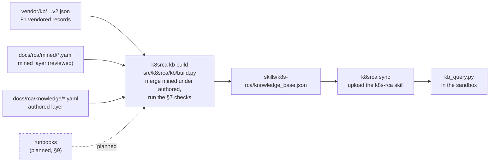
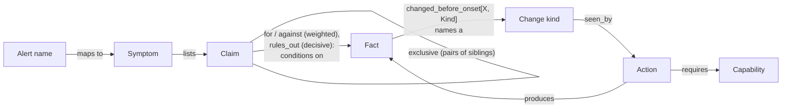
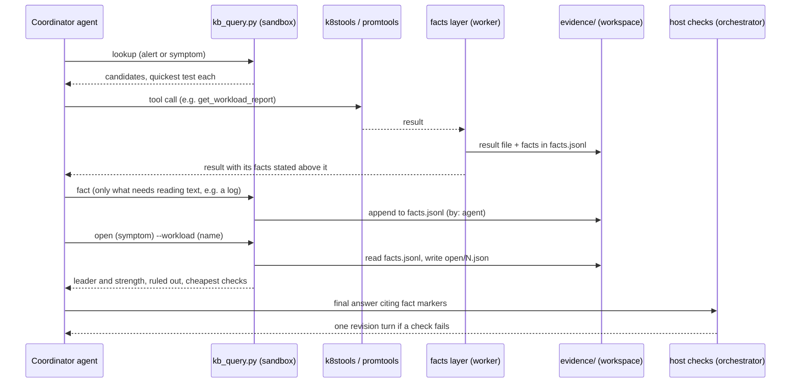
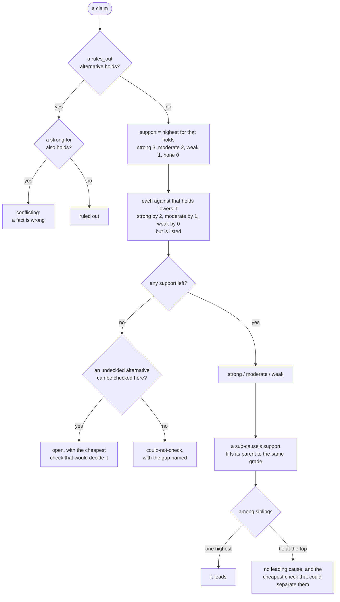
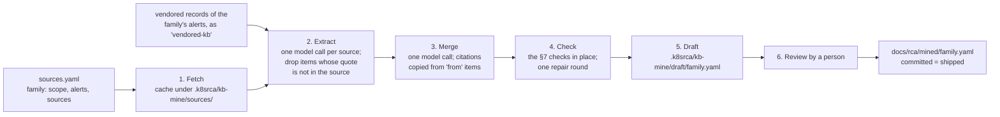
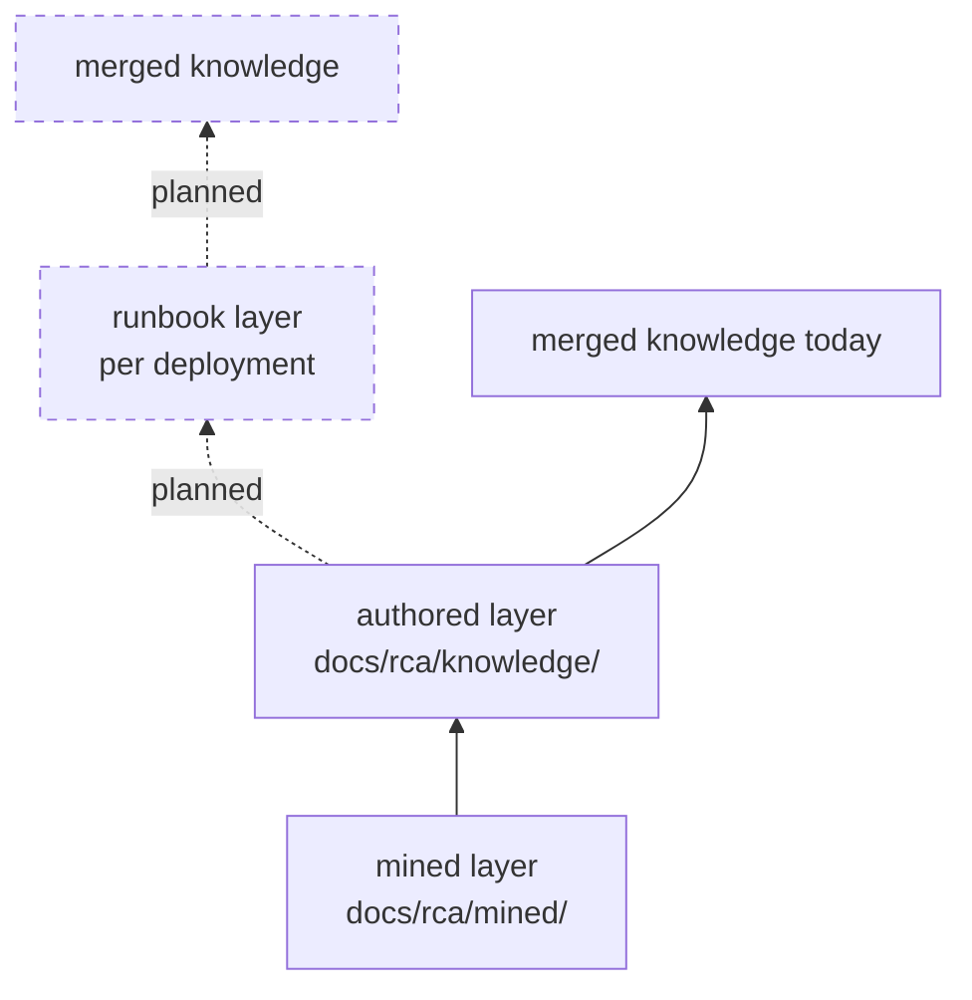
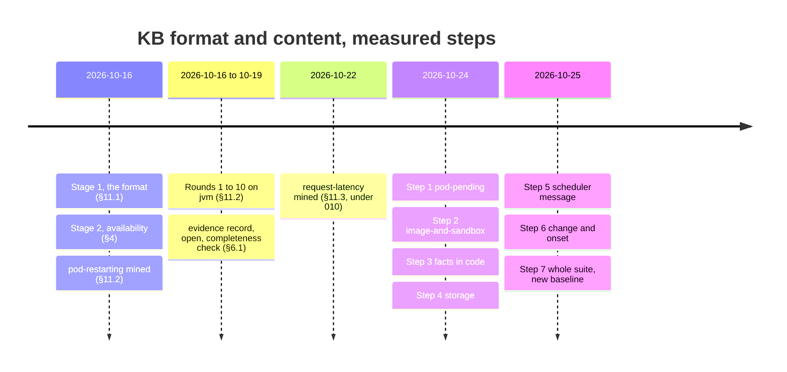

# 007 — Diagnostic knowledge: representation, sources and runbooks

k8srca is an agent that diagnoses Kubernetes problems and answers in Slack. Part of what it
reasons with is a **knowledge base (KB)** shipped in its `k8s-rca` skill (see the
[glossary](../docs/glossary.md)): for each symptom, the candidate causes, and for each
candidate cause the facts that count for it, against it, or rule it out, and the tool calls
that observe those facts. In the KB format a candidate cause is called a **claim**. This
document defines that format, says where its content comes from (hand-written, mined from
public debugging guides, and a vendored third-party dataset), how the agent reads it, and
how a site's own runbooks would fit (planned). You need to know that the agent runs on
Claude Managed Agents (Anthropic's hosted agent platform) and reaches the cluster only
through the read-only [k8stools](https://github.com/BenedatLLC/k8stools) MCP server; the
Background section covers the rest.

## How to read this document

The document is long because it also records how the format was measured. A newcomer who
wants the format as it is used today should read:

- **§2 and §2.1**: the layers and files, and how `k8srca kb build` combines them.
- **§3**: the format. The weighted `for` / `against` / `rules_out` rules in §3.2 came from
  [008 §4.2](008-conclusions-under-incomplete-evidence.md#42-weighted-evidence-in-place-of-confirm)
  and are built; there is no other rule form.
- **§4 and §5**: capabilities and alert mappings.
- **§6 and §6.1**: the `kb_query.py` commands the agent runs, and how `open` ranks
  candidates. Parts of §6.1 were built and then turned off or replaced by design 010; each
  is marked.
- **§7**: the build checks.
- **§8**: the mining pipeline and the conversion of the vendored records (§8.5; partly done).

**§9 (runbooks) is not built.** §10 lists rejected alternatives. §11 summarises how each
change to the KB was measured and what it established; the full result tables, which other
designs and code comments cite, are in the [appendix](#appendix-history-and-results). §12
holds open questions, and a short glossary of this document's own terms comes before the
appendix.

## What is built, what is left, and what was replaced

**Built:**
- the format and its build checks (§3, §7);
- `kb_query.py`'s `lookup`, `claim`, `refine`, `open`, `facts` and `fact` (§6);
- availability per deployment (§4);
- the mining pipeline, `k8srca kb mine` (§8);
- the five families the scenario suite reaches, with their facts derived in code:
  `pod-restarting` (§11.2), `request-latency` (§11.3), and `pod-pending`,
  `image-and-sandbox` and `storage` (§11.4).

**Not built, and what each needs before work starts:**

- **The eight families not mined:** `rollouts-and-jobs`, `service-traffic` (beyond the two
  latency alerts `request-latency` converts), `nodes`, `networking`, `scaling`,
  `control-plane`, `access` and `observability` (§8.5's table). Together they hold the 56
  vendored alerts that `kb_query.py` still answers from their original records, with no
  discriminators.
  - *Why they wait:* no scenario raises any of their alerts (checked in §11.4 step 6 and step
    7), so mining one could not be measured and would be decided on judgment.
  - *Needed first:* a scenario per family that raises one of its alerts, with a truth and a
    checklist written before any run ([004](004-scenario-testing.md),
    [010 §7](010-facts-and-short-answers.md#7-grading-checklists)). Then each family is a step like
    those in §11.4, at about $5 of model spend a family.
  - §8.5's last step, removing the legacy path for unconverted alerts, waits until all of them
    are done.
- **Runbooks (§9).** The format is specified; nothing reads a runbook. Needed first: a
  decision on delivery, through the deployment config or as a plugin (§12 question 4); at
  least one real runbook from an operator; and a scenario where following the runbook changes
  the right answer, without which nothing can measure it.

**Known limits** found in §11.4, each recorded where it was found:

- **Liveness probe facts** (step 6). `probe_target_not_served[C]` needs the probe's port from
  `get_pod_spec` joined with the connection refusal in the events: two tool results, and the
  facts layer derives one result at a time. Needed: a k8stools field that puts both in one
  result, or a join in the facts layer ([010 §3](010-facts-and-short-answers.md#3-the-facts-layer)),
  and a scenario item the probe facts would move (liveness-probe-wrong-port misses only
  `cause-unavailable`, which they do not reach).
- **Committed requests per node** (step 5). The captures hold only the application
  namespace's pods, so a replay cannot compute what every namespace commits on a node.
  Needed: a k8stools feature for live clusters; the suite cannot measure it, so it is decided
  on judgment.
- **itbench-33's capture predates k8stools 4.1.0** (step 5), so its `unscheduled` line carries
  no scheduler message. Needed: a re-capture, which leaves its frozen truth stale
  ([process.md §5](../docs/process.md#5-the-instrument-is-frozen-per-design)), so it is its
  own design.
- **The frontend-to-ad misreading** (steps 6 and 7). The specialist agent reads frontend's
  logs, sees connection errors to ad's address (ad crash-loops on purpose in the demo
  install), and the coordinator answers from that story instead of the ranking it opened.
  Candidate fixes, each its own step: an answer check that compares the most likely cause with
  the opened ranking's leader; a brief that scopes what the specialist reads; a fact derived
  in code for a log's connection errors, by address and the Service that owns it. Needed: a
  design that owns the answer checks. That is issue #6's reviewer rethink, held in
  [011 §4.1](011-decision-models.md#41-a-decision-model-as-the-answer-reviewer),
  not this design.

**Replaced by later designs** (the rest of this document describes what is built):

- **By [008](008-conclusions-under-incomplete-evidence.md): confirmation gives way to
  ranking.** Claims are no longer confirmed or refuted. Weighted evidence makes one most
  likely, at a strength, and decisive evidence rules others out; facts are scoped to what the
  record retains. 008 changed this format, and the change is built: §3.2's `for` / `against`
  / `rules_out`, §3.5's scope check, and §6.1's standings.
- **By [010](010-facts-and-short-answers.md): facts come from code, and the answer is
  short.**
  - The hand-written facts file is replaced by the *facts layer* (`src/k8srca/facts/`),
    which states facts from each tool result into `evidence/facts.jsonl`
    ([010 §3](010-facts-and-short-answers.md#3-the-facts-layer)). The agent adds only what
    needs reading text, such as a log, with `kb_query.py fact`
    ([010 §3.4](010-facts-and-short-answers.md#34-what-the-agent-still-writes)).
    `open --facts <file>` remains for tests.
  - §6.1's completeness check ("owed") is off (`review.completeness: false`); its code stays
    in `src/k8srca/review.py`. 010's *host checks* replaced it: every fact marker resolves, the
    prose is at most 300 words, and every number is in a cited fact
    ([010 §5.2](010-facts-and-short-answers.md#52-footnotes-and-the-host-checks)).
  - §6.1's model reviewer is deleted. 010's light reviewer is built and off
    ([010 §9.8](010-facts-and-short-answers.md#98-step-4-result-2026-10-22)).
  - The answer no longer gives every candidate a verdict. It names the most likely cause,
    what a fact rules out, and the rest as next steps
    ([010 §5](010-facts-and-short-answers.md#5-the-answer)).

---

## Background for new readers

**The agent.** k8srca answers "why is X broken?" about a Kubernetes cluster. It runs as a
Claude Managed Agents *session* (one conversation; one Slack thread) in which a
*coordinator* agent plans and writes the answer and a *specialist* agent does high-volume
reads. Both call read-only cluster tools on the k8stools MCP server and use *skills*:
bundles of files the platform downloads into the sandbox container that serves the session's
tool calls. One skill is `k8s-rca`, in [`skills/k8s-rca/`](../skills/k8s-rca/). Its
`SKILL.md` describes the investigation method, and
[`kb_query.py`](../skills/k8s-rca/kb_query.py) is a script the agent runs to query the
knowledge base.

**The knowledge base** is the content behind `kb_query.py`. It has three parts:

- **Vendored.** [`vendor/kb/kubernetes_rca_knowledge_base_v2.json`](../vendor/kb/README.md)
  is a third-party dataset we received and do not edit. It has 81 records, one per alert name
  (`CrashLoopBackOff`, `FailedScheduling`, `HighRequestLatency`, …). Each lists *hypotheses*
  (candidate causes) as strings, plus free-text evidence hints.
- **Authored.** Knowledge we write, in [`docs/rca/knowledge/`](../docs/rca/knowledge/) in
  the format of §3. Today one file, `pod-restarting.yaml`, which converted the two alerts
  that once had hand-written *discriminators* (prose saying what evidence would confirm or
  refute each candidate).
- **Mined.** Knowledge a model extracted from public debugging guides, reviewed by a person,
  in [`docs/rca/mined/`](../docs/rca/mined/) (§8). The vendored records are converted into
  the format through the same pipeline (§8.5).

`k8srca kb build` merges them into `skills/k8s-rca/knowledge_base.json`, which ships in the
skill ([`src/k8srca/kb/`](../src/k8srca/kb/)). Today it holds 13 symptoms, 239 claims (7
authored, 232 mined), 438 facts and 184 actions, and maps 32 alert names to symptoms, 25 of
them vendored alerts.

**The scenario suite** ([004](004-scenario-testing.md)) is how we find out whether a change
helps. A *scenario* is a fault injected into a test cluster, recorded once (the *capture*)
and replayed to the agent through k8stools' replay mode, with a question and a `truth.yaml`.
Each answer is graded on the scenario's *checklist* of statements a good answer makes or
avoids ([010 §7](010-facts-and-short-answers.md#7-grading-checklists)). The suite has 15 scenarios. This
document mentions these:

| Scenario | What happened in the cluster |
| --- | --- |
| `jvm-oom-on-startup` ("jvm") | Two Java services whose memory limit equals their request, with no heap flags, are killed while starting. Exit code 137 (SIGKILL), but the termination `reason` says `Error`, not `OOMKilled`. It tests whether the agent reports evidence that disagrees with its conclusion. |
| `jvm-oom-with-metrics` | The same fault, with a Prometheus capture ([009](009-metrics.md)). |
| `checkout-gc-pressure` ("checkout") | Asked why checkout is slow. The quiet cause is a Go service running above its `GOMEMLIMIT`, spending its CPU on garbage collection; nearby services crash-loop loudly for unrelated reasons. |
| `downstream-latency` | frontend is slow because a new 10m CPU limit throttles product-catalog, a dependency. |
| `itbench-33-invalid-node-selector` ("itbench-33") | From the [ITBench](https://github.com/itbench-hub/ITBench) benchmark. A rollout's new pods have a node selector no node matches; the alert is `PendingPodsDetected`. |
| `pvc-pending-no-storageclass` ("pvc-pending") | A new revision of quote mounts a PVC naming StorageClass `fast-ssd`, which does not exist; the new pod stays Pending. |
| `image-pull-typo` | A new revision of email has a misspelled image tag; every pull fails with "manifest unknown". |
| `deploy-regression` | A new revision of payment sets `PAYMENT_PORT` to an invalid port; payment crash-loops. |
| `liveness-probe-wrong-port` ("liveness") | A new revision of shipping adds a liveness probe on the wrong port. |
| `nothing-is-wrong` | Nothing is broken; the answer should say so. |

The current baseline scores are in [docs/baseline.md](../docs/baseline.md).

**The KB-on/KB-off comparison**
([004 §10.1](004-scenario-testing.md#101-s3-result-the-knowledge-base-on-and-off-2026-10-15))
ran three scenarios with the KB and with `kb_query.py` and the knowledge removed, so the agent
had to form candidates itself. §1 starts from its result.

**InferRCA** is a separate, private Benedat project (`BenedatLLC/InferRCA`). It defines a
formal language for root-cause analysis (`designs/rca-language.md` there). Runbooks are
translated into that language and compiled to [clingo](https://potassco.org/clingo/), an
Answer Set Programming solver, which decides which checks to run and what can be concluded.
This design takes InferRCA's concepts but not its solver (§3, §10.2). The repository also
holds three example runbooks (crash loop, latency SLO, cascade failure), each with a written
translation into the language, which §9 refers to.

---

## 1. Why

The KB-on/KB-off comparison found that the knowledge base did not help the agent find causes.
What it did was make the agent rule on alternatives. Without the KB, `cause` (the answer
states the true cause) did not move on any scenario, but `rivals` (every alternative cause in
the truth got a verdict) fell from 5/6 to 0/6 on the two scenarios where the KB had entries
(jvm and checkout). The agent raised fewer alternatives and stopped at the first one that fit.

That effect came from the KB's small structured parts: the would-confirm and would-refute
text of the discriminators, and one link saying that `CrashLoopBackOff`'s "OOM" candidate is
broken down further by `OOMKilled`'s candidates. Both existed for two alerts of 81. The rest
of the vendored KB is a flat list per alert of hypothesis strings with free-text hints:

```json
{"alert": "APIClientThrottling",
 "hypotheses": ["excessive client request rate", "low API priority/fairness capacity"],
 "evidence": {"metrics": ["rate(apiserver_request_total{code=\"429\"}[5m])"], ...}}
```

That record names what might be wrong. It does not say how to tell the candidates apart,
which can be true together, what each opens up when it holds, or whether this deployment can
make the checks at all. The model is left to invent those during the investigation, and that
is where it fails.

Three things are wanted, in this order:

1. **A representation** that carries discriminators, refinement and exclusion as structure,
   so that the build can check them and a script can reason over them (§3–§6).
2. **More content**, mined from public Kubernetes debugging guides rather than written to fix
   the scenarios we know about (§8).
3. **A place for runbooks** written by a site's own operators, which are site-specific and
   often keyed by alert (§9, not built).

## 2. Layers

Two layers describe the system and two say how to diagnose it. Two are generic and two are
specific to one site:

| | Generic (true of any cluster) | Site-specific |
| --- | --- | --- |
| **What the system is** | (not needed) | architecture wiki (the `cluster-architecture` skill, built by kubewiki, `packages/kubewiki/`) |
| **How to diagnose it** | the knowledge base: authored + mined | **runbooks** (planned, §9) |

The authored KB has one rule: *generic, true of any cluster*. Site-specific *descriptions*
belong in the wiki. Site-specific *diagnostics* ("this alert is usually the nightly batch
job") belong in runbooks.

All diagnostic content, whatever its layer, uses one representation (§3). Each layer is a
separate set of files with its own provenance, merged when the skill is built (§9.3).

### 2.1 Files and formats

| File | Format | Who reads it |
| --- | --- | --- |
| `docs/rca/knowledge/*.yaml` (authored) | YAML | people, who write and review it; `kb build` |
| `docs/rca/mined/*.yaml` (mined, reviewed) | YAML | people, who review it; `kb build` |
| `docs/rca/mining/sources.yaml` (the mining manifest, §8.2) | YAML | people; `kb mine` |
| `vendor/kb/kubernetes_rca_knowledge_base_v2.json` (the 81 received records) | JSON | `kb build` and `kb mine` only |
| `skills/k8s-rca/knowledge_base.json` (generated) | JSON | `kb_query.py` only, inside the sandbox |
| `.k8srca/kb-mine/` (fetched sources, extractions, drafts; gitignored) | text, JSON, YAML | `kb mine`; drafts are read by the reviewer |

The diagram shows how the files become the bundle the agent queries. The runbook layer is
planned and not built.



Everything a person writes or reviews is YAML. The two JSON files stay JSON, for these
reasons:

- **The generated file has no human reader.** The agent never opens it (the coordinator's
  prompt says not to read bundle files whole); `kb_query.py lookup` is the readable view.
  `kb_query.py` imports the standard library only, so that it runs in any sandbox; YAML would
  need PyYAML. JSON written with sorted keys is canonical, so a rebuild diffs cleanly, where
  YAML dumpers make style choices and have type traps (`no`, `1.10`). The build parses every
  condition into JSON so that `kb_query.py` never parses one itself.
- **The vendored file stays as received**, so a new upstream version replaces it whole and
  `kb build` shows what moved (`vendor/kb/README.md`). A YAML copy would be a second thing to
  keep in step.

What makes the vendored records hard to read is their shape, not their syntax: flat records
with candidate causes packed into `;`-separated strings. The remedy is converting them into
the YAML layers (§8.5). Once all 81 are converted, every file a person opens is YAML under
`docs/rca/`.

## 3. The representation

The concepts come from InferRCA's language (see Background):

- facts are kept apart from claims;
- actions are what produce facts;
- rules relate claims to facts;
- an unknown result is recorded as a gap;
- exclusion is declared.

InferRCA's syntax is not taken over. Here the source is YAML, built into JSON, and **the
model interprets it, not a solver** (§10.2). The Pydantic models that define the format are
in [`src/k8srca/kb/knowledge.py`](../src/k8srca/kb/knowledge.py).

### 3.1 Concepts

| Concept | Is | Example |
| --- | --- | --- |
| **Symptom** | An entry point: what someone asking can see. | `pod-restarting`, `pod-pending`, `request-latency` |
| **Alert mapping** | An alert name that resolves to a symptom (§5). | `KubePodCrashLooping` → `pod-restarting` |
| **Fact** | An observable statement about the cluster, with parameters. True, false or unknown, never inferred. | `last_exit_code[Container, 137]`, `limit_equals_request[Container, memory]` |
| **Action** | How a fact is observed: a capability it needs, the tool to call, what to read in the result, its cost, quality and limits. | `read-container-state`: k8stools `get_workload_report`, the container's last terminated state |
| **Claim** | A candidate cause. Never observed, only weighed by facts. | `oom-kill`, `memory-limit-too-low`, `memory-leak` |
| **Rule** | The conditions on facts that count `for` a claim or `against` it, each with a weight, and those that rule it out (`rules_out`). | §3.2 |
| **Refinement** | A claim whose sub-causes say what *kind* of it. | `oom-kill` → {`memory-limit-too-low`, `memory-leak`, `workload-spike`} |
| **Prevalence** | Whether a sub-cause is a common kind or an uncommon one. Uncommon ones are held back until asked for (§6). | `cache-growth` under `oom-kill` |
| **Exclusion** | Claims that cannot both be the cause. Claims that are not exclusive can stack. | `memory-limit-too-low` vs `memory-leak` |
| **Change kind** | A kind of change, when it takes effect, and the actions that can see one (§3.4). | `image`, `config`, `node` |

The diagram shows how the entities refer to each other. All of it is built.



The distinction that does the work is between a **refinement** and a **rival**. In the
KB-off runs of the jvm scenario, answers "confirmed" both `oom` and `memory-limit-too-low`,
as if they competed and both won. They are not rivals: one refines the other, and finding an
OOM kill is where the question "which kind of OOM?" starts. Two claims are rivals only when
they are siblings under one symptom or one refinement. Exclusion says which siblings cannot be
the cause together.

### 3.2 A worked entry

This is `CrashLoopBackOff` and `OOMKilled` as converted in
[`docs/rca/knowledge/pod-restarting.yaml`](../docs/rca/knowledge/pod-restarting.yaml),
abridged:

```yaml
symptoms:
  pod-restarting:
    title: Container repeatedly restarts
    claims: [application-crash, bad-config, oom-kill, failed-liveness-probe]
  container-oom-killed:
    title: Container terminated for memory
    claims: [memory-limit-too-low, memory-leak, workload-spike]

alerts:
  CrashLoopBackOff:     {symptom: pod-restarting}
  KubePodCrashLooping:  {symptom: pod-restarting, bind: {Pod: labels.pod, ...}}
  OOMKilled:            {symptom: container-oom-killed}

facts:
  last_exit_code:
    params: [Container, Code]
    functional: true          # one value at a time: a container has one last exit code
    says: "the container's last termination exit code is {Code}"
  memory_grows_within_life:
    params: [Container]
    says: memory climbs monotonically within each life rather than spiking

actions:
  read-container-state:
    requires: k8stools
    call: get_workload_report
    read: >-
      Each container's last terminated state: exit code, and `ran_for` -- how
      long that one instance lived, which is not how often the container restarts.
    quality: partial
    produces: [last_exit_code, last_termination_reason, completes_startup_in_retained_lives, ...]
    cost: 1
  sample-memory-now:
    requires: k8stools
    call: get_container_metrics
    quality: point
    limits: One sample, taken now. It cannot show growth within a life, ...
    produces: [memory_limit_plausibly_reached]
  read-memory-report:
    requires: prometheus
    call: memory_report             # promtools (design 009)
    produces: [memory_limit_plausibly_reached, memory_grows_within_life]
    cost: 1

claims:
  oom-kill:
    title: OOM
    for:
      - when: ["last_exit_code[C, 137]", "not process_logged_fatal_error[C]"]
        weight: moderate
      - when: ["last_exit_code[C, 137]", "not process_logged_fatal_error[C]",
               "memory_limit_plausibly_reached[C]"]
        weight: strong
    against:
      - when: "last_termination_reason[C, Reason], Reason != OOMKilled"
        weight: weak
    rules_out:
      - last_exit_code[C, Code], Code != 137
      - process_logged_fatal_error[C]
    refined_by: [memory-limit-too-low, memory-leak, workload-spike]
  memory-leak:
    title: memory leak
    for:
      - when: ["lifetime_steady_or_shortening[C]", "completes_startup_in_retained_lives[C]",
               "memory_grows_within_life[C]"]
        weight: strong
    rules_out:
      - not completes_startup_in_retained_lives[C]
      - lifetime_varies_without_trend[C]
      - not memory_grows_within_life[C]
exclusive:
  - [memory-limit-too-low, memory-leak]
```

How to read it:

- **`for` and `against`** are lists of weighted alternatives. **`rules_out`** is a list of
  decisive alternatives. An alternative that is a list holds only when every condition in it
  holds.
- **Weights** are `strong` (rarely seen unless the claim holds), `moderate` (clearly favours
  it) and `weak` (leans toward it). They are bands of a likelihood ratio, written down so that
  a calibration can later replace them with numbers
  ([008 §5.2](008-conclusions-under-incomplete-evidence.md#52-built-so-they-can-be-added)).
  §6.1 says how `open` combines them into a standing.
- **Capitalised arguments** (`C`, `Code`) are variables. `C` is the container under
  investigation (`W` the workload, `P` the pod, `N` the node, `S` the service); `Code` is bound
  by the fact and then compared. A capitalised argument that is a value, such as
  `ErrImagePull` in `waiting_reason[C, ErrImagePull]`, is a *literal*. The build decides which
  is which: an argument is a variable when it is the fact's own parameter name, appears in a
  comparison, or recurs in the alternative; anything else capitalised is a literal, and `kb
  build` lists every literal it finds so a misreading shows up at build time.

**OOM is weighed on the exit code; the termination `reason` only counts against it,
weakly.** In the jvm scenario `reason` says `Error` while the exit code says 137, and the
scenario measures whether the agent notices that disagreement. Telling the agent that
`reason` is unreliable and 137 means OOM was tried twice, once in the cluster's architecture
notes and once in the KB. Both times `traps` (the answer avoids the scenario's tempting wrong
conclusion) fell from 6/6 to 4/6, because the agent no longer had a reason to flag the
discrepancy. The weak `against` does the opposite: it says the observation counts against OOM
a little, so the answer owes it a sentence, and the exit code decides. The general rule: **a
claim says what evidence would decide a question, and does not pre-decide it.** The YAML file
keeps this reasoning in a comment.

**`not` means checked and found false, never "not looked at".** This reverses InferRCA's
semantics. There, as in most logic programming, `not p` uses *negation as failure*: it holds
whenever `p` has not been established. Here an unchecked fact is a gap (§4.2), not evidence,
so `not` needs a check that came back false.

**A condition is a fact pattern**, optionally negated, optionally followed by comparisons on
its variables. Where a condition cannot be stated precisely it can be prose: InferRCA cannot
allow that, because a solver cannot read prose, but the model can. The build counts prose
conditions (§7) so they stay the exception.

**Every claim needs a `rules_out` and a `for`.** A claim that can only be supported invites
the confirmation-seeking [002 §6](002-investigation-model.md#6-choosing-the-next-action) is
built against. The build fails without either.

**Mined claims** arrive with `for` alternatives at `strong` (where the guide said a condition
confirms the cause) or `weak` (where it only supports it), for review to adjust (§8.3).

### 3.3 Why not a decision tree

Debugging *reads* like a tree, and most guides draw one: the learnk8s flowchart (§8.2) is one.
The tree is the wrong thing to store, for two reasons:

- **A tree fixes the order and stops at the first leaf.** Stopping at the first fit is the
  failure the KB-off runs showed. Rules state what would settle each candidate; the order
  comes from cost and availability (§4) at run time.
- **A tree has one path; incidents do not.** A memory leak and a too-low limit are exclusive;
  an OOM kill and a failing liveness probe can both be true. A tree encodes neither.

The tree-like part, going from general to specific, is kept as refinement: a graph of claims.

### 3.4 Timing: changes and onsets

"What changed just before this started?" is one of the most useful questions in an
investigation and among the easiest to get wrong. A change is evidence of a cause only when
two things hold:

1. **The onset is observed.** The first failure itself falls inside what events, metrics or
   history retain. It is not inferred from a restart count or a pod's age: thousands of
   restarts against an hour of events began before the events did.
2. **The change took effect just before the onset**, inside the window in which that kind of
   change takes effect. A change outside the window is history, not a trigger.

With no observed onset, any claim that a change triggered the failure cannot be checked,
whatever else changed.

**Why this is in the format.** In the first measurement of mined content (§11.2), answers
confirmed "application release" as the trigger in the jvm scenario. The only release was 163
days old, and nothing showed when the crash loop began. The mined claim said "a deployment
change precedes the restart spike", and the authored claims said the same thing three other
ways, none of which required the onset to be seen or the change to be recent. Each claim that
coined its own timing fact could get the rule wrong in its own way, so the format gives the
rule one vocabulary.

**The format, in three parts:**

- **Two reserved facts.** `onset_observed[W]` says the onset is observed.
  `changed_before_onset[X, Kind]` says that `Kind` changed and took effect just before the
  failures began. The authored layer defines both. Only code states them: `kb_query.py fact`
  refuses them from the agent.
- **Change kinds** (`changes:` in a layer file). Each has a title, `takes_effect` (when that
  kind of change has its effect), and `seen_by` (the actions that can see one). The authored
  layer defines:
  - `image`: takes effect as the rollout replaces pods. A mutable tag re-pushed under the same
    name changes the digest with no new revision.
  - `resources`: takes effect on each new pod's first start.
  - `spec`: the rest of the pod template (command, args, env, probes); takes effect as the
    rollout replaces pods.
  - `config`: a ConfigMap or Secret edit takes effect when the process next reads it, which
    can be days later; the onset to line it up with is the first restart after the edit.

  The mined layer adds `node`. Layers merge change kinds like facts, the higher layer winning
  on a name.
- **Availability per kind.** A kind is observable only by its `seen_by` actions, not by every
  action that sees some change. Rollout history sees `image`, `resources` and `spec`. Only an
  audit log (`audit-log` capability, which no deployment has) sees `config`. So a ConfigMap
  edit is a gap with k8stools alone. An earlier fact,
  `config_change_precedes_first_failure`, hid that: it was "produced" by rollout history,
  which cannot see ConfigMap edits.

**Where the timing facts come from.** The facts layer states them in code
([`src/k8srca/facts/derive.py`](../src/k8srca/facts/derive.py), built in §11.4 step 6):

- From `get_workload_report`'s `last_change`, when every failing pod was created with the
  change (pod age within 60 s of the change's age) and the report's events reach back to that
  pod's creation: `onset_observed[W]`, `changed_before_onset[W, image|resources|spec]` for each
  kind the diff names, and `not changed_before_onset[W, Kind]` for the other two. Nothing is
  stated about `config`, which is not in the pod template, and nothing at all for an old
  change, an older pod still failing, or a rollback.
- From promtools' `restart_report`, `not onset_observed[W]` only for a series that restarted
  in the window and began before it. A pod born inside the window says nothing about the
  workload's onset.

`kb_query.py` prints the timing rule, and the `takes_effect` of each kind it mentions,
wherever a claim or check it shows names a change or rests on the onset.

**What it does not cover:**
- *Co-occurrence that is not a change*, such as "kills coincide with a rise in load". It has
  its own facts and needs no onset.
- *Changes whose effect builds up*, such as a release that introduced a leak. The onset lags
  the change by the build-up time; the evidence is the build-up itself (lifetime shortening,
  memory growth). `kb_query.py`'s timing note says so; the format does not model the lag.

The build enforces the rule (§7).

### 3.5 Scope: what the record retains

Facts are observations, but they can be worded as history. The Kubernetes API keeps each
container's last termination and a restart count; no record keeps every restart. A fact once
named `killed_on_every_life` ("killed on every restart including the first") could not be
asserted by a careful agent, so the claims that rested on it could not be decided. In two
measurement rounds (§11.2, rounds 8 and 9) that is how the correct cause was demoted.

So a fact's `says` states what was observed and over what span
([008 §4.1](008-conclusions-under-incomplete-evidence.md#41-scoped-facts)):

- `killed_on_every_life` became `killed_in_every_retained_life`: the last state, the previous
  instance's when it is shown, and what the event series implies over its span;
- `completes_startup_each_life` became `completes_startup_in_retained_lives`.

**The build check:** a fact whose `says` uses a word that quantifies over all time ("every",
"always", "never", "first", "since") is refused unless the text says it is over what is
retained (contains "retain"), or one of its producing actions declares `scope: history`.
Every action defaults to `scope: retained`. No k8stools or promtools action reads a whole
history, so none declares `history`; a restart series over a pod's whole life would.

This is §3.4's rule, generalised. §3.4 refuses to read an onset from a pod's age, because the
record does not reach back to it. This refuses any fact that claims to reach back further
than the record does. Since 010, each fact the facts layer writes also carries its scope in
its statement ([010 §3](010-facts-and-short-answers.md#3-the-facts-layer)).

## 4. Actions and availability

### 4.1 Capabilities

Every action `requires` one capability:

| Capability | Present when | Today |
| --- | --- | --- |
| `k8stools` | always: k8stools is the only route to the cluster | yes |
| `prometheus` | the deployment enables promtools ([009 §4](009-metrics.md#4-how-the-agent-reaches-it)), which `provides: [prometheus]` | off in the production config (`metrics.enabled: false`); the scenario runner turns it on for scenarios with a metrics capture |
| `tracing`, `logs-backend`, `audit-log` | an MCP server that provides it is wired in | no such server exists |
| `human` | never, for the agent | — |

A capability is named for what it provides, not for the product, so `prometheus` could be
served by any MCP server that speaks PromQL. The tool is the action's `call`, resolved
against that server's tool list. Of the 184 actions today, 76 require `k8stools`, 30
`prometheus`, 66 `human`, and the rest `logs-backend`, `audit-log` or `tracing`.

Availability is **per deployment**. A deployment declares its capabilities; nothing probes
for them ([005 §5.4](005-modular-architecture.md#54-presence-is-declared), a draft target).
It works like this ([`src/k8srca/config.py`](../src/k8srca/config.py), `Config.capabilities`):

1. Each MCP server in `k8srca.yaml` `provides` capabilities. The default is the server's own
   name when that is a capability name (`k8stools`). A capability name outside the list, or
   `human`, is refused when the config loads.
2. A deployment has the union over the servers its agents are wired to, plus `k8stools`.
3. The poller passes that set to each sandbox in the `K8SRCA_CAPABILITIES` environment
   variable (the in-process development worker sets it in its own environment), and
   `kb_query.py` reads it.
4. If the variable is unset, `kb_query.py` assumes k8stools alone. That errs toward reporting
   a check as a gap rather than assuming it can be made.

**Why an environment variable and not a file in the skill.** The skill bundle is synced once
per workspace, and scenario runs share the production agents and skills while starting their
own poller from their own config. A file in the bundle would describe production in every
scenario. A variable set by whichever poller claimed the work describes the deployment the
session actually runs in, and the knowledge itself stays deployment-independent.

### 4.2 An unavailable check is a gap

An action whose capability is missing is **kept, not dropped**. Dropping it would make its
facts look checked-and-absent, which under `not` would read as evidence. InferRCA
distinguishes "attempted, result unknown" from "known false" during an investigation; this
applies the same distinction before the investigation starts:

- A fact whose every producing action is unavailable is **unobservable here**. It is neither
  true nor false, so `not` does not hold for it either.
- A claim none of whose deciding alternatives can be observed here is shown by `lookup` as
  "cannot be decided here (needs …): not ruled out unless other evidence settles it", and by
  `open` as `could-not-check`. The gap names what would settle it ("needs prometheus"). That
  is what the scenarios' *gaps* checklist items look for, produced by the knowledge rather
  than left to the model to notice. Under ranking (§6.1), could-not-check is a reason a claim
  is *not ruled out*, not a verdict.
- An action that is available but fails at run time (a tool error, logs rotated away) is a gap
  of the same kind, found later.

`human` actions are never available to the agent. They become recommended next steps in the
answer ("ask the DBA to check lock waits"): the honest form of a check the agent cannot make.

### 4.3 Alternatives and their quality

One fact can have several producing actions with different requirements.
`memory_limit_plausibly_reached` can come from promtools' `memory_report` or from a single
k8stools `get_container_metrics` sample. Each action declares a `quality` (`complete`,
`partial` or `point`) and a `limits` sentence saying what it cannot show; `kb_query.py claim`
prints both beside the check. What a weak action cannot show is expressed by what it
`produces`: a point sample produces `memory_limit_plausibly_reached` but not
`memory_grows_within_life`, so where only the sample is available, growth stays
unobservable and cannot rule out `memory-leak`.

The checkout scenario is this situation: one usage sample showed GC pressure, and no history
was available to say since when.

### 4.4 Cost

`cost` is a small integer that orders actions, cheap lookups first, as InferRCA's `priority`
does. `lookup` lists candidates by the cost of their quickest test, and `open` names each
undecided claim's cheapest available check. Cost orders; it never removes a check.

## 5. Entry points: symptoms, and alerts mapped to them

Knowledge is keyed by **symptom**, because our questions come from people in Slack ("why is
checkout slow?"), not from an alerting system. The vendored KB is keyed by alert name, which
is why itbench-33 originally got nothing from it: its alert, `PendingPodsDetected`, is not one
of the 81 names.

Alerts still matter. Runbooks are usually written per alert (§9), and
[005 §3.3](005-modular-architecture.md#33-triggers-responding-to-alerts-in-a-channel)
(a draft target) adds investigations triggered by alerts posted to a channel. So alerts are a
**second entry point that resolves to symptoms**, through a mapping table:

```yaml
alerts:
  KubePodCrashLooping:            # kube-prometheus's name
    symptom: pod-restarting
    bind: {Pod: labels.pod, Namespace: labels.namespace, Container: labels.container}
  CrashLoopBackOff:               # the vendored KB's name for the same thing
    symptom: pod-restarting
  PendingPodsDetected:            # ITBench's
    symptom: pod-pending
  HighRequestLatency:
    symptom: request-latency
```

Many alert names map to one symptom, which is what makes runbook alert names and vendored
alert names interchangeable. Today 32 alert names are mapped: 25 vendored alerts and 7 others
(`KubePodCrashLooping`, `KubePodNotReady`, `PendingPodsDetected`, `PodOOMKilled`,
`CPUThrottlingHigh`, `KubePersistentVolumeErrors`, `KubePersistentVolumeFillingUp`).

`bind` is meant to copy an alert's labels into the claim's parameters, so an alert for pod
`checkout-7f9c` starts the investigation with `Pod` set. This is InferRCA's alert mapping,
reduced. *`bind` is stored and validated, but nothing reads it yet: alert-triggered
investigations are not built.*

An alert with no mapping falls back to its vendored record, or to `kb_query.py search`. `kb
mine` reports a family's vendored alert that no layer maps (§8.5). *The build does not yet
report unmapped alert names from runbooks (planned with §9).*

## 6. How the agent uses it

`kb_query.py` is the interface ([002 §7.2](002-investigation-model.md#72-the-scripts)). Its
commands:

| Command | What it prints |
| --- | --- |
| `lookup <symptom\|alert\|claim>` | For a symptom or mapped alert: each candidate in a line or two, cheapest test first, with its quickest test this deployment can make (a `rules_out` over a `for` at equal cost; a weak `for` is not a test) and how many sub-causes it has; then one row per tool of the checks those tests need. Candidates only unavailable actions could decide come last, marked as not decidable here (§4.2). For a mapped vendored alert, the vendored record's evidence, remediation and correlations follow. For an unmapped alert, the vendored record. For a claim id, its full criteria. |
| `claim <id> [<id> ...]` | A candidate's full criteria: every alternative with its weight, the `note`, its exclusions and refinements, its checks with their limits, and the timing rule where it applies. |
| `refine <claim> [--all]` | The common sub-causes a claim opens, in `lookup`'s brief form, and the names of the uncommon ones (`prevalence: uncommon`) without their tests. `--all` tests them too. |
| `open <symptom\|alert> --workload <name>` | The ranking: every candidate's standing from the facts recorded for that workload (§6.1). |
| `facts [--workload <name>]` | The facts recorded so far, with the ids the answer cites. |
| `fact <workload> '<fact>' --says '<sentence>' --from <n>` | Records a fact the agent read from text, such as a log, in the facts log with `by: agent`. |
| `search`, `related`, `promql`, `list` | Search and browse the vendored records. |

`SKILL.md` tells the agent to run `lookup`, then `open --workload`, then the check that would
most change the ranking, then `open` again, and to stop when the leader is strong or no cheap
check would move it. The diagram shows one investigation's flow through the KB and the facts
layer.



An opened symptom whose candidates are all one claim's sub-causes is *widened* to the symptom
that claim belongs to. Opening `OOMKilled` (`container-oom-killed`) opens `pod-restarting`
instead, because answers that started from `OOMKilled` alone never placed `oom-kill`'s rivals
such as `application-crash`.

**Why prevalence.** Mining took `oom-kill` from three sub-causes to six. In the third round
of measurement (§11.2), answers that concluded on OOM disposed of the new sub-causes (cache
growth, node memory pressure) and left out memory-leak and workload-spike. They covered a
different three, not more. Naming all six where the candidates are listed did not help: each
sub-cause shown is one more the agent chases. So the likely few are shown, and the rest wait
until the evidence calls for them. An uncommon one is worth testing only when the evidence
points at it, or fits none of the common ones. In the short answer of
[010 §5](010-facts-and-short-answers.md#5-the-answer) a sub-cause is not owed a line of its own:
the one the facts support says which kind the cause is, one a fact excludes is listed as ruled
out, and an undecided one appears only as a next step that would settle it. Which ones are likely is a
reviewer's judgement (§8.3); the guides rarely say. The build refuses `prevalence: uncommon` on
a claim that is no claim's sub-cause.

**Why `lookup` is two steps.** Once the first family was mined (§11.2), `lookup
CrashLoopBackOff` printed every candidate's full criteria and notes: 13 candidates in 28 KB.
Two things showed in the answers:
- Answers repeated the text as if it were an observation. A mined action's limits line, "only
  retained revisions are visible", became "only revision 2 is retained" in 5 of 12 runs. The
  history listed revision 1.
- How often a candidate was disposed of followed its position in the list, not its relevance.
  The first four were mentioned in 12/12 answers; later ones fell to 3/12 and 0/12.

So `lookup` prints one test per candidate and leaves the notes to `claim`, for candidates being
pursued. The brief output was about 10 KB at the time.

**`open` is a script the model chooses to run**, not an engine loop around the model. This is
InferRCA's "identify candidate actions" step, and it is the guardrail
[002 §2](002-investigation-model.md#2-design-principles) asks scripts to supply: it cannot make
the model look, but it can say precisely what is left to look at.

### 6.1 Checking against the evidence record

Measurement of mined content (§11.2) showed three failures that better knowledge text could
not fix. The agent drops candidates it was given, applies a rule the evidence does not meet,
and states things no tool returned. Each of those can be checked by a script, if the script
can see what the tools returned. This section describes what was built for that, and what of
it is still in use.

**The evidence record** (built, [`src/k8srca/evidence.py`](../src/k8srca/evidence.py)). The
worker's tool wrapper writes each MCP result to `evidence/<session id>/<n>-<tool>.json` in the
session's workspace, with its arguments.
- **Contents:** the text the model saw and the server's structured result.
- **Numbering:** `n` runs across a session's turns, resuming from the files already there.
- **What the model sees is unchanged.** It needs no new cluster access: the results have
  already passed k8stools' redaction, and the model has already seen them.
- **Lifetime:** the record lives in the session's workspace, with the investigation record
  ([002 §3](002-investigation-model.md#3-the-investigation-record)), and is reaped with it.
- **Writing is best-effort.** A failed write is logged, and the tool call still succeeds.

Since 010, the facts layer writes its facts beside it, in `evidence/facts.jsonl`.

None of the checks below runs an investigation loop, which §10.2 and
[002 §10.3](002-investigation-model.md#103-an-external-investigation-engine) reject: the model
still decides what to look at, and a check is a script it calls or a pass over its answer.

**`open`: the ranking** (built). `open <symptom> --workload <name>` reads the facts recorded
for that workload from `evidence/facts.jsonl`: those the facts layer stated in code, and those
the agent added with `fact`. (`--facts <file>` reads a file of lines instead; the tests use
it.) Each fact is observed true (`fact[args]`) or observed false (`not fact[args]`); a fact not
recorded is unknown. Role arguments (`C`, `W`, `P`, `N`, `S`) stand for the one workload, so
`[ad, 137]` and `[Container, 137]` both read as `[C, 137]`. Unknown fact names (with a
suggestion), wrong arity, contradicting lines and the reserved timing facts from the agent
are refused. A *functional* fact (one value per subject, such as the exit code) makes its
other values false.

`open` walks every candidate of the symptom, and the common sub-causes of every candidate not
ruled out, and computes each one's standing by the rule of
[008 §4.2](008-conclusions-under-incomplete-evidence.md#42-weighted-evidence-in-place-of-confirm).
The diagram shows that rule as `kb_query.py`'s `status` and `ranking` implement it.



The output prints the leader with the facts it rests on, what is ruled out and by which fact,
and the undecided candidates with their cheapest checks. The answer maps standings to its
sections: the leader is the *most likely cause*, its grade sets the strength word (*very
likely* for strong, *likely* for moderate, *possible* for weak), a ruled-out claim goes under
*ruled out*, and open or could-not-check claims become next steps
([010 §5](010-facts-and-short-answers.md#5-the-answer)). Could-not-check is a reason a claim is
not ruled out, not a verdict, so a cause that cannot be confirmed but still ranks first stays
most likely ([008 §4.3](008-conclusions-under-incomplete-evidence.md#43-what-happens-to-the-old-statuses)).

Further rules, each with its reason:
- **The logic is three-valued.** `not X` holds only when X was observed false, never because
  X is missing; otherwise the script would bring back the absence-as-evidence that review
  removes (§8.3). Prose conditions stay undecided, for the model to judge.
- **All sub-causes ruled out does not rule out the parent:** the listed ones are not all
  there are.
- **A sub-cause's support lifts its parent** because answers otherwise reported `oom-kill` as
  open beside its supported `memory-limit-too-low`.
- **Each run writes its rows** to `evidence/open/<n>.json` (id, title, standing, depth,
  parent, whether it leads), only when an evidence record sits beside the skill, so running
  from the repo writes nothing. The light reviewer (off) reads the leader from them, and the
  completeness check (off) read them.
- **Its systematic risk** is that a derivation bug gives the same wrong standing in every run,
  where the model's mistakes scatter. So derivations are tested field by field on recorded
  tool results (`k8srca scenario record-results`), and each family has an offline test that
  runs `open` on scenarios' recorded results against their truths
  (`tests/test_facts_pending_and_image.py`, `tests/test_kb_storage.py`,
  `tests/test_facts_change_onset.py` and others). *The component eval this section once
  planned, scoring extraction and `open` over a capture in `src/k8srca/evals/`, was not built;
  those tests fill its role.*

**The answer check script** (`skills/k8s-rca/answer_check.py`; ships, unused). A stdlib
script that reads a draft answer against the evidence record: every number and duration
should appear in a saved result, and scope claims ("every other workload is healthy") are
checked against the saved namespace health output. Offline it caught 41% of the grader's
unsupported claims (Appendix A.3). Agents did not run it when the skill offered it. Since 010,
`SKILL.md` does not mention it and nothing runs it; the host checks of
[010 §5.2](010-facts-and-short-answers.md#52-footnotes-and-the-host-checks) check figures against
cited facts instead.

**The completeness check, "owed"** (built in `src/k8srca/review.py`; **off**,
`review.completeness: false`; replaced by 010's host checks). The orchestrator and the
scenario runner ran it on the final answer. Every candidate in the last `open`, and every
sub-cause `open` decided under a supported claim, was *owed* a place in the answer, matched by
id or title; if any was missing, one revision turn named them. It did what it asked: unnamed
owed claims fell from 2–10 per answer to 0–2. It is off because of what it cost: every run
paid a revision turn, answers grew by about half, and in rounds 8 and 9 (§11.2) the revision
demoted the correct cause when strict facts left it undecidable. 010's short answer no longer
places every candidate, so there is nothing for it to check against.

**The model reviewer** (deleted). A model call per answer, given the answer and its evidence
record, flagging claims no result states or that a result contradicts. Offline it caught about
half the grader's unsupported claims, including inferences the answer check cannot see, but in
round 9 it cost the correct cause in half the runs (Appendix A.2, A.3). It was never on in
production. 010's light reviewer replaced it and is off
([010 §9.8](010-facts-and-short-answers.md#98-step-4-result-2026-10-22)).

## 7. Build checks

`k8srca kb build` checks the whole format
([`src/k8srca/kb/knowledge.py`](../src/k8srca/kb/knowledge.py), `check`) and fails on:

- a fact, claim, action, symptom, change kind or capability name that does not resolve, or a
  condition with the wrong number of arguments;
- a name defined twice within one layer;
- a claim with no `rules_out`, or no `for`;
- a fact with no producing action;
- a `k8stools` or `prometheus` action with no `call`;
- a refinement cycle, or an `exclusive` pair that is not a pair of siblings;
- `prevalence: uncommon` on a claim that refines nothing;
- **timing** (§3.4):
  - an alternative that names `changed_before_onset` without a positive `onset_observed` in
    the same alternative;
  - an action that lists `changed_before_onset` in `produces` (a kind's `seen_by` says which
    actions see it);
  - a fact whose name looks like a coined timing fact (`precede`, `before_onset`,
    `changed_before`, `_near_restart` and similar);
- **scope** (§3.5): a fact whose `says` quantifies over all time with no `retain` in its text
  and no `scope: history` producer;
- **conversion** (§8.5): a vendored alert's hypothesis missing from `converts`, an undecided
  `TODO`, or a claim the alert's symptom cannot reach.

It reports, without failing:

- prose conditions;
- claims none of whose deciding alternatives the default deployment (k8stools only) can
  observe;
- literals (§3.2);
- names a higher layer redefined, hiding the lower layer's definition.

Whether each action's `call` is a real tool is checked against k8stools' and promtools' tool
lists by `kb mine` (against the running k8stools server) and by the tests
(`tests/test_kb.py`), not by `kb build`, which runs without a server.

Once runbooks exist it will also perform their layer merge and report conflicts (§9.3,
planned).

## 8. Mining public debugging guides

### 8.1 Why mine

The alternative is to add whatever our scenarios turned out to be missing, such as a
GC-pressure candidate under `HighRequestLatency` for checkout. That fits the content to the
suite, which is the overfitting [006](006-holdout-suite.md)'s hold-out suite exists to detect.
Mined content comes from sources we did not choose by looking at our failures.

The KB-off comparison also says what mining is for. The model already knows most of what these
guides contain: it found causes as well without the KB. Its weaknesses were *complete
candidate lists* and *criteria that rule causes out*, so extraction targets those two, not
explanations.

### 8.2 Sources

These are the sources the manifest started with. Each licence was checked by hand. "Vendor"
means extracted content may be stored in the repository with attribution; "reference" means a
source may inform what we write, but its text is not copied and `kb mine` never extracts it.
Each family's actual sources, with fetch URLs and licences, are in
[`docs/rca/mining/sources.yaml`](../docs/rca/mining/sources.yaml).

| Source | Shape | Good for | Licence |
| --- | --- | --- | --- |
| **Kubernetes documentation**, debugging tasks: [Debug Pods](https://kubernetes.io/docs/tasks/debug/debug-application/debug-pods/), [Debug Running Pods](https://kubernetes.io/docs/tasks/debug/debug-application/debug-running-pod/), [Debug Services](https://kubernetes.io/docs/tasks/debug/debug-application/debug-service/), [Determine the Reason for Pod Failure](https://kubernetes.io/docs/tasks/debug/debug-application/determine-reason-pod-failure/), [Debug Init Containers](https://kubernetes.io/docs/tasks/debug/debug-application/debug-init-containers/), [Debug a StatefulSet](https://kubernetes.io/docs/tasks/debug/debug-application/debug-statefulset/), [Troubleshooting Clusters](https://kubernetes.io/docs/tasks/debug/debug-cluster/), [Debugging DNS Resolution](https://kubernetes.io/docs/tasks/administer-cluster/dns-debugging-resolution/) | prose, task-oriented | the core symptoms: pods pending, restarting, unreachable; DNS; nodes | CC BY 4.0 ([kubernetes/website](https://github.com/kubernetes/website)); vendor |
| **kube-prometheus runbooks**: [runbooks.prometheus-operator.dev](https://runbooks.prometheus-operator.dev/), source in [prometheus-operator/runbooks](https://github.com/prometheus-operator/runbooks) | one page per alert: meaning, impact, diagnosis, mitigation | alert mappings (§5) for the alert names most clusters fire; candidates per alert | Apache-2.0; vendor |
| **GKE troubleshooting**: [index](https://cloud.google.com/kubernetes-engine/docs/troubleshooting), e.g. [CrashLoopBackOff events](https://cloud.google.com/kubernetes-engine/docs/troubleshooting/crashloopbackoff-events) | prose per symptom, often with decision steps | node, network, storage and autoscaler failures | CC BY 4.0; vendor, keeping only the generic content |
| **Amazon EKS troubleshooting**: [user guide](https://docs.aws.amazon.com/eks/latest/userguide/troubleshooting.html), [best practices guide](https://docs.aws.amazon.com/eks/latest/best-practices/introduction.html) | prose per error message | node join, networking (CNI), IAM-shaped access failures | CC BY-SA 4.0 ([awsdocs/amazon-eks-user-guide](https://github.com/awsdocs/amazon-eks-user-guide)); vendor, but ShareAlike applies to what we derive, so keep it in its own directory |
| **AKS troubleshooting**: [Azure Kubernetes Service troubleshooting](https://learn.microsoft.com/en-us/troubleshoot/azure/azure-kubernetes/welcome-azure-kubernetes) | prose per symptom and error | connectivity, node, storage, upgrade failures | CC BY 4.0 ([MicrosoftDocs/SupportArticles-docs](https://github.com/MicrosoftDocs/SupportArticles-docs)); vendor |
| **OpenShift troubleshooting**: [openshift-docs `support/troubleshooting`](https://github.com/openshift/openshift-docs/tree/main/support/troubleshooting) | prose per component | pod, node, operator, storage and network investigation | Apache-2.0; vendor |
| **learnk8s visual troubleshooting guide**: [A visual guide on troubleshooting Kubernetes deployments](https://learnk8s.io/troubleshooting-deployments) | a decision tree | which checks matter and in what order (§3.3) | all rights reserved; reference only |
| **k8sgpt analyzers**: [k8sgpt-ai/k8sgpt `pkg/analyzer`](https://github.com/k8sgpt-ai/k8sgpt/tree/main/pkg/analyzer) | Go code, one analyzer per resource kind | checks concrete enough to bind to k8stools calls | Apache-2.0; vendor |
| **Robusta playbooks**: [robusta-dev/robusta `playbooks/robusta_playbooks`](https://github.com/robusta-dev/robusta/tree/master/playbooks/robusta_playbooks) | Python code, enrichment actions per alert | the evidence gathered per alert, and alert-to-check mappings | MIT; vendor |

The vendored knowledge base is a source too, but not one listed here: each family reads its
own vendored records (§8.5). InferRCA's runbooks are left out deliberately: they are runbooks,
not generic guides (§9.4).

### 8.3 Pipeline

`k8srca kb mine <family>` ([`src/k8srca/kb/mine.py`](../src/k8srca/kb/mine.py)) runs one
family, a batch of related symptoms, from `docs/rca/mining/sources.yaml`. `k8srca kb mine`
with no family lists them. The diagram shows the stages; only the last, a person's review,
puts anything in the shipped layer.



1. **Fetch.** Each source is downloaded once (raw markdown or code where a raw form exists,
   otherwise rendered HTML reduced to its article text) and cached under
   `.k8srca/kb-mine/sources/` with its retrieval date. `--refresh` fetches again.
2. **Extract**, one model call per source. The model is given the family's scope, the
   existing vocabulary (every symptom, claim, fact and action already in the authored and
   mined layers, and k8stools' tool names and descriptions from the running server), and the
   source text. It returns §3-format items, each with a `quote`: one or two sentences copied
   from the source that the item rests on. **An item whose quote is not in the source is
   dropped**, compared on letters and digits only so markdown and line-wrapping do not decide
   it. The model proposes; the text decides what the source said. The model writes
   `confirm`, `supports` and `refute`, which the pipeline turns into `for` at `strong`, `for`
   at `weak`, and `rules_out`: the extraction schema has no room for weights (see the grammar
   limit below), and review weighs them.
3. **Merge**, one model call over every extraction. One claim per cause, however many sources
   named it, with their criteria kept as separate alternatives. Every merged item names the
   extracted items it was made from (`from: "source:name, ..."`), and **its citations are
   copied from those items, never written by the merge**. A merged item none of whose `from`
   entries resolves is dropped. The number of sources citing a claim is the confidence signal;
   nothing else is.
4. **Check.** The draft is checked with the build's own checks (§7), in place: under the
   authored layer, beside the rest of the mined layer, with tool names checked against the
   running k8stools server. If anything fails, one repair round sends the failures back to
   the merge.
5. **Draft.** The result is written to `.k8srca/kb-mine/draft/<family>.yaml`, with a header
   naming every source, its URL, licence and retrieval date, and any check that still fails.
6. **Review, then ship.** A person reads the draft, fixes it, and copies it to
   `docs/rca/mined/<family>.yaml`. Committing it is shipping it: `kb build` reads
   `docs/rca/mined/` and nothing under `.k8srca/`. **Nothing mined ships unreviewed**, because
   there is no other way in.

What review looks for, most of it learned from the first family:

- **Drafted rule-outs.** Public guides are almost all confirm-oriented ("if you see X, it's
  Y"), so `rules_out` criteria are mostly the model's, drafted from the confirm side and
  marked `refute_drafted: true`. Budget the review there.
- **Rule-outs that rest on silence.** "`not` error-in-the-logs" rules a cause out because the
  logs do not mention it. `not` means checked and found false, but logs truncate and rotate,
  so this confuses absence with unavailability. A rule-out needs something positive, such as
  the container completing startup.
- **Pre-deciding.** A criterion that says which field or source to believe, rather than what
  evidence decides (§3.2).
- **Provider-specific content** that slipped past the generic rule.
- **Overlapping actions.** The mine report lists every draft action that calls a tool another
  layer's action already calls. Two reads of one tool are often both right; once, a mined
  action duplicated an authored one, and answers echoed its limits line as an observation
  (§6). This does not fail the build, because only a reader can tell which case it is.
- **Timing.** Claims that blame a change should use the shared timing facts (§3.4). The
  extraction prompt says so, and the build refuses a coined timing fact.
- **Weights.** `for` arrives at `strong` or `weak` only (step 2); review sets `moderate` where
  the evidence clearly favours a cause without being decisive.
- **Prevalence.** Where a claim has more than three sub-causes, mark the ones past the likely
  few `prevalence: uncommon` (§6). Mining adds sub-causes rather than replacing them, so this
  is where a family's breadth reaches the answer.

Extractions are cached by prompt version, model, source digest, family and vocabulary, so
re-running after a fix to the merge costs only the merge. `--max-usd` (default $10) stops a
run that spends past it. The default model is `claude-opus-5`, and each call may use up to
128k output tokens, thinking included (64k ran out mid-JSON on the first family's merge).

Two implementation limits. The output schemas are compiled by the API into a grammar with a
size limit, and the extraction schema is just under it; `from` is one string rather than a
list for that reason, and any field added to the schema has to be tried against the API, not
only the tests. And a merge reads every extraction in the family at once, so a family much
larger than the first (11 sources, about 50 candidate causes extracted) may have to be split.

Mined content lives in its own directory, apart from what we author, for the same reason
`vendor/kb/` and `docs/rca/knowledge/` are kept apart: what we received must stay
distinguishable from what we wrote. Every mined item keeps the quotes it came from. Families
are mined, reviewed and measured one at a time (§11).

### 8.4 The cost of breadth

More candidates means more to dispose of: more tool calls, and more claims an answer can get
wrong. Symptom keying (§5), refinement and prevalence keep what `lookup` returns small. Review
of each mined family cut its top level hard (for example `pod-pending` from 34 candidates to
six), with the rest reached by refinement.

The first family showed that the number of candidates is not the only cost; the amount of
text is too. Full criteria for 13 candidates made the output 4.5 times longer, and answers
echoed it. So `lookup` prints one test per candidate, and the rest is `claim`'s (§6).

### 8.5 Converting the 81 vendored alerts

The vendored records are converted through the same pipeline, not by a separate route. Each
family lists the vendored alerts it converts (`alerts:` in the manifest). The records of those
not yet mapped by any layer are rendered as one more source for the family, `vendored-kb`,
beside the public guides: one line per hypothesis ("PodRestartSpike candidate cause: OOM"),
with the record's evidence fields and without its remediation fields. Extraction quotes those
lines like any other source, so a mined claim can cite the vendored knowledge base as well as
the Kubernetes docs.

What each hypothesis became is an explicit table, `converts`, in the layer file:

```yaml
converts:
  PodRestartSpike:
    application release: release-regression
    OOM: oom-kill
    node issue: {declined: "a node problem is the nodes family's symptom"}
```

The pipeline fills it in from citations: a claim whose quote contains a hypothesis's line
converts that hypothesis. One that no claim cites (usually because it is the same cause as an
existing claim, which mining may not redefine) is written as `declined: "TODO: ..."`, for
review to point at the right claim or decline with a reason. The two alerts converted by hand
carry the same table in `docs/rca/knowledge/`.

A family is finished when:

- **every vendored alert it lists maps to a symptom** (§5), so `lookup` answers it from the
  knowledge rather than the legacy record (`kb mine` reports one that does not);
- **every hypothesis of every mapped vendored alert is in `converts`**, naming a claim the
  alert's symptom reaches (directly or through refinement), or declined with a reason. **This
  is a build check**: `kb build` fails on a missing hypothesis, an undecided `TODO`, or a claim
  the symptom cannot reach. The reason: once an alert is mapped, `kb_query.py` stops showing
  its vendored hypotheses, so a hypothesis missing from the table is a candidate the agent
  silently stops weighing.

When the last family is done, `kb_query.py`'s legacy path for unconverted alerts goes, and the
vendored file becomes a source the build checks coverage against, not one it serves from
(planned; it waits on every family below).

The families, in the order they were planned. The order is by how often an investigation
meets the symptom, not by which scenarios we have:

| Family | Vendored alerts it converts | State |
| --- | --- | --- |
| `pod-restarting` | CrashLoopBackOff, OOMKilled (by hand), LivenessProbeFailed, StartupProbeFailed, PodRestartSpike, MemoryWorkingSetGrowing | mined (§11.2) |
| `pod-pending` | PodPending, FailedScheduling, ResourceQuotaExceeded, LimitRangeViolation, AdmissionDenied, ReplicaSetFailure | mined (§11.4 step 1) |
| `image-and-sandbox` | ErrImagePull, ImagePullBackOff, FailedCreatePodSandbox, ContainerRuntimeDown | mined (§11.4 step 2) |
| `rollouts-and-jobs` | DeploymentRolloutStuck, DeploymentUnavailable, ReleaseCorrelatedFailure, StatefulSetFailure, PodPDBBlocked, JobFailed, JobDeadlineExceeded, CronJobMissed, NamespaceTerminating | not mined |
| `request-latency` (split from `service-traffic`) | HighRequestLatency, ServiceLatencyHigh | mined (§11.3) |
| `service-traffic`, the rest | ReadinessProbeFailed, ServiceNoEndpoints, Ingress5xx, HighCPUThrottling, WebhookTimeout | not mined |
| `storage` | PVCPending, FailedAttachVolume, FailedMount, MultiAttachError, CSIControllerDown, VolumeFull, StorageLatencyHigh (mapped to `request-latency`) | mined (§11.4 step 4) |
| `nodes` | NodeNotReady, KubeletDown, NodeMemoryPressure, NodeDiskPressure, NodePIDPressure, NodeCPUHigh, NodeDiskIOHigh, EphemeralStorageHigh, HighFileDescriptors, PodEvicted | not mined |
| `networking` | DNSFailure, DNSLatencyHigh, CoreDNSDown, CoreDNSHighErrorRate, NetworkPacketLoss, NetworkPolicyDenied, PodNetworkReceiveErrors, PodNetworkTransmitErrors | not mined |
| `scaling` | HPAUnableToScale, HPAMaxReplicas, ClusterAutoscalerBlocked, ClusterAutoscalerCloudError | not mined |
| `control-plane` | APIServerDown, APIServerHighErrorRate, APIServerHighLatency, APIServerTooManyRequests, APIClientThrottling, EtcdDown, EtcdHighDBSize, EtcdHighLatency, EtcdNoLeader, ControllerManagerDown, SchedulerDown | not mined |
| `access` | RBACForbidden, CertificateExpired, CertificateExpiring | not mined |
| `observability` | EventIngestionFailures, LogsPipelineBackpressure, MetricsScrapeFailures, NoScrapeTargets, TraceIngestionFailures, AlertStorm | not mined |

That is all 81: 25 converted, 56 not. The vendored `group` label (`causal_parent`) is not
used to form families: one of its values covers 41 records (`src/k8srca/kb/build.py`). Many
unmined families' claims will need capabilities no deployment has yet (`prometheus` above
all), and will arrive as undecidable here (§4.2). That is the honest state, not a reason to
leave them out.

Scenarios reach the five mined families: `pod-restarting` (jvm-oom-on-startup,
jvm-oom-with-metrics, deploy-regression, liveness-probe-wrong-port, and others),
`request-latency` (checkout, downstream-latency), `pod-pending` (itbench-33, and pvc-pending
through refinement), `image-and-sandbox` (image-pull-typo and pvc-pending, through
`KubePodNotReady`) and `storage` (pvc-pending). No scenario raises an alert of the unmined
families, as far as the reach checks of §11.4 steps 6 and 7 found (they covered the ten
scenarios the suite then had). Their measurement would be the hold-out suite ([006](006-holdout-suite.md)), which
is not limited to the symptoms we chose; [015](015-kb-evaluation.md) plans how to judge the
KB's coverage offline.

## 9. Runbooks (not built)

> **Not built.** Nothing in k8srca reads a runbook today, and no layer of runbooks exists. This
> section is the design. It waits on a delivery decision (§12 question 4), at least one real
> runbook from an operator, and a scenario where following the runbook changes the right
> answer.

### 9.1 The boundary

A runbook is what only one organisation knows about diagnosing its own systems:

- its services, dependencies and thresholds ("checkout p99 over 800 ms");
- its history ("this alert is usually the nightly batch job");
- checks outside Kubernetes (a database console, a vendor status page);
- owners, escalation, and remediation procedures.

If a statement would be true of any cluster, it belongs in the knowledge base and is
contributed there. If it describes rather than diagnoses ("checkout calls payment
synchronously"), it belongs in the wiki.

### 9.2 Translating a runbook into the format

Runbooks are prose and stay the source of record. Each runbook would be **translated** into
the §3 format, with every item pointing back to the runbook step it came from. InferRCA has
done this three times: its `runbooks/` directory holds three prose runbooks (crash loop,
latency SLO, cascade failure), and beside each a `*-translation.md` that translates it into
InferRCA's language and records the decisions and problems along the way. Those are the
closest thing we have to a worked example.

Runbooks are usually **keyed by alert**. The translation starts from the alert mapping (§5):
the runbook's alert maps to a symptom (an existing one, or a new site-specific one), and its
steps attach there. A runbook for `CheckoutLatencySLO` would become `request-latency`, bound
to `Service: checkout`.

What translation changes:

- **Commands become actions.** A `kubectl describe pod` step becomes a k8stools action. A step
  that needs access the agent lacks becomes an action requiring that capability, or `human`
  (§4.2). Nothing in a runbook is executed as written: k8srca never touches the Kubernetes API
  except through k8stools (CLAUDE.md, [001 §8](001-architecture.md#8-read-only-guarantee-and-security)),
  and remediation steps are reported as recommendations, never run.
- **Thresholds become comparisons** in conditions, not text in a prompt. InferRCA's
  latency-SLO translation could express "p99 > 500 ms" only by hiding the number inside the
  prompt of the action that checks it, where a reader could not see it and changing it meant
  editing prompts. Comparisons (`Code != 137`, `p99 > 500`) keep the number in the rule.
- **"Usually" becomes cost or order**, never a probability
  ([002 §10.1](002-investigation-model.md#101-numeric-hypothesis-probabilities)).

### 9.3 Combining the layers

Layers merge in a fixed order. Authored over mined is built
(`knowledge.load_layers`); runbooks over both is planned. The diagram shows the order, with the
planned layer dashed.



How layers merge today: a higher layer can add anything and can redefine a fact, action,
claim, change kind or alert mapping by name; the lower definition is hidden and `kb build`
reports it. A symptom defined in two layers lists the union of their claims, the higher
layer's first. Exclusions and refinements accumulate; a lower layer adds sub-causes to a
claim defined elsewhere with `refinements:`, since it cannot redefine the claim.

A runbook would be able to:

- add claims, facts and actions, including site-specific ones;
- reorder (lower the cost of "check the batch job" so it comes first);
- set thresholds for its own services;
- add alert mappings.

A runbook would **not** be able to remove or exclude a generic claim. Runbooks list the most
common cause first, and that is exactly how an investigation anchors. The generic claims are
what still get disposed of when the usual cause is not the cause this time.

Conflicts (a runbook `rules_out` that contradicts a KB `for`) would be reported by the build,
not silently resolved. Every claim keeps its provenance (the build already records each
name's origin), and the answer would cite it: "per the checkout-latency runbook, step 3"
versus "knowledge base".

Runbooks are per site, so they are deployment content, like the capability set (§4.1):
supplied with the deployment's configuration, not baked into the generic knowledge. How they
reach the sandbox is §12 question 4.

### 9.4 Testing runbooks

A runbook can be tested only against the system it describes. Our scenarios run on the
OpenTelemetry demo application and have no runbooks. Runbook evaluation belongs where the
runbooks are: the deployment's own scenarios, recorded and graded the 006 way. Until we have
a site's runbooks, InferRCA's three would serve as stand-ins to exercise the translation and
merge, not to measure anything.

## 10. Rejected alternatives

### 10.1 A decision tree

See §3.3. It stores one order and one path, and it encodes the stop-at-first-fit behaviour
the format is meant to remove.

### 10.2 Compiling to clingo and running a solver

This is InferRCA's route. It gives guarantees the model-interpreted format cannot: the solver
considers every rule and derives everything that follows. It is rejected for now for
[002 §10.3](002-investigation-model.md#103-an-external-investigation-engine)'s reason: the
Managed Agents platform supplies the investigation loop, and the model handles messy evidence,
which is the part that works today. The format is kept machine-checkable and close enough to
InferRCA's that a solver stays a later choice, not a rewrite: `open` (§6.1) is the step a
solver would replace.

### 10.3 A separate runbook format

It would need a second interpreter, a second set of build checks, and a merge across formats.
Translation is the one-time cost of keeping a single format, and it is where a runbook's
ambiguities show up, before an investigation depends on them.

### 10.4 Adding what the scenarios are missing

See §8.1. It is quick, and it fits the knowledge to the suite.

## 11. Measurement

Each change to the KB was measured against the scenario suite, following
[docs/process.md](../docs/process.md): a planned measurement per step, tripwires that stop
work for a checkpoint, and a decision at each checkpoint. This section says how each kind of
change is judged and what each measured step established. The tables and per-run detail are
in the [appendix](#appendix-history-and-results).

| Change | How it is judged |
| --- | --- |
| The format, with `CrashLoopBackOff` / `OOMKilled` converted | against the old skill re-run in the same sitting (§11.1) |
| Availability (§4) | by tests, without a scenario run: with k8stools alone `kb_query.py` prints what it printed before, which already assumed k8stools alone, so a run had nothing to measure. Tests cover the rest: the poller passes the set, a deployment with `prometheus` sees those checks as available, and an unknown capability is refused at config load |
| A mined family | the build checks and review (§8.3), the family's completion checks (§8.5), an offline check that `lookup` and `open` reach each reached scenario's true cause and ruled-out candidates, then a live run at n=3 as a guard against regression |
| Runbooks | planned: stand-in runbooks translate, merge and pass §7; no score until a site has runbooks and scenarios |

Two rules apply throughout. Every change is compared against a baseline **re-run in the same
sitting** or against the current recorded baseline, not against an old recording alone. And
an expected effect smaller than the noise at the planned n is not claimed from a live run
([004 §6.4](004-scenario-testing.md#64-sampling-and-the-regression-rule)): the measurements before
2026-10-24 used six runs per batch, where the agent alone varies by up to three runs in six,
so a move under four was a *lean*; the steps of §11.4 used n=3 against the checklist baseline,
where only the screening verdict REGRESSION counts.

The timeline shows when each step ran.



### 11.1 Stage 1: the format

Converting the two hand-written alerts into the format, with nothing new in them, left every
dimension level or better against the old skill re-run in the same sitting (the rivals verdict
in 10 of 12 pooled runs against 7 of 12). The measurement's first plan, "no dimension falls by
two of six against the recorded baseline", failed twice on different dimensions and turned out
to be measuring noise: the two scenarios that never looked up a converted alert moved by up to
three runs in six too. One real fix came out of it: instance *lifetime* (how long one instance
runs) and *restart interval* (how often a new one starts, set mostly by the kubelet's back-off)
are separate facts, because answers stated one as the other. Full table:
[Appendix A.1](#a1-stage-1-the-format-measured).

### 11.2 Mining: `pod-restarting`

The first family, mined 2026-10-16 from 11 public guides and the records of its four
unconverted vendored alerts, was measured in ten rounds on the jvm scenario (called *gates* in
older notes and code comments). What each round established, and the change it led to:

| Rounds | Finding | What changed |
| --- | --- | --- |
| 1 | Mined text was echoed as observation ("only revision 2 is retained"); a 163-day-old release was called the trigger | duplicate action removed and overlap review added (§8.3); timing in the format (§3.4); `lookup` in two steps (§6) |
| 2–3 | With six OOM sub-causes, answers covered the new rare ones and dropped memory-leak and workload-spike; naming them did not help | `prevalence: uncommon` (§6) |
| 4 | Answers quoted two knowledge lines as facts ("events are kept about an hour"; "every other workload is healthy") and read an event window as the onset | the lines reworded; the timing rule printed wherever a claim rests on the onset |
| 5–7 | Agents skipped `refine`; once `open` listed the sub-causes, answers still dropped them | the completeness check run by the host on the final answer (§6.1) |
| 8–9 | The completeness check and the reviewer demoted the correct cause, because a strict agent would not assert `killed_on_every_life` and the reviewer read "confirmed" as proven | facts scoped to the record (§3.5) and ranking in place of confirmation ([008](008-conclusions-under-incomplete-evidence.md)); reviewer kept off |
| 10 | Copying the reviewer's timing wording into the skill did not reduce "crash-looping since the rollout" claims | wording kept because it is correct, not because it measured better |

The lesson that recurs: text the agent reads reaches the step it is on, not the answer it
writes. Shipped: `docs/rca/mined/pod-restarting.yaml` (44 claims, 89 facts, 41 actions at the
time), converting four more vendored alerts. Tables:
[Appendix A.2](#a2-the-pod-restarting-measurement-rounds).

### 11.3 Mining: `request-latency`

Mined from seven public guides in 010's step 3b ($5.90) and reviewed in place, in
`docs/rca/mined/request-latency.yaml`; its header lists the review's changes
([010 §9.6](010-facts-and-short-answers.md#96-step-3b-result-2026-10-22)).
[010 §9.5](010-facts-and-short-answers.md#95-step-3b-plan-a-ranking-for-slow-requests) planned
an authored copy in `docs/rca/knowledge/`; none was made, so the family reaches
`knowledge_base.json` through the mined layer alone. Two facts were added for it:
`runtime_memory_limit_configured` and `cpu_limit_set`.
- **Measured** by 010's checklist, not §11's KB-on/KB-off comparison: checkout went from
  10.7/13 to 11.7/13, with the cause in 3 of 3 runs (010 §9.6).
- **Untuned test:** downstream-latency, where the cause is a dependency's CPU limit, not the
  asked-about service's resources: the cause in 3 of 3 runs
  ([010 §9.12](010-facts-and-short-answers.md#912-step-5-batch-2-result-2026-10-23)).

### 11.4 The families the scenarios reach (steps 1 to 7)

Before these steps the KB held nothing better than the vendored record for the alerts the
newer scenarios raise: `lookup FailedScheduling` returned one vendored hypothesis, and
`PendingPodsDetected` and `KubePodNotReady` were not in it at all. Each family the suite
reaches became a step, planned and measured on its own against 004's checklist baseline
([004 §10.4](004-scenario-testing.md#104-step-1-result-the-first-checklist-baseline)) at n=3. Each step had
an offline check (a test on recorded tool results, no model) and a live run as a guard: no
REGRESSION under [004 §6.4](004-scenario-testing.md#64-sampling-and-the-regression-rule) on any scenario
the change reaches. Steps 3 to 6 also ran a *reach check*: replay every scenario's recorded
results through the old and new code and knowledge, diff the derived facts and `open`'s
rankings, and run live only the scenarios that changed.

| Step | What it built | What it established |
| --- | --- | --- |
| 1 | `pod-pending` mined ($8.66); `PendingPodsDetected` mapped | every session reached the family; no regression; the facts layer derived none of its facts, so `open` ranked only what agents recorded by hand |
| 2 | `image-and-sandbox` mined ($8.34); `KubePodNotReady` mapped to a new `pod-not-ready` symptom | every first lookup found the right family; recording facts by hand was where sessions spent effort |
| 3 | scheduling, pull and claim facts derived in code; the literal fix (§3.2) | agents recorded far fewer facts; `rules-out-registry` and itbench-33's ruled-out items rose; no regression |
| 4 | `storage` mined ($4.24 plus an unrecorded interrupted run); k8stools 4.2.0 puts an unbound claim's events in its summary | pvc-pending answered from one tool call and `open`; no regression |
| 5 | what the scheduler's message settles, from the Kubernetes *Scheduling Framework* docs; k8stools 4.3.0's `placement` line (how many nodes the selector admits) | `open` rules on resources and taints as the truths do |
| 6 | change and onset facts for `pod-restarting` from `last_change` (§3.4); a false "onset before the record" removed | deploy-regression's `no-old-onset` trap met 3 of 3; `rollouts-and-jobs` found to reach no scenario, so not mined |
| 7 | nothing: the whole suite at n=3 on one skill digest | nine of ten scenarios held or gained; checkout read REGRESSION, judged a false alarm at the checkpoint; the run became the baseline of 2026-10-25 |

Reasons decided along the way, which still hold:
- **Knowledge ships with the facts code states for it.** Steps 1 and 2 shipped families that
  `open` could rank only on facts agents wrote by hand, which they did badly (guessing names
  and syntax, reading `kb_query.py`'s source). Step 3's derivations removed most of that.
- **A capability that needs two tool results goes into k8stools**, not into a join in the
  facts layer, which derives one result at a time (CLAUDE.md's rule that missing capabilities
  belong in k8stools). Steps 4 and 5 each added one field.
- **Committed requests per node cannot be replayed** (step 5): the captures hold only the
  application namespace's pods, so a replay would undercount and state "fits" from a guess.
- **No `SKILL.md` line per family** (step 3): every session reads `SKILL.md`, so a line would
  reach all scenarios and exceed the step's reach limit.

The `numeric_claims` advisory (a host check that flags restart counts the evidence does not
contain) twice took an event count for a restart count in these steps. It was fixed after
step 7: "N times" counts as a restart claim only after a restart verb, and a decimal is never a
count. On 638 saved answers the fix removed 67 findings (66 false positives) and added none;
the one real claim lost, "repeated 2,846 times", is now unchecked, a gap recorded in the code.
`open`'s message for a workload with no facts the KB uses was also corrected: it now says
there is nothing to rank, lists the facts there are, and points to `get_workload_report` or
`fact`.

Step-by-step results, with the plans' reasons and every table:
[Appendix A.4](#a4-steps-1-to-7-of-114). The baseline has since been retaken
(2026-11-01, [docs/baseline.md](../docs/baseline.md)).

## 12. Open questions

1. **How much of the investigation record becomes facts?** *Settled by
   [010 §3](010-facts-and-short-answers.md#3-the-facts-layer):* code derives facts from twelve
   tools' results (`src/k8srca/facts/derive.py`), and the agent writes only what needs reading
   text, such as a log, with `kb_query.py fact`.
2. **Prose conditions.** How many survive mining, and whether they are a permanent part of the
   format or debt to pay down.
3. **The vendored 81.** *Decided:* all go through the mining pipeline as one more source per
   family (§8.5), and the legacy path goes when the last family is done. Until then it serves
   the 56 unconverted alerts, as
   [002 §8](002-investigation-model.md#8-from-knowledge-base-to-playbooks) proposed.
4. **Runbook delivery.** Whether runbooks come in through the deployment config or as a
   plugin ([005 §5](005-modular-architecture.md#5-capability-plugins)) with its own evals.
5. **A runbook that is wrong.** It outranks the KB on order, never on what gets disposed of.
   That may still not be enough when a runbook's threshold is simply stale.
6. **Weights per mined claim.** Mining extracts conditions, not how much each counts, and the
   guides rarely say. Today the pipeline writes `strong` for a confirm and `weak` for a
   support (§8.3) and the reviewer adjusts. An alternative is for the extractor to propose a
   weight from the guide's wording ("usually", "rules out"), to be reviewed.

## Glossary

Terms specific to this document. Project-wide terms are in the
[project glossary](../docs/glossary.md).

| Term | Meaning |
| --- | --- |
| **alternative** | One entry in a claim's `for`, `against` or `rules_out` list. An alternative that is a list holds only when all its conditions do (§3.2). |
| **batch** | One set of six runs of a scenario, as used before 2026-10-24. |
| **capability** | What an action needs from the deployment: `k8stools`, `prometheus`, … (§4.1). |
| **change kind** | A kind of change (`image`, `config`, `node`, …): when it takes effect, and the actions that can see one (§3.4). |
| **claim** | A candidate cause (§3.1). Called a *hypothesis* in the vendored KB and a *rival* in `truth.yaml`. |
| **converted alert** | A vendored alert mapped to a symptom, with every hypothesis accounted for in `converts` (§8.5). |
| **could-not-check** | `open`'s standing for a claim nothing available here can decide: a gap, and a reason the claim is not ruled out (§4.2). |
| **discriminator** | Evidence that tells candidate causes apart. Formerly prose; now `for` / `against` / `rules_out` rules. |
| **family** | A batch of related symptoms mined, reviewed and measured together (§8.3). |
| **gap** | Evidence that could not be obtained, said so rather than treated as absent. |
| **lean** | A move too small for its sample to resolve. |
| **legacy path** | `kb_query.py` answering an unconverted alert from its vendored record. |
| **literal** | A capitalised condition argument that is a value, not a variable (§3.2). |
| **onset** | When the failures began. *Observed* only when the first failure itself is in what events, metrics or history retain (§3.4). |
| **owed** | The completeness check's list of claims an answer had to name (§6.1; off). |
| **prevalence** | Whether a sub-cause is a common or uncommon kind of its parent; uncommon ones wait until asked for (§6). |
| **reach check** | Replaying every scenario's recorded results through old and new code to find which scenarios a change affects (§11.4). |
| **refinement** | A claim whose sub-causes say which kind of it, e.g. `oom-kill` → which kind of OOM (§3.1). |
| **REGRESSION** | The screening verdict of [004 §6.4](004-scenario-testing.md#64-sampling-and-the-regression-rule) for a scenario whose diagnosis or checklist mean fell below the baseline by more than its spread. |
| **rival** | A claim that competes with another as *the* cause: a sibling under the same symptom or refinement. |
| **round** | One measurement of mined content on the jvm scenario (§11.2); called a *gate* in older notes. |
| **scope** | What span of the cluster's history a fact was observed over: the retained terminations, the event window, the log tail (§3.5). |
| **standing** | `open`'s result for a claim: strong, moderate or weak support; ruled out; conflicting; open; or could-not-check (§6.1). |
| **symptom** | What the person asking can see; the entry point to the knowledge (§5). |
| **vendored** | Received from elsewhere and kept unedited, under `vendor/`. |

---

## Appendix: history and results

Run records that other documents and code comments cite. Each subsection says what decision
it supports; §11 summarises them.

**How to read the tables before 2026-10-24 (A.1–A.3).** Answers were then graded on 004's
rubric ([004 §6.2](004-scenario-testing.md#62-how-an-answer-is-graded)), whose dimensions pass
per run:

| Dimension | Passes when |
| --- | --- |
| **cause** | the answer states the root cause in `truth.yaml` |
| **evidence** | every claim is tied to a tool result that supports it |
| **rivals** | every alternative cause in `truth.yaml` got a verdict (confirmed, weakened, refuted, or could-not-check). From 2026-10-18, 008 split it into *standing* and *calibration* |
| **traps** | the answer avoids the tempting wrong conclusion the scenario was built around |
| **gaps** | evidence the agent could not get is reported as unavailable, not as absent |

A score like **5/6** means a dimension passed in 5 of 6 runs. *Unsupported/run* is the
grader's count of unsupported claims per answer. The rubric is now opt-in; 010's checklists
replaced it.

**How to read the tables from 2026-10-24 (A.4).** Each answer is graded on its checklist.
*Diagnosis* is the runs that met every diagnosis item; *Checklist* is the mean items met over
the items listed; *Cause, Ruled out, Traps, Gaps, Next* are the checklist's groups, items met
summed over the runs. *Calls* is tool calls per run.

### A.1 Stage 1: the format, measured

Supports §11.1. jvm scenario, 2026-10-16:

| | skill | cause | evidence | rivals | traps | gaps | calls | $/run |
| --- | --- | --- | --- | --- | --- | --- | --- | --- |
| recorded baseline | vendored + discriminators | 6/6 | 2/6 | 5/6 | 6/6 | 6/6 | 16 | 0.22 |
| baseline, re-run | the same | 6/6 | 0/6 | 2/6 | 5/6 | 6/6 | 21 | 0.26 |
| stage 1, first batch | converted | 6/6 | 1/6 | 6/6 | 3/6 | 6/6 | 18 | 0.26 |
| stage 1, after the fix | converted | 6/6 | 0/6 | 4/6 | 5/6 | 6/6 | 21 | 0.31 |

- **The first batch failed `traps` 3/6** because two answers stated the restart interval as the
  instance lifetime ("SIGKILLed every 2-8 seconds"). The original discriminator said
  "time-to-kill", which reads as either. Lifetime and restart interval are now separate facts
  and actions. The re-run baseline made the same mistake once, so the fix is right on its
  merits rather than shown by the scores.
- **Against the same-sitting baseline the change is level or better** on every dimension.
  Pooled, the converted skill disposed of rivals in 10 of 12 runs; the old one, recorded and
  re-run, 7 of 12: a lean.
- **Every failure first blamed on the conversion appeared in the old skill's re-run**: OOM
  sub-causes dropped, restart cadence in seconds, the span of the events read as the pod's age,
  and `evidence` near zero.
- checkout and itbench-33 never looked up a converted alert, and still moved by up to three
  runs. That is how the noise floor was found.

`kb_query.py` output for a converted alert was about twice as long; jvm cost rose by about
$0.05 a run.

### A.2 The pod-restarting measurement rounds

Supports §11.2, §3.4, §3.5, §6 and §6.1, and is cited by
[008 §6.4](008-conclusions-under-incomplete-evidence.md#64-result-the-saved-measurements-regraded),
which regrades these rounds under ranking. Mining, 2026-10-16:

| | |
| --- | --- |
| extracted | 273 items from 12 sources; no quote failed verification |
| merged (draft) | 45 claims, 44 with drafted rule-outs; 92 facts; 41 actions; 2 hypotheses no claim cited |
| shipped | 44 claims, 89 facts, 41 actions |
| converted | 6 of 81 vendored alerts (was 2) |
| `lookup pod-restarting` | 13 top-level candidates (was 4); 28 KB for `lookup CrashLoopBackOff` (was 6 KB) |
| model spend | about $3 for the merge and its repair round; extraction cost unrecorded |

Review made rule-outs that rested on silence need a positive observation, dropped an
intermediate OOM claim that restated what a cgroup OOM is, nested specific causes under
general ones (22 candidates to 13), and mapped two hypotheses by hand. Three pipeline failures
were fixed on the way: the merge schema compiled to a grammar the API refused; the merge ran
out of output tokens at 64k; and a truncated response showed as a JSON error rather than as
truncation.

All rounds are jvm runs; the baseline is the stage-1 skill.

**Round 1** (12 per arm, two same-sitting batches):

| | cause | evidence | rivals | traps | gaps | unsupported/run | calls | $/run |
| --- | --- | --- | --- | --- | --- | --- | --- | --- |
| baseline | 12/12 | 3/12 | 9/12 | 10/12 | 12/12 | 2.6 | 25.5 | 0.35 |
| mined | 12/12 | 0/12 | 7/12 | 10/12 | 12/12 | 3.8 | 17.6 | 0.31 |

The missed rivals were the same in both arms. The extra unsupported claims traced to mined
text: "only revision 2 is retained" (5 mined runs, no baseline run) echoed the limits line of
`read-deployment-change`, a mined duplicate of the authored `read-rollout-history`; and one
answer called a 163-day-old release the trigger. Changes, measured together: the duplicate
dropped and overlap review added; timing in the format (which made `invalid-config-content`
undecidable with k8stools alone, as it always was); `lookup` in two steps (28 KB to 10 KB).

**Round 2** (12 per arm):

| | cause | evidence | rivals | traps | gaps | unsupported/run | calls (median) | $/run (median) |
| --- | --- | --- | --- | --- | --- | --- | --- | --- |
| baseline | 12/12 | 2/12 | 12/12 | 10/12 | 12/12 | 2.2 | 13.5 | 0.23 |
| revised | 12/12 | 2/12 | 8/12 | 10/12 | 12/12 | 2.4 | 15 | 0.29 |

The echoed claims were gone; most answers called the release could-not-check on timing.
Rivals 8/12 against 12/12: three of four misses left out memory-leak and workload-spike, the
misses of round 1 too. The brief form showed `+6 sub-causes` without naming them.

**Round 3** (sub-causes named; baseline pooled over three sittings):

| | runs | cause | evidence | rivals | traps | unsupported/run | $/run (median) |
| --- | --- | --- | --- | --- | --- | --- | --- |
| baseline, pooled | 30 | 30/30 | 6/30 | 26/30 | 26/30 | 2.3 | 0.23–0.26 |
| sub-causes named | 12 | 11/12 | 1/12 | 6/12 | 9/12 | 3.1 | 0.28 |

Five of six misses still dropped memory-leak and workload-spike. In three the agent never ran
`claim oom-kill`; in two it did and still gave the pair no disposition. The sub-causes it did
dispose of were the mined ones (cache growth, node memory pressure, CPU starvation): breadth,
not presentation. Change: naming reverted; twelve mined sub-causes marked uncommon, so
`oom-kill` shows the authored three. Requiring a disposition for every sub-cause was set aside:
it would lengthen answers and not stop rare sub-causes crowding out likely ones.

**Round 4** (prevalence; n=11, credit ran out on the twelfth):

| | runs | cause | evidence | rivals | traps | unsupported/run | $/run (median) |
| --- | --- | --- | --- | --- | --- | --- | --- |
| baseline, pooled | 36 | 36/36 | 8/36 | 32/36 | 29/36 | 2.2 | 0.23–0.30 |
| prevalence | 11 | 10/11 | 1/11 | 8/11 | 9/11 | 3.6 | 0.27 |

Memory-leak and workload-spike were left out in one run of 11 (five of 12 in round 3). Two
rival misses read the event window as the onset ("ran fine for ~159 days on this same 300Mi
limit"), which met `memory-limit-too-low`'s rule-out as the agent read it; one blamed an image
change. Unsupported claims had risen at every round with mined content. Two kinds quoted the
knowledge:

| kind (per run) | baseline (36) | round 2 (12) | round 3 (12) | round 4 (11) |
| --- | --- | --- | --- | --- |
| when it began | 0.39 | 0.75 | 1.25 | 0.73 |
| "every other workload is healthy" | 0.19 | 0.50 | 0.58 | 1.18 |
| "events are kept about an hour" | 0.06 | 0.08 | 0.33 | 0.36 |
| everything else | 0.67 | 1.08 | 0.92 | 1.36 |

"About an hour" was the authored `read-events` limit, wrong where a series recurs (a series
keeps its first_seen; `ad`'s events span four days). "Every other workload is healthy" tracked
the mined `node-issue` note, which meant the workload's own replicas; on a one-node cluster,
answers surveyed the other 23 workloads instead, past `accounting`'s 578 restarts. Changes: the
events limit says what first_seen bounds; the note names the workload's replicas; the timing
rule prints wherever a claim rests on the onset.

**Round 5** (n=10):

| | runs | cause | evidence | rivals | traps | unsupported/run | $/run (median) |
| --- | --- | --- | --- | --- | --- | --- | --- |
| round 4 | 11 | 10/11 | 1/11 | 8/11 | 9/11 | 3.6 | 0.27 |
| round 5 | 10 | 10/10 | 1/10 | 6/10 | 8/10 | 2.6 | 0.33 |

Retention claims fell from 0.36 to 0 per run, "every other workload is healthy" from 1.18 to
0.7, onset claims from 0.73 to 0.5. The onset trap held in 9 of 10. Three rival misses were the
pair again; two of those runs never ran `refine oom-kill`. No text in the knowledge reaches a
step that is not taken.

**Round 6** (k8stools 4.0.1, `open --facts` and the answer check offered; both arms same
sitting):

| | runs | cause | evidence | rivals | traps | unsupported/run | $/run (median) |
| --- | --- | --- | --- | --- | --- | --- | --- |
| baseline, k8stools 4.0.1 | 10 | 10/10 | 0/10 | 9/10 | 9/10 | 4.5 | 0.22 |
| round 6 | 10 | 10/10 | 0/10 | 4/10 | 10/10 | 4.5 | 0.41 |

Every run ran `open --facts`; none ran the answer check. Every rival miss dropped the pair,
which `open` listed as refuted directly under the confirmed sibling. Unsupported claims doubled
in both arms: "crash-looping continuously since the rollout 163 days ago", computed from
k8stools 4.0's `restarts_per_day` times `pod_age`.

**Round 7** (k8stools 4.0.2 dropped `restarts_per_day`; `open` lists what is owed; a confirmed
sub-cause confirms its parent):

| | runs | cause | evidence | rivals | traps | unsupported/run | $/run (median) |
| --- | --- | --- | --- | --- | --- | --- | --- |
| baseline, k8stools 4.0.2 | 10 | 10/10 | 0/10 | 10/10 | 8/10 | 5.1 | 0.21 |
| round 7 | 10 | 10/10 | 0/10 | 7/10 | 9/10 | 3.8 | 0.36 |

The looping claim persisted (answers reached it from the pod's age matching its last template
change). Both runs that dropped the pair had read `open`'s line naming them. That is the case
for checking the final answer in the host rather than adding text.

**Round 8** (the completeness check and its revision turn):

| | runs | cause | evidence | rivals | traps | unsupported/run | $/run (median) |
| --- | --- | --- | --- | --- | --- | --- | --- |
| round 7 | 10 | 10/10 | 0/10 | 7/10 | 9/10 | 3.8 | 0.36 |
| round 8 | 10 | 10/10 | 0/10 | 9/10 | 7/10 | 3.1 | 0.64 |

Every run got a revision turn. Unnamed owed claims fell from 2–10 per answer to 0–2. Answers
grew from 6,300 to 9,300 characters. The one rivals miss came from the revision: asked to run
`open`, run 3 would not assert `killed_on_every_life` (only the last termination is retained),
`open` left OOM and memory-limit-too-low undecided, and the revision demoted them.

**Round 9** (the reviewer beside the completeness check):

| | runs | cause | evidence | rivals | traps | unsupported/run | $/run (median) |
| --- | --- | --- | --- | --- | --- | --- | --- |
| round 8 | 10 | 10/10 | 0/10 | 9/10 | 7/10 | 3.1 | 0.64 |
| round 9 | 10 | 9/10 | 1/10 | 4/10 | 10/10 | 1.9 | 0.69 |

Five of six rival misses demoted OOM and memory-limit-too-low to could-not-check in revision,
where the first answer had them right. The reviewer's most common objection was that "every
life" is not observed; it also marked OOM overstated because the reason reads Error.
Unsupported claims fell to 1.9 a run, but at this rate the reviewer cost the correct cause in
half the runs, so it stayed off. The grader read "confirmed" as the explanation that survives;
the knowledge and the reviewer read it as proven. That is the problem 008 addresses.

**Round 10** (the reviewer's timing wording copied into `kb_query.py`'s `TIMING`;
completeness on, reviewer off):

| | runs | cause | evidence | rivals | traps | unsupported/run | $/run (median) |
| --- | --- | --- | --- | --- | --- | --- | --- |
| round 8 | 10 | 10/10 | 0/10 | 9/10 | 7/10 | 3.1 | 0.64 |
| round 10 | 10 | 10/10 | 0/10 | 8/10 | 8/10 | 3.5 | 0.76 |

Looping claims, counted with one pattern across rounds:

| | baseline | round 7 | round 8 | round 9 | round 10 |
| --- | --- | --- | --- | --- | --- |
| looping claims | 18 | 15 | 10 | 3 | 10 |
| runs with one | 9 | 10 | 6 | 3 | 6 |

Answers made the inference the rule names and said so. Only the reviewer, which reads the
answer, cut the claim, and it cost the cause.

### A.3 Offline results behind §6.1

Supports §6.1's description of the answer check, the model reviewer and the completeness
check.

**The answer check** (`skills/k8s-rca/answer_check.py`, 2026-10-17), over 59 graded jvm runs
against evidence records rebuilt from their sessions:

| graded unsupported claim | caught |
| --- | --- |
| "every other workload is healthy" | 30/33 (91%) |
| "events are kept about an hour" | 8/11 (73%) |
| "only JVM services" | 4/12 |
| when it began | 13/46 (28%) |
| lifetime stated as cadence | 1/11 |
| other: log content, init containers, QoS | 6/40 (15%) |
| **all** | **62/153 (41%)** |

2.5 flags a run on baseline answers, 5.4 on the longer mined-content answers; about 30% of
flags matched a graded claim, and a hand-labelled sample suggested about 60% of scope flags
pointed at something worth a second look. Restricting scope flags to claims about workloads'
health removed most of a first version's noise. About half the graded claims are out of its
reach: correct numbers carrying a wrong inference, and wrong facts without numbers.

**A model reviewer** (2026-10-18): one `claude-sonnet-5-5` call per answer, given the answer
and its evidence record, flagging claims that are not valid (no result states it, a result
contradicts it, an inference written as observed) or not relevant. Over 30 graded runs:

| arm | graded claims | reviewer | answer check | either | reviewer flags/run |
| --- | --- | --- | --- | --- | --- |
| 4.0.1 baseline | 45 | 60% | 18% | 64% | 8.4 |
| 4.0.1 round 6 | 45 | 47% | 20% | 60% | 6.2 |
| 4.0.2 baseline | 51 | 53% | 10% | 61% | 7.2 |

It caught 45 of 79 "crash-looping since the rollout" claims, which the answer check cannot
see, and about half its unmatched flags in a sample were real problems the grader had missed.
It disputed OOM in 14 of 30 runs (reason `Error`) and "killed on every life" in 17 of 30,
which pointed at the knowledge (§3.5). About 15k tokens in and 1.7k out per answer.

**The built reviewer** (`review.reviewer`, off by default; later deleted) added an
`overstated` kind, so a claim stays and its certainty is restated. Over the same 30 runs:

| prompt | caught | flags/run | runs where it disputes OOM |
| --- | --- | --- | --- |
| eval (v2) | 53% | 7.3 | 14/30 |
| eval with the built timing rule only | 59% | 8.2 | 16/30 |
| built | 58% | 8.8, of them 2.7 `overstated` | 4/30 |

The timing rule raised the catch; the certainty paragraph removed most OOM disputes. Each
prompt ran once, so differences of a few claims are noise.

**The completeness check on saved answers:** with `open` rows from the jvm facts, every one of
20 answers owed something (3 to 11 claims, mostly rare candidates one line of "not checked"
settles), so every run would pay a revision turn.

**`open` against `truth.yaml`, at no cost:** on six facts an agent could record for `ad` from
the jvm capture, `open` ruled out application-crash, failed-liveness-probe, memory-leak and
workload-spike and supported oom-kill, as the truth allows; it left bad-config open, where the
truth wants a judgement. It first left memory-limit-too-low open, because its only supporting
alternative needed a history the capture cannot show. The knowledge was at fault, not `open`:
a limit below the startup footprint is too low whatever came before, so the claim gained the
alternative "killed in every retained life without completing startup".

### A.4 Steps 1 to 7 of §11.4

Supports §11.4, the known limits at the top of this document, and code comments citing "007
§11.4 step N". All runs n=3, `--local-skill k8s-rca`, from a worktree, against 004's
2026-10-24 baseline. The instrument (checklists, truths, grader) was frozen throughout.

#### Step 1: `pod-pending` (2026-10-24)

*Hypothesis:* candidates and discriminators for Pending pods let the agent rule on the
alternatives, where it formed its own from one vendored hypothesis or none. The ruled-out
lean could not be seen at n=3, so the live run was a guard.

- **The family** (`docs/rca/mined/pod-pending.yaml`, eb6efab): eight sources, $8.66 (cap
  $10). Draft: 52 claims, 113 facts, 41 actions, after one repair round. A pod waiting on a
  volume is a candidate here (`unbound-persistent-volume-claim`); why the volume does not bind
  is `storage`'s. Review cut the top level from 34 to six, replaced five rule-outs that rested
  on silence (expired events, an audit log k8stools cannot read), marked 20 sub-causes
  uncommon, and mapped `PendingPodsDetected` by hand. 14 of 81 vendored alerts converted.
- **Offline check** (`tests/test_kb_pod_pending.py`): `lookup` offers both scenarios' causes
  and every candidate their truths rule out, each with a rule-out, except itbench-33's
  `application-fault`, which is no cause of a Pending pod.

| Scenario | | Diagnosis | Checklist | Cause | Ruled out | Traps | Gaps | Next | $/run |
| --- | --- | --- | --- | --- | --- | --- | --- | --- | --- |
| itbench-33 | baseline | 3/3 | 10.0/12 | 9/9 | 6/9 | 9/9 | 4/6 | 2/3 | 0.21 |
| | pod-pending | 3/3 | 10.0/12 | 9/9 | 5/9 | 9/9 | 4/6 | 3/3 | 0.27 |
| pvc-pending | baseline | 2/3 | 9.3/10 | 8/9 | 2/3 | 9/9 | 6/6 | 3/3 | 0.17 |
| | pod-pending | 2/3 | 9.7/10 | 8/9 | 3/3 | 9/9 | 6/6 | 3/3 | 0.25 |

No REGRESSION. Every session reached the family. The facts layer derived none of its facts, so
`open` ranked only what agents recorded, and agents guessed fact names. A defect in 004's
comparison was found and fixed: the baseline pin compared the whole skill digest, so any skill
change was refused; it now pins the wiki only. Spent about $10.60 of $15.

#### Step 2: `image-and-sandbox`, and `KubePodNotReady` (2026-10-24)

*Why `KubePodNotReady` here:* it is image-pull-typo's and pvc-pending's alert, and all nine
sessions before this step ran `lookup KubePodNotReady` first, found nothing, and searched
elsewhere. It maps to a `pod-not-ready` symptom whose candidates are the three states the
kube-prometheus runbook names (not scheduled, image cannot be pulled, running but failing
readiness), so both scenarios reach it.

- **The family** (`docs/rca/mined/image-and-sandbox.yaml`, fffeaea): six sources, $8.34. Draft:
  66 claims, 93 facts, 35 actions. Review cut `pod-not-ready` from 21 candidates to seven and
  `image-pull-failing` from 26 to seven; `pod-not-scheduled` refines into pod-pending's six;
  `readiness-check-failing` was added by hand from the runbook; rule-outs that could never fire
  (the registry's log, which no cluster tool reads) and those on expired events were dropped; a
  401 no longer rules out a misspelled image; 24 sub-causes marked uncommon. 18 of 81
  converted.
- **Offline check** (`tests/test_kb_image_and_sandbox.py`) passes.

| Scenario | | Diagnosis | Checklist | Cause | Ruled out | Traps | Gaps | Next | $/run |
| --- | --- | --- | --- | --- | --- | --- | --- | --- | --- |
| image-pull-typo | baseline | 3/3 | 8.3/9 | 9/9 | 1/3 | 9/9 | 3/3 | 3/3 | 0.12 |
| | step 2 | 3/3 | 8.3/9 | 9/9 | 1/3 | 9/9 | 3/3 | 3/3 | 0.17 |
| pvc-pending | baseline | 2/3 | 9.3/10 | 8/9 | 2/3 | 9/9 | 6/6 | 3/3 | 0.17 |
| | step 2 | 3/3 | 9.7/10 | 9/9 | 2/3 | 9/9 | 6/6 | 3/3 | 0.29 |

No REGRESSION. All six sessions ran `lookup KubePodNotReady` and found the family. Sessions
spent their effort recording facts by hand, with invented syntax, `fact --help`, and reading
`kb_query.py`'s code. Spent about $10.10 of $15.

#### Step 3: the scheduling and image facts, in code (2026-10-24)

*Why before `storage`:* steps 1 and 2 shipped knowledge `open` could rank only on facts agents
wrote by hand.

| Sessions (before) | `fact` commands, per run | bash calls, per run |
| --- | --- | --- |
| itbench-33, step 1 | 0, 9, 0 | 6, 13, 5 |
| pvc-pending, step 1 | 1, 0, 0 | 21, 7, 12 |
| image-pull-typo, step 2 | 3, 0, 7 | 18, 3, 12 |
| pvc-pending, step 2 | 3, 3, 0 | 22, 17, 11 |

*A defect found while planning:* `open` treated any capitalised argument as a variable, so
`waiting_reason[C, InvalidImageName]` held for a container waiting in `ImagePullBackOff`. 43
conditions in `image-and-sandbox` and `pod-pending` had bare literals. The fix is §3.2's
literal rule, with `kb build` listing every literal; `ImgArch` was renamed `Arch`.

- **Built** (03d6881), in `facts/derive.py`: from FailedScheduling messages, `pod_unscheduled`,
  `failed_scheduling_event`, whether the message cites affinity, a taint or insufficient
  resources (false only when the message accounts for every node), and
  `untolerated_noschedule_taint_on_all_candidate_nodes`; from the pod spec of an unplaced pod,
  its selector or affinity; from `get_pvc_summaries`, `pvc_not_bound`; from a container that has
  never run, its waiting reason, image, and what kind of failure the pull message names. Code
  does not infer `image_tag_not_found_in_registry` from "manifest unknown": what the message
  says is the fact. No `SKILL.md` line was added (§11.4).
- **Reach check:** image-pull-typo, itbench-33 and pvc-pending gained derived lines; the other
  seven scenarios none.
- **Offline check** (`tests/test_facts_pending_and_image.py`): image-pull-typo leads with
  `image-pull-failure` then `image-not-found-in-registry`, both strong, registry ruled out;
  pvc-pending leads with `unbound-persistent-volume-claim`; itbench-33's selector cause is
  strong, with `untolerated-node-taint` strong beside it (a known limit, step 5).

| Scenario | | Diagnosis | Checklist | Cause | Ruled out | Traps | Gaps | Next | $/run |
| --- | --- | --- | --- | --- | --- | --- | --- | --- | --- |
| image-pull-typo | baseline | 3/3 | 8.3/9 | 9/9 | 1/3 | 9/9 | 3/3 | 3/3 | 0.12 |
| | step 3 | 3/3 | 9.0/9 | 9/9 | 3/3 | 9/9 | 3/3 | 3/3 | 0.09 |
| itbench-33 | baseline | 3/3 | 10.0/12 | 9/9 | 6/9 | 9/9 | 4/6 | 2/3 | 0.21 |
| | step 3 | 3/3 | 11.3/12 | 9/9 | 8/9 | 9/9 | 5/6 | 3/3 | 0.28 |
| pvc-pending | baseline | 2/3 | 9.3/10 | 8/9 | 2/3 | 9/9 | 6/6 | 3/3 | 0.17 |
| | step 3 | 3/3 | 9.0/10 | 9/9 | 0/3 | 9/9 | 6/6 | 3/3 | 0.19 |

| Sessions (after) | `fact` commands, per run | bash calls, per run |
| --- | --- | --- |
| image-pull-typo, step 3 | 0, 0, 0 | 3, 2, 2 |
| itbench-33, step 3 | 0, 0, 3 | 5, 2, 13 |
| pvc-pending, step 3 | 2, 0, 3 | 8, 3, 17 |

No REGRESSION. `rules-out-registry` met in all three runs (a lean; the second change aimed at
it, and the first that moved it). pvc-pending's `rules-out-node-resources` was missed in all
three: `open` printed `insufficient-cluster-resources` as undecided and answers followed it,
where baseline agents had read node capacity themselves. Spent about $2.30 of $5.

#### Step 4: `storage` (2026-10-24)

*What the suite could show:* pvc-pending is the only scenario with a storage cause, and its
cause items were already met 9/9, so the live run was a guard; the step's value is the family
itself, most of it outside the suite.

- **k8stools 4.2.0** (k8stools #28) gives an unbound claim's summary its recent events, and
  adds unbound claims an unscheduled pod mounts to `get_namespace_health` and
  `get_workload_report`. *Why in k8stools:* the claim's events and the pods that mount it came
  from two tools, and the facts layer derives one result at a time. The mock answers from the
  capture's events, so no re-capture.
- **Mining** $4.24 on the rerun, plus an estimated $4–5 for an interrupted first run. Review by
  hand: pvc-pending's top level from 21 to 6, volume-mount-failing from 17 to 7, facts keyed on
  the pod (`[P]`), rule-outs on silence replaced, six claims dropped, nine sub-causes uncommon,
  and `pod-not-ready` gained `volume-not-attached-or-mounted`. 25 of 81 converted.
- **Derivations** read the composites' claim lines as well as `get_pvc_summaries` (no live
  session called the latter). Other event kinds are stated false only when the newest event's
  kind settles them or every recent event names the same kind, because a failing CSI
  provisioner's events alternate with the controller's. Which StorageClasses exist is not
  stated: no tool lists them, and adding one would leave a frozen truth stale.
- **Reach check:** derived lines changed on pvc-pending only; rankings on pvc-pending,
  image-pull-typo and itbench-33 (which opens `pod-not-ready` too).
- **Offline check** (`tests/test_kb_storage.py`): pvc-pending leads `pod-not-scheduled` →
  `unbound-persistent-volume-claim` → `requested-storage-class-does-not-exist`, all strong.

| Scenario | | Diagnosis | Checklist | Cause | Ruled out | Traps | Gaps | Next | $/run |
| --- | --- | --- | --- | --- | --- | --- | --- | --- | --- |
| image-pull-typo | step 3 | 3/3 | 9.0/9 | 9/9 | 3/3 | 9/9 | 3/3 | 3/3 | 0.09 |
| | step 4 | 3/3 | 8.7/9 | 9/9 | 3/3 | 8/9 | 3/3 | 3/3 | 0.08 |
| itbench-33 | step 3 | 3/3 | 11.3/12 | 9/9 | 8/9 | 9/9 | 5/6 | 3/3 | 0.28 |
| | step 4 | 3/3 | 11.3/12 | 9/9 | 9/9 | 9/9 | 4/6 | 3/3 | 0.28 |
| pvc-pending | step 3 | 3/3 | 9.0/10 | 9/9 | 0/3 | 9/9 | 6/6 | 3/3 | 0.19 |
| | step 4 | 3/3 | 9.0/10 | 9/9 | 0/3 | 9/9 | 6/6 | 3/3 | 0.08 |

No REGRESSION. No pvc-pending session recorded a fact by hand; each answered from
`get_namespace_health` and `open` in 5–6 tool calls, at $0.08 a run. Spent about $11 of $15.

#### Step 5: what the scheduler's message settles, and one join over nodes (2026-10-24 to 25)

*Why:* pvc-pending's `rules-out-node-resources` was missed in 6 of 6 runs in steps 3 and 4, and
itbench-33's `untolerated-node-taint` read strong although the truth rules it out. *What was
found:* neither is settled by node data; both truths rule on the scheduler's message, and the
Kubernetes *Scheduling Framework* documentation (CC BY 4.0) says how to read it. A Filter
plugin that rejects a node stops the rest for that node, so a cited taint shows the taint
rejected that node first, not that the node would otherwise fit. A PreFilter error aborts the
cycle, so a message with no node count ("0/1 nodes are available: pod has unbound immediate
PersistentVolumeClaims") rejected the pod before any node was weighed. Committed requests per
node were left out (§11.4).

- **Built:** the fact `scheduling_rejected_before_nodes_weighed[P]`; hand edits in
  `pod-pending.yaml` citing *Scheduling Framework* (it rules out resources, taint and selector
  causes; the message-only `for` of `untolerated-node-taint` falls from strong to weak; a
  selector that admits no node rules out the taint); k8stools 4.3.0 (#29) adds `placement` to
  both composites, how many nodes the selector and required affinity admit and how many of
  those carry a taint the pod does not tolerate; the derivation
  `no_node_matches_node_selector_or_affinity[P]`. The knowledge edits were checked against the
  "rule from a run" tripwire: the gap was found offline, each edit cites documented behaviour,
  and each applies to every FailedScheduling message; the owner cleared it.
- **First arm:** no REGRESSION, but pvc-pending's item was met only 1 in 3. The offline check
  had read `get_events` and `get_workload_report`, which the live sessions never called; their
  one call, `get_namespace_health`, carried the message on its `unscheduled` line, which the
  derivation did not read. Fix (03f4517): read the scheduler's message on each `unscheduled`
  line, with an offline case on `get_namespace_health` alone.

| Scenario | | Diagnosis | Checklist | Cause | Ruled out | Traps | Gaps | Next | $/run |
| --- | --- | --- | --- | --- | --- | --- | --- | --- | --- |
| itbench-33 | step 4 | 3/3 | 11.3/12 | 9/9 | 9/9 | 9/9 | 4/6 | 3/3 | 0.28 |
| | step 5 | 3/3 | 11.3/12 | 9/9 | 8/9 | 9/9 | 5/6 | 3/3 | 0.15 |
| pvc-pending | step 4 | 3/3 | 9.0/10 | 9/9 | 0/3 | 9/9 | 6/6 | 3/3 | 0.08 |
| | step 5 | 3/3 | 9.3/10 | 9/9 | 1/3 | 9/9 | 6/6 | 3/3 | 0.10 |
| | second arm (03f4517) | 3/3 | 10.0/10 | 9/9 | 3/3 | 9/9 | 6/6 | 3/3 | 0.09 |

The second arm met the item 3 of 3. itbench-33's capture predates k8stools 4.1.0, so the fix
does not reach it. The agent recorded no fact by hand in any run; itbench-33's tool calls fell
from 18–26 to 9–11. Spent about $1.50 of $5.

#### Step 6: when a change came, and when the failures began (2026-10-25)

*Why:* the reach check for `rollouts-and-jobs` found it reaches no scenario. deploy-regression
and liveness ask about crash loops, which open `pod-restarting`, and the rollout claims they
need (`bad-config`, `application-release`) turn on `onset_observed` and
`changed_before_onset`, which code did not state. `get_workload_report`'s `last_change` held
what was needed (deploy-regression: revision 3, 22m35s ago, `env[PAYMENT_PORT]` changed, the
failing pod 22m36s old). And `restart_report` stated a wrong `not onset_observed[W]` from any
row already restarting at its first sample, including a pod born inside the window; that fed
deploy-regression's one baseline miss, the `no-old-onset` trap.

- **Built** (a827b49): §3.4's two derivations. No knowledge edit (owner's option (a)): a
  release and a bad setting can both read strong, and the answer weighs them; the alternative
  of lowering the release's spec alternative to moderate had no source to cite. The `restart_report`
  correction was checked against the "rule from a run" tripwire (found offline by reading the
  rows; applies to every metrics row) and cleared by the owner.
- **Reach check:** derived lines changed in seven scenarios (five only lost false `not
  onset_observed` lines on healthy workloads); rankings on the two planned scenarios and on
  downstream-latency's frontend-proxy, which no item names, so it was not run.
- **Offline check** (`tests/test_facts_change_onset.py`): both scenarios open with
  `application-release` strong, where they had no leader.

| Scenario | | Diagnosis | Checklist | Cause | Ruled out | Traps | Gaps | Next | Calls | $/run |
| --- | --- | --- | --- | --- | --- | --- | --- | --- | --- | --- |
| deploy-regression | baseline | 3/3 | 13.7/14 | 12/12 | 6/6 | 14/15 | 6/6 | 3/3 | 33–45 | 0.60 |
| | step 6 | 3/3 | 13.3/14 | 12/12 | 6/6 | 13/15 | 6/6 | 3/3 | 17–34 | 0.35 |
| liveness | baseline | 3/3 | 8.3/9 | 10/12 | 3/3 | 6/6 | 3/3 | 3/3 | 9–19 | 0.20 |
| | step 6 | 3/3 | 8.7/9 | 11/12 | 3/3 | 6/6 | 3/3 | 3/3 | 18–21 | 0.26 |

No REGRESSION. `no-old-onset` met 3 of 3. A new miss outside the change, `no-ad-errors-as-payment`
2 of 3, came from the follow-up question: the agent quoted frontend's `ECONNREFUSED
10.106.129.133:8080`, ad's address, as failed calls to payment. Answering it with a rule would
be a rule from a run, so it went on the watch list. Spent about $2.20 of $5.

#### Step 7: the whole suite, and how 007 ends (2026-10-25)

*Why:* each step had compared its own scenarios across four skill digests; the five scenarios
no step reached had not run since the baseline, while k8stools and the skill's text had
changed for all of them. A guard, not an arm.

| Scenario | Diagnosis | Checklist | Ruled out | Calls | $/run | vs baseline |
| --- | --- | --- | --- | --- | --- | --- |
| checkout-gc-pressure | 3/3→2/3 | 12.0→10.7/13 | 3/3→1/3 | 38–54 | 0.43–0.97 | **REGRESSION** |
| deploy-regression | 3/3 | 13.7→14.0/14 | 6/6 | 10–15 | 0.14–0.21 | noise |
| downstream-latency | 3/3 | 10.0/11 | 0/3 | 36–47 | 0.47–0.91 | = |
| image-pull-typo | 3/3 | 8.3→9.0/9 | 1/3→3/3 | 6–7 | 0.08–0.09 | noise |
| itbench-33 | 3/3 | 10.0→11.3/12 | 6/9→9/9 | 10–16 | 0.15–0.23 | noise |
| jvm-oom-on-startup | 3/3 | 12.3→13.0/14 | 9/9 | 11–30 | 0.19–0.58 | noise |
| jvm-oom-with-metrics | 3/3 | 13.3→13.7/15 | 9/9 | 11–16 | 0.16–0.23 | noise |
| liveness | 3/3 | 8.3/9 | 3/3 | 8–15 | 0.12–0.27 | = |
| nothing-is-wrong | 3/3 | 7.3→6.7/8 | 3/3 | 23–44 | 0.31–0.61 | noise |
| pvc-pending | 2/3→3/3 | 9.3→10.0/10 | 2/3→3/3 | 5–6 | 0.07–0.09 | noise |

**The checkpoint** ([process.md §3](../docs/process.md#3-the-checkpoint)). Run 3 of checkout
led with frontend's connection errors to ad's address as what slows checkout. No step's change
reaches checkout's inputs: replayed at the baseline's code and at the step's, its derived facts
and `open`'s ranking are identical (both lead with `gc-thrashing-near-memory-limit`, weak),
`SKILL.md` is unchanged, and k8stools' new lines appear only for unscheduled pods. The wrong
lead had occurred on earlier dates (at least 4 of some 40 recorded runs), and at n=3 one such
run reads REGRESSION. The owner chose to continue, treating it as a false alarm; the closing
run became the baseline.

**Run 3's trace** (`sesn_01RP1AGirFWxXakLiwkPnsB7`): the agent's `open request-latency
--workload checkout` led correctly. The specialist, briefed about GC, also read frontend's
logs unasked and reported the errors. The coordinator found the address was ad's Service,
recorded two facts by hand, opened a different workload (frontend) where nothing leads, and
answered with a cause no ranking gave. The host checks flagged length and uncited figures; none
compares the most likely cause with the opened ranking's leader. This is the source of the
"frontend-to-ad misreading" known limit.

**The baseline** was recorded with `scenario baseline --agreement` from three gradings of each
of the 30 answers: 99.4% agreement over 1,035 verdicts, six items with one dissent each, no
`--force` needed. Spent about $16.60 of $18. The owner closed 007 as done in part; the baseline
was later retaken on 2026-11-01 ([docs/baseline.md](../docs/baseline.md)).
