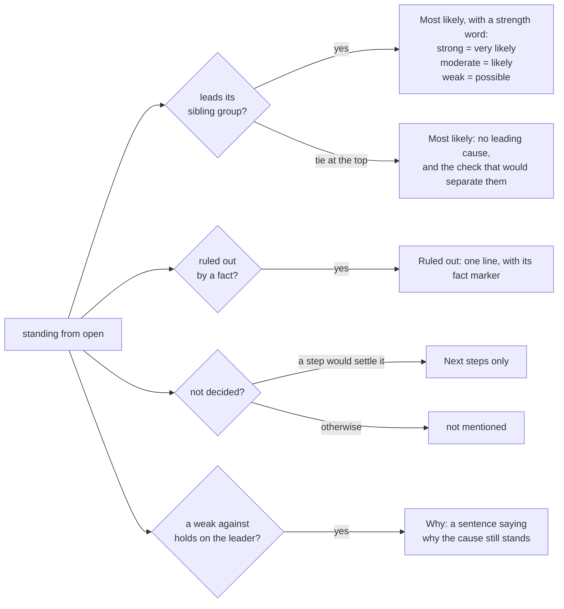
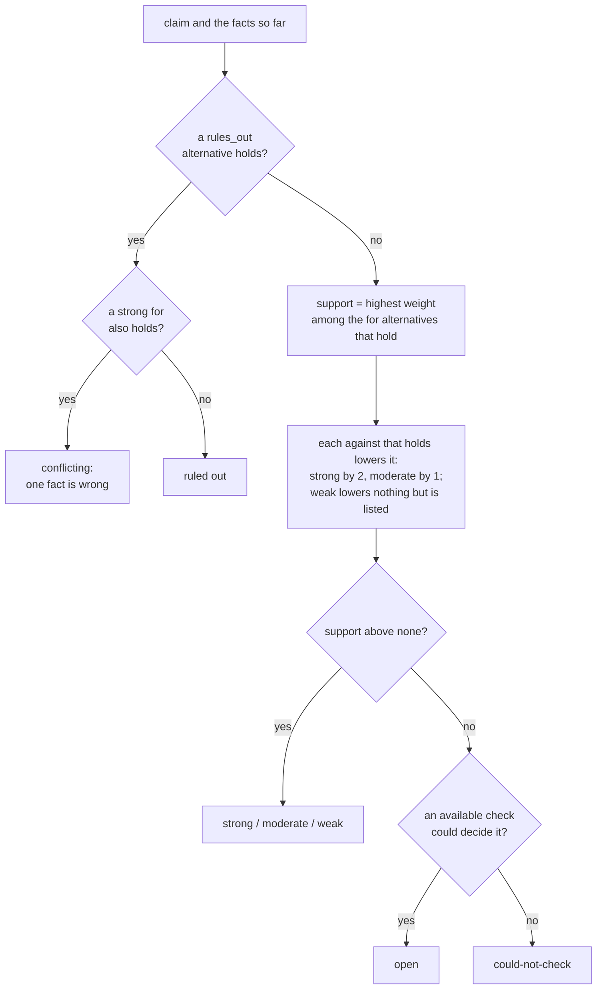
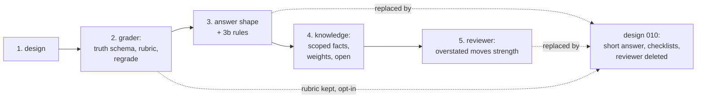

# 008 — Conclusions under incomplete evidence

k8srca is an agent that diagnoses Kubernetes problems and answers in Slack. It sees
only what the cluster still records, and Kubernetes records little history. The
agent was first asked to *confirm* a cause, and a cause it could not prove was
reported as "could not check" even when every observation pointed at it. This
document replaces confirmation with **[ranking](../docs/glossary.md)**: the answer
names the most likely cause and how strongly the evidence supports it, every fact
says how much of the history it covers, and the grader asks whether the answer drew
the conclusions the recorded evidence allows. To read it you need to know that the
[knowledge base (KB)](007-knowledge-representation.md) lists, for each symptom, its
candidate causes (each a *claim* in the KB format) and the facts that support or rule
out each one, and that `kb_query.py open` (in the `k8s-rca` skill) ranks those
candidates from the facts the agent has gathered.

Where this document and design 010 disagree, 010 describes what is built. This table
shows what each section is today:

| Section | State | Replaced by |
| --- | --- | --- |
| §1–§2 Why, principles | in force | |
| §3.1 The four-section answer | replaced; the rubric grader still uses its three standings | [010 §5.1](010-facts-and-short-answers.md#51-shape) |
| §3.2 Strength | in force; the answer says it as *very likely*, *likely* or *possible* | |
| §3.3 Example | replaced | [010 §5.3](010-facts-and-short-answers.md#53-example-jvm-oom-with-metrics-illustrative) |
| §4 The knowledge | in force; facts are now stated by the facts layer in code | [010 §3.2](010-facts-and-short-answers.md#32-a-fact) for who states a fact |
| §4.2 "Owed dispositions" | replaced; the completeness check is off | [010 §5.2](010-facts-and-short-answers.md#52-footnotes-and-the-host-checks) |
| §5 Probabilities | not built, by decision | |
| §6.1 `truth.yaml` | in force; each scenario's checklist is written from it | |
| §6.2 Dimensions | replaced as the main grade; the rubric that grades them is opt-in | [010 §7](010-facts-and-short-answers.md#7-grading-checklists) |
| §7 The reviewer | deleted; its replacement is built and off | [010 §6](010-facts-and-short-answers.md#6-the-knowledge-base-and-the-light-reviewer) |
| §8 Staging | steps 1–5 done | |

Terms used throughout:
- **Standing**: where an answer or the truth puts a candidate cause: *most likely*,
  *not ruled out*, or *ruled out*.
- **Strength**: how strongly the evidence supports a candidate that is not ruled out:
  *strong*, *moderate* or *weak* (§3.2).
- **Truth file** (`tests/scenarios/<id>/truth.yaml`): a [scenario](../docs/glossary.md)'s
  ground truth, written by a person from the capture (§6.1).
- **The jvm scenario** (`jvm-oom-on-startup`): the `ad` service's JVM has a 300Mi memory
  limit equal to its request and no heap sizing, so the kernel kills it seconds into
  every start. Its capture shows exit code 137 but a termination reason of `Error`,
  not `OOMKilled`. This document's examples use it. **checkout**
  (`checkout-gc-pressure`) and **itbench-33** (`itbench-33-invalid-node-selector`) are
  two other scenarios used in §8.
- **The seventh, eighth and ninth measurements**: numbered n=10 measurements on jvm,
  recorded in [007 §11.2](007-knowledge-representation.md#112-mining-pod-restarting)
  (which calls them gates). The eighth added the completeness check (a host check that
  the answer gave every owed candidate a place) and its revision turn (one more turn
  in which the agent is asked to fix what the check found). The ninth added the
  reviewer of §7 beside it.

---

## 1. Why

The agent never sees the whole history of the system it is diagnosing, and it never
will. Kubernetes keeps each container's last termination and a restart count, not
the terminations before. Events are kept for a window of hours to days. Logs rotate,
and a killed container's log stops mid-line. Metrics and centralized logs
([007 §4.1](007-knowledge-representation.md#41-capabilities)) widen the window but do
not close it: retention ends, scrapes sample, and the change that mattered may have
been made by a person in a tool the agent cannot read.

Before this design the system treated missing history as the exception. The answer
was to *confirm* a cause. A conclusion short of that was a "partial conclusion"
([002 §5.4](002-investigation-model.md#54-stopping-criteria)), and "could not check"
was a verdict for causes whose evidence was missing.

**"Confirmed" meant two different things.** To the grader it meant the explanation
that survives: the jvm truth file says of OOM, "This is the hypothesis that
survives". To the knowledge base and the reviewer it meant proven. The KB confirmed
`memory-limit-too-low` with the fact `killed_on_every_life`, "killed on every restart
including the first". No record holds every restart. A careful agent would not assert
that fact, so `open` could not confirm the cause, and the agent reported it as
could-not-check. The grader then failed the answer, because it wanted the surviving
explanation called confirmed. In the ninth measurement, five of the six misses on the
grader's old *rivals* dimension (did each competing candidate get the truth's verdict)
were this:
- the first answer named OOM from a too-low limit as most likely;
- the revision turn, asked by the knowledge and by the reviewer for a standard of
  proof the record cannot meet, demoted it.

Neither the agent nor the reviewer was wrong. They applied the stricter meaning, and
the grader graded the looser one.

Picking one meaning of "confirmed" would not fix this. The design stops asking for
confirmation where the evidence can only rank:
- the answer says what is most likely, and how strongly the evidence supports it;
- the knowledge says how much each fact counts, and over what span it was observed;
- the grader asks whether the answer drew the conclusions the evidence allows, no
  stronger and no weaker.

## 2. Principles

1. **Ruling out can be decisive; confirming is comparative.** "No liveness probe is
   configured" rules out a failing probe outright. Nothing in a crash loop proves
   OOM; it can only be the best-supported explanation left. The answer, the
   knowledge and the grader all keep this asymmetry.
2. **Every fact is scoped to what was observed.** A fact says what the record showed
   and over what span: the retained terminations, the event window, the log tail. A
   fact that quantifies over the whole history ("every life", "never", "the first
   failure") is one no record can state, unless an action can actually see the whole
   history.
3. **The answer is a hand-off.** The person asking can see more than the agent and
   can change the system. The answer's last job is to tell them the cheapest thing
   that would settle what the agent could not.
4. **Under-committing is an error, as over-committing is.** An answer that hedges
   every candidate is no more use than one that is certain of the wrong one. When
   the evidence separates the candidates, the answer must say which one leads.
5. **Ordinal strength, not invented numbers**
   ([002 §10.1](002-investigation-model.md#101-numeric-hypothesis-probabilities)). §5.3
   says what would change that.

## 3. The answer

> **Replaced by [010 §5](010-facts-and-short-answers.md#5-the-answer).** The shape in
> §3.1 asked for about 25 elements on jvm, and answers ran 1,000–1,600 words. The
> posted answer is now at most 300 words, not counting its Evidence block (the cited
> facts, which the host prints under the answer), in four parts: the most likely
> cause with a strength word; why, as sentences with footnoted facts; what a fact
> rules out; and next steps. A candidate no fact decided appears only as a next step.
> There is no *Not ruled out* section and no "what would change it" field.
> [`skills/k8s-rca/SKILL.md`](../skills/k8s-rca/SKILL.md) ("The answer") holds the
> instructions the agent follows. §3.2's strengths stay in force.

How each candidate's standing from `open` (§4.2) reaches the posted answer today, per
SKILL.md and 010 §5.1:



### 3.1 Shape

> **Superseded** for the posted answer by
> [010 §5.1](010-facts-and-short-answers.md#51-shape). The three standings defined here
> are still what truth files and the opt-in rubric grader use
> ([src/k8srca/scenario/model.py](../src/k8srca/scenario/model.py),
> [src/k8srca/scenario/grader.py](../src/k8srca/scenario/grader.py)).

The answer had four sections, in this order:

| Section | Holds | Each entry carries |
| --- | --- | --- |
| **Most likely** | One cause per level of refinement, or "no leading cause" when the evidence does not separate the top candidates | its strength (§3.2), the facts behind it, the facts against it, and what would change the conclusion |
| **Not ruled out** | Candidates that could still be the cause, most likely first | why it is less likely, and what would decide it. If nothing the agent can reach would decide it, the gap that stops it (what "could not check" used to say) |
| **Ruled out** | Candidates the evidence excludes | the fact that excludes it |
| **Next steps** | What the person asking should do or check, most useful first | which entry above it would settle or move. Checks that need access the agent lacks belong here |

Rare candidates that nothing pointed at shared one line at the end of *Not ruled
out*, because listing them one by one was most of the added length in the eighth
measurement.

**What would change it** named the observation that would move the leading cause.
"Most likely" says the evidence ranks this cause first, not that nothing could move
it. For jvm that is "the node's kernel log shows no OOM kill for the container" or
"raising the limit to 600Mi does not stop the kills". In 010's answer the next steps
carry this.

### 3.2 Strength

The most likely cause, and each candidate not ruled out, gets one of three grades:

| Strength | Means | Example (jvm) |
| --- | --- | --- |
| **strong** | Observations the cause predicts and its rivals do not, and nothing observed against it that the answer cannot explain | the limit is too low: limit equals request at 300Mi with no heap sizing, killed seconds into each life the record retains, never completes startup, and `fraud-detection`, the other container at 300Mi, dies the same way |
| **moderate** | Observations that fit it better than its rivals, but one rival or an unexplained observation remains | OOM itself, read alone: exit 137, no fatal error logged, but the reason reads `Error` and no OOM event was recorded |
| **weak** | Fits, and nothing better fits; little observed points at it specifically | a configuration cause, if the logs named no missing setting but showed nothing else either |

There is no grade above strong. A result that states the cause outright, such as the
reason `OOMKilled` beside an `OOMKilling` event, makes the cause strong with nothing
against it; that is as far as the evidence goes. "Confirmed" and "certain" in an
answer read as strong, and the grader holds them to it (§6).

Slack sees the grade in words, never as a number
([002 §10.1](002-investigation-model.md#101-numeric-hypothesis-probabilities)). The
answer gives only the leading cause's grade, as one
[strength word](../docs/glossary.md): *very likely* for strong, *likely* for
moderate, *possible* for weak ([010 §5.1](010-facts-and-short-answers.md#51-shape)).

### 3.3 Example

> **Replaced by [010 §5.3](010-facts-and-short-answers.md#53-example-jvm-oom-with-metrics-illustrative)**,
> which shows the current answer on the jvm scenario's metrics variant.

## 4. The knowledge

The KB is described in [design 007](007-knowledge-representation.md). This section
changes two things in it: what a fact may say (§4.1) and how facts count for or
against a candidate cause (§4.2). Both are built.

Since [010 §3](010-facts-and-short-answers.md#3-the-facts-layer), most facts are
stated by the [facts layer](../docs/glossary.md) (`src/k8srca/facts/`, code that reads
each tool result), and a fact's scope is part of its statement there
([010 §3.2](010-facts-and-short-answers.md#32-a-fact)). The KB's facts below are the
vocabulary `open` reasons over.

### 4.1 Scoped facts

A fact's `says` text states what was observed and over what. The KB build checks it
([src/k8srca/kb/knowledge.py](../src/k8srca/kb/knowledge.py)): a fact whose text
contains *every*, *always*, *never*, *first* or *since* is refused unless the text
also says "retained", or one of the actions that produce it declares
`scope: history` (it reads the whole history).

No action declares `scope: history` today. The Prometheus actions do not either: a
Prometheus series covers only what Prometheus retains, not the pod's whole life, so
the restart series answers "when did it start" only when the first restart falls
inside retention ([009 §6](009-metrics.md#6-the-knowledge)).

`killed_on_every_life` became:

```yaml
killed_in_every_retained_life:
  params: [Container]
  says: >-
    every termination the record retains was a kill -- the last state, the
    previous instance's when it is shown, and the terminations the event
    series implies over its span
```

An agent can assert that from the capture, and the claim's `note` says what it does
not cover. `completes_startup_each_life` became `completes_startup_in_retained_lives`
in the same way. The build check found the rest; in the mined layer only one fact
failed it. The authored facts are in
[docs/rca/knowledge/pod-restarting.yaml](../docs/rca/knowledge/pod-restarting.yaml).

### 4.2 Weighted evidence in place of confirm

A claim (candidate cause) used to have `confirm`, `supports` and `refute` lists.
`confirm` and `supports` merged into **`for`**, a list of alternatives, each a set of
conditions with a weight. `refute` split in two:
- **`rules_out`:** decisive, as `refute` was;
- **`against`:** weighted, the counterpart of `for`.

An example, close to the authored entries (the file adds a second strong `for` to
`memory-limit-too-low`, and writes the reason condition as
`last_termination_reason[C, Reason], Reason != OOMKilled`):

```yaml
memory-limit-too-low:
  title: memory limit too low
  for:
    - when: ["killed_in_every_retained_life[C]", "not completes_startup_in_retained_lives[C]"]
      weight: strong
    - when: ["limit_equals_request[C, memory]", "not runtime_sizing_flags_set[C]"]
      weight: moderate
  against:
    - when: "healthy_period_before_kills[C]"
      weight: moderate        # it once ran on this limit: look for what grew
  rules_out:
    - ["healthy_period_before_kills[C]", "onset_observed[W]",
       "not changed_before_onset[W, resources]", "not changed_before_onset[W, image]"]

oom-kill:
  for:
    - when: ["last_exit_code[C, 137]", "not process_logged_fatal_error[C]"]
      weight: moderate
    - when: ["last_exit_code[C, 137]", "not process_logged_fatal_error[C]",
             "memory_limit_plausibly_reached[C]"]
      weight: strong
  against:
    - when: "not last_reason[C, OOMKilled]"
      weight: weak            # stated in the answer; does not move the grade
  rules_out:
    - "last_exit_code[C, Code], Code != 137"
    - "process_logged_fatal_error[C]"
```

The weak `against` on `oom-kill` is the jvm scenario's trap (the `Error` reason),
written as knowledge. [007 §3.2](007-knowledge-representation.md#32-a-worked-entry)
found that pre-deciding the `reason` question, by telling the agent that `reason` is
unreliable, lowered the traps score both times it was tried. This does not
pre-decide it. It says the observation counts a little against OOM, and so belongs
in the answer, which is what the trap asks for.

**The standing of a claim**, as `open` computes it (`status()` and `ranking()` in
[skills/k8s-rca/kb_query.py](../skills/k8s-rca/kb_query.py)):
1. **Ruled out** if a `rules_out` alternative holds. If a strong `for` also holds,
   the claim is **conflicting**: one of the facts is wrong.
2. Otherwise, **its support** is the highest weight among the `for` alternatives
   that hold, or none.
3. **Each `against` that holds lowers it:** a strong one by two grades, a moderate one
   by one. A weak `against` lowers nothing, but `open` lists it and tells the agent to
   say in a sentence why the cause still stands.
4. **A sub-cause's support lifts its parent to the same grade.** This follows
   [007 §6.1](007-knowledge-representation.md#61-checking-against-the-evidence-record)'s
   rule that a confirmed sub-cause confirms its parent.
5. **Among siblings, the highest support leads.** A tie at the top is "no leading
   cause", and `open` names the cheapest available check that could separate the
   tied candidates.

The flow below shows rules 1–3 for one claim, as `status()` applies them. Rule 4 is
applied afterwards, walking the sub-causes, and rule 5 compares the results across
siblings.



The rule is deliberately simple, so that a reader can follow it and tests can check
it (`tests/test_kb.py`). The agent may depart from it, saying why; prose conditions
and facts outside the KB's vocabulary are the usual reason. SKILL.md tells it so.

**Owed dispositions.**

> **Replaced by [010 §5.2](010-facts-and-short-answers.md#52-footnotes-and-the-host-checks).**
> This design kept 007 §6.1's rule that every candidate, and every sub-cause `open`
> ranked or ruled out, needs a place in the answer, enforced by the completeness
> check. The short answer no longer places every candidate, and the completeness
> check is off (`review.completeness: false` in `k8srca.yaml`). `open` still marks
> which claims are owed (`owed_ids()` in `kb_query.py`) and saves them for that check.

### 4.3 What happens to the old statuses

How 007's statuses map to this design's standings. The scenario loader uses the same
table to read a truth file still written in the old format (§6.1).

| 007's status | here |
| --- | --- |
| confirmed | most likely, at the strength `open` computes |
| weakened | not ruled out, with an `against` that holds |
| refuted | ruled out |
| could-not-check | not ruled out, with the gap that stops it named |
| open | not ruled out, with the facts that would decide it |
| conflicting | unchanged: both a `rules_out` and a strong `for` hold, so a fact is wrong |

Could-not-check stops being a verdict and becomes a reason. A cause the agent cannot
confirm, but whose evidence still ranks it first, stays most likely. `open` still
prints `open` and `could-not-check` as the status of a candidate with no support (the
second when no available check could decide it); both are "not ruled out" in this
design's terms.

## 5. Probabilities

> **Not built, by decision.** The weights are ordinal. This section says why, and
> what would change it.

InferRCA, a research system for root-cause analysis, plans probabilities in its
predicates. They would go where the weights go, so the question is when.

### 5.1 Not yet

[002 §10.1](002-investigation-model.md#101-numeric-hypothesis-probabilities)'s
argument still holds:
- a Bayesian update needs priors and likelihoods nobody can defend;
- numbers the model writes are tokens, not measurements;
- `0.94` in Slack invites acting on it.

Each scenario gives one labelled outcome, and the suite's 15 scenarios cannot
calibrate a weight.

### 5.2 Built so they can be added

The three weights are meant as bands of a likelihood ratio: how much more likely the
observation is if the claim is true than if it is not.

| weight | band | read as |
| --- | --- | --- |
| strong | 10 or more | rarely seen unless the claim holds |
| moderate | 3 to 10 | clearly favours it |
| weak | under 3 | leans toward it |

The bands are not used in any computation. Writing them down keeps the weights
meaning the same thing across authors and layers (the build's `Weight` type in
`knowledge.py` cites them). A calibration would replace them with measured numbers,
per entry, without changing the format. A solver
([007 §10.2](007-knowledge-representation.md#102-compiling-to-clingo-and-running-a-solver))
could then read the same knowledge as InferRCA's probabilistic predicates, if that
becomes the route.

### 5.3 What would change it

Labelled outcomes: enough of them that a weight's band can be checked against how
often its claim turned out to be the cause. Sources:
- the [hold-out suite](006-holdout-suite.md) (design 006, on hold);
- scenarios recorded from real incidents;
- production threads where the person asking reported what fixed it. Nothing captures
  that yet (§10, question 5).

The trigger is 002 §10.1's own: "Revisit if the scenario suite grows enough labeled
incidents to *measure* calibration."

## 6. Grading

> **Changed by [010 §7](010-facts-and-short-answers.md#7-grading-checklists).** Each scenario's
> `checklist.yaml`, written from its truth file, is the measurement. The dimensions of
> §6.2 became groups of checklist items: cause, ruled out, traps, gaps and next steps.
> The checklist grader reads the checklist and the answer with its Evidence block, not
> the capture.
>
> The rubric grader of §6.2 is kept and is opt-in (`scenario run --rubric`). It still
> grades scenarios with no checklist, such as the hold-out suite's, and
> `scenario regrade` uses it to compare with runs from before 010. The truth schema of
> §6.1 is in use for every scenario.

The grader does not ask whether the answer reached the truth's verdicts. It asks
whether the answer drew the conclusions the capture allows. For that, the truth file
says what the capture allows, not what really happened.

### 6.1 `truth.yaml`

The candidate part of the truth schema
([src/k8srca/scenario/model.py](../src/k8srca/scenario/model.py)), shown for jvm:

```yaml
cause:
  summary: ...
  must_identify: [ad, memory, 300Mi]
  most_likely: memory-limit-too-low      # the claim the capture ranks first
  strength: [moderate, strong]           # the grades it supports; outside is wrong

candidates:
  - id: oom
    standing: most_likely                # parent of the leading cause
    strength: [moderate, strong]
  - id: memory-leak
    standing: ruled_out
    also_accept: [not_ruled_out]         # ...weak, on "no memory series"
    note: ...
  - id: bad-config
    standing: not_ruled_out
    strength: [weak]
    note: ...                            # flag state is invisible, so not ruled out
```

`standing` is one of `most_likely`, `not_ruled_out` or `ruled_out`. `strength` is a
range, because two sound readings can grade the same evidence a step apart.
`also_accept` keeps its rule from
[004 §6.3](004-scenario-testing.md#63-truthyaml-and-checklistyaml): it is for genuine boundaries, and
the note must say what argument leads to each.

**Older truth files.** A file still written with `rivals` and verdicts (confirmed,
weakened, refuted, could-not-check) is read through §4.3's table: confirmed becomes
`most_likely`, refuted `ruled_out`, weakened and could-not-check `not_ruled_out`. It
then has no strength ranges, because the old files never stated them. Our own files
were rewritten by hand, with ranges set by a person reading each capture and each
file re-reviewed under 004 §6.3's rule, which pins a truth to its capture. The
hold-out suite's truth files belong to its author
([design 006](006-holdout-suite.md)), so the format change reaches them as a schema
and a note, not as edits.

### 6.2 Dimensions

> **Replaced as the main grade by the checklist groups of
> [010 §7](010-facts-and-short-answers.md#7-grading-checklists).** The opt-in rubric still
> reports these dimensions (`dimensions()` in
> [src/k8srca/scenario/grader.py](../src/k8srca/scenario/grader.py)), plus a
> *restraint* dimension, from [004](004-scenario-testing.md), for scenarios about
> declining to name a cause.

| Dimension | Passes when |
| --- | --- |
| **cause** | the answer's most likely cause is the truth's `most_likely`, or its parent with the sub-cause among the leading few. "No leading cause" fails when the truth names one |
| **standing** (replaced *rivals*) | every candidate has a standing, and it matches the truth's or an `also_accept`. Leaving a candidate out fails |
| **calibration** | the leading cause's strength is inside the truth's range, and no candidate is ruled out without a fact that rules it out |
| **evidence** | every claim is tied to a result that supports it |
| **traps**, **gaps** | the designed trap is handled as the truth specifies; known-unavailable things are reported as unavailable |
| **next steps** | at least one step bears on what would change the leading cause, or on a candidate not ruled out. Reported but not required to pass, until it has a measured spread |

**Calibration** is where both kinds of error show:
- *Over-commitment:* "confirmed" or "certain" for a cause the truth grades moderate;
  a candidate ruled out on its absence from the logs.
- *Under-commitment:* "could not check" for a cause the truth grades strong; a
  candidate left open that a retained fact rules out, such as a memory leak in a
  container that never finishes starting (the ninth measurement).

Keeping calibration separate from **standing** stops a grade wrong by one step from
looking like a dropped candidate.

### 6.3 What the regrade can show for free

`scenario regrade` grades saved answers again. Once the grader and truth files
changed, every measurement in 007 §11.2 could be re-scored for a few cents a run,
before any prompt or knowledge changed. That answers two questions:
- **Which past results were the grader's.** The ninth measurement's demoted runs
  ranked OOM first while calling it could-not-check. Under §6.2 they could pass
  `cause` and fail `calibration` by a step.
- **Which conclusions survive.** The completeness check fixed dropped candidates;
  that should still show under `standing`. A past conclusion that reverses under the
  new grader was resting on the meaning of "confirmed".

§6.4 has the result.

### 6.4 Result: the saved measurements, regraded

The result table and its reading are in
[Appendix A.1](#a1-the-saved-measurements-regraded-64). In short: every answer the
ninth measurement demoted still led with the right cause, so the old *rivals* score of
4/10 was mostly the grader's meaning of "confirmed"; but its revision turn did lower
the cause's strength below what the capture allows in four of ten runs.

## 7. The reviewer

> **Deleted** ([010 §9.8](010-facts-and-short-answers.md#98-step-4-result-2026-10-22)).
> It was a model call, run by the host before posting, that read the answer and the
> session's evidence record and flagged claims as unsupported or overstated; its
> flags went back as a revision turn. It was never on in production.
>
> Its replacement, the **light reviewer**
> ([010 §6](010-facts-and-short-answers.md#6-the-knowledge-base-and-the-light-reviewer)),
> reads only the answer, the facts it cites, and `open`'s leading cause, its strength
> and what it rules out. It flags sentences that claim more than their facts. It is
> built and off (`review.light_reviewer: false` in `k8srca.yaml`), because on live
> answers it mostly flagged true statements whose facts it had not been shown.
> `k8srca eval answer --review` runs it offline. The code is in
> [src/k8srca/review.py](../src/k8srca/review.py).

What this design changed in the old reviewer, kept because §8.3 and its results refer
to it:
- **`overstated` moved a strength down one grade** and never moved a standing.
- **It got the scoped-fact rule.** A claim about "every retained life" is supported;
  "every life" is overstated.
- **It read `open`'s last standings**, so it asked for the same standard as `open`
  and the grader.

## 8. Staging

Each step after the first had a measurement: one arm (a configuration of the agent)
run n=10, or n=5 where [004 §6.4](004-scenario-testing.md#64-sampling-and-the-regression-rule)
allows, against the previous step. All five steps are done.

| Step | What changes | Measured how |
| --- | --- | --- |
| 1. This design | 002, 004 and 007 point here | review |
| 2. The grader | truth schema, migration, rubric, `scenario regrade` | regrade every saved measurement; nothing is run, so only the grader moves (§6.4) |
| 3. The answer shape (§8.1) | SKILL.md's answer section, the coordinator prompt, the revision prompts in `review.py` | n=10 on jvm under the new grader, against the regraded eighth measurement |
| 4. The knowledge (§8.2) | scoped facts and the build check; `for`/`against`/`rules_out` and their weights; `open`'s standing | n=5 on jvm, against step 3 |
| 5. The reviewer (§8.3) | `overstated` moves strength | n=5 on jvm with the reviewer on, against step 4 |

The order of the steps, all run 2026-10-18 to 2026-10-19, and the design that later
replaced parts of them:



The grader went first because every later number depends on it. Changing the answer
shape under the old grader would have been scored by the instrument whose meaning of
"confirmed" caused the problem.

checkout and itbench-33 were re-run at step 3. checkout's cause shows in a single
metrics sample, which is the case strength grades are for: the old truth could only
call it "confirmed" or "could not check".

### 8.1 Result: step 3, the answer shape

The result tables are in [Appendix A.2](#a2-step-3-the-answer-shape-81). What step 3
decided, and still holds:
- On jvm the shape did what §1 asked: no revision demoted the cause, and every answer
  held it at a strength inside the truth's range.
- Two rules were added to SKILL.md: **other failures that cannot reach the symptom
  are ruled out as unrelated** (not on its path, only on the far side of a queue, or a
  property healthy services share); and **a result that gives the reason for each
  object rules out the reasons it does not give**. SKILL.md now states the first as
  "find a path from it to the symptom in the cluster-architecture skill; one with no
  path is not a cause".
- The shape cost standing on checkout (candidates placed wrongly), and two more lines
  aimed at that did not help, so they were dropped. Standing was left to step 4,
  where a candidate's place comes from `open`'s computed standing.

### 8.2 Step 4 as built

§4 as written, with these decisions where it left room:

- **The scope check** is the one §4.1 describes. Only one mined fact failed it.
- **The authored weights** follow §4.2's two examples: `oom-kill`, with the weak
  `against` on the reason, and `memory-limit-too-low`. Three claims got a moderate
  alternative that drops one condition of their strong one:
  - bad-config: the logs name a setting, with no change seen;
  - failed-liveness-probe: probe failures without exit 143;
  - memory-leak: steady lifetime and startup, with no memory series, which is weak.

  workload-spike's peer timing is weak, as its `supports` was.
- **The mined layer is converted mechanically.** `confirm` became a strong `for`,
  `supports` a weak one, and `refute` became `rules_out`. Mining
  ([src/k8srca/kb/mine.py](../src/k8srca/kb/mine.py)) still asks the model for
  `confirm`/`supports`/`refute` and converts them, because the structured-output
  schema is at the size limit the API accepts. Nobody has re-weighed these. Most weak
  ones are background conditions that fit, such as a probe being configured or no
  fatal error logged. Three rules keep them from acting as evidence:
  - a weak `for` is never offered as a candidate's quickest test;
  - a weak sub-cause is not owed in the answer (owed sub-causes are ruled out,
    conflicting, moderate or strong);
  - a sub-cause that leads only at weak lifts its parent only to weak.
- **`open` prints the ranking.** It names the leader and the facts it rests on, or
  "no leading cause" with the cheapest available check that could separate the tied
  candidates; each weak `against` that holds, with "say in a sentence why it still
  stands"; what is ruled out, and by which fact; and the undecided candidates, each
  with its cheapest check. Nothing checks that the answer gives the weak `against` its
  sentence.

The measurement (n=5 on jvm, against step 3) is in
[Appendix A.3](#a3-step-4-the-knowledge-82). No dimension moved much, which is what a
format change should show on a scenario already near the top score, and the `Error`
reason trap held in all five answers.

### 8.3 Step 5 as built

> **The reviewer this step changed is deleted** (§7). What remains in force from this
> step is the SKILL.md wording about what the record covers.

- **The revision prompt** for `overstated` asked for one grade down. Most likely
  stayed most likely, nothing moved to not ruled out, and "confirmed" was replaced by
  the strength.
- **The reviewer read `open`'s last standings.** A strength at or below its standing
  was not overstated; one above it was overstated unless the answer gave a reason
  from the results.
- **`overstated` applied only to the strength of a cause the answer keeps.** A
  ruling-out no result supports was `unsupported` or `contradicted`, and a grade
  lifted from a sub-cause was not evidence against a ruling-out.
- **SKILL.md says what the record covers:** the last state, the previous instance's
  logs, and the terminations an event series counts. The answer says what the record
  covers rather than "one data point". This fixed answers that, after step 4's
  "retained" wording, called the record "the one retained termination" when the event
  series implies about 3,200.

The measurements are in [Appendix A.4](#a4-step-5-the-reviewer-83).

## 9. Rejected alternatives

### 9.1 Loosening the grader alone

Accepting "could not check" for OOM in the jvm truth would have passed the ninth
measurement. But the knowledge and the reviewer would still ask for a standard the
record cannot meet. Every answer would then have a reason to be weaker than its
evidence, and the grader would reward hedging. Principle 4 rules that out.

### 9.2 Keeping "confirmed" and defining it carefully

[002 §4](002-investigation-model.md#4-hypotheses) defines confirmed precisely: the
hypothesis's confirming observation is seen and every rival is weakened or refuted.
In practice models, SREs and the reviewer all read "confirmed" as proven. A word whose
careful definition every reader overrides is the wrong word.

### 9.3 Dropping the history facts

Removing `killed_on_every_life` and facts like it leaves memory-limit-too-low with
nothing but `limit_equals_request` behind it, which is a moderate fact at best. The
retained terminations are real evidence, and stated with their scope they say a lot.
The problem was the claim to more than was retained, not the facts themselves.

### 9.4 Numeric probabilities now

See §5.1.

## 10. Open questions

1. **Three grades, or four?** A grade above strong, for a cause a result states
   outright, might be needed if answers keep wanting to say "confirmed". *Settled for
   now: three.* 010's answer uses three strength words
   ([010 §5.1](010-facts-and-short-answers.md#51-shape)).
2. **Is the standing rule mechanical in `open`, or advice?** `open` computes it and
   the agent may depart from it with a reason. If departures are common and right,
   the rule is wrong; if common and wrong, `open` should hold the line. Not measured.
3. **Grading next steps.** Whether a step would settle something is a judgement. In
   the checklist, next steps are items such as "a next step is to raise the limit"
   ([010 §7](010-facts-and-short-answers.md#7-grading-checklists)).
4. **Slack length.** *Settled by 010:* the answer is at most 300 words, with no *Not
   ruled out* section ([010 §5.1](010-facts-and-short-answers.md#51-shape)).
5. **Production feedback as labels.** §5.3 counts threads where the person said what
   fixed it. Capturing that is a Slack-side feature (a reaction, or a closing
   question). Not built.

---

## Appendix: history and results

These are the measurements behind §6 and §8, kept because other documents cite them
(004 cites §8.1). Column names are the rubric's dimensions (§6.2). A figure such as
"9/10" is runs passing out of runs; a bare number in a "scaled to 5" row is a
ten-run result halved for comparison with an n=5 arm. "unsup/run" is the grader's
count of unsupported claims per answer. All runs are on the scenario named, replayed
from its capture.

### A.1 The saved measurements, regraded (§6.4)

Taken 2026-10-18. Every jvm measurement from the k8stools 4.0.2 sittings
([007 §11.2](007-knowledge-representation.md#112-mining-pod-restarting)), regraded
under this grader. Nothing was re-run. The ninth measurement's first answers (before
its revision turn) were graded here for the first time. "baseline" is the
measurement before the seventh in 007 §11.2.

| measurement | cause | standing | calibration | rivals (old grader) | traps | next | unsupported/run |
| --- | --- | --- | --- | --- | --- | --- | --- |
| baseline | 10/10 | 10/10 | 9/10 | 10/10 | 8/10 | 10/10 | 4.4 |
| seventh | 10/10 | 7/10 | 10/10 | 7/10 | 9/10 | 10/10 | 3.3 |
| eighth (completeness check) | 10/10 | 10/10 | 9/10 | 9/10 | 7/10 | 10/10 | 2.9 |
| ninth, first answers | 10/10 | 7/10 | 10/10 | - | 10/10 | 10/10 | 2.5 |
| ninth (with reviewer, revised) | 10/10 | 7/10 | 6/10 | 4/10 | 10/10 | 10/10 | 1.4 |

- **The ninth measurement's loss was partly the grader, and partly real.** The old
  rivals score read 4/10; the cause now reads 10/10, because every demoted answer
  still led with OOM from a too-low limit. The old grader read "could not check" as a
  verdict and failed them for it. But calibration fell from 10/10 on the first answers
  to 6/10 after revision: in four runs the revision lowered the cause to weak, below
  what the capture gives.
- **Standing agrees with the old rivals score where the misses were dropped
  candidates.** The seventh measurement's three misses dropped memory-leak and
  workload-spike, and read 7/10 either way. The eighth's completeness check fixed
  them: 10/10.
- **The revision turn fixed and broke in equal number.** The ninth's first answers
  lost standing in three runs, all leaving out memory-leak and workload-spike;
  revision fixed two of them. But it made two new misses: memory-limit-too-low put
  under not ruled out, and an application crash first ruled out and then walked back.
- **Calibration's other failures are single and mild.** In the baseline, bad-config
  was not ruled out but held moderate. In the eighth, memory-limit-too-low led but was
  held weak.
- **Next steps passed 50/50.** Every answer recommends raising the limit, which
  settles the cause, so as graded it does not separate these answers.
- **Unsupported claims read lower than under the old grader** (4.4 against 5.1 on the
  baseline). The rubric changed around them, so they compare only within this table.
- **The reviewer stayed off after this.** It cut unsupported claims to 1.4, the lowest
  yet, but its revision cost calibration in four runs of ten.

This table was the comparison point for step 3.

### A.2 Step 3, the answer shape (§8.1)

Taken 2026-10-18. n=10 per scenario, with the completeness check on and the reviewer
off. Comparison points: the regraded eighth measurement for jvm (A.1), and runs from
2026-10-16 regraded for checkout and itbench-33. Those were six runs each, on an
older skill and k8stools 3.x, so they show a direction, not a baseline.

| scenario | arm | cause | standing | calibration | traps | gaps | unsup/run | $/run |
| --- | --- | --- | --- | --- | --- | --- | --- | --- |
| jvm | eighth measurement, regraded | 10/10 | 10/10 | 9/10 | 7/10 | 10/10 | 2.9 | 0.64 |
| jvm | step 3 | 10/10 | 10/10 | 10/10 | 8/10 | 10/10 | 2.4 | 0.58 |
| checkout | 2026-10-16, regraded | 4/6 | 3/6 | 5/6 | 6/6 | 5/6 | 1.3 | ~0.60 |
| checkout | step 3 | 10/10 | 4/10 | 8/10 | 4/10 | 6/10 | 1.3 | 1.25 |
| itbench-33 | 2026-10-16, regraded | 6/6 | 0/6 | 6/6 | 6/6 | 6/6 | 0.5 | 0.22 |
| itbench-33 | step 3 | 10/10 | 0/10 | 9/10 | 10/10 | 8/10 | 0.5 | 0.46 |

- **jvm:** no revision demoted the cause. Every answer held it strong (7) or moderate
  (3), inside the truth's range. Answers were 20% shorter (4.8k characters first and
  7.4k revised, against 6.3k and 9.3k) and cheaper.
- **checkout: the cause was always found**, 10/10 against 4/6, at a strength the
  truth allows in 8 runs. One sample gives a weak or moderate lead, and the answers
  said so.
- **checkout: traps fell, and every miss had one shape.** A loud failure that cannot
  reach checkout's latency stayed under *Not ruled out*: kafka's consumers (3 runs),
  services near their memory limit (3), the `ad` crash loop (1, held "strong"). The
  skill's "ruling out needs an observation" was read as a reason to keep them, and the
  skill never said the dependency graph is such an observation.
- **itbench-33: excluded candidates kept open.** In 4 of 10 runs, the control-plane
  taint or insufficient resources sat under *Not ruled out*, though the
  FailedScheduling message gave every node's reason.
- **itbench-33 standing was 0/10.** Every answer left out admission-or-quota and
  application-fault. The KB had no entry for the alert, so nothing supplied them. That
  was the pod-pending family's gap, later filled by
  [007 §11.4](007-knowledge-representation.md#114-the-families-the-scenarios-reach-steps-1-to-7).
- **Cost:** checkout doubled to 56 tool calls and $1.25 a run.

The two rules in §8.1 were added after this. Both are generic, and both also match
what these two scenarios missed, so gains on them are partly expected
([007 §10.4](007-knowledge-representation.md#104-adding-what-the-scenarios-are-missing));
the hold-out suite is the test of whether they generalise. They were measured as
step 3b, with a same-sitting checkout baseline on the pre-step-3 skill, run from a
worktree. All three checkout arms ran on one capture under one grader, with three
grades per answer.

| checkout arm | cause | evidence | standing | calibration | traps | gaps | $/run |
| --- | --- | --- | --- | --- | --- | --- | --- |
| baseline, pre-step-3 skill | 9/10 | 1/10 | 8/10 | 7/10 | 4/10 | 8/10 | 1.10 |
| step 3, the shape | 10/10 | 3/10 | 4/10 | 8/10 | 4/10 | 6/10 | 1.25 |
| step 3b, shape and both rules | 10/10 | 7/10 | 5/10 | 8/10 | 8/10 | 5/10 | 1.10 |

- **The traps loss was not the shape's.** The baseline missed traps as often as step
  3, mostly on near-limit memory (product-catalog named as a co-cause at 95–97% of its
  limit; 5 of its 6 misses). With the unrelated-failure rule, traps read 8/10, a move
  of four against both arms.
- **Evidence rose with the rules,** 3/10 to 7/10. Neither rule targets unsupported
  claims; the likeliest reading, unmeasured, is that answers that rule out loud
  failures make fewer claims about them.
- **Standing is the shape's real cost, and the rules did not recover it:** 8/10
  before the shape, 4/10 with it, 5/10 with the rules. Every 3b miss is a placement:
  DNS latency ruled out on a healthy CoreDNS or one stale log line (4 runs), and CPU
  throttling or storage latency left out or only listed (3). Gaps fail on the same
  runs.
- **Cost is not the shape's either.** The baseline costs what step 3b does.
- **itbench-33's 3b arm was not run,** to save cost (evaluations were about $50 of
  sessions a day). The rule about scheduler messages is unmeasured.

**Two lines for standing, tried and dropped (2026-10-19).** One said a healthy shared
service does not rule out latency on one caller's path. The other said a candidate
the lookup returned needs a place, even if only "not checked". Measured live at n=5 on
checkout (a replay of saved investigations does not reproduce live answers):

| checkout arm | cause | evidence | standing | calibration | traps | gaps | $/run |
| --- | --- | --- | --- | --- | --- | --- | --- |
| step 3b, scaled to 5 | 5 | 3.5 | 2.5 | 4 | 4 | 2.5 | 1.10 |
| step 3b and the two lines | 4/5 | 1/5 | 3/5 | 3/5 | 4/5 | 5/5 | 1.29 |

Standing did not move (+0.5); one run ruled DNS out on exactly what the first line
forbids. Gaps rose and evidence fell by about 2.5 each, as every candidate got a place
and unsupported claims rose to 2.0 a run. Both lines were dropped rather than
extended, and standing on checkout was left to step 4.

### A.3 Step 4, the knowledge (§8.2)

Taken 2026-10-19. n=5 on jvm, the only scenario the converted knowledge reached
(checkout and itbench-33 then answered from vendored alert records), against step 3
scaled to 5. Step 3 was 10/10 on everything but traps, so standing, calibration and
cause could only fall; the question was whether traps held once the reason was in the
knowledge.

| jvm arm | cause | evidence | standing | calibration | traps | gaps | unsup/run | $/run |
| --- | --- | --- | --- | --- | --- | --- | --- | --- |
| step 3, scaled to 5 | 5 | 0.5 | 5 | 5 | 4 | 5 | 2.4 | 0.58 |
| step 4 | 5/5 | 1/5 | 5/5 | 5/5 | 3/5 | 5/5 | 2.0 | 0.54 |

- **The reason trap held in all five.** The two trap misses were other traps: a third
  crash loop counted (accounting), and the restart cadence stated as the lifetime.
- **`open`'s final run in every session** held oom-kill and memory-limit-too-low
  strong, both leading. Two sessions first ran `open` only when the completeness
  check asked for it.
- 19 tool calls a run, against 20.

### A.4 Step 5, the reviewer (§8.3)

Taken 2026-10-19. n=5 on jvm with the reviewer on (Sonnet 5.5, one call a run),
against step 4 with it off; then two rounds of fixes, each n=5.

| jvm arm | cause | evidence | standing | calibration | traps | gaps | unsup/run | $/run |
| --- | --- | --- | --- | --- | --- | --- | --- | --- |
| step 4, reviewer off | 5/5 | 1/5 | 5/5 | 5/5 | 3/5 | 5/5 | 2.0 | 0.54 |
| step 5, reviewer on | 5/5 | 1/5 | 4/5 | 5/5 | 5/5 | 5/5 | 2.0 | 0.68 |
| step 5, both reviewer fixes | 5/5 | 1/5 | 5/5 | 5/5 | 5/5 | 5/5 | 2.0 | 0.62 |
| and the SKILL.md fix | 5/5 | 2/5 | 5/5 | 4/5 | 4/5 | 5/5 | 1.0 | 0.76 |

- **Reviewer on:** 4 to 10 flags a run, 1 or 2 of them overstated; no dimension moved
  by two or more. Evidence did not rise: the grader's unsupported claims were mostly
  ones the reviewer did not flag ("flagd is healthy" from one readiness line;
  "crash-looping since the change 163 days ago").
- **The standing miss was the reviewer's.** One run's first answer ruled
  application-crash out. The reviewer flagged that as overstated, on its own reading
  of the logs and on `open`'s weak standing for it, which was lifted from a mined
  sub-cause's weak support; the revision moved it to not ruled out. A ruling-out is a
  place, not a strength, so `overstated` should not apply to it. The two fixes in §8.3
  followed, and after them no candidate changed place in a revision.
- **A new unsupported claim appeared in 3 of 5 runs** after step 4's "retained"
  wording: "the one retained termination", where the event series implies about 3,200.
  The fact text counted the event series as retained and SKILL.md's sentence did not.
  The SKILL.md fix (§8.3) cut it to 1 of 5 and halved unsupported claims, to 1.0 a
  run. That one run is also the calibration miss: reading the evidence as one
  termination, it held memory-limit-too-low at weak, below `open`'s strong. The traps
  miss is the familiar `accounting` one.
- **Cost** rose about $0.14 a run with the reviewer, within the roughly threefold
  run-to-run spread.
