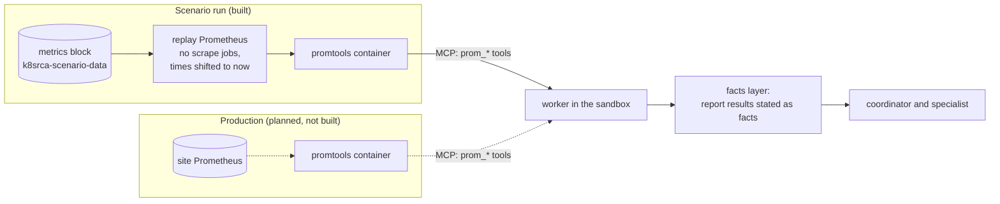
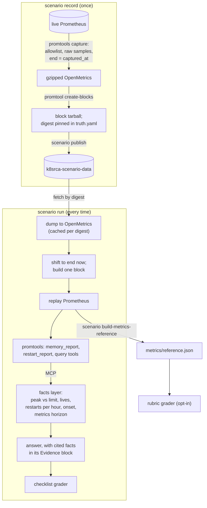
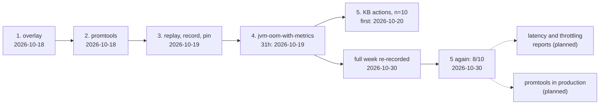

# 009 — Metrics: Prometheus in the cluster, the suite and the agent

**Status:** implemented in part. Built: promtools, our read-only Prometheus MCP server
(`packages/promtools`), with seven query tools and two reports (`memory_report`,
`restart_report`); capturing, storing and replaying a scenario's metrics; the facts
those reports produce; and the knowledge base's `prometheus` actions. Seven scenarios
carry a metrics capture. Not built: running promtools in production (it is off in
`k8srca.yaml` and `k8srca up` does not start it), latency and CPU-throttling reports,
the span metrics that carry latency, and authentication to a site's Prometheus.
**Last updated:** 2026-11-14.

**Related:** [004 — Scenario testing](004-scenario-testing.md) ·
[007 — Knowledge representation](007-knowledge-representation.md) ·
[008 — Conclusions under incomplete evidence](008-conclusions-under-incomplete-evidence.md) ·
[010 — Facts and short answers](010-facts-and-short-answers.md)

k8srca diagnoses Kubernetes problems from what the cluster records, and Kubernetes
keeps little history: the last termination, a restart count, a few days of events.
Prometheus keeps time series: memory within each life of a container, restarts per
hour, the termination reason over time. This document covers three parts: what a
cluster must scrape for metrics to help a diagnosis (§2–§3); how the agent reaches
Prometheus through **[promtools](../docs/glossary.md)**, an
[MCP](../docs/glossary.md) server of our own that sits beside
[k8stools](https://github.com/BenedatLLC/k8stools) (§4); and how a
[scenario](../docs/glossary.md) captures metrics once and replays them on every run
(§5). To read it you need to know that a scenario is a fault recorded from a test
cluster and replayed so runs need no live cluster
([design 004](004-scenario-testing.md)), and that the agent's answers grade their
leading cause as strong, moderate or weak by what the evidence can show
([design 008](008-conclusions-under-incomplete-evidence.md)).

Terms used here:
- **benben**: the host of our demo cluster, a minikube cluster running the
  OpenTelemetry demo application (an online shop built from many small services).
- **KSM** (kube-state-metrics): the exporter that turns Kubernetes object state
  (restart counts, termination reasons, limits) into metrics.
- **cAdvisor**: the kubelet's container-usage exporter (memory working set, CPU).
- **TSDB block**: Prometheus' on-disk storage unit. **OpenMetrics**: Prometheus' text
  format for samples.
- **Allowlist**: the metric names a capture keeps (§5).
- **Life**: one run of a container, from its start to its termination.
- **Horizon fact**: a fact that states how far back a source's record reaches, such
  as "metrics cover the last 30.9h" ([010 §3.2](010-facts-and-short-answers.md#32-a-fact)).
- **The jvm scenario** (`jvm-oom-on-startup`): the `ad` service's JVM is killed for
  memory seconds into every start. Its capture has no metrics.
  **`jvm-oom-with-metrics`** is the same fault recorded again with metrics.
  **checkout** (`checkout-gc-pressure`) and **itbench-33**
  (`itbench-33-invalid-node-selector`) are two other scenarios.

How the parts connect. The scenario path is built; the production path is planned
(dashed).

---

## 1. Why

Each early scenario's largest gap was a metric:
- jvm cannot see whether memory reaches the limit, or whether the crash loop ran
  continuously.
- checkout has one memory-usage sample and no latency.
- itbench-33 cannot measure user impact.

The knowledge base already had actions for these (`query-memory-series`, a restart
series), each requiring the `prometheus` capability
([007 §4.1](007-knowledge-representation.md#41-capabilities)), which no deployment
declared. Design 008 makes this worth measuring:
- with metrics, the truth file's strength ranges move up;
- a scenario with metrics tests the side of calibration that no earlier measurement
  exercised: does the agent raise its strength when the evidence allows?

## 2. What the demo cluster had before the overlay

The opentelemetry-demo chart (0.40.7) ships Prometheus 3.9.0, and a kube-state-metrics
job had been added to its scrape config. Read on 2026-10-18, through k8stools and
Prometheus' own read-only HTTP API, before the §3.1 overlay was applied:

| Property | Value | Consequence |
| --- | --- | --- |
| Scrape interval | 1m, every job | An 8-second life gets a sample only when one falls in it |
| Retention | 7d (`--storage.tsdb.retention.time=7d`) | The oldest sample was 7.1 days old. jvm's loop is older than that, so its onset stays unobserved |
| Storage | `emptyDir` | Survives a container restart, not a pod rescheduled. The pod was 181 days old, with 14 container restarts |
| Memory limit | 400Mi | 45,500 head series; fine at 1m, tight at 15s |
| kube-state-metrics | kube-system, its own helm release, scraped every 1m | Restart counters, last termination reason and exit code, limits: the series that matter most |
| Duplicate scrape | KSM is scraped twice: its own job, and `kubernetes-service-endpoints` through the `prometheus.io/scrape` annotation | Every KSM series appears twice with different `job` labels. A query without `job=` double-counts |
| cAdvisor | scraped through the API server's node proxy | **Pod-level cgroups only: no `container` label.** The docker runtime under minikube does not report per-container cgroups. For single-container pods, pod level is enough |
| node-exporter, pushgateway | absent / no target | Node memory pressure comes from k8stools, not metrics |
| Admin API | off | No TSDB snapshot endpoint. That is right for production, and §5 does not need one |
| Network | ClusterIP only | Nothing outside the cluster can reach it |

**What it says about jvm** (`ad`, over the retained 7 days):

| Question | Answer from metrics | From the k8stools capture alone |
| --- | --- | --- |
| Does memory reach the limit? | `max_over_time(container_memory_working_set_bytes{pod=~"ad-.*"}[7d])` is **300.0 MiB**, the limit exactly; the median is 1.8 MiB, between lives | not observable |
| Is the reason really `Error`? | `kube_pod_container_status_last_terminated_reason` reads **OOMKilled in 3,695 of 10,058 retained minutes, Error in 6,363** | `Error`, at one instant |
| Did it loop continuously? | **8 to 14 restarts in every hour of the 7 days**, with KSM up for all 10,080 minutes | "looping since the rollout" is an inference, unsupported |
| When did it start? | before retention began | not observable |
| OOM kill counter | `container_oom_events_total` is **0** at pod level, through thousands of kills | — |

The last row is a trap the knowledge must carry. A pod cgroup's OOM counter does not
count kills of the container inside it. A zero there is not "checked and found
false", the meaning `not` has in
[007 §3.2](007-knowledge-representation.md#32-a-worked-entry). The action that reads
it has to say so, or the counter rules out OOM on every cluster shaped like this one.

The reason series also turns the jvm scenario's main trap around. With metrics, the
`Error` reason is a property of the instant, not of the failure: the right answer
cites the series and is strong on OOM. Without metrics it stays the discrepancy the
trap asks the answer to flag.

Before the overlay replaced the storage volume, the retained week was exported raw
(12.3M samples over about 1,600 allowlisted series), with a k8stools capture at the
same moment, 2026-10-18T19:42:36Z. Built into blocks by `promtool` and served by a
stock Prometheus, it answered six comparison queries identically to the live server.
That export was §5's capture done once by hand. Its heavy queries probably cost the
old 400Mi Prometheus one restart: its probes timed out under them.

## 3. What a cluster must provide

This is what a deployment needs before it declares the `prometheus` capability
([007 §4.1](007-knowledge-representation.md#41-capabilities)), for any site:

1. **kube-state-metrics, scraped once.** The restart counter, last terminated reason
   and exit code, resource limits and requests, pod phase. These decide the most
   questions per byte.
2. **cAdvisor, container level where the runtime gives it.** Working set, CPU usage,
   and CPU throttling (`container_cpu_cfs_throttled_periods_total`), which checkout's
   `cpu-throttling` candidate needs. Pod level is a weaker fallback; the report says
   which it got.
3. **A scrape interval short against the failures it must see.** 15s for KSM and
   cAdvisor. At 1m, most 8-second lives go unsampled, and memory peaks are seen only
   by luck: jvm's 300.0 MiB was seen because there were thousands of lives.
4. **Retention longer than the incidents it explains**, 14 days at least, on storage
   that survives the pod being rescheduled.
5. **The admin API off.** Nothing here needs it.
6. **A read-only path to the HTTP API** for promtools (§4).

### 3.1 On benben

A values overlay for the demo's `prometheus` sub-chart,
[`cluster/prometheus-values.yaml`](../cluster/prometheus-values.yaml), applied
2026-10-18:
- 14 days of retention (with a 15GB size cap) on a 20Gi PVC for `/data`;
- memory limit 1Gi;
- a 15s global scrape interval (the two `-slow` jobs keep their 5m);
- kube-state-metrics scraped once. The install's own static job stays, and the
  default `kubernetes-service-endpoints` job drops KSM ahead of its annotation rule,
  so KSM series keep `job="kube-state-metrics"`, as in the exported week;
- a NodePort service on 30090, so Prometheus can be reached from outside the cluster.

The steps are in [docs/cluster-setup.md](../docs/cluster-setup.md), "Adding metrics".
The overlay was checked by rendering the chart offline: every setting takes effect,
and the extra flags enable neither the lifecycle nor the admin API. Applying it moves
Prometheus onto a new, empty volume, so the old `emptyDir` week is lost. A person
applies it with `helm upgrade`, as they installed the chart. k8srca never runs helm
against a cluster ([CLAUDE.md](../CLAUDE.md)): the overlay is configuration for the
cluster's owner.

Container-level cAdvisor series on minikube need the containerd runtime
(`minikube start --container-runtime=containerd`). That means rebuilding the
cluster, and every existing capture is of the docker one, so it is not done. Pod
level covers every scenario we have: each failing pod has one container.

## 4. How the agent reaches it

**promtools, an MCP server beside k8stools.** It is configured in the `metrics:`
block of `k8srca.yaml` with `provides: [prometheus]`; the poller passes the
capability to the sandbox, as 007 §4.1 describes. Its tools reach the agent with the
prefix `prom_` (`prom_memory_report`). The coordinator gets the two reports; the
specialist gets every tool.

Two network paths were considered:
- **Through k8stools and the API server's service proxy.** This keeps "all cluster
  access through k8stools" literal. But it needs the `services/proxy` permission,
  which reaches every HTTP endpoint of every service. RBAC can narrow it to GET on one
  named service, but the read-only property would then rest on an RBAC rule, not on
  the tool surface ([CLAUDE.md](../CLAUDE.md), reason 2). Not adopted.
- **Directly** (adopted). Prometheus is not the Kubernetes API and holds no cluster
  credential. promtools takes Prometheus' URL (`promtools serve --url`), which is site
  topology and belongs in `.env`. Many sites already run Prometheus outside the
  cluster, and they configure only the URL.

> **Planned, not built: promtools in production.** `metrics.enabled` is `false` in
> `k8srca.yaml`, `k8srca up` ([src/k8srca/bringup.py](../src/k8srca/bringup.py))
> starts no promtools container, and [docker/compose.yaml](../docker/compose.yaml)
> has none. The intended path is a NodePort (or a site's own address) reached from
> the host, carried to the promtools container by a tunnel like the one
> [src/k8srca/cluster.py](../src/k8srca/cluster.py) sets up for the API server; that
> tunnel does not exist for Prometheus yet. Today promtools runs only in scenario
> replays (§5). `K8SRCA_PROMETHEUS_URL` in `.env` is read only by `scenario record`,
> to capture metrics.

**Read-only: what makes it so.** promtools' HTTP client
([client.py](../packages/promtools/src/promtools/client.py)) sends GET only, and only
to a fixed list of query endpoints: `query`, `query_range`, `series`, `labels`,
`label/<name>/values`, `metadata`, `targets`, `status/runtimeinfo`,
`status/buildinfo` and `status/flags`. A path off the list is refused before anything
is sent. Prometheus' mutating endpoints (`/api/v1/admin/*`, `/-/reload`, `/-/quit`)
take POST or PUT, so a GET to them does nothing. A boundary test
([test_promtools_boundary.py](../packages/promtools/tests/test_promtools_boundary.py))
parses the package for HTTP calls outside the client, write methods, and strings
naming admin, lifecycle or write endpoints. This is the rule of
[001 §8](001-architecture.md#8-read-only-guarantee-and-security) for k8stools,
applied to promtools.

### 4.1 Ours, in `packages/`

Existing Prometheus MCP servers pass PromQL through and return raw JSON. k8stools'
experience (its 3.0 triage tools, k8stools issue #13) is that results need their
Kubernetes meaning attached, or the model reads them wrong. Every promtools result
carries `notes` ([notes.py](../packages/promtools/src/promtools/notes.py)) for these
cases:
- a pod-level series has no `container` label, and says so;
- a series scraped every 60s says a life shorter than that may have no sample;
- a pod cgroup's OOM counter says it does not count a container's kills;
- a range that starts before retention says how much of it is retained ("only the
  last 30.9h of the 7d asked for is retained"), so a missing onset reads as
  unobserved, not as "it started then" (§7.6);
- KSM duplicated under two jobs is reported, not summed.

So the server is ours: [`packages/promtools`](../packages/promtools). Like kubewiki,
it is a standalone package that never imports k8srca, with its own tests and its own
boundary test. It is a workspace member and a development dependency of k8srca, not
a runtime one: k8srca reaches it over MCP, in its own container
(`docker/Dockerfile.promtools`), so it stays out of the sandbox image. It has three
commands:
- **`promtools serve`**: the MCP server. Seven query tools (`query`, `query_range`,
  `series`, `label_values`, `metadata`, `targets`, `runtime_info`) and two reports
  shaped like k8stools' triage tools:
  - `memory_report`: working-set peak and median against the memory limit, per
    container or per pod, with sample count and interval, and `lives`: each life's
    length and whether memory climbed within it or was at the limit from its first
    sample;
  - `restart_report`: restarts over the window, the least and most per hour, hours
    with none, whether the first restart falls inside the window (an observed onset),
    and how long each termination reason was the latest.
- **`promtools capture`**: §5's export.
- **`promtools report`**: a report printed to the terminal, for a quick look.

> **Planned, not built: latency and throttling reports** (§8 question 2). The
> CPU-throttling series are captured, but no report reads them. The span metrics that
> carry request latency are not on the capture allowlist.

**Should it be its own repository?** k8stools is. promtools stays in `packages/`
while its interface settles, as kubewiki did, and moves out when another project
wants it.

## 5. Scenarios: capture and replay

[004 §3.3](004-scenario-testing.md#33-prometheus-a-real-server-on-a-captured-block-built)
planned a TSDB snapshot. That needs the admin API, which §3 keeps off, and a snapshot
is the whole database: 45,500 series to answer questions about a few pods. What is
built instead ([src/k8srca/scenario/record.py](../src/k8srca/scenario/record.py),
[sources.py](../src/k8srca/scenario/sources.py)):

- **Capture by query.** `promtools capture` runs, for each metric on the allowlist
  and each scenario namespace, an instant query with a range selector at the capture
  moment: `name{namespace="default"}[<window>]`. A range selector returns raw
  samples, not interpolated ones, so nothing is lost. It reads six-hour pieces, uses
  the read-only API only, and writes gzipped OpenMetrics.
- **Same moment as the k8stools capture.** `scenario record` runs both when
  `K8SRCA_PROMETHEUS_URL` is set (it needs `--namespace`); the metrics capture's end is
  the k8stools capture's `captured_at`. `truth.yaml` pins `capture.metrics: {end,
  digest}`. The runner refuses a truth not written against the metrics, a capture
  changed since it was, a metrics end that is not `captured_at`, and a pin with no
  source.
- **Stored as a block, in a data repository** (§7.4). Recording builds a TSDB block
  with `promtool tsdb create-blocks-from openmetrics`, packed as a tarball whose bytes
  depend only on its files. It lives in `BenedatLLC/k8srca-scenario-data` as
  `metrics/<digest>.tar.gz`. A week of the allowlist at 15s is about 20 MB as a
  block, against about 100 MB as gzipped OpenMetrics.
- **Replayed by a real Prometheus.** A block cannot be shifted in time, so at replay
  it is dumped back to OpenMetrics once per digest (into
  `.k8srca/scenario/metrics-cache/`). Each run shifts the samples so the capture ends
  when the run starts (the same rebasing k8stools applies to ages), builds one block
  (`--max-block-duration=168h`), and serves it from a Prometheus with no scrape jobs.
  promtools runs in front, aliased `promtools` on the scenario network. The runner
  sets `K8SRCA_METRICS=1`, which turns the `metrics:` block on for that run's sync and
  for the poller, which forwards it into the sandbox. A scenario without metrics
  declares no `prometheus` capability.
- **A metrics reference for the rubric grader.** The rubric grader (design 008's
  opt-in grader, which reads the capture) cannot query a block.
  `scenario build-metrics-reference` reads the replay through promtools' reports for
  every pod in the capture's namespaces, into a committed `metrics/reference.json`
  pinned to the capture's digest, with times on the capture's clock so a rebuild is
  identical. Without it, a true figure from `memory_report` was graded unsupported
  (§7.5, fourth arm). The checklist grader of
  [010 §7](010-facts-and-short-answers.md#7-grading-checklists), the main grader, does not need
  it: it reads the answer's Evidence block, where the reports' figures arrive as
  cited facts.

The record and replay pipeline, as built:

The allowlist ([capture.py](../packages/promtools/src/promtools/capture.py)) holds
what §2 used and §3 requires:
- kube-state-metrics: restarts, last terminated reason and exit code, limits and
  requests, pod phase and readiness, owners, deployment replicas, node conditions;
- cAdvisor: working set, RSS, CPU usage, CPU throttling, start times, memory
  pressure, the OOM counter;
- `up`, so a scrape gap reads as a gap, and Prometheus' oldest retained timestamp.

The rest of the database is not captured, so a query for something outside the
allowlist returns nothing at replay. To keep "no data" from reading as "not there",
the replay's `metadata` lists only allowlisted names.

**Scenarios with metrics:** `jvm-oom-with-metrics` (§7.3, §7.7), and six recorded for
design 010: `deploy-regression`, `downstream-latency`, `image-pull-typo`,
`liveness-probe-wrong-port`, `nothing-is-wrong` and `pvc-pending-no-storageclass`
([010 §9.9–9.12](010-facts-and-short-answers.md#99-step-5-plan-batch-1-2026-10-22)).
jvm stays without metrics. checkout-gc-pressure has no metrics capture: it waits for
the latency and throttling reports (§8 question 2).

## 6. The knowledge

**The facts layer** ([010 §3](010-facts-and-short-answers.md#3-the-facts-layer)) states
promtools' reports as facts (`memory_report()` and `restart_report()` in
[src/k8srca/facts/derive.py](../src/k8srca/facts/derive.py)). What the notes warn
about (horizons, sampled peaks, pod-level counters) reaches the agent as a fact's
scope, or as one horizon fact for metrics, not as text the agent must interpret:
- `memory_report`: the peak against the limit, `lives`, and the metrics horizon;
- `restart_report`: restarts per hour, each reason's share, the onset, and the
  horizon.

The raw result, notes included, still follows the facts
([010 §3.1](010-facts-and-short-answers.md#31-where-it-runs)).

**The KB's `prometheus` actions**
([docs/rca/knowledge/pod-restarting.yaml](../docs/rca/knowledge/pod-restarting.yaml)):

| Action | Calls | Produces |
| --- | --- | --- |
| `read-memory-report` | `memory_report` | `memory_limit_plausibly_reached`, `memory_grows_within_life` |
| `query-restart-counter` | `restart_report` | `onset_observed`, `healthy_period_before_kills` |
| `query-memory-series` | `query_range` | `memory_grows_within_life` |
| `query-load-series` | `query_range` | `load_rise_coincides_with_kills`, `kills_evenly_spaced_under_flat_load` |

Each action's `limits` text carries §2's traps: pod-level series, the sample interval
against a life's length, the pod-level OOM counter, and retention against onset.

**Scope.** No `prometheus` action declares `scope: history`
([008 §4.1](008-conclusions-under-incomplete-evidence.md#41-scoped-facts)), because a
series covers only what Prometheus retains, not the pod's whole life. So
`onset_observed` holds only when the first restart falls inside retention, and
`restart_report` says when it does not. jvm's does not.

## 7. Staging

| Step | What | Passes when | State |
| --- | --- | --- | --- |
| 1 | §3.1 overlay on benben, applied by its owner | promtools (or `curl`) reads 15s KSM and cAdvisor series, 14d retention configured | done 2026-10-18 (§3.1) |
| 2 | `packages/promtools`: the read-only server and capture | its own tests pass; a capture of benben round-trips through `promtool` and a replay Prometheus, and the same queries give the same answers | done (§7.1) |
| 3 | Replay in `scenario/sources.py`; `scenario record` captures both; truth pins both | hermetic tests with a tiny generated capture | done 2026-10-19 (§7.2) |
| 4 | `jvm-oom-with-metrics` recorded, truth written | a lint over the truth like the hold-out kit's (`holdout.lint`, design 006) | done 2026-10-19, re-recorded with a full week 2026-10-30 (§7.3, §7.7) |
| 5 | The KB's `prometheus` actions run (§6); n=10 on the new scenario | calibration on the new truth: OOM held strong, where jvm alone allows moderate | met in 8 of 10 runs, 2026-10-30 (§7.7) |

Steps 1–2 did not touch the skill, so they ran while design 008 settled what strength
means; step 5 waited for 008's step 4.

The timeline, with the remaining work dashed:

### 7.1 promtools, first cut (2026-10-18)

- **Client and boundary**, as §4 describes.
- **Tools:** the seven query tools and the two reports, each result with its notes. On
  benben, `memory_report` gave `ad` 299.7 of 300 MiB at pod level, and said the pod's
  OOM counter of 0 is not evidence. `restart_report` gave 6,889 restarts at the first
  retained sample, so the onset was not observed.
- **Per-hour figures need two hours of history.** With eleven minutes retained after
  the overlay, a partial hour read as "no restarts". The report now gives no per-hour
  figure in that case, and says why.
- **Capture** reads six-hour pieces, drops node labels (refusing a drop that would
  merge series), and streams gzipped OpenMetrics family by family. 30 minutes of
  benben came to 868 series and 46,695 samples. The allowlist plus dropped node labels
  halves the series count of the hand export, and the block is about 3.3 bytes a
  sample.
- **Size** (for §8 question 1), measured on the exported week (1m scrapes, built as
  blocks):

  | family | samples | 2h blocks | one block | one block, zeros trimmed |
  | --- | --- | --- | --- | --- |
  | span metrics (3; not on the allowlist) | 3.68M | 20.9 MB | 15.7 MB | — |
  | cAdvisor memory and CPU | 1.12M | 6.7 MB | | |
  | `kube_pod_status_phase` | 1.37M | 2.3 MB | 1.10 MB | 0.23 MB |
  | `kube_pod_status_ready`, node condition | 0.95M | 1.8 MB | 0.77 MB (ready) | 0.27 MB |
  | the three reason families | 0.33M | 1.1 MB | | |

  Bytes per sample from a short block overstate a week's size, because index overhead
  dominates a short block. Two things decide the size:
  - **The one-hot zeros.** Phase gives each pod one series per phase, all but one
    reading 0. On the allowlist, phase, ready and node condition were more than half
    the bytes. The capture drops their 0 samples (`ONE_HOT`). Exactly one state holds
    at a time, so nothing is lost. That cuts phase by 79% and ready by 65%. The reason
    families need no trim: KSM emits only the current reason, so they hold no zeros.
  - **Block length.** `promtool`'s default 2h blocks repeat the index 84 times in a
    week. `--max-block-duration=168h` halves phase and cuts the span metrics by a
    quarter. The replay uses it.

  The allowlist's week at 1m is then a few MB. Constant series cost almost nothing
  more at 15s, and changing ones about four times as much (§7.3 has the 15s figure).

### 7.2 Replay, record and pin (2026-10-19)

- **The metrics server is declared, then switched on**, as §5 describes. Production
  would switch it on with `enabled: true` once promtools runs there (§4).
- **The replay** (`sources.metrics_replay`) shifts the capture, builds one block with
  the Prometheus image's `promtool`, serves it from a Prometheus with no scrape jobs,
  and puts promtools in front, built from `packages/promtools` as
  `k8srca/promtools:<source digest>`.
- **Three fidelity fixes** found by the first end-to-end run:
  - **Time-valued samples** (last-terminated time, start times, the lowest retained
    timestamp) are shifted in value as well as in sample time. Otherwise "last
    terminated at" reads a year before now.
  - **The retention edge is the capture's.** The live Prometheus kept 14 days and a
    capture takes 7. The replay raises `prometheus_tsdb_lowest_timestamp_seconds` to
    the capture's start. Otherwise promtools reads an uncaptured week as a week
    without restarts, and could call an onset observed.
  - **Scrape intervals.** A replay has no targets, so `promtools serve` takes
    `--scrape-interval JOB=DURATION` from the capture's manifest. Without it every
    series read as 60s.
- **Tests:** hermetic ones that check the commands as built, never run docker, and
  generate a capture ([tests/test_scenario_metrics.py](../tests/test_scenario_metrics.py)).
  `K8SRCA_TEST_DOCKER=1` adds one that builds a real block from a tiny capture and
  queries it at the shifted time. An end-to-end run of the whole replay, with
  promtools answering `restart_report` over MCP, was done by hand.

### 7.3 jvm-oom-with-metrics, first recording (2026-10-19)

- **Recorded fresh,** because the 2026-10-18 export predates the overlay's new volume.
  About 31h of 15s metrics: 696 series and 4.8M samples.
- **What the metrics changed in the truth:**
  - **The cause is strong, and only strong.** The working set reaches the 300Mi limit
    in every life and stays flat until the kill (§7.7 has the exact counts). Every
    termination in the reason series is OOMKilled.
  - **memory-leak is ruled out on data,** since nothing climbs within a life.
    workload-spike is ruled out on a steady 9–17 kills an hour, with weak accepted for
    the missing request rate (a gap).
  - **jvm's two traps tied to its moment do not carry over.** The reason reads
    OOMKilled throughout, and the previous log is present.
  - **New traps:** the pod-level OOM counter at zero, and fraud-detection's sampled
    peak below its limit, from 2s lives scraped every 15s (dropped in §7.7).
  - **Lives vary.** The running series shows lives from under a scrape to several
    minutes, so the cadence trap is rewritten.
- **The replay reports the live retention** (`2w`, from the manifest), not its own.
- **Lint** (`holdout.lint`): clean but for the hold-out-only rule that a scenario
  declare its own architecture sources. Ours inherit `k8srca.yaml`'s, as jvm does.
- **Size.** 31h is 20.7 MB as gzipped OpenMetrics and 4.2 MB as a compressed block
  (17s to build), so a week is about 100 MB against about 20 MB. That is why captures
  are stored as blocks outside this repository (§7.4).
- **Hours are counted back from the report's end.** A per-hour count with a subquery
  aligns its buckets to the clock, and a replay is shifted by a different amount each
  run, so the same samples gave 9–16 one run and 8–14 the next. `restart_report` uses
  a range query aligned to whole hours back from `end`, and two replays agree.

### 7.4 Stored as blocks, in a data repository (2026-10-19)

- **Where.** A metrics capture is a TSDB block, packed as a tarball whose bytes depend
  only on the block's files: sorted, no times or owners, no name in the gzip header.
  It lives in `BenedatLLC/k8srca-scenario-data` (public, like this repository) as
  `metrics/<digest>.tar.gz`, so a re-recorded capture does not stay in this
  repository's history.
- **What stays here.** The scenario commits `metrics/manifest.json`: the window,
  retention and intervals. `truth.yaml` pins the tarball's digest. The tarball's local
  path, `metrics/block.tar.gz`, is gitignored.
- **No Git LFS.** Nothing clones the data repository to run a scenario. The runner
  fetches one file by digest from its raw URL, or from a local checkout named by
  `K8SRCA_SCENARIO_DATA`, and checks the digest. GitHub's per-file limit is 100 MB,
  against about 20 MB for a week.
- **At replay**, the block is dumped to OpenMetrics once per digest
  (`promtool tsdb dump-openmetrics`, about 16s at 31h), and each run shifts and
  rebuilds from that (§5). Recording seeds the cache with the text it built the block
  from.
- **`k8srca scenario publish <id>`** commits the block, the k8stools capture
  (`captures/<digest>.json.gz`) and the pinned skills (`skills/<digest>.tar.gz`) to a
  checkout of the data repository (`--push` to push). `k8srca scenario fetch` fetches
  them ([004 §2](004-scenario-testing.md#2-what-a-scenario-is)).
- **Known labels only.** `promtools capture` refuses a label name outside `LABELS`
  (plus `app_kubernetes_io_*`), with `--allow-label` to admit one once checked. The
  data is published unredacted, and the k8stools capture's redaction has no
  counterpart here.

### 7.5 Step 5, first measurement (2026-10-20)

The KB's `prometheus` actions call `memory_report`, `restart_report` and
`query_range`, with §2's traps as their limits. Column names are the rubric's
dimensions ([008 §6.2](008-conclusions-under-incomplete-evidence.md#62-dimensions));
figures are runs passing. These runs had the completeness check and design 008's
reviewer on (both are off today), so the "owed" rule below applies to the
completeness check.

The first arm: n=10 on `jvm-oom-with-metrics`, plus a regression check at n=5 on jvm:

| scenario | cause | evidence | standing | calibration | traps | gaps |
| --- | --- | --- | --- | --- | --- | --- |
| with-metrics (n=10) | 9 | 1 | 2 | 6 | 7 | 4 |
| jvm, this arm (n=5) | 4 | 1 | 4 | 4 | 5 | 5 |
| jvm, previous arm (n=5) | 5 | 2 | 5 | 4 | 4 | 5 |

jvm moved by 1 at most. Calibration on with-metrics was 6/10, so step 5's criterion
was not met. Every run called both reports, and none called `query_range`. What
failed:
- **The leak was left open.** The truth rules memory-leak out on the series: within
  each life the working set starts at the limit and stays flat. The reports then gave
  the peak and median, not the shape within a life, and the KB had no ruling-out on
  it. So the ruling-out rested on "never reaches serving", from one 8s life's logs;
  the reviewer rightly rejected that in two runs, which then reopened the leak and
  lowered the cause to moderate.
- **"7 days".** The reports said `window: 7d` when about 31 hours were retained, and
  answers repeated it.
- **Gaps.** Six runs never said that load cannot be measured.

**Second arm: `lives`.** `memory_report` gained `lives`. Each life runs from KSM's
start time to its recorded termination, and the report gives its length and whether
the working set climbs within it. On the capture: 327 lives, lasting 3s to 464s; 214
have two or more samples, and 182 of those start at the limit, while the other 32
reach it within 31s, which is startup. Both reports now state the window they cover
(30.9h of the 7d asked for). They read the retention edge and the limits over the
window, since an instant read of a replay's captured series is stale five minutes in.
In the KB, `not memory_grows_within_life` rules out a leak and a spike.

| scenario | cause | evidence | standing | calibration | traps | gaps |
| --- | --- | --- | --- | --- | --- | --- |
| with-metrics, second arm (n=10) | 10 | 9 | 2 | 7 | 8 | 6 |
| jvm, second arm (n=10) | 10 | 2 | 9 | 9 | 10 | 10 |

Every dimension rose on with-metrics; evidence went from 1 to 9 because the window is
stated correctly. jvm is level. Merged. Calibration was 7/10, and standing stayed at
2/10, now because application-crash went unnamed. One failure came from the grader's
`numeric_claims` check, which refused "327 restarts over the 30.9h retained" because
the k8stools capture holds only lifetime totals; with a metrics capture, that check
now only advises.

**Third arm: opening a symptom as its parent claim.** In 8 of 10 second-arm sessions
the agent ran `lookup OOMKilled` and `open OOMKilled`; every jvm session started from
`CrashLoopBackOff`. This capture's last reason reads OOMKilled where jvm's reads
Error. `container-oom-killed`'s candidates are exactly oom-kill's sub-causes, so
oom-kill's rivals never came up and nothing owed them a place. `kb_query.py` now opens
a symptom whose candidates are one claim's sub-causes as that claim's symptom. At n=5
(scaled second arm in brackets): cause 5 (5), evidence 2 (4.5), standing 4 (1),
calibration 4 (3.5), traps 5 (4), gaps 0 (3). Standing improved, but evidence and gaps
fell by 2 or more, so it was not merged alone. The owed list grew from 1–2 claims to
6–9, and the revision turn took answers from 4–6 KB to 7–9 KB, with more slips.

**Fourth arm: owe less.** A claim is owed only if the facts decided it or the
authored knowledge names it, plus the decided sub-causes of a supported claim. A
mined candidate nothing decided is offered, not owed (`owed_ids()` in
[skills/k8s-rca/kb_query.py](../skills/k8s-rca/kb_query.py)). That cut a typical
`open OOMKilled` from 17 owed claims to 8. At n=5, with the third arm and the scaled
second arm in brackets: cause 5 (5, 5), evidence 1 (2, 4.5), standing 4 (4, 1),
calibration 3 (4, 3.5), traps 4 (5, 4), gaps 4 (0, 3). jvm at n=5 against its scaled
n=10: 5/1/5/5/5/5 (5/1/4.5/4.5/5/5). Of the four evidence failures, one was
`memory_report`'s own `lives` output, which the grader could not see without the
metrics reference; two stated a retention of 5–6 or 10 days where the report gave
30.9h; one grouped other OOMing workloads by a pod-template age the capture does not
show.

**Regraded with promtools' reports in the grader's reference** (§5), all three arms
on the same answers (cause/evidence/standing/calibration/traps/gaps): second arm
(n=10) 10/5/3/7/8/6; third arm 5/3/4/4/5/0; fourth arm 5/1/4/3/4/4. The lives figure
no longer fails; the retention misstatements still do. Against the second arm scaled
to 5 (5/2.5/1.5/3.5/4/3), the fourth arm moves evidence by 1.5, standing by 2.5 and
gaps by 1, and nothing dropped by 2. Evidence fell from 9 to 5 on unchanged answers,
mostly on claims about the k8stools capture, so the grader varies more than the
margin of 2 assumes. The fourth arm was merged on this regrade, with the grader
change.

### 7.6 The retention note, reworded (2026-10-23)

The misstated retentions in §7.5 came from promtools' note, "the range starts 137.1h
before the oldest retained sample (retention)", which puts the span *missing* beside
the word retention; answers read it as 137h retained. The note states what is held:
"only the last 30.9h of the 7d asked for is retained (oldest sample …)". The committed
`metrics/reference.json` files were rebuilt with it, with their times on the
capture's clock and their windows ending at the capture's end. The change was not
re-measured. The window also reaches the agent as the metrics horizon fact
([010 §3.2](010-facts-and-short-answers.md#32-a-fact)), so the note is no longer the
only place it is stated.

### 7.7 The full-week re-recording, and step 5 again (2026-10-30)

Issue #3. Recorded through k8stools 4.4.1 with the default 7-day window: 667 series,
25.9M samples, a 7-day block (`8b9f59977eb23dbc`). The k8stools capture is
`b107097231ebbbdc`, and the architecture wiki's digest did not change. Both are in the
data repository.

**What moved in the truth.** Every candidate, standing and strength held:
- ad has restarted 9707 times, 1754 of them in the window, at 8 to 15 an hour.
- At capture ad is in CrashLoopBackOff with no running instance.
- Of the 1142 lives with two or more samples, 977 start at the limit and 165 reach
  it within 32s. None stays below it. A leak is still ruled out, because reaching the
  limit within 32s of starting is startup.
- **The `sampled-peak-is-not-the-peak` trap is dropped,** with its checklist item.
  Over 7 days, fraud-detection's sampled peak is 302.8 MiB, above its limit, so no
  answer can be misled by a peak below it.

**Step 5 again.** n=10, graded on the scenario's checklist
([010 §7](010-facts-and-short-answers.md#7-grading-checklists)), with `--local-skill k8s-rca`.
It doubles as 004's re-baseline.
- **Diagnosis:** 10/10.
- **Checklist:** 12.5 of 14 on average:

  | cause | ruled out | traps | gaps | next |
  | --- | --- | --- | --- | --- |
  | 35/40 | 30/30 | 40/50 | 10/10 | 10/10 |

- **Agreement:** three gradings of each answer agree on 99.3% of items, with one
  split on each of three items.
- **Step 5's criterion is met in 8 of 10.** Every run holds OOM at strong ("very
  likely") and rules the leak out on memory shape. Eight hold the limit-too-low
  sub-cause at strong too; two put it a step lower. Neither is a checklist item, so
  the checklist does not count it.
- **Cost:** 10–16 tool calls and $0.15–0.24 per session, which set the scenario's
  advisory budget at 25 calls and $0.40.

**What is still missed:**
- **`no-onset-date`, in 10 of 10.** Every answer offers the 193-day-old image bump
  (2.0.2-ad to 2.2.0-ad) as the possible trigger. Most add that 20 days of events
  cannot confirm it, but offering a change as the trigger is what the item counts. The
  pod template's age is visible; the loop's start is not.
- **`cause-no-heap-sizing`, in 5 of 10.** Those answers name the limit but not the
  JVM's missing heap flags.

Both are knowledge or answer-writing work, not metrics work, and belong with issue
#10's findings.

## 8. Open questions

**8.1 How much to capture.** *Settled for now (§7.4): blocks, in a data repository,
fetched by digest.* A week of benben's allowlist at 15s is about 20 MB. If the
allowlist grows, trimming constant series is the next step.

**8.2 Latency for checkout.** *Planned, not built.* The demo's spans reach Prometheus
as OTLP span metrics (`traces_span_metrics_duration_milliseconds_bucket`), which carry
server and client latency per call: design 010's downstream-latency fault was measured
with them, frontend's GetProduct calls going from 185ms to 850ms
([010 §9.11](010-facts-and-short-answers.md#911-step-5-plan-batch-2-2026-10-22)). But
they are not on the capture allowlist, and promtools has no latency or throttling
report. A replayed scenario therefore has no latency, and the agent finds throttling
only from a usage sample against the limit. The next step is both reports, and the
span metrics on the allowlist, as a design of their own.

**8.3 containerd.** Container-level series would let multi-container pods be answered
at container level. That means rebuilding the cluster; worth it when a scenario needs
it.

**8.4 Production.** *Not built.* A site's Prometheus may need authentication (a bearer
token, mTLS). That makes promtools a credential holder, the k8stools pattern again:
one container holds the credential, and nothing else does. `PromClient` accepts
request headers for this, but `promtools serve` has no option to set them yet.
