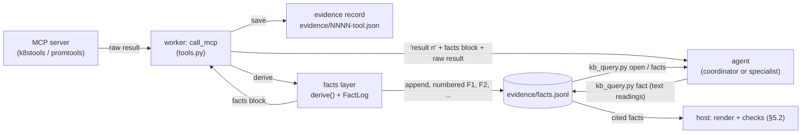
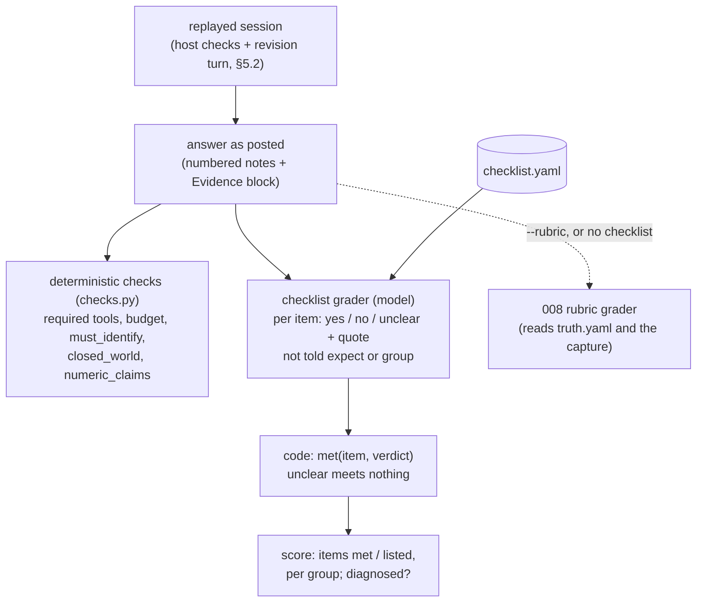

# 010 — Facts in code, short answers, checklist grading

k8srca is an agent that diagnoses Kubernetes problems and answers in Slack. It reads the cluster
only through read-only MCP tools (Model Context Protocol servers: k8stools for Kubernetes,
promtools for Prometheus). This document covers three connected changes. First, code now turns
each tool result into short, numbered **facts** (the facts layer), so the model no longer works
out counts, time spans and scopes by hand. Second, the answer is short: at most 300 words in four
parts, with each finding marked by the facts it rests on, and the host prints those facts as
footnotes. Third, each test scenario is graded against a **checklist** of statements the answer
should and should not make. To read it you need to know that the agent runs as a coordinator
(`rca-coordinator`), which plans and writes the answer, and a specialist (`k8s-investigator`),
which does high-volume reads for it; that a **scenario** is a fault recorded once on a test
cluster and replayed for each run ([design 004](004-scenario-testing.md)); and that the
**knowledge base** lists symptoms, their candidate causes, and the facts that support or rule out
each cause ([design 007](007-knowledge-representation.md)). Sections 1–8 and 10–12 describe the
system as it is. [§9](#9-build-steps-and-results) is the record of how it was built and measured,
which later designs cite.

This design replaces parts of other designs. Where they disagree with it, this one describes what
is built ([§10](#10-what-this-replaces-in-other-designs) lists each):
- [002](002-investigation-model.md), how the agent reasons;
- [004](004-scenario-testing.md), how answers are graded and what is run;
- [007 §6.1](007-knowledge-representation.md#61-checking-against-the-evidence-record), the
  completeness check and the revision turn;
- [008 §3](008-conclusions-under-incomplete-evidence.md#3-the-answer) (the answer),
  [§6](008-conclusions-under-incomplete-evidence.md#6-grading) (grading) and
  [§7](008-conclusions-under-incomplete-evidence.md#7-the-reviewer) (the reviewer).

---

## 1. Why: what the measurements showed

This design came out of a review of four and a half weeks of measurement, 2026-09-20 to
2026-10-21. The figures below are the reasons for each choice in §2–§8.

- **Spend:** 538 agent sessions cost $217. Grading was not logged; it is estimated at about $200
  more.
- **Scenarios:** 82% of runs were on the two jvm scenarios (jvm-oom-on-startup and
  jvm-oom-with-metrics: a Java service whose memory limit is too small for it to start).
- **Two different outcomes.** The cause was right in 97% of runs, and on jvm it was right in every
  run from late September. The rubric grader of
  [008 §6](008-conclusions-under-incomplete-evidence.md#6-grading) also scored an *evidence*
  dimension (every claim in the answer is supported by the recorded cluster state). Evidence
  passed in only 2–24% of jvm runs in every week, and six changes aimed at it did not move it.

**The changes that improved results and kept them improved all made the agent's job smaller:**
- the k8stools composite tools (one call returns one namespace's or one workload's state): jvm
  traps passed 6/12 → 10/12, with half the calls, 36% cheaper. A *trap* is a tempting wrong
  statement a scenario is built to provoke;
- shorter tool descriptions: traps 3/12 → 6/12;
- taking diagnostic guidance out of the architecture skill: traps 2/6 → 6/6;
- having the knowledge base at all;
- the completeness check of
  [007 §6.1](007-knowledge-representation.md#61-checking-against-the-evidence-record).

**Nearly every instruction-level change measured on jvm from 2026-10-14 on did not hold.** Most
were recorded as "no large effect", reverted, or traded one dimension for another.

Four findings follow from this.

**The agent derived low-level facts by hand, and that is where it failed.** Of 1,277 unsupported
claims from 2026-09-30 on:
- 55% were about time, horizons, counts or generalizing over every instance: "crash-looping for
  the full 163 days", "SIGKILLed 2–8s into every startup", "metrics retain 5–6 days";
- 28% generalized about other workloads ("every other workload is healthy");
- 6% were about the diagnosis.

The agent wrote knowledge-base facts such as `killed_in_every_retained_life[C]` from raw counts
and time windows, and no code checked that mapping. For example, a promtools note gave the span
missing from a window beside the word "retention", and answers read it as the retention
([009 §7.5](009-metrics.md#75-step-5-first-measurement-2026-10-20)).

**The agent was told too much, and some of it was tuned to the tests.** Before seeing any evidence
it read about 21k tokens of method and knowledge-base text:
- the coordinator prompt;
- the `k8s-rca` skill's SKILL.md, then 15.7k characters with about 40 directives;
- the architecture skill's index;
- `kb_query.py`'s `lookup`, `claim` and `open` output, about 12k characters each.

"Every candidate needs a place" was said about six times. Several rules were scenario traps
restated as instructions: jvm's back-off count wording and back-off cadence, and itbench-33's
FailedScheduling message. Some rules contradicted others: "keep it tight" against a four-section
format, and "leave out what you did not observe" against "owe every open candidate a place".

**The answer asked for too much.** 008's answer shape needed about 25 elements for jvm: seven
candidates over two levels, each with strength, facts for and against, and what would change it.
Answers ran 1,000–1,600 words, against 265 for 008's own example. The revision turn added 35–70%
and doubled the cost per run, from about $0.30 to $0.60.

**Answers varied too much between runs, and the grader too much between gradings, to show small
changes.**
- Two n=5 arms of an identical agent (two batches of five runs of the same configuration)
  differed by 2 or more on evidence about 30% of the time.
- The rubric grader disagreed with itself on evidence for an identical answer 11–16% of the time.
  One borderline claim failed the dimension, and the count of unsupported claims differed in 44%
  of re-gradings.
- The reference for each grading call was 90–120k tokens, mostly the raw capture.

The merge rule of the time, a move of 2 at n=5
([004 §6.4](004-scenario-testing.md#64-sampling-and-the-regression-rule)), could not separate a real effect
from this noise. About 4 of 25 arms from 2026-10-16 on cleared it.

## 2. Principles

1. **Code states facts; the model decides what to do with them.** Every observation the answer
   can rest on (a count, a duration, a scope, a horizon) is produced by deterministic code from a
   tool result, as a short statement. The model chooses which tool to call next, when to stop,
   which cause the facts point to, and how to say it.
2. **Numbers come from code.** The answer's figures are the facts' figures, printed by the host
   in footnotes. The prose may repeat a figure only where a cited fact states it.
3. **Say less, and only what a fact supports.** The answer is a few hundred words. A candidate
   cause appears only if a fact rules it in or out. What nothing decided appears only as a next
   step.
4. **Instructions describe the job, not the test.** No rule is written from a scenario's trap. A
   trap that keeps failing points to a missing fact, which goes into the facts layer (§3).
5. **Grade against a checklist of statements.** Each scenario lists the statements an answer
   should and should not make. The grader answers present or absent per item. It reads the
   checklist and the answer with its cited facts, not the whole capture.
6. **Measure across many scenarios.** A change is measured across many scenarios at small n, never
   by tuning one scenario at larger n.

## 3. The facts layer

### 3.1 Where it runs

The facts layer is [src/k8srca/facts/](../src/k8srca/facts/), and it runs in the worker (the
code in the sandbox container that serves the agent's tool calls). It reads MCP results and never
the cluster, so the rule that k8srca never touches the Kubernetes API directly (CLAUDE.md) holds
unchanged. It may move into k8stools and promtools later, once its statements prove general
([§11](#11-rejected-alternatives)).

The worker already sees every tool result. In [src/k8srca/tools.py](../src/k8srca/tools.py),
`wrap_mcp_tool`'s `call_mcp` saves each result to the evidence record (the workspace copy of
every result, [007 §6.1](007-knowledge-representation.md#61-checking-against-the-evidence-record))
before returning it to the agent. With `facts.enabled: true` in `k8srca.yaml`, which is the
setting today, it then:
1. derives facts from the result (`derive` in
   [facts/derive.py](../src/k8srca/facts/derive.py));
2. numbers them and appends them to `evidence/facts.jsonl` in the session's workspace
   (`FactLog` in [facts/log.py](../src/k8srca/facts/log.py));
3. puts a header above the raw result: `result <n>`, the result's number in the evidence record,
   and then a `facts` block of numbered statements, each with its scope in brackets.

The diagram shows one tool call, from the MCP server to the agent, and where the facts it
produces go next. Every box is built and on.



Every result gets its number, whether or not it has facts, so that a fact the agent reads from a
log can cite the result it came from (§3.4). The coordinator and the specialist both call tools
through the worker, so both see facts. `kb_query.py facts` lists every fact so far, including
those from the specialist's calls, so the coordinator can cite them.

### 3.2 A fact

A fact as stored in `facts.jsonl` (the `Fact` dataclass in
[facts/model.py](../src/k8srca/facts/model.py)):

```json
{"id": "F7", "subject": "default/Deployment/ad/ad",
 "key": "last_termination", "value": {"exit_code": 137, "reason": "OOMKilled"},
 "statement": "ad's last termination: exit 137 (...), reason OOMKilled, after running 8s",
 "scope": "the last termination only: Kubernetes keeps no earlier ones",
 "kb": ["last_exit_code[C, 137]", "last_termination_reason[C, OOMKilled]"],
 "by": "code",
 "source": {"tool": "k8s_get_workload_report", "n": 3}}
```

- **`id`.** `F<n>`, numbered in order within the session, so ids stay stable across the turns of
  a Slack thread. A fact already recorded keeps its id. Readers never see ids (§5.2).
- **`subject`.** `<namespace>/<Kind>/<name>[/<container>]`, `node/<name>`, or
  `<source>/horizon`.
- **`key` and `value`.** What is observed, in the knowledge base's word for it where it has one.
- **`statement`.** Written by a template per key. It is the sentence the footnote prints, so it
  reads on its own: subject, value and scope, with no reasoning.
- **`scope`.** What the record covers, in plain words. The scope is part of the fact, so the agent
  never has to work it out.
- **`kb`.** The knowledge base's fact lines this observation establishes, in the vocabulary of
  [007 §3.1](007-knowledge-representation.md#31-concepts), with role letters for the subject's
  workload (`W`), container (`C`) and pod (`P`). `kb_query.py open` reads these to rank causes.
- **`by`.** `code`, or `agent` for an observation the agent read from text (§3.4).
- **`source`.** The tool and the result number.

**Horizons are facts too.** Each source states how far back its record goes, once per source:
- "Warning events in default go back 3d20h" (the oldest record retained, not when any problem
  began);
- "metrics cover the last 31h of the 7d asked for";
- "ad's logs are kept for the current instance and the previous one only".

The answer cites them where they matter, for example for "no onset is visible". The agent never
computes or restates a window.

### 3.3 What code derives, per tool

Each derivation is a small function over one result shape, unit-tested against results recorded
from the scenario captures. The table lists the tools in `DERIVATIONS`
([facts/derive.py](../src/k8srca/facts/derive.py)), by the name the agent sees. The first seven
are the ones this design built. The others were added by later steps of
[design 007 §11.4](007-knowledge-representation.md#114-the-families-the-scenarios-reach-steps-1-to-7)
and by [design 012](012-log-evidence.md), on the same pattern.

| Tool | Facts |
| --- | --- |
| `k8s_get_namespace_health` | per unhealthy or recovering workload: ready against desired, restarts, last termination, a waiting reason; pods with no node, the unbound claims they mount, placement, and a Deployment's failing rollout conditions (`pods_unscheduled`, `rollout_condition`); one fact that the other N workloads have every replica ready, stated only when there are such workloads |
| `k8s_get_workload_report` | per container: memory limit and whether it equals the request (`limit_equals_request`), probes configured or none, restart count, the last termination (exit code and its meaning, reason, how long the instance ran, the gap to the next start); `killed_in_every_retained_life` and an "onset not visible" fact when back-off spans the whole event record; memory and CPU usage against limit from one sample, with `cpu_limit_set`; a pod that cannot be scheduled; image pull and volume failures; containers waiting that never started; the last pod template change, its age and what it changed, and `onset_after_change` when the failing pods were created with that change; each container's log horizon and the span a log result shows; NetworkPolicy effects on the workload's pods; a Deployment's rollout strategy, and whether it lets an update take every replica out of service (`rollout_strategy`); each of its Services whose routing is not the default, with the nodes holding a ready endpoint under a `Local` policy (`service_routing`); each admission webhook called when its pods are created, or that none is (`admission_webhook`, `admission_webhooks_called`); these three from k8stools 4.7.0, tested on k8stools' own results because no capture records them yet ([plan 014, step 2b](../plans/014-sregym.md#step-2b--fix-three-known-defects-and-adopt-the-k8stools-tools-for-three-gaps)) |
| `k8s_get_pod_spec` | heap and memory sizing flags in env and args (`-Xmx`, `MaxRAMPercentage`, `GOMEMLIMIT`, `MALLOC_ARENA_MAX`, and flags inside `JAVA_TOOL_OPTIONS` and similar variables), present or absent; `runtime_memory_limit_configured` when `GOMEMLIMIT` is set; a node selector or required node affinity; for a pod with no node, whether it mounts a PersistentVolumeClaim |
| `k8s_get_events` | one fact per event row, and the events horizon |
| `k8s_get_node_summaries` | node conditions (pressure, not ready), stated per node only when abnormal; otherwise one "all N nodes are Ready, with no pressure" fact |
| `prom_memory_report` | per container: peak against limit; how many sampled lives (one container instance from start to kill) start at the limit, rise to it, or stay clear (`lives`); the metrics horizon |
| `prom_restart_report` | restarts in the window, per hour (range), hours without a restart; the share of the window each termination reason held; whether the container was already restarting at the first sample (no healthy period visible); the metrics horizon |
| `k8s_get_pod_events` | one pod's events (007 §11.4) |
| `k8s_get_pvc_summaries` | claims that are not bound, against the pods that mount them, with their newest event (007 §11.4) |
| `k8s_get_log_pattern_summary` | how many lines of a log's whole retained span match a pattern, first and last match, and the span (012) |
| `k8s_get_logs_for_pod_and_container` | the span a plain log result shows, against the span the log has (012) |
| `k8s_get_networkpolicy_summaries` | each policy's ingress and egress effect and the pods it selects (012) |

The knowledge-base facts that need scope reasoning are derived where a result settles them:
- `killed_in_every_retained_life`: from the last termination and the span of the back-off events,
  or from the termination reason's share of the metrics window;
- `memory_limit_plausibly_reached`: from usage at 90% of the limit or more, or the metrics' peak;
- `memory_grows_within_life`: stated false when at least 90% of sampled lives reach the limit at
  startup;
- `healthy_period_before_kills` and `onset_observed`: from where the failures sit in each record;
- `changed_before_onset`: from the last pod template change, when every failing pod was created
  with it and the event record reaches back to their creation (added by 007 §11.4's sixth step).

**Not derived:** `completes_startup_in_retained_lives`. Whether an instance finished starting is
read from its log, and no result field states it. The agent records it (§3.4).

**Two scopes the results require:**
- **Sizing flags.** The pod spec does not show variables the image sets: jvm's
  `JAVA_TOOL_OPTIONS` comes from the image. So the "no sizing" fact says it covers the pod spec
  only.
- **Readiness.** Before k8stools 4.1.0, `k8s_get_namespace_health` listed itbench-33's `ad` and
  `cart` as ready while their new pods could not be scheduled
  ([k8stools #27](https://github.com/BenedatLLC/k8stools/issues/27)). From 4.1.0 a workload with
  an unscheduled pod or a failing Deployment condition counts as unhealthy, the facts layer states
  both (`pods_unscheduled`, `rollout_condition`), and the ready count is scoped to the pods that
  are serving.

### 3.4 What the agent still writes

Facts that need judgment over text stay with the agent, for example "the log ends mid-startup,
with no exception". The agent records each one it relies on with

```
kb_query.py fact <workload> '<kb fact line>' --says '<sentence>' --from <result n>
```

for example `kb_query.py fact default/ad 'not process_logged_fatal_error[C]' --says "ad's log
ends after its startup banner, with no exception" --from 6`. The second argument is a fact line in
the knowledge base's vocabulary; `--says` is the sentence a reader sees; `--from` is the number of
the result it was read in. The fact is appended to `facts.jsonl` with `"by": "agent"`, and is
footnoted like any other. The Evidence block shows its source as "the agent's reading of result
n", so a reader can tell which facts are the agent's reading.

`kb_query.py open <symptom> --workload <name>` reads that workload's facts from `facts.jsonl`,
both code's and the agent's. SKILL.md does not ask for a hand-written facts file. `open --facts
<file>` remains in `kb_query.py` so that tests can compare derived facts with hand-written ones
([§9.1](#91-step-1-result-2026-10-21)); the agent is not told about it.

## 4. The agent: the loop and its instructions

**The coordinator's job is a loop** (SKILL.md, in [skills/k8s-rca/](../skills/k8s-rca/SKILL.md)):
1. Find the symptom. `kb_query.py lookup` gives its candidate causes, each with its quickest test.
2. Rank. `kb_query.py open` ranks every candidate from the facts so far.
3. Run the check that would most change the ranking, then `open` again.
4. Stop when the leader is strong, or when no cheap check is left that would move it.
5. Write the answer (§5).

**SKILL.md is short:** about 6.4k characters, roughly 1.6k tokens, against 15.7k characters
before this design. It holds the loop, the answer shape and the stopping rule. It has none of:
- rules written from a scenario's trap;
- scope rules ("a fact covers what the record retains…"), which are now in the facts layer;
- per-candidate placement rules;
- repeats.

Beyond the loop it keeps three generic sections:
- another failure in the cluster is a cause only if the architecture skill shows a path from it
  to the symptom;
- what changed recently is hard to see, so ask the person;
- how to read a log against its span, added by [design 012](012-log-evidence.md).

**Not every symptom has a ranking.** `open` ranks the symptoms the knowledge layer covers (13 at
present, from 007's authored and mined layers). For any other alert or symptom, `open` says it has
nothing to rank, and SKILL.md tells the agent to rank `lookup`'s candidates by the same rule and to
say that it formed the criterion. At 010's close only restarts (`pod-restarting`) and slow
requests (`request-latency`) had rankings. The `request-latency` ranking was mined from public
guides when the checkout scenario failed for lack of one
([§9.5](#95-step-3b-plan-a-ranking-for-slow-requests),
[§9.6](#96-step-3b-result-2026-10-22)).

**`kb_query.py` output is short too:**
- `lookup` and `open` do not print the 900-character paragraph on timing (when a change counts as
  evidence) or the per-check `PARTIAL` caveats. What those warned about is now a fact's scope or a
  horizon fact. `claim`, which prints a candidate's full criteria, keeps the timing paragraph.
- `open` prints three things: the leader with the facts behind it; what is ruled out, with the
  fact that rules each out; and the open candidates, each with its cheapest next check.
- `open` prints no list of candidates the answer "owes a place".

**Gap:** `kb_query.py claim` and `refine` still say that a cause's sub-causes "each need a place
in the answer", wording left from 008's long answer. This contradicts §5.1, where only candidates
a fact excludes are named. It is not fixed.

**The coordinator prompt** ([agents/rca-coordinator.system.md](../agents/rca-coordinator.system.md))
keeps routing, delegation and Slack formatting, and points to SKILL.md for the answer. The
specialist's prompt ([agents/k8s-investigator.system.md](../agents/k8s-investigator.system.md))
asks it to give the fact ids behind each finding it reports, so the coordinator can cite them.

## 5. The answer

### 5.1 Shape

At most 300 words of prose, in four parts:
1. **Most likely:** the cause in a sentence or two, with one confidence word taken from `open`'s
   strength: *very likely* for strong, *likely* for moderate, *possible* for weak. If two causes
   tie, the answer says there is no leading cause and names the check that would separate them.
2. **Why:** the two to four facts it rests on, as sentences with fact markers.
3. **Ruled out:** only candidates a fact excludes, one line each, with its marker.
4. **Next steps:** what the person should do or check. A candidate nothing decided appears here,
   and only here, when a step would settle it: "to rule out a leak, …".

There is no candidate list, no strength per candidate, and no "what would change it" section. The
confidence word and the next steps carry the uncertainty.

### 5.2 Footnotes and the host checks

The agent writes plain sentences with markers that name facts, such as `[F7]`. Before the answer
is posted, the host ([src/k8srca/facts/render.py](../src/k8srca/facts/render.py)):
- replaces each marker with a number in order of first use, `[1]`, `[2]`;
- appends an **Evidence** block that prints each cited fact's `statement` and its source tool,
  from `facts.jsonl`.

The host here is the orchestrator (the Slack bot process) in production, and the scenario runner
in tests; both read the session's workspace on the same machine. The model does not write the
Evidence block. In Slack it goes under the answer, in the same message. Moving a long block into a
collapsed attachment is not built ([§12](#12-open-questions), question 3).

Readers see sentences and numbered notes, never ids. Exact figures sit in the notes, so the prose
can stay qualitative: "killed for memory at every start".

**Host checks before posting** (`answer_problems` in [src/k8srca/review.py](../src/k8srca/review.py),
on with `review.answer: true`):
- every marker names a fact in the record;
- the answer cites at least one fact;
- the prose is at most 300 words (`MAX_WORDS`), not counting the Evidence block or the markers;
- every number in the prose appears in a fact the answer cites, so "300Mi" passes where a cited
  fact says 300Mi. Single-digit numbers are not checked. Lines from a "Next steps" heading on are
  not checked, since a figure there is advice, such as a limit to try.

When the record holds no facts, a reply has nothing it could cite: an inventory question answered
by a tool with no fact deriver, or a conversational follow-up. Then only the first check (any
marker it carries must resolve, and the message says to remove one that does not) and the length
check run. Asking such a reply to cite made the agent invent markers or spend the turn trying to
record a fact ([#49](https://github.com/BenedatLLC/k8srca/issues/49)).

If any check fails, the host sends the failures back to the session as one revision turn (a
further user message asking for the last reply again, revised for these findings; "the complete
answer" read, on a follow-up, as the investigation's answer, and the agent resent it), and posts
the revised answer. If the revision produces no answer, the first one is posted. The revised reply
is not checked again, so before posting the orchestrator takes out any marker that names no fact,
with any note the agent wrote for it (`drop_unresolved` in
[src/k8srca/facts/render.py](../src/k8srca/facts/render.py)): an unresolved marker would
otherwise be posted looking like a citation. The checks are
deterministic: no model reads the answer before it is posted, because the light reviewer is off
(§6). The orchestrator checks the answer of every turn of a Slack thread; the scenario runner
checks the first answer only, not a scripted follow-up turn.

The sequence below is one Slack turn as the orchestrator runs it
([src/k8srca/slack/app.py](../src/k8srca/slack/app.py)). The light reviewer's call is dashed
because it is built but off.

```mermaid
sequenceDiagram
    participant S as Slack
    participant O as Orchestrator (host)
    participant A as Session (coordinator)
    participant W as Workspace (facts.jsonl)
    participant L as Light reviewer model
    S->>O: question
    O->>A: user message
    A-->>O: answer with fact markers such as [F7]
    O->>W: read facts
    O->>O: answer checks: markers resolve, cites a fact,<br/>≤300 words, every figure in a cited fact
    opt review.light_reviewer (off)
        O-->>L: answer + cited facts + open's leader
        L-->>O: flags
    end
    alt any finding
        O->>A: one revision turn (all findings)
        A-->>O: revised answer
    end
    O->>W: read facts
    O->>O: render: markers → [1], [2]; append Evidence block
    O->>S: answer + Evidence, one message
```

### 5.3 Example (jvm-oom-with-metrics, illustrative)

> **Most likely:** the `ad` container's 300Mi memory limit is too low for the
> JVM it runs, so it is killed for memory as it starts (very likely).
>
> **Why:** every retained termination is OOMKilled[1], and in every sampled
> life memory is at the limit from the first sample or rises to it within
> seconds[2]. The limit equals the request, and the JVM has no heap
> sizing[3][4].
>
> **Ruled out:** an application crash — no exception is logged before the
> kills[5]. A liveness probe — none is configured[6].
>
> **Next steps:** raise `ad`'s memory limit, or cap the JVM's heap with
> `-XX:MaxRAMPercentage`. To rule out a leak, check whether
> memory keeps climbing after startup once it runs with more headroom. No
> change is visible in the 10 days events cover[7].
>
> *Evidence*
> [1] ad: last 3 terminations OOMKilled, exit 137 (k8s_get_workload_report)
> [2] ad: memory at the 300Mi limit from the first sample in 182 of 214
> sampled lives; the other 32 reach it within 31s (prom_memory_report)
> …

The prose is about 150 words; the Evidence block is extra.

## 6. The knowledge base and the light reviewer

**The knowledge base ranks; it no longer says what the answer owes.** `open` ranks candidates from
facts, finds the leader, and drives which tool is next (§4).

**The completeness check is off.** The completeness check of
[007 §6.1](007-knowledge-representation.md#61-checking-against-the-evidence-record) required the
answer to give every candidate `open` listed a place. It is still in `review.py`, turned off
(`review.completeness: false`). The answer checks of §5.2 replace it.

> **Not built.** The plan replaced the completeness check with two further deterministic checks:
> that `open`'s leader appears as the most likely cause, and that every candidate `open` rules out
> with a fact, and that the scenario's checklist expects, is named under ruled out. Neither
> exists. The answer checks of §5.2 alone replaced completeness, and the step 3 results gave no
> reason to add them ([§9.4](#94-step-3-result-and-checkpoint-2026-10-22),
> [§9.6](#96-step-3b-result-2026-10-22)).

**The light reviewer: built, off.** It replaces the reviewer of
[008 §7](008-conclusions-under-incomplete-evidence.md#7-the-reviewer), which is deleted. It is off
in `k8srca.yaml` (`review.light_reviewer: false`), because live it mostly flagged true statements
whose source it had not been shown, and the one measurement of it showed no gain the noise could
not explain ([§9.8](#98-step-4-result-2026-10-22)). `k8srca eval answer --review` runs it offline,
to find overreach to fix upstream; `scenario run --light-reviewer` runs it live.

When on, it is one model call (`review.reviewer_model`) on each answer, before posting, and it
reads only:
- the answer;
- the statements and scopes of the facts it cites;
- the leading cause and its strength, and what the knowledge base rules out, from `open`'s last
  run.

It asks one question of each sentence: does it say only what its cited facts say? It flags:
- `beyond-facts`: a sentence that claims more than its facts, such as "every" from "the last 3";
- `no-marker`: a sentence that states something about this cluster as observed and cites no fact;
- `overstated`: a confidence word higher than `open`'s strength.

Its flags go back in the same revision turn as the host checks. It never sees the whole evidence
record, and never asks for more content.

## 7. Grading: checklists

**Each scenario has a checklist**, `tests/scenarios/<id>/checklist.yaml`, beside `truth.yaml`
(the scenario's ground truth, which 008's rubric grader reads whole). It lists statements an
answer should make (`expect: present`) or should not make (`expect: absent`). Each item has
(`Item` in [src/k8srca/scenario/checklist.py](../src/k8srca/scenario/checklist.py)):
- an `id`;
- its `group` (below);
- the `statement`, in one sentence;
- `accept`: phrasings that make the statement;
- `tempting`: for an absent item, how an answer typically puts the wrong version;
- `allowed`: nearby things an answer may say that do not make the statement, so that a hedge or an
  unrelated mention is not read as the trap;
- `diagnosis: true` on the items that state the cause. This field was added later by
  [004 §10.3](004-scenario-testing.md#103-step-1-checkpoint-marking-the-diagnosis): a run counts as
  *diagnosed* only when it meets every diagnosis item.

An abridged example, from jvm-oom-with-metrics:

```yaml
id: jvm-oom-with-metrics
items:
  - id: cause-limit-too-low
    expect: present
    group: cause
    diagnosis: true
    statement: ad's memory limit is too low for its JVM
    accept: ["300Mi limit too low", "limit below what the JVM needs at startup"]
  - id: rules-out-application-crash
    expect: present
    group: ruled_out
    statement: an application crash is ruled out
  - id: no-onset-date
    expect: absent
    group: traps
    statement: the crash loop began at a stated time, or a named change is offered as what started it
    tempting: ["the 2.2.0 image bump is plausible as the trigger, though the onset isn't observed"]
    allowed: ["it has looped throughout the retained window"]
```

The diagram shows how one scenario run is graded by `k8srca scenario run`
([src/k8srca/scenario/runner.py](../src/k8srca/scenario/runner.py)). The rubric grader is dashed
because it runs only on request or for a scenario with no checklist.



**The grader** (Claude Opus 5, `GRADER_MODEL`) answers `yes`, `no` or `unclear` per item: does the
answer make this statement? It returns the sentence it relied on. `unclear` is only for an answer
whose sentences disagree on the item. The grader is not told which way an item is expected, or
its group, so it reads the answer rather than looking for what it was told to find. Code decides
whether a verdict meets the item, and `unclear` meets nothing. A statement offered as likely,
possible or a guess counts as made.

Its input is the checklist and the answer as posted, with its Evidence block, which prints every
cited fact: a few thousand tokens, not the capture. A grading costs about $0.07
([§9.10](#910-step-5-batch-1-result-2026-10-22)).

**The score** is items met out of items listed. 008's rubric dimensions
([008 §6.2](008-conclusions-under-incomplete-evidence.md#62-dimensions)) become groups of items, so
results stay comparable with older runs:
- `cause`;
- `ruled_out`: what 008 called standing;
- `traps`: absent items;
- `gaps`: present items about what cannot be seen;
- `next`: next steps.

**Commands:**
- `k8srca scenario run` grades every answer once on its scenario's checklist and reports the score
  and the missed items (`--grades N` grades each answer N times).
- `k8srca scenario checklist <runs> --grades 3` grades saved answers again and prints each item's
  agreement.
- `k8srca scenario rescore <runs>` scores saved verdicts on today's checklists, with no grader
  calls.
- The 008 rubric runs only with `--rubric`, or for a scenario with no checklist (the hold-out
  suite's). It is opt-in because it costs about $0.70 an answer, ten times the checklist
  ([§9.10](#910-step-5-batch-1-result-2026-10-22)). `scenario regrade` keeps it for comparisons
  with runs from before 010.

**Deterministic checks in the runner** ([src/k8srca/scenario/checks.py](../src/k8srca/scenario/checks.py)),
unchanged by this design: the tools the scenario requires were called, the tool-call budget,
`must_identify` (the answer names the terms the cause turns on), `closed_world` (the answer names
no object the capture lacks), and `numeric_claims` (restart counts match the capture). The length
and footnote checks of §5.2 run as host checks inside the session, and the runner records what
they found.

**Agreement bar.** A checklist is fit to measure with when, on saved answers each graded three
times, 97% or more of all gradings agree with their answer's majority verdict, and no item splits
(gradings not unanimous) on more than one answer (`AGREEMENT_BAR` and `below_bar` in
`checklist.py`). The plan's bar was 97% for each item. At 24 gradings an item, that allows no
dissent at all, so it measured chance ([§9.2](#92-step-2-checkpoint-2026-10-21)). Every checklist
written since has passed the overall bar, nearly all at 98–100%. The checklist grader's verdicts
dissent about 0.9% of the time, against 11–16% for the rubric's evidence verdict.

## 8. Testing: the suite and the component evals

**jvm is frozen as a tuning target.** Both jvm scenarios get the cause right in every run, and
their remaining failures are what §3 addresses in code. No change is tuned on them alone.

**The suite.** This design widened the suite from four recorded scenarios to ten:
- the four it started with: jvm-oom-on-startup, jvm-oom-with-metrics,
  itbench-33-invalid-node-selector (a node selector no node matches) and checkout-gc-pressure
  (checkout slow from garbage collection under its Go memory limit);
- six recorded in step 5, each on benben (the project's test cluster, running the OpenTelemetry
  demo) with a Prometheus window: deploy-regression, pvc-pending-no-storageclass,
  image-pull-typo, downstream-latency (frontend slow because product-catalog's CPU is throttled),
  liveness-probe-wrong-port (a probe on a port the app does not listen on, in place of 004's
  probe-too-aggressive), and nothing-is-wrong (recorded clean, asking about cart).

The suite now has 15 scenarios in `tests/scenarios/`, after later designs added five `itbench-*`
scenarios; the current scores are in [docs/baseline.md](../docs/baseline.md). Two scenarios from
[004 §5](004-scenario-testing.md#5-the-scenarios) are not recorded: innocent-bystander and
evidence-unavailable. image-slow-load was tried and dropped, because benben's load generator sends
no browser traffic ([§9.10](#910-step-5-batch-1-result-2026-10-22)).

**Many scenarios, few runs each.** A change is measured at n=2–3 on every scenario it reaches,
and read across the suite. A real effect shows as movement in the same direction on most
scenarios, not as a 2-point move on one.

**Two component evals need no agent session:**
- **Facts layer:** recorded tool results in, expected facts out. Unit tests with no model
  (`tests/test_facts.py`, `tests/test_facts_change_onset.py`,
  `tests/test_facts_pending_and_image.py`), on results saved under
  `tests/scenarios/<id>/results/` by `k8srca scenario record-results`. The rendering and host
  checks are tested in `tests/test_render.py` and `tests/test_review.py`.
- **Answer writer** (`k8srca eval answer`,
  [src/k8srca/evals/answer.py](../src/k8srca/evals/answer.py)): a scenario's facts and `open`'s
  output in, one answer out, rendered, put through the host checks, and graded on the checklist.
  Cases are in `tests/evals/answer/`. Each case is one model call on fixed input, about $0.10 an
  answer with grading. This fixes the input at the facts. An earlier screen that replayed whole
  sessions on frozen evidence did not reproduce live answers
  ([004 §6.4](004-scenario-testing.md#64-sampling-and-the-regression-rule)).

**Every change gets a dollar budget up front** ([docs/process.md §1](../docs/process.md#1-plan-the-measurement-before-building)).
At 010's close a session cost $0.08–0.72, about $0.65 on checkout, and a checklist grading about
$0.07, so n=3 over ten scenarios cost about $9 in sessions and $2 in grading. Current per-scenario
costs are in [docs/baseline.md](../docs/baseline.md).

## 9. Build steps and results

This section is the record of how 010 was built and measured, kept because other designs cite its
subsections. The sections above describe the result. Terms from
[docs/process.md](../docs/process.md): a **step** is a unit of work with a planned measurement; a
**tripwire** is a condition that stops work for a **checkpoint**, which ends in a decision by the
project owner (continue, change the plan, or close the step). An **arm** is one configuration in a
comparison; in step 3, *main* is the agent before 010 and *branch* is the agent with 010's
changes. The grader and checklists were frozen from the end of step 2 to the close
([process §5](../docs/process.md#5-the-instrument-is-frozen-per-design)).

**Summary.** All five steps are done, and the design closed as done on 2026-10-23
([§9.13](#913-close-2026-10-23)). About $77 was spent: step 2 about $16, step 3 about $34, step
4 about $9, step 5 about $18.

What was learned:
- **Facts in code work.** Seven tools' results are stated as facts, and `open` reaches the same
  leader from them as from hand-written facts. One fact needs reading a log, so the agent writes
  it. Building the layer found a readiness gap in k8stools, fixed in 4.1.0 (§9.1).
- **The checklist is a steadier instrument than the rubric.** About 0.9% of its verdicts dissent,
  against 11–16% for the rubric's evidence verdict (§9.2). It costs a tenth as much: about $0.07 a
  grading against about $0.70 (§9.10).
- **The short answer holds.** On the restart family and the stuck rollout it keeps cause and
  checklist at a third to a quarter of the length, and 45–70% cheaper (§9.4, §9.6).
- **Where it failed, the knowledge base was missing a ranking.** checkout failed first because
  nothing ranked slow requests. A ranking mined from public guides fixed it, without rules written
  from the scenario (§9.5–9.6). Its untuned test, downstream-latency, passed 3 of 3 (§9.12).
- **A reviewer that sees only the cited facts flags true statements.** Offline about 90% of its
  flags were right. Live, it mostly flagged true claims it had not been shown. The fix is
  upstream: make more observations citable (§9.8).
- **The result holds on new failures.** Six new scenarios, 18 of 18 runs cause-correct, and
  checklists at 94–100% of their items (§9.10, §9.12, §9.13).
- **Truths can be wrong.** One truth was corrected before use (§9.10), and one trap was relaxed
  at the close (§9.13). One deterministic check had a defect, issue #4, fixed at the close (§9.12,
  §9.13).

What changed from the plan:
- **Agreement bar:** 97% overall and no item split on more than one answer, in place of 97% per
  item (§9.2).
- **Budgets:** step 2 raised to $20 (§9.2), step 3 to $40 (§9.4).
- **Slow requests gained a ranking,** in step 3b, which the plan did not have (§9.4–9.6).
- **The ruled-out checks of §6 were not built;** the answer checks alone replaced completeness
  (§9.3).
- **The light reviewer is off,** and the old reviewer is deleted (§9.8).
- **The rubric is opt-in;** the checklist is the measurement (§9.10).
- **Scenarios substituted:** image-slow-load was dropped (§9.10). The latency scenario asks about
  frontend, and nothing-is-wrong about cart (§9.11).
- **The confidence words:** the plan had two, *likely* and *very likely*; step 3 added *possible*
  for a weak leader (§9.3).
- **SKILL.md's size:** the plan's target was about 3k tokens; step 3 reached about 1.3k (5.2k
  characters), keeping the two generic paragraphs on other failures and on recent changes (§9.3,
  §9.4).

At the close, production had not been switched to the new skill; that waited for `k8srca sync`,
which is run on request (§9.6). Designs 002, 004, 007 and 008 were to be revisited against this
one.

**The step plans.** Each step carried a plan as [process §1](../docs/process.md#1-plan-the-measurement-before-building)
asks: what it should show, its budget, what finishes it (**done**), and what ends it early for a
checkpoint (**stop**). Each step allowed at most two revision rounds before a checkpoint.

**1. The facts layer** (§3), for the composite tools and promtools reports, with `open` reading
`facts.jsonl`.
- **Shows:** whether the facts layer can state what answers keep getting wrong.
- **Budget:** no model spend; about 3 days.
- **Done:**
  - Every derivation in §3.3 is unit-tested on recorded results from the scenarios.
  - `open` reaches the same leader from derived facts as from the hand-written jvm facts.
  - Every horizon is stated as a fact.
- **Stop:** a §3.3 fact that the composite results cannot support. Decide whether to add it to
  k8stools, have the agent write it, or drop it, rather than approximating it.

**2. Checklists** for the four recorded scenarios, and the grader that reads them.
- **Shows:** that the instrument is steady enough to measure step 3.
- **Budget:** about $10 of grading; about 2 days.
- **Done:** on saved answers graded three times each, each item gets the same verdict in 97% or
  more of gradings.
- **Stop:** two rounds of rewording leave agreement below 97%. Rethink the checklist format, not
  the items.

**3. The answer and the agent:** short SKILL.md (§4), the answer shape and footnotes (§5), host
rendering in the runner and in Slack.
- **Shows:** whether shorter instructions and a short footnoted answer hold the cause and cut
  unsupported claims.
- **Budget:** the answer-writer eval about $5; live at n=3 on the four scenarios against main
  about $25; about 4 days.
- **Done:** across the four scenarios, cause is no worse than main on any scenario; the checklist
  score is at least main's on every scenario; answers are 300 words or fewer, without the Evidence
  block; cost per run is lower than main's.
- **Stop:** the checklist score is worse on three or more scenarios, or cause drops on any. That
  calls a checkpoint, not a round of tuning.

**4. The light reviewer** (§6), on and off.
- **Shows:** whether a reviewer is worth its extra call and revision turn once numbers come from
  facts.
- **Budget:** about $15, at n=3 on the four scenarios.
- **Done:** a decision. Keep it if it removes claims beyond their facts without lowering the
  checklist score; otherwise turn it off.
- **Stop:** none beyond the budget. This step is one measurement and one decision.

**5. New scenarios** from [004 §5](004-scenario-testing.md#5-the-scenarios), recorded and given
checklists, two or three at a time.
- **Shows:** whether the step 3 result holds on failures it was not built from.
- **Budget:** set per batch.
- **Done:** at least six scenarios beyond the first four, each with a checklist that passes step
  2's agreement bar.
- **Stop:** a new scenario fails in a way step 3's design does not address. Record it, then decide
  whether 010 covers it or a new design does.

Steps 1 and 2 were independent and ran in parallel. Step 3 needed both. Run logs are in the
measurement journal, `docs/journal/`.

### 9.1 Step 1 result (2026-10-21)

| | |
| --- | --- |
| **Plan** | Derivations for the composite tools and promtools reports, unit-tested on recorded results; `open` reading them |
| **Built** | `src/k8srca/facts/` (derivations for 7 tools, the log, the block the agent reads); `scenario record-results`, which saved 42 real results from the four scenarios' replays; `kb_query.py open --workload` and `kb_query.py fact`; the worker hook, behind `facts.enabled`, off. 29 tests. No model spend |
| **Done criteria** | Met. Every derivation is tested on recorded results. On both jvm scenarios `open` leads with OOM and then memory limit too low, at strong, as from the hand-written facts. With metrics this needs derived facts only. Without metrics it also needs the agent's two log readings (§3.4). Events, metrics and logs each have a horizon fact |
| **Stop criterion** | Met by one fact: `completes_startup_in_retained_lives` has no result field behind it. Proposed: the agent writes it (§3.4) |
| **Found** | `k8s_get_namespace_health` counts a stuck rollout's workload as ready. The pod spec does not show the image's environment. `nothing-is-wrong` is not a recorded scenario (its capture had been re-cast as checkout-gc-pressure) |
| **Decision** | Close the step, done (owner, 2026-10-21). The agent writes `completes_startup_in_retained_lives` from the log (§3.4). The readiness gap is [k8stools #27](https://github.com/BenedatLLC/k8stools/issues/27). `changed_before_onset` was not derived either: with no onset visible there is nothing to put a change before. 007 §11.4 later derived it where the onset is visible (§3.3) |

### 9.2 Step 2 checkpoint (2026-10-21)

**Tripwire:** budget ([process §2](../docs/process.md#2-tripwires), tripwire 5). The first batch's
results were lost to an output bug after it was paid for, and the owner raised the budget to $20.
About $14 was spent; a second rewording round would pass $20.

| | |
| --- | --- |
| **Plan** | Checklists for the four recorded scenarios (`checklist.yaml` beside `truth.yaml`, so the rubric grader is unmoved), a grader that reads them, 32 saved answers graded 3 times |
| **Built** | `scenario/checklist.py`, `k8srca scenario checklist`; 54 items, written from each truth's cause, candidates, traps and gaps. The `allowed` field was added while writing them |
| **Round 0** | 14 of 1,296 verdicts differ from their answer's majority: 98.9% overall. 10 items below 97% |
| **Round 1** | One prompt rule (a hedged statement counts as made) and 9 items sharpened. 12 of 1,296: 99.1%. 8 items below 97% |
| **Validity** | Unanimous misses were spot-checked against the answers and hold: none of the jvm-oom-on-startup answers mentions heap sizing |

**Was the hypothesis wrong?** No. The checklist is far steadier than the rubric: about 0.9% of
verdicts dissent, against 11–16% for the rubric's evidence verdict.

**Could the measurement see the effect?** Not per item. At 24 gradings an item passes 97% only
with no dissent at all. A uniform 0.9% flip rate predicts about 11 of 54 items with one dissent,
and 10 and then 8 were seen. The splits also moved: 7 items fixed by round 1 were replaced by 4
that had been unanimous and were not reworded. The per-item bar at this n measures chance.

**Is the implementation incomplete?** In one place. `no-onset-date` on jvm-oom-with-metrics split
on 3 answers in both rounds. Those answers call the 183-day-old image bump "plausible as the
trigger" and then say the onset cannot be shown. That is a real ambiguity in the item, not noise.
The other splits are mostly long answers' "weakened" candidates, which 010's answer shape (§5.1)
no longer writes.

**Decision (owner):** change the plan. One more round, on the onset item only, then close under a
revised criterion: 97% or more overall, and no item split on more than one answer.

**Round 2** reworded jvm-oom-with-metrics `no-onset-date` to say a change offered as the possible
trigger counts, even when hedged, and regraded only that scenario (24 gradings, about $2; about
$16 spent in all). It now splits on one answer, not three, and its gradings agree that 7 of the 8
answers make the claim, as the truth's trap describes. Against the revised criterion, one item
still fails, on round 1's data: itbench-33 `no-named-author` split on two answers. Both are hedged
("shared Helm values/overlay is the likely vector"; "whatever deploy/CI step produced revision
2"), the pattern the onset item had.

**Closed (owner, 2026-10-21): done, under the revised criterion.** `no-named-author` was given the
onset item's fix on judgment and not regraded, so its agreement is unmeasured. The instrument was
frozen from here to the end of 010:
- the checklists, at these digests:
  - checkout-gc-pressure: c6ae958218776459
  - itbench-33-invalid-node-selector: 85bd0bc2073834a9
  - jvm-oom-on-startup: c5d6422d0189d3d0
  - jvm-oom-with-metrics: 96a462868e00dd1f
- the checklist grader, at apparatus digest da606073821551c6.

Agreement was to be checked again on step 3's short answers, which are what it grades.

### 9.3 Step 3 plan (2026-10-21)

Written before building, as [process §1](../docs/process.md#1-plan-the-measurement-before-building)
asks. k8stools 4.1.0 was adopted first, so both arms read the same tools.

**What changes, on a branch measured as one arm:**
- SKILL.md shrinks to the loop, the answer shape and the stopping rule (§4).
- `kb_query.py open` prints the leader with the facts behind it, what is ruled out and by which
  fact, and each open candidate's cheapest check. The timing paragraph and the "owed" footer go.
  `kb_query.py facts` lists the log, so the coordinator can cite facts from the investigator's
  calls.
- The coordinator prompt drops the answer shape; the investigator cites `[F<n>]` for what it
  reports.
- The facts layer is on (`facts.enabled`).
- The host renders `[F<n>]` markers into numbered notes and an Evidence block (§5.2), in the
  runner and in Slack.
- The host checks of §5.2 replace the completeness check: markers resolve, 300 words or fewer of
  prose, every number in the prose in a cited fact. Failures go back as one revision turn. The
  reviewer stays off (step 4).
- The answer's confidence words become three: *very likely*, *likely* and *possible*.

**Measurements, in order:**
1. **Answer-writer eval** (§8; the inner loop of
   [process §6](../docs/process.md#6-two-loops)). Each scenario's recorded facts and `open` output
   in, one answer out, graded on its checklist. n=3 per scenario. About $2. It settles the answer
   shape before any live run.
2. **Live, both arms** (the outer loop, once). main and the branch at n=3 on the four scenarios,
   graded on the checklists. About $15 in sessions, $2 in grading.

**Can we see it?** Length and cost per run: yes, at any n. Cause: it sits at ceiling, so a drop of
one run in three shows. Checklist score per scenario: there is no arm-to-arm noise figure yet, so
at n=3 only a difference of about two items per answer reads as real. Smaller differences are
reported as inside the noise, not as wins.

**Budget:** $25, about 4 days. **Done** and **stop** are step 3's in the plans above.

### 9.4 Step 3 result and checkpoint (2026-10-22)

**Budget:** raised from $25 to $40 by the owner when live sessions on checkout proved to cost
$1.10–1.70, against the $0.40 planned. About $23 was spent: answer-writer eval $3, sessions $13.40
(main $8.93, branch $4.44), rubric grading about $5, checklist grading about $2.

**The answer-writer eval** (inner loop, two rounds) found three gaps before any live run: the
recorder kept no result for the workload a question names, the usage fact dropped CPU, and `open`
listed sub-causes ruled out under an undecided claim. All three were fixed. It also showed that
only the restart family had a ranking: for pending pods and latency `open` had nothing to rank,
and SKILL.md now says to rank `lookup`'s candidates by the same rule.

**Live, n=3 per scenario, checklists graded once:**

| Scenario | Arm | Checklist | Cause | Words | $/run |
| --- | --- | --- | --- | --- | --- |
| checkout-gc-pressure | main | 10.7/13 | 2/3 | 1,019–1,501 | 1.42 |
| | branch | 6.7/13 | 1/3 | 286–322 | 0.83 |
| itbench-33 | main | 10.7/12 | 3/3 | 652–696 | 0.49 |
| | branch | 10.3/12 | 3/3 | 295–311 | 0.19 |
| jvm-oom-on-startup | main | 12.3/14 | 3/3 | 1,026–1,068 | 0.56 |
| | branch | 13.3/14 | 3/3 | 468–566 (two turns) | 0.30 |
| jvm-oom-with-metrics | main | 13.7/15 | 3/3 | 921–1,272 | 0.51 |
| | branch | 13.0/15 | 3/3 | 479–548 (two turns) | 0.16 |

Words exclude the Evidence block. The jvm scenarios ask a follow-up, so their counts are two
answers of about 250 words each.

**Against the done criteria:**
- cause no worse than main on any scenario: not met on checkout (1/3 against 2/3, one run);
- checklist at least main's on every scenario: not met. checkout is 4 items lower; itbench-33 and
  jvm-oom-with-metrics are under one item lower, inside the noise at n=3; jvm-oom-on-startup is
  one item higher;
- 300 words or fewer without the Evidence block: met within a few words; the host's check sends an
  over-long answer back once;
- cost lower than main's: met, by 40–70% on every scenario.

**Stop criterion:** met as written. Cause dropped on checkout, and the checklist score is lower on
three scenarios, two of them inside the noise.

**Was the hypothesis wrong?** Not on the restart family and the stuck rollout: there the short
answer holds cause and checklist at a third to a quarter of the length and half the cost. On
checkout it is worse by more than the noise. The groups say where: cause 31/42 against 36/42 and
gaps 11/18 against 15/18 across the suite, nearly all of it on checkout. Both arms' wrong checkout
answers take the same trap, `ad`'s crash loop seen through frontend's errors; the branch took it
in two runs of three.

**Could the measurement see it?** The checkout difference, yes: four items an answer. The other
three scenarios' differences are inside the noise.

**Is the implementation incomplete?** In two ways, both on checkout:
- the knowledge base has no ranking for latency, so `open` gives the agent nothing to rank with,
  and the loop of §4 has no ranking step there;
- the long SKILL.md carried a section on other failures in the cluster, written from checkout's
  traps, which the short one drops by design (§4). It was a rule from a run
  ([process §2](../docs/process.md#2-tripwires), tripwire 3), and main still has it.

**Decision (owner, 2026-10-22):** change the plan. Give the knowledge base a ranking for slow
requests, so the loop of §4 has its ranking step on checkout, and re-measure checkout. Merge step
3 only if checkout recovers.

### 9.5 Step 3b plan: a ranking for slow requests

**The risk, said first.** checkout's cause, garbage-collection pressure in the service itself, is
not one of the four candidates the vendored HighRequestLatency alert record gives. A ranking that
helps checkout needs a candidate for a service's own resource pressure. Writing that candidate
after checkout failed is close to knowledge written from one scenario's run
([process §2](../docs/process.md#2-tripwires), tripwire 3). The guard:
- the content comes from public guides through the mining pipeline
  ([007 §8](007-knowledge-representation.md#8-mining-public-debugging-guides)), not from
  checkout's truth or its answers;
- every fact and criterion is generic and observable (the header rules of
  `docs/rca/knowledge/pod-restarting.yaml`);
- step 5's new scenarios, not tuned on, test whether it holds; one of them should be a latency
  scenario whose cause is not resource pressure in the service asked about.

**Hypothesis:** with a ranking for slow requests, the short answer on checkout leads with the
service's own pressure and rules out what the facts exclude, as it does on the restart family.

**Expected effect:** checkout's checklist score returns to main's (about 10.7 of 13), and cause to
at least 2 of 3.

**Can we see it?** The gap was four items an answer, above the noise at n=3.

**Steps and budget:**
1. A `request-latency` family in `docs/rca/mining/sources.yaml`: public guides, licences checked
   by hand. Mine it (about $5) and review the draft.
2. Convert it to knowledge, with `rules_out` for every claim.
3. The answer-writer eval on checkout (about $1).
4. Live: the branch on checkout at n=3 (about $3), against main's three runs from §9.4, which do
   not change. Checklist grading (about $0.30).

About $10, which takes the step to about $33 of the $40.

**Done:** checkout's checklist score within one item of main's, and cause at least 2 of 3.
**Stop:** either not met. That closes step 3 as done in part, with latency carried to a later
design.

### 9.6 Step 3b result (2026-10-22)

| | |
| --- | --- |
| **Built** | `request-latency` mined from seven public guides ($5.90) and reviewed (`docs/rca/mined/request-latency.yaml`, changes in its header): out-of-scope reachability claims dropped, the Go guide's GC-thrashing claim restored after the merge dropped it, a request `downstream-latency` claim in place of a probe claim reused by name. Facts: `runtime_memory_limit_configured` from GOMEMLIMIT, `cpu_limit_set` from the usage sample. `open` on checkout's derived facts now leads with GC thrashing, weak, and rules out CPU throttling by the missing CPU limit |
| **Eval** | checkout 10.3/13 at n=3 |
| **Live** | checkout, branch, n=3: checklist 11.7/13 (13, 11, 11), cause 3/3, $0.65 a run, 316–318 words. main's three runs from §9.4: 10.7/13, cause 2/3, $1.42 |
| **Done** | Met: within one item of main's checklist (above it), cause 3/3 |
| **Not re-measured** | The other three scenarios after these changes. The new facts and claims touch only Go memory limits, CPU limits and slow requests, none of which those scenarios' rankings use |
| **Spent** | About $34 of the $40 for step 3 in all |

**Step 3 across the four scenarios**, with checkout from 3b:

| Scenario | Checklist, main / branch | Cause, main / branch | $/run, main / branch |
| --- | --- | --- | --- |
| checkout-gc-pressure | 10.7 / 11.7 | 2/3 / 3/3 | 1.42 / 0.65 |
| itbench-33 | 10.7 / 10.3 | 3/3 / 3/3 | 0.49 / 0.19 |
| jvm-oom-on-startup | 12.3 / 13.3 | 3/3 / 3/3 | 0.56 / 0.30 |
| jvm-oom-with-metrics | 13.7 / 13.0 | 3/3 / 3/3 | 0.51 / 0.16 |

Against step 3's done criteria: cause no worse anywhere, met; checklist at least main's
everywhere, met on two scenarios and within one item (inside the noise) on two; 300 words, met
within about 6%; cost lower, met everywhere, by 45–70%.

**Decision (owner, 2026-10-22):** close step 3, done, and merge. Production stays on the previous
skill until `k8srca sync` is asked for.

### 9.7 Step 4 plan: the light reviewer (2026-10-22)

**Hypothesis:** a reviewer that reads only the answer and the facts it cites removes sentences
that say more than those facts, at the cost of one call and sometimes one revision turn, without
losing checklist items.

**Expected effect:** fewer claims beyond their facts, such as "every retained life was killed
after 8 seconds" where the fact gives 8s for the last life.

**Can we see it?** Not live. Step 3's short answers carry about 0.67 unsupported claims a run by
the rubric grader (8 in 12 runs, 5 of them on jvm-oom-on-startup). Halving it, 8 to 4, is inside
chance at n=12, and that grader disagrees with itself on evidence 11–16% of the time. So, as
[process §1](../docs/process.md#1-plan-the-measurement-before-building) says, the effect is
measured offline, and the live run checks only for harm.

**Measurements:**
1. **Offline** (inner loop): the answer-writer eval at n=3 on the four scenarios, with the
   reviewer run on each answer and one revision when it flags. Every flag is read and judged right
   or wrong (a judgment, and said to be). Both versions are graded on the checklist. About $3.
2. **Live** (outer loop, once): the reviewer on, n=3 on the four scenarios (about $7 with
   grading). The "off" arm is step 3's runs (§9.4, §9.6), reused: nothing the reviewer touches
   differs from them.

**Budget:** $15. **Done:** a decision. Keep it if, offline, most of its flags are right and the
revised answers keep their checklist items, and live it lowers no scenario's checklist score by
more than one item. Otherwise turn it off. **Stop:** none beyond the budget.

### 9.8 Step 4 result (2026-10-22)

**Offline,** the answer-writer eval with the reviewer, 12 answers, two rounds:

| | Round 0 | Round 1: the reviewer reads the knowledge base's ranking |
| --- | --- | --- |
| Flags | 35, every answer | 31, every answer |
| Right, by reading each (a judgment) | 27 (77%) | about 28 (90%) |
| Flagged spans changed by the revision | 34 of 35 | |
| Checklist, before → after revision | 140 → 137 | 142 → 140 |

Round 0's wrong flags disputed what the knowledge base rules out (a leak, when the container never
finishes starting). Round 1 gave the reviewer the ranking, and most of those went. What remained
were flags right by the rule that remove the answer's best inferences: "the old pods are still
serving traffic".

**Live,** the reviewer on, n=3 on the four scenarios, against step 3's runs (§9.4, §9.6):

| Scenario | Checklist, off / on | Cause, off / on | Unsupported claims, off / on | $/run, off / on |
| --- | --- | --- | --- | --- |
| checkout | 11.7 / 11.7 | 3/3 / 3/3 | 1 / 0 | 0.65 / 0.68 |
| itbench-33 | 10.3 / 10.0 | 3/3 / 1/3 | 0 / 2 | 0.19 / 0.21 |
| jvm-oom-on-startup | 13.3 / 12.7 | 3/3 / 3/3 | 5 / 2 | 0.30 / 0.46 |
| jvm-oom-with-metrics | 13.0 / 13.3 | 3/3 / 3/3 | 2 / 0 | 0.16 / 0.17 |

It flagged every live answer, 4.75 flags a run, so every session took a revision turn.
Unsupported claims fell from 8 to 4 in 12 runs, inside chance at this n, as §9.7 said.

**Against the decision rule:** most flags are right offline, and no scenario's checklist drops by
more than one item, so the rule as written says keep it. **What the rule did not foresee:**
itbench-33's cause fell from 3 of 3 to 1 of 3. In both misses the agent never read the pod spec,
and the reviewer then flagged the inference that carried the cause ("a bad node selector was
introduced in the rollout") and the revision weakened it to "changed something in their pod
templates". Step 3's runs made the same inference and kept it. The same mechanism showed offline.
Cost rose 5–53% a run.

**Spent:** about $5 offline (one run lost to a rejected `tool_choice`) and about $4.20 live with
grading: about $9 of the $15.

**A correction on the cause drop.** itbench-33's cause tracks whether the agent read the pod spec,
which is decided before the reviewer runs. Both runs that missed it never read the spec and never
named `invalid-node`; the one run that read it got the cause. The reviewer weakened the cause's
wording in one of the two misses, not both. So the drop is mostly the agent's tool choice and the
grader, not the reviewer.

**Why it flags so much live.** It sees only the facts an answer cites, so anything the agent
learned otherwise reads as unsupported to it: a value read from the pod spec and not cited, a log
line, a dependency from the architecture skill. Offline, where every claim came from the facts it
was given, about 90% of its flags were right. Live, in runs like itbench-33's third, most were
true statements it had not been shown.

**Decision (owner, 2026-10-22):** close step 4, done. The light reviewer is merged and off
(`review.light_reviewer: false`). `k8srca eval answer --review` keeps it as an offline diagnostic,
for finding overreach to fix upstream, which is where every gain on unsupported claims has come
from. The old reviewer
([007 §6.1](007-knowledge-representation.md#61-checking-against-the-evidence-record),
[008 §7](008-conclusions-under-incomplete-evidence.md#7-the-reviewer)), never on in production,
is deleted.

**Ideas for a later reviewer,** not part of 010 (design 011 takes up the reviewer question,
[011 §4.1](011-decision-models.md#41-a-decision-model-as-the-answer-reviewer)):
1. Show it every fact, not only those cited, so a true but uncited claim gets "cite F12 here"
   rather than "remove this".
2. Make more observations citable: log readings, architecture lookups, pod-spec values. Then "no
   fact" means unsupported, and the footnotes are better for readers whether or not a reviewer
   runs. This continues 010's own goal.
3. Move its reliable flags into code: a quantifier ("every", "always", "never") on a fact that does
   not say "every" or "retained"; a confidence word above the ranking's strength; a claim about
   another workload with no marker.
4. Revise only on the flags that matter, and log the rest.
5. Measure it with an instrument that can see it: checklist items for known overreach, not the
   rubric's unsupported-claims count.

### 9.9 Step 5 plan, batch 1 (2026-10-22)

**Shows:** whether step 3's agent, now main, holds on failures it was not built from. One arm,
main, at n=3; no comparison.

**Batch 1, four scenarios,** each with a Prometheus window, faults injected by Claude on benben
with the owner's admin kubeconfig (k8srca itself stays read-only), one at a time:

| Scenario | Fault | What it tests |
| --- | --- | --- |
| `image-slow-load` | the demo's `imageSlowLoad` feature flag at 5s, set as the flagd UI sets it (no Kubernetes trace) | latency from a slow dependency, not resource pressure: the untuned test of 3b's latency ranking (§9.5) |
| `deploy-regression` (004 #5) | one Deployment rolled to a pod template whose containers fail at start; the prior ReplicaSet intact | change correlation through workload history |
| `pvc-pending-no-storageclass` (004 #4) | a workload given a PVC naming a StorageClass that does not exist | widening to another object, on a symptom with no ranking |
| `image-pull-typo` (004 #3) | one Deployment's image tag misspelled | stopping early |

**Per scenario:** inject; wait for a steady state; `k8srca scenario record`; revert, and confirm
the revert; write `truth.yaml` from the capture before any run, then the checklist from the
truth; run main at n=3; grade each answer three times on the checklist. The exact commands are in
the measurement journal (`docs/journal/2026-10-22-step5-batch1.md`).

**Can we see it?** Cause per scenario at n=3 shows a scenario the agent cannot do (0 or 1 of 3).
The checklist score has no baseline on a new scenario, so it is read item by item: which
statements the answers miss, and why.

**Budget:** about $20: sessions and grading about $4 a scenario, and the architecture wiki's
synthesis where a fault changes the deployment.

**Done:** four scenarios recorded, each with a truth, a checklist that passes step 2's agreement
bar (97% overall, no item split on more than one answer), and n=3 results. **Stop:** as step 5's:
a scenario fails in a way 010's design does not address. It is recorded, and the owner decides
whether 010 covers it.

### 9.10 Step 5 batch 1 result (2026-10-22)

Three scenarios recorded, each with a Prometheus window and its block published to the data
repository (`BenedatLLC/k8srca-scenario-data`). `image-slow-load` was dropped: the flag is applied
by the frontend's browser code, and benben's load generator sends no browser traffic, so it had no
effect. 3b's latency guard (§9.5) was still owed after this batch.

main at n=3, checklists graded three times each:

| Scenario | Checklist | Cause | $/run | Tool calls |
| --- | --- | --- | --- | --- |
| deploy-regression | 13.3/14 | 3/3 | 0.23–0.44 | 15–26 |
| pvc-pending-no-storageclass | 10/10 | 3/3 | 0.12–0.27 | 9–29 |
| image-pull-typo | 8.8/9 | 3/3 | 0.08–0.14 | 5–13 |

- **Agreement:** every checklist passes step 2's bar, 98–100% with no item split on more than one
  answer.
- **A truth corrected, once.** deploy-regression's first truth said every connection error in
  frontend's log was ad's, from reading only the last such line. 21 lines are checkout failing to
  charge cards on payment's ClusterIP: the impact is observed. The answer that found it scored
  lowest on the first checklist. Trap, gap and two items were corrected before the checklist was
  used for anything, and the three answers regraded
  ([004 §5](004-scenario-testing.md#5-the-scenarios): suspect the truth before the agent).
- **What the answers miss:** one answer calls the exit "successful (0/Completed)"; one says payment
  has no ready endpoints without saying the old pod was removed. Nothing a new design is needed
  for.
- **Stopping:** image-pull-typo took 5 to 13 tool calls against a budget of 25.
- **Spent:** about $10.60. Sessions $1.91, from the platform's list cost. Rubric grading about
  $6.30: each call reads a 190K-token reference, the cache hit on 5 of the 9 calls only, and a
  cache write is $6.25/MTok. The checklists about $2.40, 36 gradings with the regrade. Grader calls
  record no cost, so these two are counted from token counts of the rebuilt requests, with output
  measured on one fresh grading of each kind per scenario (about $1.50, used for nothing else),
  and Opus 5's list prices. This cost is why the rubric is opt-in (§7).

**Against step 5's stop criterion:** none fired. Step 3's agent holds on three failures it was not
built from. Three of the six new scenarios are done.

### 9.11 Step 5 plan, batch 2 (2026-10-22)

**Shows:** as §9.9, on the last three of step 5's six. main at n=3, no comparison; faults injected
by Claude on benben, one at a time, as in batch 1.

| Scenario | Fault | What it tests |
| --- | --- | --- |
| `downstream-latency` | a dependency of checkout made slow; checkout itself untouched. The vehicle is found by a trial first (below) | 3b's latency guard (§9.5): slow requests whose cause is not the asked-about service's own resources |
| `liveness-probe-wrong-port` | a healthy Deployment with no probe given a liveness probe on a port it does not listen on | the restart family when the app is fine: kubelet kills, a clean log, an exit code that can read as OOM |
| `nothing-is-wrong` | none; the question asks whether cart is broken (checkout, first planned, is not healthy: see the checkpoint below) | restraint: say the path is healthy, and do not adopt the deliberate crash loops as a cause |

**The latency vehicle, decided by a trial before recording.** Three options, in order:
1. **The demo's `kafkaQueueProblems` flag**, set as for `imageSlowLoad`. Doubtful: its consumers,
   accounting and fraud-detection, are already failing here, and whether checkout's own latency
   moves is unknown.
2. **A dependency throttled:** a tight CPU limit on one service checkout calls synchronously
   (product-catalog, currency or quote). Reliable, but the cause is then resource pressure, in the
   dependency. It still tests what 3b put at risk: an agent that blames checkout's own resources
   fails. The truth says the cause is the dependency's throttling.
3. **Neither moves checkout's p95 measurably** (at least 2x its baseline, in Prometheus, within 15
   minutes): the scenario is dropped and the owner decides whether 3b's guard stays owed.

The trial counts as one change aimed at this scenario: if the first vehicle fails, the second is
the last before a checkpoint.

**Checkpoint, 2026-10-23: the asked-about service is frontend.** Vehicle 1 failed: checkout's p95
reached 5.75s, but every call it makes slowed alike while the node sat idle. checkout itself is
the confound, at baseline too: in use 18.8MB against a GOMEMLIMIT of 16.8MB, garbage-collecting
constantly (checkout-gc-pressure's cause), so any latency question about checkout has its own
memory pressure as a true cause. The owner's decision: vehicle 2 throttles product-catalog (a CPU
limit of 10m against about 60m of use) and the question asks why frontend is slow. frontend has a
250Mi limit with a 52MB heap and no CPU limit, and calls GetProduct about once a second. Pass:
frontend's server p95 at least 2x its 6h baseline of 1.0s within 15 minutes; otherwise the
scenario is dropped.

**Per scenario:** as §9.9. Truth before any run, the checklist from the truth, and three
checklist gradings an answer. No rubric (§7). The commands are in
`docs/journal/2026-10-22-step5-batch2.md`.

**Can we see it?** As §9.9: cause at n=3 shows a scenario the agent cannot do. For
`nothing-is-wrong`, "cause" is that the answer says cart is healthy.

**Budget:** about $8 (step 5's $20 less batch 1's $12.10 with the recount): sessions about $0.30 a
run and checklist grading about $0.07 a grading, so about $5 for nine runs and 27 gradings, plus a
regrade if a truth is wrong.

**Done:** step 5's six scenarios recorded, with truths, checklists passing step 2's agreement bar,
and n=3 results. Step 5 then closes, and the owner decides how 010 ends. **Stop:** as §9.9, or the
latency vehicle fails twice.

### 9.12 Step 5 batch 2 result (2026-10-23)

Three scenarios recorded, each with a Prometheus window and its block published. Two checkpoints
on the way, both in §9.11: the latency scenario asks about frontend, and nothing-is-wrong about
cart, because checkout is not healthy at baseline. The latency pass criterion was changed after
its data, as §9.11 says.

main at n=3, checklists graded three times each:

| Scenario | Checklist | Cause | $/run | Tool calls |
| --- | --- | --- | --- | --- |
| downstream-latency | 10.3/11 | 3/3 | 0.38–0.72 | 37–46 |
| liveness-probe-wrong-port | 9/9 | 3/3 | 0.23–0.31 | 18–22 |
| nothing-is-wrong | 7.7/8 | 3/3 | 0.16–0.29 | 12–19 |

- **Agreement:** 100% on every item of all three checklists.
- **3b's latency guard holds.** Every downstream-latency answer leads with product-catalog's CPU
  limit and none blames frontend's resources or reads 2m of 10m as headroom. The two misses are
  not saying frontend's resources are fine. One answer passes on a subagent's claim that
  frontend's errors were to product-catalog (they are ad's), marked unverified; no item covers it.
- **nothing-is-wrong:** every answer says cart is healthy. One offers shipping's outage, which
  ended four minutes before capture, as a possible explanation if the customer's timing matches;
  the trap counts it. frontend's cart page does fetch shipping quotes, so that hedge is arguable;
  the truth was left as written for the owner to decide
  ([004 §5](004-scenario-testing.md#5-the-scenarios)).
- **An instrument defect, not changed while the instrument was frozen:** the deterministic
  `closed_world` check fails two nothing-is-wrong runs for naming `shipping-b99975b7-mq4qt`. That
  pod was deleted before capture, but the capture's events name it; `capture_entities` does not
  read event objects. The checklist, the measurement, is unaffected.
- **Spent:** about $5.10. Sessions $3.12; checklists about $2 (27 gradings at about $0.07). Step 5
  in all: about $17 of $20.

**Against step 5's done criterion:** met. Six new scenarios, each with a truth, a checklist past
step 2's bar, and n=3 results; 18 of 18 runs cause-correct. No stop criterion fired.

### 9.13 Close (2026-10-23)

**Decisions (owner, 2026-10-23):**
- **Step 5:** closed, done.
- **The shipping hedge in nothing-is-wrong is allowed.** frontend's cart page fetches shipping
  quotes, so saying the outage may explain the report, if the customer's timing matches it, is
  fair. `no-shipping-cause` gains that as an `allowed` phrasing, and the truth's trap note says so.
  The checklist digest moves from 25995af37393bbc3 to 04955e97da192ea8. The three answers were
  regraded three times each, about $0.60: 8/8 on all three, 100% agreement. nothing-is-wrong is
  now 8/8, up from 7.7/8.
- **`closed_world`'s event-names defect** is issue #4, to fix once the instrument is no longer
  frozen. It was fixed the same day (commit a050670): the objects events name count as in the
  capture, and all three nothing-is-wrong answers now pass the check.
- **010 is closed, done.** Every step met its done criterion, step 3 after 3b.

## 10. What this replaces in other designs

- **[007 §6.1](007-knowledge-representation.md#61-checking-against-the-evidence-record), the
  completeness check and "owed":** replaced by the answer checks of §5.2. The ruled-out check the
  plan named was not built (§6).
- **[008 §3](008-conclusions-under-incomplete-evidence.md#3-the-answer), the answer's
  four-section shape:** replaced by §5. 008's principle that answers rank causes rather than
  confirm one stays.
- **[008 §6](008-conclusions-under-incomplete-evidence.md#6-grading), the rubric dimensions:**
  replaced by groups of checklist items (§7). The rubric is opt-in.
- **[008 §7](008-conclusions-under-incomplete-evidence.md#7-the-reviewer), the reviewer:**
  deleted. Its replacement, the light reviewer, is built and off (§6).
- **[009](009-metrics.md)'s promtools notes:** keep their warnings, but the agent now meets them
  as fact scopes and horizon facts.
- **[004 §6.4](004-scenario-testing.md#64-sampling-and-the-regression-rule), the merge rule:** the plan was
  that a change merges when it moves the suite and regresses no scenario's must-have items. In
  practice each 010 step merged on its own done criteria, read scenario by scenario against the
  noise at n=3 ([§9.4](#94-step-3-result-and-checkpoint-2026-10-22),
  [§9.6](#96-step-3b-result-2026-10-22)).

## 11. Rejected alternatives

- **Dropping the candidate list entirely.** The shortest answer, but it loses what was ruled out,
  which saves the reader from dead ends and is the main sign that alternatives were checked.
- **Fact ids visible to readers.** Readers would have to look ids up; numbered footnotes printed by
  the host give the same traceability.
- **Fully deterministic grading.** It cannot tell a sentence that claims more than its fact from
  one that does not. Limiting the model to present-or-absent per item keeps its judgment narrow.
- **[002 §10.2](002-investigation-model.md#102-a-code-level-data-abstraction-layer)'s adapter
  layer.** 002 rejected backend-neutral adapters over MCP. The facts layer is not one: it sits
  behind MCP rather than replacing it, and it states what a result shows rather than abstracting
  the backend.
- **The facts layer in k8stools and promtools now.** That needs a release of those servers per
  iteration, and the statements are not yet proven general. They move there once they are.

## 12. Open questions

1. **How facts reach the agent.** Settled by building both: facts are put above every result
   (§3.1), and `kb_query.py facts` lists them on demand.
2. **Several failing workloads.** Facts carry their subject, and `open` runs per workload. Whether
   the answer handles two causes in 300 words is untested.
3. **Slack rendering.** The Evidence block goes in the same message as the answer, as Slack mrkdwn.
   When it should move to an attachment is open.
4. **Follow-up turns.** A follow-up such as "has anything changed recently?" is answered from the
   change and horizon facts. The jvm scenarios' follow-ups get the same four-part shape at about
   250 words ([§9.4](#94-step-3-result-and-checkpoint-2026-10-22)). Whether a shorter shape would
   serve better is untested.
5. **What the reviewer should be.** The ideas from step 4
   ([§9.8](#98-step-4-result-2026-10-22)): show it every fact, make more observations citable, and
   move its reliable flags into code. These belong to a later design
   ([011](011-decision-models.md)).
