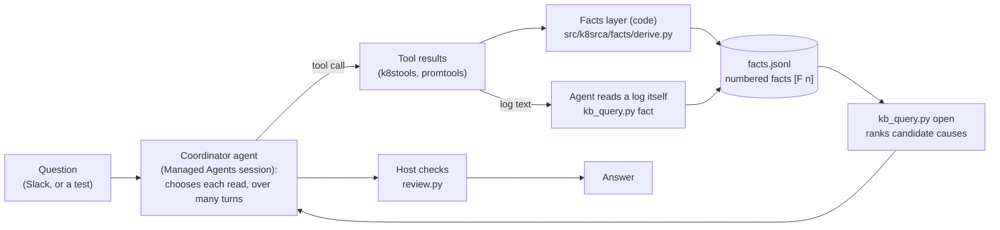
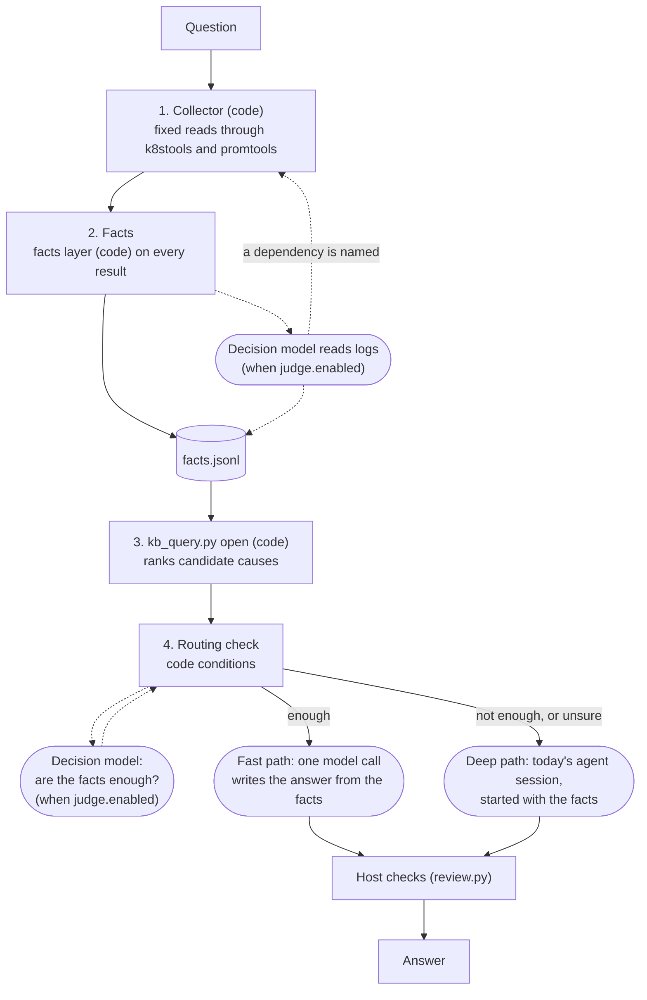

# 011 — A collect-first pipeline, with decision models for its judgments

Today a language-model agent runs the whole investigation: it decides what to read from the
cluster, reads it over many turns, and writes the answer. This design proposes that code does the
first reads instead, in a fixed order, before any model runs; that a **decision model** (a small
model that answers typed yes/no or multiple-choice questions about a piece of text with a
probability and writes no prose) reads the text code cannot, and helps decide whether the
collected evidence is already enough; and that the full agent runs only when it is not. The aim
is a lower cost per answer and less variation between runs, with no loss of accuracy.

The first decision model tried is **JEV**, TypeSafe's hosted decision model (§3.2), behind a
provider-neutral **`Judge`** interface (§3.3). Two settings control the change, and both are off
by default: one for the pipeline and one for the decision model, so the pipeline works for an
operator with no decision model, and each can be measured apart from the other (§3.8).

An earlier version of this design used a decision model only to read container logs inside
today's agent loop. An outside review ([#43](https://github.com/BenedatLLC/k8srca/issues/43))
argued that this left the main sources of cost and variation untouched, and this version takes up
most of it ([appendix](#appendix-history-and-results)). §1 gives the background a reader needs;
the [plan](../plans/011-decision-models.md) holds the steps and their measurements.

---

## 1. Problem

### 1.1 How an answer is made today

k8srca answers an SRE's question in Slack ("why is `ad` restarting?") by investigating a live
cluster through read-only tools ([001](001-architecture.md)). This diagram shows how an answer is
made today. Everything in it runs.



1. **The agent chooses each read.** The coordinator (the agent that plans and writes the answer)
   calls k8stools (the read-only Kubernetes tool server) and promtools (the Prometheus one), and
   hands high-volume reads such as logs to a specialist agent, `k8s-investigator`.
2. **Facts** ([010 §3](010-facts-and-short-answers.md#3-the-facts-layer)). A *fact* is one
   observation stated as a sentence with its scope and source, for example "ad's last 3
   terminations were OOMKilled, exit 137". Code writes most facts from tool results, because the
   agent was worst at deriving low-level facts by hand.
3. **The knowledge base** ([007](007-knowledge-representation.md),
   [008](008-conclusions-under-incomplete-evidence.md)) says which facts count for or against
   each candidate cause (a *claim* in its format). `kb_query.py open` ranks the candidates from
   the facts by plain rules a reader can follow.
4. **The answer** ([010 §5](010-facts-and-short-answers.md#5-the-answer)) is short, every claim
   footnoted to a fact, and the host checks it
   ([010 §5.2](010-facts-and-short-answers.md#52-footnotes-and-the-host-checks)).

Whether a change helps is measured on the scenario suite ([004](004-scenario-testing.md)):
recorded faults replayed through k8stools, each answer graded against a checklist
([010 §7](010-facts-and-short-answers.md#7-grading-checklists)).

### 1.2 Terms

- **Collector.** Code that reads a fixed set of objects from the cluster through k8stools and
  promtools before any model runs (§3.1). Proposed here.
- **Collect-first pipeline.** The proposed order of work: collect, state facts, rank, then
  decide whether to answer at once or investigate (§3.1).
- **Fast path.** Answering from the collected facts with one model call and no investigation.
- **Deep path.** Today's agent session, started with the collected facts already in hand.
- **Routing check.** The decision between the fast path and the deep path (§3.4).
- **Predicate (a fact key).** A named, parameterised fact in the knowledge base with a `says`
  sentence. `last_exit_code[Container, Code]` says "the container's last termination exit code is
  {Code}". `process_logged_fatal_error[Container]` says "the process's own logs end with an
  exception, stack trace or fatal error before the cut". Candidate causes are written in terms of
  predicates.
- **Text-read fact.** A predicate whose truth needs reading text. Code can compute "exit code is
  137" but cannot tell whether a log "ends with an exception before the cut".
- **Decision model.** A small model that does not write text. Given a *state* (text or JSON) and
  typed *questions*, it returns typed answers, mostly probabilities (§3.2).
- **JEV.** TypeSafe's hosted decision model, served through its "System One" API
  (`POST /v1/systemone`).
- **Judge.** Any decision model behind the `Judge` interface (§3.3), and the facts it states.
- **Abstain.** State no fact, or make no routing decision, so the agent does the work as it does
  today.
- **`by`.** A fact's author: `code` or `agent` today (`src/k8srca/facts/model.py`); this design
  adds `judge` (§3.6).

### 1.3 The gap

Three things cost money or accuracy today, and each comes from the agent running the whole
investigation.

**Which checks run varies from run to run.** On the scenario suite, the same question on the same
recorded cluster takes between 11 and 37 tool calls on one scenario and between 21 and 66 on
another ([docs/baseline.md](../docs/baseline.md)). The misses that
[010 §9.8](010-facts-and-short-answers.md#98-step-4-result-2026-10-22) traced were two runs of
one scenario (`itbench-33`) that never read the pod spec, which held the value the answer needed.
A user asks once, so this spread is part of the agent's accuracy.

**Most of the cost is the loop, not the reading.** A run on the scenario suite costs $0.08 to
$0.66 ([docs/baseline.md](../docs/baseline.md)). In the sessions timed for design 014, a session
that delegated to the specialist had a median of 341 s, of which 49% was the coordinator working
after the specialist replied, and tool calls were 14 to 17% of the wall clock
([plan 014, "Why sessions run long"](../plans/014-sregym.md#findings-from-the-baseline)). Yet the
first reads are nearly the same every time. The scenario recorder already performs them in code,
with no model, to make test fixtures: each namespace's health, its warning events, the nodes, a
report on every unhealthy workload and the spec of each of its pods
(`record_results` in [`src/k8srca/scenario/record.py`](../src/k8srca/scenario/record.py)).

**Facts that need text read depend on the agent's diligence.** Design 010 moved most fact-making
into code. What is left to the agent is any fact that needs reading text, almost always a
container's log, which it records with `kb_query.py fact`
([010 §3.4](010-facts-and-short-answers.md#34-what-the-agent-still-writes)). In the two Java
out-of-memory scenarios the knowledge base cannot rank the right cause on its own evidence,
because that needs `not process_logged_fatal_error` and nothing derives it
([plan, "What text-read facts change in the ranking"](../plans/011-decision-models.md#what-text-read-facts-change-in-the-ranking)).

A decision model that only reads logs inside today's loop addresses the third and leaves the
first two as they are. The earlier version of this design said so in its own plan, which predicted
"can't tell" for its live measurement.

---

## 2. Goal

A lower cost per answer and less variation between runs, with accuracy no worse, by moving the
first reads into code and the small judgments to a decision model:

- on the scenario suite, the pipeline shows no regression as
  [004 §6.4](004-scenario-testing.md#64-sampling-and-the-regression-rule) defines one, a lower
  median cost per run, and a narrower range of tool calls per scenario;
- no answer is sent down the fast path that an investigation would have got right and the fast
  path gets wrong, on any measured scenario;
- the pipeline runs with no decision model configured, and an operator can turn the pipeline and
  the decision model on and off separately;
- both are off by default, and text is redacted before it leaves for an outside provider.

**Out of scope for the first pass.**
- A stronger model (such as Opus) for the deep path. It is a separate assumption with its own
  cost, and gets its own step if the first pass succeeds (§4.2).
- A decision model that ranks causes or sets a strength. `open`'s ranking stays deterministic
  ([010 §2](010-facts-and-short-answers.md#2-principles)).
- Decision-model facts on results the agent fetches during a session. The first pass asks a
  decision model only about what the collector read (§3.9).
- The answer reviewer, which is held (§4.1).

### 2.1 Uses beyond the first pass

Every place a decision model could help, ranked. The "When" column says which are in the first
pass; each other row gets its own plan step, in [process.md](../docs/process.md)'s form, if it
looks promising.

| # | Use | Kind of gain | Measurable offline? | When |
| --- | --- | --- | --- | --- |
| 1 | **Text-read facts.** The knowledge base's log predicates, judged on the logs the collector read | accuracy; fewer turns | yes: labelled logs from the recordings | the first pass |
| 2 | **Support checking as an evaluation category**, with a per-sentence screen (§4.1) | a measurement we cannot do cheaply today | yes: saved answers | after [#6](https://github.com/BenedatLLC/k8srca/issues/6) |
| 3 | **A screen for the checklist grader.** Each checklist item as a yes/no on the answer | cost of measuring | yes: saved verdicts | after #6, between designs ([process.md §5](../docs/process.md#5-the-instrument-is-frozen-per-design)) |
| 4 | **Symptom matching.** A free-text question or unmapped alert to the knowledge base's symptoms, as a `choice` | accuracy at the first step | yes: the scenarios' questions | measured offline in the first pass, only if a code rule cannot choose the symptom (§3.1). On design 015's labelled queries (`tests/kb_eval/labels-2b.json`) only after design 014's comparison, because those queries come from sessions on its held-out faults. Capped by coverage: 13 symptoms have an authored ranking, and 25 of the 81 vendored alerts map to them |
| 5 | **Next-check selection.** A `choice` over the knowledge base's candidate checks, so the order of checks does not vary | spread in which checks run | partly | not planned. The collector fixes the first reads in code, which removes most of this spread without a model |
| 6 | **Model tier by difficulty.** A cheaper path when the case is plain | cost | yes: the routing check on saved facts | the first pass, as the routing check (§3.4). A stronger model for hard cases is later |
| 7 | **Following a dependency.** A log that names a failing dependency makes the collector read that dependency too | accuracy on faults that start elsewhere | yes: labelled logs | measured offline in the first pass; built if it passes |
| 8 | **A sufficiency check before the answer, in the deep path.** Whether the facts name an underlying cause, asked before the agent writes | fewer answers that restate the symptom | yes: saved sessions' facts | later. The check must tell the agent which read is missing, or it has the reviewer's problem (§4.1) |

---

## 3. Approach

### 3.1 The pipeline

The host runs four stages before any agent session exists, then takes one of two paths. This
diagram shows the proposed order; none of it is built. Stages in plain boxes are code; rounded
boxes are model calls.



**1. The collector.** Code reads a fixed set of objects, in the order the scenario recorder
already uses (`record_results`), which moves into a shared module:
- the nodes, and each namespace's health, warning events and volume claims;
- a workload report for the workload the question names and for every workload the health result
  calls unhealthy, the events of each pod a warning names, and each of those pods' specs;
- the tail of the current and previous log of each container of those workloads, which the
  recorder does not read today;
- promtools' memory and restart reports for those workloads, whenever a metrics server is
  configured. Prometheus is optional
  ([constitution A6](../docs/constitution.md#a6-optional-services-are-off-by-default-and-text-is-redacted-before-it-leaves)),
  so the collector reads it where it exists and skips it where it does not;
- the recent-changes read of [design 013](013-what-changed.md), once k8stools provides it.

Every read goes through the MCP servers, so the collector keeps
[constitution A1](../docs/constitution.md#a1-k8srca-never-touches-the-kubernetes-api-directly).
The reads are independent and run in parallel. The number of workloads read is capped, so a
namespace where everything is unhealthy does not turn into hundreds of reads.

**2. Facts.** The facts layer states facts from every collected result, as it does today for
results the agent fetches. With `judge.enabled`, a decision model answers the knowledge base's
log predicates on each collected log, and a confident answer becomes a fact (§3.6). If a log
names a failing dependency, the collector reads that dependency's workload too, once (row 7 of
§2.1).

**3. Ranking.** Code chooses the symptom to open the knowledge base at, from the alert name or
from the unhealthy workload's reported state (`CrashLoopBackOff`, `Pending`, `ImagePullBackOff`),
which `kb_query.py open` accepts. Where no rule chooses one, a decision model may (row 4 of
§2.1), and where neither does, there is no ranking and the deep path runs.

**4. The routing check** decides between the two paths (§3.4).

**The fast path** is one model call: the skill's instructions for the answer, the question, the
facts and `open`'s output, as the answer-writer evaluation already builds them
([`src/k8srca/evals/answer.py`](../src/k8srca/evals/answer.py),
[010 §8](010-facts-and-short-answers.md#8-testing-the-suite-and-the-component-evals)). The model
is the coordinator's. The answer goes through the same host checks as any other.

**The deep path** is today's session, with two differences: the collected facts are in its
workspace before it starts, and its first message carries them with `open`'s output, so the
coordinator starts from the evidence and does not repeat the collection. Its tools, skills and
specialist are unchanged.

**What the agent sees or does differently.** On the fast path there is no agent. On the deep
path, the skill's loop ([`skills/k8s-rca/SKILL.md`](../skills/k8s-rca/SKILL.md)) starts from
recorded facts, and its text on first reads is shortened to match. That is a change to the agent,
measured as the plan's step 3 says.

### 3.2 Decision models, and who offers them

A decision model takes a **state** and a set of **questions**, answers each separately, and
returns typed answers without text or reasons. Three question types recur across every provider
found so far:

| Type | Returns |
| --- | --- |
| yes/no: `noul` (TypeSafe's name; also Kev and Clef), `predicate` (OpenAI) | the probability the statement is true of the state |
| `choice` | one option from a list, with per-option probabilities and a confidence |
| `score` | a level on an ordered scale, with probabilities and a confidence |

| Provider | Interface | Notes (sources in §8) |
| --- | --- | --- |
| **TypeSafe JEV** (first implementation) | `POST /v1/systemone`: `state`, `model` (such as `jev-latest`), `questions` keyed by ids you choose; answers keyed by the same ids [1][4] | Text and JSON only. The answer carries a model version (`jev-1.13.0` in the docs' example) [1]. Hosted. Pricing and retention not in the public docs read so far |
| **Kev** (open weights, Apache-2.0) | The same `POST /v1/systemone`, so TypeSafe's SDK can point at a local server [7] | 0.8B–27B on Qwen bases; runs on CUDA, ROCm, Apple Silicon or CPU. Runs on our machine, so no text leaves. Can be fine-tuned on labelled JSONL |
| **Cloudflare Clef, Clef-flash** | "Fully Jev-API compatible" on Workers AI; weights on Hugging Face, Apache-2.0 [8] | Vendor-reported: 64k context against JEV's 32k; median latency 209 ms (Clef) and 39 ms (Clef-flash) against JEV's 524 ms. Cloudflare says it does not store requests. No price given |
| **OpenAI Decisions API** | `POST /v1/decisions`: `model` (`gpt-6-luna`), `input`, `questions` as an array of `{name, type, instructions}`; `answers` array, with a `refusal` type [6] | Different wire format. Up to 400 questions a request. Uncached input $0.10 per 1M tokens, output free. Zero Data Retention for eligible customers |
| **AWS Strands Decider 2B** | Not read | Reported by The New Stack as a local model that scores developer-supplied options [9]. Only the headline was available |

Two consequences:
- **Three of the five share one wire format,** and one differs in shape, so a `Judge` interface
  with a System One adapter and an OpenAI adapter covers all of them.
- **The numbers are not interchangeable.** Kev says it calibrates its probabilities with a
  temperature fitted per checkpoint [7]; TypeSafe makes no such claim [2]. A threshold is a
  property of a question *and* a model, so changing the model means running the evaluation again.

Speed matters little: one state's questions go in one request, and Cloudflare reports a median of
524 ms for JEV [8].

### 3.3 The `Judge` interface

In `src/k8srca/core/judge.py`, in the style of design 005's generator contract
([005 §6.2](005-modular-architecture.md#62-the-generator-contract-built)): an interface the
pipeline depends on, with implementations behind it.

```python
class Question:   # id, kind ("yes_no" | "choice" | "score"), text, options/levels
class Answer:     # id, then one of:
                  #   Probability(p)
                  #   Choice(option, probabilities, confidence)
                  #   Score(value, probabilities, confidence)
                  #   Unavailable(reason)      # refusal, timeout, provider error

class Judge(Protocol):
    name: str            # "jev", "kev-4b", "claude-haiku"
    model: str           # the pinned version; recorded on every fact it states
    def ask(self, state: str, questions: list[Question]) -> list[Answer]: ...
```

Adapters, each small:
- `systemone`: TypeSafe JEV, Kev and Clef, with a `base_url`, a `model` and an optional key.
- `openai_decisions`: the array-shaped format, mapping `noul` to `predicate`.
- `claude`: a small Claude model asked the same question and told to return a probability. It is
  a comparison in the offline evaluation, and it is also how an operator with an Anthropic key
  and no decision-model account runs the judged parts of the pipeline.

`Unavailable` is an answer, so any provider failure becomes an abstention. The pipeline never
raises on a judge: no fact is stated, or the deep path runs.

### 3.4 The routing check

The routing check sends a question down the fast path only when every one of these holds; in any
other case the deep path runs, which is what happens today.

**Conditions in code:**
- the collection finished with no failed read;
- the facts name at least one unhealthy object, or the question names a workload;
- nothing in the facts points at an object the collector did not read.

**Questions for a decision model,** asked of the question, the facts and `open`'s output together
(with `judge.enabled`):
- `evidence_explains_symptom`: the facts plausibly and completely explain the reported symptom,
  and no fact contradicts the explanation;
- `fault_originates_elsewhere`: the facts suggest the fault starts in a different workload, node
  or outside dependency than the one asked about;
- `identifies_underlying_cause`: the facts identify a specific underlying cause, and do not only
  restate the symptom (such as CrashLoopBackOff or 500 errors);
- `actionable_specificity`: the facts include the concrete resource, container, exit code,
  setting or metric needed to verify or fix the problem.

The fast path needs the first, third and fourth above their thresholds and the second below its
threshold. An answer between thresholds, or `Unavailable`, sends the question to the deep path.

Three rules shape it:
- **`open`'s strength alone never selects the fast path.** On 12 labelled scenarios the leader
  `open` computes is wrong at strong in 3
  ([plan 015, step 2a](../plans/015-kb-evaluation.md#step-2a-recall-and-false-leaders)), so a
  rule of "strong leader, so answer" would send those three to a confident wrong answer.
- **The costly error is a wrong fast answer.** A question sent to the deep path when the fast
  path would have done costs what an answer costs today. A question sent to the fast path that
  needed an investigation gets a wrong answer with nothing to catch it. Thresholds are set so the
  second does not happen on any measured case, at the price of using the fast path less often.
- **With no decision model, code decides alone, and by default it chooses the deep path.** The
  code conditions select the fast path on their own only if the plan's offline step shows they
  send no measured case wrong. Otherwise the pipeline without a decision model is the collector
  followed by the deep path.

The scenario suite has 15 scenarios, which is enough to count routing errors and too few to
calibrate a probability. The plan says how thresholds are chosen without fitting them to the
cases they are scored on.

### 3.5 Redaction

k8stools already redacts common secret shapes before a result leaves it (AWS keys, JWTs, PEM
blocks, and values under names containing `key`, `secret`, `token`, `password` or `credential`;
[001 §4.1](001-architecture.md#41-k8stools-the-only-path-to-the-kubernetes-api)), and recordings
are made through it. That misses personal data and topology: the deploy-regression recording's
accounting log holds order ids, tracking ids and a street address. A second pass runs before
anything leaves for an outside provider:
- email addresses, phone numbers, IPv4 and IPv6 addresses, UUIDs, card-number shapes (with a Luhn
  check), long hex and base64 runs;
- hostnames and URLs reduced to a scheme and `<host>`, with the port kept, because a port can be
  the signal (`port already in use`);
- every replacement a typed placeholder, such as `<email>`, so the sentence still parses.

Patterns do not reliably catch free-text personal data, so two more steps:
- **Trim first.** A predicate about how a log *ends* needs the last lines, not 200 of them. The
  pipeline sends the tail (`judge.tail_lines`, default 40) plus any lines matching the
  predicate's cheap pattern screen.
- **Drop fields from JSON log lines,** keeping the level, message and error fields.

The routing questions send facts, which code wrote from tool results, and `open`'s output. Facts
quote object names and short messages, so the same pass applies to them.

If redaction removes the signal, accuracy shows it: the plan scores JEV on raw text beside
redacted text, offline, on the demo application's synthetic data already in the recordings.

### 3.6 Facts from a decision model

A judge answer about a log becomes a `Fact` ([010 §3.2](010-facts-and-short-answers.md#32-a-fact))
with `by: "judge"` and the judge's `name` and `model` recorded:
- `p ≥ hi` states the predicate, `p ≤ lo` states its negation, anything between states nothing;
- the statement names the scope: "ad, previous instance, last 40 lines retained: no exception or
  fatal error before the cut (read by a model)";
- the footnote marks it as read by a model, as agent facts are marked today
  (`src/k8srca/facts/render.py`);
- **the agent's own reading wins.** If the agent, on the deep path, records a fact that
  contradicts a judge's fact, `open` uses the agent's, and the disagreement is logged as a
  measurement.

`open` needs no change: it already reads facts' knowledge-base keys, whoever stated them. A
routing answer is not a fact. It is recorded with the session, with the thresholds that applied.

### 3.7 Questions and thresholds

One reviewed file, `judge/questions.yaml`, in three groups:
- **extraction:** the knowledge base's log predicates, each with the predicate's `says` sentence
  as its question, edited so that high means yes [1], and a question for a named dependency;
- **routing:** the four questions of §3.4;
- **triage:** the symptom `choice` (row 4 of §2.1), if it is used.

Each question carries thresholds per model:

```yaml
process_logged_fatal_error:
  group: extraction
  text: the process's own logs end with an exception, stack trace or fatal error before the cut
  thresholds:
    jev-1.13.0: {lo: 0.15, hi: 0.85}   # illustrative; set by the plan's step 2
    kev-4b:     {lo: ..., hi: ...}
```

A model with no entry for a question abstains on it, so changing a pinned version cannot silently
reuse another version's thresholds.

### 3.8 Configuration

Two new sections of `k8srca.yaml`, and of its schema in `src/k8srca/config.py`. Neither is built.

```yaml
pipeline:
  mode: classic                 # classic (today's loop) | collect_first
  max_workloads: 10             # the collector's cap
judge:
  enabled: false                # needs pipeline.mode: collect_first
  provider: systemone           # systemone | openai_decisions | claude
  base_url: <provider url>
  model: <pinned version>       # thresholds move with the model
  tail_lines: 40
  questions: judge/questions.yaml
```

The settings are separate because the pipeline does not need a decision model, and a comparison
that turned both on at once could not say which one helped:

| `pipeline.mode` | `judge.enabled` | What runs |
| --- | --- | --- |
| `classic` | `false` | Today's system, exactly. The default |
| `collect_first` | `false` | The collector, then the deep path; the fast path only if code alone was shown safe (§3.4) |
| `collect_first` | `true` | The whole pipeline |
| `classic` | `true` | Rejected when the configuration loads: the first pass has no decision-model call in today's loop |

The commands that start a session (`k8srca scenario run`, `k8srca session`) take
`--pipeline classic|collect-first` and `--judge/--no-judge`, which override the file for that
run, as `--arch` and `--local-skill` do today. An outside driver such as design 014's passes the
same two values.

### 3.9 Where the calls run, and who holds the key

The collector, the judge calls, the routing check and the fast path's model call all run in the
**host process that starts the session**: the Slack orchestrator in production, and the scenario
runner or an outside driver in tests. That process already holds the Anthropic API key and
already reaches k8stools at its host address, as `k8srca sync` and the scenario recorder do.

- **The provider key has one holder,** that host process, read from `.env`
  ([constitution A3](../docs/constitution.md#a3-each-credential-has-one-holder)). The sandbox,
  where agent-written commands run, still holds no credential.
- **No judge service in the first pass.** The earlier version of this design ran the judge from
  the facts layer inside the sandbox, which needed a separate service on the Docker network to
  keep the key out of the sandbox. With every judge call made by the host before the session
  starts, that service is not needed. It returns if a decision model is ever asked about results
  the agent fetches during a session (out of scope, §2).
- **The facts reach the deep path through the session's workspace.** The host already reads each
  session's workspace directory to check and render the answer
  (`run_session` in [`src/k8srca/scenario/runner.py`](../src/k8srca/scenario/runner.py)); the
  pipeline writes the collected results and `facts.jsonl` there before the session's first turn.
  §7 lists what is not settled about this.
- **What leaves the network** with `judge.enabled` and a hosted provider: redacted log tails and
  redacted facts (§3.5). With a local model, nothing. With the judge off, nothing beyond what
  leaves today.

### 3.10 Principles

1. **Code collects and decides; models judge.** The first reads are a fixed list in code. A
   decision model's answer is an input: it becomes a fact, or selects a path, only through
   thresholds written in code and kept with the question texts in one reviewed file. This
   follows TypeSafe's guidance to set cutoffs in code by the cost of a wrong decision [1], and
   the AWS Builder Center alert-triage example, where the decision model supplies the judgment
   and code owns the consequences [5].
2. **Abstain rather than guess.** Between the two thresholds, no fact is stated and the deep
   path runs. A wrong fact that rules a cause out, or a wrong fast answer, is worse than doing
   the work as today. The AWS example tunes its equivalent error ("under-triage") to zero, since
   the opposite error only costs money [5].
3. **Probabilities are not calibrated until we measure them.** TypeSafe makes no calibration
   claim and calls its confidence "one reasonable way to summarize a distribution" [2]; its
   suggested 0.7 and 0.3 are "a starting point" [1]. Thresholds are set on our labelled data, per
   question *and per model*, and reported with the counts behind them (§3.7).
4. **Optional, off by default, and usable without a decision model.** With both settings at
   their defaults the system is exactly what runs today (§3.8).
5. **Redact before text leaves.** Text goes to an outside API only after a redaction pass (§3.5).
6. **Behind an interface, with no provider assumed.** The pipeline calls a `Judge`, never a
   vendor.
7. **Less variation in the results.** The collector reads the same objects on every run, and a
   judge asks the same question of the same text. We do not assume a judge is deterministic:
   TypeSafe's public docs say nothing on repeatability, so it is measured. A steady judge can
   still be steadily wrong, so repeatability is measured beside accuracy and never in place of
   it.
8. **Built and tuned only on what we may read.** The collector's list, the routing conditions
   and every threshold are set on the 15 recorded scenarios and SREGym's three burned faults
   (faults already used for development). What was read of SREGym's 14 held-out faults is not
   used to design them ([014 §3.1](014-sregym.md#31-the-suites-life-and-what-each-phase-may-do)).

---

## 4. Alternatives considered

### 4.1 A decision model as the answer reviewer

One use is the check inside design 010's light reviewer, a model that reads the answer against the
facts it cites: judge each sentence, and send a revision turn when one falls under a threshold.
010's own results argue against it
([010 §9.8](010-facts-and-short-answers.md#98-step-4-result-2026-10-22)):
- it flagged every live answer, 4.75 flags a run, so every session took a revision turn, at 5–53%
  more cost a run;
- offline about 90% of flags were right, but live most flags were true statements the reviewer had
  not been shown, because it saw only the facts the answer cited;
- unsupported claims fell from 8 to 4 in 12 runs, inside chance at that n;
- the revision weakened right inferences: one itbench-33 run turned "a bad node selector was
  introduced" into "changed something in their pod templates".

The deeper problem is that "this sentence is not supported" is a complaint, and the writer's one
move that always satisfies it is to say less. A decision model producing the same flag faster has
the same problem. The first reviewer mixed three jobs, each with a better tool:

| Job | Example | Better tool |
| --- | --- | --- |
| **Overreach by form** | "every" where the fact says "the last 3"; a confidence word stronger than `open`'s strength | **Code**, with specific feedback: "Sentence 2 says 'every'; F3 says 'the last 3'." |
| **Attribution gaps** | A true sentence with no marker, or a marker on the wrong fact | **A suggested patch** ("this sentence matches F12; add [F12]"), or recording the missing fact. Untested |
| **"Is everything supported?"** | How often answers go beyond their facts | **An evaluation measure**, not a production step |

**Decision (owner):** the reviewer is improved in the generic system first, without a decision
model, in [#6](https://github.com/BenedatLLC/k8srca/issues/6); a decision model is then tried
against the baseline that leaves, as rows 2 and 3 of §2.1. No judged check runs in production; the
light reviewer stays off.

### 4.2 Other alternatives

- **Text-read facts only, inside today's loop.** This design's earlier scope. It is the lowest
  risk and has the smallest effect: its own plan predicted "can't tell" live, because it improves
  the reading of logs the agent fetched and changes neither which checks run nor what the loop
  costs (§1.3).
- **A decision model that chooses the cause,** as SREGym's own pipeline does [11]. It would put
  uncalibrated numbers where `open`'s readable rule is, and SREGym's failures were consistent
  (the same wrong clue in all five runs of a fault). Their result does support collecting in
  code first: it came from a hand-built collector.
- **A stronger model for the deep path now.** The deep path would start from clean facts, so a
  stronger model might use its turns better. It also raises the cost of the cases that already
  cost most, and it is a second change that would be confounded with the pipeline. Later, as its
  own step.
- **A code rule that forbids stopping while a leading candidate has unread evidence.** Proposed
  for the `itbench-33` misses. It is a rule written from one scenario, which
  [process.md §2](../docs/process.md#2-tripwires) warns against, and the collector reads the pod
  spec in every run, which removes that miss without a rule.
- **One setting for everything.** A single switch could not separate what the collector does
  from what the decision model does, and would leave an operator with no decision model unable
  to use the pipeline (§3.8).
- **Calling a provider from the sandbox with the key in its environment.** A second credential
  where agent code runs (§3.9).
- **Sending whole logs.** More data than any predicate needs, and more personal data with it.
- **Building for JEV alone.** Providers already share one wire format, and the numbers differ by
  model (§3.2); tying the pipeline to one vendor would also tie the thresholds to it.

---

## 5. What it changes

| Document or component | Change |
| --- | --- |
| [001](001-architecture.md) architecture | A host-side stage before the session; answers that are written without a session; one more credential, held by the host process (§3.9). 001 is updated when it is built |
| [002](002-investigation-model.md) investigation model | The first reads are made by code. The agent's loop starts from recorded facts on the deep path |
| [004](004-scenario-testing.md) scenario testing | The recorder shares the collector's code and keeps log results; `scenario run` takes `--pipeline` and `--judge` |
| [010](010-facts-and-short-answers.md) facts and short answers | Extends the facts layer to the one kind of fact it left to the agent ([010 §3.4](010-facts-and-short-answers.md#34-what-the-agent-still-writes)); adds `by: "judge"`. The answer writer runs as a production step on the fast path. The reviewer analysis (§4.1) takes up 010's ideas for a later reviewer |
| [007](007-knowledge-representation.md) knowledge representation | None. Its predicates and `says` sentences become the extraction questions |
| [008](008-conclusions-under-incomplete-evidence.md) conclusions | None. `open`'s ranking and strength are untouched |
| [005](005-modular-architecture.md) modular architecture | The `Judge` interface follows its style; its evaluation follows [005 §8.1](005-modular-architecture.md#81-component-evals) |
| [013](013-what-changed.md) what changed | Its recent-changes read joins the collector's list when k8stools provides it |
| [014](014-sregym.md) SREGym | Its comparison was defined as one release with `judge.enabled` off and on, with a decision model stating text-read facts only ([014 §3.3](014-sregym.md#33-the-arms-one-release-with-the-decision-model-off-and-on)). With two settings there are three configurations, and the expected effect is no longer small. The exact arms are fixed after this design's first pass; the expected shape is today's loop against the whole pipeline (§7) |
| [015](015-kb-evaluation.md) KB evaluation | Its `tests/kb_eval/measure_2a.py` is the plan's offline check for text-read facts. The plan's first step also runs the answer writer with and without `open`'s output, which bears on 015's question of whether the knowledge base helps |
| The measuring instrument | None |
| Upstream | None |

---

## 6. How we will know it worked

In outline; the [plan](../plans/011-decision-models.md) states each step's hypothesis, expected
effect, budget, and done and stop criteria in full.
- **Step 1, offline:** on the 15 scenarios' recorded results, how many are diagnosed by the
  answer writer from collected facts alone, with no agent. It is run with code facts only, with
  hand-labelled text-read facts added, and without `open`'s output. This decides whether the
  fast path is worth building, how much a decision model reading logs can add, and whether the
  fast path needs the knowledge base. It stops the fast path if few scenarios are diagnosed.
- **Step 2, offline:** whether a decision model answers the pipeline's questions correctly: the
  routing questions first (no measured case may be sent to a wrong fast answer), then the log
  predicates that step 1 showed matter. It stops, for each group, if code or a small Claude
  model does as well.
- **Step 3, live:** the pipeline behind its two settings on the scenario suite, three
  configurations side by side: no regression, a lower median cost per run, a narrower range of
  tool calls.
- **Then:** design 014's comparison on SREGym's held-out faults.

---

## 7. Open questions

- [ ] **The arms of design 014's comparison.** Fixed after this design's first pass is
  complete (owner, 2026-11-15). The expected shape is today's loop against the whole pipeline,
  end to end, leaving out any part of this design that the plan's steps show to have no benefit.
  The plan's step 3 is where the collector and the decision model are measured apart, on the
  scenario suite. Recorded in [014 §7, question 12](014-sregym.md#7-open-questions).
- [ ] **How the facts reach the session's workspace.** A session's first message is sent when it
  is created today, and the workspace directory is made by the poller when it claims the work.
  The pipeline must write the facts before the first turn reads them. Also not settled: whether
  the orchestrator's host always holds the workspace (the answer check already skips a session
  whose workspace is "not on this host"). Decided in the plan's step 3.
- [ ] **A follow-up question after a fast answer.** A fast answer has no session, and a Slack
  thread maps to one. Proposed: the follow-up starts a deep-path session carrying the facts and
  the first answer. Decided in the plan's step 3.
- [ ] **Which namespaces the collector reads** when the question names none. The recorder uses
  the scenario's; production has the architecture sources' namespaces. Decided in step 3.
- [ ] **Whether the routing state fits a decision model.** JEV's context is 32k tokens and
  Clef's 64k (vendor-reported [8]). The size of a scenario's facts with `open`'s output is
  measured in step 1.
- [ ] **Provider terms.** What each hosted provider retains of a request, for how long and
  where. TypeSafe's public docs read so far do not say. Cloudflare says it does not store
  requests [8]; OpenAI offers Zero Data Retention to eligible customers [6]. This decides
  redaction as much as the patterns do.
- [ ] **Pricing for JEV.** Not in the docs read. Confirm before the first call.
- [ ] **Pinning.** Responses carry a version such as `jev-1.13.0`, and `jev-latest` is an alias
  [1], so pinning looks possible. How long a version lives is not known.
- [ ] **Local models and redaction.** Whether the redaction pass applies to a model we run
  ourselves. Principle 5 says outside APIs only.
- [ ] **A stronger model for the unsure band.** As proposed, a log answer between `lo` and `hi`
  states no fact. Hightouch's identity-resolution judge instead sends only its JEV answers
  between 30% and 90% confidence (about 22%) to Opus [12]: 98.8% accuracy at $0.88 per 1,000
  against $3.86 for Opus alone on their easy set, and 95.3% at $2.94 against $5.39 on their
  harder set. Their JEV mistakes clustered near 50%, which is why the band worked; GPT-6 Luna was
  overconfident at 90–100%. Their evidence is synthetic, tuned on the test set, with no repeated
  runs. It argues for reporting the plan's confident wrong answers by confidence bucket.
- [ ] **Prometheus on SREGym.** Whether design 014's clusters expose a Prometheus the collector
  can read. Its astronomy-shop install sets `prometheus.enabled=false`
  ([plan 014, "Build the wikis"](../plans/014-sregym.md#2a1--build-the-wikis)). Checked before
  the comparison.

---

## 8. Sources

Read in full unless noted. Vendor claims are marked as such where they are used.

1. TypeSafe, *Noul* (statements, thresholds, request and response shape):
   <https://docs.typesafe.ai/primitives/noul.md>
2. TypeSafe, *Confidence*: <https://docs.typesafe.ai/confidence.md>
3. TypeSafe, *Patterns* (atomic questions, fan-out, confidence-based routing):
   <https://docs.typesafe.ai/patterns.md>
4. TypeSafe, *System One* (the `POST /v1/systemone` endpoint, text-only state):
   <https://docs.typesafe.ai/concepts/system-one.md>
5. *Jev as an alert triage: typed decisions for OpenSearch on-call with Bedrock and AgentCore*,
   AWS Builder Center. A community-written article, not an official AWS blog post:
   <https://builder.aws.com/content/3JpdH4acDKLD3Mta05sZ1xQOpVt/jev-as-an-alert-triage-typed-decisions-for-opensearch-on-call-with-bedrock-and-agentcore>
6. OpenAI, *Decisions API* guide: <https://developers.openai.com/api/docs/guides/decisions>
7. Jared Palmer, *Kev*: <https://github.com/jaredpalmer/kev>
8. Cloudflare, *Clef decision models* (vendor-reported figures):
   <https://blog.cloudflare.com/clef-decision-models/>
9. The New Stack, *AWS launches a local answer to TypeSafe's Jev decision model* (headline only;
   body not read): <https://thenewstack.io/aws-strands-decider-model/>
10. osolmaz, *switch*, a framework for decision-model harnesses (README read, not the code):
    <https://github.com/osolmaz/switch>
11. SREGym, *Jev-driven SRE diagnosis* (2026-10-06): an agentless pipeline of a programmatic
    collector and JEV (`jev-1.13.0`) on the 21-fault SREGym-Lite cohort, five runs each, scored by
    a model judge (`gpt-6-astra`) at a 0.70 pass threshold: 80/105 passed, 14.6 s median, about
    $0.15 of JEV inference for the whole run (estimated from TypeSafe's published price). Written
    by the SREGym team; one historical cohort and a model judge:
    <https://www.sregym.com/blog/jev-driven-sre-diagnosis>
12. Hightouch, *LLM judges for identity resolution* (2026-11-04): JEV and GPT-6 Luna against
    frontier models on a synthetic over-merge benchmark, with a confidence-band cascade to Opus.
    Vendor blog; figures are theirs, thresholds were tuned on the test set, and charts were not
    read: <https://hightouch.com/blog/llm-judges-identity-resolution>

Internal: [#43](https://github.com/BenedatLLC/k8srca/issues/43) (the outside review of this
design's earlier version); [plan 015](../plans/015-kb-evaluation.md#appendix-results-in-detail),
steps 1, 2a and 2b (consultation rate, false leaders, search misses);
[#6](https://github.com/BenedatLLC/k8srca/issues/6) (the reviewer rethink);
[010](010-facts-and-short-answers.md) §3, §6, §7 and §9.7–9.8;
[007](007-knowledge-representation.md) (predicates);
[008](008-conclusions-under-incomplete-evidence.md) (ranking and strength);
[docs/baseline.md](../docs/baseline.md) (the scenario suite's scores, tool calls and cost).

---

## Appendix: history and results

**The earlier scope, and why it changed.** Until 2026-11-15 this design had a decision model
state text-read facts inside today's agent loop and nothing else, with a judge service beside
k8stools. Nothing was built. It listed a larger role for decision models as open questions and
decided against each. The outside review in
[#43](https://github.com/BenedatLLC/k8srca/issues/43) argued that the design was limited by
leaving the coordinator in charge of the loop, and the owner decided to rewrite it in place.

**What was taken from the review, and what was not:**

| The review's point | Taken? | Why |
| --- | --- | --- |
| Collect a fixed set of objects in code before any model runs | Yes (§3.1) | The first reads barely vary, and the recorder already performs them in code |
| Extract facts from logs with a decision model, in one batch | Yes (§3.1, §3.6) | The earlier design's core, moved to the collected logs |
| Follow a dependency a log names | Measured first (§2.1 row 7) | Plausible; no measurement yet |
| Route between a single-call writer and a full investigation | Yes (§3.4) | The largest saving, if the routing is safe |
| Route on `open`'s strength plus a decision model | In part | `open`'s strength alone never selects the fast path: its leader is wrong at strong in 3 of 12 scenarios |
| Escalate hard cases to Opus | Not in the first pass (§4.2) | A second change, confounded with the pipeline, that raises the cost of the costliest cases |
| A code rule forbidding a stop while evidence is unread | No (§4.2) | A rule from one scenario; the collector removes that miss |
| A sufficiency check before the answer | Later (§2.1 row 8) | It must name the missing read, or it repeats the reviewer's problem |
| A triage question measured on design 015's labelled queries | Not on those queries yet (§2.1 row 4) | They come from sessions on SREGym's held-out faults |
| Keep the judge service | Not in the first pass (§3.9) | Every judge call is made by the host, so the service is not needed yet |
