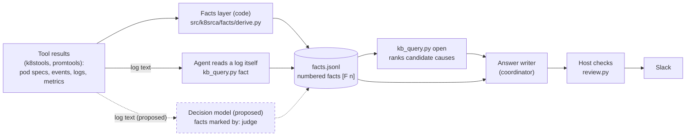
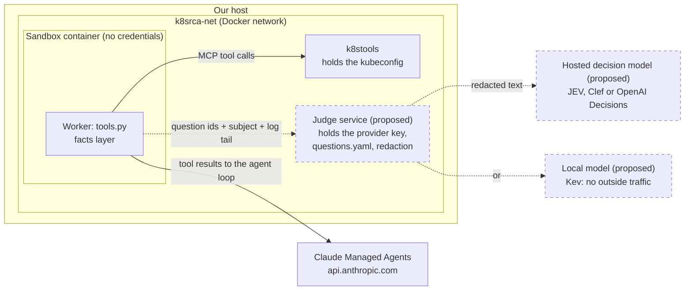

# 011 — Decision models for the small judgments

**Status:** in progress (the design being measured; the plan's step 1 has not begun). Nothing is
built yet: there is no `Judge` interface, judge service, `judge:` configuration section or fact
stated by a decision model in the code. The work is a first pass: as much of this design as makes
sense for an initial version, the plan's steps 1 and 2 at least, later steps if they look
promising. The answer-reviewer part is held for
[#6](https://github.com/BenedatLLC/k8srca/issues/6) (§4.1).
**Owner:** Linda Zhou. **Issue:** [#19](https://github.com/BenedatLLC/k8srca/issues/19).
**Plan:** [plans/011-decision-models.md](../plans/011-decision-models.md).
**Last updated:** 2026-11-15.

**Related:** [007 — Knowledge representation](007-knowledge-representation.md) ·
[008 — Conclusions under incomplete evidence](008-conclusions-under-incomplete-evidence.md) ·
[010 — Facts and short answers](010-facts-and-short-answers.md) ·
[014 — SREGym](014-sregym.md) · [015 — KB evaluation](015-kb-evaluation.md) ·
[process](../docs/process.md) · [glossary](../docs/glossary.md)

The agent states most of its observations through code (the facts layer of design 010), but a
fact that needs *reading text*, almost always a container's log, is still left to the model. This
design proposes that a **decision model**, a small model that answers typed yes/no or
multiple-choice questions about a piece of text with a probability and writes no prose, state
those facts instead, more steadily and more cheaply. The first decision model tried is **JEV**,
TypeSafe's hosted decision model (§3.2). The facts layer calls it through a provider-neutral
**`Judge`** interface (§3.3), so other decision models can be swapped in by configuration. The
feature is optional and off by default, and text is redacted before it leaves our machines. §1
gives the background a reader needs; the [plan](../plans/011-decision-models.md) holds the steps
and their measurements.

---

## 1. Problem

### 1.1 How an answer is made today

k8srca answers an SRE's question in Slack ("why is `ad` restarting?") by investigating a live
cluster through read-only tools ([001](001-architecture.md)). The diagram shows how an answer is
made and where a decision model would add facts. Solid parts run today; dashed parts are
proposed.



1. **Tool results.** The agent calls k8stools (the read-only Kubernetes tool server) and promtools
   (the Prometheus one).
2. **Facts** ([010 §3](010-facts-and-short-answers.md#3-the-facts-layer)). A *fact* is one
   observation stated as a sentence with its scope and source, for example "ad's last 3
   terminations were OOMKilled, exit 137". Code writes most facts from tool results, because the
   agent was worst at deriving low-level facts by hand.
3. **The knowledge base** ([007](007-knowledge-representation.md),
   [008](008-conclusions-under-incomplete-evidence.md)) says which facts count for or against
   each candidate cause (a *claim* in its format). `kb_query.py open` ranks the candidates from
   the facts by plain rules a reader can follow.
4. **The answer writer** ([010 §5](010-facts-and-short-answers.md#5-the-answer)) writes the short
   answer, every claim footnoted to a fact, and the host checks it
   ([010 §5.2](010-facts-and-short-answers.md#52-footnotes-and-the-host-checks)).

Whether a change helps is measured on the scenario suite ([004](004-scenario-testing.md)):
recorded faults replayed through k8stools, each answer graded against a checklist
([010 §7](010-facts-and-short-answers.md#7-grading-checklists)).

### 1.2 Terms

- **Predicate (a fact key).** A named, parameterised fact in the knowledge base with a `says`
  sentence. `last_exit_code[Container, Code]` says "the container's last termination exit code is
  {Code}". `process_logged_fatal_error[Container]` says "the process's own logs end with an
  exception, stack trace or fatal error before the cut". Candidate causes are written in terms of
  predicates: the knowledge base's `oom-kill` claim is moderately supported by
  `last_exit_code[C, 137]` together with `not process_logged_fatal_error[C]`, killed with code 137
  *and* no application error logged before the kill.
- **Text-read fact.** A predicate whose truth needs reading text. Code can compute "exit code is
  137" but cannot tell whether a log "ends with an exception before the cut". These are the facts
  this design is about.
- **Decision model.** A small model that does not write text. Given a *state* (text or JSON) and
  typed *questions*, it returns typed answers, mostly probabilities (§3.2).
- **JEV.** TypeSafe's hosted decision model, served through its "System One" API
  (`POST /v1/systemone`).
- **Judge.** Any decision model behind the `Judge` interface (§3.3), and the facts it states.
- **Abstain.** State no fact, so the agent reads the text itself as it does today.
- **`by`.** A fact's author: `code` or `agent` today (`src/k8srca/facts/model.py`); this design
  adds `judge` (§3.6).

### 1.3 The gap

Design 010 moved most fact-making into code. What is left to the agent is any fact that needs
reading text. Today the coordinator (the agent that plans and writes the answer) reads the log
itself, or delegates to the specialist (`k8s-investigator`, the agent it hands high-volume reads
to), then records the reading with `kb_query.py fact`
([010 §3.4](010-facts-and-short-answers.md#34-what-the-agent-still-writes)). That is the last
place where facts depend on the model's diligence, it varies from run to run, and it costs turns.

The gap shows in the knowledge base's ranking. In the two Java out-of-memory scenarios,
`oom-kill`'s own evidence cannot hold, because it needs `not process_logged_fatal_error` and
nothing derives that fact; for the same reason `application-crash` is never ruled out, and `open`
prints it as the most likely cause
([plan, step 2](../plans/011-decision-models.md#step-2--state-log-facts-from-a-decision-model-in-the-facts-layer-behind-the-setting)).

A decision model fits the gap. A question about a log can be as small as the predicate's own
sentence:

```
process_logged_fatal_error[Container]
  the process's own logs end with an exception, stack trace or fatal error before the cut
permission_denied_error_in_logs[C]
  the logs of the container report permission denied on a file, directory or socket
```

Each is already a yes/no question about a state (the container's log), which is the form decision
models answer. TypeSafe's guidance is to ask atomic questions and compose them in code [1][3], and
the knowledge base is already written that way.

---

## 2. Goal

A more accurate agent that costs less per answer, by having a decision model state the
knowledge base's text-read facts:
- correct facts on most container logs, and no confident wrong ones;
- the same answer to the same text on every run, more often than the agent's own reading;
- optional and off by default, with text redacted before it leaves.

**Out of scope.** Choosing the next check and deciding when to stop are multi-step judgments over
the whole evidence record; they stay with the coordinator. `open`'s ranking stays deterministic
([010 §2](010-facts-and-short-answers.md#2-principles)). The decision model never ranks causes,
sets a strength or writes the answer. The answer reviewer is held (§4.1).

### 2.1 Uses beyond the first pass

Other places a decision model could help, ranked. Only row 1 is in the first pass; each other row
gets its own plan step, in [process.md](../docs/process.md)'s form, if it looks promising.

| # | Use | Kind of gain | Measurable offline? | When |
| --- | --- | --- | --- | --- |
| 1 | **Text-read facts.** The knowledge base's log predicates, judged on each log result the facts layer sees | accuracy; fewer turns | yes: labelled logs from the recordings | the first pass |
| 2 | **Support checking as an evaluation category**, with a per-sentence screen (§4.1) | a measurement we cannot do cheaply today | yes: saved answers | after #6 |
| 3 | **A screen for the checklist grader.** Each checklist item as a yes/no on the answer | cost of measuring | yes: saved verdicts | after #6, between designs ([process.md §5](../docs/process.md#5-the-instrument-is-frozen-per-design)) |
| 4 | **Symptom matching.** A free-text question or unmapped alert to the knowledge base's symptoms, as a `choice` | accuracy at the first step | yes: 015's labelled queries (`tests/kb_eval/labels-2b.json`) | only after [015 step 4](015-kb-evaluation.md#step-4--improvements-one-at-a-time-each-settled-offline-first)'s simpler search aliases are scored on the same queries and lose. Capped by coverage: 13 symptoms have an authored ranking, and 25 of the 81 vendored alerts map to them |
| 5 | **Next-check selection.** A `choice` over the knowledge base's candidate checks, so the order of checks does not vary | spread in which checks run | partly: needs a miss caused by ordering | not planned (below) |
| 6 | **Model tier by difficulty.** A cheaper coordinator when the case is plain | cost | no: needs live runs | if ever; mostly code reading `open`'s strength |

**Why row 5 is not planned.** The misses
[010 §9.8](010-facts-and-short-answers.md#98-step-4-result-2026-10-22) traced to tool choice
are itbench-33's two runs that never read the pod spec. Replaying that scenario's recorded
results, `open` ranks the right cause strong from the events and node facts alone, so it lists no
pod-spec read as a next check. The runs missed the selector's value, which only the spec holds:
a missing detail on a decided leader, not a bad order among listed checks. A code rule (require
the value before the answer names a node selector) fits it better. Try a decision model here only
if a miss shows poor ordering among checks that were listed.

---

## 3. Approach

### 3.1 Principles

1. **The model judges; code decides.** A decision model's answer is an input. It becomes a fact
   only through thresholds written in code, kept with the question texts in one reviewed file.
   The model may say "0.93 that this log ends in an exception"; only our code decides that 0.93 is
   enough to state the fact, and only `open`'s rules decide what the fact does to the ranking.
   This follows TypeSafe's guidance to set cutoffs in code by the cost of a wrong decision [1],
   and the AWS Builder Center alert-triage example, where the decision model supplies the judgment
   and code owns the consequences [5].
2. **Abstain rather than guess.** Between the two thresholds, no fact is stated and the agent reads
   the text as today. A wrong fact that rules a cause out is worse than no fact: the AWS example
   tunes its equivalent error ("under-triage") to zero, since the opposite error only costs money
   [5]. Here that error is a confident false negative.
3. **Probabilities are not calibrated until we measure them.** TypeSafe makes no calibration claim
   and calls its confidence "one reasonable way to summarize a distribution" [2]; its suggested 0.7
   and 0.3 are "a starting point" [1]. Thresholds are set on our labelled data, per question *and
   per model*, and reported with the counts behind them (§3.7).
4. **Optional, and off by default.** `judge.enabled: false` in `k8srca.yaml` (§3.8). With it off,
   nothing is sent anywhere and the system is exactly what runs today.
5. **Redact before text leaves.** Text goes to an outside API only after a redaction pass (§3.5).
6. **Behind an interface, with no provider assumed.** The facts layer calls a `Judge`, never a
   vendor. JEV is the first implementation; a second, such as a small Claude model asked the same
   question, is a configuration change.
7. **Less variance in the results.** A user asks once, so the agent's run-to-run spread is part of
   its accuracy. A judge asks the same question of the same text on every run, which we expect to
   vary less, and `open`'s deterministic ranking carries whatever is gained through to the answer.
   We do not assume the judge is deterministic: TypeSafe's public docs say nothing on
   repeatability, so it is measured. This targets one source of spread, text reading. It leaves
   the agent's choice of checks (the main cause of misses in 010 §9.8), whether it fetches a log,
   and whether it consults the knowledge base at all (46 of 69 sessions did in 014's baseline;
   [015 §10.2](015-kb-evaluation.md#102-step-1-the-steering-trace)). A steady judge can still be
   steadily wrong, so repeatability is measured beside accuracy and never in place of it.

### 3.2 Decision models, and who offers them

A decision model takes a **state** and a set of **questions**, answers each separately, and
returns typed answers without text or reasons. Three question types recur across every provider
found so far:

| Type | Returns |
| --- | --- |
| yes/no: `noul` (TypeSafe's name; also Kev and Clef), `predicate` (OpenAI) | the probability the statement is true of the state |
| `choice` | one option from a list, with per-option probabilities and a confidence |
| `score` | a level on an ordered scale, with probabilities and a confidence |

| Provider | Interface | Notes (sources in §8) |
| --- | --- | --- |
| **TypeSafe JEV** (first implementation) | `POST /v1/systemone`: `state`, `model` (such as `jev-latest`), `questions` keyed by ids you choose; answers keyed by the same ids [1][4] | Text and JSON only. The answer carries a model version (`jev-1.13.0` in the docs' example) [1]. Hosted. Pricing and retention not in the public docs read so far |
| **Kev** (open weights, Apache-2.0) | The same `POST /v1/systemone`, so TypeSafe's SDK can point at a local server [7] | 0.8B–27B on Qwen bases; runs on CUDA, ROCm, Apple Silicon or CPU. Runs on our machine, so no text leaves. Can be fine-tuned on labelled JSONL |
| **Cloudflare Clef, Clef-flash** | "Fully Jev-API compatible" on Workers AI; weights on Hugging Face, Apache-2.0 [8] | Vendor-reported: 64k context against JEV's 32k; median latency 209 ms (Clef) and 39 ms (Clef-flash) against JEV's 524 ms. Cloudflare says it does not store requests. No price given |
| **OpenAI Decisions API** | `POST /v1/decisions`: `model` (`gpt-6-luna`), `input`, `questions` as an array of `{name, type, instructions}`; `answers` array, with a `refusal` type [6] | Different wire format. Up to 400 questions a request. Uncached input $0.10 per 1M tokens, output free. Zero Data Retention for eligible customers |
| **AWS Strands Decider 2B** | Not read | Reported by The New Stack as a local model that scores developer-supplied options [9]. Only the headline was available |

Two consequences:
- **Three of the five share one wire format,** and one differs in shape, so a `Judge` interface
  with a System One adapter and an OpenAI adapter covers all of them.
- **The numbers are not interchangeable.** Kev says it calibrates its probabilities with a
  temperature fitted per checkpoint [7]; TypeSafe makes no such claim [2]. A threshold is a
  property of a question *and* a model, so changing the model means running the evaluation again.

Speed matters little: a log result's questions go in one request, and Cloudflare reports a median
of 524 ms for JEV [8].

### 3.3 The `Judge` interface

In `src/k8srca/core/judge.py`, in the style of design 005's generator contract
([005 §6.2](005-modular-architecture.md#62-the-generator-contract-built)): an interface the facts
layer depends on, with implementations behind it.

```python
class Question:   # id, kind ("yes_no" | "choice" | "score"), text, options/levels
class Answer:     # id, then one of:
                  #   Probability(p)
                  #   Choice(option, probabilities, confidence)
                  #   Score(value, probabilities, confidence)
                  #   Unavailable(reason)      # refusal, timeout, provider error

class Judge(Protocol):
    name: str            # "jev", "kev-4b", "claude-haiku"
    model: str           # the pinned version; recorded on every fact it states
    def ask(self, state: str, questions: list[Question]) -> list[Answer]: ...
```

Adapters, each small:
- `systemone`: TypeSafe JEV, Kev and Clef, with a `base_url`, a `model` and an optional key.
- `openai_decisions`: the array-shaped format, mapping `noul` to `predicate`.
- `claude`: a small Claude model asked the same question and told to return a probability, as a
  comparison.

`Unavailable` is an answer, so any provider failure becomes an abstention. The facts layer never
raises on a judge, and the agent reads the text as today.

### 3.4 Where the call runs: a judge service

The facts layer runs in the worker, the code in the sandbox container that serves tool calls
(`src/k8srca/tools.py`). Two things follow:
- **The sandbox must not hold a provider key.** Agent-written commands run there
  ([constitution A3](../docs/constitution.md#a3-each-credential-has-one-holder)).
- **The sandbox's network rules are a deny list, not an allow list.** `docker/egress-rules.sh`
  blocks the host, private address ranges and cloud metadata, and allows the public internet
  ([001 §8.3](001-architecture.md#83-restricted-network-egress)). So the sandbox could reach a
  hosted provider; what keeps the call out of it is the key, not the network.

So the adapters sit behind a **judge service** on `k8srca-net`, the Docker network the sandbox and
k8stools share, as promtools sits beside k8stools.



The service:
- holds the provider key (from `.env`), and is the only process that does;
- accepts `{question ids, subject, text}`, not question *texts*, which live in its own reviewed
  file, so nothing in the sandbox can turn it into a general-purpose model;
- redacts (§3.5), calls the configured `Judge`, and returns probabilities with the question ids;
- is reachable from the sandbox only when `judge.enabled`, which needs a network rule that does
  not exist yet; its own outside traffic goes only to the configured provider, and to nothing for
  a local model;
- logs question ids, a hash of the redacted text and the redaction counts, never the text.

The in-process development worker (`k8srca worker`) calls the same service.

### 3.5 Redaction

k8stools already redacts common secret shapes before a result leaves it (AWS keys, JWTs, PEM
blocks, and values under names containing `key`, `secret`, `token`, `password` or `credential`;
[001 §4.1](001-architecture.md#41-k8stools-the-only-path-to-the-kubernetes-api)), and recordings
are made through it. That misses personal data and topology: the deploy-regression recording's
accounting log holds order ids, tracking ids and a street address. The service adds a second pass
before anything leaves for an outside provider:
- email addresses, phone numbers, IPv4 and IPv6 addresses, UUIDs, card-number shapes (with a Luhn
  check), long hex and base64 runs;
- hostnames and URLs reduced to a scheme and `<host>`, with the port kept, because a port can be
  the signal (`port already in use`);
- every replacement a typed placeholder, such as `<email>`, so the sentence still parses.

Patterns do not reliably catch free-text personal data, so two more steps:
- **Trim first.** A predicate about how a log *ends* needs the last lines, not 200 of them. The
  facts layer sends the tail (`judge.tail_lines`, default 40) plus any lines matching the
  predicate's cheap pattern screen.
- **Drop fields from JSON log lines,** keeping the level, message and error fields.

If redaction removes the signal, accuracy shows it: the plan scores JEV on raw text beside
redacted text, offline, on the demo application's synthetic data already in the recordings.

### 3.6 Facts from a decision model

A judge answer becomes a `Fact` ([010 §3.2](010-facts-and-short-answers.md#32-a-fact)) with
`by: "judge"` and the judge's `name` and `model` recorded:
- `p ≥ hi` states the predicate, `p ≤ lo` states its negation, anything between states nothing;
- the statement names the scope: "ad, previous instance, last 40 lines retained: no exception or
  fatal error before the cut (read by a model)";
- the footnote marks it as read by a model, as agent facts are marked today
  (`src/k8srca/facts/render.py`);
- **the agent's own reading wins.** If the agent records a fact that contradicts a judge's fact,
  `open` uses the agent's, and the disagreement is logged as a measurement.

`open` needs no change: it already reads facts' knowledge-base keys, whoever stated them.

### 3.7 Questions and thresholds

One reviewed file, `judge/questions.yaml`: the predicate id, the question text (by default the
predicate's `says` sentence, edited so that high means yes [1]), and thresholds per model.

```yaml
process_logged_fatal_error:
  text: the process's own logs end with an exception, stack trace or fatal error before the cut
  thresholds:
    jev-1.13.0: {lo: 0.15, hi: 0.85}   # illustrative; set by the plan's step 1
    kev-4b:     {lo: ..., hi: ...}
```

A model with no entry for a question abstains on it, so changing a pinned version cannot silently
reuse another version's thresholds.

### 3.8 Configuration

A new section of `k8srca.yaml`, and of its schema in `src/k8srca/config.py`:

```yaml
judge:
  enabled: false                # principle 4
  provider: systemone           # systemone | openai_decisions | claude
  base_url: <provider url>      # judge service side; not set in the sandbox
  model: <pinned version>       # thresholds move with the model
  tail_lines: 40
  questions: judge/questions.yaml
```

---

## 4. Alternatives considered

### 4.1 A decision model as the answer reviewer

One use is the check inside design 010's light reviewer, a model that reads the answer against the
facts it cites: judge each sentence, and send a revision turn when one falls under a threshold.
010's own results argue against it
([010 §9.8](010-facts-and-short-answers.md#98-step-4-result-2026-10-22)):
- it flagged every live answer, 4.75 flags a run, so every session took a revision turn, at 5–53%
  more cost a run;
- offline about 90% of flags were right, but live most flags were true statements the reviewer had
  not been shown, because it saw only the facts the answer cited;
- unsupported claims fell from 8 to 4 in 12 runs, inside chance at that n;
- the revision weakened right inferences: one itbench-33 run turned "a bad node selector was
  introduced" into "changed something in their pod templates".

The deeper problem is that "this sentence is not supported" is a complaint, and the writer's one
move that always satisfies it is to say less. A decision model producing the same flag faster has
the same problem. The first reviewer mixed three jobs, each with a better tool:

| Job | Example | Better tool |
| --- | --- | --- |
| **Overreach by form** | "every" where the fact says "the last 3"; a confidence word stronger than `open`'s strength | **Code**, with specific feedback: "Sentence 2 says 'every'; F3 says 'the last 3'." |
| **Attribution gaps** | A true sentence with no marker, or a marker on the wrong fact | **A suggested patch** ("this sentence matches F12; add [F12]"), or recording the missing fact. Untested |
| **"Is everything supported?"** | How often answers go beyond their facts | **An evaluation measure**, not a production step |

**Decision (owner):** the reviewer is improved in the generic system first, without a decision
model, in [#6](https://github.com/BenedatLLC/k8srca/issues/6); a decision model is then tried
against the baseline that leaves, as rows 2 and 3 of §2.1. No judged check runs in production; the
light reviewer stays off.

### 4.2 Other alternatives

- **A decision model ranking the candidates, or setting the strength.** It would put uncalibrated
  numbers where `open`'s readable rule is, and the scenario suite is too small to calibrate them.
- **Calling a provider from the sandbox with the key in its environment.** A second credential
  where agent code runs (§3.4).
- **Sending whole logs.** More data than any predicate needs, and more personal data with it.
- **Building for JEV alone.** Providers already share one wire format, and the numbers differ by
  model (§3.2); tying the facts layer to one vendor would also tie the thresholds to it.

---

## 5. What it changes

| Document or component | Change |
| --- | --- |
| [010](010-facts-and-short-answers.md) facts and short answers | Extends the facts layer to the one kind of fact it left to the agent ([010 §3.4](010-facts-and-short-answers.md#34-what-the-agent-still-writes)); adds `by: "judge"`. The reviewer analysis (§4.1) takes up 010's ideas for a later reviewer |
| [007](007-knowledge-representation.md) knowledge representation | None. Its predicates and `says` sentences become the questions |
| [008](008-conclusions-under-incomplete-evidence.md) conclusions | None. `open`'s ranking and strength are untouched (principle 1) |
| [001](001-architecture.md) architecture | A new judge service on `k8srca-net` holding one more credential, and a network rule for it (§3.4); 001 §8 is updated when it is built |
| [005](005-modular-architecture.md) modular architecture | The `Judge` interface follows its style; its evaluation follows [005 §8.1](005-modular-architecture.md#81-component-evals) |
| [014](014-sregym.md) SREGym | 014's comparison runs one release with `judge.enabled` off and on ([#23](https://github.com/BenedatLLC/k8srca/issues/23)), after this first pass is done |
| [015](015-kb-evaluation.md) KB evaluation | Its `tests/kb_eval/measure_2a.py` is the plan's offline check for step 2 |
| The measuring instrument | None |
| Upstream | None |

---

## 6. How we will know it worked

In outline; the [plan](../plans/011-decision-models.md) states each step's hypothesis, expected
effect, budget, and done and stop criteria in full.
- **Step 1, offline:** on hand-labelled pairs of container logs and questions, JEV states no
  confident wrong "no", at most one confident wrong "yes", abstains on at most a third, and beats
  a regular expression per question. It stops if a regular expression or a small Claude model does
  as well.
- **Step 2, offline then live:** with the judge's facts, `measure_2a.py` prints the right cause
  in the two Java out-of-memory scenarios and no new wrong leader elsewhere; three live runs per
  scenario show no regression. The expected live effect is small: a judge improves the reading of
  logs the agent fetched, and cannot help with an object it never read.
- **Then:** design 014's comparison on SREGym's held-out faults, with the setting off and on.

---

## 7. Open questions

- **Provider terms.** What each hosted provider retains of a request, for how long and where.
  TypeSafe's public docs read so far do not say. Cloudflare says it does not store requests [8];
  OpenAI offers Zero Data Retention to eligible customers [6]. This decides redaction as much as
  the patterns do.
- **Pricing for JEV.** Not in the docs read. Confirm before the first call.
- **Pinning.** Responses carry a version such as `jev-1.13.0`, and `jev-latest` is an alias [1],
  so pinning looks possible. How long a version lives is not known.
- **State size.** 32k tokens for JEV and 64k for Clef (vendor-reported [8]). Whether 40 lines is
  the right tail is for step 1.
- **Local models and redaction.** Whether the redaction pass applies to a model we run ourselves.
  Principle 5 says outside APIs only.
- **A stronger model for the unsure band.** As proposed, a result between `lo` and `hi` states no
  fact. Hightouch's identity-resolution judge instead sends only its JEV answers between 30% and
  90% confidence (about 22%) to Opus [12]: 98.8% accuracy at $0.88 per 1,000 against $3.86 for
  Opus alone on their easy set, and 95.3% at $2.94 against $5.39 on their harder set. Their JEV
  mistakes clustered near 50%, which is why the band worked; GPT-6 Luna was overconfident at
  90–100%. If tried here, the second model must be stronger than the first (Sonnet or Opus, not
  Haiku), as an extra arm of step 1, and pays only if it is cheaper or steadier than the agent's
  own reading. Their evidence is synthetic, tuned on the test set, with no repeated runs. It also
  argues for reporting step 1's confident wrong answers by confidence bucket.
- **The switch pattern, for choosing checks.** [switch](https://github.com/osolmaz/switch) [10]
  runs a decision model as a loop over a finite set: code lists typed options, the model picks
  one, code applies the transition, and every step is traced for replay. Applied here it would be
  a state machine over `open`'s candidates and their cheapest checks, making the order of checks
  repeatable (§2.1 row 5). A code-only policy ("run the cheapest check for each undecided
  candidate until the leader is strong") needs no model and should be tried first. SREGym's team
  built a version of this by hand with no language-model agent [11]: a collector lists candidate
  components and their evidence, JEV picks among them, and code routes. It passed 80 of 105
  diagnoses on 21 faults, which supports trying a code-listed candidate set first, but its failures
  were consistent (the same wrong clue in all five runs of a fault), so a steady judge can be
  steadily wrong. For symptoms with no authored ranking the knowledge base lists no check beyond
  the component's logs, so coverage ([015 step 4](015-kb-evaluation.md#step-4--improvements-one-at-a-time-each-settled-offline-first))
  comes before any chooser.
- **The agent's instructions after step 2.** Whether `skills/k8s-rca/SKILL.md`'s paragraph on
  recording text-read facts shrinks once a judge states most of them. Not before step 2's
  measurements.

---

## 8. Sources

Read in full unless noted. Vendor claims are marked as such where they are used.

1. TypeSafe, *Noul* (statements, thresholds, request and response shape):
   <https://docs.typesafe.ai/primitives/noul.md>
2. TypeSafe, *Confidence*: <https://docs.typesafe.ai/confidence.md>
3. TypeSafe, *Patterns* (atomic questions, fan-out, confidence-based routing):
   <https://docs.typesafe.ai/patterns.md>
4. TypeSafe, *System One* (the `POST /v1/systemone` endpoint, text-only state):
   <https://docs.typesafe.ai/concepts/system-one.md>
5. *Jev as an alert triage: typed decisions for OpenSearch on-call with Bedrock and AgentCore*,
   AWS Builder Center. A community-written article, not an official AWS blog post:
   <https://builder.aws.com/content/3JpdH4acDKLD3Mta05sZ1xQOpVt/jev-as-an-alert-triage-typed-decisions-for-opensearch-on-call-with-bedrock-and-agentcore>
6. OpenAI, *Decisions API* guide: <https://developers.openai.com/api/docs/guides/decisions>
7. Jared Palmer, *Kev*: <https://github.com/jaredpalmer/kev>
8. Cloudflare, *Clef decision models* (vendor-reported figures):
   <https://blog.cloudflare.com/clef-decision-models/>
9. The New Stack, *AWS launches a local answer to TypeSafe's Jev decision model* (headline only;
   body not read): <https://thenewstack.io/aws-strands-decider-model/>
10. osolmaz, *switch*, a framework for decision-model harnesses (README read, not the code):
    <https://github.com/osolmaz/switch>
11. SREGym, *Jev-driven SRE diagnosis* (2026-10-06): an agentless pipeline of a programmatic
    collector and JEV (`jev-1.13.0`) on the 21-fault SREGym-Lite cohort, five runs each, scored by
    a model judge (`gpt-6-astra`) at a 0.70 pass threshold: 80/105 passed, 14.6 s median, about
    $0.15 of JEV inference for the whole run (estimated from TypeSafe's published price). Written
    by the SREGym team; one historical cohort and a model judge:
    <https://www.sregym.com/blog/jev-driven-sre-diagnosis>
12. Hightouch, *LLM judges for identity resolution* (2026-11-04): JEV and GPT-6 Luna against
    frontier models on a synthetic over-merge benchmark, with a confidence-band cascade to Opus.
    Vendor blog; figures are theirs, thresholds were tuned on the test set, and charts were not
    read: <https://hightouch.com/blog/llm-judges-identity-resolution>

Internal: [015](015-kb-evaluation.md) §10.2–10.4 (consultation rate, false leaders, search
misses); [#6](https://github.com/BenedatLLC/k8srca/issues/6) (the reviewer rethink);
[010](010-facts-and-short-answers.md) §3, §6, §7 and §9.7–9.8;
[007](007-knowledge-representation.md) (predicates);
[008](008-conclusions-under-incomplete-evidence.md) (ranking and strength).
