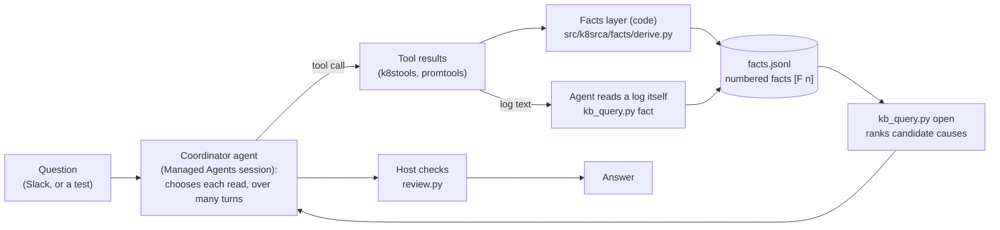
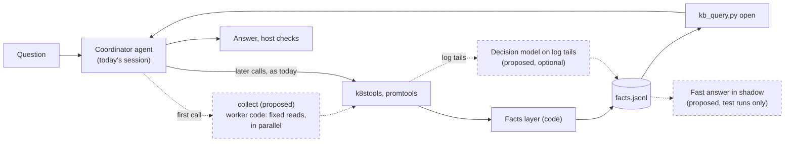

# 011 — A collector for the first reads, with decision models for what code cannot read

Today a language-model agent runs the whole investigation: it decides what to read from the
cluster, reads it over many turns, and writes the answer. This design proposes three things, in
order of how sure we are of them:

1. **A collector.** Code makes the first reads of an investigation in one step, inside today's
   agent session, so every run starts from the same evidence.
2. **Decision models for text.** A **decision model** (a small model that answers typed yes/no or
   multiple-choice questions about a piece of text with a probability and writes no prose) states
   the facts that need a log read, but only where a rule in code is shown not to be enough.
3. **A fast answer, measured before it is used.** Whether the collected facts alone are enough
   to answer from, with one model call and no investigation, is computed and logged beside every
   test run and never shown to a user. Answering that way in production is a later decision that
   needs evidence from faults the system was not built on.

The first decision model tried is **JEV**, TypeSafe's hosted decision model (§3.2), behind a
provider-neutral **`Judge`** interface (§3.3). Two settings, both off by default, turn on the
collector and the decision model separately (§3.8).

This design has had two outside reviews. The first
([#43](https://github.com/BenedatLLC/k8srca/issues/43)) argued that its original scope, a
decision model reading logs inside today's loop, was too small. The second
([#44](https://github.com/BenedatLLC/k8srca/issues/44)) argued that the pipeline written in
answer to the first was built around a fast path that saves little and cannot be shown safe on
15 scenarios. The [appendix](#appendix-history-and-results) answers both point by point. §1 gives
the background a reader needs; the [plan](../plans/011-decision-models.md) holds the steps and
their measurements.

---

## 1. Problem

### 1.1 How an answer is made today

k8srca answers an SRE's question in Slack ("why is `ad` restarting?") by investigating a live
cluster through read-only tools ([001](001-architecture.md)). This diagram shows how an answer is
made today. Everything in it runs.



1. **The agent chooses each read.** The coordinator (the agent that plans and writes the answer)
   calls k8stools (the read-only Kubernetes tool server) and promtools (the Prometheus one), and
   hands high-volume reads such as logs to a specialist agent, `k8s-investigator`. The tool calls
   are served by the worker, the code in the sandbox container
   ([010 §3.1](010-facts-and-short-answers.md#31-where-it-runs)).
2. **Facts** ([010 §3](010-facts-and-short-answers.md#3-the-facts-layer)). A *fact* is one
   observation stated as a sentence with its scope and source, for example "ad's last 3
   terminations were OOMKilled, exit 137". Code in the worker writes most facts from tool
   results, because the agent was worst at deriving low-level facts by hand.
3. **The knowledge base** ([007](007-knowledge-representation.md),
   [008](008-conclusions-under-incomplete-evidence.md)) says which facts count for or against
   each candidate cause (a *claim* in its format). `kb_query.py open` ranks the candidates from
   the facts by plain rules a reader can follow.
4. **The answer** ([010 §5](010-facts-and-short-answers.md#5-the-answer)) is short, every claim
   footnoted to a fact, and the host checks it
   ([010 §5.2](010-facts-and-short-answers.md#52-footnotes-and-the-host-checks)).

### 1.2 Terms

- **Collector.** Code that reads a fixed set of objects from the cluster through k8stools and
  promtools in one step (§3.1). Proposed here.
- **Fast answer.** An answer written from the collected facts by one model call, with no
  investigation. In this design it is computed in test runs for measurement only (§3.4).
- **In shadow.** Computed and saved beside a run, and not shown to the user or used for the
  run's result.
- **Routing reader.** A rule in code or a model that, given the collected facts, says whether
  the fast answer should be trusted (§3.4).
- **Predicate (a fact key).** A named, parameterised fact in the knowledge base with a `says`
  sentence. `last_exit_code[Container, Code]` says "the container's last termination exit code is
  {Code}". `process_logged_fatal_error[Container]` says "the process's own logs end with an
  exception, stack trace or fatal error before the cut". Candidate causes are written in terms of
  predicates.
- **Text-read fact.** A predicate whose truth needs reading text. Code can compute "exit code is
  137" but cannot always tell whether a log "ends with an exception before the cut".
- **Decision model.** A small model that does not write text. Given a *state* (text or JSON) and
  typed *questions*, it returns typed answers, mostly probabilities (§3.2).
- **JEV.** TypeSafe's hosted decision model, served through its "System One" API
  (`POST /v1/systemone`).
- **Judge.** Any decision model behind the `Judge` interface (§3.3), and the facts it states.
- **Abstain.** State no fact, so the agent reads the text itself as it does today.
- **`by`.** A fact's author: `code` or `agent` today (`src/k8srca/facts/model.py`); this design
  adds `judge` (§3.6).

### 1.3 The gap

**The gap is accuracy on faults the system was not built on.** On the 15 scenarios the agent was
developed against, it diagnoses 43 of 49 runs, and 13 of the 15 scenarios in every run
([docs/baseline.md](../docs/baseline.md)). On SREGym's 14 held-out faults it passed 25 of 70
attempts at $0.57 an attempt, and five of those faults passed in some attempts and failed in
others ([plan 014](../plans/014-sregym.md#findings-from-the-baseline), the score table). So the
suite has little room left to show an improvement in diagnosis, and the room that exists is on
faults we may not study yet ([014 §3.1](014-sregym.md#31-the-suites-life-and-what-each-phase-may-do)).

**What each instrument can show** follows from that, and shapes this design:

| Instrument | Can show | Cannot show |
| --- | --- | --- |
| The scenario suite (15 recorded faults) | A regression; a change in cost; whether text-read facts are right | That diagnosis improved: 13 of 15 scenarios are already diagnosed in every run, and the facts layer was built on these recordings |
| SREGym (14 held-out faults, one use) | Whether diagnosis improved on unseen faults, if at least five faults move one way ([plan 014, step 2](../plans/014-sregym.md#step-2--write-the-comparison-down-and-tag-the-release-with-it)) | Small effects; anything about three faults the tools cannot yet see and one no read-only tool can |

**Three things in today's loop are candidates for improvement.** None is yet measured in the
terms that would justify building against it, which is why the plan starts with measurements.

- **Which reads a run makes varies.** The same question on the same recorded cluster takes
  between 11 and 37 tool calls on one scenario and between 21 and 66 on another
  ([docs/baseline.md](../docs/baseline.md)). Whether that spread costs accuracy is not shown on
  the suite, where outcomes barely vary. It is the suspected reason attempts on one SREGym fault
  differ, and that is not shown either.
- **The first reads are the same every time, and the agent pays for each turn.** The scenario
  recorder already performs them in code, with no model, to make test fixtures
  (`record_results` in [`src/k8srca/scenario/record.py`](../src/k8srca/scenario/record.py)).
  Making the agent's job smaller is what has worked before: the k8stools composite tools, where
  one call returns a whole workload's state, halved the calls and cut cost by 36% on one
  scenario ([010 §1](010-facts-and-short-answers.md#1-why-what-the-measurements-showed)). How
  many dollars of a run go on the first reads is not measured; the only split we have is of
  wall-clock time.
- **Facts that need text read depend on the agent's diligence.** Design 010 moved most
  fact-making into code. What is left to the agent is any fact that needs reading text, almost
  always a container's log, which it records with `kb_query.py fact`
  ([010 §3.4](010-facts-and-short-answers.md#34-what-the-agent-still-writes)). In the two Java
  out-of-memory scenarios, `oom-kill`'s own evidence cannot hold without
  `not process_logged_fatal_error`, and nothing derives it
  ([plan, "What text-read facts change in the ranking"](../plans/011-decision-models.md#what-text-read-facts-change-in-the-ranking)).

---

## 2. Goal

Every investigation starts from the same collected evidence, at a lower cost, with accuracy no
worse; and we learn, on faults the system was not built on, whether the collected facts alone
would have been enough.

- **No regression** on the scenario suite, read against a classic arm run alongside, by the rule
  of [004 §6.4](004-scenario-testing.md#64-sampling-and-the-regression-rule).
- **A lower cost,** stated in the plan as a share of the suite's total and set from a measurement
  of where a run's dollars go, and lower than the cheaper control of running today's loop with
  the coordinator at a lower effort setting.
- **Less variation in outcomes** on unseen faults: fewer SREGym faults that pass in some attempts
  and fail in others. The suite cannot show this.
- **A measured answer to the fast-answer question:** for every test run, the fast answer and
  each routing reader's decision are saved, so that after design 014's comparison there is a
  table of how often the fast answer was right, and how often each reader would have trusted it
  wrongly, on unseen faults.
- **Optional and off by default.** With both settings off the system is exactly what runs today,
  and the collector works with no decision model.

**Out of scope for the first pass.**
- Answering a user from the fast answer, with no session. It needs the evidence above first, and
  it changes the architecture (§4.2).
- A stronger model (such as Opus) for the investigation. A separate assumption with its own cost.
- A decision model that ranks causes or sets a strength. `open`'s ranking stays deterministic
  ([010 §2](010-facts-and-short-answers.md#2-principles)).
- The answer reviewer, which is held (§4.1).

### 2.1 Uses beyond the first pass

Every place a decision model could help, ranked. The "When" column says which are in the first
pass; each other row gets its own plan step, in [process.md](../docs/process.md)'s form, if it
looks promising.

| # | Use | Kind of gain | Measurable offline? | When |
| --- | --- | --- | --- | --- |
| 1 | **Text-read facts.** The knowledge base's log predicates, judged on the logs the collector read | accuracy; fewer turns | yes: the log tails already in the recordings | the first pass, where a rule in code is shown not to be enough |
| 2 | **Support checking as an evaluation category**, with a per-sentence screen (§4.1) | a measurement we cannot do cheaply today | yes: saved answers | after [#6](https://github.com/BenedatLLC/k8srca/issues/6) |
| 3 | **A screen for the checklist grader.** Each checklist item as a yes/no on the answer | cost of measuring | yes: saved verdicts | after #6, between designs ([process.md §5](../docs/process.md#5-the-instrument-is-frozen-per-design)) |
| 4 | **Symptom matching.** A free-text question or unmapped alert to the knowledge base's symptoms, as a `choice` | accuracy at the first step | yes: the scenarios' questions | not in the first pass. On design 015's labelled queries (`tests/kb_eval/labels-2b.json`) only after design 014's comparison, because those queries come from sessions on its held-out faults. Capped by coverage: 13 symptoms have an authored ranking, and 25 of the 81 vendored alerts map to them |
| 5 | **Next-check selection.** A `choice` over the knowledge base's candidate checks | spread in which checks run | partly | not planned. The collector fixes the first reads in code |
| 6 | **Model tier by difficulty.** Trusting a fast answer when the case is plain | cost | in part: the suite is too small to show it safe | the first pass, in shadow only (§3.4) |
| 7 | **Following a dependency.** A log that names a failing dependency makes the collector read that dependency too | accuracy on faults that start elsewhere | yes: the log tails in the recordings | code first: match the tail against the names of the component's neighbours in the architecture wiki. A decision model only if that fails |
| 8 | **A sufficiency check before the answer.** Whether the facts name an underlying cause, asked before the agent writes | fewer answers that restate the symptom | yes: saved sessions' facts | later. The check must tell the agent which read is missing, or it has the reviewer's problem (§4.1) |

---

## 3. Approach

### 3.1 The collector: one tool the coordinator calls first

The collector is a tool, `collect`, served by the worker inside today's session. The coordinator
calls it once at the start, and it performs the first reads in code. This diagram shows where it
sits; dashed parts are proposed and not built.



**What it reads.** The order the scenario recorder already uses (`record_results`), which moves
into a module the recorder and the worker share:
- the nodes, and each namespace's health, warning events and volume claims;
- a workload report for the workload the question names and for every workload the health result
  calls unhealthy, the events of each pod a warning names, and each of those pods' specs. A
  workload report already carries the last 20 lines of each container's current and previous
  log;
- promtools' memory and restart reports for those workloads, whenever a metrics server is
  configured. Prometheus is optional
  ([constitution A6](../docs/constitution.md#a6-optional-services-are-off-by-default-and-text-is-redacted-before-it-leaves)),
  so the collector reads it where it exists and skips it where it does not;
- one more workload report for a dependency, when a log tail names a neighbour of the workload in
  the architecture wiki next to an error (row 7 of §2.1);
- the recent-changes read of [design 013](013-what-changed.md), once k8stools provides it.

The reads are independent and run in parallel inside the one tool call. The number of workloads
read is capped, so a namespace where everything is unhealthy does not become hundreds of reads.

**What it returns.** Each read goes through the same evidence record and facts layer as a tool
call the agent makes itself, so the facts are numbered in one sequence and can be cited as
`[F n]`. The tool's result is the facts, grouped by read, with each read's number so the agent
can open the full result from the evidence record
([007 §6.1](007-knowledge-representation.md#61-checking-against-the-evidence-record)) when it
needs more than the facts. The full results are not put in the conversation.

**What the agent sees or does differently.** With the collector on, the coordinator is declared
one more tool, and the session's first message asks it to call `collect` before anything else.
The skill, the prompts and every other tool are unchanged, so with the collector off the system
is exactly today's. After the call the agent investigates as it does today: it runs `open`,
delegates log reading, and makes whatever further reads it chooses.

**Why in the worker.** The worker already holds the connections to the MCP servers, the evidence
record and the facts log, and already runs in the session. Nothing new holds a credential, no
new process is needed, and every read goes through the MCP servers
([constitution A1](../docs/constitution.md#a1-k8srca-never-touches-the-kubernetes-api-directly)).
§4.2 compares the alternatives.

### 3.2 Decision models, and who offers them

A decision model takes a **state** and a set of **questions**, answers each separately, and
returns typed answers without text or reasons. Three question types recur across every provider
found so far:

| Type | Returns |
| --- | --- |
| yes/no: `noul` (TypeSafe's name; also Kev and Clef), `predicate` (OpenAI) | the probability the statement is true of the state |
| `choice` | one option from a list, with per-option probabilities and a confidence |
| `score` | a level on an ordered scale, with probabilities and a confidence |

| Provider | Interface | Notes (sources in §8) |
| --- | --- | --- |
| **TypeSafe JEV** (first implementation) | `POST /v1/systemone`: `state`, `model` (such as `jev-latest`), `questions` keyed by ids you choose; answers keyed by the same ids [1][4] | Text and JSON only. The answer carries a model version (`jev-1.13.0` in the docs' example) [1]. Hosted. Pricing and retention not in the public docs read so far |
| **Kev** (open weights, Apache-2.0) | The same `POST /v1/systemone`, so TypeSafe's SDK can point at a local server [7] | 0.8B–27B on Qwen bases; runs on CUDA, ROCm, Apple Silicon or CPU. Runs on our machine, so no text leaves. Can be fine-tuned on labelled JSONL |
| **Cloudflare Clef, Clef-flash** | "Fully Jev-API compatible" on Workers AI; weights on Hugging Face, Apache-2.0 [8] | Vendor-reported: 64k context against JEV's 32k; median latency 209 ms (Clef) and 39 ms (Clef-flash) against JEV's 524 ms. Cloudflare says it does not store requests. No price given |
| **OpenAI Decisions API** | `POST /v1/decisions`: `model` (`gpt-6-luna`), `input`, `questions` as an array of `{name, type, instructions}`; `answers` array, with a `refusal` type [6] | Different wire format. Up to 400 questions a request. Uncached input $0.10 per 1M tokens, output free. Zero Data Retention for eligible customers |
| **AWS Strands Decider 2B** | Not read | Reported by The New Stack as a local model that scores developer-supplied options [9]. Only the headline was available |

Two consequences:
- **Three of the five share one wire format,** and one differs in shape, so a `Judge` interface
  with a System One adapter and an OpenAI adapter covers all of them.
- **The numbers are not interchangeable.** Kev says it calibrates its probabilities with a
  temperature fitted per checkpoint [7]; TypeSafe makes no such claim [2]. A threshold is a
  property of a question *and* a model, so changing the model means running the evaluation again.

Speed matters little: one log's questions go in one request, and Cloudflare reports a median of
524 ms for JEV [8].

### 3.3 The `Judge` interface

In `src/k8srca/core/judge.py`, in the style of design 005's generator contract
([005 §6.2](005-modular-architecture.md#62-the-generator-contract-built)): an interface the
facts layer depends on, with implementations behind it.

```python
class Question:   # id, kind ("yes_no" | "choice" | "score"), text, options/levels
class Answer:     # id, then one of:
                  #   Probability(p)
                  #   Choice(option, probabilities, confidence)
                  #   Score(value, probabilities, confidence)
                  #   Unavailable(reason)      # refusal, timeout, provider error

class Judge(Protocol):
    name: str            # "jev", "kev-4b", "claude-haiku"
    model: str           # the pinned version; recorded on every fact it states
    def ask(self, state: str, questions: list[Question]) -> list[Answer]: ...
```

Adapters, each small:
- `systemone`: TypeSafe JEV, Kev and Clef, with a `base_url`, a `model` and an optional key.
- `openai_decisions`: the array-shaped format, mapping `noul` to `predicate`.
- `claude`: a small Claude model asked the same question and told to return a probability. It is
  a comparison in the offline evaluation, and it is also how an operator with an Anthropic key
  and no decision-model account gets the judged facts.

`Unavailable` is an answer, so any provider failure becomes an abstention. The facts layer never
raises on a judge: no fact is stated, and the agent reads the text as today.

### 3.4 The fast answer, in shadow only

For a plain fault, the collected facts may already hold everything a correct answer needs. If
so, one model call could answer it with no investigation. Two things are unknown: how often that
is true on faults the system was not built on, and whether anything can tell, before answering,
which cases those are. A wrong fast answer would reach the user with nothing to catch it, so
this design measures both and acts on neither.

**What is computed.** In a test run with shadow on, after the session ends, the host takes the
facts the `collect` call produced (not those from later reads), runs `kb_query.py open` on them,
and makes one model call with the skill's instructions for the answer, as the answer-writer
evaluation does today ([`src/k8srca/evals/answer.py`](../src/k8srca/evals/answer.py),
[010 §8](010-facts-and-short-answers.md#8-testing-the-suite-and-the-component-evals)). The fast
answer is saved in the run's record and graded like the session's answer. Its cost is added to
the run's recorded cost. The user-facing answer, and the run's result, are the session's.

**What the routing readers are.** Each reader looks at the same collected facts and says "trust
the fast answer" or "investigate". Their decisions are saved beside the fast answer:
- **A rule in code:** trust it only when `open`'s leader is strong, is a specific cause and not
  a broad one, and has a strong sub-cause. On the 12 labelled scenarios that rule selects four,
  all correct, where `open`'s strength alone would also select two wrong ones (found by the
  review in [#44](https://github.com/BenedatLLC/k8srca/issues/44) from
  `tests/kb_eval/measure_2a.py`'s output; see also
  [plan 015, step 2a](../plans/015-kb-evaluation.md#step-2a-recall-and-false-leaders)).
- **A decision model,** asked of the question, the facts and `open`'s output:
  `evidence_explains_symptom` (the facts explain the reported symptom and none contradicts the
  explanation), `fault_originates_elsewhere` (the facts suggest the fault starts in a different
  workload, node or dependency than the one asked about), `identifies_underlying_cause` (the
  facts name a specific cause and do not only restate the symptom) and `actionable_specificity`
  (the facts include the concrete resource, setting or value needed to verify or fix it).
- **A small Claude model** asked the same four questions.

**What it gives us.** For each run there are two graded answers and each reader's decision, so a
table can be made: how often the fast answer was right, and for each reader, how often it would
have trusted a wrong fast answer. On the scenario suite that table is small and comes from the
scenarios the facts layer was built on, so it can rule a reader out and cannot show one safe:
if the fast answer is wrong on nine of the fifteen, seeing no reader error on those nine still
allows a true error rate near 30%. Design 014's comparison computes the same table on unseen faults in one use of the
hold-out. Those answers are graded once the faults may be read.

**Limits said in advance.** The four decision-model questions are judgments over a whole list
of facts, not the single-statement questions decision models are documented to answer best [3],
and a model that could answer them reliably could nearly do the diagnosis. Whether a small model
can is what the shadow record shows. Nothing in this design depends on the answer being yes.

### 3.5 Redaction

k8stools already redacts common secret shapes before a result leaves it (AWS keys, JWTs, PEM
blocks, and values under names containing `key`, `secret`, `token`, `password` or `credential`;
[001 §4.1](001-architecture.md#41-k8stools-the-only-path-to-the-kubernetes-api)), and recordings
are made through it. That misses personal data and topology: the deploy-regression recording's
accounting log holds order ids, tracking ids and a street address. A second pass runs before
anything leaves for an outside provider:
- email addresses, phone numbers, IPv4 and IPv6 addresses, UUIDs, card-number shapes (with a Luhn
  check), long hex and base64 runs;
- hostnames and URLs reduced to a scheme and `<host>`, with the port kept, because a port can be
  the signal (`port already in use`);
- every replacement a typed placeholder, such as `<email>`, so the sentence still parses.

Patterns do not reliably catch free-text personal data, so two more steps:
- **Trim first.** A predicate about how a log *ends* needs the last lines, not 200 of them. The
  facts layer sends the tail the collector read, plus any lines matching the predicate's cheap
  pattern screen.
- **Drop fields from JSON log lines,** keeping the level, message and error fields.

**What leaves, and what does not.** In production the only text sent to an outside provider is
redacted log tails, for the log predicates. The dependency check of §3.1 is code, because it
needs the hostnames this pass removes. The routing questions of §3.4 would send the user's
question, facts and workload names, which this pass does not cover; they are asked only in test
runs, on test clusters with synthetic data. If answering without a session is ever built, what
those questions send needs its own redaction design first.

If redaction removes the signal, accuracy shows it: the plan scores JEV on raw text beside
redacted text, offline, on the demo application's synthetic data already in the recordings.

### 3.6 Facts from a decision model

A judge answer about a log becomes a `Fact` ([010 §3.2](010-facts-and-short-answers.md#32-a-fact))
with `by: "judge"` and the judge's `name` and `model` recorded:
- `p ≥ hi` states the predicate, `p ≤ lo` states its negation, anything between states nothing;
- the statement names the scope: "ad, previous instance, last 20 lines retained: no exception or
  fatal error before the cut (read by a model)";
- the footnote marks it as read by a model, as agent facts are marked today
  (`src/k8srca/facts/render.py`);
- **the agent's own reading wins.** If the agent records a fact that contradicts a judge's fact,
  `open` uses the agent's, and the disagreement is logged as a measurement.

`open` needs no change: it already reads facts' knowledge-base keys, whoever stated them. Where
the plan finds a regular expression reads a predicate as well as any model, that predicate is
derived in code like any other fact, with `by: "code"` and no judge.

### 3.7 Questions and thresholds

One reviewed file, `judge/questions.yaml`, in two groups:
- **extraction:** the knowledge base's log predicates that code cannot read, each with the
  predicate's `says` sentence as its question, edited so that high means yes [1];
- **routing:** the four questions of §3.4, used in shadow only.

Each question carries thresholds per model:

```yaml
process_logged_fatal_error:
  group: extraction
  text: the process's own logs end with an exception, stack trace or fatal error before the cut
  thresholds:
    jev-1.13.0: {lo: 0.15, hi: 0.85}   # illustrative; set by the plan's step 3
    kev-4b:     {lo: ..., hi: ...}
```

A model with no entry for a question abstains on it, so changing a pinned version cannot silently
reuse another version's thresholds.

### 3.8 Configuration

Two new sections of `k8srca.yaml`, and of its schema in `src/k8srca/config.py`. Neither is built.

```yaml
collect:
  enabled: false                # the coordinator gets the collect tool and is asked to call it first
  max_workloads: 10             # the collector's cap
judge:
  enabled: false                # a decision model states text-read facts on collected log tails
  provider: systemone           # systemone | openai_decisions | claude
  base_url: <provider url>      # judge service side; not set in the sandbox
  model: <pinned version>       # thresholds move with the model
  questions: judge/questions.yaml
```

The settings are separate because the collector does not need a decision model, and a comparison
that turned both on at once could not say which one helped:

| `collect.enabled` | `judge.enabled` | What runs |
| --- | --- | --- |
| `false` | `false` | Today's system, exactly. The default |
| `true` | `false` | The collector, with every fact stated by code or the agent |
| `true` | `true` | The collector, with a decision model stating text-read facts on what it read |
| `false` | `true` | Rejected when the configuration loads: the first pass asks a decision model only about what the collector read |

The commands that start a session (`k8srca scenario run`, `k8srca session`) take
`--collect/--no-collect` and `--judge/--no-judge`, which override the file for that run, as
`--arch` and `--local-skill` do today. `k8srca scenario run` also takes `--shadow`, which
computes the fast answer and the routing readers' decisions (§3.4); it has no production
setting. An outside driver such as design 014's passes the same values.

### 3.9 Where the calls run, and who holds the key

**The collector** runs in the worker, in the sandbox, and holds nothing new (§3.1).

**The fast answer and the routing readers** run in the test driver on the host (the scenario
runner, or design 014's driver), after the session, with the Anthropic key that process already
uses to grade answers. They do not run in production.

**A decision model for text-read facts** is called from the facts layer, which runs in the
sandbox, where agent-written commands also run. So:
- **The sandbox must not hold the provider key**
  ([constitution A3](../docs/constitution.md#a3-each-credential-has-one-holder)). The sandbox's
  network rules are a deny list (`docker/egress-rules.sh` blocks the host, private ranges and
  cloud metadata, and allows the public internet;
  [001 §8.3](001-architecture.md#83-restricted-network-egress)), so what keeps the call out of
  the sandbox is the key, not the network.
- **A judge service holds it.** The adapters sit behind a small service on `k8srca-net`, the
  Docker network the sandbox and k8stools share, as promtools sits beside k8stools. It accepts
  `{question ids, subject, text}`, never question texts, which live in its own reviewed file, so
  nothing in the sandbox can turn it into a general-purpose model. It redacts (§3.5), calls the
  configured `Judge`, and returns probabilities. It logs question ids, a hash of the redacted
  text and the redaction counts, never the text.
- **It is built only if the plan finds a model that reads logs better than code.** If regular
  expressions do as well, there is no judge service, no provider key and no network rule.
- **Two existing gaps are closed with it.** The `.env` loader puts every value into the
  environment of every command (`load_dotenv` in
  [`src/k8srca/settings.py`](../src/k8srca/settings.py)), and the development worker removes a
  fixed list of names before running agent-written commands (`SCRUB`, same file). A provider key
  is added to that list, and the judge service reads its key from its own environment file, as
  the k8stools container reads its kubeconfig.

### 3.10 Principles

1. **Code collects and decides; models judge.** The first reads are a fixed list in code. A
   decision model's answer is an input: it becomes a fact only through thresholds written in
   code and kept with the question texts in one reviewed file. This follows TypeSafe's guidance
   to set cutoffs in code by the cost of a wrong decision [1], and the AWS Builder Center
   alert-triage example, where the decision model supplies the judgment and code owns the
   consequences [5].
2. **Code first, a model only where code is shown not to be enough.** Each use of a decision
   model is compared offline with a rule in code and with a small general model, and the
   simplest reader that does as well is the one built.
3. **Abstain rather than guess.** Between the two thresholds, no fact is stated and the agent
   reads the text as today. A wrong fact that rules a cause out is worse than no fact: the AWS
   example tunes its equivalent error ("under-triage") to zero, since the opposite error only
   costs money [5].
4. **Measure before acting on a judgment.** A decision that could put a wrong answer in front of
   a user is computed in shadow until there is evidence for it from faults the system was not
   built on (§3.4).
5. **Probabilities are not calibrated until we measure them.** TypeSafe makes no calibration
   claim and calls its confidence "one reasonable way to summarize a distribution" [2]; its
   suggested 0.7 and 0.3 are "a starting point" [1]. Thresholds are set on our labelled data, per
   question *and per model*, and reported with the counts behind them (§3.7).
6. **Optional, off by default, and usable without a decision model** (§3.8).
7. **Redact before text leaves** (§3.5).
8. **Behind an interface, with no provider assumed.** The facts layer calls a `Judge`, never a
   vendor.
9. **Built and tuned only on what we may read.** The collector's list, the routing rule and
   every threshold are set on the 15 recorded scenarios and SREGym's three burned faults (faults
   already used for development). What was read of SREGym's 14 held-out faults is not used to
   design them ([014 §3.1](014-sregym.md#31-the-suites-life-and-what-each-phase-may-do)).

---

## 4. Alternatives considered

### 4.1 A decision model as the answer reviewer

One use is the check inside design 010's light reviewer, a model that reads the answer against the
facts it cites: judge each sentence, and send a revision turn when one falls under a threshold.
010's own results argue against it
([010 §9.8](010-facts-and-short-answers.md#98-step-4-result-2026-10-22)):
- it flagged every live answer, 4.75 flags a run, so every session took a revision turn, at 5–53%
  more cost a run;
- offline about 90% of flags were right, but live most flags were true statements the reviewer had
  not been shown, because it saw only the facts the answer cited;
- unsupported claims fell from 8 to 4 in 12 runs, inside chance at that n;
- the revision weakened right inferences: one itbench-33 run turned "a bad node selector was
  introduced" into "changed something in their pod templates".

The deeper problem is that "this sentence is not supported" is a complaint, and the writer's one
move that always satisfies it is to say less. A decision model producing the same flag faster has
the same problem. The first reviewer mixed three jobs, each with a better tool:

| Job | Example | Better tool |
| --- | --- | --- |
| **Overreach by form** | "every" where the fact says "the last 3"; a confidence word stronger than `open`'s strength | **Code**, with specific feedback: "Sentence 2 says 'every'; F3 says 'the last 3'." |
| **Attribution gaps** | A true sentence with no marker, or a marker on the wrong fact | **A suggested patch** ("this sentence matches F12; add [F12]"), or recording the missing fact. Untested |
| **"Is everything supported?"** | How often answers go beyond their facts | **An evaluation measure**, not a production step |

**Decision (owner):** the reviewer is improved in the generic system first, without a decision
model, in [#6](https://github.com/BenedatLLC/k8srca/issues/6); a decision model is then tried
against the baseline that leaves, as rows 2 and 3 of §2.1. No judged check runs in production; the
light reviewer stays off.

### 4.2 Other alternatives

- **Text-read facts only, inside today's loop.** This design's original scope. It is the lowest
  risk and has the smallest effect: its own plan predicted "can't tell" live, because it
  improves the reading of logs the agent fetched and changes neither which reads are made nor
  what the loop costs.
- **A host-side pipeline that answers without a session.** The host collects, states facts,
  ranks, and sends plain cases to a single model call and the rest to a session started with the
  facts. This was the design's second version. It is not chosen for the first pass because:
  - on the scenario suite the saving is small. The three cheapest scenarios already cost $0.08
    to $0.10 a run, about what a fast answer costs, and sending the six cheapest down a fast
    path lowers the suite's total by about 6% and leaves the median where it is
    ([docs/baseline.md](../docs/baseline.md));
  - 15 scenarios cannot show the routing safe (§3.4);
  - it needs changes this design then avoids: a session created without its first message so
    the facts can be written first, a Slack thread store that accepts a thread with no session
    (`threads.session_id` is required today, and a reply in an unknown thread is ignored), host
    checks and a revision turn that assume a session, a connection from the Slack orchestrator
    to k8stools that does not exist today, and a provider key in the orchestrator.

  It becomes worth building if the shadow record from unseen faults shows a reader that trusts
  the fast answer often and never wrongly.
- **The collector as a k8stools tool.** One upstream composite would serve any client. It is not
  chosen first because the facts layer and the evidence record are in the worker, so the worker
  can number and state facts for each read, and because no capability is missing from k8stools
  ([constitution A4](../docs/constitution.md#a4-a-missing-capability-goes-upstream) is about
  missing capabilities). If the list of reads settles, proposing it upstream is the natural next
  step.
- **Today's loop with the coordinator at a lower effort setting.** One line in `k8srca.yaml`
  (`effort: high` today). It may lower cost with no new code. It is not an alternative to the
  collector so much as the control the collector has to beat, and the plan runs it as an arm.
- **A decision model that chooses the cause,** as SREGym's own pipeline does [11]. It would put
  uncalibrated numbers where `open`'s readable rule is, and SREGym's failures were consistent
  (the same wrong clue in all five runs of a fault). Their result does support collecting in
  code first: it came from a hand-built collector.
- **A stronger model for the investigation now.** It raises the cost of the cases that already
  cost most, and it is a second change that would be confounded with the collector. Later, as
  its own step.
- **A code rule that forbids stopping while a leading candidate has unread evidence.** A rule
  written from one scenario, which [process.md §2](../docs/process.md#2-tripwires) warns
  against, and the scenario it was written for (`itbench-33`) is diagnosed in every run today.
- **One setting for everything.** A single switch could not separate what the collector does
  from what the decision model does, and would leave an operator with no decision model unable
  to use the collector (§3.8).
- **Calling a provider from the sandbox with the key in its environment.** A second credential
  where agent code runs (§3.9).
- **Sending whole logs.** More data than any predicate needs, and more personal data with it.
- **Building for JEV alone.** Providers already share one wire format, and the numbers differ by
  model (§3.2); tying the facts layer to one vendor would also tie the thresholds to it.

---

## 5. What it changes

| Document or component | Change |
| --- | --- |
| [001](001-architecture.md) architecture | One more tool served by the worker. If a decision model is used: a judge service on `k8srca-net` holding one more credential, and a network rule for it (§3.9). 001 is updated when each is built |
| [002](002-investigation-model.md) investigation model | The first reads are made by code in one call. The loop after it is unchanged |
| [003](003-operations.md) operations | None in the first pass: every answer still comes from a session, with its console link, budget and timing record |
| [004](004-scenario-testing.md) scenario testing | The recorder shares the collector's code; `scenario run` takes `--collect`, `--judge` and `--shadow`; a run's record holds the fast answer, its grade, the readers' decisions and their cost |
| [010](010-facts-and-short-answers.md) facts and short answers | Extends the facts layer to the one kind of fact it left to the agent ([010 §3.4](010-facts-and-short-answers.md#34-what-the-agent-still-writes)), in code where a rule is enough, with `by: "judge"` where it is not. The reviewer analysis (§4.1) takes up 010's ideas for a later reviewer |
| [007](007-knowledge-representation.md) knowledge representation | None. Its predicates and `says` sentences become the extraction questions |
| [008](008-conclusions-under-incomplete-evidence.md) conclusions | None. `open`'s ranking and strength are untouched |
| [005](005-modular-architecture.md) modular architecture | The `Judge` interface follows its style; its evaluation follows [005 §8.1](005-modular-architecture.md#81-component-evals) |
| [013](013-what-changed.md) what changed | Its recent-changes read joins the collector's list when k8stools provides it |
| [014](014-sregym.md) SREGym | Its comparison was defined as one release with `judge.enabled` off and on. The exact arms are fixed after this design's first pass; the expected shape is today's loop against the collector with whatever else this design's steps showed to be worth having, with the fast answer computed in shadow for every attempt (§7) |
| [015](015-kb-evaluation.md) KB evaluation | Its `tests/kb_eval/measure_2a.py` is the plan's offline check for text-read facts. The plan's fast-answer measurement runs the answer writer with and without `open`'s output, which bears on 015's question of whether the knowledge base helps |
| `src/k8srca/settings.py` | If a provider key is added: its name joins the list the development worker removes (§3.9) |
| The measuring instrument | None. The fast answer is graded by the same checklists; it is a second answer per run, not a change to how answers are graded |
| Upstream | None |

---

## 6. How we will know it worked

In outline; the [plan](../plans/011-decision-models.md) states each step's hypothesis, expected
effect, budget, and done and stop criteria in full. The fixes for three known defects and the
adoption of three k8stools tools ([plan 014, step 2b](../plans/014-sregym.md#step-2b--fix-three-known-defects-and-adopt-the-k8stools-tools-for-three-gaps))
come before any live run here, because one of the defects changes what is graded and the tools
are what give SREGym room to show a difference.

- **Step 1, offline and free:** where a run's dollars go, from saved sessions, and how much of
  that the collector's reads account for. This sets the expected saving, or ends the cost
  argument for the collector.
- **Step 2, offline:** how many scenarios the fast answer diagnoses from the collector's facts,
  and whether the routing rule in code would have trusted any wrong one. This is a screen: a bad
  result ends the fast-answer question cheaply, and a good one proves nothing, because the
  scenarios are few and the facts layer was built on them.
- **Step 3, offline:** on the log tails already in the recordings, whether a decision model
  reads the knowledge base's log predicates better than a regular expression and a small Claude
  model. The simplest reader that does as well is built.
- **Step 4, live on the scenario suite:** today's loop, today's loop at lower effort, and the
  collector, side by side, with the fast answer in shadow. The suite is read as a guard against
  regression and as a measure of cost. It is not expected to show diagnosis improving.
- **Then design 014's comparison** on SREGym's held-out faults, which is where an effect on
  diagnosis, and the fast answer's record on unseen faults, can show.

---

## 7. Open questions

- [ ] **The arms of design 014's comparison.** Fixed after this design's first pass is complete
  (owner, 2026-11-15). The expected shape is today's loop against the collector with whatever
  else this design's steps showed to be worth having, end to end, with the fast answer computed
  in shadow for every attempt. Recorded in
  [014 §7, question 12](014-sregym.md#7-open-questions).
- [ ] **Whether the agent calls `collect` first, every time.** The first message asks it to. If
  the plan's live step finds runs that skip it, the worker runs the collection itself when the
  session's first tool call arrives. Decided in the plan's step 4.
- [ ] **Which namespaces the collector reads** when the question names none. The recorder uses
  the scenario's; production has the architecture sources' namespaces. Decided in step 4.
- [ ] **Whether SREGym's judge can grade a second answer for an attempt.** If not, the fast
  answers from the comparison are graded by us once the faults may be read.
- [ ] **Prometheus on SREGym.** Whether design 014's clusters expose a Prometheus the collector
  can read. Its astronomy-shop install sets `prometheus.enabled=false`
  ([plan 014, "Build the wikis"](../plans/014-sregym.md#2a1--build-the-wikis)). Checked before
  the comparison.
- [ ] **What the user sees while the collector runs,** and how long it may take. Twenty-four
  workload reports in parallel took about ten seconds on a test cluster
  ([plan 014, "Why sessions run long"](../plans/014-sregym.md#findings-from-the-baseline)). A
  time limit and a progress line in Slack are decided in step 4.
- [ ] **Provider terms.** What each hosted provider retains of a request, for how long and
  where. TypeSafe's public docs read so far do not say. Cloudflare says it does not store
  requests [8]; OpenAI offers Zero Data Retention to eligible customers [6]. This decides
  redaction as much as the patterns do.
- [ ] **Pricing for JEV.** Not in the docs read. Confirm before the first call.
- [ ] **Pinning.** Responses carry a version such as `jev-1.13.0`, and `jev-latest` is an alias
  [1], so pinning looks possible. How long a version lives is not known.
- [ ] **Local models and redaction.** Whether the redaction pass applies to a model we run
  ourselves. Principle 7 says outside APIs only.
- [ ] **A stronger model for the unsure band.** As proposed, a log answer between `lo` and `hi`
  states no fact. Hightouch's identity-resolution judge instead sends only its JEV answers
  between 30% and 90% confidence (about 22%) to Opus [12]: 98.8% accuracy at $0.88 per 1,000
  against $3.86 for Opus alone on their easy set, and 95.3% at $2.94 against $5.39 on their
  harder set. Their JEV mistakes clustered near 50%, which is why the band worked; GPT-6 Luna was
  overconfident at 90–100%. Their evidence is synthetic, tuned on the test set, with no repeated
  runs. It argues for reporting the plan's confident wrong answers by confidence bucket.

---

## 8. Sources

Read in full unless noted. Vendor claims are marked as such where they are used.

1. TypeSafe, *Noul* (statements, thresholds, request and response shape):
   <https://docs.typesafe.ai/primitives/noul.md>
2. TypeSafe, *Confidence*: <https://docs.typesafe.ai/confidence.md>
3. TypeSafe, *Patterns* (atomic questions, fan-out, confidence-based routing):
   <https://docs.typesafe.ai/patterns.md>
4. TypeSafe, *System One* (the `POST /v1/systemone` endpoint, text-only state):
   <https://docs.typesafe.ai/concepts/system-one.md>
5. *Jev as an alert triage: typed decisions for OpenSearch on-call with Bedrock and AgentCore*,
   AWS Builder Center. A community-written article, not an official AWS blog post:
   <https://builder.aws.com/content/3JpdH4acDKLD3Mta05sZ1xQOpVt/jev-as-an-alert-triage-typed-decisions-for-opensearch-on-call-with-bedrock-and-agentcore>
6. OpenAI, *Decisions API* guide: <https://developers.openai.com/api/docs/guides/decisions>
7. Jared Palmer, *Kev*: <https://github.com/jaredpalmer/kev>
8. Cloudflare, *Clef decision models* (vendor-reported figures):
   <https://blog.cloudflare.com/clef-decision-models/>
9. The New Stack, *AWS launches a local answer to TypeSafe's Jev decision model* (headline only;
   body not read): <https://thenewstack.io/aws-strands-decider-model/>
10. osolmaz, *switch*, a framework for decision-model harnesses (README read, not the code):
    <https://github.com/osolmaz/switch>
11. SREGym, *Jev-driven SRE diagnosis* (2026-10-06): an agentless pipeline of a programmatic
    collector and JEV (`jev-1.13.0`) on the 21-fault SREGym-Lite cohort, five runs each, scored by
    a model judge (`gpt-6-astra`) at a 0.70 pass threshold: 80/105 passed, 14.6 s median, about
    $0.15 of JEV inference for the whole run (estimated from TypeSafe's published price). Written
    by the SREGym team; one historical cohort and a model judge:
    <https://www.sregym.com/blog/jev-driven-sre-diagnosis>
12. Hightouch, *LLM judges for identity resolution* (2026-11-04): JEV and GPT-6 Luna against
    frontier models on a synthetic over-merge benchmark, with a confidence-band cascade to Opus.
    Vendor blog; figures are theirs, thresholds were tuned on the test set, and charts were not
    read: <https://hightouch.com/blog/llm-judges-identity-resolution>

Internal: [#43](https://github.com/BenedatLLC/k8srca/issues/43) and
[#44](https://github.com/BenedatLLC/k8srca/issues/44) (the two outside reviews of this design's
earlier versions); [plan 015](../plans/015-kb-evaluation.md#appendix-results-in-detail),
steps 1, 2a and 2b (consultation rate, false leaders, search misses);
[#6](https://github.com/BenedatLLC/k8srca/issues/6) (the reviewer rethink);
[010](010-facts-and-short-answers.md) §3, §6, §7 and §9.7–9.8;
[007](007-knowledge-representation.md) (predicates);
[008](008-conclusions-under-incomplete-evidence.md) (ranking and strength);
[docs/baseline.md](../docs/baseline.md) (the scenario suite's scores, tool calls and cost).

---

## Appendix: history and results

**Three versions, none built.**
1. **A decision model reading logs inside today's loop,** with a judge service beside k8stools.
   It listed a larger role for decision models as open questions and decided against each. Its
   own plan predicted "can't tell" for its live measurement.
2. **A host-side pipeline with a fast path,** written on 2026-11-15 in answer to the outside
   review in [#43](https://github.com/BenedatLLC/k8srca/issues/43): the host collected, routed
   plain cases to a single model call, and started a session only for the rest. The owner chose
   to rewrite the design in place, because nothing had been built, where
   [designs/README.md](README.md#design-plan-and-results) would otherwise ask for a new design.
3. **This version,** written the same day in answer to the adversarial review in
   [#44](https://github.com/BenedatLLC/k8srca/issues/44), which found that the fast path saves
   little on the scenario suite's own numbers and cannot be shown safe on 15 scenarios, and that
   the suite is too close to its ceiling to show diagnosis improving.

**Review [#43](https://github.com/BenedatLLC/k8srca/issues/43), point by point:**

| The review's point | Taken? | Why |
| --- | --- | --- |
| Collect a fixed set of objects in code before the model reasons | Yes (§3.1) | The first reads barely vary, and the recorder already performs them in code |
| Extract facts from logs with a decision model, in one batch | Where code is not enough (§3.6) | Compared offline with regular expressions first |
| Follow a dependency a log names | In code first (§2.1 row 7) | It needs the hostnames redaction removes |
| Route between a single-call writer and a full investigation | In shadow only (§3.4) | The saving is small on our numbers and the routing cannot be shown safe yet |
| Route on `open`'s strength plus a decision model | In shadow only | `open`'s strength alone selects wrong leaders |
| Escalate hard cases to Opus | Not in the first pass (§4.2) | A second change that raises the cost of the costliest cases |
| A code rule forbidding a stop while evidence is unread | No (§4.2) | A rule from one scenario, which is diagnosed in every run today |
| A sufficiency check before the answer | Later (§2.1 row 8) | It must name the missing read, or it repeats the reviewer's problem |
| A triage question measured on design 015's labelled queries | Not yet (§2.1 row 4) | Those queries come from sessions on SREGym's held-out faults |
| Keep the judge service | If a decision model is used (§3.9) | The facts layer runs in the sandbox, which must not hold the key |

**Review [#44](https://github.com/BenedatLLC/k8srca/issues/44), point by point:**

| The review's finding | Taken? | What changed |
| --- | --- | --- |
| 1. The fast path saves little; the cost target does not follow | Yes | The fast path is not built (§4.2). The plan's step 1 measures where a run's dollars go before any saving is promised, and the lower-effort coordinator is a control arm |
| 2. The variation targeted is not the variation the suite shows | Yes | §1.3 and §2 state variation as variation in outcomes, say the suite cannot show it, and drop the stale `itbench-33` miss. Tool-call counts are no longer a goal |
| 3. The routing check cannot be shown safe; its code baseline is weak | Yes | Routing is computed in shadow and acted on nowhere (§3.4). The code reader is the review's "strong specific cause" rule. The plan leaves out by family and fixes the repeat rule. Design 014's comparison computes the fast answer for every attempt |
| 4. The architecture is paid for by the fast path alone | Yes | The collector is a tool in the worker, inside today's session (§3.1). No host-side pipeline |
| 5. Step 1 cannot run as described; its fixtures are best-case | Yes | The plan's step 2 fixes the evaluation's failure on error results, leaves out hand-picked reads, runs `open` on the workload a code rule picks, scores the symptom rule on all 15, and limits labelled facts to what the collector read |
| 6. Two stop and done rules do not work | Yes | Regression is read against a classic arm run alongside, with a rule for the two scenarios below 3 of 3. The log step reports recorded positives per predicate and judges a predicate without them on constructed logs only, said as such. Cost includes every model call |
| 7. Claims that do not match the repository | Yes, each | Log tails are already recorded; the symptom is `pod-pending`; the orchestrator has no MCP connection; the key's holder and the scrub list (§3.9); "exactly today's system" now holds because the skill is unchanged (§3.1); the jvm sentence is corrected (§1.3); the no-session problems are listed in §4.2; design 003 is in §5 |
| 7, on process: the status, and rewriting in place | In part | Rewriting in place was the owner's decision (above). The status is the owner's to set |
| 8. Redaction does not cover what leaves | Yes | §3.5 says what leaves in production (redacted log tails only), makes the dependency check code, and keeps the routing questions to test runs |
| 9. Operational gaps | In part | Latency and progress are open questions for the plan's step 4 (§7). The three burned SREGym faults are used in the plan's step 4 |
