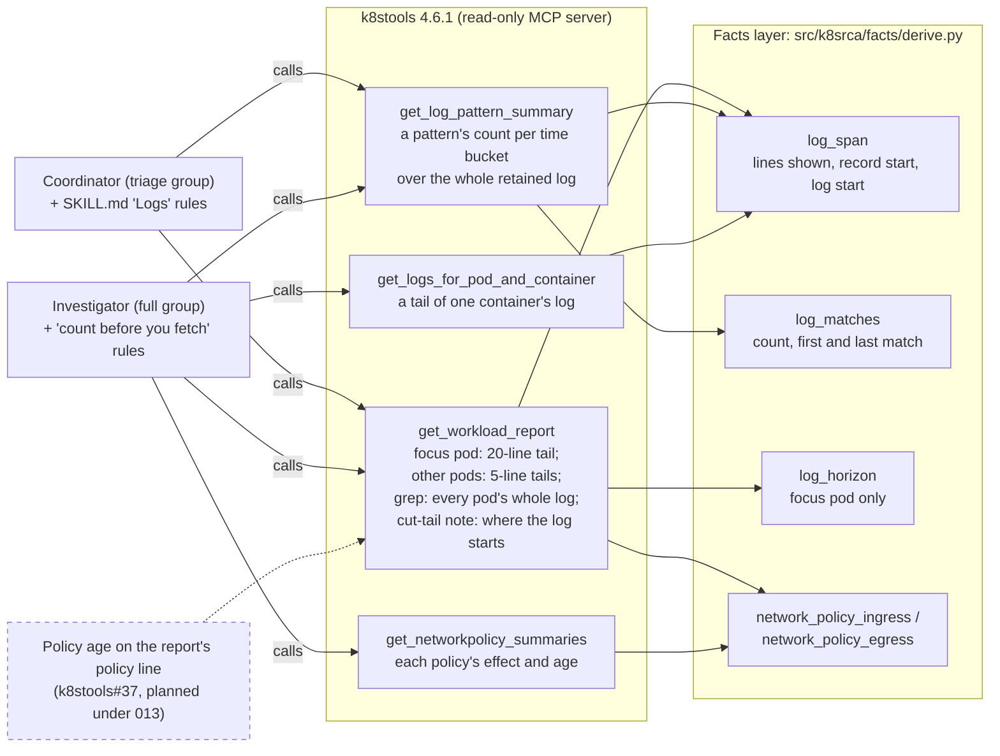
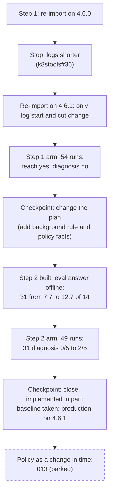

# 012 — Log evidence the agent can't see

**Status:** implemented in part. Built: k8stools 4.6.1 (whole-log search, multi-pod logs and
the `get_log_pattern_summary` tool), the `log_span`, `log_matches` and NetworkPolicy facts, the
log-reading rules, and the pattern tool in the coordinator's triage group. Together they took
scenario itbench-31's diagnosis from 0/5 to 2/5 and are part of the current baseline. Not
reached: two of itbench-31's checklist items (the error rate across the NetworkPolicy, and
ruling the policy out), which need to know *when* the policy appeared. They are left to
[013](013-what-changed.md), which is parked. **Last updated:** 2026-11-14.

**Related:** [004 — Scenario testing](004-scenario-testing.md) ·
[010 — Facts and short answers](010-facts-and-short-answers.md) ·
[013 — What changed near the alert](013-what-changed.md) · [process](../docs/process.md) ·
[glossary](../docs/glossary.md)

The agent missed evidence that was in a log it could read, because the tools showed only the
end of one pod's log and said nothing about the rest. This was
[issue #11](https://github.com/BenedatLLC/k8srca/issues/11), "Log evidence the agent can't
see: whole-log search and multi-pod logs". It was split out of
[issue #10](https://github.com/BenedatLLC/k8srca/issues/10), a reading of why the agent missed
evidence in the scenarios imported under
[004 §12.3](004-scenario-testing.md#123-four-more-itbench-imports-24-80-102-and-105),
which sorted the misses into numbered patterns; this design covers pattern 1 (evidence earlier
than any tail read) and pattern 6 (evidence on another pod, or past a line cut). The fix has two
halves: changes to [k8stools](https://github.com/BenedatLLC/k8stools), the read-only Kubernetes
MCP server that is the agent's only path to the Kubernetes API, and changes on our side (facts, rules,
configuration). They were measured separately, in two steps (§3), against the scenario suite
([004](004-scenario-testing.md)): faults recorded once and replayed, graded on a checklist of
statements the answer should make.

Scenarios are named by number below: **24** is `itbench-24-kafka-port-change`, **31**
`itbench-31-network-policy-decoy`, **33** `itbench-33-invalid-node-selector`, **80**
`itbench-80-kafka-two-brokers`, **102** `itbench-102-memory-quota`, **105**
`itbench-105-invalid-command`. These six came from ITBench, an external benchmark of Kubernetes
faults; the other nine scenarios were recorded on minikube.

## 1. Problem

The agent misses evidence that is in a log it can read, because the tools
show only part of the log and say nothing about the rest. Issue #11 has the
full account; in short:

- **Back in time (issue #10's pattern 1).**
  - Tails were short: the workload report's 20 lines, the log tool's 1000,
    and the report's `grep` searched only that tail.
  - No result said where the log started, so a tail that begins after a
    change read as the whole story, and the last line (capture time) read
    as an error burst ending.
  - Cost: in 80, diagnosis 0/3 (checkout's write failures predate
    every tail read); in 31, diagnosis 0/3 (a trickle of HTTP 503s runs from
    the log's first minute, and every run called the last three a one-off);
    in 102, the evidence was earlier than any tail.
- **Across pods and line width (issue #10's pattern 6).** The workload report showed
  one pod's log and cut lines at 300 characters. In 80 the evidence was on
  the other Kafka pod, and cut off on the one shown.

## 2. What was built

The diagram shows how log evidence reaches the agent today. Each arrow is a tool or a
derivation that exists in the code; the dashed box is what this design did not reach.

**In k8stools** (released in 4.6.0, from
[k8stools#34](https://github.com/BenedatLLC/k8stools/issues/34) and
[#35](https://github.com/BenedatLLC/k8stools/issues/35); 4.6.1 fixes a capture bug, below):
- `get_log_pattern_summary`: match counts per time bucket over the whole
  retained log, gaps collapsed, first and last match, samples, the log's
  span. It is in k8stools' `investigate` and `all` tool groups.
- The workload report's `grep` searches every pod's whole log (up to 10
  pods), with a match count per pod; a cut line keeps its match.
- Without `grep`, other pods get a 5-line tail.
- A cut tail notes where the log starts and names the pattern tool;
  `LogTail` has `lines_from` and `log_starts`.
- Captures record `log_starts` (4.6.1 also records `log_limits`).

**In k8srca:**
1. **k8stools 4.6.1 is the version pinned everywhere:** `pyproject.toml` (`k8stools>=4.6.1`),
   the floor in `tests/test_packaging.py`, `docker/Dockerfile.k8stools`,
   `docker/compose.yaml`, and `docs/holdout/requirements.md`. 4.6.0 is skipped because its
   captures kept only about 1 MiB of each log
   ([k8stools#36](https://github.com/BenedatLLC/k8stools/issues/36), §4).
2. **The five ITBench captures made with `--from-itbench` (24, 31, 80, 102, 105) are
   re-imported on 4.6.1,** so they record where each log starts. They were re-published to the
   scenario data repo, re-pinned, and their `results/` fixtures re-recorded; all five wikis
   rebuilt to the same digests. 33 came from an earlier one-off converter (its README), so
   re-importing it would rebuild the capture its truth was written against; it keeps "start
   not recorded", as do the minikube captures.
3. **A log-span fact,** `log_span` in `src/k8srca/facts/derive.py`, beside `events_horizon`:
   "these lines cover T1–T2 of a log that starts at T0", with the scope "its last line is the
   latest the log had when read, not the end of anything". It is derived from each log in a
   workload report, from `get_logs_for_pod_and_container` and from `get_log_pattern_summary`.
   The pattern tool also gives `log_matches`: a pattern's count over every retained line, with
   its first and last match. (`log_horizon`, the fact for how many container instances
   Kubernetes keeps logs of, already had the obvious name; it now reads the focus pod's log
   entries only, since the report carries other pods' logs too.)
4. **Answer and search rules, stated generally** rather than for one scenario:
   - a claim that errors began at, or rose after, a change needs a count from
     before it;
   - a log's last line is capture time, not the end of anything;
   - grep for the exact token (`" 503 `, not `503`);
   - a multi-pod workload's pods are read, not one of them;
   - an error rate that has held steady since the log's start is reported as a background
     that predates the incident, not as a new fault to fix, unless something shows it changed.

   The answer rules are the "Logs" section of `skills/k8s-rca/SKILL.md`. The search rules
   ("count before you fetch", the exact token, every pod, report the span) are in
   `agents/k8s-investigator.system.md`.
5. **The coordinator's `triage` group in `k8srca.yaml` includes `get_log_pattern_summary`,**
   and its prompt (`agents/rca-coordinator.system.md`) lets it run that one log tool itself
   rather than delegate. The investigator has it through the `full` group (`"*"`).
6. **The policy check, as facts.** The workload report's `network_policies` lines and
   `get_networkpolicy_summaries` give `network_policy_ingress` and `network_policy_egress`
   facts. Every 31 run read frontend's workload report, which says "ingress: allows all ingress
   (NetworkPolicy/frontend-block-all-ports)", but no fact stated it and no answer mentioned the
   policy. (It was first planned as a knowledge-base entry pointing to
   `get_networkpolicy_summaries`; step 1's traces showed the line was read and not used, so it
   became a fact.) Only the summary tool's fact carries the policy's age.

**For the scenario fixtures:** `scenario.yaml` takes `record_calls`, extra calls
`k8srca scenario record-results` makes after the triage reads, so every derivation has a
recorded result as `tests/test_facts.py` requires. 31 lists four: frontend's report, the policy
summary, a pattern summary of ` 503 UC ` and a 100-line log read. 31 is also an `eval answer`
case (`tests/evals/answer/`), and `eval answer` allows 16,000 output tokens, the grader's
figure: at 8,000, two of three 31 answers ran out while thinking and came back empty.

## 3. Steps

Two steps, so the tools' effect is measured apart from ours. Each ends in an
arm (one configuration run across the suite) across the whole suite, since the tool changes
reach every scenario that reads a log. Both steps are done; §4 has the results. The
"diagnosis" of a scenario is the checklist item or items that state its cause; "n" is the
number of runs per scenario; each answer is graded three times, checklist score as the
median and diagnosis as the majority.

The diagram shows how the work went, including the stop and the two checkpoints
([process.md §3](../docs/process.md#3-the-checkpoint)).

### Step 1: the tools alone (§2 items 1–2)

| | |
|---|---|
| **Hypothesis** | The tools' own changes (the cut-tail note naming the pattern tool, whole-log `grep`, other pods' tails) get the agent to the earlier evidence without any change of ours. |
| **Expected effect** | 31: diagnosis at least 3/5 (from 0/3). 80: `cause-two-brokers` or `cause-writes-fail-from-start` met in at least 2/5. Other scenarios: checklist within noise. Cost per run up by at most 30%. |
| **Can we see it?** | The target items are cause items, which don't flip between gradings. From a true rate of 0.2, 3/5 or better happens 6% of the time; from 0.3, 16%. So 3/5 on 31 is a signal, 2/5 on 80 a weak one. Regressions at n=3 are flagged for the checkpoint, not decided. |
| **Inner loop first** | Re-import diff: each capture's `k8s.json` changes only by `log_starts`, else stop and look. `record-results` before and after: which scenarios' tool results change, and how. Unit tests. |
| **Arm** | n=5 for 31 and 80, n=3 for the other 13. |
| **Budget** | $35 (sessions about $27 with a 30% allowance, grading about $6), 2 days. |
| **Done** | The arm is run, graded with `--grades 3` at the agreement criterion, and the result is in §4 with a decision. |
| **Stop** | Any tripwire; cost per run more than 1.5× baseline suite-wide; a re-import that changes anything but `log_starts`. |

During step 1 the replay used a locally built k8stools image (`K8SRCA_SCENARIO_K8STOOLS_IMAGE`)
and imports ran the new k8stools through `uvx`, so production stayed on the older pins until
step 2's baseline (§6).

### Step 2: ours (§2 items 3–6)

Step 1 showed the agent now reaches the earlier log, so the misses step 2 must close are
reading ones: a steady rate called a live fault, a policy never inspected, broad patterns
misread. The plan below is the one rewritten at step 1's checkpoint (§4).

| | |
|---|---|
| **Hypothesis** | Stating the log's span as a fact, the background rule, the precise-pattern rule and the policy check get the agent from "the trickle recurs" to "the trickle is old and unchanged, and the policy allows everything", without new unsupported claims. The coordinator's pattern tool and the other rules hold step 1's reach. |
| **Expected effect** | From step 1's levels: 31 `cause-rate-unchanged` at least 3/5 (0/5 now), `rules-out-network-policy` at least 3/5 (0/5), diagnosis at least 2/5 (0/5); `no-errors-began-with-policy` stays met. 80: `cause-writes-fail-from-start` stays at least 2/5; nothing expected of `cause-two-brokers`, which no item of step 2 aims at. Elsewhere checklist within noise, cost per run within 1.3× step 1, and no rise in unsupported claims. |
| **Tripwire 3 (a rule written from one run)** | The background rule and the policy check come from 31's runs (and issue #10's reading of `nothing-is-wrong`). The owner reviews their text, with §2 item 4's others, before the arm. |
| **Can we see it?** | As step 1. If step 1 already meets these, step 2's live arm checks for regressions only, and the change is decided on the offline evals and judgment, which §4 says. |
| **Inner loop first** | The facts layer on step 1's fixtures: the new fact appears with the right times on 31, 80 and 102, and on no log it doesn't apply to. `eval answer` on fixed facts for the rules (about $0.10 an answer). |
| **Arm** | As step 1. It becomes the new baseline (`scenario baseline --agreement`). |
| **Budget** | $40, 2 days. |
| **Done** | The arm is run and graded, the baseline taken, §4 written, status set. |
| **Stop** | As step 1. |

**Whole design:** $75, about 4 working days.

## 4. Results

**Summary.** Step 1 (the k8stools changes alone) gave the agent reach to the earlier log but
not the diagnosis. Step 2 (our facts and rules) took 31's diagnosis from 0/5 to 2/5 at lower
cost, with no regression elsewhere. Two of 31's items stayed missed because they need the
policy's creation time, which the facts the runs get do not carry. The design closed
implemented in part on 2026-11-01. The records below are the run logs those decisions rest
on.

### Step 1: stopped at the re-import check (2026-10-31)

The re-import of 24, 31, 80, 102 and 105 with 4.6.0 changed more than
`log_starts`, which is step 1's stop criterion. Nothing was run live; $0 spent.

- **Logs are shorter.** 31's frontend-proxy log went from 10,000 lines
  (17:42:19 on, 15 `503 UC`) to 2,675 (17:53:10 on, 6), so the window before
  the policy, which 31's truth counts, is gone. 80's Kafka and proxy logs
  shrank the same way; checkout's 6,486 lines, under the cap, did not.
  - Cause: the capture reads each log through `_read_pod_log`, which since
    4.6.0's tail fix keeps a read within 1 MiB and asks again for fewer
    lines. `--max-log-lines` was then bounded by about 1 MiB a log.
  - A k8stools bug: right for a tool result, wrong for a capture.
- **Requests and limits** now in the container statuses of 24, 80 and 105
  (imported on 4.4.0); 4.4.1's replay already filled them from the spec.
- **About 900 empty fields** per capture from the newer `kubernetes` client's
  models (`bind_mount_options`, `eviction_responders`, ...).

**Decision (owner): change the plan.** The capture bug was filed as
[k8stools#36](https://github.com/BenedatLLC/k8stools/issues/36). Step 1 resumed on the release
that fixed it: re-import, the same check, then the arm. Meanwhile the replay's effect was looked
at offline on the current captures.

**Offline, 4.6.0's replay on the current captures** (`record-results` on
the 15 scenarios against 4.4.1's, times masked):
- 43 workload reports gain the cut-tail note ("These 20 lines start at T;
  the recorded log starts at T0. get_log_pattern_summary searches all of
  it.").
- Two gain another pod's log (image-pull-typo's email, 33's cart), and four
  multi-pod notes are reworded.
- Every log gains `lines_from`.
- The fixtures hold no `grep` calls, so whole-log grep isn't exercised here.
- The facts layer derives the same facts but one: 33's cart gains a
  `log_horizon` fact from the old pod's log, its focus pod being Pending.
  That is what §2 item 3's focus-pod change fixes.

### Step 1: the re-import check on 4.6.1 (2026-10-31)

k8stools 4.6.1 fixed #36. Re-imported with `--max-log-lines 10000` and the
`kubernetes` 36 client (version 37's models add about 900 empty fields that reach
`get_pod_spec` as nulls; the old imports used 36):
- **Logs:** every log's lines are identical to the old capture's.
- **Added:** `log_starts` and `log_limits`, and, in 24, 80, 102 and 105
  (first imported on 4.4.0), requests and limits in the container statuses.
- **What the agent sees** (`record-results` on 4.6.1, old captures against
  new): only the log notes of 11 workload reports, which now say where the
  log began and that the capture kept its last 10,000 lines. The requests and
  limits show in no result: 4.4.1's replay already took them from the spec.
- The criterion said "only `log_starts`"; it was read as "nothing the agent
  sees changes but the log's start and cut", which holds.
- **Wikis:** rebuilt from the new captures, all five match their pins.
- Published to the data repo; `scenario.yaml` re-pinned. `results/` for all
  15 re-recorded on 4.6.1, which also brings the older scenarios' fixtures
  up to the current recorder (claim summaries and pod events).
  `test_eval_answer` no longer depends on a result's position.

### Step 1: the arm (2026-10-31)

54 runs: n=5 for 31 and 80, n=3 for the other 13. The replay was 4.6.1's
image, with the skill local (`k8s-rca` 69fe31d5dfc9d3c1). Each answer was
graded three times. Checklist is the median of the three gradings; diagnosis
is the majority. The baseline then was `tests/scenarios/baseline.json` as it stood before this
design.

| scenario | checklist base → step 1 | diagnosis base → step 1 | $ per run | calls |
|---|---|---|---|---|
| itbench-31-network-policy-decoy | 10.0 → 10.2 /14 | 0/3 → **0/5** | 1.22 → 0.66 | 43 → 39 |
| itbench-80-kafka-two-brokers | 9.7 → 12.0 /21 | 0/3 → **0/5** | 0.72 → 0.77 | 31 → 40 |
| checkout-gc-pressure | 10.7 → 12.3 /13 | 2/3 → 3/3 | 0.76 → 0.54 | 48 → 41 |
| deploy-regression | 14.0 → 13.3 /14 | 3/3 → 3/3 | 0.17 → 0.33 | 12 → 26 |
| downstream-latency | 10.0 → 10.0 /11 | 3/3 → 3/3 | 0.66 → 0.43 | 43 → 44 |
| image-pull-typo | 9.0 → 8.7 /9 | 3/3 → 3/3 | 0.08 → 0.08 | 7 → 7 |
| itbench-102-memory-quota | 13.7 → 13.0 /17 | 3/3 → 3/3 | 0.25 → 0.62 | 17 → 36 |
| itbench-105-invalid-command | 18.0 → 17.7 /20 | 3/3 → 3/3 | 0.10 → 0.11 | 10 → 11 |
| itbench-24-kafka-port-change | 14.7 → 13.7 /16 | 3/3 → 3/3 | 0.35 → 0.36 | 20 → 26 |
| itbench-33-invalid-node-selector | 11.3 → 10.7 /12 | 3/3 → 3/3 | 0.18 → 0.20 | 12 → 21 |
| jvm-oom-on-startup | 13.0 → 12.3 /14 | 3/3 → 3/3 | 0.34 → 0.24 | 18 → 13 |
| jvm-oom-with-metrics | 12.5 → 12.7 /14 | 10/10 → 3/3 | 0.20 → 0.20 | 12 → 12 |
| liveness-probe-wrong-port | 8.3 → 8.3 /9 | 3/3 → 3/3 | 0.19 → 0.30 | 12 → 24 |
| nothing-is-wrong | 6.7 → 6.7 /8 | 3/3 → 3/3 | 0.48 → 0.48 | 31 → 32 |
| pvc-pending-no-storageclass | 10.0 → 10.0 /10 | 3/3 → 3/3 | 0.08 → 0.08 | 6 → 6 |

- **Against the expected effect:**
  - **31:** diagnosis 0/5 against at least 3/5. Not met.
  - **80:** `cause-writes-fail-from-start` was met in 2/5 (baseline 0/3), and
    `cause-two-brokers` in 0/5. The expected effect was one of the two in
    2/5, so this is met, but only as the weak signal §3 said 2/5 would be.
  - **Elsewhere:** the runner flagged four drops at n=3 (deploy-regression,
    image-pull-typo, 105, jvm-oom-on-startup). Each is under one item a run,
    and none is a diagnosis. Where each comes from:
    - deploy-regression: `no-clean-exit`, which split between gradings on 2
      of 3 answers.
    - image-pull-typo and 105: one answer each, missing one ruled-out item.
    - jvm-oom-on-startup: `cause-no-heap-sizing`, missed in 2 of 3 (1 of 3 at
      baseline).

    They are flagged for the checkpoint, not decided.
- **Cost:** the suite's cost per run came to 0.93× baseline. Calls rose where
  a log was read more widely: 102 (17 → 36 calls, 2.5× cost),
  deploy-regression (12 → 26 calls, 1.9×), liveness-probe-wrong-port and 33.
  No scenario failed for cost.
- **Agreement between gradings:**
  - 99.1% of item gradings matched their answer's majority.
  - Only one item split on more than one answer: 31's
    `no-trickle-cause-as-observed`, a gap item, which split on 2 of 5.
  - So the criterion is missed on that one item, which isn't a target.
  - One grading came back as malformed JSON and stopped `scenario checklist`.
    It was redone with the same `checklist.grade` call. The other 116 had
    already been saved.
- **Spend:** $19.02 in sessions. Grading was about 147 calls, estimated at
  about $6. The total of about $25 is within the $35 budget.
- **What the traces show (31 and 80):**
  - **The agent now reads the earlier log.** 8 of the 10 runs called
    `get_log_pattern_summary`, and several grepped all 10,000 lines.
  - **31, the trickle:**
    - Two runs with a precise pattern (`503 UC upstream_reset`) got exactly
      the trickle: 15 matches from the log's start, with the gap across the
      policy.
    - Both described it as recurring, so no run called it a one-off any
      more. Instead they framed it as a live intermittent fault in frontend
      (keep-alive resets, stalls), with fixes to try. Neither called it a
      background that was there already.
    - Three runs used broad patterns. ` [4-5][0-9][0-9] ` matched 2,904 lines,
      mostly byte counts.
  - **31, the policy:** `rules-out-network-policy` was missed in all 5 runs,
    as it was in all 3 baseline runs. No run in either set called
    `get_networkpolicy_summaries`. With no change found, there was nothing to
    compare before and after, and so no onset claim for step 2's onset rule to
    correct.
  - **80:**
    - One run read "the two brokers disagree … endless
      `TOPIC_ALREADY_EXISTS`" but did not conclude that there were two
      replicas.
    - The others blamed broker epochs, Chaos Mesh or a stuck broker.
  - **One answer leaked the revision turn's preamble** ("Now the revised
    answer, trimmed to fit…"). That belongs to `review.py`, not to this
    design.

**Reading.** Step 1's hypothesis holds for reach: the agent now gets to the
earlier evidence. It does not hold for diagnosis. 31's miss has moved from
evidence never seen to two things:
- what the agent makes of a steady error rate;
- a policy it never inspects.

80's misses have moved to an inference the agent doesn't make (two replicas).
On 31, step 2 as first planned targeted claims the runs no longer make. Its onset
rule and log-span fact were aimed at "errors began at the change", and no run
said that.

**Checkpoint.** No tripwire fired: this was the first arm, the budget wasn't spent, and no rule
had been written. Step 1 was done on its own criteria, and a decision was needed before step 2.
The options were:
- **Change the plan (recommended).** Rewrite step 2's expected effects from
  these levels. Drop "31 diagnosis at least 4/5" as something step 2's
  first-planned items could reach. Decide whether step 2 should also carry:
  - a general rule that an error rate steady since the log's start is a
    background to report as such, not a fault to fix. This comes from 31's
    runs and from issue #10's reading of `nothing-is-wrong`, so the owner reviews it
    under tripwire 3;
  - a check of the policies that select an alerting path's upstream.

  Keep the log-span fact and the precise-pattern rule. The broad-pattern
  misreads are this step's evidence for the latter.
- **Continue unchanged:** run step 2 as written, and expect 31 to stay near
  0/5.
- **Close:** take 4.6.1 as step 1's result, move production and the baseline
  to it, and end the design implemented in part.

**Decision (owner): change the plan,** as recommended. Step 1 closed. Step 2 was rewritten in §3
with the background rule (§2 item 4) and the policy check (§2 item 6), and the owner reviewed
their text before step 2's arm.

### Step 2: built, and checked offline (2026-10-31)

What was built is described in §2 items 3–6. Two side effects at the time: a `k8srca sync`
against production's then k8stools (4.4.0) stopped, naming the missing tool, until production
moved to 4.6.1 with step 2's baseline; and `eval answer`'s output limit was raised to 16,000
tokens (§2).

**`eval answer` at 3 answers per case.** The same harness ran HEAD (708e93d)
and the change side by side:

| case | HEAD | step 2 |
|---|---|---|
| itbench-31-network-policy-decoy | 7.7 /14 | **12.7** /14 |
| checkout-gc-pressure | 10.7 /13 | 10.3 /13 |
| itbench-33-invalid-node-selector | 10.3 /12 | 11.7 /12 |
| jvm-oom-on-startup | 13.3 /14 | 12.7 /14 |
| jvm-oom-with-metrics | 11.3 /14 | 12.0 /14 |

- **31, item by item:**
  - `cause-background-trickle`: 0/3 → 3/3;
  - `cause-rate-unchanged`: 0/3 → 2/3;
  - `rules-out-network-policy`: 0/3 → 2/3;
  - `impact-small`: 0/3 → 3/3.
- **31's answers** now say the trickle "has been present for the whole
  retained log window, not a new spike".
- **The other four** moved within noise, and word counts are as before: most
  are a little over 300 in both, which the live review trims.
- **Writer only:** this tests the answer writer on fixed facts. Whether the
  agent makes the calls that produce these facts is the arm's question.

**Also seen in step 1's evidence:**
- 7 `get_logs_for_pod_and_container` reads failed with "Server-sent event
  exceeded the 1048576 byte limit": tails of 5,000 to 10,000 long lines. The
  limit was the MCP client's, on our side. The investigator rule "count before
  you fetch" steers away from it. Raising the limit was a separate change
  (k8srca#12, since fixed: `src/k8srca/mcp_client.py` accepts results up to 8 MiB).
- The answer check read "10,000" as the figures 10 and 000, which no fact
  states, and the review turn then asked for a fix that wasn't needed. That belonged
  to `skills/k8s-rca/answer_check.py`, outside this design (k8srca#13, since fixed).

**Before the arm:** the owner reviewed the rules' text (tripwire 3) and
approved it. Committed as ac554ee; sandbox `k8srca/sandbox:ac554eec5868`.

### Step 2: the arm (2026-11-01)

49 runs, as step 1: n=5 for 31 and 80, n=3 for the other 13, on 4.6.1's
replay with the skill local. Each answer was graded three times; checklist is
the median, diagnosis the majority.

| scenario | checklist step 1 → step 2 | diagnosis step 1 → step 2 | $ per run | calls |
|---|---|---|---|---|
| itbench-31-network-policy-decoy | 10.2 → 11.4 /14 | 0/5 → **2/5** | 0.66 → 0.34 | 39 → 20 |
| itbench-80-kafka-two-brokers | 12.0 → 10.8 /21 | 0/5 → 0/5 | 0.77 → 0.88 | 40 → 49 |
| checkout-gc-pressure | 12.3 → 11.3 /13 | 3/3 → 3/3 | 0.54 → 0.68 | 41 → 49 |
| deploy-regression | 13.3 → 13.7 /14 | 3/3 → 3/3 | 0.33 → 0.32 | 26 → 20 |
| downstream-latency | 10.0 → 10.0 /11 | 3/3 → 3/3 | 0.43 → 0.53 | 44 → 41 |
| image-pull-typo | 8.7 → 9.0 /9 | 3/3 → 3/3 | 0.08 → 0.08 | 7 → 6 |
| itbench-102-memory-quota | 13.0 → 15.0 /17 | 3/3 → 3/3 | 0.62 → 0.34 | 36 → 25 |
| itbench-105-invalid-command | 17.7 → 17.7 /20 | 3/3 → 3/3 | 0.11 → 0.12 | 11 → 11 |
| itbench-24-kafka-port-change | 13.7 → 14.3 /16 | 3/3 → 3/3 | 0.36 → 0.41 | 26 → 26 |
| itbench-33-invalid-node-selector | 10.7 → 11.0 /12 | 3/3 → 3/3 | 0.20 → 0.22 | 21 → 18 |
| jvm-oom-on-startup | 12.3 → 13.3 /14 | 3/3 → 3/3 | 0.24 → 0.32 | 13 → 23 |
| jvm-oom-with-metrics | 12.7 → 12.3 /14 | 3/3 → 3/3 | 0.20 → 0.23 | 12 → 14 |
| liveness-probe-wrong-port | 8.3 → 9.0 /9 | 3/3 → 3/3 | 0.30 → 0.26 | 24 → 19 |
| nothing-is-wrong | 6.7 → 7.3 /8 | 3/3 → 3/3 | 0.48 → 0.33 | 32 → 22 |
| pvc-pending-no-storageclass | 10.0 → 10.0 /10 | 3/3 → 3/3 | 0.08 → 0.11 | 6 → 6 |

- **Against the expected effect:**
  - **31:** diagnosis (`cause-background-trickle`) 2/5, against at least 2/5:
    met. `cause-rate-unchanged` 0/5 and `rules-out-network-policy` 1/5,
    against at least 3/5 each: not met. `no-errors-began-with-policy` stayed
    met in all 5.
  - **80:** `cause-writes-fail-from-start` 1/5, against "stays at least 2/5":
    not met, though one answer's difference at n=5 is within noise.
    `cause-two-brokers` 0/5, as expected.
  - **Elsewhere:** within noise; no diagnosis lost. The runner flagged no
    drop.
- **Cost:** 0.89× baseline, 0.96× step 1, within the 1.3× allowed. 31's runs
  halved in cost and calls; 80's rose (two of five over the 50-call budget).
- **Agreement between gradings:** 98.4% of item gradings matched their answer's majority, but
  three items split on 2 answers each: 80's `no-observed-checkout-latency`,
  checkout-gc-pressure's `no-downstream-ruled-out` and deploy-regression's
  `no-clean-exit`. None is a target. One pvc-pending grading came back garbled
  (its items unreadable, so all "unclear"), which put that scenario at 92.6%.
  As it stood, `scenario baseline --agreement` refused.
- **Spend:** $17.91 in sessions; grading about 147 calls, estimated at about $6.
  About $24 of the $40.
- **What the traces show (31):**
  - **The facts reached every run.** All five had the two policy facts and at
    least one `log_matches`; none called `get_networkpolicy_summaries`.
  - **The background reading worked in part.** Answers now say the 503s are
    "spread across the whole retained window with no burst or ramp", and two
    were graded as background. The others still frame the same reading as a
    live keep-alive fault to fix.
  - **The rate item cannot be met as the runs go.** "The same before the policy
    as after" needs to know when the policy appeared. Only
    `get_networkpolicy_summaries` gives its age, and the workload report's
    policy line, which every run read, doesn't. Offline, the fixtures held
    the summary, which is why the eval reached 2/3.
  - **The policy rule-out:** one answer cited the "allows all ingress" fact;
    four never mention the policy. A fact that says a policy allows
    everything gives an answer no reason to name it, unless something points
    at it as a suspect.

**Reading.** Step 2's hypothesis holds in part. The log-span fact and the
background rule moved 31's diagnosis from 0/5 to 2/5 at lower cost, with no
regression elsewhere. The rate and policy items missed, and the traces say
why: they turn on the policy as a change in time, which the facts the runs
get don't carry. That is a gap in what the agent asks for, not in how it
reads.

**Checkpoint.** Two of step 2's targets missed. A further change aimed at 31's rate or policy
items would be the third aimed at them (process.md's tripwire "a third change aimed at the same
thing"), so this ended in a decision. The options were:
- **Close step 2, and the design implemented in part (recommended).** Keep step 2's
  changes. Regrade the one garbled pvc grading, as step 1's malformed one was
  redone, and take the baseline with the three non-target splits recorded
  (`--force`, named here). Move production to 4.6.x with it. The policy as a
  change in time (its age on the report's policy line, or the coordinator
  asking what changed near the alert) becomes its own proposal: it is about
  finding changes, not reading logs.
- **Change the plan:** a step 3 putting the policy's age on the workload
  report's line (a k8stools issue) or giving the coordinator
  `get_networkpolicy_summaries`. It fires the tripwire and needs the owner's
  explicit override.
- **Close without keeping:** revert step 2, and take 4.6.1 alone (step 1) as
  the baseline.

**Decision (owner, 2026-11-01): close step 2, and the design implemented in part,**
as recommended. What was done:
- The garbled pvc-pending grading was redone with the same `checklist.grade`
  call (10/10), which put that scenario back at the agreement bar.
- `baseline.json` became step 2's arm, both batches, taken with `--force` for the
  three splits named above. checkout-gc-pressure's 95.7% overall comes from
  its split. (The baseline was re-taken later the same day, at commit c817681 with the fixes
  for k8srca#12 and #13; that is the current baseline in
  [docs/baseline.md](../docs/baseline.md), and the code tagged `holdout-v1`.)
- Production's pins moved to 4.6.1 (§2 item 1).
- The policy's age on the report's policy line is
  [k8stools#37](https://github.com/BenedatLLC/k8stools/issues/37), still open. It and the rate
  across a change went to [013](013-what-changed.md), "what changed near the alert", which is
  parked.
- The 1 MiB limit on a tool result in the MCP client became k8srca#12 (since fixed).

## 5. Instrument and tripwires

- **Frozen from step 1's start:** grader, truth files and checklists. The
  re-import changed captures only; a truth file that depended on what changed
  (it shouldn't have: only `log_starts` was to be added) would have fired the tripwire "the
  grader or a truth file changed mid-step". The READMEs that describe tail lengths (31, 80)
  are documentation, updated with the re-import.
- **Tripwire 3 (a rule written from one run).** The rules in §2 item 4 come from issue #10's
  reading of 12 runs across four scenarios, and from 31, and they state how
  Kubernetes logs work rather than what one scenario needs. The owner reviewed
  their text before step 2's arm.
- **Production.** The upgrade changed what the live agent sees once the owner ran
  `k8srca up`. Production has been on 4.6.1 since step 2's baseline.

## 6. Decisions taken

The questions this design put to the owner, and the answers:

1. **The plan and its budget:** approved 2026-10-31.
2. **The coordinator and the pattern tool:** given in step 2, not step 1, so step 1 measured
   the tools alone. The investigator had it from step 1, through `full: "*"`.
3. **When production moves to 4.6.x:** after step 2, with the new baseline. Step 1's arm
   needed only the replay image, built locally. Production moved to 4.6.1 on 2026-11-01.
