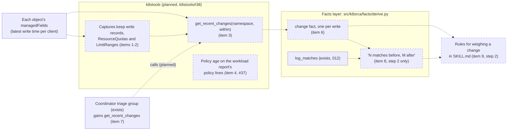
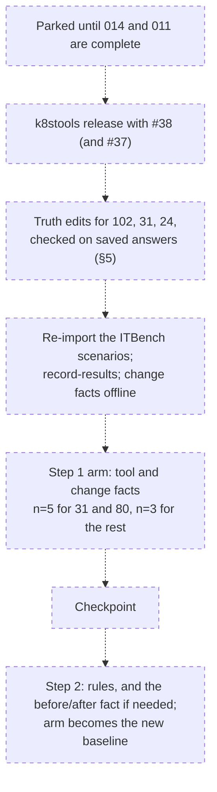

# 013 — What changed near the alert

**Status:** parked. The owner parked this design on 2026-11-07, before step 1 began, until the
SREGym hold-out work ([014](014-sregym.md)) and the decision-model work
([011](011-decision-models.md)) are complete. **Nothing in it is built:** k8stools has no
`get_recent_changes` tool and captures keep no write times
([k8stools#38](https://github.com/BenedatLLC/k8stools/issues/38) is open), and k8srca has no
`change` fact and none of the rules in §2. The plan was approved on 2026-11-01 with §6's
choices. **Last updated:** 2026-11-14.

**Related:** [012 — Log evidence](012-log-evidence.md) ·
[004 — Scenario testing](004-scenario-testing.md) ·
[010 — Facts and short answers](010-facts-and-short-answers.md) ·
[process](../docs/process.md) · [glossary](../docs/glossary.md)

> **Parked, not built.** Everything below §1 is a plan. Present-tense descriptions of the tool,
> the facts and the rules describe what would be built, not what runs.

The agent can see a rollout, and events for about an hour, but no other kind of change: a new
NetworkPolicy, a ResourceQuota, a ConfigMap edit. This design would give it a list of recent
writes in the alerting namespace, through a new tool in
[k8stools](https://github.com/BenedatLLC/k8stools) (the read-only Kubernetes MCP server that is
the agent's only path to the cluster), state each write as a fact, and add rules for weighing a
change against the symptom. It follows [012](012-log-evidence.md), which closed implemented in
part and left two of scenario itbench-31's checklist items to this design: the error rate
across the NetworkPolicy, and ruling the policy out. Both need to know *when* the policy
appeared.

Scenarios are named by number below, as in 012: **24** is `itbench-24-kafka-port-change`,
**31** `itbench-31-network-policy-decoy`, **33** `itbench-33-invalid-node-selector`, **80**
`itbench-80-kafka-two-brokers`, **102** `itbench-102-memory-quota`, **105**
`itbench-105-invalid-command`. These six came from ITBench, an external benchmark of
Kubernetes faults; the other nine scenarios were recorded on minikube.

## 1. Problem

The `k8s-rca` skill says it outright (`skills/k8s-rca/SKILL.md`): "What changed recently is
what you can see least." The agent sees changes only in pieces:
- **Rollouts,** through the workload report's `last_change` (revision, age,
  rollout restart) and the ReplicaSet history.
- **Events,** for as long as they survive, usually about an hour.
- **Nothing else.** A new NetworkPolicy, ResourceQuota or LimitRange, a
  ConfigMap edit, a Service change or a scale doesn't show up as a change.
  Captures keep each object's creation age and nothing about later writes;
  102's capture doesn't hold its ResourceQuota at all, though the quota is
  the fault.

The misses go both ways: a change is missed, or an irrelevant one is blamed. Measured on 012's
step 2 arm (each answer graded three times, majority verdicts; "runs met" counts runs whose
answer made the checklist statement):

| scenario | item (runs met) | the change |
|---|---|---|
| itbench-31 | `cause-rate-unchanged` 0/5, `rules-out-network-policy` 1/5, `cause-background-trickle` 2/5 | a NetworkPolicy created 6 minutes before, which changed nothing |
| itbench-102 | `cause-scale-trigger` 2/3, `rules-out-ad-fault` 1/3 | a ResourceQuota, then ad scaled to 0 and back |
| itbench-80 | `rules-out-checkout-config` 0/5, `cause-writes-fail-from-start` 1/5 | no change to checkout at all |
| jvm-oom-with-metrics | `no-onset-date` 0/3; jvm-oom-on-startup 2/3 | a months-old rollout taken as the onset |
| nothing-is-wrong | `no-shipping-cause` 2/3 | an unrelated recent rollout |

Rollouts themselves are not the gap: the `cause-recent-revision` and
`cause-recent-change` items in all 8 scenarios that have them are met in every
run.

**The data exists.** Kubernetes keeps no history of an object, but each object records the
time of the last write by each client that wrote it (its `managedFields` metadata). The raw
ITBench snapshots keep these. Taking only the writes by clients other than
Kubernetes' own controllers, in the alerting namespace, in the 20 minutes
before the snapshot:

| snapshot | writes, in order |
|---|---|
| 24 | Role, RoleBinding `agent-access`; Deployment `checkout` (the fault) |
| 31 | Role, RoleBinding `agent-access`; NetworkPolicy `frontend-block-all-ports` (the decoy) |
| 80 | Role, RoleBinding `agent-access`; nothing else |
| 102 | Role, RoleBinding `agent-access`; ResourceQuota `otel-demo-memory` (the fault) |
| 105 | Role, RoleBinding `agent-access`; Deployment `product-catalog` (the fault) |
| 33 | Role, RoleBinding `agent-access`; Deployments `ad` and `cart` (the fault) |

The `agent-access` writes are ITBench's harness setting up the agent's access
(and the cluster-wide `agent` Namespace). They are a decoy in every snapshot:
a change near the alert with no path to the symptom. The window matters. Over
40 minutes the list also holds the demo's Helm install, a monitoring stack and
a `flagd-config` edit followed by a `kubectl rollout restart` of flagd (31's
and 102's "flagd's rollout restart" decoys).

## 2. What it would change (planned)

The diagram shows the planned flow from an object's write records to the agent. Every dashed
part is planned and not built; the solid parts exist today (012's `log_matches` fact and the
coordinator's triage group).

**k8stools (one issue, [k8stools#38](https://github.com/BenedatLLC/k8stools/issues/38), with
[#37](https://github.com/BenedatLLC/k8stools/issues/37) folded in):**
1. **Captures keep write times.** For each object a capture records, its
   writes from `managedFields`: time, client (manager), operation and
   subresource. They are not reduced to one "last modified" time, because a
   controller's status write would hide a person's spec write. The ITBench
   import carries them from the raw objects.
2. **Captures record ResourceQuotas and LimitRanges** (the ITBench snapshots
   hold both), and replay serves them. A capture without them says "not
   recorded", as k8stools#30 established for kinds a capture lacks.
3. **`get_recent_changes(namespace, within)`.** Every object in the
   namespace, plus cluster-scoped objects, written within the window by a
   client that isn't one of Kubernetes' own controllers. One record per write:
   kind, name, created or updated, the time, the client, and for workloads the
   revision it made. Its notes state its limits:
   - a write records only the time of each client's latest write, not its
     contents;
   - a deletion leaves no trace;
   - Secrets are named, never read;
   - which clients count as controllers is a list (kube-controller-manager,
     kubelet, the scheduler, CSI and the like), and the result names the ones
     it left out.

   In replay the window is measured from the capture's clock.
4. **#37 folded in:** the workload report's policy lines carry each policy's
   age.

**k8srca:**
5. **Pins and replay** move to the k8stools release, as 012 did. The six
   ITBench scenarios (24, 31, 33, 80, 102, 105) are re-imported. 33 came from
   an earlier converter ([012 §2](012-log-evidence.md#2-what-was-built) item 2), so it is
   re-imported only if the import path can carry its truth unchanged. Otherwise it keeps
   "writes not recorded". The 9 minikube captures can't be re-captured, since their fault
   state is gone. They keep creation ages and revisions, which is what their
   changes (rollouts) need.
6. **A `change` fact** per write that the tool returns: "NetworkPolicy
   frontend-block-all-ports was created 5m55s before the capture". Its scope
   says what a write record can and can't show. The client's name stays out
   of the statement (§6 item 3).
7. **The coordinator's `triage` group** in `k8srca.yaml` gains `get_recent_changes`. 012
   found that a tool only the investigator holds goes uncalled:
   `get_networkpolicy_summaries` was called in none of 10 runs.
8. **Step 2 only: a fact from two results,** "N matches before the change, M
   after". It is computed when a `log_matches` result and a `change` fact both
   exist and the change falls inside the log's span. The facts layer makes facts from one
   result at a time, so this is a new mechanism. It is built only if
   step 1 leaves 31's rate item where it is.
9. **Step 2: rules,** replacing "What changed recently is what you can see
   least" in the skill:
   - a change is a suspect only if it is close in time and has a path to the
     symptom (the `cluster-architecture` skill gives paths);
   - a rate that is the same across a change rules the change out;
   - an old change isn't an onset;
   - if the record shows no change, say so, and ask the person, as the skill
     already says.

## 3. Steps

> **Planned.** Neither step has started. Step 1 waits on the k8stools release for #38, and the
> design as a whole on the end of the park.

Two steps, so the tool's effect is measured apart from the rules, as in 012. Each ends in an
arm: one configuration of the agent run across the scenario suite. "n" is the number of runs
per scenario.

The diagram shows the planned order of work once the design resumes; all of it is planned.

### Step 1: the tool and its facts (§2 items 1–7)

| | |
|---|---|
| **Hypothesis** | With the recent writes in front of it, as facts, the agent rules out what didn't change and names what did. A policy created minutes before the alert becomes a suspect it inspects. |
| **Expected effect** | From 012's step 2 arm: 31 `rules-out-network-policy` at least 3/5 (1/5 now). 80 `rules-out-checkout-config` at least 2/5 (0/5). 102 `rules-out-ad-fault` at least 2/3 (1/3), since ad's template has no write in 35 minutes. The `agent-access` decoy is named as a cause in no run. The author traps (`no-named-author`, checklist items that fail an answer naming who made a change) hold where they are met now. Elsewhere checklist within noise, cost per run within 1.3× the baseline. |
| **Can we see it?** | Ruled-out items, like cause items, don't flip between gradings. From a true rate of 0.2, 3/5 or better happens 6% of the time, so 31 at 3/5 is a signal; 80 at 2/5 is a weak one. 102 at n=3 is indicative only. Regressions at n=3 are flagged for the checkpoint, not decided. |
| **Inner loop first** | Re-import diff: each capture's `k8s.json` gains only write records, quotas and limit ranges; anything else, stop and look. `record-results` before and after, on all 15 scenarios. The `change` fact on the six re-imported fixtures: the fault or decoy appears, the harness writes appear, and nothing from a controller. `eval answer` on 31 and 102 with the new facts (about $0.10 an answer). |
| **Arm** | n=5 for 31 and 80, n=3 for the other 13. |
| **Budget** | $30 (sessions about $20 with a 30% allowance, grading about $6), 3 days, most of it waiting on the k8stools release. |
| **Done** | The arm is run and graded with `--grades 3` at the agreement criterion, and §4 has the result and a decision. |
| **Stop** | The re-import changes anything a truth file depends on beyond §5's planned edits (the tripwire "the grader or a truth file changed mid-step"); or the budget is spent. |

### Step 2: the rules (§2 items 8–9)

| | |
|---|---|
| **Hypothesis** | Rules for weighing a change, and a fact that counts errors either side of one, get the agent from "this changed" to "this change made no difference", and stop it dating an onset to an old change. |
| **Expected effect** | From step 1's levels: 31 `cause-rate-unchanged` at least 3/5 (0/5 at baseline), diagnosis at least 3/5 (2/5). jvm-oom-with-metrics `no-onset-date` at least 2/3 (0/3). nothing-is-wrong `no-shipping-cause` holds. Elsewhere within noise, cost within 1.3× step 1. |
| **Tripwire 3 (a rule written from one run)** | The rules state how Kubernetes changes work, and they come from six scenarios' runs, not one. The owner reviews their text before the arm. |
| **Can we see it?** | As step 1. `no-onset-date` is a trap item, which flips about 4% of the time; 0/3 to 2/3 is past that. |
| **Inner loop first** | The two-result fact on 31's fixtures: 9 before, 6 after, matching the truth file (9 in 6,096 lines before, 6 in 3,904 after). `eval answer` on the rules. |
| **Arm** | As step 1. It becomes the new baseline. |
| **Budget** | $30, 2 days. |
| **Done** | The arm is run and graded, the baseline taken, §4 written, status set. |
| **Stop** | As step 1. |

**Whole design:** $60, about 5 working days.

**Starting figures.** The expected effects above were read from 012's step 2 arm. The current
baseline ([docs/baseline.md](../docs/baseline.md)) re-ran the suite the same day with the fixes
for k8srca#12 and #13 (§5). When the design resumes, the starting figures are to be re-read
from the baseline then current.

## 4. Results

None yet.

## 5. Instrument and tripwires

- **Truth edits at the start, before step 1's measurements.** Three truth
  files say the capture can't show what the re-import will make visible.
  Changing them mid-design would fire the tripwire "the grader or a truth file changed
  mid-step" ([process.md §2](../docs/process.md#2-tripwires)), so they change first, each
  checked for noise on saved answers
  ([process.md §5](../docs/process.md#5-the-instrument-is-frozen-per-design)):
  - **102:** the gap "k8stools has no ResourceQuota tool, so the quota's
    creation time … are not visible", and the trap `no-quota-time-as-observed`
    built on it. The quota's creation time becomes observable. Its other
    limits and scopes stay unseen unless the capture records them.
  - **31:** the gap `who-created-the-policy` ("nothing in the capture says
    who created the policy"). The write's client becomes visible, but it is a
    client library, not a person or a reason.
  - **24:** the gap that says "k8stools does not expose managedFields".
  The author traps stay as they are: a client name such as
  `OpenAPI-Generator` doesn't name who made a change.
- **Frozen from step 1's start:** grader, truth files and checklists.
- **Fixes that are already in the baseline.** Two changes outside this design were to go in
  before step 1, and both are now in the current baseline (taken 2026-11-01 at c817681), so
  step 1's comparison does not carry their effect:
  - k8srca#12: the MCP client accepts tool results up to 8 MiB
    (`MAX_RESULT_BYTES` in `src/k8srca/mcp_client.py`), where the SDK's default refused
    anything over 1 MiB, which a full log read crosses. 012's step 1 had 7 such reads fail,
    all on long log tails.
  - k8srca#13: the answer check (`skills/k8s-rca/answer_check.py`) reads "10,000" as one
    figure, where it read 10 and 000 and sent a revision turn for a figure that was right. It
    touches the revision turn only, not the grader.
- **Tripwire 2 (a third change aimed at the same thing).** 31's rate and policy items get their
  third and fourth attempts here (012's steps were the first two). The owner chose this
  design at 012's checkpoint knowing that. The items are measured alongside
  five other scenarios' items, so the steps don't aim at one scenario.
- **Production.** The tool reads live `managedFields`, so on the live
  cluster it sees every kind of change, not only what the captures hold.
  Production moves with step 2's baseline, as in 012.
- **Hold-out.** The hold-out kit's requirements (`docs/holdout/requirements.md`) name a
  k8stools floor. It moves with production's.

## 6. Decisions taken at approval

The plan was approved on 2026-11-01 with these choices:

1. **The plan and its budget:** approved.
2. **One k8stools issue, not two.** §2 items 1–4 are one issue (k8stools#38), with #37 folded
   in, so the capture format changes once and the six re-imports happen once.
3. **The client's name stays out of the `change` fact's statement.** The tool reports it; the
   fact says instead whether the write came from a controller or a client. The author traps
   exist because answers name who made a change, and the client name would invite that,
   though it is one step from "kubectl" to "someone ran kubectl". The agent can still read
   the name in the result.
4. **The window: a 30-minute default.** The coordinator chooses a wider one when the alert's
   onset is older. In the ITBench snapshots, 20 minutes holds the fault and the harness decoy,
   and 40 minutes adds the install and the flagd decoys.
