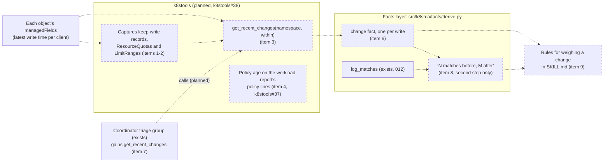

# 013 — What changed near the alert

> **On hold, not built.** Put on hold on 2026-11-07, before the plan's first step, until the SREGym
> comparison ([014](014-sregym.md)) and the decision-model work ([011](011-decision-models.md)) are
> done. Everything after §1 is planned. Present-tense descriptions of the tool,
> the facts and the rules describe what would be built, not what runs.

The agent can see a rollout, and events for about an hour, but no other kind of change: a new
NetworkPolicy, a ResourceQuota, a ConfigMap edit. This design would give it a list of recent
writes in the alerting namespace, through a new tool in
[k8stools](https://github.com/BenedatLLC/k8stools) (the read-only Kubernetes MCP server that is
the agent's only path to the Kubernetes API), state each write as a fact in the
[facts layer](../docs/glossary.md), and add rules for weighing a change against the symptom. It
follows [design 012](012-log-evidence.md), which left two of scenario itbench-31's checklist
items to this design: the error rate across the NetworkPolicy, and ruling the policy out. Both
need to know *when* the policy appeared. Before reading, know the measurement terms
([scenario, capture and replay, checklist, trap, gap, truth file, arm, n, baseline](../docs/glossary.md#how-we-measure-changes))
and that the [plan](../plans/013-what-changed.md) holds the steps and their measurements.

Scenarios are named by number, as in 012. These six came from ITBench, an external benchmark of
Kubernetes faults; the other nine scenarios in the suite were recorded on minikube.

| Number | Scenario |
| --- | --- |
| 24 | `itbench-24-kafka-port-change` |
| 31 | `itbench-31-network-policy-decoy` |
| 33 | `itbench-33-invalid-node-selector` |
| 80 | `itbench-80-kafka-two-brokers` |
| 102 | `itbench-102-memory-quota` |
| 105 | `itbench-105-invalid-command` |

## 1. Problem

### 1.1 What the agent sees of changes today

The `k8s-rca` skill says it outright
([`skills/k8s-rca/SKILL.md`](../skills/k8s-rca/SKILL.md)): "What changed recently is what you
can see least." The agent sees changes only in pieces:
- **Rollouts,** through the workload report's `last_change` (revision, age, rollout restart) and
  the ReplicaSet history.
- **Events,** for as long as they survive, usually about an hour.
- **Nothing else.** A new NetworkPolicy, ResourceQuota or LimitRange, a ConfigMap edit, a Service
  change or a scale does not show up as a change. Captures keep each object's creation age and
  nothing about later writes; 102's capture does not hold its ResourceQuota at all, though the
  quota is the fault.

### 1.2 What it costs

The misses go both ways: a change is missed, or an irrelevant one is blamed. Measured on
[012's step 2 arm](012-log-evidence.md#step-2-the-arm-2026-11-01) (each answer graded three
times, majority verdicts; "runs met" counts runs whose answer made the checklist statement):

| Scenario | Item (runs met) | The change |
|---|---|---|
| itbench-31 | `cause-rate-unchanged` 0/5, `rules-out-network-policy` 1/5, `cause-background-trickle` 2/5 | a NetworkPolicy created 6 minutes before, which changed nothing |
| itbench-102 | `cause-scale-trigger` 2/3, `rules-out-ad-fault` 1/3 | a ResourceQuota, then ad scaled to 0 and back |
| itbench-80 | `rules-out-checkout-config` 0/5, `cause-writes-fail-from-start` 1/5 | no change to checkout at all |
| jvm-oom-with-metrics | `no-onset-date` 0/3; jvm-oom-on-startup 2/3 | a months-old rollout taken as the onset |
| nothing-is-wrong | `no-shipping-cause` 2/3 | an unrelated recent rollout |

Rollouts themselves are not the gap: the `cause-recent-revision` and `cause-recent-change` items
in all 8 scenarios that have them are met in every run.

### 1.3 The data exists

Kubernetes keeps no history of an object, but each object records the time of the last write by
each client that wrote it (its `managedFields` metadata). The raw ITBench snapshots keep these.
Taking only the writes by clients other than Kubernetes' own controllers, in the alerting
namespace, in the 20 minutes before the snapshot:

| Snapshot | Writes, in order |
|---|---|
| 24 | Role, RoleBinding `agent-access`; Deployment `checkout` (the fault) |
| 31 | Role, RoleBinding `agent-access`; NetworkPolicy `frontend-block-all-ports` (the decoy) |
| 80 | Role, RoleBinding `agent-access`; nothing else |
| 102 | Role, RoleBinding `agent-access`; ResourceQuota `otel-demo-memory` (the fault) |
| 105 | Role, RoleBinding `agent-access`; Deployment `product-catalog` (the fault) |
| 33 | Role, RoleBinding `agent-access`; Deployments `ad` and `cart` (the fault) |

The `agent-access` writes are ITBench's harness setting up the agent's access (and the
cluster-wide `agent` Namespace). They are a **decoy** in every snapshot: a change near the alert
with no path to the symptom. The window matters. Over 40 minutes the list also holds the demo's
Helm install, a monitoring stack, and a `flagd-config` edit followed by a
`kubectl rollout restart` of flagd (the "flagd's rollout restart" decoys in 31 and 102).

## 2. Goal

When this design is done:
- the agent can ask for the writes made in the alerting namespace, and to cluster-scoped objects,
  within a time window, by clients other than Kubernetes' own controllers, live and in replay;
- each write is stated to it as a `change` fact, whose scope says what a write record can and
  cannot show;
- the `k8s-rca` skill tells it how to weigh a change against the symptom: close in time and with
  a path to the symptom, or ruled out;
- on the scenario suite, the agent rules out what did not change and names what did, measured on
  the checklist items in §1.2. The [plan](../plans/013-what-changed.md) states the levels each
  step expects.

Out of scope, because a write record cannot show them: what a write changed (only each client's
latest write time is kept), deletions (they leave no trace), and Secrets' contents (Secrets are
named, never read). The nine minikube captures are not re-captured, since their fault state is
gone; they keep creation ages and revisions, which is what their changes (rollouts) need.

## 3. Approach

### 3.1 Data flow

The diagram shows the planned flow from an object's write records to the agent. Every dashed part
is planned and not built; the solid parts exist today (012's `log_matches` fact and the
coordinator's triage group). The item numbers refer to the lists below.

### 3.2 In k8stools: write records and a recent-changes tool

> **Planned.** All four items are one k8stools issue,
> [k8stools#38](https://github.com/BenedatLLC/k8stools/issues/38), with
> [k8stools#37](https://github.com/BenedatLLC/k8stools/issues/37) folded in (§4). It is open.

1. **Captures keep write times.** For each object a capture records, its writes from
   `managedFields`: time, client (manager), operation and subresource. They are not reduced to
   one "last modified" time, because a controller's status write would hide a person's spec
   write. The ITBench import carries them from the raw objects.
2. **Captures record ResourceQuotas and LimitRanges** (the ITBench snapshots hold both), and
   replay serves them. A capture without them says "not recorded", as
   [k8stools#30](https://github.com/BenedatLLC/k8stools/issues/30) established for kinds a
   capture lacks.
3. **`get_recent_changes(namespace, within)`.** Every object in the namespace, plus
   cluster-scoped objects, written within the window by a client that is not one of Kubernetes'
   own controllers. One record per write: kind, name, created or updated, the time, the client,
   and for workloads the revision it made. Its notes state its limits:
   - a write records only the time of each client's latest write, not its contents;
   - a deletion leaves no trace;
   - Secrets are named, never read;
   - which clients count as controllers is a list (kube-controller-manager, kubelet, the
     scheduler, CSI and the like), and the result names the ones it left out.

   **The window defaults to 30 minutes** (decided at approval, 2026-11-01). The coordinator
   chooses a wider one when the alert's onset is older. In the ITBench snapshots, 20 minutes
   holds the fault and the harness decoy, and 40 minutes adds the install and the flagd decoys
   (§1.3). In replay the window is measured from the capture's clock.
4. **The workload report's policy lines carry each policy's age** (k8stools#37, folded in).

### 3.3 In k8srca: replay, the `change` fact and the coordinator

5. **Pins and replay move to the k8stools release,** as in 012. The six ITBench scenarios are
   re-imported. 33 came from an earlier converter
   ([012 §2](012-log-evidence.md#2-what-was-built) item 2), so it is re-imported only if the
   import path can carry its truth unchanged; otherwise it keeps "writes not recorded". The nine
   minikube captures keep creation ages and revisions (§2).
6. **A `change` fact** for each write the tool returns: "NetworkPolicy
   frontend-block-all-ports was created 5m55s before the capture". Its scope says what a write
   record can and cannot show. **The client's name stays out of the statement** (decided at
   approval, 2026-11-01): the tool reports it, and the fact says instead whether the write came
   from a controller or a client. The author traps (checklist items that fail an answer naming
   who made a change) exist because answers name who made a change, and the client's name would
   invite that, since it is one step from "kubectl" to "someone ran kubectl". The agent can still
   read the name in the tool's result.
7. **The coordinator's `triage` group** in [`k8srca.yaml`](../k8srca.yaml) gains
   `get_recent_changes`, because 012 found that a tool only the investigator holds goes uncalled:
   `get_networkpolicy_summaries` was called in none of 10 runs.

### 3.4 Rules for weighing a change, and errors either side of it

> **Planned for the second step only.** The plan measures the tool and its facts first, apart
> from these.

8. **A fact from two results,** "N matches before the change, M after". It is computed when a
   `log_matches` result and a `change` fact both exist and the change falls inside the log's
   span. The facts layer makes facts from one result at a time, so this is a new mechanism. It
   is built only if the first step leaves 31's rate item (`cause-rate-unchanged`) where it is.
9. **Rules** in the `k8s-rca` skill, replacing "What changed recently is what you can see
   least":
   - a change is a suspect only if it is close in time and has a path to the symptom (the
     `cluster-architecture` skill gives paths);
   - a rate that is the same across a change rules the change out;
   - an old change is not an onset;
   - if the record shows no change, say so, and ask the person, as the skill already says.

### 3.5 How it keeps the constitution

- **Cluster access goes through k8stools only**
  ([A1](../docs/constitution.md#a1-k8srca-never-touches-the-kubernetes-api-directly),
  [A4](../docs/constitution.md#a4-a-missing-capability-goes-upstream)): the write records are a
  new k8stools tool and capture field, not something k8srca reads itself.
- **Read-only:** the tool reads `managedFields` metadata and names Secrets without reading them.
- **Code states the facts** ([A5](../docs/constitution.md#a5-code-states-the-facts-the-model-judges)):
  the `change` fact and the before/after count are derived in the facts layer.
- **Production.** The tool reads live `managedFields`, so on the live cluster it sees every kind
  of change, not only what the captures hold. Production moves to the new k8stools release with
  the second step's baseline, as in 012.

## 4. Alternatives considered

- **One "last modified" time per object.** Simpler to capture and show, but a controller's status
  write would hide a person's spec write, so each client's write is kept (§3.2 item 1).
- **Two k8stools issues, one for captures and one for the tool.** One issue (k8stools#38, with
  #37 folded in) was chosen at approval, so the capture format changes once and the six
  re-imports happen once.
- **The client's name in the `change` fact's statement.** Rejected at approval because it invites
  answers that name who made a change, which the author traps fail (§3.3 item 6).
- **A 20- or 40-minute window.** 20 minutes holds the fault and the harness decoy in the ITBench
  snapshots but can miss an older onset; 40 minutes adds the install and flagd decoys. A
  30-minute default, widened by the coordinator when the onset is older, was chosen at approval.
- **Giving the tool to the investigator only.** 012 found that a tool only the investigator holds
  goes uncalled (§3.3 item 7).
- **Building the before/after fact from the start.** It is a new mechanism in the facts layer, and
  the tool and its facts may move 31's rate item without it, so it waits on the first step's
  result (§3.4 item 8).
- **Re-capturing the minikube scenarios.** Not possible: their fault state is gone.

## 5. What it changes

### 5.1 Other designs and components

| Document or component | Change |
| --- | --- |
| [012](012-log-evidence.md) log evidence | Takes over the two itbench-31 items 012 left: the rate across the NetworkPolicy and ruling the policy out, and the policy's age on the report's policy line (k8stools#37) |
| [002](002-investigation-model.md) investigation model and [001](001-architecture.md) architecture | Both mention the recent-changes tool as planned under this design; they are updated when it is built |
| [`skills/k8s-rca/SKILL.md`](../skills/k8s-rca/SKILL.md) | "What changed recently is what you can see least" is replaced by the rules of §3.4 item 9 |
| [`k8srca.yaml`](../k8srca.yaml) | The coordinator's `triage` group gains `get_recent_changes` |
| [`src/k8srca/facts/derive.py`](../src/k8srca/facts/derive.py) | The `change` fact; in the second step, possibly the fact from two results |
| Scenario captures | The six ITBench scenarios are re-imported with write records, quotas and limit ranges (33 only if its truth carries over unchanged) |
| Production and the hold-out kit | Production's k8stools pins move with the second step's baseline. The hold-out kit's requirements ([`docs/holdout/requirements.md`](../docs/holdout/requirements.md)) name a k8stools floor, which moves with production's |

### 5.2 The measuring instrument

Three truth files say the capture cannot show what the re-import will make visible, so they are
edited **before the first step's measurements start**, each checked for noise on saved answers
([process.md §5](../docs/process.md#5-the-instrument-is-frozen-per-design)). Changing them
mid-design would fire the tripwire "the grader or a truth file changed mid-step"
([process.md §2](../docs/process.md#2-tripwires)). The edits are listed in the
[plan's step 0](../plans/013-what-changed.md#step-0--edit-three-truth-files-before-any-measurement):
102's quota-time gap and the trap built on it, 31's `who-created-the-policy` gap, and 24's gap
about `managedFields`. The author traps stay as they are: a client name such as
`OpenAPI-Generator` does not name who made a change. From the first step's start, the grader,
truth files and checklists are frozen
([constitution P3](../docs/constitution.md#p3-the-measuring-instrument-is-frozen-for-the-length-of-a-design)).

### 5.3 Upstream

[k8stools#38](https://github.com/BenedatLLC/k8stools/issues/38) (with
[#37](https://github.com/BenedatLLC/k8stools/issues/37) folded in), tracked here by
[#25](https://github.com/BenedatLLC/k8srca/issues/25).

## 6. How we will know it worked

In outline; the [plan](../plans/013-what-changed.md) states each step's hypothesis, expected
effect, budget, and done and stop criteria in full. Two steps, each ending in an arm across the
whole suite, so the tool's effect is measured apart from the rules, as in 012:
- **First, the tool and its facts** (§3.2–§3.3): the agent rules out the NetworkPolicy in 31,
  checkout's config in 80 and the ad fault in 102 more often, never names the `agent-access`
  decoy as a cause, keeps the author traps it meets now, and stays within noise and 1.3× the
  cost per run elsewhere.
- **Then, the rules** (§3.4): 31's rate item and diagnosis rise, jvm-oom-with-metrics stops
  dating its onset to an old rollout, and nothing-is-wrong keeps not blaming an unrelated
  rollout. That arm becomes the new baseline.

Either step stops if the re-import changes anything a truth file depends on beyond the planned
edits (§5.2), or its budget is spent.

## 7. Open questions

- [ ] **Can 33 be re-imported with its truth unchanged?** It came from an earlier converter.
  Settled during the first step's re-import (§3.3 item 5).
- [ ] **Is the fact from two results needed?** Decided by the first step's result on 31's rate
  item (§3.4 item 8).
