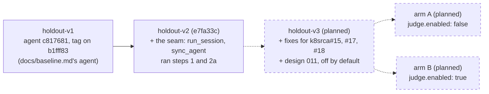
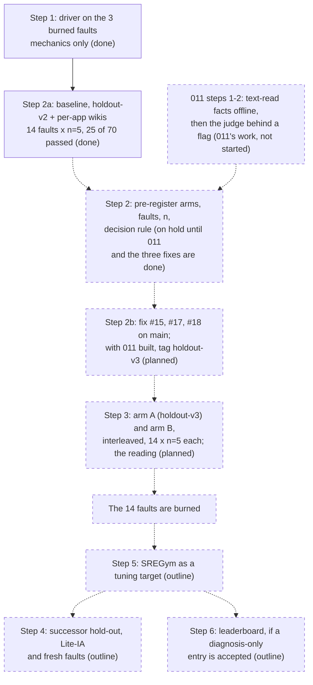
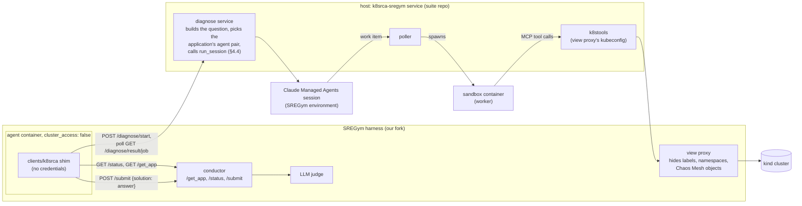

# 014 — SREGym: a live exam, a one-use hold-out, a tuning target, a leaderboard entry

**Status:** on hold (owner, 2026-11-14). Step 1 (the driver works end to end on three faults)
and step 2a (the baseline: the current agent on the 14 hold-out faults, 25 of 70 attempts passed)
are done (§10). The design resumes once two things are done: three known agent defects are fixed
(k8srca#15, #17 and #18, step 2b), and design 011 is implemented. The next hold-out tag,
`holdout-v3`, is cut then, and steps 2 (pre-register the comparison) and 3 (run both arms
together) run on it. Steps 4 to 6 are outlines. The driver's logic and every run record live in
a private repository, not here (§4.0).
**Last updated:** 2026-11-14.

**Related:** [004 — Scenario testing](004-scenario-testing.md) ·
[005 — Modular architecture](005-modular-architecture.md) ·
[006 — Hold-out suite](006-holdout-suite.md) · [011 — Decision models](011-decision-models.md) ·
[015 — KB evaluation](015-kb-evaluation.md) · [`docs/process.md`](../docs/process.md)

[SREGym](https://github.com/SREGym/SREGym) is a public benchmark for SRE agents. Its harness
deploys a real application on a Kubernetes cluster, injects a fault, starts the agent under test,
and has a language model (the *judge*) grade the agent's diagnosis and, optionally, its fix. This
design runs k8srca on SREGym, live and diagnosis only. It uses the benchmark three ways in turn: to
prove the wiring works, then once as a **hold-out** (a test set nobody tunes against) for a single
comparison between the agent as it is and the agent with design 011's decision model, and then as
an ordinary tuning target. To read it you need k8srca's architecture
([design 001](001-architecture.md)), what a hold-out is ([design 006](006-holdout-suite.md)), and
the project's way of planning a measurement in steps, with tripwires and checkpoints
([`docs/process.md`](../docs/process.md)). Project terms are defined in the
[glossary](../docs/glossary.md).

**Terms used throughout this document.**

- **SREGym-Lite** ("Lite"): a 17-fault subset of SREGym (cohort id `SREGym-Lite-1004`) on three
  applications (hotel-reservation and social-network from DeathStarBench, and astronomy-shop,
  which is the OpenTelemetry demo) plus infrastructure faults. It is the suite this design uses.
- **SREGym-Lite-IA** ("Lite-IA"): the same 17 fault families ported to three other applications.
  Kept unused, as a later hold-out (§3.1).
- **Burned set / hold-out set.** Three of the 17 faults (the burned set) are used freely to build
  the driver; we may read everything about them. The other 14 (the hold-out set) are kept unread
  until the comparison has run (§3). After step 3 all 17 are burned.
- **Arm**: one configuration in a comparison: a git tag of this repository, its `k8srca.yaml`
  settings, and the same inputs from outside it (§4.3, diagram below).
  - **`holdout-v1`**: the tag of the agent as frozen for design 006's hold-out (agent commit
    `c817681`; the tag itself is on `b1fff83`, which adds the hold-out kit). It is the agent
    `docs/baseline.md` measured.
  - **`holdout-v2`** (`e7fa33c`): `holdout-v1` plus a host-side refactor that lets an outside
    program run one session on a given question (the *seam*, §4.4). Its agent behaves as
    `holdout-v1`'s. Steps 1 and 2a ran it.
  - **`holdout-v3`** (planned, not tagged): `holdout-v2` plus fixes for three defects found in the
    baseline (step 2b) and design 011's decision model, off by default. Both arms of the step 3
    comparison run from this one tag (owner, 2026-11-14):
    - **Arm A**: `holdout-v3` with `judge.enabled: false`, the agent with no decision model.
    - **Arm B**: `holdout-v3` with `judge.enabled: true`, so that a decision model states
      text-read facts (facts that need reading a log to decide). The decision models and their
      `Judge` contract are described in [design 011](011-decision-models.md).

    One tag means the arms share every line of code, so the comparison measures the setting and
    nothing else.
- **Suite repo**: the private repository named by `K8SRCA_SREGYM_SUITE`, holding the driver's
  logic (the `k8srca-sregym` package) and all run records (§4.0).
- **The reading**: the write-up of step 3's results, `reading.md` in the suite repo. Until it
  exists, the suite's tooling prints scores only for hold-out faults, not answers.

This diagram shows how each arm's configuration is built from the one before. Every arm also gets
the same per-application wikis, agent pairs and driver from the suite repo, which sit outside the
tagged commits. Dashed parts are planned.



**Process note.** [`docs/process.md` §4](../docs/process.md#4-designs-end) allows one design in
progress at a time. This design is on hold while 011 is implemented, so 011 is that design. The
owner parked [design 013](013-what-changed.md) until this design and 011's decision-model work
are complete.

This design is a companion to [004 §12.2](004-scenario-testing.md#122-sregym-not-part-of-this-suite)
(why SREGym is not part of the scenario suite), [005 §8.4](005-modular-architecture.md#84-imported-scenarios-and-external-benchmarks)
(a live exam is an ordinary deployment pointed at the exam cluster), [006](006-holdout-suite.md)
(what a hold-out is) and [011](011-decision-models.md) (the decision-model version this design
compares against the baseline).

---

## 1. Goal

The owner's plan, in order:

1. **Proof of concept** on SREGym-Lite: a k8srca agent diagnoses a live SREGym problem and SREGym
   grades it.
2. **A hold-out, once.** SREGym-Lite is the hold-out for one comparison: the agent without a
   decision model (arm A) against the decision-model version (arm B, design 011).
3. **A tuning target.** After that comparison, SREGym joins the evaluation scenarios and we do the
   best we can on it. It is no longer a hold-out, and a **new hold-out suite** is created.
4. **The SREGym leaderboard.**

**How SREGym is used, in general.** SREGym is a source of hold-out tests: its faults are mined
for hold-out suites, and a fault stays unread until a hold-out pass has used it. After that pass
it moves into the regular scenario suite ([design 004](004-scenario-testing.md)), where it may
be read, captured and tuned against. Items 2 and 3 above are the first instance (the 14 Lite
faults); Lite-IA is the next (step 4).

**Why it is on hold.** The comparison should measure only the decision model. The three defects
of step 2b would otherwise move the result, and the owner wants them fixed, and 011 built, before
another hold-out tag is cut. Because 011 lands before the tag, both arms run from that one tag,
with `judge.enabled` off (arm A) and on (arm B).

Fixed by the owner: the comparison's baseline is the agent of `holdout-v1`, with the seam added on
`main` and tagged `holdout-v2`, and with the three fixes of step 2b added and tagged `holdout-v3`.
Both open branches (this design's and 011's `jev-decision-models`) were rebased onto `holdout-v2`.
The decision-model code has not diverged yet, so 011 can still change if this design needs it
(§9 question 1). **Mitigation is out of scope for now**: every run is diagnosis only, and the
leaderboard's mitigation half is deferred (step 6).

**Which suite:** SREGym-Lite for steps 1 to 3, 5 and 6, and **SREGym-Lite-IA kept untouched as the
later hold-out** (§3.1).

This diagram shows the steps, what each waits on, and where the work stands. Solid boxes are done;
dashed boxes are planned.



## 2. What we know about SREGym

Read directly in our fork of SREGym (`~/code/SREGym`): `README.md`, `docs/SREGym-Lite.md`,
`agents.yaml`, `clients/claudecode/driver.py`, `clients/claudecode_radar/README.md`. Read
second-hand, through a subagent that fetched the pages: the leaderboard and blog pages (marked
**[web]**). Recheck those figures at the source before citing them anywhere else.

- **The harness.** `uv run main.py --suite sregym-lite --agent <name> --model <m>`. Per problem it
  deploys the application, injects the fault, and starts the agent through `agents.yaml`'s
  `kickoff_command`. The agent talks to the *conductor*, SREGym's control API: `GET /get_app`,
  `GET /status`, `POST /submit`. Stages are `diagnosis` then `mitigation`. `--stages diagnosis`
  runs the first alone, and `--n-attempts` repeats.
- **Agents run in Docker containers** (README, "Container Isolation"), except those registered with
  `container_isolation: false` (demo, tierzero, cloudthinker). Registering with
  `cluster_access: false` withholds the kubeconfig and the egress routes to the API proxy and
  SREGym's MCP server. `claudecode_radar` is the precedent for an agent that reaches the cluster
  only through its own tool server.
- **The view proxy.** What an SREGym agent can see of the cluster is filtered: hidden namespaces
  and labels, Chaos Mesh objects (the fault injector), write restrictions. `claudecode_radar` keeps
  that filter by reading through SREGym's `radar_view_proxy` (`--kubeconfig-out`). k8stools must
  read through the same proxy, or k8srca sees the fault injector (§4.2).
- **The Lite cohort.** `SREGym-Lite-1004`, 17 faults **[web]**, listed in `docs/SREGym-Lite.md`.
  Three are on astronomy-shop, the OpenTelemetry demo our own scenarios run on (006 §3 says a
  hold-out should not be the OpenTelemetry demo; §6 below). The rest are on hotel-reservation and
  social-network (DeathStarBench) and infrastructure faults (network policy, namespace quota,
  Valkey, and so on).
- **Grading.** A free-text diagnosis is judged against SREGym's nine-question rubric; a pass is a
  *composite score* (the rubric's combined score, 0 to 1) of at least 0.70, with GPT-6 Astra at
  high reasoning effort as the leaderboard's judge **[web]**. Per-agent results are in
  `*_results.csv`.
- **The leaderboard** ranks on **E2E success: correct diagnosis and successful mitigation on the
  same run** **[web]**. It also shows Diag. (%), Mit. (%), time and tokens. Third-party rows are
  marked "verified by the SREGym team". **No submission process, harness requirement or tuning
  rule was found** on the site or in the local README. The README says the `full` profile is the
  one "for results you intend to compare against the leaderboard"; `svelte` profile scores are not
  comparable.
- **Prior art on our exact question [web].** SREGym's own blog reports two decision-model pipelines
  on an older 21-fault cohort: JEV (a decision model; 011 §4) alone, 76.2% of 105 diagnoses; and a
  decision model choosing the root cause with an LLM reviewing it, 89.5% (JEV) and 95.2% (GPT-6
  Luna Decisions), against 78–79% with no review. They tuned on those same faults, in the open.
  This is evidence that a decision model can score well on this suite. Its role there differs
  from 011's (§9 question 1; [011 §13](011-decision-models.md#13-sources), source 11).

## 3. The suite's life, and what each phase may do

| Phase | The suite is | We may | We may not |
| --- | --- | --- | --- |
| A. Mechanics (step 1) | the **burned set**, 3 faults | read everything: problems, answers, grader notes | claim any score means anything |
| B. One-use hold-out (steps 2–3) | the **hold-out set**, the other 14 faults | read scores, after the run | read the hold-out problems' definitions, answers or grader notes before the step 3 reading is written; change any frozen item (§5) |
| C. Tuning target (step 5) | burned, all 17 | read everything, build offline first | call anything on it a hold-out |
| D. Leaderboard (step 6) | the public cohort | submit what the rules allow | tune on the leaderboard run |

Two rules make phase B a hold-out:

- **Nobody reads the 14 faults' definitions.** That includes Claude. The fault names are public and
  fair to know; the source under SREGym's `conductor/problems`, the oracles and the mitigation
  scripts are not. Reading them to design the decision model would be fitting to the exam.
- **Scores only until the reading.** Run records hold full answers. They are written but not opened
  until step 3's reading is in this file. This is a weaker form of 006's hold-out, whose author
  reports scores only and whose sessions are in another workspace; here the owner runs the suite.
  It is accepted and said here. After step 3 the 14 are burned (phase C), so nothing needs
  unsealing by hand.

**Exposure: the hold-out is no longer blind.** By the owner's decision, the baseline's saved answers
for the 14 hold-out faults were read against SREGym's root-cause text for them, and the findings
are in §10.1. Both rules above were set aside for that reading. What follows from it:

- The owner and Claude have seen how the baseline fails on each fault and what each fault's cause
  is. The comparison still tests something, arm A against arm B under the same frozen inputs, in
  the way §3.1 says Lite-IA's exposure leaves a test of applications. It is reported as a
  **non-blind comparison**, not as a hold-out score.
- What was read is not used to design arm B, the decision model or 011's judges before step 3's
  comparison has run. §10.1's findings are about the instrument, the tools and the baseline agent,
  and are read that way. Some of them name what the agent missed, so this is a rule about design
  intent; nothing enforces it.
- Arm B's answers and scores stay sealed until step 3's comparison is written. `reading.md` is
  written after that comparison.
- Anything further read about the 14 (their definitions beyond the root-cause text, the oracles,
  the mitigation scripts) is recorded here with its date.
- **Not audited:** whether anything under `conductor/problems` beyond the root-cause text was
  opened during the baseline reading.

### 3.1 Lite and Lite-IA

`docs/SREGym-Lite-IA.md` (in the fork) describes the same 17 Lite faults, each ported to a real
component of three other applications (Frappe/ERPNext, Saleor, Slack Spine) in place of
hotel-reservation, social-network and astronomy-shop. It runs as `--suite sregym-lite-ia`. The
leaderboard page shows Lite and the full suite; no Lite-IA toggle was seen **[web]**.

| | Lite | Lite-IA |
| --- | --- | --- |
| Faults | 17, new to us | the same 17 families, ported |
| Applications | includes the OpenTelemetry demo (3 faults) | none we have built on |
| On the leaderboard | yes (`SREGym-Lite-1004`) | not seen |
| Tests whether we fitted | nothing yet | the applications, after tuning on Lite; **not** the faults |

**Proposed: Lite now, Lite-IA later.**
- The suite for the one-use comparison is the one we will tune on and submit with anyway. That is
  Lite, and it is burned at step 3 by plan.
- Lite-IA stays untouched through steps 1 to 3 and 5. It then serves as the **application
  hold-out** for step 4: it asks whether what we tuned on Lite holds on the same faults in new
  applications. It avoids the OpenTelemetry-demo problem of 006 §3 and costs nothing to author.
- It is **not a fault hold-out**. After tuning on Lite, its faults are known families, and the
  successor hold-out (step 4) still needs fresh faults if the owner wants that property. The two
  are different tests.
- If Lite-IA were spent as the first hold-out instead, it would be burned and the successor would
  have to be authored from nothing. In this order, neither suite is wasted.

**Exposure of Lite-IA.** The fork's Lite-IA document names each port's target component, and it
has been read in full. It is public, and a hold-out against *applications* survives it, but it is
not blind. This design does not copy that table. A session that designs Lite tuning should not
load Lite-IA's `environment_ports.py` or its `apps/` packages: §3's reading rule applies to Lite-IA
from step 1 until step 4 reads it.

## 4. Architecture

005 §8.4's description holds: an ordinary deployment pointed at the exam cluster. k8stools holds
the cluster credential and nothing else does. The mitigation stage is skipped (k8srca does not
change the cluster; [001 §8](001-architecture.md#8-read-only-guarantee-and-security)).

This diagram shows how one live SREGym attempt is driven, as built for steps 1 and 2a. The fork
holds only the shim; the service and its logic are in the suite repo; the session itself runs on
Claude Managed Agents like any other k8srca session.



### 4.0 Where each thing lives

The agent never sees any repository on disk. What reaches it is what `docker/Dockerfile.sandbox`
copies (`src/`, `packages/kubewiki`, `k8srca.yaml`), the synced skills and the prompts. So the leak
that matters is into *those*, and the people who could fit the agent to the exam are us. On one
machine a separate repository is hygiene (no stray `git add`, no hold-out content in history, no
test that reads it), not blindness; 006 gets blindness from another machine and workspace, which
this design does not have (§3). Three places:

| Where | Holds | Why |
| --- | --- | --- |
| **The fork** (`BenedatLLC/SREGym`) | the `clients/k8srca/` shim and its `agents.yaml` entry, on a branch | `kickoff_command` runs from SREGym's own tree, so the client has to be there. The fork is public, as is this repository, so **no records, lists or scores** go into it. The shim has nothing in it worth hiding |
| **The private suite repo**, outside `~/code/k8srca` (`K8SRCA_SREGYM_SUITE`) | the burned/hold-out split, run records, saved answers, the reading file, the driver's logic (`k8srca-sregym`, a package that imports `k8srca` as a library) | 006's pattern: its `--root` must be outside this repository and is refused if inside it. Nothing SREGym-specific enters `src/` |
| **This repo** | nothing for SREGym until phase C, apart from the seam (§4.4), which is general | `src/` ships in the sandbox image. At step 5 the package and the records are merged back in |

**This design stays in this repo, and the repo is public.** The design holds nothing that fitting
could use: fault names are public, the burned/hold-out split and the decision rule are choices,
not results, and no hold-out answer, grader note or score is in it before step 3, apart from the
baseline findings the owner chose to read (§3, "Exposure"). Committing step 2's pre-registration
here, and tagging it before the first run, is what makes it checkable afterwards. The sandbox image
does not copy `designs/`. Every run record, saved answer and grader note stays in the suite repo,
and so does the reading file until the reading is written (§3). Step 3's score table then goes
into this file and becomes public; the owner can hold it back until after a leaderboard decision.

**Planned, not built:** a test in this repo that scans `src/`, `skills/` and `docs/rca/` for SREGym
fault names, so that a rule or a mined note written from a hold-out answer cannot ship unnoticed.
No such test exists today; the suite repo scans the built wikis (step 2a.1). A Claude Code `deny`
rule on reading the hold-out problems' source (`SREGym/sregym/conductor/problems/**`, Lite-IA's
`apps/`) is a cheap addition to §3's reading rule, and is the owner's call.

**Consequence for the arms.** If the driver's logic lived in `src/`, it would be inside both arms'
commits, and `holdout-v1` does not contain it. Living outside, the same code serves both arms. It
needs one thing from each arm: a way to run a session on a given question. `holdout-v1` had none,
so a seam was added to both arms (§4.4).

### 4.1 The driver: a thin shim in the fork and a service on the host

The client registered in the fork's `agents.yaml`, under `clients/k8srca/`, holds no agent logic.
It runs in SREGym's agent container, registered `cluster_access: false`, so it holds no cluster
credential and no API key. It polls `/status`, calls `GET /get_app`, asks the host-side service for
a diagnosis, polls for the result, and submits it with `POST /submit`. Filtered mode lets it reach
the host service with `--allow-agent-endpoint http://host.docker.internal:<port>`.

The host-side service is `k8srca-sregym` in the suite repo (§4.0). It holds `ANTHROPIC_API_KEY`,
the poller and k8stools. It takes the application information the conductor returns, builds the
question, runs one session through this repo's `run_session` (§4.4), and returns the answer. All of
the logic is there, behind hermetic tests; the fork carries a few dozen lines and an `agents.yaml`
entry. The fork is otherwise the upstream harness, so that a leaderboard run is the upstream
harness plus one client, apart from the fork patches §10.1 lists. The shim starts a job and polls
because SREGym's egress proxy closes a single blocking call after ten minutes (§10.1 item 8).

This follows the `claudecode_radar` precedent and stays container-isolated and filtered, as the
leaderboard presumably wants. It answers the isolation half of §9 question 2.

A persistent view proxy of our own was proposed: the same `KubernetesAPIProxy` class bound to the
`k8srca-net` gateway on a fixed port with a fixed kubeconfig path, so that one long-lived k8stools
container can mount it. The conductor's per-problem kubeconfig changes its CA every run, which
would otherwise need a k8stools restart per problem. Whether it was built as proposed, and whether
it applies the same filtering as the conductor's, is recorded in the suite repo and is not checked
here.

### 4.2 The cluster view: k8stools reads through SREGym's view proxy

k8stools is pointed at SREGym's view proxy, not at the kind cluster's kubeconfig. Without it, k8srca
could list Chaos Mesh objects and hidden labels that a `kubectl` agent in SREGym cannot, so a
hold-out score would partly reflect the injector's fingerprints. Step 1's done criterion includes a
direct test: through k8stools, the agent cannot list what SREGym hides (passed; §4.5). This also
keeps CLAUDE.md's rule that k8stools is the only path to the Kubernetes API: the proxy's kubeconfig is the
one credential, held by k8stools.

### 4.3 Environment, arms and the architecture skill

- **A separate Managed Agents environment for SREGym.** The scenario runner starts its own poller
  with k8stools in replay mode; a live SREGym session queued in the same environment could be
  claimed by it, and the reverse. The same reasoning split production from scenarios (004 §3). The
  settings are in §8.
- **An arm is a tag and its settings.** Each arm runs from a git worktree of its tag with its own
  state directory and `k8srca.yaml`, synced into the SREGym environment, with its sandbox image
  built for that commit. Both go through the same driver. In step 3 both arms use `holdout-v3`
  and differ only in `judge.enabled`. Two arms cannot share one environment as built (§9
  question 3).
- **The architecture skill.** 005 builds the cluster-architecture skill (the wiki of the
  deployment, built by kubewiki) before any fault exists, but the harness injects the fault first
  and starts the agent after, so a wiki built from the live cluster would describe the faulted
  state. Step 1 therefore ran with no wiki. From step 2a on, each application gets a wiki built
  offline from its chart and values (not from the faulted cluster), carried by that application's
  own agent pair (§7 step 2a).

### 4.4 The seam: a way to run one session on a given question

In `holdout-v1` the only path from a question to an answer was `scenario/runner.py`'s `run_once`,
and it is a scenario run all the way down. It needs a `ScenarioDir` (truth, capture, checklist and
a pinned cluster-architecture skill), starts the poller and a replay k8stools, rebuilds the
scenario's agents against that replay (`sync_scenario_agent`, which uploads `sd.skill_dir`), runs
the review and revision turns, renders the facts footnotes, reads the spend and only then grades.
Three options were weighed:

| Option | Cost |
| --- | --- |
| **(i) Factor a seam out of `run_once`** (**chosen**): `sync_agent(skill_dir, cfg, state, …)` and `run_session(cfg, state, question, …) -> Answer`, with `run_once` calling them | Arm A becomes `holdout-v2`, `holdout-v1` plus the seam commit, not the bare tag. A moderate refactor of `runner.py`: two extractions |
| (ii) The driver imports `session`, `review` and `render` and reimplements the loop | No change to the arms. A copy of the review, revision and rendering logic that can drift from what the baseline measured, and imports of underscore names |
| (iii) The driver builds a synthetic `ScenarioDir` per problem and calls `run_once` with live k8stools | No refactor. It misuses the type (it demands a truth and a checklist), and `run_once` grades, which a live problem cannot be |

**Built, on `main` and in `holdout-v2`:** `sync_agent` and `run_session` in
[`src/k8srca/scenario/runner.py`](../src/k8srca/scenario/runner.py), with `run_once` calling both.
The move was checked behaviour-identical by a line-by-line diff of what moved, 13 tests in
[`tests/test_runner_session.py`](../tests/test_runner_session.py), and one replay smoke run
(`pvc-pending-no-storageclass`, n=3: 3/3 diagnosed, 10.0/10, 6–7 calls, $0.09–0.11 a run, against
the baseline's 3/3, 10.0/10, 6–8 calls, $0.08). The smoke run found one defect, fixed in the same
tag: the scenario suite polls its own environment with the test key, but `docker/spawn.sh` reads
`ANTHROPIC_ENVIRONMENT_KEY`, so every sandbox died at once and the session waited out its 45-minute
deadline. The poller now sets that variable from `--env-key-var`, and the runner's watchdog treats
a non-zero `container_exit` as a failed sandbox.

What SREGym needs beyond the seam (a second k8stools instance on the view proxy, since the
production one holds port 8000 and a different cluster's kubeconfig; and a per-application
architecture skill upload that does not go through a scenario) lives in the suite repo.

### 4.5 What the first live runs showed

Setting up a machine is described in `docs/setup.md` in the suite repo.

**The first live run** used SREGym's own `debug` agent (it does nothing) on `network_policy_block`,
a burned fault, with `--stages diagnosis` and `API_PORT=8001`. No k8srca session ran, so nothing
was spent on the agent; SREGym's judge preflight made one cheap call. Verified:

- A fresh clone of the fork needs `git submodule update --init --recursive` first. Without it the
  first run died at deploy ("Helm chart_path does not exist") after three retries and left nothing
  behind.
- The conductor's API port defaults to 8000, which k8stools holds, so SREGym runs with
  `API_PORT=8001`.
- The problem deployed, the fault was injected, and `/status` reported `diagnosis` with
  `agent_remaining_seconds: 1500`. `GET /get_app` returned `app_name`, `namespace`, `namespaces`,
  `descriptions` (the application's description, not the fault's) and `stages`. Stopping the
  harness undeployed the application and removed its egress policy.
- In filtered mode (the default) the conductor's proxy listens on `172.17.0.1:16443`, the docker0
  gateway, and writes a **per-problem** agent kubeconfig to `/tmp/sregym-agent-kubeconfig-*.yaml`:
  server `https://host.docker.internal:16443`, a CA generated for that run, a token. The agent
  container gets it mounted and nothing else of the cluster.
- A throwaway k8stools container on `k8srca-net`, with
  `--add-host host.docker.internal:host-gateway` and that kubeconfig mounted, bound to the proxy
  and served 33 tools. `get_pod_summaries` for the problem's namespace returned its pods. So
  k8stools works through SREGym's view proxy.
- In that problem the view equals the raw cluster's, in names: it hid no namespace. The injected
  fault, a NetworkPolicy, is visible, as it is to any agent with `kubectl`.

**Integration findings.** Each stopped a run while wiring the client, and each has a fix in the
suite repo or the fork; `docs/setup.md` in the suite repo has the symptoms and the steps.

| Finding | Consequence |
| --- | --- |
| SREGym hides the problem from agents: the artifact id is `anon_<hash>` | The host names the problem (`/expect`), which is also what makes the hold-out guard enforceable. A suite runs one problem per SREGym process |
| Filtered mode has a hard-coded list of agent names (`provider_endpoints.py`) | A new client needs a one-line change in SREGym's own code, not only under `clients/`. For the leaderboard that is an upstream pull request (§9 question 2) |
| Without `SREGYM_AGENT_IMAGE`, SREGym runs its published agent image | A third-party client needs a locally built image, or to be merged upstream and shipped in a release |
| An empty `KUBECONFIG` (from k8srca's `.env`) breaks SREGym's own `kubectl` | The runner drops it. Any process started from k8srca's environment should be checked for this |
| `SREGym-applications` is a submodule, not initialised by a plain clone | Setup must say so; a run without it fails at deploy |
| k8stools holds port 8000, SREGym's API default | SREGym runs with `API_PORT=8001` |
| `k8srca up`'s egress probe passes when nothing listens on `gateway:6443` | The probe ([`bringup.py`](../src/k8srca/bringup.py) `egress_status`) only tests whether port 6443 on the gateway answers, so "confined" means nothing on a host with no API server there. Apply and check `egress-rules.sh` by hand; the probe is not fixed |

**First end-to-end result.** `network_policy_block`, a burned fault, one attempt: the agent's
session took 65 s and $0.14 with 5 tool calls; SREGym's whole run took about five minutes (deploy
127 s, diagnosis 69 s, evaluation 6 s, cleanup 98 s, undeploy 5 s); a cheap judge scored it 1.0.
The score means nothing, as the fault is burned and the judge is not the leaderboard's. The timing
does: a fault costs about five minutes of wall clock whatever the agent does.

**The view proxy hides what SREGym hides.** With a `khaos` namespace and a pod labelled
`app=load-generator` created as stand-ins, the raw cluster showed both and k8stools showed neither,
and an ordinary pod stayed visible. This is step 1's done criterion (b); the stand-ins were
deleted.

**A security finding.** The proxy's token answers `can-i create pods` and `can-i get secrets` with
*yes*. The read-only RBAC backstop of [001 §8](001-architecture.md#8-read-only-guarantee-and-security)
(layer four, 8.4) does not apply behind it. k8stools exposes no mutating tool and no secrets tool,
so the guarantee holds at the layers above, but for SREGym runs it is a property of k8stools alone.
The owner decides whether that is acceptable, or whether the SREGym proxy should sit behind an
RBAC-restricted credential of ours (open).

## 5. The instrument and what is frozen

Under [process.md §5](../docs/process.md#5-the-instrument-is-frozen-per-design), these are fixed
when step 3's reading begins and unchanged until it is written:

- the SREGym fork's commit, the cohort id (`SREGym-Lite-1004`), the profile (`full`), the SREGym
  grader model (`anthropic/claude-sonnet-5-5`) and `--judge-backend api`, `--stages diagnosis`;
- the three wikis' digests and their source commits (step 2a.1);
- the 14-fault list, the number of attempts, and the interleaving order;
- the `holdout-v3` commit both arms run from, tagged before the first run, and each arm's
  `judge` settings (`enabled` off for A, on for B, and B's model and thresholds);
- the driver, the question it builds, and the k8stools and promtools versions;
- the decision rule (§7, step 2).

Every submitted answer is saved verbatim with the run, so that a change in SREGym's grader (an
external model, which can be retired or revised) can be scored again on the same answers. A grader
that changes mid-design is the "instrument moved" tripwire
([process.md §2](../docs/process.md#2-tripwires), item 4).

Each run's record carries the SREGym commit, cohort, profile, grader, the arm's commit and its
image digest. Step 1's runs are in this repo's journal
([`docs/journal/2026-11-08-sregym-step1.md`](../docs/journal/2026-11-08-sregym-step1.md)); later
runs are recorded in the suite repo, because they include hold-out answers.

## 6. Where SREGym is not a clean hold-out

- **Three of the 17 faults are on the OpenTelemetry demo.** 006 §3 wanted a different application.
  Our wiki pipeline and prompts are shaped by it, so these three test the faults but not the
  application. The hold-out set keeps two of them (the burned set takes one, §7 step 1), and the
  reading reports them separately. Lite-IA (§3.1) addresses this for the later hold-out.
- **SREGym is public.** Its problems, and other teams' tuning on them, are on the web. Our agent's
  skills must contain no SREGym problem knowledge. The suite repo scans the built wikis for the
  fault names; a scan of this repo's shipped skills is planned, not built (§4.0).
- **We chose nothing blind.** The authors of the suite are not us, which is the property that
  matters. They are also not a colleague who reports scores only, so §3's two rules stand in for
  that, and §3's exposure note says how far they held.

## 7. Steps

The steps are named in the order they were planned, which is not the order they run. Step 2a (arm
A's baseline) was added before step 2 and has run. Step 2 writes down the comparison before any
comparison run. Step 2b is the last change to the agent before the comparison. Step 3 is the
comparison. Each step is written in [process.md §1](../docs/process.md#1-plan-the-measurement-before-building)'s
form.

### Step 1 — the driver on the burned set (mechanics only)

**Done** (§10).

| | |
| --- | --- |
| **Hypothesis** | A read-only k8srca session, through k8stools on SREGym's view proxy, can take a live SREGym problem, produce a diagnosis, and have SREGym grade it, with the harness upstream and unmodified apart from one client |
| **Expected effect** | A run completes end to end. No claim about a score |
| **Can we see it?** | Yes: mechanics are binary. Nothing here is measured against noise |
| **Burned set** | Confirmed by the owner: `network_policy_block`, `env_variable_shadowing_astronomy_shop`, `service_wrong_pod_selection_hotel_reservation`, one per application family, so the wiring is exercised on each. Chosen before any run, for mechanics and not for difficulty |
| **Budget** | Seven calendar days. $50 for sessions, and SREGym's judge at whatever SREGym's grader costs per diagnosis |
| **Done** | (a) each burned fault run twice, diagnosis only, graded by SREGym, the answer saved; (b) the view-proxy test passes (§4.2); (c) the isolation and arms questions (§9 questions 2, 3) are answered; (d) wall clock and dollars per run are measured, which sets step 3's budget; (e) a hermetic test covers the driver's logic, and the shim carries none |
| **Stop** | The isolation question cannot be answered both ways; a run needs more than two hours of wall clock; the budget is spent |

Also in this step: the hold-out discipline goes into code, not anyone's memory. `k8srca-sregym`
refuses to print a run's answers or grader notes for a hold-out fault until a reading file exists,
and prints scores only.

### Step 2a — the baseline: arm A alone, with a wiki for each application

**Done** (§10, §10.1): 25 of 70 attempts passed.

At the owner's direction the baseline was built first, with the decision-model work done
independently (on another machine, on the existing scenarios), and where to run arm B decided when
that work is done. This splits step 3's "both arms in one sitting"; step 2b and step 3 say how the
comparison gets it back. Step 2a also answers §9 question 5 as "build the wikis": the agent gets
the architecture skill for **the application under test and no other**, as an SRE's deployment
would.

| | |
| --- | --- |
| **Hypothesis** | None against a number. This step produces the baseline agent's reading on the 14 hold-out faults. The agent is `holdout-v2` plus a per-application wiki, so it is **not** the agent `docs/baseline.md` measured (that one had a pinned skill for a different cluster) |
| **Expected effect** | None claimed. A guess, flagged as one: the wiki helps most on faults that need the application's dependency graph (a datastore, a queue) and not on ones visible in a single object. Nothing here tests it, because there is no arm without the wiki |
| **Can we see it?** | Not a comparison. The unit of evidence for step 3 is the fault (see step 2), so this step records passes of 5 per fault. With n=5 a fault reads 0–5; the spread across attempts is the within-arm noise step 3 needs |
| **Judge** | `anthropic/claude-sonnet-5-5` through `--judge-backend api` (owner's choice). SREGym fixes none: with no `--judge-model` it reuses the agent's own model. Leaderboard rules on the judge were not found (§9 question 2), so these scores are a proxy until step 6. Answers are saved verbatim, so a different judge can score them again |
| **Budget** | Wikis: about $3 to build (three at about $0.90) plus review. Runs: 14 faults × 5 attempts = 70 runs. Step 1's per-run figures came from a misconfigured agent (§10), so they were a floor: the real agent reads the knowledge base and a wiki and may review and revise its answer. Ceiling: $100 in sessions and four calendar days. Measured: $41.17 in sessions |

**2a.1 — Build the wikis.** One per application: hotel-reservation, social-network,
astronomy-shop.

- Sources: what SREGym deploys, read from the checkout and not from a cluster. Astronomy-shop and
  social-network install from local Helm charts in `SREGym-applications`, with SREGym's values
  files (and, for astronomy-shop, its `--set prometheus.enabled=false`). **Hotel-reservation does
  not use Helm**: SREGym applies the manifests in `hotelReservation/kubernetes` (its tree also
  holds a chart that is not used). Per-fault environment overrides are applied at deploy time and
  are not in those manifests, which is why the manifests are the right source. **Not**
  `live_cluster` (that describes the faulted state, §4.3), **not** `change_history`, and nothing
  from SREGym's fault generators or problem files.
- kubewiki has a local-chart source (`HelmChartRef.local`, `values` as a list, `sets`), cached by
  the chart's contents. It runs `helm template` under CLAUDE.md's exception: offline,
  `KUBECONFIG=/dev/null`.
- Built wikis are **inputs, not code**. They are kept in the suite repo with their source commits
  and digests, so arm A syncs them as local skills and arm B uses the same bytes.
- Done criterion: `kubewiki check` passes on each; a hermetic test in the suite repo scans every
  built skill for the 17 Lite fault names and fails on a hit (§6); digests recorded.
- **Result.** All three render offline and pass `kubewiki check`, synthesised with `claude-opus-5`
  (about $0.90 each). The scan found no fault name. Digests and source commits are in the suite
  repo's `wikis/provenance.json`. Components and edges: astronomy-shop 26 components with 44 edges
  (after the hidden-label fix, §10.1 item 7); **hotel-reservation 20 and social-network 27, with no
  edges.** Their call graphs live in configuration files baked into the images (hotel's
  `config.json`, social-network's `service-config.json`), not in the manifests, so a wiki from
  manifests alone has components, kinds and what each is for, but no dependency edges. The owner
  accepted this; the reading says which wikis have edges.
- **Future enhancement, not in this design:** build-time edges *observed* on the healthy
  deployment from its tracing backend (all three applications deploy Jaeger), as a new source type
  with provenance `observed`. It needs a healthy deployment before injection, which the harness
  does not give us. Smaller options: read any mounted configuration that names a Service (today
  only the OpenTelemetry collector's shape is read; DeathStarBench's shared configuration would
  over-connect), or a `docs` source describing the call graph.
- Stop: a chart cannot be rendered offline after a day's work on it. Then the owner decides between
  no wiki for that application, flagged in the reading, and a different source.

**2a.2 — One agent pair per application.** A skill belongs to an agent, not a session, so each
application gets its own coordinator and specialist, synced with that application's wiki.

- The service picks the pair from the namespace in the conductor's `app_info`. The question the
  driver builds is unchanged (frozen in §5). An application with no wiki gets a pair with none, and
  the run record says `wiki: none`, so the reading can show it.
- State is one directory per arm and application (`.state/arms/<arm>/<pair>/` in the suite repo).
  **One environment and one poller still serve all of an arm**: the pairs differ in agents, not in
  sandbox image.
- **Result.** Built as `pairs.py` in the suite repo. `up` syncs a `none` pair and one per
  application with a wiki; `diagnose` records the pair and the wiki's digest in the run. Checked on
  the platform: each of the four coordinators has the 3,830-character system prompt and `k8s-rca`,
  and the three application pairs also carry their own wiki and no other. The derived configuration
  fails on a missing prompt or unbuilt skill, and `sync` fails if it reports skills skipped (the
  defect that left step 1's agents without a prompt; §10). 44 hermetic tests.

**2a.3 — Mechanics check on the burned set.** One run each of the three burned faults, each with
its application's wiki. Done when each session shows its own wiki read and no other's, and a run's
dollars with a wiki are measured. No claim about scores. If the wiki made a run cost more than
twice step 1's mean, that would be a checkpoint, not a reason to continue.

**Result.** Astronomy-shop $0.18 (92 s), hotel-reservation `service_wrong_pod_selection` $0.57
(259 s), `network_policy_block` $0.31 (166 s); mean $0.35. The largest is 1.5 times step 1's mean,
under the 2x limit (step 1's agent had no prompt and no skills, so the two are not like for like).
Each session read its own application's `cluster-architecture/SKILL.md`, and no session's events
name another application. Three runs is a mechanics check, not a cost estimate.

**Added from it: a preflight** (suite `preflight.py`). It makes a real namespace read through
k8stools before each session, and an answer in which the agent says it could not reach the cluster
is invalid, not a result. Phrases are limited to the agent's own access, so a finding that quotes
"connection refused" from application logs is not flagged. The reason: a first attempt at 2a.3 read
no cluster at all. The view proxy had been restarted, which regenerated its CA, and the running
k8stools container still held the old one, so every read failed with `CERTIFICATE_VERIFY_FAILED`;
the agent said so and the runs were recorded as ordinary answers. Restarting k8stools fixed it (the
cause was inferred from the matching CA files, not otherwise traced). Without the preflight a
hold-out run could score the plumbing.

**2a.4 — The run.** The baseline agent, 14 faults, n=5, in the order of §5's frozen list, diagnosis
only. Frozen first, and unchanged until the score table is written (§5, plus the wiki digests, the
judge above and the SREGym fork commit).

- **Sealed.** The score table is `baseline-scores.md` in the suite repo, **not `reading.md`**: the
  suite's guard opens a hold-out fault's answers and grader notes once `reading.md` exists, and the
  hold-out stays sealed until arm B has run too, so that whoever reads the baseline's failures
  cannot tune toward them. `reading.md` is written after step 3's comparison. (The baseline's
  answers were opened by the owner's decision; §3, "Exposure". Arm B's stay sealed.)
- The table: per fault, passes of 5, SREGym composite mean, dollars, wall clock, the wiki used (or
  none); the three astronomy-shop faults on their own line.
- The decision-model branch does not see this table until it is complete (it runs elsewhere).
- Stop: a frozen item changes; the budget is spent; a run needs more than two hours; cluster resets
  fail on more than two faults; the judge model is retired mid-step.

### Step 2 — pre-register the comparison (no runs)

> **Not started.** Requires design 011 to be implemented (the judge service, `by: judge` facts,
> the egress rule; [011 §9](011-decision-models.md#9-later-steps-in-outline)) and `holdout-v3`
> to be tagged. Neither has happened.

This step writes down, commits and tags:

- **Arms.** Both run from `holdout-v3`, which is `holdout-v2` plus the three agent-side fixes of
  step 2b and design 011. A has `judge.enabled: false`; B has `judge.enabled: true`. The only
  difference between the arms is the decision-model facts. Step 2a's `holdout-v2` baseline stays as the record of the agent before
  the fixes; it is not the comparison's arm A.
- **Faults.** The 14 not in the burned set, listed in this file.
- **n.** Five attempts per fault per arm, interleaved fault by fault so that cluster drift and
  API-time effects fall on both arms.
- **Can we see it?** Below.
- **Budget.** 14 faults × 5 × 2 arms = 140 runs. By step 2a's measured figures ($0.57 an attempt in
  agent sessions; 29 to 70 minutes a fault for its five attempts, deploy and judge included): about
  $80 in sessions and about 20 hours serial, plus SREGym's judge.
- **The decision rule**, below.

**Can we see it?** The unit of evidence is the fault, not the run. SREGym's own JEV pipeline passed
16 of 21 faults in all five attempts and failed 5 of 21 in all five **[web]**, so attempts within a
fault are strongly correlated and 70 attempts per arm behave like fewer than 14 independent ones.
With the same faults in both arms, only faults that move count. A sign test on moved faults needs
five faults moving one way and none the other to reach p ≈ 0.03 (4 and 0 gives 0.06). So the
comparison reads as a result only if at least five of 14 faults (about 35%) improve with none
worse. Anything smaller is **"can't tell"** and is reported as that.

**Expected effect: small.** 011's text-read facts improve the reading of logs the agent fetched;
they cannot reach an object the agent never read, and most Lite faults are visible in objects and
events rather than logs. "Can't tell" is the predicted outcome. §9 question 1 and
[011 §9](011-decision-models.md#9-later-steps-in-outline) step 2 give the reasons.

**Decision rule, set before the run.** B is *not worse* if no more than one fault moves down; B is
*better* only by the five-and-none test above; otherwise "can't tell", and the decision-model
version is decided on its offline results (011 step 1) and on judgment, and said to be.

### Step 2b — `holdout-v3`: fix three known defects once, and run arm A again

> **Planned, not built.** The three GitHub issues are open and none of the fixes is on `main`
> yet. `holdout-v3` is cut once all three are fixed and design 011 is implemented
> (owner, 2026-11-14), so both arms are built on the fixes.

- **The fixes.** Three defects found during the baseline, each in deterministic code and none taken
  from what was read about the faults' causes (§3, "Exposure"):
  - [k8srca#18](https://github.com/BenedatLLC/k8srca/issues/18): `kb_query.py open` prints a leader
    other than the one `ranking` computed. Found on the scenario corpus
    ([015 §10.3](015-kb-evaluation.md#103-step-2a-recall-and-false-leaders), 4 of 12 cases). Its
    visible signature, a weak printed leader above a strong undecided candidate, appears in 3 of
    the 44 baseline sessions that ran `open` (one each in `namespace_memory_limit`,
    `search_rate_retry_collapse`, `secret_rotation`).
  - [k8srca#15](https://github.com/BenedatLLC/k8srca/issues/15): the agent's narration is joined
    into the graded answer (host-side, in the answer path; §10.1 item 6).
  - [k8srca#17](https://github.com/BenedatLLC/k8srca/issues/17): the coordinator's `sleep` blocks
    the specialist's tool calls (a deterministic guard on bash, no prompt change; §10.1 item 8).

  Each goes onto `main` with its tests. `holdout-v3` is `main` once the fixes and 011 are both
  there.
- **Why the fixes go in before the tag.** They change the agent or the answer path, so they move
  `holdout-v2`. Fixing them in arm B alone would confound the fixes with the judge. Putting them
  and 011 into one tag means arm A is re-run once, on the agent both arms share.
- **Arm A runs again** on `holdout-v3`: the 14 faults, n=5, under §5's frozen list (`arm`
  re-stamped to `holdout-v3` in the suite's `baseline-frozen.json`, with the reason), about $41
  and 10 hours by step 2a's figures. It runs interleaved with arm B in step 3, not before it.
- **What `holdout-v2` against `holdout-v3` can say.** The same 14 faults at n=5, under step 2's test:
  five faults moving one way and none the other. Anything smaller is "can't tell". The three fixes
  are not expected to move passes (the #18 signature touched three sessions, one in a fault that
  passed 5 of 5); the comparison is reported, not relied on.
- **Stop:** a fix needs a rule written from one run (process.md tripwire 3); a fourth agent-side
  change is proposed for the tag (a checkpoint, not a fourth change).

### Step 3 — the comparison run, and the reading

> **Planned.** Follows step 2b.

Both arms on the 14 faults, n=5, diagnosis only, under §5's frozen list: arm A (`holdout-v3`) and
arm B, **interleaved fault by fault in one sitting** (004's way of settling a lean), so that cluster
and API-time drift fall on both. Two rules:

- Arm B uses arm A's frozen inputs byte for byte: the wiki digests, the judge, the SREGym fork
  commit, the driver and its question. A change to any of them is the "instrument moved" tripwire,
  and arm A is rerun.
- **If the arms cannot be interleaved** (arm B on another machine, §9 question 3), a *drift canary*
  applies instead: in arm B's sitting, arm A runs again on three faults fixed now, one per
  application (`cronjob_sidecar_blocks_completion_hotel_reservation`,
  `mutating_webhook_resource_limits_social_network`, `internal_traffic_policy_local_astronomy_shop`),
  n=5 each (15 runs, about $6 and 1.8 hours). If arm A's passes on those differ from its earlier
  sitting by two or more on any fault, the comparison reads "can't tell" whatever the table shows.
  A smaller difference is reported next to the result.

The reading says whether the arms were interleaved. If they were not, that weakens a "better" and
leaves "can't tell" as it is. Where arm B runs is decided when the decision-model work is done; it
needs its own environment only if it runs beside arm A on this machine (§9 question 3). No answer,
transcript or grader note of arm B is opened until the score table is written here. Then:

- the table: per fault, A and B passes of 5, SREGym composite mean, dollars, wall clock, with step
  2a's `holdout-v2` passes beside them as the record, not as an arm;
- the three OpenTelemetry-demo faults reported on their own line;
- the decision under the step 2 rule, the number of faults that moved each way, and a checkpoint
  ([process.md §3](../docs/process.md#3-the-checkpoint)) if two arms in a row are "can't tell";
- **then** the 14 faults are burned, and the status line says so.

**Stop:** a frozen item changes; the budget is spent; an arm cannot be run cleanly (cluster resets
failing on more than two faults).

### Steps 4–6 — outlines

> **Planned, in outline only.** Each is planned in full when the step before it ends.

- **Step 4: the successor hold-out.** Two parts, both untouched until step 5 has tuned on Lite.
  **Lite-IA** is the application hold-out (§3.1), run by the same driver, once, with step 2's
  pre-registration and step 3's rules. A suite of *fresh faults* is the other part, wanted if the
  owner wants a fault hold-out, authored and run by someone who does not work on the agent (006's
  design, revised with a record of how its "scores only" worked in practice). Its own plan, started
  during step 3's wait.
- **Step 5: SREGym as a tuning target.** Offline first
  ([process.md §6](../docs/process.md#6-two-loops)): live runs record captures
  (`k8s-capture-state`), which become scenarios, and most changes are settled on those. Live n=2–3
  at milestones only. Live exam results never become the grader or truth of a scenario (004 §12: we
  import captures, never scoring).
- **Step 6: the leaderboard.** Requires answers to §9 questions 2 and 4. The board ranks on E2E,
  which needs mitigation. **Mitigation is deferred**, so step 6 is planned only if SREGym accepts
  and shows a diagnosis-only entry (the board has a Diag. (%) column). Otherwise it waits for a
  separate design with its own security decision (001 §8.1). Also needed: the `full` profile at the
  recommended 16 vCPU and 32 GB, the leaderboard's attempt count, and a fresh run on the final
  agent, not a tuning run's result.

## 8. Configuration

The SREGym settings are read by the suite repo's package, not by k8srca, and none of them is in
this repo's `.env.example`:

```bash
# SREGym (design 014). A separate environment from the scenario one (§4.3).
K8SRCA_SREGYM_ENVIRONMENT_ID=
ANTHROPIC_SREGYM_ENVIRONMENT_KEY=
K8SRCA_SREGYM_DIR=/home/jfischer/code/SREGym     # the fork; its commit is recorded per run
K8SRCA_SREGYM_SUITE=                             # the private suite repo (§4.0), outside this repo
```

> **Not built in this repo.** `SCRUB` in [`src/k8srca/settings.py`](../src/k8srca/settings.py) (the
> credentials the in-process worker removes from its environment) does not list
> `ANTHROPIC_SREGYM_ENVIRONMENT_KEY`, and `k8srca up` has no SREGym mode that gives k8stools the
> view proxy's kubeconfig. The suite repo's service starts its own k8stools with that kubeconfig
> (§4.1). CLAUDE.md's rule still holds: the cluster credential is held by k8stools alone.

SREGym's grader credentials are set where SREGym runs, not here.

## 9. Open questions

1. **What is "the decision-model version"?** *Decided by the owner: (a).* 011 as written adds
   *text-read facts* only, and rejects a decision model choosing or ranking the cause
   ([011 §11](011-decision-models.md#11-rejected-alternatives)). SREGym's own results **[web]** come
   from a decision model that chooses the cause with an LLM reviewing it. The options were: (a) 011
   as written, with the comparison a regression guard and a lean, most likely "can't tell"; (b)
   change 011 to the chooser-plus-reviewer role, for which a larger effect is plausible, which
   reverses a rejected alternative and needs its own design; (c) both as arms. Why (a): (b) is a new
   design and this one is about SREGym, and design 015's offline results
   ([015 §10.3](015-kb-evaluation.md#103-step-2a-recall-and-false-leaders);
   [011 §9](011-decision-models.md#9-later-steps-in-outline) step 2) make the expected effect small
   either way. Text-read facts change the leader on the scenarios that hinge on a log, and cannot
   reach an object the agent never read. (b) would choose from the same knowledge base, in which
   only 13 symptoms have authored rankings (25 of its 81 vendored alerts map to them), and SREGym's own
   pipeline got its result from a hand-built collector, not from choosing among a knowledge base
   ([011 §13](011-decision-models.md#13-sources), source 11). The comparison is pre-registered as a
   regression guard with "can't tell" the predicted outcome. 011's work proceeds on its own branch
   and machine with its own steps and results; step 2 here takes its flag when it is ready, and step
   2b then fixes the known agent-side defects once, in `holdout-v3`, for both arms. Steps 1 and 4 do
   not depend on the answer.
2. **Does the leaderboard accept a diagnosis-only entry?** Unknown. The site and README do not say
   how third parties submit. Ask the SREGym team (their table says third-party rows are verified by
   them) before step 6's plan. The isolation half is answered: a container-isolated shim with
   `cluster_access: false` and a host-side service works in filtered mode (§4.1, step 1).
3. **Can two arms share one environment?** *Answered from the code and from step 1, not by running a
   second arm: not as built.* `sync` updates an agent in place (`v1 -> v2` on the same agent id, seen
   in step 1) and a session takes the version from the state file, so two arms sharing one state
   file would run whichever arm synced last. And a poller claims any work item in its environment
   and spawns *its own* sandbox image, so two pollers on one environment would serve one arm's
   session with the other's image. Two arms need a state directory per arm (built in the suite repo,
   step 2a.2) and either **one environment per arm** (recommended: the owner generates one more key)
   or one poller at a time, started and stopped around each run. Arm B will be developed
   independently and may run on another machine, so a second environment is deferred until that is
   decided. Step 2a ran one arm in one environment, with per-application state under it.
4. **Tuning rules.** None found. SREGym's own blog tunes on the benchmark openly, so the norm looks
   permissive, but ask in the same message as question 2.
5. **What architecture skill does the agent get?** *Decided by the owner:* per-application wikis,
   and the agent gets the wiki for the application under test only (step 2a). Step 1 ran with none.
   Building from chart and values, not from the live cluster, avoids describing the faulted state
   (§4.3). Both arms use the same wiki bytes, so neither arm is `docs/baseline.md`'s agent, which had
   a pinned cluster-architecture skill for a different cluster.
6. **Who runs the successor hold-out,** and does 006's colleague still want to? The owner's call;
   step 4.
7. **The baseline agent.** *Decided:* step 2a's baseline is `holdout-v2`. Its agent behaves as
   `holdout-v1`'s (the changes are host-side, in `runner.py` and the poller command), so
   `docs/baseline.md` still describes its agent. The driver is outside every arm and identical for
   all of them. The comparison's arm A is `holdout-v3` (step 2).
8. **011 under 014?** *Decided by the owner:* both run in parallel, an exception to process.md §4's
   one design at a time. Each keeps its own steps and results table. 014's step 2 requirement (011
   steps 1 and 2 done) is the only coupling, and 014's step 1 did not depend on 011. Each design's
   tripwires and checkpoints are its own; the shared budget and calendar are the owner's to watch.

---

## 10. Results

| Step | Plan | Outcome | Decision |
| --- | --- | --- | --- |
| 1 | §7: the driver on the burned set, mechanics only, 7 days, $50 | Done in one day; $2.21 in agent sessions for six runs, plus a cheap judge call each. (a) Each burned fault run twice, diagnosis only, graded by SREGym, answers saved: yes ([journal](../docs/journal/2026-11-08-sregym-step1.md)). (b) The view proxy hides what SREGym hides: yes, checked with stand-ins. (c) Isolation answered: a container-isolated shim with `cluster_access: false` and a host-side service works in filtered mode. Arms answered from the code (§9 question 3). (d) Not valid, see the next column. (e) The driver's logic has 27 hermetic tests in the suite repo; the shim, in the fork, holds only glue and has no tests of its own | Closed as done for the mechanics (a–c, e). The six runs used agents with **no system prompt and no skills**: the derived configuration sat in `.state/`, k8srca resolves an agent's prompt and skill paths against the configuration file's directory, the paths pointed at nothing, and `sync` did not fail. So everything measured about the agent in step 1 (scores, $0.37 and 7.1 minutes a run) describes a bare model with k8stools. Fixed in the suite's `pairs.derive`, which makes the paths absolute and fails when one is missing, with a test that loads the derived configuration from outside the checkout |
| 2a | §7: wikis, per-application agents, a burned-set check, then 70 baseline runs; $100 ceiling, four days | Done. Wikis built and checked; one agent pair per application; burned-set check at $0.35 a run with each session reading only its own wiki; the preflight added. The 70 runs: 25 passes, $41.17 in agent sessions, after the six astronomy-shop faults were re-run on a corrected wiki (§10.1) | Baseline recorded in the suite repo's `baseline-scores.md`. The findings in §10.1 are for the step 2 and step 2b decisions |

### 10.1 Findings from arm A's baseline (step 2a)

The baseline here is `holdout-v2` with per-application wikis. Final scores, judge passes of 5:

| Fault | Passes | Note |
| --- | --- | --- |
| `cronjob_sidecar` | 0 | item 2 |
| `mutating_webhook` | 0 | item 3, tool gap |
| `finalizer_deadlock` | 3 | |
| `edge_request_filter_cpu_saturation` (astronomy-shop) | 5 | item 1; re-run on the corrected wiki |
| `kafka_poison_pill` (astronomy-shop) | 5 | re-run on the corrected wiki |
| `internal_traffic_policy_local` (astronomy-shop) | 0 | item 4, tool gap |
| `service_dns_resolution` | 1 of 4 judged | one attempt lost to the 600 s limit (item 8) |
| `namespace_memory_limit` | 5 | |
| `valkey_auth_disruption` (astronomy-shop) | 0 | item 5, runtime state |
| `secret_rotation_stale_env_credentials` (astronomy-shop) | 0 | item 7 |
| `unschedulable_incorrect_port_assignment` (astronomy-shop) | 2 | item 7 |
| `duplicate_pvc_mounts` | 3 | item 7 |
| `rolling_update_misconfigured` | 1 | item 7, half a tool gap |
| `search_rate_retry_collapse` | 0 | item 7 |

25 passes in 70 attempts, $41.17 in agent sessions plus the judge. The table and the append-only
ledger are in the suite repo (`baseline-scores.md`, `baseline-notes.md`); the ledger and the saved
runs also keep the first-pass scores of the six re-run faults (Appendix). These are read-outs from
saved answers, not rules: process.md's tripwire on a rule written from one run applies, and the
baseline is frozen.

1. **`edge_request_filter_cpu_saturation` needed a harder payload to set up here.** SREGym's own
   `_verify_fault_effect` needs a normal request to time out within 3 s. The crafted payload (5000
   characters) costs about 1.5 s of regex time at the pod's 100m CPU limit on this host (16 vCPU),
   and the single serial driver puts only one crafted request ahead of the probe, so the check never
   passed: 3 deploy retries, twice, 0 attempts. Measured with the image's own Perl (5.34) under
   `docker --cpus 0.1`: 5000 characters about 1.5 s, 10000 about 6 s, 20000 about 24 s (quadratic).
   **The fork's payload is 10000 characters** (SREGym fork commit `05b2f534`, on `80898c1b`).
   Consequences: the frozen cohort's `sregym` commit does not match the fork's head; edge's score
   is for a harder fault than the leaderboard's, so it is reported beside the cohort, not inside a
   comparison with other people's numbers; the mitigation oracle also sends this payload (diagnosis
   only here, so it does not matter yet). With it the fault's own check passes ("the normal request
   times out"). The suite's frozen check (`baseline.py verify`) accepts that one fork commit
   through an `allowed_sregym_patches` entry in `baseline-frozen.json` (owner's choice) and still
   stops on any other change.
2. **`failure-admin-{geo,rate}` are deliberate decoys in hotel-reservation.** SREGym creates the two
   ConfigMaps (scripts that drop or revoke the Mongo admin user) and patches `mongodb-geo` and
   `mongodb-rate` to mount them at `/scripts` (`hotel_reservation.py`:
   `populate_failure_configmaps`, `_patch_mongo_failure_script_mounts`), documented there as
   "noise/red herrings for unrelated faults". It is not the view proxy leaking benchmark internals.
   It also gives those two deployments a pod-template revision 2 for every hotel-reservation fault.
   In `cronjob_sidecar` (0/5, composite 0.0), four of five answers made it the main finding
   ("staged, dormant") and the fifth blamed a one-off DNS failure; all five read the real fault,
   `audit-log-archiver`'s sidecar that never exits so the Job cannot complete, as "completed Jobs
   that exited 0, normal". What to weigh: the agent's reading of the decoy was accurate (nothing
   runs the scripts) and still wrong as a conclusion, since the namespace showed nothing broken and
   the answer put the most alarming object first. The signal it missed was Jobs that never reach
   Complete while a sidecar runs.
3. **k8stools 4.6.1 has no tool that lists webhook configurations.** Nothing in the package
   mentions `MutatingWebhookConfiguration`, `ValidatingWebhookConfiguration` or
   `admissionregistration`; it has `get_custom_resource_definitions` and
   `get_custom_resource_status` but not these, and the sandbox has no `kubectl` (001 §8.2). In
   `mutating_webhook` (0/5, composite mean 0.4 on the set that counted; a first set was discarded,
   item 8), the cause is a cluster-scoped mutating webhook rewriting memory to
   16Mi (with four inert decoy webhooks beside it). Every run found the OOM-killed `nginx-thrift`;
   four noticed the Deployment's revision says 128Mi/256Mi while the pod has 16Mi, which is the
   signature of a rewrite at admission time; one named "LimitRange… possibly a mutating webhook".
   None could list the webhooks. So this fault is out of reach because of the tool set, not the
   reasoning. Per CLAUDE.md's rule, the fix is a k8stools tool: a read-only list of mutating and
   validating webhook configurations, with rules and selectors
   ([BenedatLLC/k8stools#39](https://github.com/BenedatLLC/k8stools/issues/39), open). It would
   change the agent after the baseline is frozen, so it is a checkpoint decision: add it and
   re-baseline the affected faults, or leave it out and report the gap beside the score.
4. **`internal_traffic_policy_local` (0/5, composite mean 0.4): k8stools does not show a Service's
   traffic policy.** The cause is `spec.internalTrafficPolicy: Local` on the single-replica
   `recommendation` Service, so a `frontend` pod on another node has its connections silently
   dropped by kube-proxy. Four of the five answers found the symptom path (`frontend` timing out
   to `recommendation`, one Ready pod behind a Ready endpoint, nothing wrong with the pod); three
   noticed the nodeSelector pins that put the caller and callee on different nodes; one blamed a
   stale conntrack entry on a node, a kube-proxy-level guess and the nearest miss. None looked at
   the Service's traffic policy, and none could: k8stools 4.6.1's `ServiceSummary` has `type`, IPs,
   ports, selector, labels, annotations and endpoint counts, but no `internalTrafficPolicy`,
   `externalTrafficPolicy` or `sessionAffinity`, and no tool returns the raw Service. Two more
   answers called a hung `recommendation` process the cause (no probes, "listening" then silence),
   which fits the data and is wrong. Same shape as item 3, so the fix is in k8stools: add the three
   fields to the Service summary, and have the workload report note a Service whose policy is not
   the default ([BenedatLLC/k8stools#40](https://github.com/BenedatLLC/k8stools/issues/40), open).
   The same checkpoint decision applies.
5. **`valkey_auth_disruption` (0/5, composite mean 0.4): the fault is in a process's runtime state,
   which no read-only Kubernetes tool can show.** Valkey was reconfigured with
   `CONFIG SET requirepass`, so `cart`'s unauthenticated connections get NOAUTH. All five answers
   found `cart` crash-looping on "Wasn't able to connect to redis" (exit 139) and `valkey-cart`
   healthy, Ready, with an endpoint, the init container's TCP check passing and no NetworkPolicy in
   the way, and all five concluded that no auth is needed, because the specs set no password. Four
   called it a client or protocol mismatch inside `cart`; one guessed Valkey's protected mode. The
   password is in the running server, not in any object: no spec change, no event. Seeing it needs
   the server's own configuration (an exec), which the read-only tools do not allow, so there is no
   k8stools ticket: it is out of reach by design (001 §8.1). Not checked: whether Valkey's log has a
   line for the CONFIG SET, which would be the nearest evidence. Faults of this kind should be
   counted as unreachable, not as the agent's reasoning failing.
6. **Narration leaks into the saved answer**
   ([BenedatLLC/k8srca#15](https://github.com/BenedatLLC/k8srca/issues/15), fix scheduled under
   step 2b). The scenario runner takes every message of a turn, joined, as the answer
   ([`scenario/runner.py`](../src/k8srca/scenario/runner.py), lines 485, 517 and 551); the Slack
   path takes the last one (`slack/relay.py`). Of 60 baseline records, 43 `first_answer`s begin with
   narration, and 3 final answers begin with preamble, for example `valkey_auth_disruption`'s last
   attempt ("Good — now at 299 words… Here is the revised answer:", then `---`) and one
   `finalizer_deadlock` attempt. All 60 had a revision turn (the 300-word limit fired on every first
   answer, a real overshoot that does not depend on the narration), so the final answer is the
   revision turn's messages, and a revision turn that runs a tool and narrates puts the narration
   before the answer. The judge reads it. The effect on a score is not measured; the saved answers
   can be stripped to their last message and re-graded to find out, with no new runs. Until the fix,
   the baseline's answers carry this, and the comparison's must too.
7. **The rest, read against SREGym's root-cause text.**
   - `unschedulable_incorrect_port_assignment` (2/5, mean 0.7) has two faults: a wrong port in
     `PRODUCT_CATALOG_ADDR`, and a nodeSelector pinning `checkout` to a node that does not exist.
     All five found the nodeSelector. All five also saw that `PRODUCT_CATALOG_ADDR` changed in the
     latest revision; one called it "a second issue" (the nearest), three called it unrelated or
     something to verify later, and none compared the value with product-catalog's port. The facts
     were in hand: this is reasoning (follow the second thread), not the tool set.
   - `duplicate_pvc_mounts` (3/5): four of five found jaeger's second replica Unschedulable on
     anti-affinity plus a PVC node-affinity conflict, which is the cause; one blamed a DNS flood
     from an OpenTelemetry exporter (wrong).
   - `rolling_update_misconfigured` (1/5, mean 0.7): all five found the hung `hang-init` init
     container. None mentioned the rollout strategy (`maxUnavailable=100%`, `maxSurge=0`), which the
     truth names as the reason all old replicas drained. k8stools 4.6.1's `DeploymentSummary` has
     no strategy fields and nothing in `k8s_tools.py` reads them, so this half is out of reach
     because of the tool set: a third k8stools gap, with items 3 and 4
     ([BenedatLLC/k8stools#41](https://github.com/BenedatLLC/k8stools/issues/41), open).
   - `search_rate_retry_collapse` (0/5, mean 0.3): four of five blamed the `rate` service as hung;
     one blamed a startup race. Only one answer mentioned retries at all. The truth is a timeout,
     retry and queue feedback loop in `search`'s RPC policy. Whether the retry policy is readable
     (it may be in the application's configuration) was not checked.
   - `secret_rotation_stale_env_credentials` (first pass 2/5, mean 0.5; 0/5 on the corrected wiki):
     four of five found Postgres rejecting `otelu` (authentication failures) and a credential
     mismatch, which is the symptom and half the cause; the missing half is that product-catalog
     keeps the connection string captured at startup.
   - **"`load-generator` is missing": the view and the wiki disagreed.** SREGym hides every object
     labelled `app=load-generator` (and `locust-fetcher`, `job=workload`,
     `network-access=restricted`, `opentelemetry.io/name=load-generator`) from the agent, on
     purpose (`sregym/service/agent_visibility_policy.py`, `HIDDEN_LABELS`, applied by the view
     proxy). The first astronomy-shop wiki was built from the chart and declared `load-generator`
     as the sole traffic source (`index.md`, `graph.json`, `frontend-proxy.md`). So an agent read
     that the Deployment exists, looked, found nothing, and concluded it was never created. Seven
     of 31 astronomy-shop answers (23%) made that the most likely cause, each a wrong answer: edge 3
     of 5, `kafka_poison_pill` 2, `internal_traffic_policy` 1, `secret_rotation` 1. Every failed
     attempt in edge and in `kafka_poison_pill` was one of these. The edge fault's driver uses
     `load-generator` through SREGym's own client, which the policy does not touch, which is why
     SREGym finds it there. The artifact is common to both arms (the same wiki bytes, §9 question
     5), so it does not bias the comparison, but it lowered the baseline's absolute scores on this
     application and was a flaw in the instrument.
     **Decision (owner): make the wiki builder honour the visibility policy, before the hold-out,
     and re-run the six astronomy-shop faults**
     ([BenedatLLC/k8srca#16](https://github.com/BenedatLLC/k8srca/issues/16), option 1). The
     alternative was to leave the wiki and report the artifact beside the score. The fix is a
     command-line option on the suite's wiki build only, not a kubewiki configuration or contract
     change, because the hiding is SREGym's mechanism (labels) and not something a real cluster does
     (RBAC and namespaces do). Checked first: (1) the chart's `load-generator` Deployment and Service
     carry `opentelemetry.io/name=load-generator`, so the filter matches (the chart sets no
     `app=load-generator`); the hotel-reservation manifests and the social-network chart carry none
     of the hidden labels, so only astronomy-shop changes. (2) Production is not affected:
     `k8srca arch build` reads a live cluster through the read-only ClusterRole and cannot name what
     it cannot read, and the wiki names only workloads. Only a chart-sourced wiki can disagree with
     the agent's view, so this is a harness issue. Built: `kubewiki build --hide-label key=value`
     (chart sources only, no configuration key; [`packages/kubewiki/src/kubewiki/charts.py`](../packages/kubewiki/src/kubewiki/charts.py)),
     and the suite's wiki build passes it SREGym's `HIDDEN_LABELS` read from the policy file.
     Re-stamped: `wiki_digests` for astronomy-shop `45896df7f747` → `91ca2e95972f` in
     `baseline-frozen.json`, with the reason in `wiki_restamps`. The new wiki has 26 components and
     44 edges, losing `load-generator` and its three edges and nothing else, and records what it
     left out in `sources.md` and `log.md`. **Caveat:** synthesis was re-run, so every
     astronomy-shop page was reworded, not just the one removed. The deterministic check is
     therefore a search of the answers for a "`load-generator` is missing" claim, not the score
     alone. The 31 attempts on the old wiki keep the old digest in their records; the other two
     wikis are unchanged. (#16 stays open on GitHub; the option it asked for is built.)
   - **The re-run on the corrected wiki.** The six astronomy-shop faults, n=5 each: edge 5 of 5 (was
     2), `kafka_poison_pill` 5 of 5 (was 3), `internal_traffic_policy_local` 0 of 5 (was 0),
     `valkey_auth_disruption` 0 of 5 (was 0), `secret_rotation_stale_env_credentials` 0 of 5 (was 2),
     `unschedulable_incorrect_port_assignment` 2 of 5 (was 2). `internal_traffic_policy_local`'s
     first two re-run sets were discarded to the 600 s limit (each 0 on its four complete attempts),
     and it ran a third time on the polling shim (item 8). **The check that counts:** the 40 saved
     answers on the new wiki (the 30 counted and the 10 from the two discarded sets) were searched
     with the same pattern that finds 7 "`load-generator` is missing" claims in the 31 old-wiki
     answers; it finds **0 of 40**, and no new-wiki answer mentions `load-generator` at all. Scores
     moved where the artifact was every failure (edge, kafka) and not where it was one of several or
     none; `secret_rotation`'s 2 to 0 is inside n=5's noise, and its one artifact answer was wrong
     anyway. Not established: that edge's and kafka's gains are the wiki alone, since synthesis
     reworded every astronomy-shop page.
   - **Pattern across the fourteen:** the zeros are mostly not reasoning failures. Of the five at 0/5
     on the first pass, three are out of reach (webhooks, runtime state, traffic policy); the others
     (`cronjob_sidecar`, `search_rate_retry_collapse`) are where the agent read the most alarming
     object, not the cause. That bears on §9 question 1 and on what a decision model can be expected
     to move.

8. **Sessions over ten minutes were lost, and why sessions run long.**
   - **The limit.** SREGym's egress proxy (mitmproxy 12.2.3, `tcp_timeout` at its default of 600 s
     of inactivity, not overridden in `docker_egress.py`) closed the driver's single blocking call to
     our service after ten minutes. SREGym marks the attempt `incomplete`
     (`agent_exited_before_all_stages_completed`) and the judge never sees the answer. Three attempts
     of the 104 sessions with saved records were lost this way: `service_dns` in the baseline (625 s,
     attempt 1), and `internal_traffic_policy_local` in the first and second re-run sets (897 s and
     610 s). No session over 600 s survived; the longest that did was 542 s. Not counted:
     `mutating_webhook` (3 attempts, an HTTP 500 preflight error where k8stools could not read a pod;
     that set was discarded and re-run) and one `network_policy_block` attempt in the burned set
     (cause not examined). **Effect on the baseline:** `service_dns`'s 1 pass is 1 of 4 judged; the
     other 13 faults are clean.
   - **A gap in the guard, closed.** The suite's `ran_cleanly` checked counts and not run status, and
     the lost `service_dns` attempt still had a session record, so it passed. An `incomplete`
     attempt now stops the batch (suite `cb57269`, with tests; `baseline-notes.md` note 6).
   - **The fix (owner's choice): poll from the driver.** The alternative, raising the proxy's
     `tcp_timeout`, was set aside because it changes SREGym's shared proxy for every agent. The
     service has `POST /diagnose/start` and `GET /diagnose/result/<job>` (suite `36458af`; the
     blocking `/diagnose` stays) and the shim starts the job and polls every 5 s (fork `d118a717`,
     allow-listed in `baseline-frozen.json` with its reason). **Checked:** the agent image was
     rebuilt and a burned astronomy-shop fault ran end to end through the polled path (a 99 s
     session, submitted), and `internal_traffic_policy_local`'s third re-run set ran on it. **Not
     checked:** that a session over 600 s now survives.
   - **Why sessions run long** (50 sessions with saved records, from their session events). 31
     delegated to the specialist and 19 did not (median 144 s). A delegated session has a median of
     341 s: 89 s (26%) in the coordinator before delegating, 73 s (25%) with the specialist working,
     and 161 s (49%) in the coordinator after the reply. The coordinator is `claude-sonnet-5` at
     `effort: high`. In eight sessions whose model requests were counted, the slow ones generated
     15,900 to 25,700 output tokens after the specialist's reply against 3,300 to 4,800 in the fast
     ones, at about 80 tokens a second; the slowest single requests took 42 to 95 s. Six of the eight
     longest sessions are `internal_traffic_policy_local`, where nothing is loudly broken. Session
     length tracks the coordinator's own cluster calls after the reply (r = 0.73 over the 31). Tool
     calls are only 14 to 17% of the wall clock in the two sessions of 316 s and 610 s.
   - **Tool cost is not the cause.** On a deployed, healthy astronomy-shop (25 workloads, 27 pods) a
     `get_workload_report` takes 0.92 s and 27 proxy requests, and 24 in parallel take 10.3 s, 2.2
     times faster than one at a time. After restarting 14 deployments (events 200 to 346, distinct
     involved objects 76 to 104) the figures were 0.97 s and 10.9 s. `get_events` alone went from
     1.9 s to 2.6 s, about 25 ms per distinct involved object, because SREGym's view proxy clears its
     object cache on every request; that is a cost of the proxy, not of production. In a session,
     calls run one at a time, about 1.3 s per report (the SDK worker's single dispatch loop). There
     is no k8stools ticket: deduplicating a report's reads would save about 10 s of a 316 to 610 s
     session.
   - **The sleep convoy** ([BenedatLLC/k8srca#17](https://github.com/BenedatLLC/k8srca/issues/17),
     fix scheduled under step 2b). In one of the 50 sessions (897 s) the coordinator waited for the
     specialist with eight `sleep` commands (561 s in all), and because both agents share one serial
     tool queue, all 21 of the specialist's calls were held behind a sleep. The specialist's phase
     took 584 s against a median of 73 s. The coordinator's prompt already forbids sleeping; it did
     so once in 31 delegations. #17 recommends a deterministic guard on the coordinator's bash and no
     new prompt line (a rule from one session is a process.md tripwire).
   - **Not established:** how the coordinator's output tokens split between thinking and drafting;
     why it re-sweeps the cluster after the reply (3 sessions made 10 or more of their own cluster
     calls); what lower effort would do to duration and to scores (it would change `holdout-v2`);
     why the `internal_traffic` sessions were longer after the wiki change (n=5 each, no mechanism
     found); timing in production Slack sessions.

---

## Appendix: history and results

**Timeline.**

- **2026-11-07.** Design started; the owner parked 013 and set 011 to run in parallel. Burned set
  confirmed. Suite repo created. `holdout-v1` checked: its `src/`, `skills/`, `docker/` and
  `k8srca.yaml` were then identical to `main`'s, and it had no way to run a session on a given
  question (§4.4). Mitigation declared out of scope.
- **2026-11-08.** Seam option (i) chosen and built (`d8ee043`, fix `e7fa33c`), tagged `holdout-v2`;
  both open branches rebased onto it. First live run with SREGym's `debug` agent; integration
  findings; first end-to-end k8srca run. Step 1 done. Step 2a added at the owner's direction (the
  baseline first, arm B later), with per-application wikis (§9 question 5) and the judge
  `anthropic/claude-sonnet-5-5`. Same day, step 2a.2 found that step 1's agents had no prompt and no
  skills (§10). 2a.1 to 2a.3 done; the first 2a.3 attempt found the stale-CA fault and led to the
  preflight. Step 3 was rewritten as arm B alone against the earlier baseline, with a drift canary,
  because arm A had already run.
- **2026-11-09.** Baseline runs begin. Edge payload raised to 10000 characters in the fork; the
  frozen check allows that commit. k8stools#39 (webhooks) and #40 (Service traffic policy) filed.
- **2026-11-10.** All 14 faults run: 22 passes in 70 attempts (31%), $40.12. The owner opened the
  hold-out: the baseline's answers read against SREGym's root-cause text (§3, "Exposure"). Five
  remaining faults read (item 7).
- **2026-11-11.** The `load-generator` artifact explained. Its count was corrected from four of 31
  to seven of 31: the first count used a regular expression that missed "doesn't exist" and "is
  gone". An earlier note that edge "finds it present" mixed SREGym's client view with the agent's
  view. k8stools#41 (rollout strategy) filed. k8srca#16 filed, scoped, decided as option (b) and
  built (`5b95f25`; suite `94fef14`); astronomy-shop wiki re-stamped.
- **2026-11-12.** The 600 s proxy limit found; `service_dns`'s lost attempt makes the first pass 22
  of 69 judged. The polling shim built. The six astronomy-shop faults re-run: final baseline 25 of
  70, $41.17. The session-length analysis; k8srca#17 filed. Two earlier readings in this analysis
  were withdrawn: that large parallel tool batches were slow, and that a report costs about 4 s;
  the first gap analysis had counted the specialist's model time as tool wait.
- **2026-11-14.** §9 question 1 decided as (a). Step 2b added: fixes for #15, #17 and #18 go in once
  as `holdout-v3`, with arm A re-run and interleaved with arm B, which restores step 3's
  interleaved design. Step 2's arms revised to `holdout-v3` and `holdout-v3` plus 011 step 2.

**Superseded estimates.** Step 2's first budget guess was $70–210 and one to three days; step 1's
figures from the misconfigured agent projected 140 runs at about 16.5 hours and $52 plus the judge.
Both are replaced by step 2a's measured figures (§7 step 2).

**First-pass baseline scores** (before the astronomy-shop re-run): `cronjob_sidecar` 0/5,
`mutating_webhook` 0/5, `finalizer_deadlock` 3/5, edge 2/5 (composite 0.4, $2.49, 37 min),
`kafka_poison_pill` 3/5, `internal_traffic_policy_local` 0/5, `service_dns_resolution` 1/5,
`namespace_memory_limit` 5/5, `valkey_auth_disruption` 0/5,
`secret_rotation_stale_env_credentials` 2/5, `unschedulable_incorrect_port` 2/5,
`duplicate_pvc_mounts` 3/5, `rolling_update_misconfigured` 1/5, `search_rate_retry_collapse` 0/5.
22 passes in 69 judged attempts.
