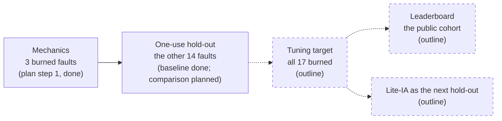
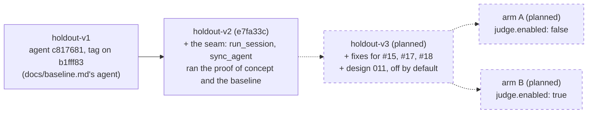

# 014 — SREGym: a live exam, a one-use hold-out, a tuning target, a leaderboard entry

> **On hold** (owner, 2026-11-14). The driver works end to end, and the baseline is recorded: the
> agent as it stands passed 25 of 70 attempts on the 14 held-out faults (plan steps 1 and 2a).
> The design resumes once everything planned before the SREGym runs is done: a first pass at
> design 011's decision-model work ([#19](https://github.com/BenedatLLC/k8srca/issues/19)), fixes for three known agent defects ([#15](https://github.com/BenedatLLC/k8srca/issues/15),
> [#17](https://github.com/BenedatLLC/k8srca/issues/17), [#18](https://github.com/BenedatLLC/k8srca/issues/18)), and the k8stools tools for three gaps the baseline found ([#26](https://github.com/BenedatLLC/k8srca/issues/26), [#27](https://github.com/BenedatLLC/k8srca/issues/27),
> [#28](https://github.com/BenedatLLC/k8srca/issues/28)). Then the comparison is written down ([#39](https://github.com/BenedatLLC/k8srca/issues/39)), naming the release tag; `main` is
> tagged `holdout-v3` on a commit holding both the code and that document ([#22](https://github.com/BenedatLLC/k8srca/issues/22)); and the
> comparison runs on it with the decision model off and on ([#23](https://github.com/BenedatLLC/k8srca/issues/23)). The driver's logic and every run record
> live in a private repository, not here (§3.4). Parent issue:
> [#32](https://github.com/BenedatLLC/k8srca/issues/32); steps and results:
> [plans/014-sregym.md](../plans/014-sregym.md).

[SREGym](https://github.com/SREGym/SREGym) is a public benchmark for SRE agents. Its harness
deploys a real application on a Kubernetes cluster, injects a fault, starts the agent under test,
and has a language model (the *judge*) grade the agent's diagnosis and, optionally, its fix. This
design runs k8srca on SREGym, live and diagnosis only. It uses the benchmark three ways in turn:
to prove the wiring works, then once as a **hold-out** (a test set nobody tunes against) for a
single comparison between the agent with and without design 011's decision model, and then as an
ordinary tuning target. To read it you need k8srca's architecture
([design 001](001-architecture.md)), what a hold-out is ([design 006](006-holdout-suite.md)), and
the project's way of planning a measurement in steps, with tripwires and checkpoints
([process.md](../docs/process.md)). Project terms are defined in the
[glossary](../docs/glossary.md). The [plan](../plans/014-sregym.md) holds the steps, their
measurements and their results.

**Terms used throughout this document.**

- **SREGym-Lite** ("Lite"): a 17-fault subset of SREGym (cohort id `SREGym-Lite-1004`) on three
  applications (hotel-reservation and social-network from DeathStarBench, and astronomy-shop,
  which is the OpenTelemetry demo) plus infrastructure faults. It is the suite this design uses.
- **SREGym-Lite-IA** ("Lite-IA"): the same 17 fault families ported to three other applications.
  Kept unused, as a later hold-out (§3.2).
- **Burned set, hold-out set.** Three of the 17 faults (the burned set) are used freely to build
  the driver; we may read everything about them. The other 14 (the hold-out set) are kept unread
  until the comparison has run (§3.1). After the comparison all 17 are burned.
- **Arm:** one configuration in a comparison: a git tag of this repository, its `k8srca.yaml`
  settings, and the same inputs from outside it. The tags and the two arms of the comparison are
  in §3.3.
- **Suite repo:** the private repository named by `K8SRCA_SREGYM_SUITE`, holding the driver's
  logic (the `k8srca-sregym` package) and all run records (§3.4).
- **The reading:** the write-up of the comparison's results, `reading.md` in the suite repo. Until
  it exists, the suite's tooling prints scores only for hold-out faults, not answers.

> **The hold-out rules, in brief.** Nobody, Claude included, reads the 14 held-out faults'
> definitions: the source under SREGym's `conductor/problems`, the oracles and the mitigation
> scripts. Run records are written but not opened until the reading is written; only scores are
> read. By the owner's decision the baseline's answers were read against SREGym's root-cause text
> for the 14, so the comparison is reported as a **non-blind comparison**, and what was read is
> not used to design arm B (the agent with the decision model). The full rules, and what was read,
> are in §3.1.

---

## 1. Problem

### 1.1 Why we need a test we did not tune against

k8srca is measured on a suite of scenarios: faults recorded once from a test cluster, replayed
through the read-only tool server, and graded against a checklist
([design 004](004-scenario-testing.md)). We also read those scenarios' answers to decide what to
fix next, so a better score on them cannot tell a better agent from one fitted to them
([006 §1](006-holdout-suite.md#1-why-a-suite-we-never-see)). Two more limits:
- **The suite is near its ceiling.** At the first checklist baseline, diagnosis was 29 of 30 and
  cause items 93 of 99, and a change can only show on a scenario the agent can still fail
  ([004 §12.3](004-scenario-testing.md#123-four-more-itbench-imports-24-80-102-and-105)).
- **Every scenario runs on the OpenTelemetry demo,** which shaped the prompts and the wiki
  pipeline ([006 §3](006-holdout-suite.md#3-a-different-application)).

Design 006's hold-out suite, written and scored by a colleague, is built but on hold, so no
hold-out score exists. Meanwhile design 011 proposes a decision model, and whether it helps needs
a measurement on faults nobody has tuned against
([011 §6](011-decision-models.md#6-how-we-will-know-it-worked)). On 2026-10-25 the owner reserved
SREGym as a hold-out candidate, so the scenario suite does not import, run or tune against it
([004 §12.2](004-scenario-testing.md#122-sregym-not-part-of-this-suite)). SREGym is written by
people who do not work on k8srca, runs live on applications other than ours, and has a public
leaderboard, so it can answer both "does the decision model help?" and "how does k8srca compare
with other agents?".

### 1.2 What we know about SREGym

Read directly in our fork of SREGym (`~/code/SREGym`): `README.md`, `docs/SREGym-Lite.md`,
`agents.yaml`, `clients/claudecode/driver.py`, `clients/claudecode_radar/README.md`. Read
second-hand, through a subagent that fetched the pages: the leaderboard and blog pages (marked
**[web]**). Recheck those figures at the source before citing them anywhere else.

- **The harness.** `uv run main.py --suite sregym-lite --agent <name> --model <m>`. Per problem it
  deploys the application, injects the fault, and starts the agent through `agents.yaml`'s
  `kickoff_command`. The agent talks to the *conductor*, SREGym's control API: `GET /get_app`,
  `GET /status`, `POST /submit`. Stages are `diagnosis` then `mitigation`. `--stages diagnosis`
  runs the first alone, and `--n-attempts` repeats.
- **Agents run in Docker containers** (README, "Container Isolation"), except those registered
  with `container_isolation: false` (demo, tierzero, cloudthinker). Registering with
  `cluster_access: false` withholds the kubeconfig and the egress routes to the API proxy and
  SREGym's MCP server. `claudecode_radar` is the precedent for an agent that reaches the cluster
  only through its own tool server.
- **The view proxy.** What an SREGym agent can see of the cluster is filtered: hidden namespaces
  and labels, Chaos Mesh objects (the fault injector), write restrictions. `claudecode_radar`
  keeps that filter by reading through SREGym's `radar_view_proxy` (`--kubeconfig-out`). k8stools
  must read through the same proxy, or k8srca sees the fault injector (§3.6).
- **The Lite cohort.** `SREGym-Lite-1004`, 17 faults **[web]**, listed in `docs/SREGym-Lite.md`.
  Three are on astronomy-shop, the OpenTelemetry demo our own scenarios run on (006 §3 says a
  hold-out should not be the OpenTelemetry demo; §3.10). The rest are on hotel-reservation and
  social-network (DeathStarBench) and infrastructure faults (network policy, namespace quota,
  Valkey, and so on).
- **Grading.** A free-text diagnosis is judged against SREGym's nine-question rubric; a pass is a
  *composite score* (the rubric's combined score, 0 to 1) of at least 0.70, with GPT-6 Astra at
  high reasoning effort as the leaderboard's judge **[web]**. Per-agent results are in
  `*_results.csv`.
- **The leaderboard** ranks on **E2E success: correct diagnosis and successful mitigation on the
  same run** **[web]**. It also shows Diag. (%), Mit. (%), time and tokens. Third-party rows are
  marked "verified by the SREGym team". **No submission process, harness requirement or tuning
  rule was found** on the site or in the local README. The README says the `full` profile is the
  one "for results you intend to compare against the leaderboard"; `svelte` profile scores are
  not comparable.
- **Prior art on our exact question [web].** SREGym's own blog reports two decision-model
  pipelines on an older 21-fault cohort: JEV (a decision model;
  [011 §3.2](011-decision-models.md#32-decision-models-and-who-offers-them)) alone, 76.2% of 105
  diagnoses; and a decision model choosing the root cause with an LLM reviewing it, 89.5% (JEV)
  and 95.2% (GPT-6 Luna Decisions), against 78–79% with no review. They tuned on those same
  faults, in the open. This is evidence that a decision model can score well on this suite. Its
  role there differs from 011's (§7 question 1; [011 §8](011-decision-models.md#8-sources),
  source 11).

## 2. Goal

The owner's plan, in order:

1. **Proof of concept** on SREGym-Lite: a k8srca agent diagnoses a live SREGym problem and SREGym
   grades it.
2. **A hold-out, once.** SREGym-Lite is the hold-out for one comparison: the agent without a
   decision model (arm A) against the decision-model version (arm B, design 011).
3. **A tuning target.** After that comparison, SREGym joins the evaluation scenarios and we do
   the best we can on it. It is no longer a hold-out, and a **new hold-out suite** is created.
4. **The SREGym leaderboard.**

**How SREGym is used, in general.** SREGym is a source of hold-out tests: its faults are mined
for hold-out suites, and a fault stays unread until a hold-out pass has used it. After that pass
it moves into the regular scenario suite ([design 004](004-scenario-testing.md)), where it may be
read, captured and tuned against. Items 2 and 3 above are the first instance (the 14 Lite
faults); Lite-IA is the next (the plan's step 4).

**Which suite:** SREGym-Lite for the proof of concept, the comparison, tuning and the
leaderboard, and **SREGym-Lite-IA kept untouched as the later hold-out** (§3.2).

**Done when:** the driver runs a live problem end to end and SREGym grades it; the comparison has
run under the decision rule written down before it (§6) and its reading is written; the 14 faults
are burned and SREGym is a tuning target. The leaderboard part is planned only if SREGym accepts
a diagnosis-only entry (§7 question 2).

**Out of scope:**
- **Mitigation.** Every run is diagnosis only; k8srca does not change the cluster
  ([001 §8](001-architecture.md#8-read-only-guarantee-and-security)), and the leaderboard's
  mitigation half is deferred.
- **SREGym code in this repository** before the tuning phase, apart from the seam (§3.8), which
  is general.

**Where it sits among the designs.** [process.md §4](../docs/process.md#4-designs-end) allows one
design in progress at a time. This design is on hold while 011's first pass is done, so 011 is
that design. Before that, 011 and 014 ran in parallel by the owner's decision (§7 question 8).
The owner put [design 013](013-what-changed.md) on hold until this design and 011's
decision-model work are complete. This design is a companion to
[004 §12.2](004-scenario-testing.md#122-sregym-not-part-of-this-suite) (why SREGym is not part of
the scenario suite), [005 §8.4](005-modular-architecture.md#84-imported-scenarios-and-external-benchmarks)
(a live exam is an ordinary deployment pointed at the exam cluster), [006](006-holdout-suite.md)
(what a hold-out is) and [011](011-decision-models.md) (the decision-model version this design
compares against the agent without it).

## 3. Approach

### 3.1 The suite's life, and what each phase may do

The suite passes through four phases. This table says what each phase allows; the rules below it
are what make the second phase a hold-out.



| Phase | The suite is | We may | We may not |
| --- | --- | --- | --- |
| A. Mechanics (plan step 1) | the **burned set**, 3 faults | read everything: problems, answers, grader notes | claim any score means anything |
| B. One-use hold-out (plan steps 2–3) | the **hold-out set**, the other 14 faults | read scores, after the run | read the hold-out problems' definitions, answers or grader notes before the comparison's reading is written; change any frozen item (§3.9) |
| C. Tuning target (plan step 5) | burned, all 17 | read everything, build offline first | call anything on it a hold-out |
| D. Leaderboard (plan step 6) | the public cohort | submit what the rules allow | tune on the leaderboard run |

Two rules make phase B a hold-out:

- **Nobody reads the 14 faults' definitions.** That includes Claude. The fault names are public
  and fair to know; the source under SREGym's `conductor/problems`, the oracles and the
  mitigation scripts are not. Reading them to design the decision model would be fitting to the
  exam.
- **Scores only until the reading.** Run records hold full answers. They are written but not
  opened until the comparison's reading is written. This is a weaker form of 006's hold-out,
  whose author reports scores only and whose sessions are in another workspace; here the owner
  runs the suite. It is accepted and said here. After the comparison the 14 are burned (phase C),
  so nothing needs unsealing by hand.

The suite's tooling enforces the second rule in part: `k8srca-sregym` refuses to print a run's
answers or grader notes for a hold-out fault until a reading file exists, and prints scores only.
Nothing enforces the first; it rests on the people (and agents) involved.

**Exposure: the hold-out is no longer blind.** By the owner's decision, the baseline's saved
answers for the 14 hold-out faults were read against SREGym's root-cause text for them, and the
findings are in the plan
([findings from the baseline](../plans/014-sregym.md#findings-from-the-baseline)). Both rules
above were set aside for that reading. What follows from it:

- The owner and Claude have seen how the baseline fails on each fault and what each fault's
  cause is. The comparison still tests something, arm A against arm B under the same frozen
  inputs, in the way §3.2 says Lite-IA's exposure leaves a test of applications. It is reported
  as a **non-blind comparison**, not as a hold-out score.
- What was read is not used to design arm B, the decision model or 011's judges before the
  comparison has run. The baseline findings are about the instrument, the tools and the baseline
  agent, and are read that way. Some of them name what the agent missed, so this is a rule about
  design intent; nothing enforces it.
- Arm B's answers and scores stay sealed until the comparison is written. `reading.md` is written
  after that comparison.
- Anything further read about the 14 (their definitions beyond the root-cause text, the oracles,
  the mitigation scripts) is recorded here with its date.
- **Not audited:** whether anything under `conductor/problems` beyond the root-cause text was
  opened during the baseline reading.

### 3.2 Lite now, Lite-IA later

`docs/SREGym-Lite-IA.md` (in the fork) describes the same 17 Lite faults, each ported to a real
component of three other applications (Frappe/ERPNext, Saleor, Slack Spine) in place of
hotel-reservation, social-network and astronomy-shop. It runs as `--suite sregym-lite-ia`. The
leaderboard page shows Lite and the full suite; no Lite-IA toggle was seen **[web]**.

| | Lite | Lite-IA |
| --- | --- | --- |
| Faults | 17, new to us | the same 17 families, ported |
| Applications | includes the OpenTelemetry demo (3 faults) | none we have built on |
| On the leaderboard | yes (`SREGym-Lite-1004`) | not seen |
| Tests whether we fitted | nothing yet | the applications, after tuning on Lite; **not** the faults |

Lite is used now and Lite-IA later, for these reasons:
- The suite for the one-use comparison is the one we will tune on and submit with anyway. That is
  Lite, and it is burned by the comparison by plan.
- Lite-IA stays untouched through the proof of concept, the comparison and tuning. It then serves
  as the **application hold-out** (the plan's step 4): it asks whether what we tuned on Lite holds
  on the same faults in new applications. It avoids the OpenTelemetry-demo problem of 006 §3 and
  costs nothing to author.
- It is **not a fault hold-out**. After tuning on Lite, its faults are known families, and the
  successor hold-out still needs fresh faults if the owner wants that property. The two are
  different tests.
- If Lite-IA were spent as the first hold-out instead, it would be burned and the successor would
  have to be authored from nothing (§4). In this order, neither suite is wasted.

**Exposure of Lite-IA.** The fork's Lite-IA document names each port's target component, and it
has been read in full. It is public, and a hold-out against *applications* survives it, but it is
not blind. This design does not copy that table. A session that designs Lite tuning should not
load Lite-IA's `environment_ports.py` or its `apps/` packages: §3.1's reading rule applies to
Lite-IA from the start of this design until the plan's step 4 reads it.

### 3.3 The arms: one release, with the decision model off and on

The comparison should measure only the decision model. So both arms run from one git tag, and
differ in one setting. The tags are:

- **`holdout-v1`:** the tag of the agent as frozen for design 006's hold-out (agent commit
  `c817681`; the tag itself is on `b1fff83`, which adds the hold-out kit). It is the agent
  [`docs/baseline.md`](../docs/baseline.md) measured.
- **`holdout-v2`** (`e7fa33c`): `holdout-v1` plus a host-side refactor that lets an outside
  program run one session on a given question (the *seam*, §3.8). Its agent behaves as
  `holdout-v1`'s: the changes are host-side, in `runner.py` and the poller command, so
  `docs/baseline.md` still describes its agent (§7 question 7). The proof of concept and the
  baseline ran it.
- **`holdout-v3`** (planned, not tagged): `main` once the fixes for three defects found in the
  baseline ([#15](https://github.com/BenedatLLC/k8srca/issues/15), [#17](https://github.com/BenedatLLC/k8srca/issues/17), [#18](https://github.com/BenedatLLC/k8srca/issues/18)), the k8stools tools for three gaps it found ([#26](https://github.com/BenedatLLC/k8srca/issues/26),
  [#27](https://github.com/BenedatLLC/k8srca/issues/27), [#28](https://github.com/BenedatLLC/k8srca/issues/28)), design 011's first pass (off by default) and the written comparison
  ([#39](https://github.com/BenedatLLC/k8srca/issues/39)) are all there. It holds everything else on `main` at that point too; the owner set no
  limit on what goes in. Both arms of the comparison run from it (owner, 2026-11-14):
  - **Arm A:** `holdout-v3` with `judge.enabled: false`, the agent with no decision model.
  - **Arm B:** `holdout-v3` with `judge.enabled: true`, so that a decision model states
    text-read facts (facts that need reading a log to decide). The decision models and their
    `Judge` interface are described in [design 011](011-decision-models.md).

One tag means the arms share every line of code, so the comparison measures the setting and
nothing else. The fixes and the k8stools tools go in before the tag because they change the agent
or the answer path; adding them to arm B alone would confound them with the decision model. The
k8stools tools make three faults reachable that neither arm can diagnose today, which gives the
comparison more room to show a difference. The baseline
already run on `holdout-v2` stays as the record of the agent before the fixes; it is not the
comparison's arm A.

This diagram shows how each arm's configuration is built from the one before. Every arm also
gets the same per-application wikis, agent pairs and driver from the suite repo, which sit
outside the tagged commits. Dashed parts are planned.



Fixed by the owner: the comparison's starting point is the agent of `holdout-v1`, with the seam
added on `main` and tagged `holdout-v2`, and then `main` as it stands once the fixes, the
k8stools tools, 011's first pass and the written comparison are in, tagged `holdout-v3`. Both open branches (this design's and 011's
`jev-decision-models`) were rebased onto `holdout-v2`. The decision-model code has not diverged
yet, so 011 can still change if this design needs it (§7 question 1). What arm B's decision model
does is §7 question 1: design 011 as written, which adds text-read facts only.

### 3.4 Where each thing lives

The agent never sees any repository on disk. What reaches it is what `docker/Dockerfile.sandbox`
copies (`src/`, `packages/kubewiki`, `k8srca.yaml`), the synced skills and the prompts. So the
leak that matters is into *those*, and the people who could fit the agent to the exam are us. On
one machine a separate repository is hygiene (no stray `git add`, no hold-out content in history,
no test that reads it), not blindness; 006 gets blindness from another machine and workspace,
which this design does not have (§3.1). Three places:

| Where | Holds | Why |
| --- | --- | --- |
| **The fork** (`BenedatLLC/SREGym`) | the `clients/k8srca/` shim and its `agents.yaml` entry, on a branch | `kickoff_command` runs from SREGym's own tree, so the client has to be there. The fork is public, as is this repository, so **no records, lists or scores** go into it. The shim has nothing in it worth hiding |
| **The private suite repo**, outside `~/code/k8srca` (`K8SRCA_SREGYM_SUITE`) | the burned/hold-out split, run records, saved answers, the reading file, the driver's logic (`k8srca-sregym`, a package that imports `k8srca` as a library) | 006's pattern: its `--root` must be outside this repository and is refused if inside it. Nothing SREGym-specific enters `src/` |
| **This repo** | nothing for SREGym until the tuning phase, apart from the seam (§3.8), which is general | `src/` ships in the sandbox image. In the tuning phase the package and the records are merged back in |

**This design stays in this repo, and the repo is public.** The design holds nothing that fitting
could use: fault names are public, the burned/hold-out split and the decision rule are choices,
not results, and no hold-out answer, grader note or score is in it before the comparison, apart
from the baseline findings the owner chose to read (§3.1, "Exposure"), which are in the plan.
Committing the comparison's pre-registration here, and tagging it before the first run, is what
makes it checkable afterwards. The sandbox image does not copy `designs/` or `plans/`. Every run
record, saved answer and grader note stays in the suite repo, and so does the reading file until
the reading is written (§3.1). The comparison's score table then goes into the plan and becomes
public; the owner can hold it back until after a leaderboard decision.

> **Planned, not built:** a test in this repo that scans `src/`, `skills/` and `docs/rca/` for
> SREGym fault names, so that a rule or a mined note written from a hold-out answer cannot ship
> unnoticed. No such test exists today; the suite repo scans the built wikis (plan step 2a). A
> Claude Code `deny` rule on reading the hold-out problems' source
> (`SREGym/sregym/conductor/problems/**`, Lite-IA's `apps/`) is a cheap addition to §3.1's
> reading rule, and is the owner's call (§7 question 10).

**Consequence for the arms.** If the driver's logic lived in `src/`, it would be inside every
arm's commit, and `holdout-v1` does not contain it. Living outside, the same code serves every
arm. It needs one thing from each arm: a way to run a session on a given question. `holdout-v1`
had none, so a seam was added (§3.8).

### 3.5 How one attempt is driven

[005 §8.4](005-modular-architecture.md#84-imported-scenarios-and-external-benchmarks)'s
description holds: an ordinary deployment pointed at the exam cluster. k8stools holds the cluster
credential and nothing else does. The mitigation stage is skipped.

This diagram shows how one live SREGym attempt is driven, as built for the proof of concept and
the baseline. The fork holds only the shim; the service and its logic are in the suite repo; the
session itself runs on Claude Managed Agents like any other k8srca session.


**The shim, in the fork.** The client registered in the fork's `agents.yaml`, under
`clients/k8srca/`, holds no agent logic. It runs in SREGym's agent container, registered
`cluster_access: false`, so it holds no cluster credential and no API key. It polls `/status`,
calls `GET /get_app`, asks the host-side service for a diagnosis, polls for the result, and
submits it with `POST /submit`. Filtered mode lets it reach the host service with
`--allow-agent-endpoint http://host.docker.internal:<port>`. The shim starts a job and polls
because SREGym's egress proxy closes a single blocking call after ten minutes (plan,
[findings from the baseline](../plans/014-sregym.md#findings-from-the-baseline), item 8).

**The service, on the host.** `k8srca-sregym` in the suite repo (§3.4) holds
`ANTHROPIC_API_KEY`, the poller and k8stools. It takes the application information the conductor
returns, builds the question, runs one session through this repo's `run_session` (§3.8), and
returns the answer. All of the logic is there, behind hermetic tests; the fork carries a few dozen
lines and an `agents.yaml` entry. The fork is otherwise the upstream harness, so that a
leaderboard run is the upstream harness plus one client, apart from the fork patches listed with
the baseline findings (items 1 and 8).

This follows the `claudecode_radar` precedent and stays container-isolated and filtered, as the
leaderboard presumably wants. It answers the isolation half of §7 question 2.

**A persistent view proxy of our own** was proposed: the same `KubernetesAPIProxy` class bound to
the `k8srca-net` gateway on a fixed port with a fixed kubeconfig path, so that one long-lived
k8stools container can mount it. The conductor's per-problem kubeconfig changes its CA every run,
which would otherwise need a k8stools restart per problem. Whether it was built as proposed, and
whether it applies the same filtering as the conductor's, is recorded in the suite repo and is not
checked here.

### 3.6 The cluster view: k8stools reads through SREGym's view proxy

k8stools is pointed at SREGym's view proxy, not at the kind cluster's kubeconfig. Without it,
k8srca could list Chaos Mesh objects and hidden labels that a `kubectl` agent in SREGym cannot,
so a hold-out score would partly reflect the injector's fingerprints. The proof of concept's done
criterion includes a direct test: through k8stools, the agent cannot list what SREGym hides. It
passed (plan step 1). This also keeps the rule that k8stools is the only path to the Kubernetes
API ([constitution A1](../docs/constitution.md#a1-k8srca-never-touches-the-kubernetes-api-directly)):
the proxy's kubeconfig is the one credential, held by k8stools.

**The proxy's credential is not read-only.** The proxy's token answers `can-i create pods` and
`can-i get secrets` with *yes*. The read-only RBAC backstop of
[001 §8.4](001-architecture.md#84-least-privilege-rbac) (the fourth layer of
[001 §8](001-architecture.md#8-read-only-guarantee-and-security)) does not apply behind it.
k8stools exposes no mutating tool and no secrets tool, so the guarantee holds at the layers above,
but for SREGym runs it is a property of k8stools alone. Whether that is acceptable is open (§7
question 9).

### 3.7 Environment and the architecture skill

- **A separate Managed Agents environment for SREGym.** The scenario runner starts its own poller
  with k8stools in replay mode; a live SREGym session queued in the same environment could be
  claimed by it, and the reverse. The same reasoning split production from scenarios
  ([004 §3](004-scenario-testing.md#3-how-a-scenario-is-served)). The settings are in §3.11.
- **An arm is a tag and its settings.** Each arm runs from a git worktree of its tag with its own
  state directory and `k8srca.yaml`, synced into the SREGym environment, with its sandbox image
  built for that commit. Both go through the same driver. In the comparison both arms use
  `holdout-v3` and differ only in `judge.enabled`. Two arms cannot share one environment as built
  (§7 question 3).
- **The architecture skill.** 005 builds the cluster-architecture skill (the wiki of the
  deployment, built by kubewiki) before any fault exists, but the harness injects the fault first
  and starts the agent after, so a wiki built from the live cluster would describe the faulted
  state. The proof of concept therefore ran with no wiki. From the baseline on, each application
  gets a wiki built offline from its chart and values (not from the faulted cluster), carried by
  that application's own agent pair, and the agent gets the wiki for **the application under test
  and no other**, as an SRE's deployment would (§7 question 5; how they are built is in the plan's
  step 2a). Both arms use the same wiki bytes.
- **The wiki honours SREGym's visibility policy.** SREGym hides objects with certain labels from
  agents, and a wiki built from the chart would name them. `kubewiki build --hide-label key=value`
  (chart sources only, no configuration key;
  [`packages/kubewiki/src/kubewiki/charts.py`](../packages/kubewiki/src/kubewiki/charts.py))
  leaves them out, and the suite's wiki build passes it SREGym's `HIDDEN_LABELS`
  ([#16](https://github.com/BenedatLLC/k8srca/issues/16)). It is a command-line option and not a
  kubewiki configuration or interface change because the hiding is SREGym's mechanism (labels),
  not something a real cluster does (RBAC and namespaces do). Production is not affected:
  `k8srca arch build` reads a live cluster through the read-only ClusterRole and cannot name what
  it cannot read. Why it was needed is in the plan's baseline findings (item 7).

### 3.8 The seam: a way to run one session on a given question

In `holdout-v1` the only path from a question to an answer was `scenario/runner.py`'s `run_once`,
and it is a scenario run all the way down. It needs a `ScenarioDir` (truth, capture, checklist and
a pinned cluster-architecture skill), starts the poller and a replay k8stools, rebuilds the
scenario's agents against that replay (`sync_scenario_agent`, which uploads `sd.skill_dir`), runs
the review and revision turns, renders the facts footnotes, reads the spend and only then grades.

The chosen option factors a seam out of `run_once`: `sync_agent(skill_dir, cfg, state, …)` and
`run_session(cfg, state, question, …) -> Answer`, with `run_once` calling them. Its cost is that
the arm built on `holdout-v1` becomes `holdout-v2`, `holdout-v1` plus the seam commit, not the
bare tag, and a moderate refactor of `runner.py` (two extractions). The two options not chosen
are in §4.

**Built, on `main` and in `holdout-v2`:** `sync_agent` and `run_session` in
[`src/k8srca/scenario/runner.py`](../src/k8srca/scenario/runner.py), with `run_once` calling both.
The move was checked behaviour-identical by a line-by-line diff of what moved, 13 tests in
[`tests/test_runner_session.py`](../tests/test_runner_session.py), and one replay smoke run
(`pvc-pending-no-storageclass`, n=3: 3/3 diagnosed, 10.0/10, 6–7 calls, $0.09–0.11 a run, against
the baseline's 3/3, 10.0/10, 6–8 calls, $0.08). The smoke run found one defect, fixed in the same
tag: the scenario suite polls its own environment with the test key, but `docker/spawn.sh` reads
`ANTHROPIC_ENVIRONMENT_KEY`, so every sandbox died at once and the session waited out its
45-minute deadline. The poller now sets that variable from `--env-key-var`, and the runner's
watchdog treats a non-zero `container_exit` as a failed sandbox.

What SREGym needs beyond the seam (a second k8stools instance on the view proxy, since the
production one holds port 8000 and a different cluster's kubeconfig; and a per-application
architecture skill upload that does not go through a scenario) lives in the suite repo.

### 3.9 The instrument and what is frozen

Under [process.md §5](../docs/process.md#5-the-instrument-is-frozen-per-design), these are fixed
when the comparison begins and unchanged until its reading is written:

- the SREGym fork's commit, the cohort id (`SREGym-Lite-1004`), the profile (`full`), the SREGym
  grader model (`anthropic/claude-sonnet-5-5`) and `--judge-backend api`, `--stages diagnosis`;
- the three wikis' digests and their source commits (plan step 2a);
- the 14-fault list, the number of attempts, and the interleaving order;
- the `holdout-v3` commit both arms run from, tagged before the first run, and each arm's `judge`
  settings (`enabled` off for A, on for B, and B's model and thresholds);
- the driver, the question it builds, and the k8stools and promtools versions;
- the decision rule (plan step 2).

Every submitted answer is saved verbatim with the run, so that a change in SREGym's grader (an
external model, which can be retired or revised) can be scored again on the same answers. A
grader that changes mid-design is the "instrument moved" tripwire
([process.md §2](../docs/process.md#2-tripwires), item 4).

Each run's record carries the SREGym commit, cohort, profile, grader, the arm's commit and its
image digest. The proof of concept's runs are in this repo's journal
([`docs/journal/2026-11-08-sregym-step1.md`](../docs/journal/2026-11-08-sregym-step1.md)); later
runs are recorded in the suite repo, because they include hold-out answers.

### 3.10 Where SREGym is not a clean hold-out

- **Three of the 17 faults are on the OpenTelemetry demo.** 006 §3 wanted a different
  application. Our wiki pipeline and prompts are shaped by it, so these three test the faults but
  not the application. The hold-out set keeps two of them (the burned set takes one, plan step 1),
  and the reading reports them separately. Lite-IA (§3.2) addresses this for the later hold-out.
- **SREGym is public.** Its problems, and other teams' tuning on them, are on the web. Our agent's
  skills must contain no SREGym problem knowledge. The suite repo scans the built wikis for the
  fault names; a scan of this repo's shipped skills is planned, not built (§3.4).
- **We chose nothing blind.** The authors of the suite are not us, which is the property that
  matters. They are also not a colleague who reports scores only, so §3.1's two rules stand in for
  that, and §3.1's exposure note says how far they held.

### 3.11 Configuration

The SREGym settings are read by the suite repo's package, not by k8srca, and none of them is in
this repo's `.env.example`:

```bash
# SREGym (design 014). A separate environment from the scenario one (§3.7).
K8SRCA_SREGYM_ENVIRONMENT_ID=
ANTHROPIC_SREGYM_ENVIRONMENT_KEY=
K8SRCA_SREGYM_DIR=/home/jfischer/code/SREGym     # the fork; its commit is recorded per run
K8SRCA_SREGYM_SUITE=                             # the private suite repo (§3.4), outside this repo
```

> **Not built in this repo.** `SCRUB` in [`src/k8srca/settings.py`](../src/k8srca/settings.py)
> (the credentials the in-process worker removes from its environment) does not list
> `ANTHROPIC_SREGYM_ENVIRONMENT_KEY`, and `k8srca up` has no SREGym mode that gives k8stools the
> view proxy's kubeconfig. The suite repo's service starts its own k8stools with that kubeconfig
> (§3.5). The constitution's rule still holds: the cluster credential is held by k8stools alone.

SREGym's grader credentials are set where SREGym runs, not here. Arm B's `judge:` section is
design 011's ([011 §3.8](011-decision-models.md#38-configuration)), off by default.

### 3.12 How it keeps the constitution

- **k8stools is the only path to the cluster**
  ([A1](../docs/constitution.md#a1-k8srca-never-touches-the-kubernetes-api-directly)): k8stools
  reads through the view proxy with the proxy's kubeconfig (§3.6); the shim holds no credential
  (§3.5). The wikis are rendered with `helm template` under kubewiki's offline exception
  (`KUBECONFIG=/dev/null`; plan step 2a).
- **Read-only** ([A2](../docs/constitution.md#a2-read-only-by-more-than-one-control)): diagnosis
  only, so SREGym's mitigation stage never runs. Behind SREGym's proxy the RBAC layer does not
  hold, and the guarantee rests on k8stools' tool list (§3.6, §7 question 9).
- **One holder per credential**
  ([A3](../docs/constitution.md#a3-each-credential-has-one-holder)): the host service holds the
  API key, k8stools the cluster credential, the sandbox none. `SCRUB` does not list the SREGym
  environment key (§3.11).
- **The instrument is frozen**
  ([P3](../docs/constitution.md#p3-the-measuring-instrument-is-frozen-for-the-length-of-a-design)):
  §3.9's list, checked by the suite's frozen check (`baseline.py verify`).
- **No hold-out content ships:** the driver and records live outside `src/` (§3.4); the suite
  repo's test scans the built wikis for fault names; this repo's scan is planned, not built.

## 4. Alternatives considered

- **The seam: the driver reimplements the session loop** (option ii). The driver imports
  `session`, `review` and `render` and reimplements the loop. It changes no arm, but it is a copy
  of the review, revision and rendering logic that can drift from what the baseline measured, and
  it imports underscore names.
- **The seam: a synthetic `ScenarioDir` per problem** (option iii). The driver calls `run_once`
  with live k8stools. No refactor, but it misuses the type (it demands a truth and a checklist),
  and `run_once` grades, which a live problem cannot be.
- **The driver's logic in `src/`.** It would be inside every arm's commit, and `holdout-v1` does
  not contain it (§3.4). Records in the public fork were ruled out for the same reason the fork
  carries nothing worth hiding.
- **Lite-IA as the first hold-out.** It would be burned by the comparison, and the successor
  would have to be authored from nothing; Lite is the suite we will tune on and submit with anyway
  (§3.2).
- **A decision model that chooses the cause, with a reviewer** (§7 question 1, option b), or both
  that and 011 as written, as two arms (option c). Rejected by the owner: (b) reverses an
  alternative 011 rejected and needs its own design, and the expected effect is small either way.
- **Fixing the three defects in arm B only.** It would confound the fixes with the decision model
  (§3.3).
- **Arm B alone against the earlier baseline.** Before 2026-11-14 the comparison was arm B on its
  own, set against the `holdout-v2` baseline, with a drift canary (three faults of arm A run
  again in arm B's sitting) to catch drift between the sittings. Replaced by one release run with
  the setting off and on, interleaved fault by fault, which restores both arms in one sitting. The
  drift canary is kept for the case where the arms cannot be interleaved (plan step 3).
- **A wiki built from the live cluster.** It would describe the faulted state, because the
  harness injects the fault before the agent starts (§3.7).
- **Leaving the first astronomy-shop wiki and reporting its artifact beside the score.** The
  owner chose to make the wiki builder honour SREGym's visibility policy and re-run the six
  astronomy-shop faults ([#16](https://github.com/BenedatLLC/k8srca/issues/16), option 1), since
  the artifact was a flaw in the instrument (plan, baseline findings item 7). A kubewiki
  configuration key was not used, because the hiding is SREGym's mechanism (§3.7).
- **Raising SREGym's egress proxy timeout** instead of polling from the shim. Set aside because it
  changes SREGym's shared proxy for every agent (plan, baseline findings item 8).
- **Two arms in one environment.** Not possible as built (§7 question 3).
- **A prompt line against the coordinator's `sleep`.** The coordinator's prompt already forbids
  sleeping; [#17](https://github.com/BenedatLLC/k8srca/issues/17) recommends a deterministic guard
  on its bash instead, since a rule written from one session is a
  [process.md tripwire](../docs/process.md#2-tripwires).

## 5. What it changes

| Document or component | Change |
| --- | --- |
| [004 §12.2](004-scenario-testing.md#122-sregym-not-part-of-this-suite) scenario testing | SREGym moved here from 004's external benchmarks. After the comparison the 14 faults may become scenarios (plan step 5), as captures; live exam results never become a scenario's grader or truth (004 §12: we import captures, never scoring) |
| [005 §8.4](005-modular-architecture.md#84-imported-scenarios-and-external-benchmarks) modular architecture | This design is its concrete plan for a live exam |
| [006](006-holdout-suite.md) hold-out suite | Reuses its idea of a hold-out, in a weaker form (§3.1); adds the tags `holdout-v2` and `holdout-v3`. The successor hold-out of fresh faults (plan step 4) would revise 006's design with a record of how its "scores only" worked in practice |
| [011](011-decision-models.md) decision models | Its first pass is arm B. 011's steps 1 and 2 done is the only coupling (§7 question 8) |
| [015](015-kb-evaluation.md) KB evaluation | Its remaining steps wait on the comparison; the [#18](https://github.com/BenedatLLC/k8srca/issues/18) rendering fix goes into `holdout-v3` |
| [013](013-what-changed.md) what changed | On hold until this design and 011's decision-model work are complete |
| [001 §8](001-architecture.md#8-read-only-guarantee-and-security) architecture | None to the system. For SREGym runs only, the RBAC layer does not apply behind SREGym's proxy (§3.6) |
| `src/k8srca/scenario/runner.py` | The seam: `sync_agent` and `run_session` (§3.8). Built |
| kubewiki | `kubewiki build --hide-label` for chart sources (§3.7, [#16](https://github.com/BenedatLLC/k8srca/issues/16)). Built |
| The measuring instrument | SREGym's judge, frozen for the comparison (§3.9). The scenario suite's grader, truth files and checklists are unchanged |
| Upstream | Three k8stools gaps found in the baseline: webhook configurations ([k8stools#39](https://github.com/BenedatLLC/k8stools/issues/39)), a Service's traffic policy ([k8stools#40](https://github.com/BenedatLLC/k8stools/issues/40)), a Deployment's rollout strategy ([k8stools#41](https://github.com/BenedatLLC/k8stools/issues/41)); all open. For a leaderboard entry, an upstream pull request to SREGym for its hard-coded list of agent names (§7 question 2) |

## 6. How we will know it worked

In outline; the [plan](../plans/014-sregym.md) states each step's hypothesis, expected effect,
budget, and done and stop criteria in full.

- **Proof of concept (done):** each burned fault runs end to end and SREGym grades it; through
  k8stools the agent cannot see what SREGym hides. No score claimed.
- **Baseline (done):** the agent on `holdout-v2` with a wiki per application, 14 faults × 5
  attempts: 25 passes.
- **The comparison:** arm A (no decision model) and arm B (with it), both from `holdout-v3`, the 14
  faults × 5 attempts each, interleaved fault by fault. The unit of evidence is the fault, because
  attempts within a fault are strongly correlated. B is **better** only if at least five of the 14
  faults improve with none worse (a sign test, p ≈ 0.03); B is **not worse** if no more than one
  fault moves down; anything else is **"can't tell"**, the predicted outcome, because 011's
  text-read facts cannot reach an object the agent never read and most Lite faults are visible in
  objects and events. Then the decision-model version is decided on 011's offline results and on
  judgment, and said to be.
- **Stop** if a frozen item changes, the budget is spent, or an arm cannot be run cleanly.

## 7. Open questions

Questions 1, 3, 5, 7 and 8 are decided and kept here with their answers, because other sections
and documents cite them.

1. [x] **What is "the decision-model version"?** *Decided by the owner: (a).* 011 as written adds
   *text-read facts* only, and rejects a decision model choosing or ranking the cause
   ([011 §4](011-decision-models.md#4-alternatives-considered)). SREGym's own results **[web]**
   come from a decision model that chooses the cause with an LLM reviewing it. The options were:
   (a) 011 as written, with the comparison a regression guard and a lean, most likely "can't
   tell"; (b) change 011 to the chooser-plus-reviewer role, for which a larger effect is
   plausible, which reverses a rejected alternative and needs its own design; (c) both as arms.
   Why (a): (b) is a new design and this one is about SREGym, and design 015's offline results
   ([015's plan, step 2a](../plans/015-kb-evaluation.md#step-2a-recall-and-false-leaders);
   [011's plan, step 2](../plans/011-decision-models.md#step-2--state-log-facts-from-a-decision-model-in-the-facts-layer-behind-the-setting))
   make the expected effect small either way. Text-read facts change the leader on the scenarios
   that hinge on a log, and cannot reach an object the agent never read. (b) would choose from the
   same knowledge base, in which only 13 symptoms have authored rankings (25 of its 81 vendored
   alerts map to them), and SREGym's own pipeline got its result from a hand-built collector, not
   from choosing among a knowledge base ([011 §8](011-decision-models.md#8-sources), source 11).
   The comparison is pre-registered as a regression guard with "can't tell" the predicted outcome.
   011's work proceeds on its own branch and machine with its own steps and results; the
   comparison takes its setting when it is ready, and the known agent-side defects are fixed once,
   in `holdout-v3`, for both arms. The proof of concept and the successor hold-out do not depend on
   the answer.
2. [ ] **Does the leaderboard accept a diagnosis-only entry?** Unknown. The site and README do not
   say how third parties submit. Ask the SREGym team (their table says third-party rows are
   verified by them) before the leaderboard step is planned. The isolation half is answered: a
   container-isolated shim with `cluster_access: false` and a host-side service works in filtered
   mode (§3.5, plan step 1). Filtered mode also has a hard-coded list of agent names, so a
   leaderboard entry needs an upstream pull request to SREGym. The owner decides.
3. [x] **Can two arms share one environment?** *Answered from the code and from the proof of
   concept, not by running a second arm: not as built.* `sync` updates an agent in place
   (`v1 -> v2` on the same agent id, seen in plan step 1) and a session takes the version from
   the state file, so two arms sharing one state file would run whichever arm synced last. And a poller
   claims any work item in its environment and spawns *its own* sandbox image, so two pollers on
   one environment would serve one arm's session with the other's image. Two arms need a state
   directory per arm (built in the suite repo, plan step 2a) and either **one environment per arm**
   (recommended: the owner generates one more key) or one poller at a time, started and stopped
   around each run. Arm B is developed independently and may run on another machine, so a second
   environment is deferred until where arm B runs is decided, when the decision-model work is
   done. The baseline ran one arm in one environment, with per-application state under it.
4. [ ] **Tuning rules.** None found. SREGym's own blog tunes on the benchmark openly, so the norm
   looks permissive, but ask in the same message as question 2. The owner decides.
5. [x] **What architecture skill does the agent get?** *Decided by the owner:* per-application
   wikis, and the agent gets the wiki for the application under test only (§3.7). The proof of
   concept ran with none. Building from chart and values, not from the live cluster, avoids
   describing the faulted state. Both arms use the same wiki bytes, so neither arm is
   `docs/baseline.md`'s agent, which had a pinned cluster-architecture skill for a different
   cluster.
6. [ ] **Who runs the successor hold-out,** and does 006's colleague still want to? The owner's
   call; plan step 4.
7. [x] **The baseline agent.** *Decided:* the baseline is `holdout-v2`. Its agent behaves as
   `holdout-v1`'s (the changes are host-side, in `runner.py` and the poller command), so
   `docs/baseline.md` still describes its agent. The driver is outside every arm and identical for
   all of them. The comparison's arm A is `holdout-v3` (§3.3).
8. [x] **011 under 014?** *Decided by the owner:* both run in parallel, an exception to
   [process.md §4](../docs/process.md#4-designs-end)'s one design at a time. Each keeps its own
   steps and results table. The comparison's requirement (011 steps 1 and 2 done) is the only
   coupling, and the proof of concept did not depend on 011. Each design's tripwires and
   checkpoints are its own; the shared budget and calendar are the owner's to watch. (Since
   2026-11-14 this design is on hold and 011 is the one in progress; §2.)
9. [ ] **Should SREGym's proxy sit behind an RBAC-restricted credential of ours?** Its token can
   create pods and read secrets (§3.6). The owner decides whether relying on k8stools' tool list
   alone is acceptable for SREGym runs.
10. [ ] **A Claude Code `deny` rule on the hold-out problems' source** (§3.4). The owner's call.
11. [x] **The three k8stools gaps.** Tools for webhook configurations, a Service's traffic policy
    and a Deployment's rollout strategy. Decided (owner, 2026-11-15): wait for them and include
    them in `holdout-v3`. Both arms run from that release and arm A is re-run anyway, so no
    separate re-baseline is needed, and adopting them is a cheap change.

---

## Appendix: history and results

The plan holds every step's results, the baseline's findings and a dated history
([plan, appendix](../plans/014-sregym.md#appendix-a-history)). What a later reader of this design
needs:

- **The baseline** (the agent on `holdout-v2` with a wiki per application): 25 passes in 70
  attempts, $41.17 in agent sessions, after the six astronomy-shop faults were re-run on a wiki
  that honours SREGym's visibility policy. Of the five faults at 0 of 5 on the first pass, three
  are out of reach of the tools (webhooks, runtime state, traffic policy) and two are where the
  agent read the most alarming object, not the cause. That bears on question 1 and on what a
  decision model can be expected to move
  ([findings from the baseline](../plans/014-sregym.md#findings-from-the-baseline)).
- **The proof of concept's agents were misconfigured.** Its six runs used agents with no system
  prompt and no skills, so its per-run figures describe a bare model with k8stools; the suite's
  configuration now fails when a path is missing (plan step 1).
- **The comparison was once arm B alone** against the `holdout-v2` baseline, with a drift canary.
  It was replaced on 2026-11-14 by one release run with the decision model off and on (§4).
