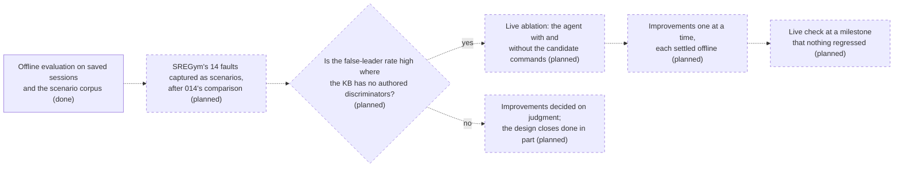

# 015 — Is the knowledge base helping? Evaluating it, then improving it

> **On hold** until design 014's comparison has run. The offline steps (steps 0 to 2b of the
> plan) are done: they read saved sessions and the scenario corpus, and changed nothing. The next
> step, capturing SREGym's faults as scenarios, and the decision after it wait for design 014's
> comparison ([#23](https://github.com/BenedatLLC/k8srca/issues/23)), and 014 is on hold until a
> first pass at design 011 is done. The later steps have not started. Nothing here changes the
> knowledge base's content, its search or the agent before 014's comparison, with one exception:
> the rendering fix for [#18](https://github.com/BenedatLLC/k8srca/issues/18) (§1.3), which goes
> in before 014's next tagged release (014's step 2b) and is not yet made.

The agent carries a knowledge base of symptoms and their candidate causes. This design asks
whether that knowledge base helps the agent reach the right cause, does nothing, or steers it
toward wrong causes, and then how to improve it. It started from design 014's baseline on
SREGym, an external benchmark of injected Kubernetes faults, where several failures looked
related to gaps in the knowledge base. To read it you need the knowledge base's shape (§1.1), the
idea of a hold-out (a test set we do not tune against;
[014 §3.1](014-sregym.md#31-the-suites-life-and-what-each-phase-may-do)), and the project's way of
planning a measurement ([process.md](../docs/process.md)). Project terms are defined in the
[glossary](../docs/glossary.md). The [plan](../plans/015-kb-evaluation.md) holds the steps, their
measurements and their results.

## 1. Problem

### 1.1 The knowledge base and how the agent reads it

The agent's `k8s-rca` skill (the instructions and files the platform downloads into the agent's
sandbox) carries a **knowledge base** (KB, [design 007](007-knowledge-representation.md)): alerts
and symptoms, the candidate causes of each (a *claim* in the KB format), and the facts that
support or rule out each candidate. The agent reads it through a script,
[`skills/k8s-rca/kb_query.py`](../skills/k8s-rca/kb_query.py), whose commands include:

- `search "<text>"`: find alerts and symptoms whose text contains every word of the query;
- `lookup <alert or symptom>`: list its candidate causes and their checks;
- `open`: every candidate's standing given the facts recorded so far, with a `most likely:` line
  naming the leading candidate and its evidence grade (strong, moderate or weak);
- `claim <id>`: one candidate's full criteria;
- `fact`: record an observation the agent read from text, such as a log line.

The KB has 81 vendored alert records (imported from an outside alert catalogue). 13 symptoms have
authored rankings: candidate causes with written criteria (239 candidates in all), and 25 of the
vendored alerts map to those symptoms (32 alert names in all, counting 7 that come from the mined
layers). A symptom with an authored ranking is said to have **authored discriminators**. The KB is
the same on `main` as in `holdout-v2`, the git tag of the agent that design 014's baseline ran.

Design 007 groups alerts into *families* and leaves eight unmined (no authored layer built from
public guides), covering the 56 unconverted vendored alerts: `rollouts-and-jobs`,
`service-traffic` beyond latency, `nodes`, `networking`, `scaling`, `control-plane`, `access` and
`observability`. Their alerts are served by `kb_query.py`'s legacy path, which lists hypotheses
with no criteria to tell them apart. 007 leaves them because no scenario reaches any of them, so
mining one "would be unmeasurable".

### 1.2 What design 014's baseline showed

Design 014's baseline (arm A, the agent as tagged `holdout-v2`, run on SREGym-Lite's 14 hold-out
faults) found failures that look related to the KB
([014's baseline findings](../plans/014-sregym.md#findings-from-the-baseline), items 2 and 7, and
`baseline-summary.md` in 014's private suite repo, "Why the reasoning faults failed"):

- For five faults the evidence was available and the agent mostly did not read the object that
  held it. The KB has no candidate for DNS misconfiguration, credential staleness, retry
  amplification or Jobs that never complete, and `search "password"` and
  `search "authentication failed"` return "no match".
- KB coverage tracks scores (Spearman 0.69 over the eight comparable faults, p 0.04), but the
  covered families are also the loud ones, so coverage and ease cannot be told apart. Two
  uncovered faults were solved anyway. One fault (`search_rate`) used the KB heavily, was offered
  the wrong candidates, and scored 0 of 5.

### 1.3 What the offline steps added

The plan's offline steps read saved sessions and the scenario corpus. Their results are in the
[plan](../plans/015-kb-evaluation.md#results); in short:

- **Consulting the KB** (a session whose bash ran `kb_query.py open` or `lookup`) neither helped
  nor hurt in any way the baseline's sessions can show. Within the five faults where some attempts
  consulted and some did not, consulted attempts passed 3 of 11 and unconsulted 1 of 13, a
  difference inside the noise. Whether wrong answers adopt a KB candidate could not be measured
  reliably: two readers agreed on 70% of sessions, below the 85% set beforehand
  ([plan, step 1](../plans/015-kb-evaluation.md#step-1-the-steering-trace)).
- **Recall is not the problem on the scenario corpus; clutter and wrong leaders are.** The true
  cause is a top-level candidate in 11 of 12 cases, in lists of 6 to 13. `open` names a wrong
  leader in 2 to 5 of 12 cases, depending on the reading (printed or computed leader, any grade
  or confident only). Its printed `most likely:` line
  differs from the leader its ranking computes in 4 of 12 cases, a display defect
  ([#18](https://github.com/BenedatLLC/k8srca/issues/18)). The corpus has no case of a symptom
  without authored discriminators, which is the case this design is most concerned with
  ([plan, step 2a](../plans/015-kb-evaluation.md#step-2a-recall-and-false-leaders)).
- **Search misses come from vocabulary.** Search finds the wanted entry for 59% of the queries
  that have one, and returns no match for 31%: agents search with words they read in the cluster
  (`unschedulable`, `panic`, `exit 139`) that the KB's text does not contain
  ([plan, step 2b](../plans/015-kb-evaluation.md#step-2b-the-search-hit-rate)).

**The questions this design answers:**
1. Does the KB add value on faults like these, do nothing, or steer the agent wrong?
2. Which changes to the KB's content and to `kb_query.py` would help, and by how much?

## 2. Goal

When the design ends, as done, done in part or abandoned
([process.md §4](../docs/process.md#4-designs-end)), it records:
- the answer to question 1: the KB helps, hurts, or we cannot tell, with the evidence;
- the changes that shipped, each with its offline evidence;
- what remains.

Out of scope:
- **Tuning to SREGym's hold-out faults.** The aim is to evaluate whether the KB helps, not to fit
  it to the 14 faults (§3.1).
- **Writing KB entries from failing runs.** Entries come from public sources only (§3.1).
- **A finer ablation** than removing the candidate commands together. If the planned one is
  inconclusive, a finer one is a new plan (§4.4).

## 3. Approach

The design evaluates first and improves second. It measures the KB offline wherever it can, runs
one live counterfactual if the offline numbers justify it, and then makes improvements one at a
time, each settled offline before any live run. The diagram shows the order; dashed parts are
planned and not started.

### 3.1 What binds the design

- **Design 014's exposure rule** ([014 §3.1](014-sregym.md#31-the-suites-life-and-what-each-phase-may-do)).
  What the baseline reading showed is not used to design 014's arm B (the agent plus design 011's
  decision model) before 014's step 3 comparison. The KB is part of arm A's tag and arm B uses it
  unchanged, so no KB or search change is made before that comparison. The first steps only read
  saved sessions of the 14 hold-out faults, which the exposure rule allows as analysis; they are
  not used to design arm B.
- **No rule from one run** ([process.md §2](../docs/process.md#2-tripwires), tripwire 3). No KB
  text is written from one failing run. Entries for a family come from public sources through
  `k8srca kb mine`, are reviewed, and are measured on scenarios whose truth was written before any
  run. A fault's root-cause text may be a scenario's truth, and may never be the source of a KB
  entry.
- **Live runs only for effects larger than the noise**
  ([process.md §1](../docs/process.md#1-plan-the-measurement-before-building) and
  [§6](../docs/process.md#6-two-loops)). A change whose effect is smaller than the noise at an
  affordable n gets an offline evaluation, not a live run. Known noise: two n=5 arms of an
  identical agent differ by 2 or more on a 30%-pass dimension about 30% of the time. At n=70 an
  arm's pass rate has a standard error near 5.6 points, so a difference between two arms has one
  near 8. A live ablation can therefore detect swings of about 15 points or more, and not smaller
  effects.
- **Frozen instruments** ([process.md §5](../docs/process.md#5-the-instrument-is-frozen-per-design)).
  Each step fixes its instrument (the labelled corpus, the query labels, the arm definitions, the
  decision thresholds) before it measures.

### 3.2 Instruments

| Instrument | State | What it gives |
| --- | --- | --- |
| SREGym's per-attempt results (`results/<stamp>/k8srca/<fault>/*_results.csv`) | Exists; joined to 014's run records by step 0, outside this repo | Each attempt's `Diagnosis.success` (the judge's pass or fail) and composite score. 014's ledger holds only counts per fault |
| Saved sessions (Claude Managed Agents session events) | Exists | Every `kb_query.py` call and its output, every tool call and result, the answer |
| The scenario suite ([design 004](004-scenario-testing.md)): 15 scenarios in `tests/scenarios/`, captures in `BenedatLLC/k8srca-scenario-data` | Exists | Replayable clusters with a truth and a checklist; `open` can run offline on the facts derived from recorded tool results (`scenario record-results`) |
| `k8srca kb mine <family>` | Exists, about $5 a family | A draft knowledge layer from public guides, to review ([007 §8](007-knowledge-representation.md#8-mining-public-debugging-guides)) |
| KB candidate recall and false-leader rate | Built in step 2a: [`tests/kb_eval/measure_2a.py`](../tests/kb_eval/measure_2a.py), labels in [`tests/kb_eval/labels-2a.yaml`](../tests/kb_eval/labels-2a.yaml) | Whether `lookup` lists the true cause, and whether `open` names a wrong leader |
| Search hit rate | Built in step 2b: [`tests/kb_eval/measure_2b.py`](../tests/kb_eval/measure_2b.py), labels in [`tests/kb_eval/labels-2b.json`](../tests/kb_eval/labels-2b.json) | Whether the agents' `search` queries find the entry they wanted |
| SREGym faults as scenario captures | **To check** (step 2c, not started) | Scenarios for the unmined families. Needs a check that the capture tooling can record from the SREGym cluster through k8stools |

### 3.3 The measures

- **Candidate recall:** whether the true cause is among the candidates `lookup` and `open` list,
  its rank, and the number of candidates (clutter).
- **False-leader rate:** how often `open` names a confident leader that is wrong, or names one
  when the cause is not listed. It is the measure of whether the KB confuses the agent.
- **Search hit rate:** for each `search` query an agent issued, whether it found the entry the
  agent wanted, returned no match, or listed the wrong entries; and, for a query with nothing to
  find, whether it correctly returned no match.
- **The ablation**, the only counterfactual: arm A, the agent as shipped, against **A−cand** ("A
  minus candidates"), the same agent with `search`, `lookup`, `open` and `claim` removed from
  `kb_query.py` and from the skill text, keeping the facts layer, the cluster-architecture wiki
  and the method text. It answers whether the candidate commands as a whole help, not which part.

The ablation runs only if the false-leader rate on symptoms without authored discriminators is
25% or more. That rate needs cases the scenario corpus does not have, which is why SREGym's 14
faults are to be captured as scenarios once design 014's comparison has used them. After that
comparison they are *burned* (used, and no longer a hold-out), so they may be read and tuned on
([014 §3.1](014-sregym.md#31-the-suites-life-and-what-each-phase-may-do), phase C). Captured with a
truth and a checklist written before any run, they also give design 007 the scenario per family it
needs before mining a family.

### 3.4 The improvements considered

Each is one change for one thing, measured on the offline instruments before any live run. The
plan's [step 4](../plans/015-kb-evaluation.md#step-4--improve-the-kb-one-change-at-a-time-each-settled-offline-first)
gives each one's measure.

1. **Search aliases and log-line triggers.** "password authentication failed" maps to an
   authentication-failure entry, and a category listing replaces "no match". It addresses the
   vocabulary misses of §1.3.
2. **Coverage honesty.** For a symptom with no authored discriminators, say so and list classes to
   consider, and have `open` name no leader. It addresses false leaders where the KB cannot tell
   candidates apart.
3. **Open-world candidates and configuration checks.** A standing "not listed" candidate, and for
   each candidate the object to read (spec, env, ConfigMap) beside its log and metric checks. It
   addresses causes outside the KB and the five baseline faults where the agent did not read the
   object that held the evidence (§1.2).
4. **A survey routine for a vague question** ("something is wrong with X", with no symptom): a
   sweep of every workload kind and the configuration on the path.
5. **Mine the missing families** with `k8srca kb mine`, from public sources only: `networking`
   (DNS), `rollouts-and-jobs`, `service-traffic`, and new ones for credentials and authentication,
   and for timeouts and retries. About $5 a family. A family is mined once from public guides,
   without looking at the fault that reaches it, then measured on that fault's capture. This is
   where the rule against writing from one run matters most.

### 3.5 How it keeps the constitution

- **Read-only.** The offline instruments read saved sessions and recorded tool results; they call
  no model and no cluster. The capture in step 2c goes through k8stools, the only path to the
  Kubernetes API ([constitution A1](../docs/constitution.md#a1-k8srca-never-touches-the-kubernetes-api-directly)).
- **Hold-out data stays out of this repo.** The joined per-attempt table holds answers and scores
  of SREGym's hold-out faults, so it is not reproduced here; it and the session events are kept
  with the analysis scripts outside the repo ([014 §3.1](014-sregym.md#31-the-suites-life-and-what-each-phase-may-do)).
- **The instrument is frozen.** The scenario suite's grader and truth files are not changed. This
  design's own labels were committed before their first measurement
  ([constitution P3](../docs/constitution.md#p3-the-measuring-instrument-is-frozen-for-the-length-of-a-design)).

## 4. Alternatives considered

### 4.1 Symptom matching with a decision model instead of search aliases

Row 4 of [design 011 §2.1](011-decision-models.md#21-uses-beyond-the-first-pass), symptom matching
with a decision model (a small model that returns typed answers instead of text), addresses the
same problem as search aliases (§3.4, item 1). Aliases come first because they are simpler. If they
leave a high miss rate, the two are compared offline on the same held-back queries, as one of
011's later steps ([011's plan](../plans/011-decision-models.md#later-steps-only-if-they-look-promising)).
Design 011 otherwise targets text-read facts (facts that need a log read to decide) and does not
address the failures this design started from: not reading a configuration object, and stopping
at the first explanation.

### 4.2 A second condition for the ablation: wrong answers adopting a KB candidate

The ablation was also to go ahead if a third of wrong consulted answers named a KB-listed
candidate as the cause. It is not used, for two reasons: step 1 could not measure it reliably (two
readers agreed on 70% of sessions, below the 85% set beforehand), and a list as broad as the KB's
would meet it whatever the KB's effect. The model's reading put the share at 69%, which meets a
one-third threshold on its face, but any broad list would do the same. The decision to ablate
rests on the false-leader rate alone
([plan, step 1](../plans/015-kb-evaluation.md#step-1-the-steering-trace)).

### 4.3 Deciding whether to ablate on the scenario corpus now

Step 2a measured the false-leader rate on the 12 scenario cases, where three readings give 17% to
42% against the 25% line. None is adopted, because every case has an authored truth claim, so none
is the case the condition is about (`open` run on a bare alert, where the question is whether the
first-listed candidate misleads), and with n=12 one case moves a rate by 8 points. The owner chose
to wait for the SREGym faults as scenarios
([plan, step 2a](../plans/015-kb-evaluation.md#step-2a-recall-and-false-leaders)).

### 4.4 A finer ablation

A−cand removes the candidate commands together, so it cannot say which part helps or hurts. A
finer ablation would need more arms, each able to detect only swings of about 15 points (§3.1).
If A−cand comes out inconclusive, a finer ablation is a new plan, not an extension of this one.

### 4.5 KB entries written from the failing faults

Entries could be written for the five faults whose evidence the agent missed, aimed at those
faults directly. This is rejected: it writes rules from single runs
([process.md §2](../docs/process.md#2-tripwires), tripwire 3), and before 014's comparison it
would leak what the baseline showed into the agent being compared (§3.1).

### 4.6 A live run for each change

Each improvement could be measured live. At an affordable number of runs only swings of about 15
points can be seen (§3.1), and a change whose effect is smaller than the noise gets an offline
evaluation, not a live run. Each change is therefore settled offline and kept on that evidence,
with one live run at a milestone as a guard against regression, not as a way to see a gain.

## 5. What it changes

| Document or component | Change |
| --- | --- |
| The KB's content and [`kb_query.py`](../skills/k8s-rca/kb_query.py) | The improvements of §3.4 that pass offline, and only after design 014's comparison. None made yet |
| `open`'s printed `most likely:` line | Found wrong in 4 of 12 cases by step 2a ([#18](https://github.com/BenedatLLC/k8srca/issues/18)). Fixed under design 014's step 2b, in the tagged release both of 014's arms run on, not by this design. It is a display fix found on the scenario corpus, not a KB change |
| [007](007-knowledge-representation.md) knowledge representation | Supplies the KB's format, `kb mine`, and the requirement of a scenario per family that capturing the SREGym faults is meant to meet. Mining (§3.4, item 5) adds families 007 left unmined |
| [011](011-decision-models.md) decision models | Row 4 (symptom matching) is an alternative to search aliases (§4.1). 011 otherwise uses decision models for text-read facts and for deciding whether collected facts are enough to answer from. 011 takes up this design's results: [011's plan, step 2](../plans/011-decision-models.md#what-text-read-facts-change-in-the-ranking) uses `measure_2a.py` as its offline check for text-read facts and scores the computed leader rather than the printed line (#18); its step 1 runs the answer writer with and without `open`'s output, which bears on this design's question; [011 §2.1](011-decision-models.md#21-uses-beyond-the-first-pass) row 4 waits until the search aliases have been scored on the same queries, and notes the coverage limit |
| [013](013-what-changed.md) what changed | None. 013 is on hold and independent |
| [014](014-sregym.md) SREGym | None. It is the source of the findings, and its exposure rule governs the timing |
| The measuring instrument | None. The scenario grader and truth files are unchanged; this design's own labels are frozen before each measurement |
| Tests | [`tests/kb_eval/`](../tests/kb_eval/) holds the offline instruments and their labels |
| Upstream | None |

## 6. How we will know it worked

In outline; the [plan](../plans/015-kb-evaluation.md) states each step's hypothesis, expected
effect, budget, and done and stop criteria in full.
- **Offline instruments** (done): candidate recall, the false-leader rate and the search hit rate,
  on labels frozen before the first measurement.
- **The decision to ablate:** the ablation runs if the false-leader rate on symptoms with no
  authored discriminators, measured on the SREGym faults once captured, is 25% or more. Below that,
  the KB is not the main problem, improvements are decided on judgment where they are cheap, and
  the design closes done in part.
- **The ablation**, read by a rule fixed beforehand: A−cand ahead by 15 points or more means the
  KB is net harmful here; behind by 15 or more means it helps; within 15 either way means we cannot
  tell, and the question is decided on the offline evidence and said to be.
- **Each improvement** moves its offline measure without lowering recall, and is kept on that
  evidence. A live run at a milestone guards against a regression of 15 points or more across the
  faults the changes reach; a change that regresses is backed out.
- **Stop:** any tripwire of [process.md §2](../docs/process.md#2-tripwires) or of the plan's
  [tripwires for this design](../plans/015-kb-evaluation.md#tripwires-for-this-design); fewer than
  10 labelled cases in the corpus; or the budget, about $170 in all, spent.

## 7. Open questions

- [ ] **Can the SREGym faults be captured?** Whether the scenario capture tooling can record from
  the SREGym cluster through SREGym's view proxy (the filtered API endpoint SREGym gives agents;
  [014 §3.6](014-sregym.md#36-the-cluster-view-k8stools-reads-through-sregyms-view-proxy)),
  and how many of the 14 can be captured while faulted. If not, the corpus is the 15 existing
  scenarios, which reach few of the missing families; mining (§3.4, item 5) then cannot be
  measured and is decided on judgment, as 007 says of any family no scenario reaches. Answered by
  the plan's step 2c.
- [ ] **Which reading of the false-leader rate decides the ablation?** Printed or computed leader,
  any grade or confident only (§4.3). The owner decides once the SREGym faults supply cases of
  symptoms with no authored discriminators.
- [ ] **Coverage against loudness.** Coverage and ease are confounded in the baseline. The corpus
  and the ablation's fault set should include loud and quiet faults in the covered and uncovered
  families, and the coverage coding must be done before the outcomes are looked at.
- [ ] **Does a search miss cost a pass?** Step 2b did not check whether a session that got no
  match went on to reach the right entry another way.

---

## Appendix: history and results

**Results other documents cite.** The detailed results of the offline steps are in the plan's
appendix: [the join](../plans/015-kb-evaluation.md#step-0-the-join),
[the steering trace](../plans/015-kb-evaluation.md#step-1-the-steering-trace),
[recall and false leaders](../plans/015-kb-evaluation.md#step-2a-recall-and-false-leaders), and
[the search hit rate](../plans/015-kb-evaluation.md#step-2b-the-search-hit-rate). §1.3 summarises
them.

**History.**
- **2026-11-12.** Design drafted. Steps 0, 1 and 2a run. After step 1, the owner removed the
  second condition for the ablation (a third of wrong consulted answers adopting a KB candidate)
  and kept the false-leader rate alone (§4.2). Step 2a found
  [#18](https://github.com/BenedatLLC/k8srca/issues/18).
- **2026-11-13.** Step 2b run. After step 2a, the owner decided to wait for the SREGym faults as
  scenarios rather than adopt one of the three readings of the condition for the ablation (§4.3).
- **2026-11-14.** The owner scheduled the #18 rendering fix under design 014's step 2b, in the
  `holdout-v3` tag both of 014's arms are built on, together with
  [#15](https://github.com/BenedatLLC/k8srca/issues/15) and
  [#17](https://github.com/BenedatLLC/k8srca/issues/17). It is a display fix found on the scenario
  corpus, not a KB change. Design 011 was revised to use step 2a's instrument (§5).
