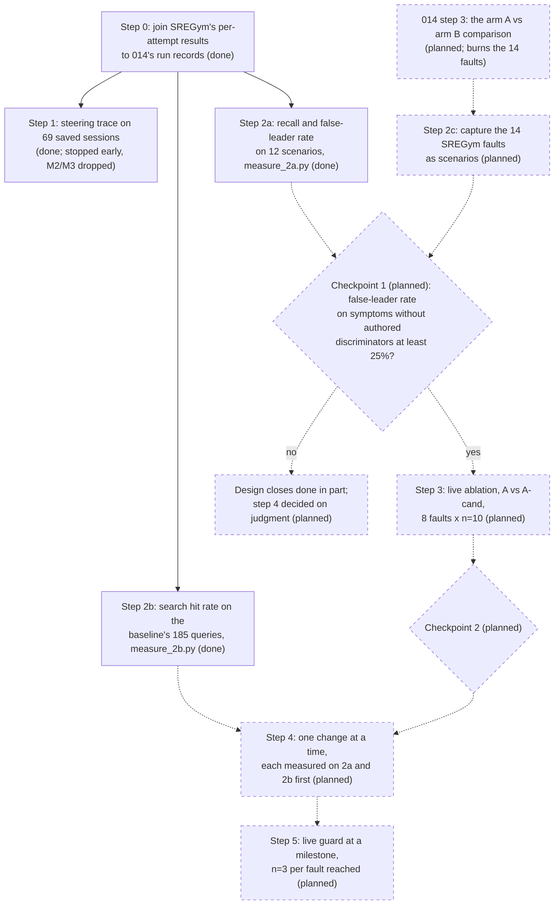

# 015 — Is the knowledge base helping? Evaluating it, then improving it

**Status:** in progress. Steps 0 to 2b are done: they read saved sessions and the scenario
corpus offline, and changed nothing (§10). Step 2c and checkpoint 1 wait on design 014's step 3,
and 014 is on hold until design 011 is implemented; steps 3 to 5 have not started. Nothing here changes the knowledge base's content, its search
utility or the agent before 014's step 3 comparison has run, with one exception: the rendering
fix for [k8srca#18](https://github.com/BenedatLLC/k8srca/issues/18) (§10.3), which goes in
before the next hold-out tag (014's step 2b) and is not yet made. **Last updated:** 2026-11-14.

**Related:** [007 — Knowledge representation](007-knowledge-representation.md) ·
[011 — Decision models](011-decision-models.md) · [014 — SREGym](014-sregym.md) ·
[`docs/process.md`](../docs/process.md)

The agent carries a knowledge base of symptoms and their candidate causes. This design asks
whether that knowledge base helps the agent reach the right cause, does nothing, or steers it
toward wrong causes, and then how to improve it. It started from design 014's baseline on
SREGym, an external benchmark of injected Kubernetes faults, where several failures looked
related to gaps in the knowledge base. To read it you need the knowledge base's shape (§1), the
idea of a hold-out (a test set we do not tune against; design 014 §3), and the project's way of
planning a measurement ([`docs/process.md`](../docs/process.md)). Project terms are defined in
the [glossary](../docs/glossary.md).

## 1. The question

The agent's `k8s-rca` skill (the instructions and files the platform downloads into the agent's
sandbox) carries a **knowledge base** (KB, [design 007](007-knowledge-representation.md)): alerts
and symptoms, the candidate causes of each (a *claim* in the KB format), and the facts that
support or rule out each candidate. The agent reads it through a script,
[`skills/k8s-rca/kb_query.py`](../skills/k8s-rca/kb_query.py), whose commands include:

- `search "<text>"`: find alerts and symptoms whose text contains every word of the query;
- `lookup <alert or symptom>`: list its candidate causes and their checks;
- `open`: every candidate's standing given the facts recorded so far, with a `most likely:` line
  naming the leading candidate and its evidence grade (strong, moderate or weak);
- `claim <id>`: one candidate's full criteria;
- `fact`: record an observation the agent read from text, such as a log line.

The KB has 81 vendored alert records (imported from an outside alert catalogue). 13 symptoms have
authored rankings: candidate causes with written criteria (239 candidates in all), and 25 of the
vendored alerts map to those symptoms (32 alert names in all, counting 7 that come from the mined layers). A symptom with an authored ranking is said to have *authored
discriminators*. The KB is the same on `main` as in `holdout-v2`, the git tag of the agent that
design 014's baseline ran. Design 007 groups alerts into *families* and leaves eight unmined (no
authored layer built from public guides), covering the 56 unconverted vendored alerts:
`rollouts-and-jobs`, `service-traffic` beyond latency, `nodes`, `networking`, `scaling`,
`control-plane`, `access` and `observability`. Their alerts are served by `kb_query.py`'s legacy path, which lists
hypotheses with no criteria to tell them apart. 007 leaves them because no scenario reaches any
of them, so mining one "would be unmeasurable".

Design 014's baseline (arm A, the agent as tagged `holdout-v2`, run on SREGym-Lite's 14 hold-out
faults) found failures that look related ([014 §10.1](014-sregym.md#101-findings-from-arm-as-baseline-step-2a),
items 2 and 7, and `baseline-summary.md` in 014's private suite repo, "Why the reasoning faults
failed"):

- For five faults the evidence was available and the agent mostly did not read the object that
  held it. The KB has no candidate for DNS misconfiguration, credential staleness, retry
  amplification or Jobs that never complete, and `search "password"` and
  `search "authentication failed"` return "no match".
- KB coverage tracks scores (Spearman 0.69 over the eight comparable faults, p 0.04), but the
  covered families are also the loud ones, so coverage and ease cannot be told apart. Two
  uncovered faults were solved anyway. One fault (`search_rate`) used the KB heavily, was offered
  the wrong candidates, and scored 0 of 5.

**The questions this design answers:**
1. Does the KB add value on faults like these, do nothing, or steer the agent wrong?
2. Which changes to the KB's content and to `kb_query.py` would help, and by how much?

**What it is not:** tuning to SREGym's hold-out faults. See §2.

## 2. Constraints: what binds this design

- **Design 014's exposure rule** ([014 §3](014-sregym.md#3-the-suites-life-and-what-each-phase-may-do)).
  What the baseline reading showed is not used to design 014's arm B (the agent plus design 011's
  decision model) before 014's step 3 comparison. The KB is part of arm A's tag and arm B uses it
  unchanged, so no KB or search change is made before that comparison. Steps 0 and 1 only read
  saved sessions.
- **Tripwire 3 of [`docs/process.md`](../docs/process.md#2-tripwires): no rule from one run.** No
  KB text is written from one failing run. Entries for a family come from public sources through
  `k8srca kb mine`, are reviewed, and are measured on scenarios whose truth was written before any
  run. A fault's root-cause text may be a scenario's truth, and may never be the source of a KB
  entry.
- **Live runs only for effects larger than the noise** ([process.md §1](../docs/process.md#1-plan-the-measurement-before-building)
  and [§6](../docs/process.md#6-two-loops)). A change whose effect is smaller than the noise at an
  affordable n gets an offline evaluation, not a live run. Known noise: two n=5 arms of an
  identical agent differ by 2 or more on a 30%-pass dimension about 30% of the time. At n=70 an
  arm's pass rate has a standard error near 5.6 points, so a difference between two arms has one
  near 8. A live ablation can therefore detect swings of about 15 points or more, and not smaller
  effects.
- **Frozen instruments** ([process.md §5](../docs/process.md#5-the-instrument-is-frozen-per-design)).
  Each step fixes its instrument (the labelled corpus, the query labels, the arm definitions, the
  decision thresholds) before it measures.

## 3. Instruments

| Instrument | State | What it gives |
| --- | --- | --- |
| SREGym's per-attempt results (`results/<stamp>/k8srca/<fault>/*_results.csv`) | exists; joined to 014's run records by step 0, outside this repo | each attempt's `Diagnosis.success` (the judge's pass or fail) and composite score. 014's ledger holds only counts per fault |
| Saved sessions (Claude Managed Agents session events) | exists | every `kb_query.py` call and its output, every tool call and result, the answer |
| The scenario suite ([design 004](004-scenario-testing.md)): 15 scenarios in `tests/scenarios/`, captures in `BenedatLLC/k8srca-scenario-data` | exists | replayable clusters with a truth and a checklist; `open` can run offline on the facts derived from recorded tool results (`scenario record-results`) |
| `k8srca kb mine <family>` | exists, about $5 a family | a draft knowledge layer from public guides, to review ([007 §8](007-knowledge-representation.md#8-mining-public-debugging-guides)) |
| KB candidate recall and false-leader rate | built in step 2a: [`tests/kb_eval/measure_2a.py`](../tests/kb_eval/measure_2a.py), labels in `tests/kb_eval/labels-2a.yaml` | whether `lookup` lists the true cause, and whether `open` names a wrong leader |
| Search hit rate | built in step 2b: [`tests/kb_eval/measure_2b.py`](../tests/kb_eval/measure_2b.py), labels in `tests/kb_eval/labels-2b.json` | whether the agents' `search` queries find the entry they wanted |
| SREGym faults as scenario captures | **to check** (step 2c, not started) | scenarios for the unmined families. Needs a check that the capture tooling can record from the SREGym cluster through k8stools |

## 4. Steps

Each step is written in [`docs/process.md`](../docs/process.md#1-plan-the-measurement-before-building)'s
form: hypothesis, expected effect, whether the planned measurement can see it, budget, and done
and stop criteria. A *consulted* session is one whose bash ran `kb_query.py open` or `lookup`.

The diagram shows the order of the steps, what each reads, and where the checkpoints decide what
runs next. Solid boxes are done; dashed boxes are planned and not started.

### Step 0 — Join per-attempt results to the run records

**Done** (§10.1).

| | |
| --- | --- |
| **Hypothesis** | None; instrument preparation |
| **Expected effect** | The baseline summary's gaps where right-looking answers outnumber passes become explainable, and every later analysis can use the judge's per-attempt verdict instead of a keyword proxy |
| **Can we see it?** | Deterministic: per fault, the joined passes sum to the ledger's count |
| **Budget** | $0; about a day |
| **Done and stop** | Done when all 14 faults join and match the ledger. A fault whose records and attempts differ in number (a lost attempt, an orphan record) is marked and left out of per-attempt analyses |

### Step 1 — The steering trace on saved sessions

**Done, stopped early as planned** (§10.2): the matching rule did not reach 85% agreement.

| | |
| --- | --- |
| **Hypothesis** | Wrong answers adopt the KB's candidate list: among consulted sessions, a larger share of wrong answers than of right ones name a KB-listed candidate as the cause |
| **Expected effect** | If the KB steers, the two shares differ by about 25 points or more; if not, they are close |
| **Can we see it?** | Only coarsely. About 50 sessions consult the KB; the share comparison has a standard error near 15 points, so it detects only a difference of 30 or more. It is descriptive and will not settle the question |
| **Measures** | M1: the session consulted `open` or `lookup`. M2: the headline cause matches a candidate listed in that session's KB output. M3: it equals the candidate `open` ranked first. M4: the answer is right and its cause was not a KB candidate. Each split by per-attempt pass (step 0) |
| **Matching rule** | Written before reading, applied to a labelled sample of 40 answers by one reader and to 20 of them by a second. If agreement is below 85%, M2 and M3 are dropped and only M1 and M4 are reported |
| **Budget** | about $2 if a model reads; no cluster, no agent run |
| **Done and stop** | Done when a table for all 14 faults is written to the journal. Stop early if the matching rule cannot reach 85% |

### Step 2 — Offline instruments, before any change

**2a. Candidate recall and false-leader rate. Done** (§10.3). On a labelled corpus, record for each
case: whether the true cause is among the candidates `lookup` and `open` list (recall), its rank,
the number of candidates (clutter), and whether `open` names a confident leader that is wrong, or
names one when the cause is not listed. That last measure is the **false-leader rate**, the
measure of whether the KB confuses the agent. Corpus: the scenario captures that have a truth and
a KB mapping, and later the SREGym faults (2c). Truth labels are written before the first
measurement. No model call, so it costs nothing and can be repeated at will.

**2b. Search hit rate. Done** (§10.4). Collect every `kb_query.py search "<q>"` string the agents
issued in the saved sessions (the baseline's and the scenario suite's). A reader labels each with
the KB entry it wanted, or "none exists". Report the hit rate, the no-match rate and the
wrong-entry rate. Split the queries in half at random before any change; one half is for building
improvements, the other only for reporting.

**2c. SREGym faults as scenarios.**

> **Planned.** Waits for design 014's step 3 and for the capture check below.

After 014's step 3 comparison, the 14 faults are *burned*: they have been used and are no longer
a hold-out, so we may read and tune on them ([014 §3](014-sregym.md#3-the-suites-life-and-what-each-phase-may-do),
phase C). Capture each through k8stools with a truth and a checklist written before any run. That
gives 007 the "scenario per family" it needs before mining a family. **To check first:** whether
the scenario capture tooling can record from the SREGym cluster through SREGym's view proxy (the
filtered API endpoint SREGym gives agents; 014 §4.2), and how many of the 14 can be captured while
faulted.

| | |
| --- | --- |
| **Hypothesis** | The false-leader rate is high on symptoms without authored discriminators, and the search miss rate on queries about authentication, DNS and Jobs is high |
| **Expected effect** | A measurable false-leader rate and miss rate that a later change can move |
| **Can we see it?** | Yes. Both are deterministic over a fixed corpus and a fixed query set, with no sampling noise |
| **Budget** | $0 in model calls; about 1 to 2 weeks of engineering |
| **Done and stop** | Done when 2a and 2b report on frozen labels. **Checkpoint 1** (§6) follows. Stop if the corpus has fewer than 10 labelled cases, as the numbers would mean little |

### Step 3 — The ablation (live, the only counterfactual)

> **Planned.** Runs only if checkpoint 1 (§6) passes it, which waits on step 2c.

| | |
| --- | --- |
| **Hypothesis** | Removing the KB's candidate-listing commands changes the pass rate on faults whose evidence is available |
| **Arms** | **A**: the agent as shipped. **A−cand** ("A minus candidates"): the same agent with `search`, `lookup`, `open` and `claim` removed from `kb_query.py` and from the skill text, keeping the facts layer, the cluster-architecture wiki and the method text. It answers whether the candidate commands as a whole help, not which part |
| **Faults** | The eight of the 14 SREGym faults not confounded by a tool gap or by the wiki artifact (014 §10.1 items 3, 4, 5 and 7), after 014's step 3 has burned them; n=10 per arm (80 attempts each) |
| **Expected effect** | Unknown in sign. Planned to detect a swing of 15 points or more |
| **Can we see it?** | Only that large. Smaller differences are inside the noise, and the step says so beforehand |
| **Decision rule (fixed now)** | A−cand ahead by 15 points or more: the KB is net harmful here, and step 4 starts with 4.2 and 4.3. A−cand behind by 15 or more: the KB helps, and step 4 targets coverage. Within 15 either way: **cannot tell**, decided on the offline evidence and said so (process.md tripwire 1, two inconclusive arms, applies if step 5 is also inconclusive) |
| **Budget** | about $50 per arm (the baseline cost $0.57 an attempt) and about 12 hours of wall clock per arm |
| **Done and stop** | Done when both arms are scored. Requires checkpoint 1. Stopped if an arm loses attempts to the harness; a lost attempt is rerun, not scored |

### Step 4 — Improvements, one at a time, each settled offline first

> **Planned.** Nothing here starts before 014's step 3 has run.

Each is one change for one thing (process.md tripwire 2: a third change aimed at one thing stops
work for a checkpoint). Each is measured on 2a and 2b before any live run.

| # | Change | Offline measure | Live? |
| --- | --- | --- | --- |
| 4.1 | **Search:** aliases and log-line triggers ("password authentication failed" maps to an authentication-failure entry), and a category listing in place of "no match" | hit rate on the held-back query half; no drop in 2a recall | no |
| 4.2 | **Coverage honesty:** for a symptom with no authored discriminators, say so and list classes to consider, and have `open` name no leader | false-leader rate down; recall unchanged | no |
| 4.3 | **Open-world candidates and configuration checks:** a standing "not listed" candidate, and for each candidate the object to read (spec, env, ConfigMap) beside its log and metric checks | recall of causes that live in configuration | at a milestone |
| 4.4 | **A survey routine for a vague question** ("something is wrong with X", no symptom): a sweep of every workload kind and the configuration on the path | needs live behaviour | at a milestone |
| 4.5 | **Mine the missing families** with `k8srca kb mine`, from public sources only: `networking` (DNS), `rollouts-and-jobs`, `service-traffic`, and new ones for credentials and authentication, and for timeouts and retries. About $5 a family | recall and false-leader rate on the corpus | at a milestone |

4.5 is where the "no rule from one run" tripwire matters most. A family is mined once from public
guides, without looking at the fault that reaches it, then measured on that fault's capture. A
second iteration on the same family is a checkpoint, not another edit.

**Alternative for 4.1:** row 4 of [design 011 §5](011-decision-models.md#5-where-it-could-help-ranked),
symptom matching with a decision model (a small model that returns typed answers instead of
text), addresses the same problem. If 4.1's aliases leave a high miss rate, compare the two
offline on the same held-back queries, as part of 011's step 5. Design 011 otherwise targets
text-read facts (facts that need a log read to decide) and does not address the failures this
design started from: not reading a configuration object, and stopping at the first explanation.

### Step 5 — Live confirmation at a milestone

> **Planned.** Follows step 4.

| | |
| --- | --- |
| **Hypothesis** | The changes that passed offline do not regress, and 4.3 to 4.5 move the faults they reach |
| **Design** | Arm A (the agent as shipped) against arm A plus the changes that passed offline, n=3 per fault reached ([process.md §6](../docs/process.md#6-two-loops), the outer loop), on the burned set |
| **Can we see it?** | A regression of 15 points or more across the reached faults, not a small gain. A change is kept on its offline evidence, with the live run as a guard |
| **Budget** | about $40 |
| **Done and stop** | Done when no change regresses. A change that does is backed out |

## 5. Tripwires specific to this design

These add to [process.md §2](../docs/process.md#2-tripwires)'s tripwires; any one stops work for a
checkpoint.

1. **A KB entry written from an SREGym fault's run or root-cause text** (process.md tripwire 3).
   Entries come from public sources only.
2. **The instrument moved.** The corpus labels, the query labels, the arm definitions or the
   decision thresholds changed after a measurement began.
3. **Drift.** The work becomes tuning the KB to the 14 faults instead of evaluating whether it
   helps.
4. **Two inconclusive arms in a row** (step 3 and step 5).

## 6. Checkpoints and who decides

- **Checkpoint 1, after steps 0 to 2.** The owner decides whether step 3 is justified, on one
  condition: step 3 goes ahead if step 2a's false-leader rate on symptoms with no authored
  discriminators is 25% or more. If it is below 25%, the KB is not the main problem, step 4 is
  decided on judgment where it is cheap, and the design closes as done in part. A second
  condition, that a third of wrong consulted answers adopt a KB-listed candidate, is not used:
  step 1 could not measure it reliably (§10.2), and a list as broad as the KB's would meet it
  whatever the KB's effect. The scenario corpus has no case of a symptom without authored
  discriminators, so the condition cannot be decided until step 2c supplies such cases (§10.3).
- **Checkpoint 2, after step 3.** Continue to step 4 as the decision rule says, change the plan,
  or close.
- **The design ends** as done, done in part or abandoned ([process.md §4](../docs/process.md#4-designs-end)),
  with: the answer to question 1 (helps, hurts, or cannot tell), the changes that shipped with
  their offline evidence, and what remains.

## 7. Budget and calendar

| Steps | Model spend | Work |
| --- | --- | --- |
| 0 to 2 | about $2 | 1 to 2 weeks |
| 3 | about $100 for both arms | about 24 hours of wall clock |
| 4 | about $25 for mining | days, offline |
| 5 | about $40 | about 12 hours |
| **Total** | **about $170** | |

Steps 0 and 1 could run during 014 and have. Steps 2c to 5 wait for 014's step 3, and the KB is
not touched before then. The #18 rendering fix goes in under 014's step 2b, so both of 014's arms
carry it. The figures use the baseline's $0.57 an attempt and about 8 to 9 minutes of wall clock
an attempt.

## 8. Risks and unknowns

- **Per-attempt joins.** A fault with a lost attempt or an orphan record has more session records
  than attempts. Step 0 marks and excludes those.
- **Can the SREGym faults be captured?** Unchecked (2c). If not, the corpus is the 15 existing
  scenarios, which reach few of the missing families; step 4.5 then cannot be measured and is
  decided on judgment, as 007 says of any family no scenario reaches.
- **Loudness.** Coverage and ease are confounded in the baseline. The corpus and the step 3 fault
  set should include loud and quiet faults in the covered and uncovered families, and the
  coverage coding must be done before the outcomes are looked at.
- **A−cand is a blunt arm.** It removes the candidate commands together. If it comes out
  inconclusive, a finer ablation is a new plan, not an extension.
- **Reading the baseline.** Steps 0 and 1 read saved sessions of the 14 hold-out faults, which
  014 §3's exposure rule allows as analysis; they are not used to design arm B.

## 9. Relation to other designs

- **[007](007-knowledge-representation.md)** supplies the KB's format, `kb mine`, and the
  "scenario per family" requirement that step 2c is meant to meet.
- **[011](011-decision-models.md)**: row 4 (symptom matching) is an alternative to step 4.1.
  Decision models otherwise target text-read facts. 011 takes up this design's results:
  [011 §9](011-decision-models.md#9-later-steps-in-outline) step 2 uses `measure_2a.py` as its
  offline instrument and floor, scores the computed leader rather than the printed line (#18),
  and states its expected live effect as small; [011 §5](011-decision-models.md#5-where-it-could-help-ranked)
  row 4 waits until step 4.1's aliases have been scored on the same queries, and notes the
  coverage limit.
- **[013](013-what-changed.md)** is parked and independent.
- **[014](014-sregym.md)** is the source of the findings, and its exposure rule governs the timing.

## 10. Results

| Step | Plan | Outcome | Decision |
| --- | --- | --- | --- |
| 0 | §4 | Done 2026-11-12. All 14 faults join to the ledger; 69 of 70 attempts joined | Done |
| 1 | §4 | M1 and the within-fault comparison reported; M2 and M3 dropped (matching rule agreement 70%, below 85%) | Stopped early as planned; no evidence of steering, none against it |
| 2a | §4 | Done 2026-11-12 on 12 cases (§10.3): recall 11 of 12 at the top level; printed false-leader rate 5 of 12 at any grade, 2 of 12 at strong or moderate; the corpus has no case of a symptom without authored discriminators | Checkpoint 1's condition cannot be decided as worded; owner: wait for 2c. #18's fix scheduled under 014 step 2b |
| 2b | §4 | Done 2026-11-13: on the report half, search finds the wanted entry for 59% of queries that have one; 31% return no match | Informs step 4.1; not a condition for step 3 |

### 10.1 Step 0: the join

Each row of SREGym's `results/*/k8srca/<fault>/*_results.csv` was matched to a suite run record by
answer text (`Diagnosis.submission` against the record's `answer`, `raw_answer` or
`first_answer`), then the latest five rows per fault were taken as the final clean set. Their
`Diagnosis.success` counts equal the ledger's `passes` for all 14 faults (25 in all). The one
exception to 70 joined attempts is `service_dns_resolution_failure_social_network`, whose lost
(`incomplete`) attempt has no submission; it is left out of per-attempt analyses, as planned,
leaving 69. Session events for the 69 were fetched by `session_id` and saved with the analysis
scripts outside the repo. Which attempt of `service_dns` passed is known from the CSV. The joined
table is not reproduced here because it holds answers and scores (014 §3).

### 10.2 Step 1: the steering trace

Cost: about $1 of Claude Sonnet 5.5 labelling. 46 of the 69 sessions consulted the KB (M1).

**M1, consulted, by the judge's verdict (step 0):** 14 of 25 passing attempts (56%) and 32 of 44
failing ones (73%). This is confounded by fault: `edge_request_filter` and `kafka_poison_pill`
pass 5 of 5 with no consultation at all, while the faults in the KB's covered families are
consulted every time and pass less.

**Within the five faults where some attempts consulted and some did not**, consulted attempts
passed 3 of 11 and unconsulted 1 of 13. That is 27% against 8%, a difference inside the noise (one
fault, `finalizer_deadlock`, supplies 3 of the 4 passes). It does not say consulting helps, and it
gives no sign that consulting hurts.

**M2 and M3 (the answer names a KB-listed candidate; the one `open` ranked first): dropped.** A
model read all 46 consulted sessions under the rule fixed beforehand (§4, step 1). Its labels gave
M2 79% of passing and 69% of failing attempts (22 of 32 wrong answers named a listed candidate) and
M3 36% and 34%. A second reader then labelled 20 sessions, seeing the answer's opening and the KB
item names but not the model's labels. The two agreed on 14 of 20 (70%). Five of the six
disagreements are the same judgment: whether a more specific cause than any listed item (a hung
`rate` handler against "downstream dependency slow"; a pod unschedulable for a combined affinity
and volume reason against "pod-not-scheduled") counts as listed. The rule does not settle it. The
agreement is below the 85% the plan set, so M2 and M3 are not reported as findings, and the rule
is not reworded and re-run on the same sessions. Deviations from the plan: the first reader was a
model, not a person, and the second read 20 sessions, not a labelled 40 and 20.

**M4 (right and the cause not a KB candidate)**, from the model's labels and so of lower
confidence: 3 of 14 passing consulted attempts.

**What this supports.** The planned hypothesis was a 25-point gap between wrong and right answers
in how often they adopt a KB candidate. The model's labels show none (wrong 69%, right 79%), and
the labels are too uncertain to rely on. Two things can be said without the matching rule: the
KB's output is long and mostly generic (the lists run to 20 or more items, most of them broad), so
almost any answer overlaps it; and wrong answers do not stand out by consulting it more once the
fault is accounted for. Neither shows the KB confuses the agent; neither shows it helps.

**For checkpoint 1.** The condition on wrong answers adopting a KB candidate cannot be tested
without M2. The model's 69% meets a one-third threshold on its face, but any broad list would meet
it, so it is not evidence of steering. Checkpoint 1 therefore rests on step 2a's false-leader rate
alone (§6).

### 10.3 Step 2a: recall and false leaders

Labels: `tests/kb_eval/labels-2a.yaml`, committed (`7e9999a`) before the first run. Script:
[`tests/kb_eval/measure_2a.py`](../tests/kb_eval/measure_2a.py)
(`uv run python tests/kb_eval/measure_2a.py`), no model, no cluster. 12 cases from the 15
scenarios: three have no KB claim or no symptom to open (`itbench-31`, `itbench-80`,
`nothing-is-wrong`), and the two `jvm-oom-*` cases are near copies. `open` ran on the facts the
facts layer derives from each scenario's recorded results, without the text-read facts an agent
would add, so each standing is a floor.

**Recall (what `lookup` lists).** The true cause is a top-level candidate in 11 of 12 cases, at
rank 1 to 4 of a list of 6 to 13 (one at rank 9 of 9: `gc-thrashing-near-memory-limit`). In the
twelfth (`pvc-pending-no-storageclass`) it is reachable below a candidate. Recall is not the
problem on this corpus; clutter (6 to 13 candidates, most of them not the cause) is the cost.

**Leader (what `open` prints on the `most likely:` line).**

| | correct | false leader | no leader |
| --- | --- | --- | --- |
| as printed | 5 | 5 (2 strong, 3 weak) | 2 |
| as `ranking` computes it among the symptom's candidates | 6 | 3 (all strong) | 3 |

The false leaders: `application-release`, graded strong, for `deploy-regression` and
`liveness-probe-wrong-port`; and a weak "application crash; within it, port already in use" for
`itbench-24-kafka-port-change`, `jvm-oom-on-startup` and `jvm-oom-with-metrics`. The last two are
`oom-kill` in truth, and `oom-kill` had the highest grade (moderate).

**A defect in `open`'s output ([k8srca#18](https://github.com/BenedatLLC/k8srca/issues/18)).**
`ranking` computes the right leader for the two `jvm-oom-*` cases (`oom-kill leads (moderate)`),
but `fmt_open` prints the first depth-0 claim found in a flat set of every group's leaders
([`kb_query.py`](../skills/k8s-rca/kb_query.py), `top = [cid for d, cid, _ in rows if d == 0 and
cid in leads]`). `application-crash` is in that set because it leads the sub-causes of
`failing-init-container`, so it prints as "most likely" at weak while `oom-kill` waits in the
undecided list. The printed line differs from the computed leader in 4 of 12 cases. The same weak
line ("application crash; within it, port already in use") appears in the saved SREGym sessions'
`open` output. The code is unchanged on `main`; the fix is scheduled under 014's step 2b (§2).

**Checkpoint 1's condition, under three readings.** The condition is a false-leader rate of 25% or
more on symptoms with no authored discriminators. All 12 cases have an authored truth claim, so
there is no case for the condition as worded. The case it is about is `open` run on a bare alert,
where the question is whether the first-listed candidate misleads; that needs a corpus the
scenarios do not supply (the SREGym faults after 014's step 3, step 2c). On the cases that exist:

| reading | rate | against 25% |
| --- | --- | --- |
| printed, any grade | 5 of 12 (42%) | meets |
| printed, confident only (strong or moderate), as §4 describes it | 2 of 12 (17%) | does not meet |
| computed leader, any grade | 3 of 12 (25%) | meets, at the line |

Two cautions on the confident readings. Both are `application-release`, which is true at a coarse
level in `deploy-regression` and `liveness-probe-wrong-port` (both are rollouts that introduced
the fault) and wrong only in being less specific than the cause. The labels fixed beforehand call
it a false leader, and that is what is counted. And n is 12: one case moves a rate by 8 points.

**Decision (owner): wait for 2c.** No reading is adopted. Step 3 stays conditioned on the
false-leader rate on symptoms with no authored discriminators, to be measured on the SREGym faults
once they are scenarios (2c, after 014's step 3, and only if capture works; §8). The numbers on
the scenario corpus do not settle which reading should decide, and the defect is a reason to fix
the rendering, which is a code change scheduled under 014's step 2b so that both of 014's arms
carry it.

### 10.4 Step 2b: the search hit rate

Corpus: every `kb_query.py search` run in the 69 joined baseline sessions, 185 queries, 81
distinct texts. The scenario suite's saved runs hold answers only, no tool calls, so they
contribute nothing; the corpus is the baseline's. The distinct texts were split in half with
`random.Random(1502)` before labelling: the **build** half (105 queries) is for step 4.1's design,
the **report** half (80 queries, 40 distinct) is read only to report. A model labelled what each
query wanted from the query, the question and the next KB commands the agent ran, without the
search output. A second reader labelled 20 and agreed on 17 (85%, the bar step 1 used). The
disagreements were bare keywords (`configmap`, `hotel`) where the model read the agent's next
commands as intent. Labels: `tests/kb_eval/labels-2b.json`, committed (`124bbe4`) before the first
run. Script: [`tests/kb_eval/measure_2b.py`](../tests/kb_eval/measure_2b.py), which runs today's
search on each text. The knowledge base is identical to `holdout-v2`'s.

**Report half.**

| | queries | share |
| --- | --- | --- |
| something exists to find | 59 | |
| found (hit) | 35 | 59% |
| no match | 18 | 31% |
| listed entries, not the wanted one (wrong) | 6 | 10% |
| nothing exists for it | 21 | |
| search returned no match (right) | 16 | 76% |
| search listed entries anyway (spurious) | 5 | 24% |

The build half is close on the first block (60% hit, 23% no match, 17% wrong) and differs on the
second (60% spurious). That difference comes from small numbers and from the build half holding
the `credential`, `secret` and `auth` queries.

**What the misses are.** Agents search with the words they read in the cluster, and the KB's text
does not contain them: `unschedulable` (6 of the report half's 24 misses; the KB's pending-pod
entries say "no node has enough ..."), `podinitializing`, `panic`, `segfault`, `exit code`,
`exit 139`, `no reachable servers`. The search requires every word of the query to appear in an
entry's text (`cmd_search` in `kb_query.py`), so one absent word returns nothing. `timeout`,
`deadline` and `connect` list entries but not `request-latency` or `NetworkPolicyDenied`, the ones
the agent wanted. A bare application word (`hotel`, `otel`, `search`) cannot match and should not.

**The hypothesis (a high miss rate on authentication, DNS and Jobs queries) is not tested by the
report half**: it holds none of those queries. In the build half, the `credential`, `secret` and
`auth` queries (nothing in the KB covers them) listed entries anyway, so the failure there is the
opposite of a miss, and the one `403` query for the RBAC entry returned no match.

**What this supports.** A fifth to a third of searches return nothing for a query the KB could
answer, and the cause is vocabulary (aliases such as `unschedulable`, exit codes, signals and state
names), which is what step 4.1 proposes. It does not show that a miss costs a pass: whether a
session that got no match went on to reach the right entry another way was not checked. Step 4.1
can be built against the build half and checked on the report half, offline.

## Appendix: history

- **2026-11-12.** Design drafted. Steps 0, 1 and 2a run. After step 1, the owner removed the
  second condition for step 3 (a third of wrong consulted answers adopting a KB candidate) and
  kept the false-leader rate alone. Step 2a found k8srca#18.
- **2026-11-13.** Step 2b run. After step 2a, the owner decided to wait for step 2c rather than
  adopt one of the three readings of checkpoint 1's condition.
- **2026-11-14.** The owner scheduled the #18 rendering fix under design 014's step 2b, in the
  `holdout-v3` tag both of 014's arms are built on, together with k8srca#15 and #17. It is a
  display fix found on the scenario corpus, not a KB change. Design 011 was revised to use
  step 2a's instrument (§9).
