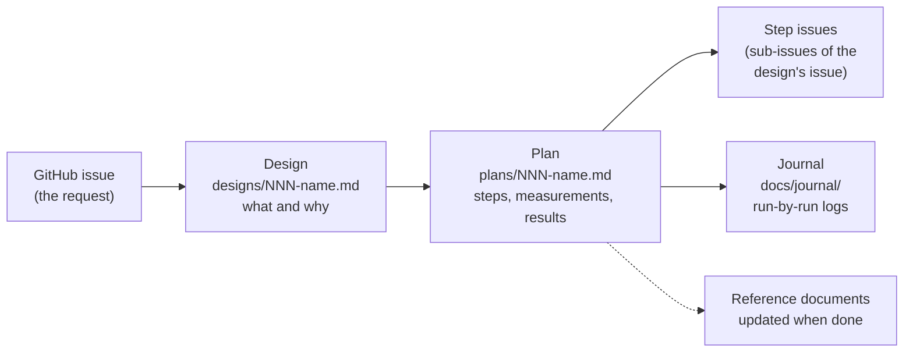
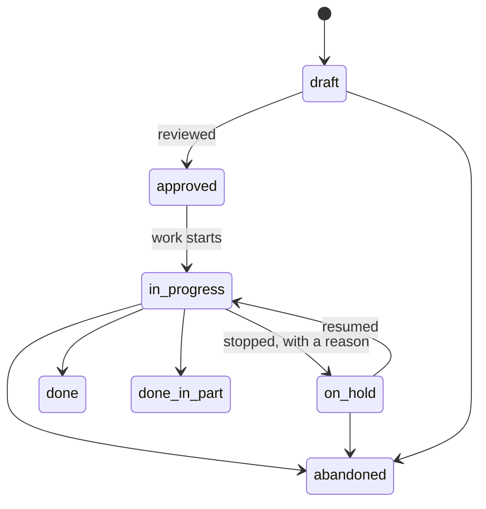

# Designs

This directory holds k8srca's design documents and the index of their status. It says when a
change needs a design, how designs relate to plans and results, what each status means, and how a
design is reviewed. The rules behind it are in the [constitution](../docs/constitution.md); how a
change is made day to day is in [development.md](../docs/development.md).

## Two kinds of document

- **Reference documents** describe the system as it is and are kept current as it changes:
  [001 — Architecture](001-architecture.md), [002 — Investigation model](002-investigation-model.md)
  and [003 — Operations](003-operations.md). They have no end state. Anything in them that is not
  built is labelled where it appears.
- **Change designs** (004 onward) each propose one change to the system: what it is, why, and what
  it would change. They go through the statuses below and end.

When a change design is done, the reference documents are updated to describe the result, so a
reader learns the current system from 001–003 without reading every design.

## When to write a design

Write a design when a change does any of these:
- changes how the agent behaves, and needs more than one step to build or measure;
- changes the architecture: a new process, tool server, credential, data store or external
  service, or a change to how the parts talk to each other;
- touches a rule in the [constitution](../docs/constitution.md), such as the read-only controls,
  what data leaves the network, or how measurements are graded;
- changes the measuring instrument across the suite (a new grading method, not one checklist
  fix);
- needs a budget or a decision someone else should see before work starts.

Do not write one for a bug fix, a one-step change to the agent (a plan is enough), tooling inside
the existing architecture, or documentation. An issue carries those
([development.md, "Kinds of change"](../docs/development.md#kinds-of-change)).

## Design, plan and results

Each change design has up to three parts, kept apart so the design stays short and stable while
the work moves:

| Part | Holds | Changes |
| --- | --- | --- |
| **Design** (`designs/NNN-name.md`) | The problem, the goal, the approach, alternatives considered and why they were rejected, what it changes in other designs, open questions | Rarely, once approved. A large change of direction is a new design that says what it replaces |
| **Plan** ([`plans/NNN-name.md`](../plans/README.md)) | The steps, each with the five fields of [process.md §1](../docs/process.md#1-plan-the-measurement-before-building), the issues that track them, and a results table with each step's outcome and any checkpoint decision | As work proceeds |
| **Journal** ([`docs/journal/`](../docs/journal/)) | Run-by-run measurement logs | Appended |

A design and its plan share a number and a name. A one-step change to the agent can have a plan
and no design.

Designs 004 to 010 and 012 predate this split and hold their plans and results inline. They stay
as they are; a design that resumes work moves its remaining steps into a plan. Designs 011 and
013 to 015 each have a plan ([index](../plans/README.md#plans)).

## Statuses

Every change design has one of these statuses, in its front matter
([writing.md](../docs/writing.md#front-matter-for-designs-and-plans)) and in the index below:

| Status | Meaning | Set by |
| --- | --- | --- |
| **draft** | Being written; not yet reviewed | The owner |
| **approved** | Reviewed and accepted; work has not started | The owner, after review |
| **in progress** | Being built or measured | The owner |
| **on hold** | Stopped before it ended, with the reason, the step it stopped at, and what would restart it | The owner |
| **done** | Every step met its done criterion. Work handed to another design, which says so, does not count against it | The owner, after review |
| **done in part** | Ended with some parts dropped and not carried anywhere; says which and why | The owner, after review |
| **abandoned** | Ended without the change shipping; says why and what was learned | The owner |

Reference documents have the status **reference**.

Rules:
- **One measured design at a time.** Only one design may spend the live-evaluation budget or
  change the agent being measured
  ([constitution P5](../docs/constitution.md#p5-one-measured-design-at-a-time)). The index marks
  it. Other designs can be drafted, built offline or reviewed alongside.
- **Designs end** ([constitution P10](../docs/constitution.md#p10-designs-end)): done, done in part
  or abandoned, with the reason. One that stops without ending is on hold.
- **Each design has an owner,** named in its front matter, who decides for it
  ([constitution P8](../docs/constitution.md#p8-the-owner-of-a-task-decides-for-it)).
- **When a design replaces part of another,** both say so: the new one in its "What it changes"
  section, the old one where the replaced part is described.

## Writing a design

Copy [TEMPLATE.md](TEMPLATE.md) to `designs/NNN-short-name.md`, taking the next free number, and
follow [writing.md](../docs/writing.md). Open an issue for it if there is none (labelled
`design`); the plan's steps become its sub-issues
([development.md](../docs/development.md#issues)). Get the design reviewed in a pull request before the plan's first step
starts.

## Reviewing a design

The reviewer checks:
- **The problem is real and stated with evidence:** a measurement, an incident, a ticket.
- **The goal can be checked:** someone could tell whether it was met.
- **It keeps the [constitution](../docs/constitution.md),** or proposes a change to it explicitly.
- **It fits the other designs and the code:** it names what it replaces, and does not quietly
  contradict a reference document.
- **The alternatives are real,** and each rejection has a reason.
- **It aims high enough.** The design says what the highest-impact version of the change would
  be and why it is or is not that version. "Lower risk" is a reason only with the expected
  effect of each beside it. A design whose own plan predicts "can't tell" has not answered this.
- **The plan's first steps are measurable** (the five fields), and the budget is stated.
- **A newcomer could read it** ([writing.md](../docs/writing.md)).

### An adversarial review before approval

Before a design moves from draft to approved, it gets one review whose job is to argue against
it. The reviewer is a person or a coding agent that did not write the design and has not read
its reasoning. They are given the goal the design serves and the evidence it cites (measurements,
baselines, the issues), and only then the design, and they argue the strongest case that it is
too timid, aimed at the wrong thing, or beaten by a different approach.

The review is posted as an issue labelled `design-input` and linked from the design. The owner
answers each point in the design: taken, or rejected with the reason
([constitution P8](../docs/constitution.md#p8-the-owner-of-a-task-decides-for-it)). A design
written with a coding agent is reviewed by a fresh agent session or by a person, not by the
session that wrote it.

One adversarial review per design is enough. A design revised in answer to its review does not
need another unless the owner asks for one.

- **Why:** design 011 listed a larger role for decision models three times and argued it down
  each time, and its comparison was pre-registered as "can't tell". An outside review
  ([#43](https://github.com/BenedatLLC/k8srca/issues/43)) made the case in one pass.

## Index

The status of every design, kept current. When a design's status changes, update its front matter
and this row in the same change. `*` marks the one measured design (P5).

| Design | Type | Status | Where it stands |
| --- | --- | --- | --- |
| [001 — Architecture](001-architecture.md) | reference | reference | Describes the platform as built: processes, sandboxes, tool wiring, Slack, security |
| [002 — Investigation model](002-investigation-model.md) | reference | reference | How the agent reasons. Built in part; partly replaced by 008 and 010 |
| [003 — Operations](003-operations.md) | reference | reference | Observability, rolling out changes. Built in part; deploying on Kubernetes is not built |
| [004 — Scenario testing](004-scenario-testing.md) | change | done in part | Recorded faults, replay, checklist grading and the regression rule are built; scenario 8, the feature-flag imports and the generic proxy are not |
| [005 — Modular architecture](005-modular-architecture.md) | change | draft | A proposed future structure. Only the generator interface and component evaluations are built |
| [006 — Hold-out suite](006-holdout-suite.md) | change | on hold | The kit is built and `holdout-v1` tagged; handing it to a colleague waits on the owner |
| [007 — Knowledge representation](007-knowledge-representation.md) | change | done in part | Five symptom families built; eight families and runbooks not built |
| [008 — Conclusions under incomplete evidence](008-conclusions-under-incomplete-evidence.md) | change | done in part | Ranking with strengths is built; its answer shape and grader were replaced by 010 |
| [009 — Metrics](009-metrics.md) | change | done in part | promtools and metrics replay are built, off in production; latency and throttling reports are not |
| [010 — Facts and short answers](010-facts-and-short-answers.md) | change | done | The facts layer, short answers with cited facts, checklist grading |
| [011 — A collector for the first reads, with decision models](011-decision-models.md) * | change | in progress | Code makes the first reads in one tool call inside today's session; a decision model reads logs where code is not enough; a fast answer is measured in shadow. Revised after two outside reviews ([#43](https://github.com/BenedatLLC/k8srca/issues/43), [#44](https://github.com/BenedatLLC/k8srca/issues/44)). Nothing built; [plan](../plans/011-decision-models.md) step 1 (offline) is next |
| [012 — Log evidence](012-log-evidence.md) | change | done | Whole-log search and log-span facts built; seeing when a policy appeared moved to 013 |
| [013 — What changed near the alert](013-what-changed.md) | change | on hold | Waits for 014 and 011's first pass, and for k8stools#38 |
| [014 — SREGym](014-sregym.md) | change | on hold | Baseline done (25 of 70); resumes when 011's first pass, three bug fixes and three k8stools tools are in one tagged release |
| [015 — Knowledge-base evaluation](015-kb-evaluation.md) | change | on hold | Offline steps done; the rest waits for 014's comparison |
| [kubewiki](../packages/kubewiki/docs/design.md) | reference | reference | The generator behind the architecture wiki |
