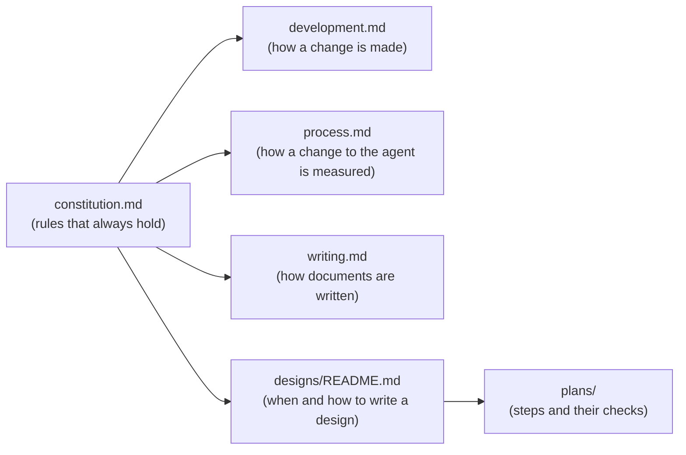

# k8srca constitution

These are the rules every change to k8srca must keep, whoever makes it: a developer, or a coding
agent working for one. Part 1 covers the system's architecture; part 2 covers how we work. Each
rule says why it exists and what enforces it, so a reader can tell a rule a test checks from one
that review has to catch.

Every review checks the change against this document
([development.md, "Review"](development.md#review)). When a rule and a design disagree, the
rule wins until this document is changed.

**Changing this document.** Open a pull request that says which rule changes and why. Both
developers must agree to it. Record the reason in the pull request, not in this file; git
history keeps it.

## Part 1: architecture

### A1. k8srca never touches the Kubernetes API directly

All Kubernetes API access goes through the k8stools MCP server. No part of k8srca may import the
`kubernetes` client, call `load_kube_config`, run `kubectl`, `helm` or `oc`, or read a
kubeconfig. This holds for build-time code as much as for anything the agent drives. The one
exception is `helm template` in kubewiki, which renders a pinned chart offline with no
credential ([CLAUDE.md](../CLAUDE.md)).

- **Why:** one credential has one holder, so the read-only property can be checked in one place;
  k8stools' tool list is the security boundary, and code that goes around it is not bound by it;
  and data read ahead of time goes stale, while the same data behind a tool can be read during
  the investigation that needs it.
- **Enforced by:** `tests/test_no_direct_cluster_access.py` and kubewiki's
  `packages/kubewiki/tests/test_kubewiki_boundary.py`, which parse every module.

### A2. Read-only, by more than one control

k8srca diagnoses and suggests. It never changes the cluster, and a fix appears only as text for
a person to apply. Four controls each block a write on their own: no mutating tools exist, the
sandbox holds no credentials, the sandbox cannot reach the cluster, and the tool server's
Kubernetes role has only read verbs
([001 §8](../designs/001-architecture.md#8-read-only-guarantee-and-security)). promtools, the
Prometheus server, can call only Prometheus' query endpoints.

- **Why:** an agent that can change a cluster needs a different level of trust, review and audit.
  The guarantee must not rest on the model choosing to behave.
- **Enforced by:** the tool lists of k8stools and promtools, the sandbox image's tests, the
  egress rules, and RBAC. A change that adds a write path of any kind needs a design and a change
  to this rule first.

### A3. Each credential has one holder

The kubeconfig is mounted only into the k8stools container. The Anthropic API key and the Slack
tokens are held by the orchestrator, the environment key by the poller, and the sandbox holds
none ([001 §8.6](../designs/001-architecture.md#86-who-holds-which-credential)). The in-process
development worker scrubs credentials from its environment before running agent-written commands.

- **Why:** a credential in two places doubles what has to be audited, and a sandbox that runs
  model-written commands must have nothing worth stealing.
- **Enforced by:** `settings.scrub_environment`, the sandbox image tests, and review.

### A4. A missing capability goes upstream

If the agent needs to see something k8stools cannot show, the fix is a k8stools feature, requested
as an issue on [k8stools](https://github.com/BenedatLLC/k8stools/issues), not code in k8srca that
reads it another way. The same holds for promtools and Prometheus. k8srca pins the k8stools
version it runs, and a new version goes into a release between measurements, never during one.

- **Why:** a workaround is a second path to the cluster (A1), and it would freeze into a skill
  what the tool could have read live.
- **Enforced by:** A1's test, and review. How to file one is in
  [development.md](development.md#upstream-changes-to-k8stools).

### A5. Code states the facts; the model judges

Observations from tool results become numbered facts in code
([design 010](../designs/010-facts-and-short-answers.md)). The model chooses what to check,
weighs the facts and writes the answer, citing the facts it relies on. A fact that needs text read,
such as a log, is stated by the agent or a decision model and marked as such.

- **Why:** in the measurements behind design 010, 55% of the agent's unsupported claims were
  counts, time spans and generalizations it derived by hand
  ([010 §1](../designs/010-facts-and-short-answers.md#1-why-what-the-measurements-showed)).
- **Enforced by:** the host's answer checks (every marker resolves to a fact, every figure in the
  prose appears in a cited fact), and review.

### A6. Optional services are off by default, and text is redacted before it leaves

Anything that sends cluster data to a service beyond the Anthropic API, such as a decision model
([design 011](../designs/011-decision-models.md)), is optional, off unless configured, and
redacts secrets before the text leaves. Prometheus is optional too.

- **Why:** k8srca must run with only k8stools and the Anthropic API, and an operator decides what
  leaves their network.
- **Enforced by:** configuration defaults in `src/k8srca/config.py` and `k8srca.yaml`, and review.

### A7. Tests are hermetic

`uv run pytest` needs no credentials, cluster or network. Anything that describes a real cluster
is a build artifact, not source: tests build the small examples they need in code. A test that
needs downloaded scenario data skips, saying so, until it has been fetched. Tests that cost money
or need a live system are opt-in (`K8SRCA_TEST_LIVE=1`).

- **Why:** anyone can run the whole suite at any time, including CI, and a test cannot pass only
  on one machine.
- **Enforced by:** CI running the suite with no credentials, and review.

### A8. The documents describe the system as it is

The design documents are authoritative. When the code and a design disagree, one of them is
changed in the same piece of work. Anything planned or not built is labelled as such where it
appears ([writing.md](writing.md)).

- **Why:** a new developer, or a coding agent, acts on what the documents say.
- **Enforced by:** review, which checks the documents a change affects.

## Part 2: how we work

### P1. Plan the measurement before building

A change judged by its effect on the agent's answers (the scenario suite, SREGym, or another
evaluation) states five things before any code is written: hypothesis, expected effect, whether
the measurement can see that effect at an affordable number of runs, budget, and what finishes or
stops the step ([process.md §1](process.md#1-plan-the-measurement-before-building)).

- **Why:** from 2026-09-20 to 2026-10-21 about $450 went on runs, and 21 of the last 25 measured
  comparisons were too small to tell from noise
  ([process.md](process.md)).
- **Enforced by:** the plan template ([plans/TEMPLATE.md](../plans/TEMPLATE.md)) and review of
  the plan.

### P2. Warning signs stop work, and a stop ends in a decision

The warning signs in [process.md §2](process.md#2-tripwires) (two inconclusive results in a row, a
third change aimed at the same thing, a rule written from one run, the grader changed mid-step, the
budget spent, drift from the goal) stop work on the step. Whoever notices one says so at once,
including a coding agent. The stop ends in a decision by the step's owner: continue, change the
plan, or close the step. It never ends in another small change to try.

- **Why:** the expensive failure on this project has been a run of small changes, each plausible,
  that together went nowhere.
- **Enforced by:** the plan's results table, and review.

### P3. The measuring instrument is frozen for the length of a design

The grader, the scenarios' truth files and their checklists do not change while a design is being
measured ([process.md §5](process.md#5-the-instrument-is-frozen-per-design)). Changing them is
its own piece of work, checked on saved answers first.

- **Why:** a result measured on a moving instrument cannot be compared with anything.
- **Enforced by:** the content digests the scenario runner records with every run, and review.

### P4. Hold-out tests stay unread

A hold-out test (one we never tune against) is not read, studied or used to design a change until
a hold-out run has used it. For SREGym's held-out faults that means their definitions, oracles
and the agent's answers on them ([014 §3](../designs/014-sregym.md#3-the-suites-life-and-what-each-phase-may-do)).
After the run, the test moves into the regular scenario suite.

- **Why:** a test we have tuned against no longer estimates how the agent does on problems it has
  not seen.
- **Enforced by:** the suite tooling prints only scores for held-out faults, and review.

### P5. One measured design at a time

Only one design at a time may spend the live-evaluation budget or change the agent that is being
measured. Other work (offline tools, documents, infrastructure, a design being drafted) can go on
alongside it, as long as it changes neither that agent nor the instrument (P3).

- **Why:** two designs measured at once confound each other, and an unfinished design left behind
  for a new one was the pattern that cost the most.
- **Enforced by:** the design index ([designs/README.md](../designs/README.md)), which shows which
  design is being measured.

### P6. Every piece of work has an issue, and an issue closes only when it is finished

Work is tracked as GitHub issues: defects, tasks, the steps of a plan, findings that should feed a
design, and requests to k8stools. An issue is closed only when the work is done (with the commit or
pull request that did it) or when its owner decides not to do it (with the reason). Deciding when
to do it is a comment, not a close.

- **Why:** closed issues that were only scheduled have hidden unfinished work.
- **Enforced by:** `Fixes #N` in pull requests, and review.

### P7. Every change is reviewed

Every pull request is reviewed before it merges, and the depth of the review matches the size of
the change. The reviewer is usually the other developer; the author may review their own change
when that is not practical. Every review checks three things: the change keeps this constitution, it matches its
design and plan (if it has one), and the code is correct and tested
([development.md, "Review"](development.md#review)).

- **Why:** two people now share the code, and the rules above are only as good as the check that
  catches a break.
- **Enforced by:** the pull request template. When the other developer is not available, or the
  change is small, the author may review their own pull request against the same three
  questions, and says so in it.

### P8. The owner of a task decides for it

Each design, plan or task has one owner, the developer doing it. The owner approves its plan and
budget and makes its checkpoint decisions (P2). The other developer reviews. Changes to this
constitution need both.

- **Why:** decisions are fastest where the context is, and review keeps them visible.
- **Enforced by:** the owner is named on the design, the plan and the issue.

### P9. Decisions are written down where they apply

A decision that changes a design, a plan or a rule is recorded in that document or its issue, with
its reason. A decision that exists only in a chat, a meeting or a coding agent's memory does not
bind the next person.

- **Why:** this project has had rules that lived only in an assistant's notes, and went stale
  there.
- **Enforced by:** review.

### P10. Designs end

A design ends as done, done in part, or abandoned, and says why. One that stops without ending is
put on hold, with a one-line reason and the step it stopped at
([designs/README.md](../designs/README.md#statuses)).

- **Why:** designs left open accumulated while new ones started.
- **Enforced by:** the design index.
