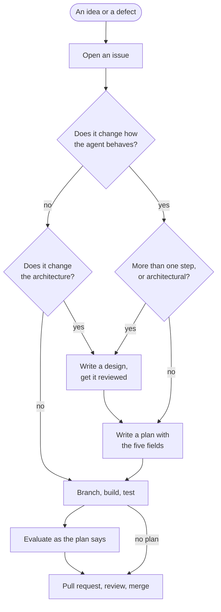
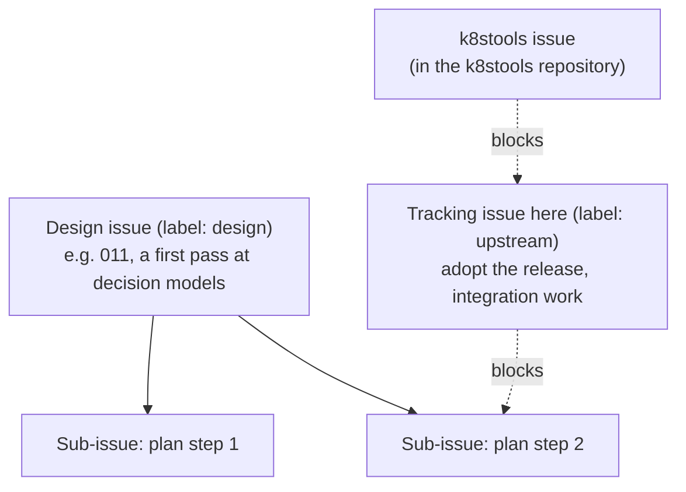

# Development workflow

This page is how a change gets from an idea to `main`: which kind of change needs what, how to
test it, when and how to run the evaluations, how to ask k8stools for a capability, and how
review works. It assumes you have read the [README](../README.md) and the
[constitution](constitution.md), the rules every change keeps. Project terms are defined in the
[glossary](glossary.md).

**Setup.** The README's [Development](../README.md#development) section lists what to install and
how to run k8srca with no cluster. `uv sync --extra dev` then `uv run pytest` is enough to start.
Run `uv run k8srca scenario fetch` once to download the recorded scenarios, or the tests that
read them skip.

## Kinds of change

What a change needs depends on what it touches. The biggest divide is whether it changes how the
agent behaves. A change to the agent can only be judged by measuring its answers, which is noisy
and costs money, so it needs a measurement plan before any code is written
([process.md](process.md)).

| Kind | Examples | Issue | Design | Plan | Evaluation |
| --- | --- | --- | --- | --- | --- |
| **Small fix** | A bug with a clear cause, a refactor that changes no behaviour, a docs correction | Yes (a typo needs none) | No | No | Tests |
| **Tooling or infrastructure** | CLI commands, scenario tooling, bring-up, CI | Yes | Only if it changes the architecture ([001](../designs/001-architecture.md)) | If it has several steps | Tests |
| **Change to the agent** | Prompts, skills, the knowledge base, facts, the tools an agent is given, answer checks, models | Yes | If it is more than one step or changes the architecture ([when](../designs/README.md#when-to-write-a-design)) | Always, with process.md's five fields | Tests, then offline evaluations, then live runs at the milestones the plan names |
| **Change to the instrument** | The grader, a scenario's truth file or checklist | Yes, its own | No | A short one | Re-grade saved answers; only between designs ([constitution P3](constitution.md#p3-the-measuring-instrument-is-frozen-for-the-length-of-a-design)) |
| **A k8stools capability** | A field or tool the agent needs | One on [k8stools](https://github.com/BenedatLLC/k8stools/issues), linked from one here | No | No | Adopting the new version is a change to the agent |



## Making a change, step by step

1. **Open an issue, or take an open one, and assign it to yourself before you start.** A new
   issue says what is wrong or wanted, with evidence (a scenario, a session id, a log line), what
   you propose, and how we will know it worked, and has a label ([below](#writing-an-issue)).
   Assigning yourself is your claim on the issue ([Claiming an issue](#claiming-an-issue)): you
   are its owner
   ([constitution P8](constitution.md#p8-the-owner-of-a-task-decides-for-it)).
2. **Branch** from `main` as `NNN-short-name`, where NNN is the issue number.
3. **Design and plan first, if the change needs them.** Write the design
   ([designs/README.md](../designs/README.md)) and the plan ([plans/README.md](../plans/README.md))
   and get them reviewed before building. A pull request that holds only the design and plan is
   the usual way.
4. **Build it, with tests.** New behaviour gets a test. If a test fails because of your change,
   fix the code, not the test, unless the test itself is wrong.
5. **Evaluate it** as the plan says ([Evaluations](#evaluations-cheapest-first)). Record the
   results in the plan.
6. **Update the documents** the change affects: the designs, the README, CLAUDE.md, the glossary
   ([constitution A8](constitution.md#a8-the-documents-describe-the-system-as-it-is),
   [writing.md](writing.md)).
7. **Open a pull request** with `Fixes #NNN` in its description and fill in the template. Ask the
   other developer to review it, or review it yourself against the same questions when that is
   not practical (a small change, or the other developer is away), and say so in the pull
   request.
8. **Merge** once it is approved. The issue closes through `Fixes #NNN`.

Commit messages say what changed and why, and name the issue. Keep commits focused: a refactor and
a behaviour change go in separate commits.

## Testing

```bash
uv run pytest                 # hermetic: no credentials, cluster or network
```

- Tests that read a recorded scenario skip until `uv run k8srca scenario fetch` has run. If a
  scenario was re-recorded since you fetched it, the fetch fails and names the stale files;
  `uv run k8srca scenario fetch --replace` fetches the pinned ones over them.
- Two suites are opt-in because they are not hermetic: `tests/test_live_mcp.py` against a running
  MCP server, and `tests/test_e2e_slack.py`, which runs real sessions and costs money. The
  README's [Testing](../README.md#testing) section has the commands.
- Concurrency has broken more often than anything else here, and a single-threaded test does not
  show it. `tests/test_poller_concurrency.py`, `tests/test_orchestrator.py::TestConcurrentThreads`
  and `TestEventDedup::test_exactly_one_racing_caller_wins` each fail if their fix is reverted.
  Keep them that way rather than weakening them.
- `tests/test_no_direct_cluster_access.py` enforces
  [constitution A1](constitution.md#a1-k8srca-never-touches-the-kubernetes-api-directly). If it
  fails, the fix is never to relax it.

## Evaluations, cheapest first

Most changes should be settled by the first three rows. A live run is for the milestones a plan
names in advance, on the scenarios the change can reach
([process.md §6](process.md#6-two-loops)).

| Level | What it tells you | Commands | Cost | When |
| --- | --- | --- | --- | --- |
| 1. Unit tests | The code does what it says | `uv run pytest` | Free | Always |
| 2. Offline evaluations of one component | One part of the agent on fixed input, with no live session | `k8srca eval answer` (the answer writer on fixed facts); `k8srca eval arch` (the architecture wiki on recorded clusters); `tests/kb_eval/measure_2a.py` and `measure_2b.py` (the knowledge base's ranking and search) | `eval answer` about $0.10 an answer; the others free (`eval arch --judge` about $0.22 a case) | When the change touches that component |
| 3. Re-grading saved answers | Whether a grader or checklist change moves scores, without new runs | `k8srca scenario rescore F` (free); `k8srca scenario checklist F --grades 3`; `k8srca scenario regrade F` | Free to a few dollars | When the instrument changes, as its own piece of work |
| 4. Live scenario runs | Whether the agent's answers got better or worse | `k8srca scenario run <ids> --n 3 --local-skill k8s-rca --save F`, then `k8srca scenario compare F` | About $0.20–0.70 a run, plus about $0.07 to grade each answer | At the plan's milestones. The full suite runs before a new baseline is recorded (`k8srca scenario baseline`) |
| 5. SREGym | How the agent does on a public benchmark, live | The private suite repository ([design 014](../designs/014-sregym.md)) | About $40 and ten hours for 14 faults × 5 attempts | Only as design 014's plan says |

How to read a live run:
- Three runs per scenario is what the regression rule reads
  ([004 §6.4](../designs/004-scenario-testing.md#64-sampling-and-the-regression-rule)). A scenario
  regresses when fewer of its runs meet every diagnosis item than in the baseline, or its mean
  checklist score falls by more than the baseline's spread. Anything smaller is noise, and
  `scenario compare` says so.
- `--local-skill k8s-rca` runs the skill from your working tree, so you can measure a change
  before it is synced to production.
- Scenario runs use their own Managed Agents environment (`ANTHROPIC_TEST_ENVIRONMENT_KEY`), never
  production's.
- Do not read or run anything held out
  ([constitution P4](constitution.md#p4-hold-out-tests-stay-unread)).

Before a live run, check [process.md §2](process.md#2-tripwires)'s warning signs. If one has
fired, stop and decide (continue, change the plan, or close the step) before spending more.

## Upstream changes to k8stools

[k8stools](https://github.com/BenedatLLC/k8stools) is a separate open-source project and the
agent's only path to the Kubernetes API
([constitution A1, A4](constitution.md#a4-a-missing-capability-goes-upstream)). When the agent
needs something k8stools cannot show:

1. **File an issue on k8stools.** Say what the agent needs to see and why, with the evidence (the
   scenario or SREGym fault, what the agent missed, what it would have needed), and a proposal: a
   new read-only tool, or a field on an existing one. Its maintainer reviews and releases it; we do
   not push to or release k8stools from here.
2. **Link it** from a k8srca issue for adopting it, and from the design that needs it.
3. **When it is released,** adopt it in a k8srca change: the version in
   `docker/Dockerfile.k8stools` (`K8STOOLS_VERSION`), the image tag in `docker/compose.yaml`, and
   the minimum in `pyproject.toml`. A new k8stools version changes the tools the agent sees, so it
   goes into a release between measurements, never during one. Recorded scenarios may need
   re-recording to use a new field.

Never work around a missing capability in k8srca, even for a build-time script. That is how
`arch/history.py` once read ReplicaSets directly; the fix was a k8stools tool
(`get_replicaset_summaries`, k8stools 1.2.0).

promtools (the Prometheus server) and kubewiki (the architecture-wiki generator) live in this
repository under `packages/` and follow the normal path. kubewiki must never import k8srca, which
its own test checks.

One trap: k8stools' own test suite binds port 8000, the same port as k8srca's k8stools container,
and will silently talk to the container if it is running.

## Releases and production

- **Production** gets a change through `uv run k8srca sync`, which uploads the skills and updates
  the agents and environment from `k8srca.yaml`. A running orchestrator keeps the agent versions it
  loaded at start, so restart it afterwards ([001 §6](../designs/001-architecture.md#6-configuration-and-provisioning)).
  The owner of a change runs sync after it merges, if it changes anything sync applies.
- **Tags.** `holdout-vN` tags mark the agent versions used for hold-out runs. Tags are created
  only when the owner of the measurement decides to, and never moved. The next one, `holdout-v3`,
  is [#22](https://github.com/BenedatLLC/k8srca/issues/22).

## Review

Every pull request is reviewed, and the review's depth matches the change
([constitution P7](constitution.md#p7-every-change-is-reviewed)). Every review answers three
questions:

1. **Does it keep the [constitution](constitution.md)?**
2. **Does it match its design and plan,** if it has them? Does it do what the issue asked, and no
   more?
3. **Is the code correct, tested and documented?** Do the tests cover the new behaviour? Do the
   documents it affects still describe the system?

What else to look at, by kind of change:

| Change | Also check |
| --- | --- |
| Documents only | Accurate against the code; follows [writing.md](writing.md); links resolve |
| Small fix | A test that fails without the fix |
| Tooling or infrastructure | Tests stay hermetic; no new path to a credential or the cluster |
| Change to the agent | The plan's five fields were written before the build; the evaluation ran as planned and was read with the regression rule; results and any checkpoint are recorded in the plan |
| Change to the instrument | Checked on saved answers; not made in the middle of a design |
| A new design or plan | [designs/README.md](../designs/README.md#reviewing-a-design)'s checklist; consistent with the other designs |

A coding agent can do a first pass (for example Claude Code's `/code-review`), but a person
approves. A self-review answers the same three questions and is noted in the pull request.

## Issues

Every piece of work has an issue, and an issue closes only when the work is done or its owner
decides not to do it, with the reason
([constitution P6](constitution.md#p6-every-piece-of-work-has-an-issue-and-an-issue-closes-only-when-it-is-finished)).
**The issues are the source of truth for the state of work:** what is open, who owns it, and what
blocks what, through sub-issues and "blocked by" links. Issues record dependencies, not priority:
the order among unblocked work, and why, is in [todo.md](todo.md), which also maps how the pieces
fit together. Where todo.md and the issues disagree on state, the issues win
([writing.md](writing.md#one-home-for-each-fact)).

### Claiming an issue

Assign an issue to yourself before you start work on it, and do not start work on an issue
assigned to someone else. The assignee is the claim: it is how two developers avoid picking up
the same issue independently.

- **Check the assignee first.** If the issue is assigned to someone else, ask them; work on it
  only once they have handed it over and the assignee is changed.
- **Claim when you start, not before.** An assignment says someone is working on the issue now,
  so do not assign yourself issues you only mean to get to.
- **Release what you stop.** If you put an issue down, unassign yourself and leave a comment
  saying where the work stands and where any branch is.

```bash
gh issue edit 42 --add-assignee @me       # claim
gh issue edit 42 --remove-assignee @me    # release
```

### Writing an issue

Issues follow the [writing guidelines](writing.md): someone new to the project should understand
one without asking.

- **The title is one plain sentence about the problem or the need,** as a reader would put it. No
  internal labels, no two thoughts joined by a semicolon, and no schedule ("fix after …"): when it
  will be done is shown by its relationships (what blocks it) and explained in a comment.
  - Not: "kubewiki: the wiki names a component the agent's view hides (SREGym load-generator);
    further scope to discuss"
  - But: "When the agent's own view of the cluster is narrower than the chart, the wiki names
    something the agent can never find"
- **The body** says:
  - the problem, with evidence: a scenario, a session id, a log line, a measurement;
  - what you propose;
  - how we will know it is done;
  - links to the design, the plan and related issues.

  Define project terms or link the [glossary](glossary.md), and link every reference.
- **Labels:** one of `bug` (something does not work as intended), `enhancement` (new behaviour or
  capability), `documentation` or `question`. Add `design` to a design's parent issue, `upstream`
  to an issue that tracks work in another project, and `design-input` to a finding that a future
  design should use.

### Relationships between issues

Use GitHub's relationships rather than prose like "waits on #12", so the dependency shows on
both issues and cannot go stale.



- **Blocked by.** When an issue cannot proceed until another is done, mark it "blocked by" that
  issue (the issue's Relationships panel). This works across repositories.
- **Upstream work has a tracking issue here.** For each k8stools issue we need, open a k8srca
  issue labelled `upstream` and mark it blocked by the k8stools issue. It covers what is left on
  our side once k8stools releases: adopting the version
  ([Upstream changes](#upstream-changes-to-k8stools)), the facts, knowledge-base entries and
  tests that use the new capability, and any re-recording of scenarios.
- **A design is a parent issue.** It is labelled `design`, and each step of its plan is a
  sub-issue. Any large task can be split into sub-issues the same way.
- **Splitting a design.** If a design ends in part and the rest is still wanted, close the parent
  with what was done and open a "part 2" issue for the rest, linking the two and moving the
  unfinished sub-issues to it.

From the command line (the web page's Relationships panel does the same):

```bash
# an issue's internal id, which the relationship calls need (not its number)
id=$(gh api repos/BenedatLLC/k8srca/issues/42 --jq .id)
# make #42 a sub-issue of #40
gh api repos/BenedatLLC/k8srca/issues/40/sub_issues -F sub_issue_id=$id
# mark #41 as blocked by #42
gh api repos/BenedatLLC/k8srca/issues/41/dependencies/blocked_by -F issue_id=$id
```

### Keeping todo.md current

[todo.md](todo.md) copies state from the issues, the designs and the plans, so it goes stale as
they change. The `update-todo` skill (`.claude/skills/update-todo/`) brings it back in line: in
Claude Code, run `/update-todo` after issues close, a milestone changes or a design's status
changes. It:

- corrects what todo.md says about issues, designs and plans to match their actual state;
- updates the project plan diagram to show what is finished and what remains;
- regenerates the diagram of the current milestone's issues, with their dependencies, state and
  assignee;
- lists the inconsistencies it cannot settle by editing todo.md (an issue in the milestone
  blocked by one outside it, a claimed issue that is blocked, a status that disagrees with its
  index), for a person to resolve.

It edits only todo.md and does not commit. The mechanical half is a script, which also runs on
its own:

```bash
python3 .claude/skills/update-todo/todo_state.py report                       # states and findings
python3 .claude/skills/update-todo/todo_state.py graph --write docs/todo.md   # the milestone diagram
```

## Working with a coding agent

- [CLAUDE.md](../CLAUDE.md) loads automatically, and the constitution binds the agent as it binds
  you.
- A coding agent must say when one of process.md's warning signs fires, before proposing anything
  else ([constitution P2](constitution.md#p2-warning-signs-stop-work-and-a-stop-ends-in-a-decision)).
- An agent's memory is not the record. If a decision matters, it goes in the design, the plan or
  the issue ([constitution P9](constitution.md#p9-decisions-are-written-down-where-they-apply)).
- An agent commits, pushes, opens issues or spends evaluation money only when you ask.
- Before an agent starts work on an issue, it checks the assignee
  ([Claiming an issue](#claiming-an-issue)). If the issue is assigned to someone other than you,
  it stops and says so. If the issue is unassigned, it assigns the issue to you when you have
  asked it to carry the change through, and otherwise reminds you to claim it.
