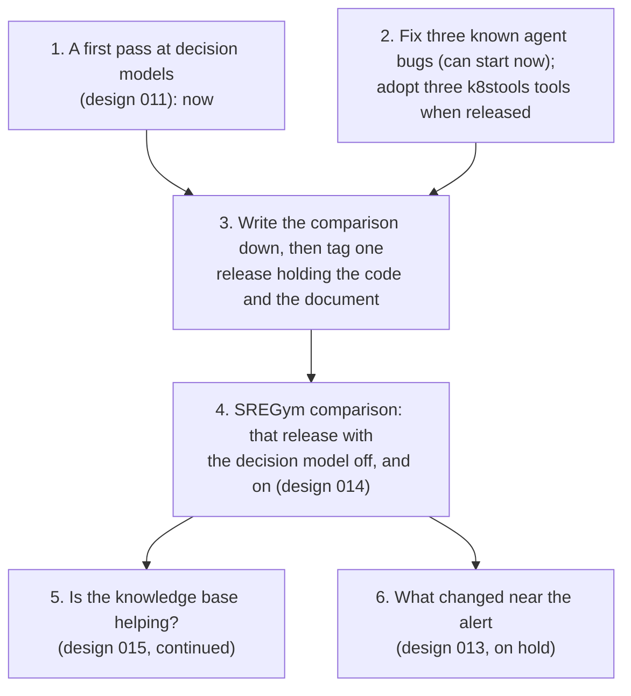

# Project to-do list

This page is a map of the work planned for k8srca: how the pieces fit together, the order we
intend to do them in, and why. It also lists the open tickets and the loose ends earlier designs
left behind.

What each source is the source of truth for
([writing.md](writing.md#one-home-for-each-fact)):
- **GitHub issues and their relationships** (sub-issues, "blocked by"): what is open, who owns it,
  and what blocks what. When this page disagrees with them, the issues win and this page is
  corrected.
- **This page:** the order among work that is not blocked, and the reasons for it. Issues record
  dependencies, not priority.
- **Designs and plans:** what each change is and why (the design), and its steps, measurements and
  results (the plan). This page links to them rather than repeating them.

Project terms are defined in the [glossary](glossary.md).

## Background: what this list refers to

k8srca is an agent that answers "why is this broken?" questions about a Kubernetes cluster in
Slack. It reads the cluster through read-only tools and answers with the evidence
([README](../README.md)). Most of the work below is about making those answers more often right.
These are the pieces it touches:

- **The knowledge base.** The agent's `k8s-rca` skill carries files that name symptoms (such as
  "pod restarting"), the candidate causes of each, and which observations count for or against
  each cause. The agent queries it with a script, `kb_query.py`. Its `open` command ranks the
  candidates from the facts gathered so far and prints a "most likely" cause.
  [Design 007](../designs/007-knowledge-representation.md) defines the format;
  [design 015](../designs/015-kb-evaluation.md) measures whether it helps.
- **Facts.** Code turns each tool result into short, numbered statements, such as "the
  container's last exit code was 137" ([design 010](../designs/010-facts-and-short-answers.md)).
  The answer cites them. A few facts can only be decided by reading text, usually a container's
  log ("the log ends in a stack trace"). Today the agent reads the log itself, and it does so
  inconsistently.
- **The collector and decision models.**
  [Design 011](../designs/011-decision-models.md) proposes that code makes the first reads of an
  investigation in one tool call (the collector), so every run starts from the same evidence,
  and that a decision model (a small, cheap model that answers yes or no with a probability,
  instead of writing prose) states the facts that need a log read, where a rule in code is not
  enough. It also measures, without acting on it, whether the collected facts alone would have
  been enough to answer from. The first decision model tried is JEV, a hosted one from TypeSafe.
  Two settings in `k8srca.yaml`, both off by default, turn on the collector (`collect.enabled`)
  and the decision model (`judge.enabled`). Not built.
- **The scenario suite.** Fifteen recorded faults the agent is tested on offline, each graded
  against a checklist of statements a good answer makes
  ([design 004](../designs/004-scenario-testing.md),
  [checklists in design 010](../designs/010-facts-and-short-answers.md#7-grading-checklists)).
  It is how we tell whether a change made the agent better or worse.
- **Hold-out tests.** A *hold-out* is a set of tests we never tune the agent against, so its
  score is an honest estimate of how the agent does on problems it has not seen
  ([design 006](../designs/006-holdout-suite.md)). A test that has been used for development is
  called *burned* and can no longer serve as a hold-out.
- **SREGym.** A public benchmark that deploys an application on a test cluster, injects a fault,
  asks the agent what is wrong, and has a model grade the answer
  ([design 014](../designs/014-sregym.md)). We use it as a source of hold-out tests. A fault stays
  unread until a hold-out run has used it; after that it moves into the scenario suite, where we
  may study it and tune against it. Of its 17-fault "Lite" set, 3 were used to build our harness
  and 14 are held out.
- **How we work.** [docs/process.md](process.md) sets the rules. Each step states before it starts
  what it expects to see, what it may spend, and when it is done. Certain warning signs, such as
  two inconclusive results in a row, stop work until the owner decides how to continue.

## The plan, in order

**Next to pick up, in order.** Two pieces of work are unblocked today:
1. Steps 1 to 3 of [plan 011](../plans/011-decision-models.md), which are offline, independent
   of each other and have no issues yet: where a run's dollars go, whether an answer written
   from collected facts alone is right, and whether a decision model reads logs better than
   code. They come first because everything after item 3 waits on design 011's work, they are
   cheap and need no cluster, and each can end a part of the design before it is built.
2. The three bug fixes ([#18](https://github.com/BenedatLLC/k8srca/issues/18), [#15](https://github.com/BenedatLLC/k8srca/issues/15), [#17](https://github.com/BenedatLLC/k8srca/issues/17)), alongside it, in that order: #18 changes what
   the agent is told is the most likely cause, so it matters most to the comparison; #15 changes
   what gets graded; #17 cost one session 561 seconds and is the least frequent.

### 1. A first pass at decision models (design 011): now

Code makes the first reads of an investigation in one step, and a small, cheap model reads the
logs where a rule in code is not enough. The design answers two outside reviews
([#43](https://github.com/BenedatLLC/k8srca/issues/43), which found its original scope too
small, and [#44](https://github.com/BenedatLLC/k8srca/issues/44), which found the pipeline
written in reply saved little and could not be shown safe). Its plan has three offline
measurements, each able to end a part of the design, then a live check on the scenario suite
that needs the bug fixes of item 2 first. The scenario suite is nearly at its ceiling (43 of 49
runs diagnosed), so it is read there as a guard against regression and a measure of cost;
whether diagnosis improves is a question for the SREGym comparison. That comparison's exact arms
are fixed once this work is complete; the expected shape is today's loop against the collector
with whatever else showed a benefit
([014 §7, question 12](../designs/014-sregym.md#7-open-questions)). Tracked in [#19](https://github.com/BenedatLLC/k8srca/issues/19); the steps, their measurements and their done and stop criteria
are in [plan 011](../plans/011-decision-models.md).

### 2. Fix three known agent bugs (can start now), and adopt three k8stools tools

Found while measuring the SREGym baseline and left in so the baseline would measure one fixed
version of the agent: [#18](https://github.com/BenedatLLC/k8srca/issues/18) (`kb_query.py open` sometimes prints a different most likely cause
than its ranking chose), [#15](https://github.com/BenedatLLC/k8srca/issues/15) (the scenario runner grades the agent's narration) and [#17](https://github.com/BenedatLLC/k8srca/issues/17)
(the coordinator's `sleep` blocks the specialist). Each is fixed on `main` with a test.

The baseline also found three faults the agent cannot diagnose because k8stools does not show the
object involved: admission webhook configurations, a Service's traffic policy and a Deployment's
rollout strategy. We wait for k8stools to release those tools and adopt them before the tag
([#26](https://github.com/BenedatLLC/k8srca/issues/26), [#27](https://github.com/BenedatLLC/k8srca/issues/27), [#28](https://github.com/BenedatLLC/k8srca/issues/28), each blocked by its k8stools issue): it is a cheap change, and it
gives the comparison three more faults where a difference can show (owner, 2026-11-15).

### 3. Write the comparison down, then tag one release holding the code and the document

Once items 1 and 2 are done, we write down the SREGym comparison's setup and the rule for reading
its result, naming the release tag `holdout-v3` ([#39](https://github.com/BenedatLLC/k8srca/issues/39)). Then `main` is tagged on a commit
holding both the code (with the decision model off by default) and that document ([#22](https://github.com/BenedatLLC/k8srca/issues/22)), so
the tag itself shows the reading rule was fixed before any run. Both configurations of the
comparison run from this one tag, so they share every line of code (owner, 2026-11-15).

### 4. The SREGym comparison (design 014): on hold until the release is tagged

The release on SREGym's 14 held-out faults with the decision model off and on, alternating fault
by fault, read by a rule written down before any run. The baseline (no decision model) passed 25
of 70 attempts. Afterwards the 14 faults move into the scenario suite. Tracked in [#32](https://github.com/BenedatLLC/k8srca/issues/32), with the comparison itself in [#23](https://github.com/BenedatLLC/k8srca/issues/23); the
steps, the reading rule and the later steps (the next hold-out, SREGym as a tuning target, the
leaderboard) are in [plan 014](../plans/014-sregym.md).

### 5. Is the knowledge base helping? (design 015): after the SREGym comparison

Its offline steps found no evidence the knowledge base helps or hurts, a wrong top cause in 2 to 5
of 12 scenarios, and search misses from vocabulary. The rest (the 14 SREGym faults as scenarios, a
decision point, a live test with the candidate lists removed, then improvements) needs the
faults the comparison releases. Tracked in [#33](https://github.com/BenedatLLC/k8srca/issues/33), with a sub-issue per step ([#35](https://github.com/BenedatLLC/k8srca/issues/35)–[#38](https://github.com/BenedatLLC/k8srca/issues/38)); see [plan 015](../plans/015-kb-evaluation.md).

### 6. Then: what changed near the alert (design 013), on hold

Let the agent see recent changes to the cluster. It waits for the comparison, the decision-model
work, and k8stools' recent-changes tool ([#25](https://github.com/BenedatLLC/k8srca/issues/25), tracking
[k8stools#38](https://github.com/BenedatLLC/k8stools/issues/38)).
Tracked in [#31](https://github.com/BenedatLLC/k8srca/issues/31) (step issues [#34](https://github.com/BenedatLLC/k8srca/issues/34), [#25](https://github.com/BenedatLLC/k8srca/issues/25) and [#40](https://github.com/BenedatLLC/k8srca/issues/40)); see [design 013](../designs/013-what-changed.md) and [its plan](../plans/013-what-changed.md).

## Open tickets

Each k8stools request has a tracking issue here, labelled `upstream` and marked as blocked by it,
for the work left on our side once k8stools releases it
([development.md](development.md#relationships-between-issues)).

| Ticket | What it is | When |
| --- | --- | --- |
| [#19](https://github.com/BenedatLLC/k8srca/issues/19) | A first pass at the collector and decision models (design 011); sub-issues [#20](https://github.com/BenedatLLC/k8srca/issues/20) and [#21](https://github.com/BenedatLLC/k8srca/issues/21), both written for the design's original scope and to be rewritten | Item 1, now |
| [#43](https://github.com/BenedatLLC/k8srca/issues/43), [#44](https://github.com/BenedatLLC/k8srca/issues/44) | Two outside reviews of design 011, which it answers point by point | Answered in design 011's appendix |
| [#18](https://github.com/BenedatLLC/k8srca/issues/18) | `kb_query.py open` sometimes prints a most likely cause other than the one its ranking chose | Item 2 |
| [#17](https://github.com/BenedatLLC/k8srca/issues/17) | The coordinator waits for the specialist with `sleep`, which blocks the specialist's tool calls | Item 2 |
| [#15](https://github.com/BenedatLLC/k8srca/issues/15) | The scenario runner grades the agent's narration as part of the answer | Item 2 |
| [#39](https://github.com/BenedatLLC/k8srca/issues/39) | The SREGym comparison's setup and reading rule must be written down before any run | Item 3, before [#22](https://github.com/BenedatLLC/k8srca/issues/22) |
| [#22](https://github.com/BenedatLLC/k8srca/issues/22) | Tag one release with the decision-model work, the bug fixes, the k8stools tools and the written comparison | Item 3 |
| [#32](https://github.com/BenedatLLC/k8srca/issues/32) | Run k8srca on the SREGym benchmark (design 014); sub-issues [#39](https://github.com/BenedatLLC/k8srca/issues/39), [#23](https://github.com/BenedatLLC/k8srca/issues/23) and [#16](https://github.com/BenedatLLC/k8srca/issues/16) | Item 4 |
| [#23](https://github.com/BenedatLLC/k8srca/issues/23) | Compare the agent with and without the decision model on SREGym's held-out faults | Item 4 |
| [#33](https://github.com/BenedatLLC/k8srca/issues/33) | Find out whether the knowledge base helps the agent, then improve it (design 015); sub-issues [#35](https://github.com/BenedatLLC/k8srca/issues/35)–[#38](https://github.com/BenedatLLC/k8srca/issues/38) | Item 5 |
| [#31](https://github.com/BenedatLLC/k8srca/issues/31) | Let the agent see what changed in the cluster near the alert (design 013); sub-issues [#34](https://github.com/BenedatLLC/k8srca/issues/34), [#25](https://github.com/BenedatLLC/k8srca/issues/25), [#40](https://github.com/BenedatLLC/k8srca/issues/40) | Item 6 |
| [#34](https://github.com/BenedatLLC/k8srca/issues/34) | Three truth files say a recording cannot show what k8stools' write records will show | Item 6, before [#25](https://github.com/BenedatLLC/k8srca/issues/25)'s measurement |
| [#16](https://github.com/BenedatLLC/k8srca/issues/16) | When the agent's own view of the cluster is narrower than the chart, the wiki names something the agent can never find. A flag to hide such components (`--hide-label`) is built; whether to do more is still to discuss | Unscheduled |
| [#14](https://github.com/BenedatLLC/k8srca/issues/14) | The agent does not see that two Kafka replicas are independent brokers (itbench-80) | Input to a future design |
| [#10](https://github.com/BenedatLLC/k8srca/issues/10) | Why the agent misses evidence in the imported ITBench scenarios | Input to designs 013 and 015 |
| [#6](https://github.com/BenedatLLC/k8srca/issues/6) | The answer reviewer's feedback is not something the agent can act on | Unscheduled; 011's reviewer work waits on it |
| [#40](https://github.com/BenedatLLC/k8srca/issues/40) | The agent takes an old change as the start of a failure (design 013 step 2) | Item 6; blocked by [#25](https://github.com/BenedatLLC/k8srca/issues/25) |
| [#24](https://github.com/BenedatLLC/k8srca/issues/24) | Claude Code commands for reviewing a design, planning a step and writing a checkpoint | Future enhancement |
| [#25](https://github.com/BenedatLLC/k8srca/issues/25) | Use k8stools' recent-changes tool and write times once released ([k8stools#38](https://github.com/BenedatLLC/k8stools/issues/38), with [#37](https://github.com/BenedatLLC/k8stools/issues/37) folded in) | Design 013's first step |
| [#26](https://github.com/BenedatLLC/k8srca/issues/26) | Let the agent see admission webhook configurations ([k8stools#39](https://github.com/BenedatLLC/k8stools/issues/39)) | Item 2; explains SREGym's `mutating_webhook` fault (0 of 5) |
| [#27](https://github.com/BenedatLLC/k8srca/issues/27) | Let the agent see a Service's traffic policies ([k8stools#40](https://github.com/BenedatLLC/k8stools/issues/40)) | Item 2; explains SREGym's `internal_traffic_policy` fault (0 of 5) |
| [#28](https://github.com/BenedatLLC/k8srca/issues/28) | Let the agent see a Deployment's rollout strategy ([k8stools#41](https://github.com/BenedatLLC/k8stools/issues/41)) | Item 2; explains half the misses on SREGym's `rolling_update` fault |

A k8stools change changes the tools the agent sees (we run `k8stools:4.6.1`), so it goes into a
release between comparisons, never during one.

## Left open by earlier designs

Each item is its own piece of work and has no ticket unless the table above names one.

- **[004 Scenario testing](../designs/004-scenario-testing.md)** (done in part). Open
  ([004 §11](../designs/004-scenario-testing.md#11-open-questions)):
  - check the checklist grader against a person: hand-grade about ten saved answers and measure
    agreement;
  - test whether the agent's sense of the current time matters, by freezing the clock in a
    replay;
  - a policy for re-recording scenarios when k8stools changes.

  Not built:
  - a scenario where the evidence the agent needs is unavailable, from ITBench fault 34;
  - imports of the ITBench faults injected through feature flags or Chaos Mesh, which need
    metrics and traces ([004 §12.1](../designs/004-scenario-testing.md#121-itbench-lite));
  - a generic record-and-replay proxy for third-party tool servers
    ([004 §3.4](../designs/004-scenario-testing.md#34-third-party-mcp-servers-generic-record-and-replay-not-built));
  - synthetic clusters with KWOK, a tool that simulates nodes and pods without running them
    ([004 §4.3](../designs/004-scenario-testing.md#43-kwok-for-states-a-real-cluster-cannot-produce-not-built)).

  Gaps found along the way:
  - the architecture wiki loses the outgoing connections of a workload that has no pods;
  - k8stools' workload report shows only one pod's log for a multi-pod Deployment and cuts long
    lines;
  - k8stools cannot filter events by owner.
- **[005 Modular architecture](../designs/005-modular-architecture.md)** (draft). Its goal is
  components behind interfaces, so parts can be swapped. Only the interface for build-time
  generators and their tests exist. Not scheduled
  ([005 §10](../designs/005-modular-architecture.md#10-migration-in-order)):
  - packaging the Kubernetes tools as a reusable plugin;
  - deploying k8srca on Kubernetes;
  - an OpenAI-based runtime alongside Claude;
  - Microsoft Teams, with the orchestrator split out of the Slack code;
  - a management UI.
- **[006 Hold-out suite](../designs/006-holdout-suite.md)** (done in part, on hold). A colleague
  writes scenarios we never see, runs them, and reports scores only. The kit and the author's
  instructions are written, and the first release was tagged (`holdout-v1`, 2026-11-01). Handing
  it over waits on the owner, and SREGym's later hold-outs (item 4) raise the same question.
- **[007 Knowledge representation](../designs/007-knowledge-representation.md)** (done in part;
  [what is left](../designs/007-knowledge-representation.md#what-is-built-what-is-left-and-what-was-replaced)):
  - eight families of alerts are not yet written up in the knowledge base's format, because no
    scenario reaches them (item 5 covers some of them);
  - runbooks: the format exists, but nothing reads one. They need a decision on how to deliver
    them, a real runbook from an operator, and a scenario where following it changes the answer;
  - the older path that answers unconverted alerts from their original records can go once
    every family is converted;
  - known limits, such as liveness-probe facts that need two tool results joined.
- **[008 Conclusions under incomplete evidence](../designs/008-conclusions-under-incomplete-evidence.md)**
  (done in part). Ranking causes with three strengths (weak, moderate, strong) is built.
  Probabilities in their place are deferred
  ([008 §5](../designs/008-conclusions-under-incomplete-evidence.md#5-probabilities)).
- **[009 Metrics](../designs/009-metrics.md)** (done in part). Prometheus recording and replay and
  promtools' reports are built. Open: reports on latency and CPU throttling for the agent. The
  throttling data is recorded but no report reads it, and the latency data is not recorded. A
  new design if wanted.
- **[010 Facts and short answers](../designs/010-facts-and-short-answers.md)** (done). Two of its
  ideas have no schedule of their own: record more observations as facts (log readings, pod-spec
  values), and have code catch overreach in an answer's wording, such as "every" where the fact
  says "the last 3". [011 §4.1](../designs/011-decision-models.md#41-a-decision-model-as-the-answer-reviewer)
  picks both up, as part of the reviewer work that waits on issue #6.
- **[012 Log evidence](../designs/012-log-evidence.md)** (done). Two checklist items of
  scenario itbench-31, the error rate before and after a NetworkPolicy and ruling that policy
  out, need the agent to see when the policy appeared. That is design 013's work.
- **The `k8s-rca` skill ships `answer_check.py`, which nothing uses.** Delete it, or wire it into
  the host's answer checks.

## Rules that shape the order

From [docs/process.md](process.md) and the designs:
- only one design is in progress at a time. Today that is 011; 014 is on hold until item 3, and
  015's remaining steps wait on 014;
- the grader and the scenarios' truth files do not change while a design is being measured;
- a release being compared does not change during the comparison;
- what was read about the 14 SREGym faults is not used to design the decision model before the
  comparison runs ([014 §3.1](../designs/014-sregym.md#31-the-suites-life-and-what-each-phase-may-do));
- a stop for a decision ends in a decision (continue, change the plan, or close the step), never
  in another small change;
- a rule written from a single run is a warning sign that stops work.
