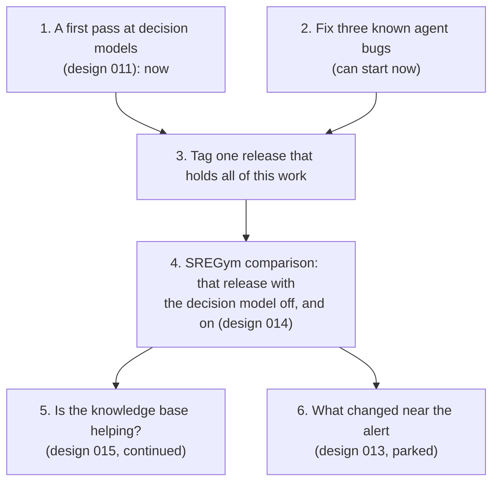

# Project to-do list

This page lists the work planned for k8srca, in the order we intend to do it. It also lists the
open tickets and the loose ends earlier designs left behind. It was written on 2026-11-14 from
the design documents and the open GitHub issues. The [design documents](../designs/) are
authoritative: when a design's status changes, update this page to match. Project terms are
defined in the [glossary](glossary.md).

## Background: what this list refers to

k8srca is an agent that answers "why is this broken?" questions about a Kubernetes cluster in
Slack. It reads the cluster through read-only tools and answers with the evidence
([README](../README.md)). Most of the work below is about making those answers more often right.
These are the pieces it touches:

- **The knowledge base.** The agent's `k8s-rca` skill carries files that name symptoms (such as
  "pod restarting"), the candidate causes of each, and which observations count for or against
  each cause. The agent queries it with a script, `kb_query.py`. Its `open` command ranks the
  candidates from the facts gathered so far and prints a "most likely" cause.
  [Design 007](../designs/007-knowledge-representation.md) defines the format;
  [design 015](../designs/015-kb-evaluation.md) measures whether it helps.
- **Facts.** Code turns each tool result into short, numbered statements, such as "the
  container's last exit code was 137" ([design 010](../designs/010-facts-and-short-answers.md)).
  The answer cites them. A few facts can only be decided by reading text, usually a container's
  log ("the log ends in a stack trace"). Today the agent reads the log itself, and it does so
  inconsistently.
- **Decision models.** [Design 011](../designs/011-decision-models.md) hands those reading
  questions to a small, cheap model that answers yes or no with a probability, instead of
  writing prose. The first one tried is JEV, a hosted decision model from TypeSafe. A confident
  answer becomes a fact; an unsure one states nothing, and the agent reads the log as it does
  today. The feature is off unless `judge.enabled` is set in `k8srca.yaml`.
- **The scenario suite.** Fifteen recorded faults the agent is tested on offline, each graded
  against a checklist of statements a good answer makes
  ([design 004](../designs/004-scenario-testing.md),
  [checklists in design 010](../designs/010-facts-and-short-answers.md#7-grading-checklists)).
  It is how we tell whether a change made the agent better or worse.
- **Hold-out tests.** A *hold-out* is a set of tests we never tune the agent against, so its
  score is an honest estimate of how the agent does on problems it has not seen
  ([design 006](../designs/006-holdout-suite.md)). A test that has been used for development is
  called *burned* and can no longer serve as a hold-out.
- **SREGym.** A public benchmark that deploys an application on a test cluster, injects a fault,
  asks the agent what is wrong, and has a model grade the answer
  ([design 014](../designs/014-sregym.md)). We use it as a source of hold-out tests. A fault stays
  unread until a hold-out run has used it; after that it moves into the scenario suite, where we
  may study it and tune against it. Of its 17-fault "Lite" set, 3 were used to build our harness
  and 14 are held out.
- **How we work.** [docs/process.md](process.md) sets the rules. Each step states before it starts
  what it expects to see, what it may spend, and when it is done. Certain warning signs, such as
  two inconclusive results in a row, stop work until the owner decides how to continue.

## The plan, in order

### 1. A first pass at decision models (design 011): now

We do as much of [design 011](../designs/011-decision-models.md) as makes sense for an initial
version, and stop when we are satisfied with it. That means its first two steps at least, and
later steps if they look promising. Then we go back to the SREGym comparison (item 4).

**Step 1: can a decision model read our logs?** This is an offline test, with no agent and no
cluster ([011 §8](../designs/011-decision-models.md#8-step-1-plan-can-a-decision-model-read-our-logs-offline)).
- *What:* take the container logs from the 15 scenario recordings (about 540 logs) and pair each
  with each of the 19 log-reading questions the knowledge base asks ("does the log end in a fatal
  error?", "does it report permission denied?"). Label the pairs by hand, then score three
  readers on the redacted text: a regular expression per question, JEV, and a small Claude model
  asked the same question. Also measure repeatability by asking the same question five times.
- *Why:* before anything goes into the agent, we want to know whether the model's answers are
  right, whether it says "unsure" when it should, and whether a plain regular expression would
  do as well.
- *Cost:* about $25 and a week, most of it hand-labelling.
- *Done when* JEV gives no confident wrong "no", at most one confident wrong "yes", is unsure on
  at most a third of the pairs, and beats the regular expressions on five questions.
- *Stop if* a regular expression or the Claude model does as well (then use the simpler one), or
  no confidence threshold removes the confident wrong "no"s (the idea does not work on this
  text).

**Step 2: the decision model as a source of facts, behind the setting.**
- *What:* build the interface every decision model implements, a small service next to k8stools
  that holds the provider's key and redacts text before it leaves, and facts marked as coming
  from the decision model. All of it is off unless `judge.enabled` is set.
- *Offline check:* `tests/kb_eval/measure_2a.py` runs the knowledge base's ranking on 12
  labelled scenarios. Today the ranking's top cause is right in 6, wrong in 3, and there is no
  top cause in 3. Step 2 adds the decision model's facts and reports what moves.
- *Expected:* in the two Java out-of-memory scenarios, the fact "the log ends with no fatal error"
  rules out "application crash", so the agent's tool prints "out-of-memory kill" as the most
  likely cause instead of the wrong "application crash". We checked this by adding the fact by
  hand ([011 §9](../designs/011-decision-models.md#9-later-steps-in-outline)). No other scenario
  should gain a wrong top cause. This needs the scenario recordings to keep the previous
  container log, which they do not do yet.
- *Live check:* three runs of each scenario, to catch a regression. Expected effect: small. A
  decision model improves how logs the agent fetched are read; it cannot help with an object the
  agent never looked at, which is where most misses were. "Can't tell" is the predicted outcome.

**Later steps, if they look promising** (none is scheduled):
- a stronger second model for the questions JEV is unsure about;
- matching a free-text question to a knowledge-base symptom with a decision model
  ([011 §5](../designs/011-decision-models.md#5-where-it-could-help-ranked)), compared against
  the simpler search fix of item 5;
- the reviewer rethink, which waits on
  [issue #6](https://github.com/BenedatLLC/k8srca/issues/6)
  ([011 §6](../designs/011-decision-models.md#6-the-reviewer-rethought-held-until-issue-6-improves-the-generic-reviewer)).

Before the first call to JEV, confirm the provider's terms and its pricing.

### 2. Fix three known agent bugs (can start now)

These three bugs were found while measuring the SREGym baseline and deliberately left in, so the
baseline would measure one fixed version of the agent. Each is fixed on `main` with a test.

- [#18](https://github.com/BenedatLLC/k8srca/issues/18): `kb_query.py open` sometimes prints a
  "most likely" cause other than the one its own ranking chose: a weakly supported cause from
  another group takes the slot. Seen in 4 of the 12 labelled scenarios, and visibly in 3 of the 44
  baseline sessions that used `open`. After the fix, rerun `measure_2a.py` and confirm the printed
  cause matches the ranking in all 12 and nothing else moved.
- [#15](https://github.com/BenedatLLC/k8srca/issues/15): the scenario runner grades every message
  of a turn as the answer, so the agent's narration ("Let me check the logs…") is graded with it.
  The Slack path already uses only the final message.
- [#17](https://github.com/BenedatLLC/k8srca/issues/17): the coordinator waits for the specialist
  agent by running `sleep`, which blocks the specialist's tool calls (once for 561 seconds). The
  fix is a check in code on the commands the coordinator runs, with no change to its prompt.

### 3. Tag one release that holds all of this work

Once items 1 and 2 are done, tag `main` as one release. It holds everything up to that point,
including the decision-model code (off by default) and any other changes made meanwhile. Both
configurations of the SREGym comparison run from this one tag, so they share every line of code.
Design 014 calls the tag `holdout-v3`.

### 4. The SREGym comparison (design 014): on hold until the release is tagged

[Design 014](../designs/014-sregym.md) is on hold until item 3.

**Done so far:** the harness that runs our agent on SREGym works. The baseline (the agent with no
decision model, as of tag `holdout-v2`) passed 25 of 70 attempts on the 14 held-out faults
(2026-11-12; [014 §10.1](../designs/014-sregym.md#101-findings-from-arm-as-baseline-step-2a)).

**Next:**
- *Write down the comparison before running it:* the two configurations (the release with
  `judge.enabled` off, and on), the 14 faults, five attempts per fault for each, the budget, and
  the rule for reading the result. Writing it first means the result cannot be reinterpreted
  after the fact.
- *Run the comparison:* about 140 runs, $80 in agent sessions and 20 hours, alternating the two
  configurations fault by fault so that changes in the cluster or the API affect both equally
  ([014 step 3](../designs/014-sregym.md#step-3--the-comparison-run-and-the-reading)).
- *The rule for reading it, set in advance:* attempts on the same fault tend to succeed or fail
  together, so the unit is the fault, not the attempt. The decision model is "better" only if
  five or more faults improve and none gets worse; "not worse" if at most one fault gets worse;
  otherwise "can't tell", reported as such. No answer is read until the score table is written.
- *A caveat already recorded:* the baseline's answers were read against the faults' causes on
  2026-11-10, so this is reported as a comparison that was not blind.
- *Afterwards* the 14 faults move into the scenario suite.

**Later, each planned only when the one before ends**
([014 steps 4–6](../designs/014-sregym.md#steps-46--outlines)):
- *The next hold-out:* SREGym's "Lite-IA" set, the same kinds of fault on three other
  applications, kept unread so far. If the owner wants one, add a set of new faults written by
  someone who does not work on the agent.
- *SREGym as a tuning target:* record the faulted clusters as scenarios and settle most changes
  on those offline, with live runs only at milestones.
- *The SREGym leaderboard:* only if SREGym accepts an entry that diagnoses without fixing (its
  board ranks on fixing, which we have deferred). First ask the SREGym team how outside teams
  submit and what tuning is allowed ([014 §9](../designs/014-sregym.md#9-open-questions),
  questions 2 and 4).
- *Open questions from the baseline* ([014 §10.1](../designs/014-sregym.md#101-findings-from-arm-as-baseline-step-2a),
  item 8): why the coordinator re-checks the cluster after the specialist replies (half of a
  delegated session's time); what a lower reasoning effort for the coordinator would do to
  speed and scores; and how long production Slack sessions take.
- *Confirm the polling workaround:* our SREGym fork polls to keep sessions alive, because
  SREGym's proxy silently dropped sessions quiet for 600 seconds. No session has yet run past
  600 seconds with it; the first one that does confirms it works.

### 5. Is the knowledge base helping? (design 015): after the SREGym comparison

**Done so far** ([015 §10](../designs/015-kb-evaluation.md#10-results)), all offline on saved
sessions and the scenario recordings:
- matched SREGym's per-attempt grades to our session records;
- traced whether the agent consulted the knowledge base and whether that went with passing: no
  evidence that it helps, and none that it hurts;
- on 12 scenarios, the knowledge base lists the true cause in 11, but `open` names a wrong top
  cause in 3 to 5 of 12, depending on how it is read;
- 31% of the agent's knowledge-base searches find nothing even though an entry exists, because
  the agent uses words the knowledge base does not contain (`unschedulable`, `exit 139`,
  `panic`).

**Next** ([015 §4](../designs/015-kb-evaluation.md#4-steps)):
1. *Turn the 14 SREGym faults into scenarios,* once the comparison has burned them: record each
   faulted cluster with a truth and a checklist written before any run. First check whether our
   recording tools work through SREGym's proxy, and how many of the 14 can be recorded while
   faulted. Why: these faults reach parts of the knowledge base no scenario reaches yet, and they
   are the only cases where `open` ranks a symptom that has no hand-written ranking rules.
2. *A decision point for the owner:* whether to run the live test below. Run it if `open` names a
   wrong top cause in 25% or more of the cases whose symptom has no hand-written ranking rules
   ([015 §6](../designs/015-kb-evaluation.md#6-checkpoints-and-who-decides)). Below 25%, the
   knowledge base is not the main problem, and the improvements are made on judgment where they
   are cheap.
3. *The live test:* the agent as shipped against the same agent with the knowledge base's
   candidate lists removed, on 8 of the faults, 10 attempts each. It is the one direct test of
   whether the candidate lists help, do nothing, or steer the agent wrong. It can see only a
   difference of 15 percentage points or more. About $90.
4. *Improvements,* each settled offline first, then one live run as a check:
   - search that understands the agent's words (aliases, exit codes, signals, state names) and
     falls back to a looser match;
   - when a symptom has no hand-written ranking rules, `open` says so and names no top cause;
   - a standing "something not listed" candidate, so the agent is never told the list is
     complete, and for each candidate the object to read (pod spec, environment, ConfigMap),
     since four of the baseline's five reasoning misses were in configuration;
   - a fixed survey for a vague question ("something is wrong with X"), before the agent commits
     to one line of inquiry;
   - writing the missing knowledge-base sections from public debugging guides with
     `k8srca kb mine` (about $5 each): networking and DNS, rollouts and Jobs, service traffic,
     and two new ones for credentials and for timeouts and retries.

### 6. Then: what changed near the alert (design 013), parked

[Design 013](../designs/013-what-changed.md) is parked until the SREGym comparison and the
decision-model work are done. It would let the agent see recent changes to the cluster: keep each
object's last write time in recordings, add a `get_recent_changes` tool to k8stools and facts for
each change ([k8stools#38](https://github.com/BenedatLLC/k8stools/issues/38)), then add rules for
weighing a change against the symptom.

## Open tickets

| Ticket | What it is | When |
| --- | --- | --- |
| [k8srca#18](https://github.com/BenedatLLC/k8srca/issues/18) | `kb_query.py open` sometimes prints a "most likely" cause other than the one its ranking chose | Item 2 |
| [k8srca#17](https://github.com/BenedatLLC/k8srca/issues/17) | The coordinator waits for the specialist with `sleep`, which blocks the specialist's tool calls | Item 2 |
| [k8srca#15](https://github.com/BenedatLLC/k8srca/issues/15) | The scenario runner grades the agent's narration as part of the answer | Item 2 |
| [k8srca#16](https://github.com/BenedatLLC/k8srca/issues/16) | The architecture wiki names a component that SREGym hides from the agent (its load generator). A flag to hide it (`--hide-label`) is built; whether to do more is still to discuss | Unscheduled |
| [k8srca#14](https://github.com/BenedatLLC/k8srca/issues/14) | In scenario itbench-80 the agent does not conclude that two Kafka replicas are two independent brokers | Input to a future design |
| [k8srca#10](https://github.com/BenedatLLC/k8srca/issues/10) | Why the agent misses evidence: misses sorted into numbered patterns | Input to designs 013 and 015 |
| [k8srca#6](https://github.com/BenedatLLC/k8srca/issues/6) | Rethink the answer reviewer: make its feedback something the agent can act on, and measure "is every sentence supported" as a grading category instead of a check before sending | Unscheduled; 011's reviewer work waits on it |
| [k8srca#1](https://github.com/BenedatLLC/k8srca/issues/1) | Use workloads' change history to answer "what changed?" | Design 013 |
| [k8stools#41](https://github.com/BenedatLLC/k8stools/issues/41) | Show a Deployment's rollout strategy (`maxUnavailable`, `maxSurge`) | Explains half the misses on SREGym's `rolling_update` fault |
| [k8stools#40](https://github.com/BenedatLLC/k8stools/issues/40) | Show a Service's traffic policies and session affinity | Explains the misses on SREGym's `internal_traffic_policy` fault (0 of 5) |
| [k8stools#39](https://github.com/BenedatLLC/k8stools/issues/39) | A read-only tool for admission webhook configurations | Explains the misses on SREGym's `mutating_webhook` fault (0 of 5): the agent cannot see webhooks |
| [k8stools#38](https://github.com/BenedatLLC/k8stools/issues/38) | Keep write times in recordings, record ResourceQuotas, and a `get_recent_changes` tool | Design 013's first step |
| [k8stools#37](https://github.com/BenedatLLC/k8stools/issues/37) | Show each NetworkPolicy's age in the workload report | Folded into k8stools#38 |

A k8stools change changes the tools the agent sees (we run `k8stools:4.6.1`), so it goes into a
release between comparisons, never during one.

## Left open by earlier designs

Each item is its own piece of work and has no ticket unless the table above names one.

- **[004 Scenario testing](../designs/004-scenario-testing.md)** (done in part). Open
  ([004 §11](../designs/004-scenario-testing.md#11-open-questions)):
  - check the checklist grader against a person: hand-grade about ten saved answers and measure
    agreement;
  - test whether the agent's sense of the current time matters, by freezing the clock in a
    replay;
  - a policy for re-recording scenarios when k8stools changes.

  Not built:
  - a scenario where the evidence the agent needs is unavailable, from ITBench fault 34;
  - imports of the ITBench faults injected through feature flags or Chaos Mesh, which need
    metrics and traces ([004 §12.1](../designs/004-scenario-testing.md#121-itbench-lite));
  - a generic record-and-replay proxy for third-party tool servers
    ([004 §3.4](../designs/004-scenario-testing.md#34-third-party-mcp-servers-generic-record-and-replay-not-built));
  - synthetic clusters with KWOK, a tool that simulates nodes and pods without running them
    ([004 §4.3](../designs/004-scenario-testing.md#43-kwok-for-states-a-real-cluster-cannot-produce-not-built)).

  Gaps found along the way:
  - the architecture wiki loses the outgoing connections of a workload that has no pods;
  - k8stools' workload report shows only one pod's log for a multi-pod Deployment and cuts long
    lines;
  - k8stools cannot filter events by owner.
- **[005 Modular architecture](../designs/005-modular-architecture.md)** (draft). Its goal is
  components behind interfaces, so parts can be swapped. Only the interface for build-time
  generators and their tests exist. Not scheduled
  ([005 §10](../designs/005-modular-architecture.md#10-migration-in-order)):
  - packaging the Kubernetes tools as a reusable plugin;
  - deploying k8srca on Kubernetes;
  - an OpenAI-based runtime alongside Claude;
  - Microsoft Teams, with the orchestrator split out of the Slack code;
  - a management UI.
- **[006 Hold-out suite](../designs/006-holdout-suite.md)** (done in part, on hold). A colleague
  writes scenarios we never see, runs them, and reports scores only. The kit and the author's
  instructions are written, and the first release was tagged (`holdout-v1`, 2026-11-01). Handing
  it over waits on the owner, and SREGym's later hold-outs (item 4) raise the same question.
- **[007 Knowledge representation](../designs/007-knowledge-representation.md)** (done in part;
  [what is left](../designs/007-knowledge-representation.md#what-is-built-what-is-left-and-what-was-replaced)):
  - eight families of alerts are not yet written up in the knowledge base's format, because no
    scenario reaches them (item 5 covers some of them);
  - runbooks: the format exists, but nothing reads one. They need a decision on how to deliver
    them, a real runbook from an operator, and a scenario where following it changes the answer;
  - the older path that answers unconverted alerts from their original records can go once
    every family is converted;
  - known limits, such as liveness-probe facts that need two tool results joined.
- **[008 Conclusions under incomplete evidence](../designs/008-conclusions-under-incomplete-evidence.md)**
  (done in part). Ranking causes with three strengths (weak, moderate, strong) is built.
  Probabilities in their place are deferred
  ([008 §5](../designs/008-conclusions-under-incomplete-evidence.md#5-probabilities)).
- **[009 Metrics](../designs/009-metrics.md)** (done in part). Prometheus recording and replay and
  promtools' reports are built. Open: reports on latency and CPU throttling for the agent. The
  throttling data is recorded but no report reads it, and the latency data is not recorded. A
  new design if wanted.
- **[010 Facts and short answers](../designs/010-facts-and-short-answers.md)** (done). Two of its
  ideas have no schedule of their own: record more observations as facts (log readings, pod-spec
  values), and have code catch overreach in an answer's wording, such as "every" where the fact
  says "the last 3". [011 §6](../designs/011-decision-models.md#6-the-reviewer-rethought-held-until-issue-6-improves-the-generic-reviewer)
  picks both up, as part of the reviewer work that waits on issue #6.
- **[012 Log evidence](../designs/012-log-evidence.md)** (done in part). Two checklist items of
  scenario itbench-31, the error rate before and after a NetworkPolicy and ruling that policy
  out, need the agent to see when the policy appeared. That is design 013's work.
- **The `k8s-rca` skill ships `answer_check.py`, which nothing uses.** Delete it, or wire it into
  the host's answer checks.

## Rules that shape the order

From [docs/process.md](process.md) and the designs:
- only one design is in progress at a time. Today that is 011; 014 is on hold until item 3, and
  015's remaining steps wait on 014;
- the grader and the scenarios' truth files do not change while a design is being measured;
- a release being compared does not change during the comparison;
- what was read about the 14 SREGym faults is not used to design the decision model before the
  comparison runs ([014 §3](../designs/014-sregym.md#3-the-suites-life-and-what-each-phase-may-do));
- a stop for a decision ends in a decision (continue, change the plan, or close the step), never
  in another small change;
- a rule written from a single run is a warning sign that stops work.
