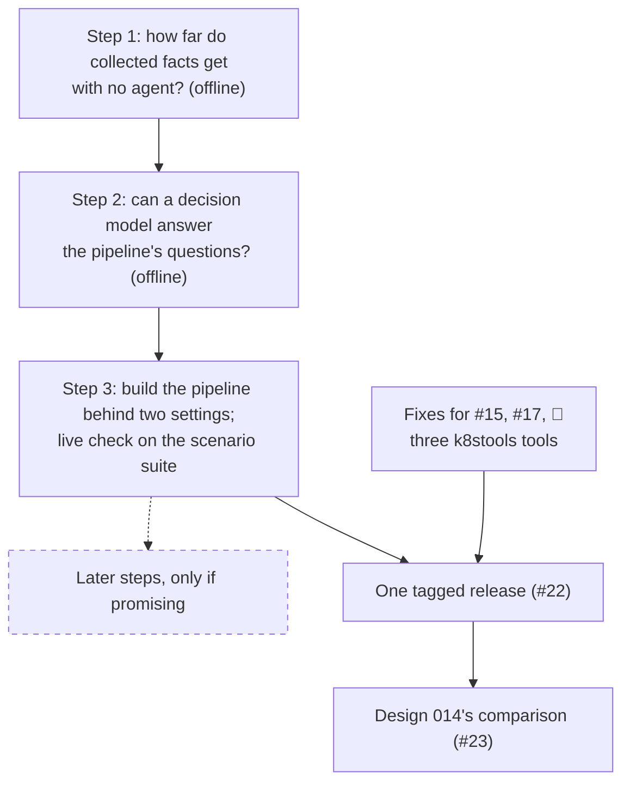

# Plan 011 — A collect-first pipeline, with decision models for its judgments

Design: [011 — A collect-first pipeline, with decision models for its judgments](../designs/011-decision-models.md).
Each step is a sub-issue of [#19](https://github.com/BenedatLLC/k8srca/issues/19).

This plan carries out a first pass at design 011: code makes the first reads of an investigation,
a decision model (a small model that answers yes/no or multiple-choice questions with a
probability) reads the logs and helps decide whether the collected facts are enough, and the full
agent runs only when they are not. The steps are ordered so that the cheapest one that could end
the work comes first. Step 1 measures offline how far the collected facts get with no agent at
all, which decides whether the rest is worth building. Step 2 measures offline whether a decision
model answers the pipeline's questions correctly. Step 3 builds the pipeline behind its two
settings and checks it live on the scenario suite. Design 014's comparison on SREGym follows.

**Issues.** [#20](https://github.com/BenedatLLC/k8srca/issues/20) and
[#21](https://github.com/BenedatLLC/k8srca/issues/21) were written for this design's earlier
scope (reading logs inside today's loop) and need rewriting for steps 2 and 3. Step 1 has no
issue yet.

**What every step may read.** The 15 recorded scenarios and SREGym's three burned faults (faults
already used for development). Nothing read of SREGym's 14 held-out faults is used to choose the
collector's list, a routing condition or a threshold
([014 §3.1](../designs/014-sregym.md#31-the-suites-life-and-what-each-phase-may-do)).

## Step 1 — Measure offline how far the collected facts get with no agent

**Issue:** not opened yet. **Status:** not started.

| | |
| --- | --- |
| **Hypothesis** | For a share of faults, the objects a fixed collection reads hold everything a correct answer needs, so one model call on the facts diagnoses them with no investigation. Text-read facts (facts that need a log read) raise that share, and that rise is the most a decision model reading logs can add |
| **Expected effect** | With text-read facts added, at least 6 of 15 scenarios diagnosed in all three answers. This is an estimate, not a measurement: six scenarios are diagnosed live today in about 20 tool calls or fewer ([docs/baseline.md](../docs/baseline.md)). Cost per fast answer about $0.10 against $0.08 to $0.66 per live run |
| **Can we see it?** | Yes, as counts of scenarios. The checklist grader dissents on about 0.9% of verdicts ([process.md §6](../docs/process.md#6-two-loops)). One answer of three differing is noise; a scenario diagnosed in all three answers or in none is readable. A difference of one scenario between two rows is not read as a result |
| **Budget** | $30 and one week: 15 scenarios × 3 rows × 3 answers at about $0.10 an answer and $0.07 to grade it, about $23. Hand-labelling the text-read facts is the owner's time |
| **Done and stop** | Below |

**What it runs.** No cluster and no agent session. Each scenario already has the collector's
reads recorded as fixtures (`tests/scenarios/<id>/results/`, made by
`k8srca scenario record-results`). The answer-writer evaluation
([`src/k8srca/evals/answer.py`](../src/k8srca/evals/answer.py),
[010 §8](../designs/010-facts-and-short-answers.md#8-testing-the-suite-and-the-component-evals))
already turns those into facts, runs `kb_query.py open`, makes one model call and grades the
answer on the scenario's checklist. It has cases for five scenarios; this step extends it to all
15 and runs three rows:

| Row | Input to the writer | What it tells us |
| --- | --- | --- |
| A | Code facts, and `open`'s output | What the fast path does with no decision model |
| B | Code facts only, no `open` output | Whether the fast path needs the knowledge base |
| C | Code facts, hand-labelled text-read facts, and `open`'s output | The ceiling: what the fast path does if a decision model reads every log correctly |

The symptom `open` is run on is the entry symptom already labelled for 12 scenarios
(`tests/kb_eval/labels-2a.yaml`); the three with no entry symptom run without `open` in every
row. Those labels name the workload where the cause lives, which is the best case for the
knowledge base, and the results say so. The text-read facts for row C are labelled by the owner
and Claude from each recording's logs, before any row is run.

**Measures,** per scenario and row: whether every diagnosis item of the checklist is met, in how
many of three answers; the mean checklist score; dollars per answer; the size in tokens of the
facts with `open`'s output (design §7 asks whether it fits a decision model's context). Beside
them, the live baseline's figures for the same scenario.

**Done** when the table is written here. What it decides:

- **Row C diagnoses fewer than 4 of 15 scenarios in all three answers:** the fast path is not
  worth building. Checkpoint: continue with the collector feeding the deep path only, or close.
- **Rows A and C diagnose the same scenarios:** reading logs adds nothing measurable on this
  suite, and step 2 drops its extraction group.
- **Rows A and B diagnose the same scenarios:** the fast path does not use `open`'s output.
- **Otherwise:** step 2 goes ahead, and each scenario's outcome in each row becomes a label for
  its routing group.

**Stop** when the budget is spent.

- [ ] Answer-writer cases for all 15 scenarios, with the labelled text-read facts
- [ ] `uv run k8srca eval answer` takes the row (with or without `open`, with or without the
      labelled facts)
- [ ] Results in the table below
- [ ] Tests

## Step 2 — Measure offline whether a decision model answers the pipeline's questions

**Issue:** [#20](https://github.com/BenedatLLC/k8srca/issues/20), to be rewritten; blocked by
step 1. **Status:** not started.

| | |
| --- | --- |
| **Hypothesis** | A decision model's thresholded answers (a) separate the cases where the fast path's answer is right from those where it is wrong, with no wrong case sent to the fast path, and (b) state correct facts on most container logs and abstain on the rest. On redacted text, JEV does each better than a rule in code, and at least as well as a small Claude model asked the same question, for less |
| **Expected effect** | Routing: no case sent to a wrong fast answer, and at least half of the cases the fast path gets right sent to it. Logs: no confident false negative, at most one confident false positive, abstaining on at most a third of pairs |
| **Can we see it?** | Routing: only as counts on a small set (15 scenarios, up to three states each from step 1's rows). That is enough to see a reader that sends wrong cases to the fast path, and too few to calibrate a probability, so thresholds are chosen leaving one scenario out (below) and the live step is the real test. Logs: confident wrong answers as counts; with few positives per predicate, results report counts, not rates. A model against a rule or Haiku: only where the difference is large; a tie means the simpler reader wins. Nothing runs live |
| **Budget** | One week. $30 in all: decision-model calls (checked against each provider's pricing before the first call), Haiku calls and Claude's labelling. Hand-labelling is the owner's time and the step's real cost |
| **Done and stop** | Per group, below |

One evaluation, `uv run k8srca eval judge`, scores every question the pipeline would ask a
decision model, in three groups, in this order. The readers are the same for each group, each on
redacted text unless noted:

| Reader | What |
| --- | --- |
| Rule in code | Routing: the code conditions of [design §3.4](../designs/011-decision-models.md#34-the-routing-check). Logs: one regular-expression set per predicate. Written before looking at the other readers' results |
| JEV (primary) | The question as a yes/no; model version pinned |
| Haiku | `claude-haiku-4-5` through the `claude` adapter, the same question and state, asked for a probability |
| JEV, raw text | JEV on unredacted text: what redaction costs |
| Others (optional) | Kev (4B, run locally, so also on raw text), Clef and OpenAI Decisions, each only if an account or hardware is at hand |

Each reader answers every case five times on separate calls, so repeatability is reported for
all of them: the share of cases whose five outcomes are identical, and the share that cross a
threshold.

### Group 1: routing

**Cases.** Each scenario's state from step 1: the question, the facts and `open`'s output, for
each row that differs. The label is step 1's outcome: *safe* if the fast answer met every
diagnosis item in all three answers, otherwise *unsafe*. The scenarios with nothing wrong and
with a decoy (`nothing-is-wrong`, `itbench-31-network-policy-decoy`) are in the set.

**Thresholds** are chosen leaving one scenario out: set on 14 scenarios, applied to the 15th, and
repeated for each, so no case is scored at a threshold fitted to it.

**Done** when one reader, under that procedure, sends no unsafe case to the fast path and sends
at least half of the safe cases to it. The readers are reported against the same two lines.

**Stop, and say which:**
- **the rule in code matches the best model:** the routing check uses code alone, and the
  pipeline's fast path does not need a decision model;
- **Haiku matches JEV:** the `claude` adapter is the routing reader, and the case for a
  dedicated decision model here is gone;
- **no reader sends zero unsafe cases to the fast path:** the fast path is not built. Checkpoint:
  the collector feeding the deep path only, or close.

### Group 2: log predicates

Run only if step 1's rows A and C differ, and only on the predicates whose facts changed an
outcome there, plus the question for a named dependency.

**The predicates.** These read a container's own log, and none is derived in code today
(`src/k8srca/facts/derive.py`). The group's first task fixes the list from step 1's result,
dropping any whose state is not a single container's log:

> `process_logged_fatal_error`, `startup_logs_show_error`, `startup_logs_show_progress`,
> `logs_show_different_fatal_error`, `logs_show_executable_not_found`,
> `logs_show_initialization_failure`, `logs_show_missing_or_incompatible_library`,
> `logs_show_port_already_in_use`, `logs_show_queue_empty_exit`,
> `logs_show_timeout_waiting_for_dependency`, `logs_show_dependency_connection_failure`,
> `logs_show_dependency_wait`, `logs_show_auth_rejection`, `logs_name_invalid_setting`,
> `missing_file_error_in_logs`, `permission_denied_error_in_logs`,
> `operation_not_permitted_in_logs`, `readonly_filesystem_error_in_logs`,
> `probe_endpoint_logs_show_errors`

Event-message predicates (`pull_message_names_*`, `sandbox_message_names_*`) are left out: their
text is short and formulaic, and code is the right tool for them.

**A named dependency.** One more question on the same logs: whether the log shows a failing call
to another component, and which, as a `choice` among the component's neighbours in the
architecture wiki's graph. `itbench-24`'s and `itbench-80`'s logs are real positives.

**The corpus.** The container logs in the 15 scenario recordings: the first ten held 307 current
and 235 previous logs (up to 200 lines each, about 42k lines), many repeated because the
scenarios share one demo application; the ITBench imports (24, 31, 80, 102, 105) add more. After
removing duplicates, each log is paired with each predicate. The recorder
(`k8srca scenario record-results`) is changed to keep log results in the fixtures, which it does
not do today.

**Labels.** Hand-labelling every pair is too slow, and most pairs are negative:
1. **Screen.** A pair is a candidate positive if the regular expression, JEV (p > 0.2) or Haiku
   flags it.
2. **Label every candidate by hand.** Two labellers, the owner and Claude, blind to which reader
   flagged it. The owner settles disagreements, and they are counted.
3. **Sample the rest.** A random 200 unflagged pairs are labelled by hand, to estimate the
   positives every reader missed.
4. **Constructed positives.** About five constructed logs per predicate: real error shapes from
   the mined guides' sources, set inside demo log context. Marked `constructed`, scored and
   reported separately, never mixed into the recorded counts.

The labels are frozen before any reader is scored
([process.md §5](../docs/process.md#5-the-instrument-is-frozen-per-design)).

**Measures,** per predicate and overall:
- **confident wrong:** a fact stated (p ≥ hi or p ≤ lo) that the label contradicts, split into
  false positives and false negatives (the kind that would rule a cause out), and reported by
  confidence bucket;
- **abstain rate** at the chosen thresholds;
- **repeatability,** as above, with the regular expression as the deterministic reference;
- dollars and milliseconds per log;
- for the raw-text reader, the change in confident wrong and abstain against JEV.

Thresholds are chosen per predicate and per model on the constructed set, then applied unchanged
to the recorded set, so they are not fitted to what they are scored on.

**Done** when, for JEV on the recorded set at thresholds fixed on the constructed set:
- it states no confident false negative;
- it states at most one confident false positive across all predicates;
- it abstains on at most a third of the pairs;
- it beats the regular expressions on confident wrong or abstain, on at least five predicates,
  or on every predicate measured if fewer than five are.

The other readers are reported against the same lines; one that passes where JEV fails becomes
the primary reader.

**Stop, and say which,** when:
- **a regular expression matches the best decision model:** put the regular expression in the
  facts layer as code;
- **Haiku matches the best decision model** at an acceptable cost per log: the `claude` adapter
  reads the logs;
- **no threshold removes the confident false negatives:** the idea does not work on this text;
- **redaction costs more than it keeps:** the raw-text reader is clearly better. A decision about
  data for the owner, not a threshold to tune; a local model may make it moot.

#### What text-read facts change in the ranking

`tests/kb_eval/measure_2a.py` runs `open` in process on 12 labelled scenarios with the facts the
facts layer derives and no text-read facts. Scored on the leader `ranking` computes among the
symptom's own candidates
([plan 015, step 2a](015-kb-evaluation.md#step-2a-recall-and-false-leaders)): right in 6 of 12
(including both `jvm-oom-*` cases, where `oom-kill` leads at moderate); wrong in 3, all
`application-release` at strong (`deploy-regression`, `liveness-probe-wrong-port`,
`itbench-24-kafka-port-change`); no leader in 3 (`downstream-latency`,
`itbench-102-memory-quota`, `itbench-105-invalid-command`).

In the two `jvm-oom-*` cases `oom-kill` leads today only through a sub-cause:
`memory-limit-too-low` holds at moderate, and a sub-cause's grade lifts its parent's. `oom-kill`'s
own evidence cannot hold, because it needs `not process_logged_fatal_error` and nothing derives
that fact. For the same reason `application-crash` is not ruled out, and `open` prints it, with
`port-conflict` under it, as the most likely cause at weak (the wrong leader of
[#18](https://github.com/BenedatLLC/k8srca/issues/18)). Adding
`not process_logged_fatal_error` for the killed container by hand to the script's input gives:

| Case | Printed leader today | Printed leader with the fact | Computed leader |
|---|---|---|---|
| `jvm-oom-on-startup` | `application-crash`, weak (wrong) | `oom-kill`, moderate | `oom-kill`, moderate (unchanged) |
| `jvm-oom-with-metrics` | `application-crash`, weak (wrong) | `oom-kill`, strong | `oom-kill`, moderate → strong |

The fact matches `application-crash`'s `rules_out` (exit 137 with no fatal error logged), which
removes the wrong printed leader whether or not #18 is fixed. The `application-release` leaders
depend on how coarse the knowledge base's claims are, not on any log, and are not expected to
move. This group's offline check repeats the script with the judge's facts in place of the
hand-added one: the two `jvm-oom-*` cases print the right cause, and no other scenario gains a
wrong leader. `measure_2a.py` reads the computed leader, because `open`'s printed line differs
from it in 4 of 12 cases (#18).

### Group 3: choosing the symptom

Run only if a rule in code (the alert name, or the unhealthy workload's reported state) fails to
choose the labelled entry symptom on 3 or more of the 12 scenarios that have one. Then the
readers answer a `choice` over the knowledge base's symptoms and `unmapped`, on the 15 scenarios'
questions, scored against `tests/kb_eval/labels-2a.yaml`. Design 015's larger labelled set
(`tests/kb_eval/labels-2b.json`) is not used: its queries come from sessions on SREGym's
held-out faults.

**Deliverables,** in every outcome:
- [ ] `judge/questions.yaml` (draft) and `src/k8srca/core/judge.py` with the first adapters
- [ ] The labelled sets under `tests/judge/`, with their provenance
- [ ] `uv run k8srca eval judge` to rerun the readers
- [ ] The recorder keeps log results; fixtures re-recorded
- [ ] Results in the table below

## Step 3 — Build the pipeline behind its two settings, and check it live on the scenario suite

**Issue:** [#21](https://github.com/BenedatLLC/k8srca/issues/21), to be rewritten; blocked by
step 2. **Status:** not started; planned in full when step 2 ends.

What it builds ([design §3](../designs/011-decision-models.md#3-approach)): the collector as a
shared module the recorder also uses, the host-side pipeline (facts, ranking, routing check, fast
path), facts with `by: "judge"`, the `pipeline:` and `judge:` configuration sections (both off by
default), and `--pipeline` and `--judge` on the commands that start a session. It builds only
what steps 1 and 2 left standing: no fast path if step 1 or the routing group stopped it, no
decision-model call for a group where code or Haiku won.

| | |
| --- | --- |
| **Hypothesis** | The pipeline answers the plain cases from collected facts and starts the rest from them, so runs cost less and vary less, with diagnosis no worse |
| **Expected effect** | Set from steps 1 and 2. In outline: median dollars per run down by at least a third with the decision model on; the range of tool calls per scenario narrower; no scenario regresses |
| **Can we see it?** | Cost and tool calls: yes, if the fast path takes the share of scenarios step 1 found, since a fast answer costs about $0.10 against a live median several times that. Diagnosis: three runs per scenario is a guard against a regression as [004 §6.4](../designs/004-scenario-testing.md#64-sampling-and-the-regression-rule) defines one, not a way to see a small gain |
| **Budget** | Set when step 2 ends. In outline: three configurations × 15 scenarios × 3 runs, about $45 in sessions at the baseline's rates and about $10 to grade |
| **Done and stop** | Done when the live check shows no regression and the expected saving. Stop if any scenario regresses with the pipeline on, or a fast answer is wrong where the investigation was right |

**The three configurations,** run interleaved scenario by scenario so drift falls on all of them:

| Configuration | `pipeline.mode` | `judge.enabled` | What it shows |
| --- | --- | --- | --- |
| Today's loop | `classic` | off | The reference |
| The collector alone | `collect_first` | off | What collecting first does with no decision model |
| The whole pipeline | `collect_first` | on | What the decision model adds to that |

- [ ] The collector, shared with the recorder; log tails and, where configured, metrics reports
- [ ] The host-side pipeline: facts, ranking, routing check, fast path
- [ ] `by: "judge"` facts, with tests
- [ ] `pipeline:` and `judge:` configuration; `--pipeline` and `--judge` on `scenario run` and
      `session`
- [ ] The skill's first-reads text shortened for a session that starts from facts
- [ ] The open questions of [design §7](../designs/011-decision-models.md#7-open-questions) that
      this step decides: how facts reach the workspace, follow-ups after a fast answer, which
      namespaces
- [ ] Offline checks rerun; live check run and recorded
- [ ] Documents updated (001 for the host-side stage and the new credential, 002, the glossary)

## Later steps, only if they look promising

None is planned. Each gets a step here, with the five fields and its own issue, if it is taken up
([design §2.1](../designs/011-decision-models.md#21-uses-beyond-the-first-pass)):
- **A stronger model for the deep path,** such as Opus, started from the collected facts.
- **A sufficiency check before the answer, in the deep path,** that names the missing read.
- **Decision-model facts on results the agent fetches during a session,** which needs the judge
  service of the design's earlier version
  ([design §3.9](../designs/011-decision-models.md#39-where-the-calls-run-and-who-holds-the-key)).
- **A stronger model for the unsure band** of a log answer
  ([design §7](../designs/011-decision-models.md#7-open-questions)).
- **Support as an evaluation category** and **a screen for the checklist grader:** instrument
  changes, so only between designs, and only after
  [#6](https://github.com/BenedatLLC/k8srca/issues/6) leaves a baseline.
- **Symptom matching on design 015's labelled queries:** only after design 014's comparison, and
  after 015's simpler search aliases are scored on the same queries and lose.
- **Suggested attribution patches** for the reviewer (design §4.1): after more observations are
  recorded as facts.

## Results

| Step | Plan | Outcome | Decision |
| --- | --- | --- | --- |
| 1 | Above | | |
| 2 | Above | | |
| 3 | Above | | |

### Checkpoints

None yet.
