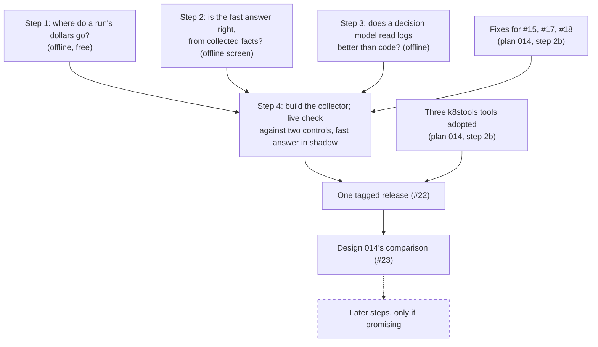

# Plan 011 — A collector for the first reads, with decision models for what code cannot read

Design: [011 — A collector for the first reads, with decision models for what code cannot read](../designs/011-decision-models.md).
Each step is a sub-issue of [#19](https://github.com/BenedatLLC/k8srca/issues/19).

This plan carries out a first pass at design 011. Code makes the first reads of an investigation
in one tool call (the collector), a decision model (a small model that answers yes/no questions
with a probability) states the facts that need a log read where a rule in code is not enough,
and a fast answer, written from the collected facts alone, is computed beside every test run to
find out whether it could be trusted. Steps 1 to 3 are offline and independent of each other, so
they can run in any order; each can end a part of the design cheaply. Step 4 builds what they
left standing and checks it live. Design 014's comparison on SREGym follows.

**What each instrument is read for.** The scenario suite's 15 scenarios are diagnosed in 43 of
49 baseline runs, 13 of them in every run, and the facts layer was built on their recordings
([docs/baseline.md](../docs/baseline.md)). So in this plan the suite is a guard against
regression and a measure of cost, and it is not expected to show diagnosis improving. Whether
diagnosis improves is a question for design 014's comparison, on faults the system was not built
on ([design §1.3](../designs/011-decision-models.md#13-the-gap)).

**What comes first.** The fixes for three known defects
([#18](https://github.com/BenedatLLC/k8srca/issues/18),
[#15](https://github.com/BenedatLLC/k8srca/issues/15),
[#17](https://github.com/BenedatLLC/k8srca/issues/17);
[plan 014, step 2b](014-sregym.md#step-2b--fix-three-known-defects-and-adopt-the-k8stools-tools-for-three-gaps))
are merged before step 4's live run: #15 changes what is graded and #18 changes the cause the
agent is told is most likely, so a live comparison across them would not be like for like. The
three k8stools tools are needed before design 014's comparison, not before step 4.

**Issues.** [#20](https://github.com/BenedatLLC/k8srca/issues/20) and
[#21](https://github.com/BenedatLLC/k8srca/issues/21) were written for this design's original
scope and need rewriting for steps 3 and 4. Steps 1 and 2 have no issue yet.

**What every step may read.** The 15 recorded scenarios and SREGym's three burned faults (faults
already used for development). Nothing read of SREGym's 14 held-out faults is used to choose the
collector's list, a routing rule or a threshold
([014 §3.1](../designs/014-sregym.md#31-the-suites-life-and-what-each-phase-may-do)).

## Step 1 — Measure where a run's dollars go, and how much the collector's reads account for

**Issue:** not opened yet. **Status:** not started.

| | |
| --- | --- |
| **Hypothesis** | A useful share of what a run costs is spent before the run has made the reads the collector would make, because every turn the agent takes to choose and make a read sends the whole conversation again |
| **Expected effect** | Not known, which is why this step exists. The only split measured so far is of wall-clock time. The line for building the collector on cost grounds is 20% of the suite's total dollars spent before the collector's reads are complete |
| **Can we see it?** | Yes. It is accounting on saved sessions: each model request's tokens are in the session's events, and each tool call is dated |
| **Budget** | Two days. No model calls if the baseline's run records and sessions can still be read; otherwise one run of each scenario on today's loop, about $5 |
| **Done and stop** | Below |

**What it does.** For each saved session of the baseline (49 runs; the run records are on the
machine that took it), from the session's events:
- dollars by phase: before the last read that is on the collector's list
  ([design §3.1](../designs/011-decision-models.md#31-the-collector-one-tool-the-coordinator-calls-first)),
  and after it; and by agent, coordinator and specialist;
- which of the collector's reads the run made, which it skipped, and how many reads it made that
  are not on the list;
- the spread of a scenario's cost between its runs, which step 4 needs to say whether a saving
  is larger than noise.

The share of dollars before the collector's reads are complete is an upper limit on what the
collector saves, since its result still enters the conversation.

**Done** when the table is written here, per scenario and for the suite, and step 4's expected
effect is stated from it. What it decides:
- **Under 10% of the suite's dollars are spent before the collector's reads are complete:** cost
  is not a reason to build the collector. Checkpoint: build it for a consistent starting point
  alone, or stop.
- **Between 10% and 20%:** the owner decides at a checkpoint.
- **Otherwise** step 4 states its expected saving from this table.

- [ ] A script under `tests/` that produces the table from session events
- [ ] Results in the table below

## Step 2 — Screen offline whether the fast answer is right, from the collector's facts alone

**Issue:** not opened yet. **Status:** not started.

| | |
| --- | --- |
| **Hypothesis** | For a share of faults, the objects the collector reads hold everything a correct answer needs, so one model call on the facts answers them as well as an investigation does. A rule in code can pick out cases where that is so without picking a wrong one |
| **Expected effect** | The fast answer is as good as the investigation's on about 6 of 15 scenarios. An estimate: six scenarios are diagnosed live in about 20 tool calls or fewer ([docs/baseline.md](../docs/baseline.md)), and the review in [#44](https://github.com/BenedatLLC/k8srca/issues/44) found the cause stated in the collected facts for 7 to 9 |
| **Can we see it?** | In one direction only. The step can show the fast answer is rarely right, or that a routing reader trusts wrong answers, and either ends that part of the design. It cannot show a reader is safe: the scenarios are 15, share one demo application, and the facts layer was built on them. If the fast answer is wrong on nine scenarios, a reader that trusts none of those nine could still be wrong on about 30% of such cases. The checklist grader dissents on about 0.9% of verdicts ([process.md §6](../docs/process.md#6-two-loops)) |
| **Budget** | $35 and one week: 15 scenarios × 3 rows × 3 answers at about $0.10 an answer and $0.07 to grade it, about $23, plus the routing readers' calls |
| **Done and stop** | Below |

**What it runs.** No cluster and no agent session. The answer-writer evaluation
([`src/k8srca/evals/answer.py`](../src/k8srca/evals/answer.py),
[010 §8](../designs/010-facts-and-short-answers.md#8-testing-the-suite-and-the-component-evals))
turns a scenario's recorded results into facts, runs `kb_query.py open`, makes one model call
and grades the answer on the scenario's checklist. It has cases for five scenarios. This step
extends it to all 15, with these changes so that it sees what a collector would have seen and no
more:

- **It handles a recorded error result.** Today it fails on the four scenarios whose fixtures
  hold a "pod not found" result (`image-pull-typo`, `itbench-105-invalid-command`,
  `nothing-is-wrong`, `pvc-pending-no-storageclass`).
- **Only the collector's reads are used.** Results recorded from a scenario's hand-written
  `record_calls` are left out. `itbench-31-network-policy-decoy`'s include a count of one log
  pattern chosen knowing the answer.
- **`open` runs where a rule in code points,** not where the cause is known to live: the alert's
  symptom if the knowledge base maps the alert, otherwise the reported state of the workload the
  question names, otherwise nothing. The rule is scored on all 15 scenarios against the entry
  symptoms labelled in `tests/kb_eval/labels-2a.yaml`, with "none" as the right answer for the
  three scenarios that have no entry symptom.

Three rows:

| Row | Input to the writer | What it tells us |
| --- | --- | --- |
| A | Code facts, and `open`'s output | The fast answer as it would be with no decision model |
| B | Code facts only, no `open` output | Whether the fast answer needs the knowledge base |
| C | Code facts, hand-labelled text-read facts, and `open`'s output | The fast answer if every log tail were read correctly |

Row C's facts are labelled by the owner and Claude before any row is run, only for the
predicates listed in step 3, and only from the 20-line log tails the collector reads.

**When the fast answer counts as right.** Both halves of the regression rule
([004 §6.4](../designs/004-scenario-testing.md#64-sampling-and-the-regression-rule)): every
diagnosis item met in all three answers, and a mean checklist score no lower than the baseline's
by more than the baseline's spread. Three scenarios have a follow-up question whose turn the
baseline's score includes and this evaluation's does not (`deploy-regression` and the two
`jvm-oom-*`); they are scored on the first question's items and marked.

**The routing readers** ([design §3.4](../designs/011-decision-models.md#34-the-fast-answer-in-shadow-only))
each read every scenario's collected facts with `open`'s output and say "trust" or
"investigate": the rule in code, JEV, and `claude-haiku-4-5` asked the same four questions. Each
model reader answers five times, and counts as "trust" only if all five say so. A model reader's
thresholds are chosen leaving out a family of scenarios at a time (the two `jvm-oom-*`; the six
ITBench imports; the remaining seven), not one scenario, because scenarios within a family share
questions and faults.

**Measures:** per scenario and row, whether the fast answer is right, its checklist score and
its cost; the size in tokens of the facts with `open`'s output; per reader, the wrong fast
answers it trusts and the right ones it trusts; whether the symptom rule chose the labelled
symptom.

**Done** when the table is written here. What it decides:
- **The fast answer is right on fewer than 4 of 15 scenarios in row C:** the fast-answer
  question is closed. Step 4 runs without shadow, and design 014's comparison does not compute
  it.
- **A reader trusts a wrong fast answer:** that reader is dropped. If every reader does, shadow
  still records the fast answer, with no readers.
- **Rows A and B are right on the same scenarios:** the fast answer is written without `open`'s
  output.
- **Rows A and C:** the scenarios where they differ say which text-read facts change an answer,
  which orders step 3's work.

**Stop** when the budget is spent.

- [ ] The evaluation handles error results; cases for all 15 scenarios; the three rows
- [ ] The symptom rule, scored on all 15
- [ ] The routing rule in code, and the four routing questions
- [ ] Results in the table below
- [ ] Tests

## Step 3 — Measure offline whether a decision model reads logs better than code

**Issue:** [#20](https://github.com/BenedatLLC/k8srca/issues/20), to be rewritten.
**Status:** not started.

| | |
| --- | --- |
| **Hypothesis** | On the knowledge base's log predicates, a decision model's yes/no answers, thresholded, state correct facts on most log tails and abstain on the rest, with no confident wrong answers. On redacted text, JEV does this better than a regular expression per question, and at least as well as a small Claude model asked the same question, for less |
| **Expected effect** | No confident false negative, at most one confident false positive, abstaining on at most a third of pairs, and better than the regular expressions on the predicates that have recorded positives |
| **Can we see it?** | Confident wrong answers: yes, as counts. Few predicates have positives in the recordings, so each result says how many recorded positives it rests on, and a predicate with fewer than three is judged on constructed logs only and said to be. A model against the regular expressions or Haiku: only where the difference is large; a tie means the simpler reader wins. Nothing runs live |
| **Budget** | One week. $25 in all: decision-model calls (checked against each provider's pricing before the first call), Haiku calls and Claude's labelling. Hand-labelling is the owner's time and the step's real cost |
| **Done and stop** | Below |

**The predicates.** These read a container's own log, and none is derived in code today
(`src/k8srca/facts/derive.py`). The step's first task fixes the list, dropping any whose state
is not a single container's log, and takes first the predicates step 2 found to change an answer:

> `process_logged_fatal_error`, `startup_logs_show_error`, `startup_logs_show_progress`,
> `logs_show_different_fatal_error`, `logs_show_executable_not_found`,
> `logs_show_initialization_failure`, `logs_show_missing_or_incompatible_library`,
> `logs_show_port_already_in_use`, `logs_show_queue_empty_exit`,
> `logs_show_timeout_waiting_for_dependency`, `logs_show_dependency_connection_failure`,
> `logs_show_dependency_wait`, `logs_show_auth_rejection`, `logs_name_invalid_setting`,
> `missing_file_error_in_logs`, `permission_denied_error_in_logs`,
> `operation_not_permitted_in_logs`, `readonly_filesystem_error_in_logs`,
> `probe_endpoint_logs_show_errors`

Event-message predicates (`pull_message_names_*`, `sandbox_message_names_*`) are left out: their
text is short and formulaic, and code is the right tool for them.

**The dependency rule.** Scored here too, as code: whether a log tail names a neighbour of the
component in the architecture wiki's graph next to an error. `itbench-24`'s and `itbench-80`'s
tails are real positives (`checkout`'s tail in `itbench-24` reads "Failed to connect to broker
kafka:9999").

**The corpus.** What the collector would read: the log tails in the recorded workload reports
(99 entries across the 15 scenarios, 76 with lines, up to 20 lines each), and the recordings'
full container logs cut to the same tail, with duplicates removed. Each tail is paired with each
predicate. The five ITBench recordings hold exported OpenTelemetry log records, not a
container's own output, and a stack trace may be missing from them; their results are reported
separately.

**Labels.** Hand-labelling every pair is too slow, and most pairs are negative:
1. **Screen.** A pair is a candidate positive if the regular expression, JEV (p > 0.2) or Haiku
   flags it.
2. **Label every candidate by hand.** Two labellers, the owner and Claude, blind to which reader
   flagged it. The owner settles disagreements, and they are counted.
3. **Sample the rest.** A random 200 unflagged pairs are labelled by hand, to estimate the
   positives every reader missed.
4. **Constructed positives.** About five constructed logs per predicate: real error shapes from
   the mined guides' sources, set inside demo log context. Marked `constructed`, scored and
   reported separately, never mixed into the recorded counts.

The labels are frozen before any reader is scored
([process.md §5](../docs/process.md#5-the-instrument-is-frozen-per-design)).

**The readers,** each on redacted text unless noted:

| Reader | What |
| --- | --- |
| Regular expression | One pattern set per predicate, written before looking at the other readers' results |
| JEV (primary) | The predicate's `says` sentence as a yes/no question; model version pinned |
| Haiku | `claude-haiku-4-5` through the `claude` adapter, the same sentence and state, asked for a probability; one call per pair |
| JEV, raw text | JEV on unredacted text: what redaction costs |
| Others (optional) | Kev (4B, run locally, so also on raw text), Clef and OpenAI Decisions, each only if an account or hardware is at hand |

**Measures,** per predicate and overall:
- **confident wrong:** a fact stated (p ≥ hi or p ≤ lo) that the label contradicts, split into
  false positives and false negatives (the kind that would rule a cause out), and reported by
  confidence bucket;
- **abstain rate** at the chosen thresholds;
- **repeatability:** each reader answers every labelled pair five times on separate calls. Report
  the share of pairs whose five outcomes (stated true, stated false, abstain) are identical, and
  the share that cross a threshold. The regular expression is the deterministic reference;
- dollars and milliseconds per log;
- for the raw-text reader, the change in confident wrong and abstain against JEV.

Thresholds are chosen per predicate and per model on the constructed set, then applied unchanged
to the recorded set, so they are not fitted to what they are scored on.

**Done** when the table is written here, with the number of recorded positives beside each
predicate. JEV is taken for a predicate when, at thresholds fixed on the constructed set:
- it states no confident false negative and at most one confident false positive;
- it abstains on at most a third of the pairs;
- it beats the regular expression on confident wrong or on abstain, on recorded pairs where the
  predicate has at least three recorded positives, and on constructed pairs otherwise.

The other readers are reported against the same lines. For each predicate, the simplest reader
that meets them is the one step 4 builds: the regular expression as code, then Haiku, then a
decision model.

**Stop, and say which,** when:
- **the regular expressions match the best model on every predicate:** all are put in the facts
  layer as code. No judge service, provider key or network rule is built;
- **Haiku matches the best decision model** at an acceptable cost per log: the `claude` adapter
  is the reader, and the case for a dedicated decision model is gone;
- **no threshold removes the confident false negatives:** the idea does not work on this text;
- **redaction costs more than it keeps:** the raw-text reader is clearly better. A decision about
  data for the owner, not a threshold to tune; a local model may make it moot;
- **the budget is spent.**

**Deliverables,** in every outcome:
- [ ] `judge/questions.yaml` (draft) and `src/k8srca/core/judge.py` with the first adapters
- [ ] The labelled set under `tests/judge/`, with its provenance
- [ ] `uv run k8srca eval judge` to rerun the readers
- [ ] Results in the table below

### What text-read facts change in the ranking

`tests/kb_eval/measure_2a.py` runs `open` in process on 12 labelled scenarios with the facts the
facts layer derives and no text-read facts. Scored on the leader `ranking` computes among the
symptom's own candidates
([plan 015, step 2a](015-kb-evaluation.md#step-2a-recall-and-false-leaders)): right in 6 of 12
(including both `jvm-oom-*` cases, where `oom-kill` leads at moderate); wrong in 3, all
`application-release` at strong (`deploy-regression`, `liveness-probe-wrong-port`,
`itbench-24-kafka-port-change`); no leader in 3 (`downstream-latency`,
`itbench-102-memory-quota`, `itbench-105-invalid-command`).

In the two `jvm-oom-*` cases `oom-kill` leads today only through a sub-cause:
`memory-limit-too-low` holds at moderate, and a sub-cause's grade lifts its parent's. `oom-kill`'s
own evidence cannot hold, because it needs `not process_logged_fatal_error` and nothing derives
that fact. For the same reason `application-crash` is not ruled out, and `open` prints it, with
`port-conflict` under it, as the most likely cause at weak (the wrong leader of
[#18](https://github.com/BenedatLLC/k8srca/issues/18)). Adding
`not process_logged_fatal_error` for the killed container by hand to the script's input gives:

| Case | Printed leader today | Printed leader with the fact | Computed leader |
|---|---|---|---|
| `jvm-oom-on-startup` | `application-crash`, weak (wrong) | `oom-kill`, moderate | `oom-kill`, moderate (unchanged) |
| `jvm-oom-with-metrics` | `application-crash`, weak (wrong) | `oom-kill`, strong | `oom-kill`, moderate → strong |

The fact matches `application-crash`'s `rules_out` (exit 137 with no fatal error logged), which
removes the wrong printed leader whether or not #18 is fixed. The `application-release` leaders
depend on how coarse the knowledge base's claims are, not on any log, and are not expected to
move. This step's offline check repeats the script with the chosen reader's facts in place of
the hand-added one: the two `jvm-oom-*` cases print the right cause, and no other scenario gains a
wrong leader. `measure_2a.py` reads the computed leader, because `open`'s printed line differs
from it in 4 of 12 cases (#18).

## Step 4 — Build the collector, and check it live against two controls

**Issue:** [#21](https://github.com/BenedatLLC/k8srca/issues/21), to be rewritten; follows steps
1 to 3 and the three fixes. **Status:** not started; planned in full when steps 1 to 3 end.

What it builds ([design §3](../designs/011-decision-models.md#3-approach)): the collector as a
module the recorder and the worker share, the `collect` tool, the `collect:` and `judge:`
configuration sections (both off by default), `--collect`, `--judge` and `--shadow` on the
commands that start a session, and the fast answer in shadow. It builds only what steps 1 to 3
left standing: text-read facts by whichever reader step 3 chose (a judge service only if that
reader is a model), and shadow only if step 2 did not close the fast-answer question.

| | |
| --- | --- |
| **Hypothesis** | Starting every investigation from the collector's facts costs less than today's loop and less than today's loop at a lower effort setting, with diagnosis no worse |
| **Expected effect** | On cost: set from step 1's table, as a share of the suite's total. On diagnosis: none expected on this suite, where 13 of 15 scenarios are already diagnosed in every run |
| **Can we see it?** | Cost: yes if the expected saving is larger than the spread between runs that step 1 measures. Diagnosis: three runs per scenario is a guard against a regression, not a way to see a gain |
| **Budget** | Set when steps 1 to 3 end. In outline: three arms × 15 scenarios × 3 runs, about $48 in sessions at the baseline's rates, about $10 to grade, and about $8 for the fast answer in shadow; a fourth arm, about $20, if step 3 chose a model reader |
| **Done and stop** | Below |

**The arms,** run interleaved scenario by scenario so drift falls on all of them:

| Arm | Settings | What it shows |
| --- | --- | --- |
| Today's loop | collector off | The reference, taken in the same sitting |
| Today's loop, lower effort | collector off; the coordinator at `effort: medium` | The cheapest alternative: what one line of configuration saves, and costs in diagnosis |
| The collector | `--collect`, `--shadow` | What collecting first does, with text-read facts from code where step 3 chose code |
| The collector with a model reader | `--collect --judge`, `--shadow` | Only if step 3 chose a model for some predicate: what it adds |

**How a regression is read.** Against the reference arm of the same sitting, not the saved
baseline. A scenario regresses when an arm diagnoses at least two fewer of its three runs than
the reference arm, or its mean checklist score is lower by more than the reference arm's spread
([004 §6.4](../designs/004-scenario-testing.md#64-sampling-and-the-regression-rule)). A
difference of one run is not read: `itbench-31-network-policy-decoy` and
`itbench-80-kafka-two-brokers` are diagnosed in 3 of 5 and 1 of 5 baseline runs, so they often
lose a run by chance.

**Cost is the cost of everything.** A run's recorded cost today is its session's. The fast
answer's call, a judge's calls and their grading are added to the run's record, so no arm looks
cheaper by leaving a call out.

**Mechanics on SREGym's three burned faults.** One attempt each with the collector on, to check
that `collect` works through SREGym's view of the cluster and that the fast answer is saved.
Scores from it mean nothing.

**Done** when: no scenario regresses in the collector arms; the collector arm's suite cost is
lower than both control arms' by step 1's expected saving or more; `collect` is the first call
in every collector run; and the shadow record is written for every run.

**Stop** when two or more scenarios regress in a collector arm, when the collector arm costs
more than the reference arm, or when the budget is spent. If the lower-effort arm is as cheap as
the collector arm with no regression, that is a checkpoint: the simpler change may be the one to
make.

- [ ] The collector, shared with the recorder; metrics reports where a metrics server is
      configured; the dependency read if step 3's rule passed
- [ ] The `collect` tool in the worker, with facts numbered in the session's sequence
- [ ] Text-read facts by the reader step 3 chose, with tests
- [ ] `collect:` and `judge:` configuration; `--collect`, `--judge` and `--shadow`
- [ ] The fast answer and the routing readers in the scenario runner, with their cost recorded
- [ ] The open questions of [design §7](../designs/011-decision-models.md#7-open-questions) that
      this step decides: whether `collect` is always called first, which namespaces, a time
      limit and a progress line
- [ ] Offline checks rerun; live check run and recorded
- [ ] Documents updated (001, 002, 004, the glossary)

## Later steps, only if they look promising

None is planned. Each gets a step here, with the five fields and its own issue, if it is taken up
([design §2.1](../designs/011-decision-models.md#21-uses-beyond-the-first-pass)):
- **Answering from the fast answer, with no session.** Only after design 014's comparison, and
  only if its shadow record shows a reader that trusts the fast answer often and never wrongly
  on unseen faults. It needs its own design for what
  [design §4.2](../designs/011-decision-models.md#42-other-alternatives) lists.
- **The collector as a k8stools tool,** once its list of reads has settled.
- **A stronger model for the investigation,** such as Opus, started from the collected facts.
- **A sufficiency check before the answer** that names the missing read.
- **A stronger model for the unsure band** of a log answer
  ([design §7](../designs/011-decision-models.md#7-open-questions)).
- **Support as an evaluation category** and **a screen for the checklist grader:** instrument
  changes, so only between designs, and only after
  [#6](https://github.com/BenedatLLC/k8srca/issues/6) leaves a baseline.
- **Symptom matching on design 015's labelled queries:** only after design 014's comparison, and
  after 015's simpler search aliases are scored on the same queries and lose.
- **Suggested attribution patches** for the reviewer (design §4.1): after more observations are
  recorded as facts.

## Results

| Step | Plan | Outcome | Decision |
| --- | --- | --- | --- |
| 1 | Above | | |
| 2 | Above | | |
| 3 | Above | | |
| 4 | Above | | |

### Checkpoints

None yet.
