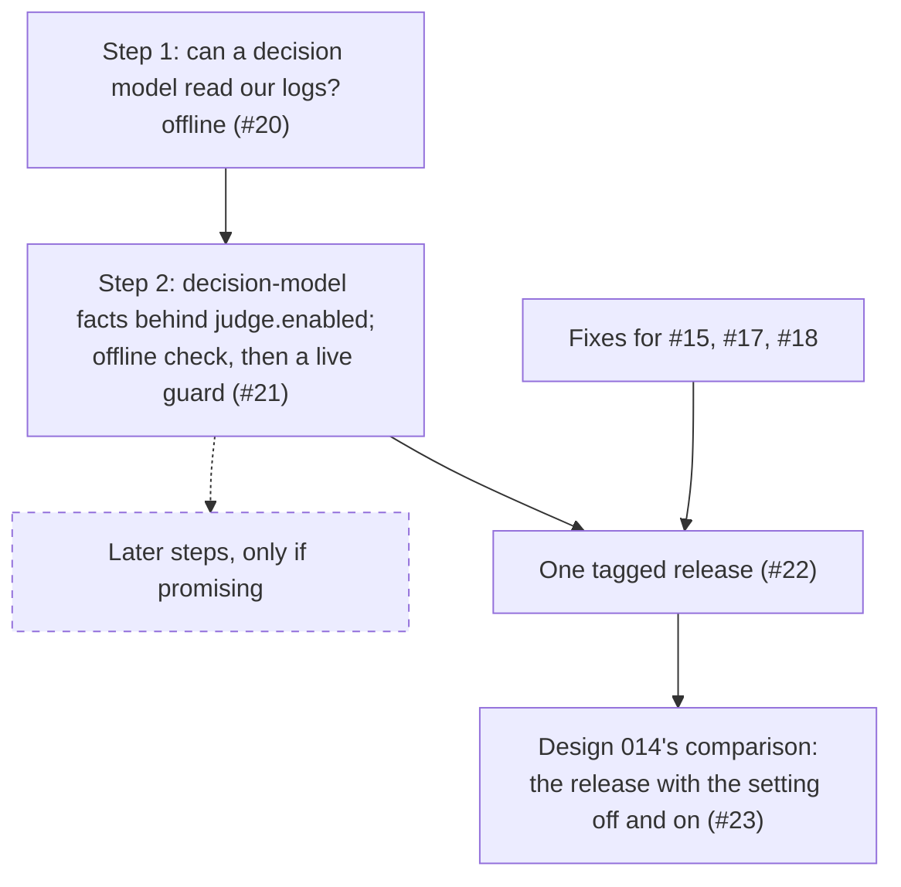

# Plan 011 — Decision models for the small judgments

Design: [011 — Decision models for the small judgments](../designs/011-decision-models.md).
Each step is a sub-issue of [#19](https://github.com/BenedatLLC/k8srca/issues/19).

This plan carries out a first pass at design 011: a decision model states the knowledge base's
text-read facts (facts that need a container's log read to decide). Step 1 measures offline
whether a decision model reads our logs correctly. Step 2 puts it in the facts layer behind
`judge.enabled` and checks the effect offline and then live. Later steps run only if they look
promising. When the first pass is done, #15, #17 and #18 are fixed, the k8stools tools for three
gaps are adopted, and the comparison is written down, `main` is tagged as one release
([#22](https://github.com/BenedatLLC/k8srca/issues/22)) for design 014's comparison
([#23](https://github.com/BenedatLLC/k8srca/issues/23)).

## Step 1 — Measure offline whether a decision model reads our logs correctly

**Issue:** [#20](https://github.com/BenedatLLC/k8srca/issues/20). **Status:** not started.

| | |
| --- | --- |
| **Hypothesis** | On the knowledge base's log predicates, a decision model's yes/no answers, thresholded, state correct facts on most container logs and abstain on the rest, with no confident wrong answers. On redacted text, JEV does this better than a regular expression per question, and at least as well as a small Claude model asked the same question, for less |
| **Expected effect** | No confident false negative, at most one confident false positive, abstaining on at most a third of pairs, and better than the regular expressions on at least five predicates |
| **Can we see it?** | Confident wrong answers: yes, as counts (with few positives per predicate, results report counts, not rates, and say so). Repeatability: yes, as counts of pairs. A model against the regular expressions or Haiku: only where the difference is large; a tie means the simpler reader wins. Nothing runs live |
| **Budget** | One week. $25 in all: decision-model calls (checked against each provider's pricing before the first call), Haiku calls and Claude's labelling. Hand-labelling is the owner's time and the step's real cost |
| **Done and stop** | Below |

**The predicates.** These read a container's own log, and none is derived in code today
(`src/k8srca/facts/derive.py`). The step's first task fixes the list, dropping any whose state is
not a single container's log:

> `process_logged_fatal_error`, `startup_logs_show_error`, `startup_logs_show_progress`,
> `logs_show_different_fatal_error`, `logs_show_executable_not_found`,
> `logs_show_initialization_failure`, `logs_show_missing_or_incompatible_library`,
> `logs_show_port_already_in_use`, `logs_show_queue_empty_exit`,
> `logs_show_timeout_waiting_for_dependency`, `logs_show_dependency_connection_failure`,
> `logs_show_dependency_wait`, `logs_show_auth_rejection`, `logs_name_invalid_setting`,
> `missing_file_error_in_logs`, `permission_denied_error_in_logs`,
> `operation_not_permitted_in_logs`, `readonly_filesystem_error_in_logs`,
> `probe_endpoint_logs_show_errors`

Event-message predicates (`pull_message_names_*`, `sandbox_message_names_*`) are left out: their
text is short and formulaic, and code is the right tool for them.

**The corpus.** The container logs in the 15 scenario recordings: the first ten held 307 current
and 235 previous logs (up to 200 lines each, about 42k lines), many repeated because the
scenarios share one demo application; the ITBench imports (24, 31, 80, 102, 105) add more. 24's
and 80's logs are real positives for `logs_show_dependency_connection_failure`, and 80's "topic or
partition does not exist on this broker" is a message no predicate covers. After removing
duplicates, each log is paired with each predicate.

**Labels.** Hand-labelling every pair is too slow, and most pairs are negative:
1. **Screen.** A pair is a candidate positive if the regular expression, JEV (p > 0.2) or Haiku
   flags it.
2. **Label every candidate by hand.** Two labellers, the owner and Claude, blind to which reader
   flagged it. The owner settles disagreements, and they are counted.
3. **Sample the rest.** A random 200 unflagged pairs are labelled by hand, to estimate the
   positives every reader missed.
4. **Constructed positives.** About five constructed logs per predicate: real error shapes from
   the mined guides' sources, set inside demo log context. Marked `constructed`, scored and
   reported separately, never mixed into the recorded counts.

The labels are frozen before any reader is scored
([process.md §5](../docs/process.md#5-the-instrument-is-frozen-per-design)).

**The readers,** each on redacted text unless noted:

| Reader | What |
| --- | --- |
| Regular expression | One pattern set per predicate, written before looking at the other readers' results |
| JEV (primary) | The predicate's `says` sentence as a yes/no question; model version pinned |
| Haiku | `claude-haiku-4-5`, the same sentence and state, asked for a probability; one call per pair |
| JEV, raw text | JEV on unredacted text: what redaction costs |
| Others (optional) | Kev (4B, run locally, so also on raw text), Clef and OpenAI Decisions, each only if an account or hardware is at hand. A stronger model (Sonnet or Opus) for the pairs JEV is unsure about ([design §7](../designs/011-decision-models.md#7-open-questions)) |

**Measures,** per predicate and overall:
- **confident wrong:** a fact stated (p ≥ hi or p ≤ lo) that the label contradicts, split into
  false positives and false negatives (the kind that would rule a cause out), and reported by
  confidence bucket;
- **abstain rate** at the chosen thresholds;
- **repeatability:** each reader answers every labelled pair five times on separate calls. Report
  the share of pairs whose five outcomes (stated true, stated false, abstain) are identical, and
  the share that cross a threshold. The regular expression is the deterministic reference.
  Compared with how consistently the live agent recorded facts on the same logs, where saved runs
  hold them; if too few do, the report says so. Reported for every reader, and not a done
  criterion;
- dollars and milliseconds per log;
- for the raw-text reader, the change in confident wrong and abstain against JEV.

Thresholds are chosen per predicate and per model on the constructed set, then applied unchanged
to the recorded set, so they are not fitted to what they are scored on.

**Done** when, for JEV on the recorded set at thresholds fixed on the constructed set:
- it states no confident false negative;
- it states at most one confident false positive across all predicates;
- it abstains on at most a third of the pairs;
- it beats the regular expressions on confident wrong or abstain, on at least five predicates.

The other readers are reported against the same lines; one that passes where JEV fails becomes
the primary reader.

**Stop, and say which,** when:
- **a regular expression matches the best decision model:** close the step and put the regular
  expression in the facts layer as code;
- **Haiku matches the best decision model** at an acceptable cost per log: the case for a
  dedicated decision model is gone;
- **no threshold removes the confident false negatives:** the idea does not work on this text;
- **redaction costs more than it keeps:** the raw-text reader is clearly better. A decision about
  data for the owner, not a threshold to tune; a local model may make it moot;
- **the budget is spent.**

**Deliverables,** in every outcome:
- [ ] `judge/questions.yaml` (draft) and `src/k8srca/core/judge.py` with the first adapters
- [ ] The labelled set under `tests/judge/`, with its provenance
- [ ] `uv run k8srca eval judge` to rerun the readers
- [ ] Results in the table below

## Step 2 — State log facts from a decision model in the facts layer, behind the setting

**Issue:** [#21](https://github.com/BenedatLLC/k8srca/issues/21), blocked by step 1.
**Status:** not started; planned in full when step 1 ends.

What it builds ([design §3](../designs/011-decision-models.md#3-approach)): the judge service and
its network rule, facts with `by: "judge"`, the `judge:` configuration section (off by default),
and the recorder (`k8srca scenario record-results`) keeping log results in the recorded fixtures,
which it does not do today.

| | |
| --- | --- |
| **Hypothesis** | The judge's text-read facts let the knowledge base's ranking decide cases it cannot today, without adding wrong leaders |
| **Expected effect** | Offline, on `tests/kb_eval/measure_2a.py`'s 12 labelled scenarios: the two Java out-of-memory scenarios print the right cause, and no other scenario gains a wrong leader (below). Live: small; "can't tell" is the predicted result |
| **Can we see it?** | Offline: yes, the script is deterministic. Live: three runs per scenario is a guard against a regression as [004 §6.4](../designs/004-scenario-testing.md#64-sampling-and-the-regression-rule) defines one (fewer runs diagnosed, or a checklist drop larger than the baseline's spread), not a way to see a small gain; at most a lean on `fact` commands, specialist delegations and dollars per run |
| **Budget** | Set when step 1 ends, from what it chose |
| **Done and stop** | Done when the offline check matches the expected effect and the live guard shows no regression. Stop if a new wrong leader appears offline, or the live guard flags a regression |

**The offline floor.** `measure_2a.py` runs `open` in process on the 12 labelled scenarios with
the facts the facts layer derives and no text-read facts. Scored on the leader `ranking` computes
among the symptom's own candidates
([015 §10.3](015-kb-evaluation.md#step-2a-recall-and-false-leaders)): right in 6 of
12 (including both `jvm-oom-*` cases, where `oom-kill` leads at moderate); wrong in 3, all
`application-release` at strong (`deploy-regression`, `liveness-probe-wrong-port`,
`itbench-24-kafka-port-change`); no leader in 3 (`downstream-latency`,
`itbench-102-memory-quota`, `itbench-105-invalid-command`).

**Expected effect on the two `jvm-oom-*` cases.** Today `oom-kill` leads them only through a
sub-cause: `memory-limit-too-low` holds at moderate (the memory limit equals the request and no
runtime sizing flags are set), and a sub-cause's grade lifts its parent's. `oom-kill`'s own
evidence cannot hold, because it needs `not process_logged_fatal_error` and nothing derives that
fact. For the same reason `application-crash` is not ruled out, and `open` prints it, with
`port-conflict` under it, as the most likely cause at weak (the wrong leader of
[#18](https://github.com/BenedatLLC/k8srca/issues/18)). Adding the judge's
`not process_logged_fatal_error` for the killed container by hand to the script's input gives:

| Case | Printed leader today | Printed leader with the fact | Computed leader |
|---|---|---|---|
| `jvm-oom-on-startup` | `application-crash`, weak (wrong) | `oom-kill`, moderate | `oom-kill`, moderate (unchanged) |
| `jvm-oom-with-metrics` | `application-crash`, weak (wrong) | `oom-kill`, strong | `oom-kill`, moderate → strong |

The fact matches `application-crash`'s `rules_out` (exit 137 with no fatal error logged), which
removes the wrong printed leader whether or not #18 is fixed. It also lets `oom-kill`'s own
evidence hold: at moderate, and at strong in `jvm-oom-with-metrics`, where the metrics recording
gives the facts layer `memory_limit_plausibly_reached`. The precondition is that each recording's
fixtures hold the killed container's previous log; if it is unavailable, the judge states nothing
and these cases do not move. The `application-release` leaders depend on how coarse the knowledge
base's claims are, not on any log, and are not expected to move.

**Score the computed leader, not the printed line.** `open`'s printed "most likely" differs from
the leader `ranking` computed in 4 of 12 cases (#18). `measure_2a.py` reads `ranking` directly.
The agent sees the printed line, so #18's fix is part of what a live run of this step runs on.

**Before planning it in full,** read from the ITBench imports' results
([004 §12.3](../designs/004-scenario-testing.md#123-four-more-itbench-imports-24-80-102-and-105))
which scenarios leave room for a change to show, and how many misses come from reading logs.

- [ ] Judge service, network rule and `judge:` configuration
- [ ] `by: "judge"` facts, with tests
- [ ] Recorder keeps log results; fixtures re-recorded where needed
- [ ] Offline check run and recorded
- [ ] Live guard run and recorded
- [ ] Documents updated (001 §8 for the new service and credential, the glossary)

## Later steps, only if they look promising

None is planned. Each gets a step here, with the five fields and its own issue, if it is taken up
([design §2.1](../designs/011-decision-models.md#21-uses-beyond-the-first-pass)):
- **A stronger model for the unsure band,** as an extra reader in step 1 (design §7).
- **Support as an evaluation category** and **a screen for the checklist grader:** instrument
  changes, so only between designs, and only after
  [#6](https://github.com/BenedatLLC/k8srca/issues/6) leaves a baseline.
- **Symptom matching:** only after 015's simpler search aliases are scored on the same queries and
  lose.
- **Suggested attribution patches** for the reviewer (design §4.1): after more observations are
  recorded as facts.

## Results

| Step | Plan | Outcome | Decision |
| --- | --- | --- | --- |
| 1 | Above | | |
| 2 | Above | | |

### Checkpoints

None yet.
