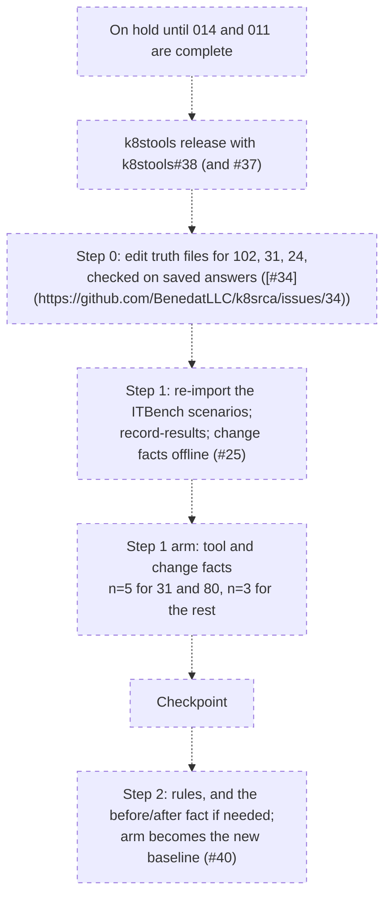

# Plan 013 — What changed near the alert

Design: [013 — What changed near the alert](../designs/013-what-changed.md). Each step is a
sub-issue of [#31](https://github.com/BenedatLLC/k8srca/issues/31).

This plan gives the agent the recent writes in the alerting namespace as facts, then rules for
weighing a change against the symptom, and measures each apart, as design 012 did. Step 0 edits
three truth files the new captures would contradict. Step 1 adopts the k8stools release with the
recent-changes tool, re-imports the ITBench scenarios and runs an arm with the `change` fact.
Step 2 adds the rules, and a fact counting log matches either side of a change if step 1 leaves
itbench-31's rate item where it is; its arm becomes the new baseline. The plan and its budget
were approved on 2026-11-01. The owner put the design on hold on 2026-11-07, before step 0, until
designs [014](../designs/014-sregym.md) and [011](../designs/011-decision-models.md) are
complete.

Terms: an **arm** is one configuration of the agent run across the scenario suite; **n** is the
number of runs per scenario; scenarios are named by number as in
[the design](../designs/013-what-changed.md) (24, 31, 33, 80, 102, 105 are the ITBench imports).
The rest are in the [glossary](../docs/glossary.md#how-we-measure-changes).

The diagram shows the planned order of work once the design resumes; all of it is planned.

**Whole plan:** $60, about 5 working days.

## Before the design resumes

- **Re-read the starting figures.** The expected effects below were read from
  [012's step 2 arm](../designs/012-log-evidence.md#step-2-the-arm-2026-11-01). The current
  baseline ([docs/baseline.md](../docs/baseline.md)) re-ran the suite the same day with the fixes
  for [#12](https://github.com/BenedatLLC/k8srca/issues/12) and
  [#13](https://github.com/BenedatLLC/k8srca/issues/13) (below). When the design resumes, the
  starting figures are re-read from the baseline then current.
- **Fixes already in the baseline.** Two changes outside this design were to go in before step 1.
  Both are in the current baseline (taken 2026-11-01 at c817681), so step 1's comparison does not
  carry their effect:
  - [#12](https://github.com/BenedatLLC/k8srca/issues/12): the MCP client accepts tool results up
    to 8 MiB (`MAX_RESULT_BYTES` in [`src/k8srca/mcp_client.py`](../src/k8srca/mcp_client.py)),
    where the SDK's default refused anything over 1 MiB, which a full log read crosses. 012's
    step 1 had 7 such reads fail, all on long log tails.
  - [#13](https://github.com/BenedatLLC/k8srca/issues/13): the answer check
    ([`skills/k8s-rca/answer_check.py`](../skills/k8s-rca/answer_check.py)) reads "10,000" as one
    figure, where it read 10 and 000 and sent a revision turn for a figure that was right. It
    touches the revision turn only, not the grader.
- **Tripwire 2 (a third change aimed at the same thing,
  [process.md §2](../docs/process.md#2-tripwires)).** 31's rate and policy items get their third
  and fourth attempts here (012's two steps were the first two). The owner chose this design at
  [012's checkpoint](../designs/012-log-evidence.md#step-2-the-arm-2026-11-01) knowing that. The
  items are measured alongside five other scenarios' items, so the steps do not aim at one
  scenario.

## Step 0 — Edit three truth files before any measurement

**Issue:** [#34](https://github.com/BenedatLLC/k8srca/issues/34). **Status:** not started; waits on the k8stools release.

This step changes no agent behaviour. Three truth files say the capture cannot show what the
re-import will make visible. Changing them during step 1 would fire the tripwire "the grader or a
truth file changed mid-step" ([process.md §2](../docs/process.md#2-tripwires)), so they change
first, each checked for noise on saved answers
([process.md §5](../docs/process.md#5-the-instrument-is-frozen-per-design)):
- **102:** the gap "k8stools has no ResourceQuota tool, so the quota's creation time … are not
  visible", and the trap `no-quota-time-as-observed` built on it. The quota's creation time
  becomes observable. Its other limits and scopes stay unseen unless the capture records them.
- **31:** the gap `who-created-the-policy` ("nothing in the capture says who created the
  policy"). The write's client becomes visible, but it is a client library, not a person or a
  reason.
- **24:** the gap that says "k8stools does not expose managedFields".

The author traps (checklist items that fail an answer naming who made a change) stay as they are:
a client name such as `OpenAPI-Generator` does not name who made a change. From step 1's start
the grader, truth files and checklists are frozen.

- [ ] 102's gap and `no-quota-time-as-observed` trap edited
- [ ] 31's `who-created-the-policy` gap edited
- [ ] 24's `managedFields` gap edited
- [ ] Each edit checked for noise on saved answers

## Step 1 — Give the agent the recent writes as facts, and measure it

**Issue:** [#25](https://github.com/BenedatLLC/k8srca/issues/25), tracking
[k8stools#38](https://github.com/BenedatLLC/k8stools/issues/38). **Status:** not started; waits
on the k8stools release and step 0.

What it builds: design §3 items 1–7
([§3.2](../designs/013-what-changed.md#32-in-k8stools-write-records-and-a-recent-changes-tool),
[§3.3](../designs/013-what-changed.md#33-in-k8srca-replay-the-change-fact-and-the-coordinator)).
Items 1–4 are k8stools' release; k8srca's part is moving the pins and replay to it, the
re-import, the `change` fact and the coordinator's `triage` group.

| | |
|---|---|
| **Hypothesis** | With the recent writes in front of it, as facts, the agent rules out what didn't change and names what did. A policy created minutes before the alert becomes a suspect it inspects |
| **Expected effect** | From 012's step 2 arm: 31 `rules-out-network-policy` at least 3/5 (1/5 now). 80 `rules-out-checkout-config` at least 2/5 (0/5). 102 `rules-out-ad-fault` at least 2/3 (1/3), since ad's template has no write in 35 minutes. The `agent-access` decoy is named as a cause in no run. The author traps (`no-named-author`) hold where they are met now. Elsewhere checklist within noise, cost per run within 1.3× the baseline |
| **Can we see it?** | Ruled-out items, like cause items, don't flip between gradings. From a true rate of 0.2, 3/5 or better happens 6% of the time, so 31 at 3/5 is a signal; 80 at 2/5 is a weak one. 102 at n=3 is indicative only. Regressions at n=3 are flagged for the checkpoint, not decided |
| **Budget** | $30 (sessions about $20 with a 30% allowance, grading about $6), 3 days, most of it waiting on the k8stools release |
| **Done and stop** | Done when the arm is run and graded with `--grades 3` at the agreement criterion, and the results table below has the result and a decision. Stop if the re-import changes anything a truth file depends on beyond step 0's edits (the tripwire "the grader or a truth file changed mid-step"), or the budget is spent |

**Inner loop first**
([development.md](../docs/development.md#evaluations-cheapest-first)):
- Re-import diff: each capture's `k8s.json` gains only write records, quotas and limit ranges;
  anything else, stop and look.
- `uv run k8srca scenario record-results` before and after, on all 15 scenarios.
- The `change` fact on the six re-imported fixtures: the fault or decoy appears, the harness
  writes appear, and nothing from a controller.
- `uv run k8srca eval answer` on 31 and 102 with the new facts (about $0.10 an answer).

**Arm:** n=5 for 31 and 80, n=3 for the other 13.

- [ ] Pins and replay moved to the k8stools release (design §3 item 5)
- [ ] ITBench scenarios re-imported (33 only if its truth carries over unchanged); re-import diff checked
- [ ] `change` fact in the facts layer, with tests (item 6)
- [ ] `get_recent_changes` in the coordinator's `triage` group (item 7)
- [ ] `record-results` before and after; `eval answer` on 31 and 102
- [ ] Arm run and graded with `--grades 3`; result and decision in the table below
- [ ] Documents updated (the glossary for the `change` fact)

## Step 2 — Add rules for weighing a change, and measure them

**Issue:** [#40](https://github.com/BenedatLLC/k8srca/issues/40) (which carries on from the closed [#1](https://github.com/BenedatLLC/k8srca/issues/1)), blocked by
[#25](https://github.com/BenedatLLC/k8srca/issues/25). **Status:** not started.

What it builds: design §3 items 8–9
([§3.4](../designs/013-what-changed.md#34-rules-for-weighing-a-change-and-errors-either-side-of-it)).
Item 8, the fact from two results, is built only if step 1 leaves 31's rate item
(`cause-rate-unchanged`) where it is.

| | |
|---|---|
| **Hypothesis** | Rules for weighing a change, and a fact that counts errors either side of one, get the agent from "this changed" to "this change made no difference", and stop it dating an onset to an old change |
| **Expected effect** | From step 1's levels: 31 `cause-rate-unchanged` at least 3/5 (0/5 at baseline), diagnosis at least 3/5 (2/5). jvm-oom-with-metrics `no-onset-date` at least 2/3 (0/3). nothing-is-wrong `no-shipping-cause` holds. Elsewhere within noise, cost within 1.3× step 1 |
| **Can we see it?** | As step 1. `no-onset-date` is a trap item, which flips about 4% of the time; 0/3 to 2/3 is past that |
| **Budget** | $30, 2 days |
| **Done and stop** | Done when the arm is run and graded, the baseline taken, the results table written and the design's status set. Stop as step 1 |

**Tripwire 3 (a rule written from one run).** The rules state how Kubernetes changes work, and
they come from six scenarios' runs, not one. The owner reviews their text before the arm.

**Inner loop first:**
- The two-result fact on 31's fixtures: 9 before, 6 after, matching the truth file (9 in 6,096
  lines before, 6 in 3,904 after).
- `uv run k8srca eval answer` on the rules.

**Arm:** as step 1. It becomes the new baseline.

- [ ] Fact from two results, with tests, if step 1 leaves 31's rate item unmoved (item 8)
- [ ] Rules in `skills/k8s-rca/SKILL.md`, text reviewed by the owner (item 9)
- [ ] `eval answer` on the rules
- [ ] Arm run and graded; baseline taken
- [ ] Production's k8stools pins moved, and the hold-out kit's k8stools floor
  ([`docs/holdout/requirements.md`](../docs/holdout/requirements.md)) with them
- [ ] Documents updated (001 and 002 where they call the recent-changes tool planned; the design's status and the [design index](../designs/README.md#index))

## Results

| Step | Plan | Outcome | Decision |
| --- | --- | --- | --- |
| 0 | Above | Not started | |
| 1 | Above | Not started | |
| 2 | Above | Not started | |

### Checkpoints

None yet.
