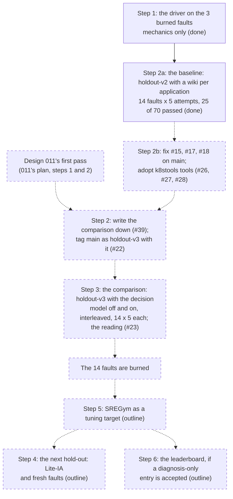

# Plan 014 — SREGym: a live exam, a one-use hold-out, a tuning target, a leaderboard entry

Design: [014 — SREGym](../designs/014-sregym.md). Parent issue:
[#32](https://github.com/BenedatLLC/k8srca/issues/32); each step is a sub-issue.

This plan runs k8srca on SREGym-Lite live, diagnosis only. Step 1 built the driver and ran it on
the three burned faults (the faults we may read everything about). Step 2a recorded the baseline:
the agent as tagged `holdout-v2`, with a wiki for each application, on the 14 held-out faults.
Step 2b fixes three known defects and adopts the k8stools tools for three gaps the baseline found.
Once that and design 011's first pass are done, step 2 writes the comparison down, naming the
release tag, and `main` is tagged `holdout-v3` on a commit holding the code and that document.
Step 3 then runs the comparison: `holdout-v3`
with the decision model off (arm A, the agent with no decision model) and on (arm B, where a
decision model states facts read from logs), interleaved fault by fault. Steps 4 to 6 are
outlines. The plan is **on hold** while the design is
([design, status](../designs/014-sregym.md)), after step 2a.

**The hold-out rules apply to every step** ([design §3.1](../designs/014-sregym.md#31-the-suites-life-and-what-each-phase-may-do)):
nobody, Claude included, reads the 14 held-out faults' definitions (the source under SREGym's
`conductor/problems`, the oracles, the mitigation scripts); run records are not opened until the
reading is written, apart from the baseline answers the owner chose to read; and what was read is
not used to design arm B before step 3 has run.

The steps are named in the order they were planned, which is not the order they run. Step 2a
(arm A's baseline) was added before step 2 and has run. Step 2b is the last change to the agent.
Step 2 then writes down the comparison and takes the tag. Step 3 is the comparison. This diagram shows the steps, what each waits on, and where the work stands; dashed
boxes are planned.

## Step 1 — Build the driver and run it on the three burned faults (mechanics only)

**Issue:** none (done before steps had issues). **Status:** done, 2026-11-08.

| | |
| --- | --- |
| **Hypothesis** | A read-only k8srca session, through k8stools on SREGym's view proxy, can take a live SREGym problem, produce a diagnosis, and have SREGym grade it, with the harness upstream and unmodified apart from one client |
| **Expected effect** | A run completes end to end. No claim about a score |
| **Can we see it?** | Yes: mechanics are binary. Nothing here is measured against noise |
| **Burned set** | Confirmed by the owner: `network_policy_block`, `env_variable_shadowing_astronomy_shop`, `service_wrong_pod_selection_hotel_reservation`, one per application family, so the wiring is exercised on each. Chosen before any run, for mechanics and not for difficulty |
| **Budget** | Seven calendar days. $50 for sessions, and SREGym's judge at whatever SREGym's grader costs per diagnosis |
| **Done** | (a) each burned fault run twice, diagnosis only, graded by SREGym, the answer saved; (b) the view-proxy test passes ([design §3.6](../designs/014-sregym.md#36-the-cluster-view-k8stools-reads-through-sregyms-view-proxy)); (c) the isolation and arms questions (design §7 questions 2 and 3) are answered; (d) wall clock and dollars per run are measured, which sets step 3's budget; (e) a hermetic test covers the driver's logic, and the shim carries none |
| **Stop** | The isolation question cannot be answered both ways; a run needs more than two hours of wall clock; the budget is spent |

Also in this step: the hold-out discipline goes into code, not anyone's memory. `k8srca-sregym`
refuses to print a run's answers or grader notes for a hold-out fault until a reading file exists,
and prints scores only.

- [x] The seam in this repo, tagged `holdout-v2` ([design §3.8](../designs/014-sregym.md#38-the-seam-a-way-to-run-one-session-on-a-given-question))
- [x] The shim in the fork and the service in the suite repo
- [x] (a) Each burned fault run twice and graded ([journal](../docs/journal/2026-11-08-sregym-step1.md))
- [x] (b) The view proxy hides what SREGym hides
- [x] (c) Isolation and arms answered
- [ ] (d) Wall clock and dollars per run: not valid (below); replaced by step 2a's measured figures
- [x] (e) 27 hermetic tests of the driver's logic in the suite repo
- [x] The hold-out guard in `k8srca-sregym`

**Outcome.** Done in one day; $2.21 in agent sessions for six runs, plus a cheap judge call each.
The six runs used agents with **no system prompt and no skills**: the derived configuration sat in
`.state/`, k8srca resolves an agent's prompt and skill paths against the configuration file's
directory, the paths pointed at nothing, and `sync` did not fail. So everything measured about the
agent in step 1 (scores, $0.37 and 7.1 minutes a run) describes a bare model with k8stools. Fixed
in the suite's `pairs.derive`, which makes the paths absolute and fails when one is missing, with
a test that loads the derived configuration from outside the checkout. Found in step 2a.2.

### What the first live runs showed

Setting up a machine is described in `docs/setup.md` in the suite repo.

**The first live run** used SREGym's own `debug` agent (it does nothing) on
`network_policy_block`, a burned fault, with `--stages diagnosis` and `API_PORT=8001`. No k8srca
session ran, so nothing was spent on the agent; SREGym's judge preflight made one cheap call.
Verified:

- A fresh clone of the fork needs `git submodule update --init --recursive` first. Without it the
  first run died at deploy ("Helm chart_path does not exist") after three retries and left nothing
  behind.
- The conductor's API port defaults to 8000, which k8stools holds, so SREGym runs with
  `API_PORT=8001`.
- The problem deployed, the fault was injected, and `/status` reported `diagnosis` with
  `agent_remaining_seconds: 1500`. `GET /get_app` returned `app_name`, `namespace`, `namespaces`,
  `descriptions` (the application's description, not the fault's) and `stages`. Stopping the
  harness undeployed the application and removed its egress policy.
- In filtered mode (the default) the conductor's proxy listens on `172.17.0.1:16443`, the docker0
  gateway, and writes a **per-problem** agent kubeconfig to `/tmp/sregym-agent-kubeconfig-*.yaml`:
  server `https://host.docker.internal:16443`, a CA generated for that run, a token. The agent
  container gets it mounted and nothing else of the cluster.
- A throwaway k8stools container on `k8srca-net`, with
  `--add-host host.docker.internal:host-gateway` and that kubeconfig mounted, bound to the proxy
  and served 33 tools. `get_pod_summaries` for the problem's namespace returned its pods. So
  k8stools works through SREGym's view proxy.
- In that problem the view equals the raw cluster's, in names: it hid no namespace. The injected
  fault, a NetworkPolicy, is visible, as it is to any agent with `kubectl`.

**Integration findings.** Each stopped a run while wiring the client, and each has a fix in the
suite repo or the fork; `docs/setup.md` in the suite repo has the symptoms and the steps.

| Finding | Consequence |
| --- | --- |
| SREGym hides the problem from agents: the artifact id is `anon_<hash>` | The host names the problem (`/expect`), which is also what makes the hold-out guard enforceable. A suite runs one problem per SREGym process |
| Filtered mode has a hard-coded list of agent names (`provider_endpoints.py`) | A new client needs a one-line change in SREGym's own code, not only under `clients/`. For the leaderboard that is an upstream pull request (design §7 question 2) |
| Without `SREGYM_AGENT_IMAGE`, SREGym runs its published agent image | A third-party client needs a locally built image, or to be merged upstream and shipped in a release |
| An empty `KUBECONFIG` (from k8srca's `.env`) breaks SREGym's own `kubectl` | The runner drops it. Any process started from k8srca's environment should be checked for this |
| `SREGym-applications` is a submodule, not initialised by a plain clone | Setup must say so; a run without it fails at deploy |
| k8stools holds port 8000, SREGym's API default | SREGym runs with `API_PORT=8001` |
| `k8srca up`'s egress probe passes when nothing listens on `gateway:6443` | The probe ([`bringup.py`](../src/k8srca/bringup.py) `egress_status`) only tests whether port 6443 on the gateway answers, so "confined" means nothing on a host with no API server there. Apply and check `egress-rules.sh` by hand; the probe is not fixed |

**First end-to-end result.** `network_policy_block`, a burned fault, one attempt: the agent's
session took 65 s and $0.14 with 5 tool calls; SREGym's whole run took about five minutes (deploy
127 s, diagnosis 69 s, evaluation 6 s, cleanup 98 s, undeploy 5 s); a cheap judge scored it 1.0.
The score means nothing, as the fault is burned and the judge is not the leaderboard's. The timing
does: a fault costs about five minutes of wall clock whatever the agent does.

**The view proxy hides what SREGym hides.** With a `khaos` namespace and a pod labelled
`app=load-generator` created as stand-ins, the raw cluster showed both and k8stools showed
neither, and an ordinary pod stayed visible. This is done criterion (b); the stand-ins were
deleted.

**A security finding.** The proxy's token answers `can-i create pods` and `can-i get secrets` with
*yes*, so the read-only RBAC layer does not apply behind it. What follows, and the open decision,
are in [design §3.6](../designs/014-sregym.md#36-the-cluster-view-k8stools-reads-through-sregyms-view-proxy)
and §7 question 9.

## Step 2a — Record the baseline: the agent as tagged `holdout-v2`, with a wiki for each application

**Issue:** none (done before steps had issues). **Status:** done: 25 of 70 attempts passed.

At the owner's direction the baseline was built first, with the decision-model work done
independently (on another machine, on the existing scenarios), and where to run arm B decided when
that work is done. This splits step 3's "both arms in one sitting"; step 2b and step 3 say how the
comparison gets it back. Step 2a also answers design §7 question 5 as "build the wikis": the agent
gets the architecture skill for **the application under test and no other**, as an SRE's
deployment would.

| | |
| --- | --- |
| **Hypothesis** | None against a number. This step produces the baseline agent's reading on the 14 hold-out faults. The agent is `holdout-v2` plus a per-application wiki, so it is **not** the agent `docs/baseline.md` measured (that one had a pinned skill for a different cluster) |
| **Expected effect** | None claimed. A guess, flagged as one: the wiki helps most on faults that need the application's dependency graph (a datastore, a queue) and not on ones visible in a single object. Nothing here tests it, because there is no arm without the wiki |
| **Can we see it?** | Not a comparison. The unit of evidence for step 3 is the fault (see step 2), so this step records passes of 5 per fault. With n=5 a fault reads 0–5; the spread across attempts is the within-arm noise step 3 needs |
| **Judge** | `anthropic/claude-sonnet-5-5` through `--judge-backend api` (owner's choice). SREGym fixes none: with no `--judge-model` it reuses the agent's own model. Leaderboard rules on the judge were not found (design §7 question 2), so these scores are a proxy until step 6. Answers are saved verbatim, so a different judge can score them again |
| **Budget** | Wikis: about $3 to build (three at about $0.90) plus review. Runs: 14 faults × 5 attempts = 70 runs. Step 1's per-run figures came from a misconfigured agent, so they were a floor: the real agent reads the knowledge base and a wiki and may review and revise its answer. Ceiling: $100 in sessions and four calendar days. Measured: $41.17 in sessions |
| **Done and stop** | Each part below has its own done and stop criteria |

- [x] 2a.1 A wiki for each application, checked and scanned
- [x] 2a.2 One agent pair per application
- [x] 2a.3 Mechanics check on the burned set, and the preflight
- [x] 2a.4 The 70 runs, scored and sealed
- [x] The wiki honours SREGym's visibility policy
      ([#16](https://github.com/BenedatLLC/k8srca/issues/16), option 1; item 7 below), and the
      six astronomy-shop faults re-run

### 2a.1 — Build the wikis

One per application: hotel-reservation, social-network, astronomy-shop.

- Sources: what SREGym deploys, read from the checkout and not from a cluster. Astronomy-shop and
  social-network install from local Helm charts in `SREGym-applications`, with SREGym's values
  files (and, for astronomy-shop, its `--set prometheus.enabled=false`). **Hotel-reservation does
  not use Helm**: SREGym applies the manifests in `hotelReservation/kubernetes` (its tree also
  holds a chart that is not used). Per-fault environment overrides are applied at deploy time and
  are not in those manifests, which is why the manifests are the right source. **Not**
  `live_cluster` (that describes the faulted state,
  [design §3.7](../designs/014-sregym.md#37-environment-and-the-architecture-skill)), **not**
  `change_history`, and nothing from SREGym's fault generators or problem files.
- kubewiki has a local-chart source (`HelmChartRef.local`, `values` as a list, `sets`), cached by
  the chart's contents. It runs `helm template` under CLAUDE.md's exception: offline,
  `KUBECONFIG=/dev/null`.
- Built wikis are **inputs, not code**. They are kept in the suite repo with their source commits
  and digests, so arm A syncs them as local skills and arm B uses the same bytes.
- Done criterion: `kubewiki check` passes on each; a hermetic test in the suite repo scans every
  built skill for the 17 Lite fault names and fails on a hit
  ([design §3.10](../designs/014-sregym.md#310-where-sregym-is-not-a-clean-hold-out)); digests
  recorded.
- Stop: a chart cannot be rendered offline after a day's work on it. Then the owner decides
  between no wiki for that application, flagged in the reading, and a different source.

**Result.** All three render offline and pass `kubewiki check`, synthesised with `claude-opus-5`
(about $0.90 each). The scan found no fault name. Digests and source commits are in the suite
repo's `wikis/provenance.json`. Components and edges: astronomy-shop 26 components with 44 edges
(after the hidden-label fix, item 7 below); **hotel-reservation 20 and social-network 27, with no
edges.** Their call graphs live in configuration files baked into the images (hotel's
`config.json`, social-network's `service-config.json`), not in the manifests, so a wiki from
manifests alone has components, kinds and what each is for, but no dependency edges. The owner
accepted this; the reading says which wikis have edges.

**Future enhancement, not in this design:** build-time edges *observed* on the healthy deployment
from its tracing backend (all three applications deploy Jaeger), as a new source type with
provenance `observed`. It needs a healthy deployment before injection, which the harness does not
give us. Smaller options: read any mounted configuration that names a Service (today only the
OpenTelemetry collector's shape is read; DeathStarBench's shared configuration would
over-connect), or a `docs` source describing the call graph.

### 2a.2 — One agent pair per application

A skill belongs to an agent, not a session, so each application gets its own coordinator and
specialist, synced with that application's wiki.

- The service picks the pair from the namespace in the conductor's `app_info`. The question the
  driver builds is unchanged (frozen,
  [design §3.9](../designs/014-sregym.md#39-the-instrument-and-what-is-frozen)). An application
  with no wiki gets a pair with none, and the run record says `wiki: none`, so the reading can
  show it.
- State is one directory per arm and application (`.state/arms/<arm>/<pair>/` in the suite repo).
  **One environment and one poller still serve all of an arm**: the pairs differ in agents, not in
  sandbox image.

**Result.** Built as `pairs.py` in the suite repo. `up` syncs a `none` pair and one per
application with a wiki; `diagnose` records the pair and the wiki's digest in the run. Checked on
the platform: each of the four coordinators has the 3,830-character system prompt and `k8s-rca`,
and the three application pairs also carry their own wiki and no other. The derived configuration
fails on a missing prompt or unbuilt skill, and `sync` fails if it reports skills skipped (the
defect that left step 1's agents without a prompt). 44 hermetic tests.

### 2a.3 — Mechanics check on the burned set

One run each of the three burned faults, each with its application's wiki. Done when each session
shows its own wiki read and no other's, and a run's dollars with a wiki are measured. No claim
about scores. If the wiki made a run cost more than twice step 1's mean, that would be a
checkpoint, not a reason to continue.

**Result.** Astronomy-shop $0.18 (92 s), hotel-reservation `service_wrong_pod_selection` $0.57
(259 s), `network_policy_block` $0.31 (166 s); mean $0.35. The largest is 1.5 times step 1's mean,
under the 2x limit (step 1's agent had no prompt and no skills, so the two are not like for like).
Each session read its own application's `cluster-architecture/SKILL.md`, and no session's events
name another application. Three runs is a mechanics check, not a cost estimate.

**Added from it: a preflight** (suite `preflight.py`). It makes a real namespace read through
k8stools before each session, and an answer in which the agent says it could not reach the
cluster is invalid, not a result. Phrases are limited to the agent's own access, so a finding that
quotes "connection refused" from application logs is not flagged. The reason: a first attempt at
2a.3 read no cluster at all. The view proxy had been restarted, which regenerated its CA, and the
running k8stools container still held the old one, so every read failed with
`CERTIFICATE_VERIFY_FAILED`; the agent said so and the runs were recorded as ordinary answers.
Restarting k8stools fixed it (the cause was inferred from the matching CA files, not otherwise
traced). Without the preflight a hold-out run could score the plumbing.

### 2a.4 — The run

The baseline agent, 14 faults, n=5, in the order of the frozen list, diagnosis only. Frozen first,
and unchanged until the score table is written
([design §3.9](../designs/014-sregym.md#39-the-instrument-and-what-is-frozen), plus the wiki
digests, the judge above and the SREGym fork commit).

- **Sealed.** The score table is `baseline-scores.md` in the suite repo, **not `reading.md`**: the
  suite's guard opens a hold-out fault's answers and grader notes once `reading.md` exists, and
  the hold-out stays sealed until arm B has run too, so that whoever reads the baseline's failures
  cannot tune toward them. `reading.md` is written after step 3's comparison. (The baseline's
  answers were opened by the owner's decision;
  [design §3.1](../designs/014-sregym.md#31-the-suites-life-and-what-each-phase-may-do),
  "Exposure". Arm B's stay sealed.)
- The table: per fault, passes of 5, SREGym composite mean, dollars, wall clock, the wiki used (or
  none); the three astronomy-shop faults on their own line.
- The decision-model branch does not see this table until it is complete (it runs elsewhere).
- Stop: a frozen item changes; the budget is spent; a run needs more than two hours; cluster
  resets fail on more than two faults; the judge model is retired mid-step.

**Result.** 25 passes in 70 attempts, $41.17 in agent sessions, after the six astronomy-shop
faults were re-run on a corrected wiki (item 7 below). The findings follow.

### Findings from the baseline

The baseline here is `holdout-v2` with per-application wikis. These findings come from reading
the baseline's saved answers against SREGym's root-cause text, which the owner decided to do
([design §3.1](../designs/014-sregym.md#31-the-suites-life-and-what-each-phase-may-do),
"Exposure"). They are for the step 2 and step 2b decisions, and are read as findings about the
instrument, the tools and the baseline agent, not as input to arm B. Final scores, judge passes
of 5:

| Fault | Passes | Note |
| --- | --- | --- |
| `cronjob_sidecar` | 0 | item 2 |
| `mutating_webhook` | 0 | item 3, tool gap |
| `finalizer_deadlock` | 3 | |
| `edge_request_filter_cpu_saturation` (astronomy-shop) | 5 | item 1; re-run on the corrected wiki |
| `kafka_poison_pill` (astronomy-shop) | 5 | re-run on the corrected wiki |
| `internal_traffic_policy_local` (astronomy-shop) | 0 | item 4, tool gap |
| `service_dns_resolution` | 1 of 4 judged | one attempt lost to the 600 s limit (item 8) |
| `namespace_memory_limit` | 5 | |
| `valkey_auth_disruption` (astronomy-shop) | 0 | item 5, runtime state |
| `secret_rotation_stale_env_credentials` (astronomy-shop) | 0 | item 7 |
| `unschedulable_incorrect_port_assignment` (astronomy-shop) | 2 | item 7 |
| `duplicate_pvc_mounts` | 3 | item 7 |
| `rolling_update_misconfigured` | 1 | item 7, half a tool gap |
| `search_rate_retry_collapse` | 0 | item 7 |

25 passes in 70 attempts, $41.17 in agent sessions plus the judge. The table and the append-only
ledger are in the suite repo (`baseline-scores.md`, `baseline-notes.md`); the ledger and the saved
runs also keep the first-pass scores of the six re-run faults
([appendix B](#appendix-b-superseded-estimates-and-first-pass-scores)). These are read-outs from
saved answers, not rules: process.md's tripwire on a rule written from one run applies, and the
baseline is frozen.

1. **`edge_request_filter_cpu_saturation` needed a harder payload to set up here.** SREGym's own
   `_verify_fault_effect` needs a normal request to time out within 3 s. The crafted payload (5000
   characters) costs about 1.5 s of regex time at the pod's 100m CPU limit on this host (16 vCPU),
   and the single serial driver puts only one crafted request ahead of the probe, so the check
   never passed: 3 deploy retries, twice, 0 attempts. Measured with the image's own Perl (5.34)
   under `docker --cpus 0.1`: 5000 characters about 1.5 s, 10000 about 6 s, 20000 about 24 s
   (quadratic). **The fork's payload is 10000 characters** (SREGym fork commit `05b2f534`, on
   `80898c1b`). Consequences: the frozen cohort's `sregym` commit does not match the fork's head;
   edge's score is for a harder fault than the leaderboard's, so it is reported beside the cohort,
   not inside a comparison with other people's numbers; the mitigation oracle also sends this
   payload (diagnosis only here, so it does not matter yet). With it the fault's own check passes
   ("the normal request times out"). The suite's frozen check (`baseline.py verify`) accepts that
   one fork commit through an `allowed_sregym_patches` entry in `baseline-frozen.json` (owner's
   choice) and still stops on any other change.
2. **`failure-admin-{geo,rate}` are deliberate decoys in hotel-reservation.** SREGym creates the
   two ConfigMaps (scripts that drop or revoke the Mongo admin user) and patches `mongodb-geo` and
   `mongodb-rate` to mount them at `/scripts` (`hotel_reservation.py`:
   `populate_failure_configmaps`, `_patch_mongo_failure_script_mounts`), documented there as
   "noise/red herrings for unrelated faults". It is not the view proxy leaking benchmark
   internals. It also gives those two deployments a pod-template revision 2 for every
   hotel-reservation fault. In `cronjob_sidecar` (0/5, composite 0.0), four of five answers made
   it the main finding ("staged, dormant") and the fifth blamed a one-off DNS failure; all five
   read the real fault, `audit-log-archiver`'s sidecar that never exits so the Job cannot
   complete, as "completed Jobs that exited 0, normal". What to weigh: the agent's reading of the
   decoy was accurate (nothing runs the scripts) and still wrong as a conclusion, since the
   namespace showed nothing broken and the answer put the most alarming object first. The signal
   it missed was Jobs that never reach Complete while a sidecar runs.
3. **k8stools 4.6.1 has no tool that lists webhook configurations.** Nothing in the package
   mentions `MutatingWebhookConfiguration`, `ValidatingWebhookConfiguration` or
   `admissionregistration`; it has `get_custom_resource_definitions` and
   `get_custom_resource_status` but not these, and the sandbox has no `kubectl`
   ([001 §8.2](../designs/001-architecture.md#82-no-credentials-in-the-sandbox)). In
   `mutating_webhook` (0/5, composite mean 0.4 on the set that counted; a first set was
   discarded, item 8), the cause is a cluster-scoped mutating webhook rewriting memory to 16Mi
   (with four inert decoy webhooks beside it). Every run found the OOM-killed `nginx-thrift`; four
   noticed the Deployment's revision says 128Mi/256Mi while the pod has 16Mi, which is the
   signature of a rewrite at admission time; one named "LimitRange… possibly a mutating webhook".
   None could list the webhooks. So this fault is out of reach because of the tool set, not the
   reasoning. Per the rule that a missing capability goes upstream
   ([constitution A4](../docs/constitution.md#a4-a-missing-capability-goes-upstream)), the fix is
   a k8stools tool: a read-only list of mutating and validating webhook configurations, with rules
   and selectors ([BenedatLLC/k8stools#39](https://github.com/BenedatLLC/k8stools/issues/39),
   open). It would change the agent after the baseline is frozen, so it is a checkpoint decision:
   add it and re-baseline the affected faults, or leave it out and report the gap beside the score
   ([checkpoints](#checkpoints)).
4. **`internal_traffic_policy_local` (0/5, composite mean 0.4): k8stools does not show a
   Service's traffic policy.** The cause is `spec.internalTrafficPolicy: Local` on the
   single-replica `recommendation` Service, so a `frontend` pod on another node has its
   connections silently dropped by kube-proxy. Four of the five answers found the symptom path
   (`frontend` timing out to `recommendation`, one Ready pod behind a Ready endpoint, nothing wrong
   with the pod); three noticed the nodeSelector pins that put the caller and callee on different
   nodes; one blamed a stale conntrack entry on a node, a kube-proxy-level guess and the nearest
   miss. None looked at the Service's traffic policy, and none could: k8stools 4.6.1's
   `ServiceSummary` has `type`, IPs, ports, selector, labels, annotations and endpoint counts, but
   no `internalTrafficPolicy`, `externalTrafficPolicy` or `sessionAffinity`, and no tool returns
   the raw Service. Two more answers called a hung `recommendation` process the cause (no probes,
   "listening" then silence), which fits the data and is wrong. Same shape as item 3, so the fix
   is in k8stools: add the three fields to the Service summary, and have the workload report note
   a Service whose policy is not the default
   ([BenedatLLC/k8stools#40](https://github.com/BenedatLLC/k8stools/issues/40), open). The same
   checkpoint decision applies.
5. **`valkey_auth_disruption` (0/5, composite mean 0.4): the fault is in a process's runtime
   state, which no read-only Kubernetes tool can show.** Valkey was reconfigured with
   `CONFIG SET requirepass`, so `cart`'s unauthenticated connections get NOAUTH. All five answers
   found `cart` crash-looping on "Wasn't able to connect to redis" (exit 139) and `valkey-cart`
   healthy, Ready, with an endpoint, the init container's TCP check passing and no NetworkPolicy
   in the way, and all five concluded that no auth is needed, because the specs set no password.
   Four called it a client or protocol mismatch inside `cart`; one guessed Valkey's protected
   mode. The password is in the running server, not in any object: no spec change, no event.
   Seeing it needs the server's own configuration (an exec), which the read-only tools do not
   allow, so there is no k8stools ticket: it is out of reach by design
   ([001 §8.1](../designs/001-architecture.md#81-no-mutating-tools)). Not checked: whether
   Valkey's log has a line for the CONFIG SET, which would be the nearest evidence. Faults of this
   kind should be counted as unreachable, not as the agent's reasoning failing.
6. **Narration leaks into the saved answer**
   ([BenedatLLC/k8srca#15](https://github.com/BenedatLLC/k8srca/issues/15), fix scheduled under
   step 2b). The scenario runner takes every message of a turn, joined, as the answer
   ([`scenario/runner.py`](../src/k8srca/scenario/runner.py), lines 485, 517 and 551); the Slack
   path takes the last one (`slack/relay.py`). Of 60 baseline records, 43 `first_answer`s begin
   with narration, and 3 final answers begin with preamble, for example
   `valkey_auth_disruption`'s last attempt ("Good — now at 299 words… Here is the revised
   answer:", then `---`) and one `finalizer_deadlock` attempt. All 60 had a revision turn (the
   300-word limit fired on every first answer, a real overshoot that does not depend on the
   narration), so the final answer is the revision turn's messages, and a revision turn that runs
   a tool and narrates puts the narration before the answer. The judge reads it. The effect on a
   score is not measured; the saved answers can be stripped to their last message and re-graded
   to find out, with no new runs. Until the fix, the baseline's answers carry this, and the
   comparison's must too.
7. **The rest, read against SREGym's root-cause text.**
   - `unschedulable_incorrect_port_assignment` (2/5, mean 0.7) has two faults: a wrong port in
     `PRODUCT_CATALOG_ADDR`, and a nodeSelector pinning `checkout` to a node that does not exist.
     All five found the nodeSelector. All five also saw that `PRODUCT_CATALOG_ADDR` changed in
     the latest revision; one called it "a second issue" (the nearest), three called it unrelated
     or something to verify later, and none compared the value with product-catalog's port. The
     facts were in hand: this is reasoning (follow the second thread), not the tool set.
   - `duplicate_pvc_mounts` (3/5): four of five found jaeger's second replica Unschedulable on
     anti-affinity plus a PVC node-affinity conflict, which is the cause; one blamed a DNS flood
     from an OpenTelemetry exporter (wrong).
   - `rolling_update_misconfigured` (1/5, mean 0.7): all five found the hung `hang-init` init
     container. None mentioned the rollout strategy (`maxUnavailable=100%`, `maxSurge=0`), which
     the truth names as the reason all old replicas drained. k8stools 4.6.1's `DeploymentSummary`
     has no strategy fields and nothing in `k8s_tools.py` reads them, so this half is out of reach
     because of the tool set: a third k8stools gap, with items 3 and 4
     ([BenedatLLC/k8stools#41](https://github.com/BenedatLLC/k8stools/issues/41), open).
   - `search_rate_retry_collapse` (0/5, mean 0.3): four of five blamed the `rate` service as
     hung; one blamed a startup race. Only one answer mentioned retries at all. The truth is a
     timeout, retry and queue feedback loop in `search`'s RPC policy. Whether the retry policy is
     readable (it may be in the application's configuration) was not checked.
   - `secret_rotation_stale_env_credentials` (first pass 2/5, mean 0.5; 0/5 on the corrected
     wiki): four of five found Postgres rejecting `otelu` (authentication failures) and a
     credential mismatch, which is the symptom and half the cause; the missing half is that
     product-catalog keeps the connection string captured at startup.
   - **"`load-generator` is missing": the view and the wiki disagreed.** SREGym hides every object
     labelled `app=load-generator` (and `locust-fetcher`, `job=workload`,
     `network-access=restricted`, `opentelemetry.io/name=load-generator`) from the agent, on
     purpose (`sregym/service/agent_visibility_policy.py`, `HIDDEN_LABELS`, applied by the view
     proxy). The first astronomy-shop wiki was built from the chart and declared `load-generator`
     as the sole traffic source (`index.md`, `graph.json`, `frontend-proxy.md`). So an agent read
     that the Deployment exists, looked, found nothing, and concluded it was never created. Seven
     of 31 astronomy-shop answers (23%) made that the most likely cause, each a wrong answer: edge
     3 of 5, `kafka_poison_pill` 2, `internal_traffic_policy` 1, `secret_rotation` 1. Every failed
     attempt in edge and in `kafka_poison_pill` was one of these. The edge fault's driver uses
     `load-generator` through SREGym's own client, which the policy does not touch, which is why
     SREGym finds it there. The artifact is common to both arms (the same wiki bytes, design §7
     question 5), so it does not bias the comparison, but it lowered the baseline's absolute
     scores on this application and was a flaw in the instrument.
     **Decision (owner): make the wiki builder honour the visibility policy, before the hold-out,
     and re-run the six astronomy-shop faults**
     ([BenedatLLC/k8srca#16](https://github.com/BenedatLLC/k8srca/issues/16), option 1). The
     alternative was to leave the wiki and report the artifact beside the score. The fix is a
     command-line option on the suite's wiki build only, not a kubewiki configuration or interface
     change, because the hiding is SREGym's mechanism (labels) and not something a real cluster
     does (RBAC and namespaces do). Checked first: (1) the chart's `load-generator` Deployment and
     Service carry `opentelemetry.io/name=load-generator`, so the filter matches (the chart sets
     no `app=load-generator`); the hotel-reservation manifests and the social-network chart carry
     none of the hidden labels, so only astronomy-shop changes. (2) Production is not affected:
     `k8srca arch build` reads a live cluster through the read-only ClusterRole and cannot name
     what it cannot read, and the wiki names only workloads. Only a chart-sourced wiki can
     disagree with the agent's view, so this is a harness issue. Built:
     `kubewiki build --hide-label key=value` (chart sources only, no configuration key;
     [`packages/kubewiki/src/kubewiki/charts.py`](../packages/kubewiki/src/kubewiki/charts.py)),
     and the suite's wiki build passes it SREGym's `HIDDEN_LABELS` read from the policy file.
     Re-stamped: `wiki_digests` for astronomy-shop `45896df7f747` → `91ca2e95972f` in
     `baseline-frozen.json`, with the reason in `wiki_restamps`. The new wiki has 26 components and
     44 edges, losing `load-generator` and its three edges and nothing else, and records what it
     left out in `sources.md` and `log.md`. **Caveat:** synthesis was re-run, so every
     astronomy-shop page was reworded, not just the one removed. The deterministic check is
     therefore a search of the answers for a "`load-generator` is missing" claim, not the score
     alone. The 31 attempts on the old wiki keep the old digest in their records; the other two
     wikis are unchanged. (#16 stays open on GitHub; the option it asked for is built.)
   - **The re-run on the corrected wiki.** The six astronomy-shop faults, n=5 each: edge 5 of 5
     (was 2), `kafka_poison_pill` 5 of 5 (was 3), `internal_traffic_policy_local` 0 of 5 (was 0),
     `valkey_auth_disruption` 0 of 5 (was 0), `secret_rotation_stale_env_credentials` 0 of 5 (was
     2), `unschedulable_incorrect_port_assignment` 2 of 5 (was 2).
     `internal_traffic_policy_local`'s first two re-run sets were discarded to the 600 s limit
     (each 0 on its four complete attempts), and it ran a third time on the polling shim (item 8).
     **The check that counts:** the 40 saved answers on the new wiki (the 30 counted and the 10
     from the two discarded sets) were searched with the same pattern that finds 7
     "`load-generator` is missing" claims in the 31 old-wiki answers; it finds **0 of 40**, and no
     new-wiki answer mentions `load-generator` at all. Scores moved where the artifact was every
     failure (edge, kafka) and not where it was one of several or none; `secret_rotation`'s 2 to 0
     is inside n=5's noise, and its one artifact answer was wrong anyway. Not established: that
     edge's and kafka's gains are the wiki alone, since synthesis reworded every astronomy-shop
     page.
   - **Pattern across the fourteen:** the zeros are mostly not reasoning failures. Of the five at
     0/5 on the first pass, three are out of reach (webhooks, runtime state, traffic policy); the
     others (`cronjob_sidecar`, `search_rate_retry_collapse`) are where the agent read the most
     alarming object, not the cause. That bears on design §7 question 1 and on what a decision
     model can be expected to move.
8. **Sessions over ten minutes were lost, and why sessions run long.**
   - **The limit.** SREGym's egress proxy (mitmproxy 12.2.3, `tcp_timeout` at its default of
     600 s of inactivity, not overridden in `docker_egress.py`) closed the driver's single blocking
     call to our service after ten minutes. SREGym marks the attempt `incomplete`
     (`agent_exited_before_all_stages_completed`) and the judge never sees the answer. Three
     attempts of the 104 sessions with saved records were lost this way: `service_dns` in the
     baseline (625 s, attempt 1), and `internal_traffic_policy_local` in the first and second
     re-run sets (897 s and 610 s). No session over 600 s survived; the longest that did was
     542 s. Not counted: `mutating_webhook` (3 attempts, an HTTP 500 preflight error where
     k8stools could not read a pod; that set was discarded and re-run) and one
     `network_policy_block` attempt in the burned set (cause not examined). **Effect on the
     baseline:** `service_dns`'s 1 pass is 1 of 4 judged; the other 13 faults are clean.
   - **A gap in the guard, closed.** The suite's `ran_cleanly` checked counts and not run status,
     and the lost `service_dns` attempt still had a session record, so it passed. An `incomplete`
     attempt now stops the batch (suite `cb57269`, with tests; `baseline-notes.md` note 6).
   - **The fix (owner's choice): poll from the driver.** The alternative, raising the proxy's
     `tcp_timeout`, was set aside because it changes SREGym's shared proxy for every agent. The
     service has `POST /diagnose/start` and `GET /diagnose/result/<job>` (suite `36458af`; the
     blocking `/diagnose` stays) and the shim starts the job and polls every 5 s (fork `d118a717`,
     allow-listed in `baseline-frozen.json` with its reason). **Checked:** the agent image was
     rebuilt and a burned astronomy-shop fault ran end to end through the polled path (a 99 s
     session, submitted), and `internal_traffic_policy_local`'s third re-run set ran on it. **Not
     checked:** that a session over 600 s now survives.
   - **Why sessions run long** (50 sessions with saved records, from their session events). 31
     delegated to the specialist and 19 did not (median 144 s). A delegated session has a median
     of 341 s: 89 s (26%) in the coordinator before delegating, 73 s (25%) with the specialist
     working, and 161 s (49%) in the coordinator after the reply. The coordinator is
     `claude-sonnet-5` at `effort: high`. In eight sessions whose model requests were counted, the
     slow ones generated 15,900 to 25,700 output tokens after the specialist's reply against 3,300
     to 4,800 in the fast ones, at about 80 tokens a second; the slowest single requests took 42 to
     95 s. Six of the eight longest sessions are `internal_traffic_policy_local`, where nothing is
     loudly broken. Session length tracks the coordinator's own cluster calls after the reply
     (r = 0.73 over the 31). Tool calls are only 14 to 17% of the wall clock in the two sessions of
     316 s and 610 s.
   - **Tool cost is not the cause.** On a deployed, healthy astronomy-shop (25 workloads, 27 pods)
     a `get_workload_report` takes 0.92 s and 27 proxy requests, and 24 in parallel take 10.3 s,
     2.2 times faster than one at a time. After restarting 14 deployments (events 200 to 346,
     distinct involved objects 76 to 104) the figures were 0.97 s and 10.9 s. `get_events` alone
     went from 1.9 s to 2.6 s, about 25 ms per distinct involved object, because SREGym's view
     proxy clears its object cache on every request; that is a cost of the proxy, not of
     production. In a session, calls run one at a time, about 1.3 s per report (the SDK worker's
     single dispatch loop). There is no k8stools ticket: deduplicating a report's reads would save
     about 10 s of a 316 to 610 s session.
   - **The sleep convoy** ([BenedatLLC/k8srca#17](https://github.com/BenedatLLC/k8srca/issues/17),
     fix scheduled under step 2b). In one of the 50 sessions (897 s) the coordinator waited for
     the specialist with eight `sleep` commands (561 s in all), and because both agents share one
     serial tool queue, all 21 of the specialist's calls were held behind a sleep. The
     specialist's phase took 584 s against a median of 73 s. The coordinator's prompt already
     forbids sleeping; it did so once in 31 delegations. #17 recommends a deterministic guard on
     the coordinator's bash and no new prompt line (a rule from one session is a process.md
     tripwire).
   - **Not established:** how the coordinator's output tokens split between thinking and
     drafting; why it re-sweeps the cluster after the reply (3 sessions made 10 or more of their
     own cluster calls); what lower effort would do to duration and to scores (it would change
     `holdout-v2`); why the `internal_traffic` sessions were longer after the wiki change (n=5
     each, no mechanism found); timing in production Slack sessions.

## Step 2b — Fix three known defects, and adopt the k8stools tools for three gaps

**Issues:** the fixes [#15](https://github.com/BenedatLLC/k8srca/issues/15), [#17](https://github.com/BenedatLLC/k8srca/issues/17) and [#18](https://github.com/BenedatLLC/k8srca/issues/18); the k8stools tools [#26](https://github.com/BenedatLLC/k8srca/issues/26), [#27](https://github.com/BenedatLLC/k8srca/issues/27) and
[#28](https://github.com/BenedatLLC/k8srca/issues/28). **Status:** not started.

> **Planned, not built.** None of the fixes is on `main`, and k8stools has not released the three
> tools (k8stools#39, #40, #41). This is the last change to the agent before step 2 tags the
> release (owner, 2026-11-14 and 2026-11-15), so both arms are built on it.

| | |
| --- | --- |
| **Hypothesis** | The three fixes correct deterministic defects in the answer path and the agent's tooling without moving passes much: the #18 signature touched three sessions, one in a fault that passed 5 of 5. Other changes on `main` may move passes |
| **Expected effect** | None claimed on passes |
| **Can we see it?** | `holdout-v2` (step 2a) against arm A on `holdout-v3` (step 3), the same 14 faults at n=5, under step 2's test: five faults moving one way and none the other. Anything smaller is "can't tell". The comparison is reported, not relied on |
| **Budget** | Arm A's re-run is about $41 and 10 hours by step 2a's figures, and runs in step 3, interleaved with arm B, not before it. No budget is set for the fixes themselves |
| **Done and stop** | Done when the three fixes are on `main` with their tests and the three k8stools tools are adopted, with facts and tests that use them. Stop if a fix needs a rule written from one run ([process.md tripwire 3](../docs/process.md#2-tripwires)) |

**The fixes.** Three defects found during the baseline, each in deterministic code and none taken
from what was read about the faults' causes
([design §3.1](../designs/014-sregym.md#31-the-suites-life-and-what-each-phase-may-do),
"Exposure"):
- [#18](https://github.com/BenedatLLC/k8srca/issues/18): `kb_query.py open` prints a leader other
  than the one `ranking` computed. Found on the scenario corpus
  ([015's plan, step 2a](015-kb-evaluation.md#step-2a-recall-and-false-leaders), 4 of 12
  cases). Its visible signature, a weak printed leader above a strong undecided candidate, appears
  in 3 of the 44 baseline sessions that ran `open` (one each in `namespace_memory_limit`,
  `search_rate_retry_collapse`, `secret_rotation`).
- [#15](https://github.com/BenedatLLC/k8srca/issues/15): the agent's narration is joined into the
  graded answer (host-side, in the answer path; baseline finding 6).
- [#17](https://github.com/BenedatLLC/k8srca/issues/17): the coordinator's `sleep` blocks the
  specialist's tool calls (a deterministic guard on bash, no prompt change; baseline finding 8).

Each goes onto `main` with its tests. **The k8stools tools** (webhook configurations, a Service's
traffic policy, a Deployment's rollout strategy) make three faults reachable that neither arm can
diagnose today (baseline findings); adopting each is a version bump plus the facts that use it
([development.md](../docs/development.md#upstream-changes-to-k8stools)). `holdout-v3` holds
everything else on `main` at that point too (for example the 2026-11-14
change to `kb_query.py`'s sub-cause wording); the owner set no limit on what goes in.

**Why the fixes go in before the tag.** They change the agent or the answer path, so they move
`holdout-v2`. Fixing them in arm B alone would confound the fixes with the decision model. Putting
everything into one tag means arm A is re-run once, on the agent both arms share.

**Arm A runs again** on `holdout-v3`: the 14 faults, n=5, under the frozen list (`arm` re-stamped
to `holdout-v3` in the suite's `baseline-frozen.json`, with the reason). It runs interleaved with
arm B in step 3.

- [ ] Fix for #18, with tests
- [ ] Fix for #15, with tests
- [ ] Fix for #17, with tests
- [ ] k8stools tools adopted: webhook configurations (#26), traffic policy (#27), rollout strategy (#28)

## Step 2 — Write the comparison down, and tag the release with it

**Issues:** [#39](https://github.com/BenedatLLC/k8srca/issues/39) (the document), [#22](https://github.com/BenedatLLC/k8srca/issues/22) (the tag). **Status:** not started.

> **Not started.** Requires step 2b and the first pass at design 011
> ([011's plan, step 3](011-decision-models.md#step-3--build-the-pipeline-behind-its-two-settings-and-check-it-live-on-the-scenario-suite)).
> The arms, the expected effect and the reading rule below were written when design 011 had a
> decision model state text-read facts only. Design 011 is now a collect-first pipeline with two
> settings. The exact arms are fixed after design 011's first pass is complete; the expected
> shape is today's loop against the whole pipeline, without any part of 011 that showed no
> benefit ([design §7 question 12](../designs/014-sregym.md#7-open-questions)). This step's
> text is rewritten then.

This step runs nothing. Once everything planned before the SREGym runs is done, it writes down
what step 3 measures and how it will be read, naming the release tag `holdout-v3`, commits it,
and then tags `main` on a commit holding both the code and the document (owner, 2026-11-15). Committing it in this public repository and tagging it
before the first run is what makes it checkable afterwards
([design §3.4](../designs/014-sregym.md#34-where-each-thing-lives)).

- **Arms.** Both run from `holdout-v3`, which is `holdout-v2` plus step 2b (the three fixes and
  the k8stools tools), design 011's first pass, and this document. Arm A has `judge.enabled: false`; arm B has `judge.enabled: true`. The
  only difference between the arms is the decision-model facts. Step 2a's `holdout-v2` baseline
  stays as the record of the agent before the fixes; it is not the comparison's arm A.
- **Faults.** The 14 not in the burned set (listed with the
  [baseline findings](#findings-from-the-baseline)).
- **n.** Five attempts per fault per arm, interleaved fault by fault so that cluster drift and
  API-time effects fall on both arms.
- **Can we see it?** The unit of evidence is the fault, not the run. SREGym's own JEV pipeline
  passed 16 of 21 faults in all five attempts and failed 5 of 21 in all five **[web]**, so
  attempts within a fault are strongly correlated and 70 attempts per arm behave like fewer than
  14 independent ones. With the same faults in both arms, only faults that move count. A sign test
  on moved faults needs five faults moving one way and none the other to reach p ≈ 0.03 (4 and 0
  gives 0.06). So the comparison reads as a result only if at least five of 14 faults (about 35%)
  improve with none worse. Anything smaller is **"can't tell"** and is reported as that.
- **Expected effect: small.** 011's text-read facts improve the reading of logs the agent
  fetched; they cannot reach an object the agent never read, and most Lite faults are visible in
  objects and events rather than logs. "Can't tell" is the predicted outcome. Design §7 question 1
  and [011's plan, step 2](011-decision-models.md#what-text-read-facts-change-in-the-ranking)
  give the reasons.
- **Budget.** 14 faults × 5 × 2 arms = 140 runs. By step 2a's measured figures ($0.57 an attempt
  in agent sessions; 29 to 70 minutes a fault for its five attempts, deploy and judge included):
  about $80 in sessions and about 20 hours serial, plus SREGym's judge.
- **Decision rule, set before the run.** B is *not worse* if no more than one fault moves down; B
  is *better* only by the five-and-none test above; otherwise "can't tell", and the decision-model
  version is decided on its offline results (011 step 1) and on judgment, and said to be.

- [ ] The pre-registration above completed (the frozen items of
      [design §3.9](../designs/014-sregym.md#39-the-instrument-and-what-is-frozen), arm B's model
      and thresholds) and committed
- [ ] `main` tagged `holdout-v3` on a commit holding the code and the document, before the first
      comparison run (#22)
- [ ] `arm` re-stamped to `holdout-v3` in `baseline-frozen.json`, with the reason
- [ ] Documents updated (the design's status, the glossary's `holdout-v3` entry)

## Step 3 — Run the comparison, and write the reading

**Issue:** [#23](https://github.com/BenedatLLC/k8srca/issues/23). **Status:** not started;
follows step 2b.

| | |
| --- | --- |
| **Hypothesis** | Arm B (the decision model's text-read facts) is not worse than arm A (no decision model) on SREGym-Lite's 14 held-out faults, and may be better |
| **Expected effect** | Small; "can't tell" is predicted (step 2) |
| **Can we see it?** | Only if at least five of 14 faults improve with none worse (step 2's sign test) |
| **Budget** | 140 runs: about $80 in sessions and about 20 hours serial, plus SREGym's judge (step 2). If the arms cannot be interleaved, the drift canary adds 15 runs, about $6 and 1.8 hours |
| **Done and stop** | Done when the score table and the decision under step 2's rule are written here and the reading is written. Stop if a frozen item changes, the budget is spent, or an arm cannot be run cleanly (cluster resets failing on more than two faults) |

Both arms on the 14 faults, n=5, diagnosis only, under the frozen list
([design §3.9](../designs/014-sregym.md#39-the-instrument-and-what-is-frozen)): arm A
(`holdout-v3`, `judge.enabled: false`) and arm B (`holdout-v3`, `judge.enabled: true`),
**interleaved fault by fault in one sitting** (004's way of settling a lean), so that cluster and
API-time drift fall on both. Two rules:

- Arm B uses arm A's frozen inputs byte for byte: the wiki digests, the judge, the SREGym fork
  commit, the driver and its question. A change to any of them is the "instrument moved" tripwire,
  and arm A is rerun.
- **If the arms cannot be interleaved** (arm B on another machine, design §7 question 3), a
  *drift canary* applies instead: in arm B's sitting, arm A runs again on three faults fixed now,
  one per application (`cronjob_sidecar_blocks_completion_hotel_reservation`,
  `mutating_webhook_resource_limits_social_network`,
  `internal_traffic_policy_local_astronomy_shop`), n=5 each (15 runs, about $6 and 1.8 hours). If
  arm A's passes on those differ from its earlier sitting by two or more on any fault, the
  comparison reads "can't tell" whatever the table shows. A smaller difference is reported next to
  the result.

The reading says whether the arms were interleaved. If they were not, that weakens a "better" and
leaves "can't tell" as it is. Where arm B runs is decided when the decision-model work is done; it
needs its own environment only if it runs beside arm A on this machine (design §7 question 3). No
answer, transcript or grader note of arm B is opened until the score table is written here. Then:

- the table: per fault, A and B passes of 5, SREGym composite mean, dollars, wall clock, with step
  2a's `holdout-v2` passes beside them as the record, not as an arm;
- the three OpenTelemetry-demo faults reported on their own line;
- the decision under the step 2 rule, the number of faults that moved each way, and a checkpoint
  ([process.md §3](../docs/process.md#3-the-checkpoint)) if two arms in a row are "can't tell";
- **then** the 14 faults are burned, and the design's status says so.

- [ ] Both arms run, interleaved (or the drift canary run)
- [ ] Score table and decision written here
- [ ] `reading.md` written in the suite repo
- [ ] The 14 faults marked burned; the design's status updated

## Steps 4 to 6 — Outlines

> **Planned, in outline only.** Each is planned in full, with the five fields, when the step
> before it ends.

### Step 4 — The next hold-out: Lite-IA, and a suite of fresh faults

**Issue:** none yet; one is opened when the step is planned. **Status:** outline.

Two parts, both untouched until step 5 has tuned on Lite. **Lite-IA** is the application hold-out
([design §3.2](../designs/014-sregym.md#32-lite-now-lite-ia-later)), run by the same driver, once,
with step 2's pre-registration and step 3's rules. A suite of *fresh faults* is the other part,
wanted if the owner wants a fault hold-out, authored and run by someone who does not work on the
agent (006's design, revised with a record of how its "scores only" worked in practice). Its own
plan, started during step 3's wait. Who runs it is design §7 question 6.

### Step 5 — SREGym as a tuning target

**Issue:** none yet; one is opened when the step is planned. **Status:** outline.

Offline first ([process.md §6](../docs/process.md#6-two-loops)): live runs record captures
(`k8s-capture-state`), which become scenarios, and most changes are settled on those. Live n=2–3
at milestones only. Live exam results never become the grader or truth of a scenario
([004 §12](../designs/004-scenario-testing.md#12-external-benchmarks): we import captures, never
scoring). The suite repo's package and records are merged into this repository in this phase
([design §3.4](../designs/014-sregym.md#34-where-each-thing-lives)).

### Step 6 — The leaderboard

**Issue:** none yet; one is opened when the step is planned. **Status:** outline.

Requires answers to design §7 questions 2 and 4. The board ranks on E2E, which needs mitigation.
**Mitigation is deferred**, so step 6 is planned only if SREGym accepts and shows a
diagnosis-only entry (the board has a Diag. (%) column). Otherwise it waits for a separate design
with its own security decision
([001 §8.1](../designs/001-architecture.md#81-no-mutating-tools)). Also needed: the `full` profile
at the recommended 16 vCPU and 32 GB, the leaderboard's attempt count, and a fresh run on the
final agent, not a tuning run's result.

## Results

| Step | Plan | Outcome | Decision |
| --- | --- | --- | --- |
| 1 | The driver on the burned set, mechanics only; 7 days, $50 | Done in one day; $2.21 in agent sessions for six runs, plus a cheap judge call each. (a) Each burned fault run twice, diagnosis only, graded by SREGym, answers saved: yes ([journal](../docs/journal/2026-11-08-sregym-step1.md)). (b) The view proxy hides what SREGym hides: yes, checked with stand-ins. (c) Isolation answered: a container-isolated shim with `cluster_access: false` and a host-side service works in filtered mode. Arms answered from the code (design §7 question 3). (d) Not valid: the agents had no system prompt and no skills (step 1, "Outcome"). (e) The driver's logic has 27 hermetic tests in the suite repo; the shim, in the fork, holds only glue and has no tests of its own | Closed as done for the mechanics (a–c, e). Everything measured about the agent (scores, $0.37 and 7.1 minutes a run) describes a bare model with k8stools; fixed in the suite's `pairs.derive` |
| 2a | Wikis, per-application agents, a burned-set check, then 70 baseline runs; $100 ceiling, four days | Done. Wikis built and checked; one agent pair per application; burned-set check at $0.35 a run with each session reading only its own wiki; the preflight added. The 70 runs: 25 passes, $41.17 in agent sessions, after the six astronomy-shop faults were re-run on a corrected wiki ([findings](#findings-from-the-baseline)) | Baseline recorded in the suite repo's `baseline-scores.md`. The findings are for the step 2 and step 2b decisions |
| 2b | Fix #15, #17, #18; tag `holdout-v3` | Not started | |
| 2 | Write the comparison down and tag it | Not started | |
| 3 | Both arms from `holdout-v3`, interleaved, 14 × 5 each | Not started | |
| 4–6 | Outlines | | |

### Checkpoints

None written yet.

**The three k8stools gaps** (design §7 question 11): tools for webhook configurations
([k8stools#39](https://github.com/BenedatLLC/k8stools/issues/39)), a Service's traffic policy
([k8stools#40](https://github.com/BenedatLLC/k8stools/issues/40)) and a Deployment's rollout
strategy ([k8stools#41](https://github.com/BenedatLLC/k8stools/issues/41)). Decided (owner,
2026-11-15): wait for them and include them in `holdout-v3` (step 2b). Arm A is re-run on that
release anyway, so no separate re-baseline is needed.

---

## Appendix A: history

- **2026-11-07.** Design started; the owner parked 013 and set 011 to run in parallel. Burned set
  confirmed. Suite repo created. `holdout-v1` checked: its `src/`, `skills/`, `docker/` and
  `k8srca.yaml` were then identical to `main`'s, and it had no way to run a session on a given
  question ([design §3.8](../designs/014-sregym.md#38-the-seam-a-way-to-run-one-session-on-a-given-question)).
  Mitigation declared out of scope.
- **2026-11-08.** Seam option (i) chosen and built (`d8ee043`, fix `e7fa33c`), tagged
  `holdout-v2`; both open branches rebased onto it. First live run with SREGym's `debug` agent;
  integration findings; first end-to-end k8srca run. Step 1 done. Step 2a added at the owner's
  direction (the baseline first, arm B later), with per-application wikis (design §7 question 5)
  and the judge `anthropic/claude-sonnet-5-5`. Same day, step 2a.2 found that step 1's agents had
  no prompt and no skills. 2a.1 to 2a.3 done; the first 2a.3 attempt found the stale-CA fault and
  led to the preflight. Step 3 was rewritten as arm B alone against the earlier baseline, with a
  drift canary, because arm A had already run.
- **2026-11-09.** Baseline runs begin. Edge payload raised to 10000 characters in the fork; the
  frozen check allows that commit. k8stools#39 (webhooks) and #40 (Service traffic policy) filed.
- **2026-11-10.** All 14 faults run: 22 passes in 70 attempts (31%), $40.12. The owner opened the
  hold-out: the baseline's answers read against SREGym's root-cause text (design §3.1,
  "Exposure"). Five remaining faults read (finding 7).
- **2026-11-11.** The `load-generator` artifact explained. Its count was corrected from four of 31
  to seven of 31: the first count used a regular expression that missed "doesn't exist" and "is
  gone". An earlier note that edge "finds it present" mixed SREGym's client view with the agent's
  view. k8stools#41 (rollout strategy) filed. k8srca#16 filed, scoped, decided as option (b) and
  built (`5b95f25`; suite `94fef14`); astronomy-shop wiki re-stamped.
- **2026-11-12.** The 600 s proxy limit found; `service_dns`'s lost attempt makes the first pass
  22 of 69 judged. The polling shim built. The six astronomy-shop faults re-run: final baseline 25
  of 70, $41.17. The session-length analysis; k8srca#17 filed. Two earlier readings in this
  analysis were withdrawn: that large parallel tool batches were slow, and that a report costs
  about 4 s; the first gap analysis had counted the specialist's model time as tool wait.
- **2026-11-14.** Design §7 question 1 decided as (a). Step 2b added: fixes for #15, #17 and #18 go
  in once as `holdout-v3`, with arm A re-run and interleaved with arm B, which restores step 3's
  interleaved design. Step 2's arms revised to `holdout-v3` and `holdout-v3` plus 011 step 2. The
  owner then fixed both arms as one `holdout-v3` tag with `judge.enabled` off and on, and put the
  design on hold until the fixes and 011's first pass are done.

## Appendix B: superseded estimates and first-pass scores

**Superseded estimates.** Step 2's first budget guess was $70–210 and one to three days; step 1's
figures from the misconfigured agent projected 140 runs at about 16.5 hours and $52 plus the
judge. Both are replaced by step 2a's measured figures (step 2).

**First-pass baseline scores** (before the astronomy-shop re-run): `cronjob_sidecar` 0/5,
`mutating_webhook` 0/5, `finalizer_deadlock` 3/5, edge 2/5 (composite 0.4, $2.49, 37 min),
`kafka_poison_pill` 3/5, `internal_traffic_policy_local` 0/5, `service_dns_resolution` 1/5,
`namespace_memory_limit` 5/5, `valkey_auth_disruption` 0/5,
`secret_rotation_stale_env_credentials` 2/5, `unschedulable_incorrect_port` 2/5,
`duplicate_pvc_mounts` 3/5, `rolling_update_misconfigured` 1/5, `search_rate_retry_collapse` 0/5.
22 passes in 69 judged attempts.
