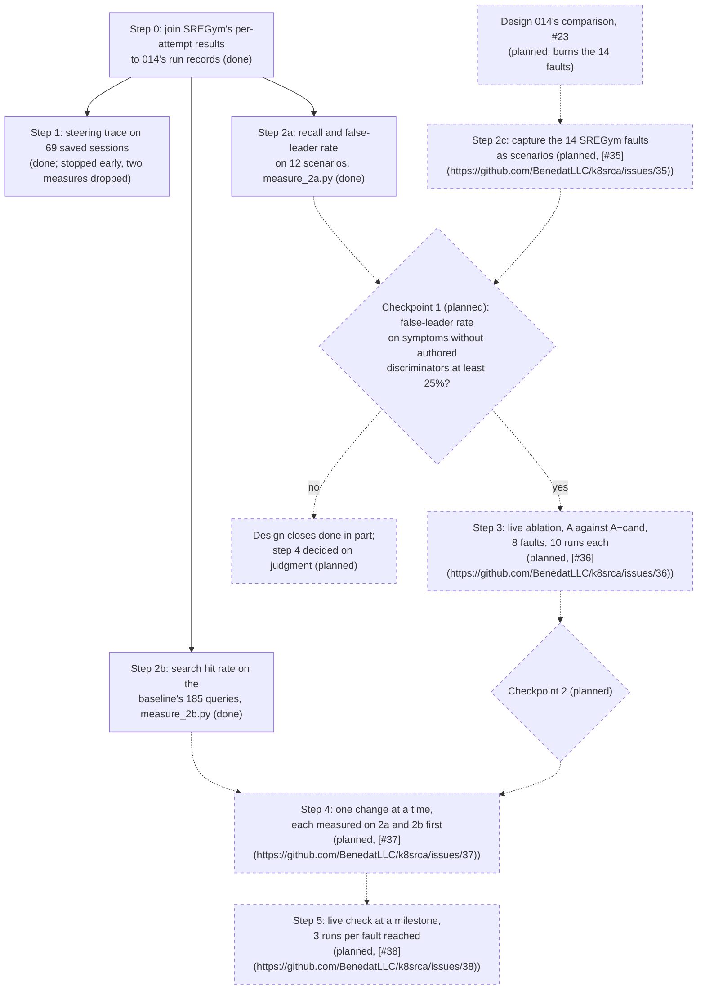

# Plan 015 — Is the knowledge base helping? Evaluating it, then improving it

Design: [015 — Is the knowledge base helping?](../designs/015-kb-evaluation.md).

> **On hold, with the design.** Steps 0 to 2b are done. Step 2c waits for design 014's comparison
> ([#23](https://github.com/BenedatLLC/k8srca/issues/23)); steps 3 to 5 have not started.

This plan measures whether the knowledge base (KB) helps the agent, then improves it. Steps 0 to
2b measure it offline on saved sessions and the scenario corpus, and are done. Step 2c captures
SREGym's 14 faults as scenarios once design 014's comparison has used them. Checkpoint 1 then
decides whether step 3, a live ablation, runs. Step 4 makes improvements one at a time, each
settled offline, and step 5 is a live check that nothing regressed. A **consulted** session is one
whose bash ran `kb_query.py open` or `lookup`. The measures (recall, false-leader rate, search hit
rate) and the arms are defined in [design §3.3](../designs/015-kb-evaluation.md#33-the-measures).

Two pieces of work outside this plan come first:
- the rendering fix for `open`'s printed leader,
  [#18](https://github.com/BenedatLLC/k8srca/issues/18), made under design 014's step 2b so both of
  014's arms carry it;
- design 014's comparison, [#23](https://github.com/BenedatLLC/k8srca/issues/23), after which the
  14 faults are burned (used, and no longer a hold-out) and may be captured and tuned on.

The diagram shows the order of the steps, what each reads, and where the checkpoints decide what
runs next. Solid boxes are done; dashed boxes are planned and not started.

## Budget and calendar

| Steps | Model spend | Work |
| --- | --- | --- |
| 0 to 2 | about $2 | 1 to 2 weeks |
| 3 | about $100 for both arms | about 24 hours of wall clock |
| 4 | about $25 for mining | days, offline |
| 5 | about $40 | about 12 hours |
| **Total** | **about $170** | |

Steps 0 and 1 could run during design 014, and have. Steps 2c to 5 wait for 014's comparison, and
the KB is not touched before then. The figures use the baseline's $0.57 an attempt and about 8 to
9 minutes of wall clock an attempt.

## Tripwires for this design

These add to [process.md §2](../docs/process.md#2-tripwires)'s tripwires; any one stops work for a
checkpoint.

1. **A KB entry written from an SREGym fault's run or root-cause text** (process.md tripwire 3).
   Entries come from public sources only.
2. **The instrument moved.** The corpus labels, the query labels, the arm definitions or the
   decision thresholds changed after a measurement began.
3. **Drift.** The work becomes tuning the KB to the 14 faults instead of evaluating whether it
   helps.
4. **Two inconclusive arms in a row** (step 3 and step 5).

## Step 0 — Join SREGym's per-attempt results to 014's run records

**Issue:** none; done before steps had issues. **Status:** done 2026-11-12
([result](#step-0-the-join)).

| | |
| --- | --- |
| **Hypothesis** | None; instrument preparation |
| **Expected effect** | The baseline summary's gaps where right-looking answers outnumber passes become explainable, and every later analysis can use the judge's per-attempt verdict instead of a keyword proxy |
| **Can we see it?** | Deterministic: per fault, the joined passes sum to the ledger's count |
| **Budget** | $0; about a day |
| **Done and stop** | Done when all 14 faults join and match the ledger. A fault whose records and attempts differ in number (a lost attempt, an orphan record) is marked and left out of per-attempt analyses |

- [x] Per-attempt results joined to the run records for all 14 faults; passes match the ledger
- [x] Session events for the 69 joined attempts fetched and saved, with the analysis scripts,
  outside the repo

## Step 1 — Trace whether answers follow the KB's candidates, on saved sessions

**Issue:** none; done before steps had issues. **Status:** done 2026-11-12, stopped early as
planned: the matching rule did not reach 85% agreement ([result](#step-1-the-steering-trace)).

| | |
| --- | --- |
| **Hypothesis** | Wrong answers adopt the KB's candidate list: among consulted sessions, a larger share of wrong answers than of right ones name a KB-listed candidate as the cause |
| **Expected effect** | If the KB steers, the two shares differ by about 25 points or more; if not, they are close |
| **Can we see it?** | Only coarsely. About 50 sessions consult the KB; the share comparison has a standard error near 15 points, so it detects only a difference of 30 or more. It is descriptive and will not settle the question |
| **Measures** | M1: the session consulted `open` or `lookup`. M2: the headline cause matches a candidate listed in that session's KB output. M3: it equals the candidate `open` ranked first. M4: the answer is right and its cause was not a KB candidate. Each split by per-attempt pass (step 0) |
| **Matching rule** | Written before reading, applied to a labelled sample of 40 answers by one reader and to 20 of them by a second. If agreement is below 85%, M2 and M3 are dropped and only M1 and M4 are reported |
| **Budget** | About $2 if a model reads; no cluster, no agent run |
| **Done and stop** | Done when a table for all 14 faults is written to the journal. Stop early if the matching rule cannot reach 85% |

- [x] M1 and the within-fault comparison reported
- [x] M2 and M3 labelled, checked by a second reader, and dropped at 70% agreement
- [x] M4 reported, at lower confidence
- [ ] A table for all 14 faults in [docs/journal/](../docs/journal/) (no entry exists there; the
  results are summarised [below](#step-1-the-steering-trace))

## Step 2 — Measure the KB offline, before any change

**Issue:** none for 2a and 2b, which are done; 2c below. **Status:** 2a and 2b done; 2c not
started.

Step 2 builds two offline instruments, 2a and 2b, and then extends 2a's corpus with SREGym's faults
(2c). Neither instrument calls a model, so they cost nothing and can be repeated at will.

| | |
| --- | --- |
| **Hypothesis** | The false-leader rate is high on symptoms without authored discriminators, and the search miss rate on queries about authentication, DNS and Jobs is high |
| **Expected effect** | A measurable false-leader rate and miss rate that a later change can move |
| **Can we see it?** | Yes. Both are deterministic over a fixed corpus and a fixed query set, with no sampling noise |
| **Budget** | $0 in model calls; about 1 to 2 weeks of engineering |
| **Done and stop** | Done when 2a and 2b report on frozen labels. Checkpoint 1 follows. Stop if the corpus has fewer than 10 labelled cases, as the numbers would mean little |

### Step 2a — Measure candidate recall and the false-leader rate

**Status:** done 2026-11-12 on 12 scenario cases
([result](#step-2a-recall-and-false-leaders)).

On a labelled corpus, record for each case: whether the true cause is among the candidates
`lookup` and `open` list (recall), its rank, the number of candidates (clutter), and whether
`open` names a confident leader that is wrong, or names one when the cause is not listed (the
false-leader rate). Corpus: the scenario captures that have a truth and a KB mapping, and later the
SREGym faults (2c). Truth labels are written before the first measurement.

- [x] Labels, [`tests/kb_eval/labels-2a.yaml`](../tests/kb_eval/labels-2a.yaml), committed
  (`7e9999a`) before the first run
- [x] Script, [`tests/kb_eval/measure_2a.py`](../tests/kb_eval/measure_2a.py)
  (`uv run python tests/kb_eval/measure_2a.py`), no model, no cluster
- [x] Results recorded

### Step 2b — Measure how often search finds what the agent wanted

**Status:** done 2026-11-13 ([result](#step-2b-the-search-hit-rate)).

Collect every `kb_query.py search "<q>"` string the agents issued in the saved sessions (the
baseline's and the scenario suite's). A reader labels each with the KB entry it wanted, or "none
exists". Report the hit rate, the no-match rate and the wrong-entry rate. Split the queries in half
at random before any change; one half is for building improvements, the other only for reporting.

- [x] Labels, [`tests/kb_eval/labels-2b.json`](../tests/kb_eval/labels-2b.json), committed
  (`124bbe4`) before the first run, with the build and report halves
- [x] Script, [`tests/kb_eval/measure_2b.py`](../tests/kb_eval/measure_2b.py), which runs
  today's search on each text
- [x] Results recorded

### Step 2c — Capture the 14 SREGym faults as scenarios

**Issue:** [#35](https://github.com/BenedatLLC/k8srca/issues/35), blocked by
[#23](https://github.com/BenedatLLC/k8srca/issues/23). **Status:** not started.

> **Planned.** Waits for design 014's comparison and for the capture check below.

After 014's comparison the 14 faults are burned, so we may read and tune on them
([014 §3.1](../designs/014-sregym.md#31-the-suites-life-and-what-each-phase-may-do), phase C). Capture
each through k8stools with a truth and a checklist written before any run. That gives design 007
the scenario per family it needs before mining a family, and gives step 2a cases of symptoms with
no authored discriminators, which checkpoint 1 needs. **To check first:** whether the scenario
capture tooling can record from the SREGym cluster through SREGym's view proxy (the filtered API
endpoint SREGym gives agents;
[014 §3.6](../designs/014-sregym.md#36-the-cluster-view-k8stools-reads-through-sregyms-view-proxy)),
and how many of the 14 can be captured while faulted. If none can, the corpus stays the 15
existing scenarios
([design §7](../designs/015-kb-evaluation.md#7-open-questions)). The corpus should include loud and
quiet faults in the covered and uncovered families, and the coverage coding is done before the
outcomes are looked at.

- [ ] Capture check: can the tooling record through the view proxy, and how many faults while
  faulted
- [ ] The capturable faults as scenarios, each with a truth and a checklist written before any run
- [ ] Their step 2a labels, frozen before measurement
- [ ] Step 2a rerun on the extended corpus, for checkpoint 1

## Step 3 — Remove the KB's candidate commands and compare, live

**Issue:** [#36](https://github.com/BenedatLLC/k8srca/issues/36), blocked by [#35](https://github.com/BenedatLLC/k8srca/issues/35) (checkpoint 1). **Status:** not
started.

> **Planned.** Runs only if checkpoint 1 passes it, which waits on step 2c. This is the only
> counterfactual in the plan.

| | |
| --- | --- |
| **Hypothesis** | Removing the KB's candidate-listing commands changes the pass rate on faults whose evidence is available |
| **Arms** | **A**: the agent as shipped. **A−cand** ("A minus candidates"): the same agent with `search`, `lookup`, `open` and `claim` removed from `kb_query.py` and from the skill text, keeping the facts layer, the cluster-architecture wiki and the method text. It answers whether the candidate commands as a whole help, not which part |
| **Faults** | The eight of the 14 SREGym faults not confounded by a tool gap or by the wiki artifact ([014's baseline findings](../plans/014-sregym.md#findings-from-the-baseline), items 3, 4, 5 and 7), after 014's comparison has burned them; 10 runs per fault per arm (80 attempts each). The set should include loud and quiet faults in the covered and uncovered families |
| **Expected effect** | Unknown in sign. Planned to detect a swing of 15 points or more |
| **Can we see it?** | Only that large. Smaller differences are inside the noise, and the step says so beforehand |
| **Decision rule (fixed now)** | A−cand ahead by 15 points or more: the KB is net harmful here, and step 4 starts with 4.2 and 4.3. A−cand behind by 15 or more: the KB helps, and step 4 targets coverage. Within 15 either way: **cannot tell**, decided on the offline evidence and said so (tripwire 4, two inconclusive arms, applies if step 5 is also inconclusive) |
| **Budget** | About $50 per arm (the baseline cost $0.57 an attempt) and about 12 hours of wall clock per arm |
| **Done and stop** | Done when both arms are scored. Requires checkpoint 1. Stopped if an arm loses attempts to the harness; a lost attempt is rerun, not scored |

A−cand is a blunt arm: it removes the candidate commands together. If it comes out inconclusive, a
finer ablation is a new plan, not an extension
([design §4.4](../designs/015-kb-evaluation.md#44-a-finer-ablation)).

- [ ] A−cand built: the candidate commands removed from `kb_query.py` and the skill text
- [ ] Both arms run and scored
- [ ] Checkpoint 2 written

## Step 4 — Improve the KB one change at a time, each settled offline first

**Issue:** [#37](https://github.com/BenedatLLC/k8srca/issues/37), blocked by [#23](https://github.com/BenedatLLC/k8srca/issues/23);
each change gets its own sub-issue when it is taken up. **Status:**
not started.

> **Planned, and outlined only.** Nothing here starts before design 014's comparison has run. Each
> change states the five fields of [process.md §1](../docs/process.md#1-plan-the-measurement-before-building)
> before it is built.

Each is one change for one thing ([process.md §2](../docs/process.md#2-tripwires): a third change
aimed at one thing stops work for a checkpoint). Each is measured on 2a and 2b before any live run.
The changes are described in [design §3.4](../designs/015-kb-evaluation.md#34-the-improvements-considered).

| # | Change | Offline measure | Live? |
| --- | --- | --- | --- |
| 4.1 | **Search:** aliases and log-line triggers ("password authentication failed" maps to an authentication-failure entry), and a category listing in place of "no match" | Hit rate on the held-back query half; no drop in 2a recall | No |
| 4.2 | **Coverage honesty:** for a symptom with no authored discriminators, say so and list classes to consider, and have `open` name no leader | False-leader rate down; recall unchanged | No |
| 4.3 | **Open-world candidates and configuration checks:** a standing "not listed" candidate, and for each candidate the object to read (spec, env, ConfigMap) beside its log and metric checks | Recall of causes that live in configuration | At a milestone |
| 4.4 | **A survey routine for a vague question** ("something is wrong with X", no symptom): a sweep of every workload kind and the configuration on the path | Needs live behaviour | At a milestone |
| 4.5 | **Mine the missing families** with `k8srca kb mine`, from public sources only: `networking` (DNS), `rollouts-and-jobs`, `service-traffic`, and new ones for credentials and authentication, and for timeouts and retries. About $5 a family | Recall and false-leader rate on the corpus | At a milestone |

4.5 is where the rule against writing from one run matters most. A family is mined once from public
guides, without looking at the fault that reaches it, then measured on that fault's capture. A
second iteration on the same family is a checkpoint, not another edit.

4.1 can be built against step 2b's build half and checked on its report half, offline. If its
aliases leave a high miss rate, compare it offline on the same held-back queries with symptom
matching by a decision model, one of
[011's later steps](011-decision-models.md#later-steps-only-if-they-look-promising)
([design §4.1](../designs/015-kb-evaluation.md#41-symptom-matching-with-a-decision-model-instead-of-search-aliases)).

- [ ] 4.1 Search aliases and log-line triggers
- [ ] 4.2 Coverage honesty
- [ ] 4.3 Open-world candidates and configuration checks
- [ ] 4.4 A survey routine for a vague question
- [ ] 4.5 The missing families mined
- [ ] Tests, and documents updated (007 for the new families)

## Step 5 — Check live at a milestone that nothing regressed

**Issue:** [#38](https://github.com/BenedatLLC/k8srca/issues/38), blocked by [#37](https://github.com/BenedatLLC/k8srca/issues/37). **Status:** not started.

> **Planned.** Follows step 4.

| | |
| --- | --- |
| **Hypothesis** | The changes that passed offline do not regress, and 4.3 to 4.5 move the faults they reach |
| **Design** | Arm A (the agent as shipped) against arm A plus the changes that passed offline, 3 runs per fault reached ([process.md §6](../docs/process.md#6-two-loops), the outer loop), on the burned set |
| **Can we see it?** | A regression of 15 points or more across the reached faults, not a small gain. A change is kept on its offline evidence, with the live run as a guard |
| **Budget** | About $40 |
| **Done and stop** | Done when no change regresses. A change that does is backed out |

- [ ] Both arms run and scored
- [ ] Any regressing change backed out
- [ ] The design's end state recorded in its header and the
  [design index](../designs/README.md#index)

## Results

| Step | Plan | Outcome | Decision |
| --- | --- | --- | --- |
| 0 | [Above](#step-0--join-sregyms-per-attempt-results-to-014s-run-records) | Done 2026-11-12. All 14 faults join to the ledger; 69 of 70 attempts joined ([detail](#step-0-the-join)) | Done |
| 1 | [Above](#step-1--trace-whether-answers-follow-the-kbs-candidates-on-saved-sessions) | M1 and the within-fault comparison reported; M2 and M3 dropped (matching rule agreement 70%, below 85%) ([detail](#step-1-the-steering-trace)) | Stopped early as planned; no evidence of steering, none against it. The second condition for step 3 removed (checkpoints, below) |
| 2a | [Above](#step-2a--measure-candidate-recall-and-the-false-leader-rate) | Done 2026-11-12 on 12 cases: recall 11 of 12 at the top level; printed false-leader rate 5 of 12 at any grade, 2 of 12 at strong or moderate; the corpus has no case of a symptom without authored discriminators ([detail](#step-2a-recall-and-false-leaders)) | Checkpoint 1's condition cannot be decided as worded; owner: wait for 2c. #18's fix scheduled under 014's step 2b |
| 2b | [Above](#step-2b--measure-how-often-search-finds-what-the-agent-wanted) | Done 2026-11-13: on the report half, search finds the wanted entry for 59% of queries that have one; 31% return no match ([detail](#step-2b-the-search-hit-rate)) | Informs step 4.1; not a condition for step 3 |
| 2c | [Above](#step-2c--capture-the-14-sregym-faults-as-scenarios) | Not started | |
| 3 | [Above](#step-3--remove-the-kbs-candidate-commands-and-compare-live) | Not started | |
| 4 | [Above](#step-4--improve-the-kb-one-change-at-a-time-each-settled-offline-first) | Not started | |
| 5 | [Above](#step-5--check-live-at-a-milestone-that-nothing-regressed) | Not started | |

### Checkpoints

**After step 1 (2026-11-12): change the plan.** Checkpoint 1 had a second condition: step 3 would
also go ahead if a third of wrong consulted answers adopted a KB-listed candidate. The owner removed
it and kept the false-leader rate alone. Step 1 could not measure the condition reliably (agreement
70%, below 85%), and a list as broad as the KB's would meet it whatever the KB's effect: the
model's 69% meets a one-third threshold on its face, but any broad list would.

**After step 2a (decided 2026-11-13): wait for step 2c.** Checkpoint 1's condition cannot be
decided as worded, because the scenario corpus has no case of a symptom without authored
discriminators. Of the three readings of the condition on the cases that exist (17%, 25% and 42%),
none is adopted. Step 3 stays conditioned on the false-leader rate on symptoms with no authored
discriminators, to be measured on the SREGym faults once they are scenarios (2c, after 014's
comparison, and only if capture works). The defect step 2a found
([#18](https://github.com/BenedatLLC/k8srca/issues/18)) is a reason to fix the rendering, a code
change the owner scheduled on 2026-11-14 under 014's step 2b so that both of 014's arms carry it.

**Checkpoint 1, after steps 0 to 2 (planned).** The owner decides whether step 3 is justified, on
one condition: step 3 goes ahead if step 2a's false-leader rate on symptoms with no authored
discriminators is 25% or more. If it is below 25%, the KB is not the main problem, step 4 is
decided on judgment where it is cheap, and the design closes as done in part. The condition cannot
be decided until step 2c supplies such cases.

**Checkpoint 2, after step 3 (planned).** Continue to step 4 as step 3's decision rule says, change
the plan, or close.

---

## Appendix: results in detail

### Step 0: the join

Each row of SREGym's `results/*/k8srca/<fault>/*_results.csv` was matched to a suite run record by
answer text (`Diagnosis.submission` against the record's `answer`, `raw_answer` or
`first_answer`), then the latest five rows per fault were taken as the final clean set. Their
`Diagnosis.success` counts equal the ledger's `passes` for all 14 faults (25 in all). The one
exception to 70 joined attempts is `service_dns_resolution_failure_social_network`, whose lost
(`incomplete`) attempt has no submission; it is left out of per-attempt analyses, as planned,
leaving 69. Session events for the 69 were fetched by `session_id` and saved with the analysis
scripts outside the repo. Which attempt of `service_dns` passed is known from the CSV. The joined
table is not reproduced here because it holds answers and scores
([014 §3.1](../designs/014-sregym.md#31-the-suites-life-and-what-each-phase-may-do)).

### Step 1: the steering trace

Cost: about $1 of Claude Sonnet 5.5 labelling. 46 of the 69 sessions consulted the KB (M1).

**M1, consulted, by the judge's verdict (step 0):** 14 of 25 passing attempts (56%) and 32 of 44
failing ones (73%). This is confounded by fault: `edge_request_filter` and `kafka_poison_pill`
pass 5 of 5 with no consultation at all, while the faults in the KB's covered families are
consulted every time and pass less.

**Within the five faults where some attempts consulted and some did not**, consulted attempts
passed 3 of 11 and unconsulted 1 of 13. That is 27% against 8%, a difference inside the noise (one
fault, `finalizer_deadlock`, supplies 3 of the 4 passes). It does not say consulting helps, and it
gives no sign that consulting hurts.

**M2 and M3 (the answer names a KB-listed candidate; the one `open` ranked first): dropped.** A
model read all 46 consulted sessions under the rule fixed beforehand (step 1's matching rule). Its
labels gave M2 79% of passing and 69% of failing attempts (22 of 32 wrong answers named a listed
candidate) and M3 36% and 34%. A second reader then labelled 20 sessions, seeing the answer's
opening and the KB item names but not the model's labels. The two agreed on 14 of 20 (70%). Five
of the six disagreements are the same judgment: whether a more specific cause than any listed item
(a hung `rate` handler against "downstream dependency slow"; a pod unschedulable for a combined
affinity and volume reason against "pod-not-scheduled") counts as listed. The rule does not settle
it. The agreement is below the 85% the plan set, so M2 and M3 are not reported as findings, and the
rule is not reworded and re-run on the same sessions. Deviations from the plan: the first reader
was a model, not a person, and the second read 20 sessions, not a labelled 40 and 20.

**M4 (right and the cause not a KB candidate)**, from the model's labels and so of lower
confidence: 3 of 14 passing consulted attempts.

**What this supports.** The planned hypothesis was a 25-point gap between wrong and right answers
in how often they adopt a KB candidate. The model's labels show none (wrong 69%, right 79%), and
the labels are too uncertain to rely on. Two things can be said without the matching rule: the
KB's output is long and mostly generic (the lists run to 20 or more items, most of them broad), so
almost any answer overlaps it; and wrong answers do not stand out by consulting it more once the
fault is accounted for. Neither shows the KB confuses the agent; neither shows it helps.

**For checkpoint 1.** The condition on wrong answers adopting a KB candidate cannot be tested
without M2. The model's 69% meets a one-third threshold on its face, but any broad list would meet
it, so it is not evidence of steering. Checkpoint 1 therefore rests on step 2a's false-leader rate
alone ([checkpoints](#checkpoints)).

### Step 2a: recall and false leaders

Labels: `tests/kb_eval/labels-2a.yaml`, committed (`7e9999a`) before the first run. Script:
[`tests/kb_eval/measure_2a.py`](../tests/kb_eval/measure_2a.py)
(`uv run python tests/kb_eval/measure_2a.py`), no model, no cluster. 12 cases from the 15
scenarios: three have no KB claim or no symptom to open (`itbench-31`, `itbench-80`,
`nothing-is-wrong`), and the two `jvm-oom-*` cases are near copies. `open` ran on the facts the
facts layer derives from each scenario's recorded results, without the text-read facts an agent
would add, so each standing is a floor.

**Recall (what `lookup` lists).** The true cause is a top-level candidate in 11 of 12 cases, at
rank 1 to 4 of a list of 6 to 13 (one at rank 9 of 9: `gc-thrashing-near-memory-limit`). In the
twelfth (`pvc-pending-no-storageclass`) it is reachable below a candidate. Recall is not the
problem on this corpus; clutter (6 to 13 candidates, most of them not the cause) is the cost.

**Leader (what `open` prints on the `most likely:` line).**

| | correct | false leader | no leader |
| --- | --- | --- | --- |
| as printed | 5 | 5 (2 strong, 3 weak) | 2 |
| as `ranking` computes it among the symptom's candidates | 6 | 3 (all strong) | 3 |

The false leaders: `application-release`, graded strong, for `deploy-regression` and
`liveness-probe-wrong-port`; and a weak "application crash; within it, port already in use" for
`itbench-24-kafka-port-change`, `jvm-oom-on-startup` and `jvm-oom-with-metrics`. The last two are
`oom-kill` in truth, and `oom-kill` had the highest grade (moderate).

**A defect in `open`'s output ([#18](https://github.com/BenedatLLC/k8srca/issues/18)).**
`ranking` computes the right leader for the two `jvm-oom-*` cases (`oom-kill leads (moderate)`),
but `fmt_open` prints the first depth-0 claim found in a flat set of every group's leaders
([`kb_query.py`](../skills/k8s-rca/kb_query.py), `top = [cid for d, cid, _ in rows if d == 0 and
cid in leads]`). `application-crash` is in that set because it leads the sub-causes of
`failing-init-container`, so it prints as "most likely" at weak while `oom-kill` waits in the
undecided list. The printed line differs from the computed leader in 4 of 12 cases. The same weak
line ("application crash; within it, port already in use") appears in the saved SREGym sessions'
`open` output. The code is unchanged on `main`; the fix is scheduled under 014's step 2b.

**Checkpoint 1's condition, under three readings.** The condition is a false-leader rate of 25% or
more on symptoms with no authored discriminators. All 12 cases have an authored truth claim, so
there is no case for the condition as worded. The case it is about is `open` run on a bare alert,
where the question is whether the first-listed candidate misleads; that needs a corpus the
scenarios do not supply (the SREGym faults after 014's comparison, step 2c). On the cases that
exist:

| reading | rate | against 25% |
| --- | --- | --- |
| printed, any grade | 5 of 12 (42%) | meets |
| printed, confident only (strong or moderate), as step 2a describes it | 2 of 12 (17%) | does not meet |
| computed leader, any grade | 3 of 12 (25%) | meets, at the line |

Two cautions on the confident readings. Both are `application-release`, which is true at a coarse
level in `deploy-regression` and `liveness-probe-wrong-port` (both are rollouts that introduced
the fault) and wrong only in being less specific than the cause. The labels fixed beforehand call
it a false leader, and that is what is counted. And n is 12: one case moves a rate by 8 points.

The decision taken on these numbers is in [checkpoints](#checkpoints).

### Step 2b: the search hit rate

Corpus: every `kb_query.py search` run in the 69 joined baseline sessions, 185 queries, 81
distinct texts. The scenario suite's saved runs hold answers only, no tool calls, so they
contribute nothing; the corpus is the baseline's. The distinct texts were split in half with
`random.Random(1502)` before labelling: the **build** half (105 queries) is for step 4.1's design,
the **report** half (80 queries, 40 distinct) is read only to report. A model labelled what each
query wanted from the query, the question and the next KB commands the agent ran, without the
search output. A second reader labelled 20 and agreed on 17 (85%, the bar step 1 used). The
disagreements were bare keywords (`configmap`, `hotel`) where the model read the agent's next
commands as intent. Labels: `tests/kb_eval/labels-2b.json`, committed (`124bbe4`) before the first
run. Script: [`tests/kb_eval/measure_2b.py`](../tests/kb_eval/measure_2b.py), which runs today's
search on each text. The knowledge base is identical to `holdout-v2`'s.

**Report half.**

| | queries | share |
| --- | --- | --- |
| something exists to find | 59 | |
| found (hit) | 35 | 59% |
| no match | 18 | 31% |
| listed entries, not the wanted one (wrong) | 6 | 10% |
| nothing exists for it | 21 | |
| search returned no match (right) | 16 | 76% |
| search listed entries anyway (spurious) | 5 | 24% |

The build half is close on the first block (60% hit, 23% no match, 17% wrong) and differs on the
second (60% spurious). That difference comes from small numbers and from the build half holding
the `credential`, `secret` and `auth` queries.

**What the misses are.** Agents search with the words they read in the cluster, and the KB's text
does not contain them: `unschedulable` (6 of the report half's 24 misses; the KB's pending-pod
entries say "no node has enough ..."), `podinitializing`, `panic`, `segfault`, `exit code`,
`exit 139`, `no reachable servers`. The search requires every word of the query to appear in an
entry's text (`cmd_search` in `kb_query.py`), so one absent word returns nothing. `timeout`,
`deadline` and `connect` list entries but not `request-latency` or `NetworkPolicyDenied`, the ones
the agent wanted. A bare application word (`hotel`, `otel`, `search`) cannot match and should not.

**The hypothesis (a high miss rate on authentication, DNS and Jobs queries) is not tested by the
report half**: it holds none of those queries. In the build half, the `credential`, `secret` and
`auth` queries (nothing in the KB covers them) listed entries anyway, so the failure there is the
opposite of a miss, and the one `403` query for the RBAC entry returned no match.

**What this supports.** A fifth to a third of searches return nothing for a query the KB could
answer, and the cause is vocabulary (aliases such as `unschedulable`, exit codes, signals and state
names), which is what step 4.1 proposes. It does not show that a miss costs a pass: whether a
session that got no match went on to reach the right entry another way was not checked. Step 4.1
can be built against the build half and checked on the report half, offline.
