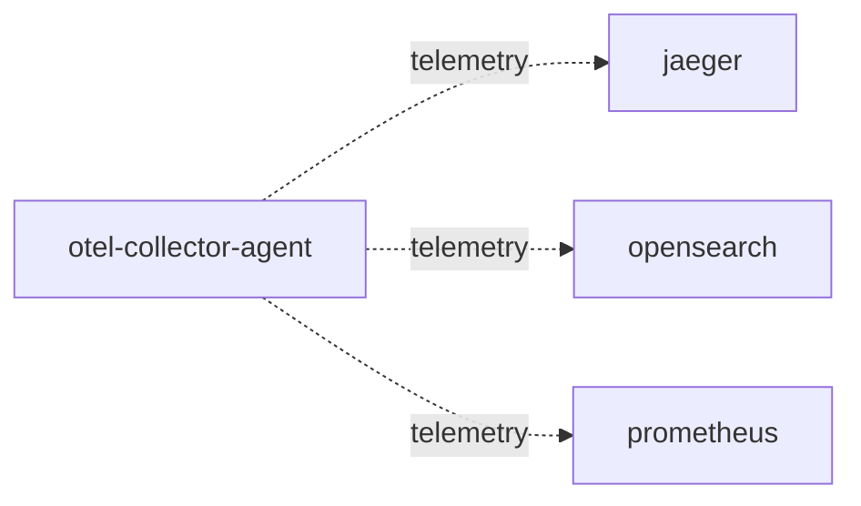

# otel-collector-agent

**Kind:** telemetry [chart: opentelemetry-demo-0.40.7.yaml] [derived: edges]  
**Workload:** DaemonSet  
**Namespace:** default  
**Connects:** [jaeger](jaeger.md) via telemetry (soft); [opensearch](opensearch.md) via telemetry (soft); [prometheus](prometheus.md) via telemetry (soft)  

## Purpose

Runs as a DaemonSet collecting telemetry and exporting it to Jaeger, OpenSearch and Prometheus. [chart: opentelemetry-demo-0.40.7.yaml] [config: otel-collector-agent/exporters.otlp/jaeger] [config: otel-collector-agent/exporters.opensearch] [config: otel-collector-agent/exporters.otlphttp/prometheus]

## If it fails

No component calls it, so request paths are unaffected; telemetry stops flowing into Jaeger, OpenSearch and Prometheus. [derived: callers] [derived: edges] [config: otel-collector-agent/exporters.otlp/jaeger] [config: otel-collector-agent/exporters.opensearch] [config: otel-collector-agent/exporters.otlphttp/prometheus]

## Connections

- **jaeger** (telemetry, soft): named by config `otel-collector-agent/exporters.otlp/jaeger` (declared, opentelemetry-demo-0.40.7.yaml), config `otel-collector-agent/exporters.otlp/jaeger` (observed, k8stools)
- **opensearch** (telemetry, soft): named by config `otel-collector-agent/exporters.opensearch` (declared, opentelemetry-demo-0.40.7.yaml), config `otel-collector-agent/exporters.opensearch` (observed, k8stools)
- **prometheus** (telemetry, soft): named by config `otel-collector-agent/exporters.otlphttp/prometheus` (declared, opentelemetry-demo-0.40.7.yaml), config `otel-collector-agent/exporters.otlphttp/prometheus` (observed, k8stools)

## Documentation

No documentation page names this component. [derived: docs source]

## Declared configuration

- image: otel/opentelemetry-collector-contrib:0.142.0 [chart: opentelemetry-demo-0.40.7.yaml]
- resources: requests memory 200Mi; limits memory 200Mi [chart: opentelemetry-demo-0.40.7.yaml]
- probes: liveness_probe, readiness_probe [chart: opentelemetry-demo-0.40.7.yaml]
