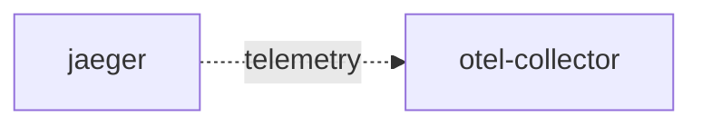

# otel-collector

**Kind:** telemetry [chart: opentelemetry-demo-0.40.7.yaml] [derived: callers]  
**Workload:** none (a Service with no workload)  
**Namespace:** default  
**Called by:** [jaeger](jaeger.md)  

## Purpose

Receives telemetry on the declared collector ports (OTLP 4317/4318, Jaeger 6831/14250/14268, Zipkin 9411, and 8888). [chart: opentelemetry-demo-0.40.7.yaml]

Jaeger is its only declared caller. [derived: callers] [derived: edges]

## If it fails

Jaeger, its only declared caller, carries on serving but its telemetry has no endpoint to reach. [derived: callers] [derived: edges]

## Documentation

No documentation page names this component. [derived: docs source]

## Declared configuration

- ports: 6831, 14250, 14268, 8888, 4317, 4318, 9411 [chart: opentelemetry-demo-0.40.7.yaml]
