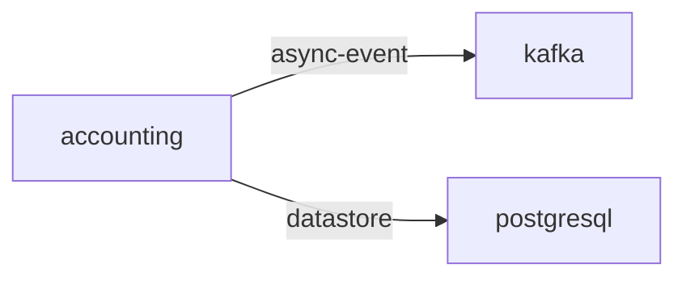

# accounting

**Kind:** service [derived: edges]  
**Workload:** Deployment  
**Namespace:** otel-demo  
**Connects:** [kafka](kafka.md) via async-event; [postgresql](postgresql.md) via datastore  

## Purpose

Consumes order messages from kafka via KAFKA_ADDR and records them in postgresql through DB_CONNECTION_STRING. [derived: edges] [env: KAFKA_ADDR] [env: DB_CONNECTION_STRING]

## If it fails

It has no callers, so no component waits on it; messages it would consume from kafka are not written to postgresql. [derived: callers] [derived: edges]

## Connections

- **kafka** (async-event): named by `KAFKA_ADDR` (observed, k8stools)
- **postgresql** (datastore): named by `DB_CONNECTION_STRING` (observed, k8stools)

## Documentation

No documentation page names this component. [derived: docs source]
