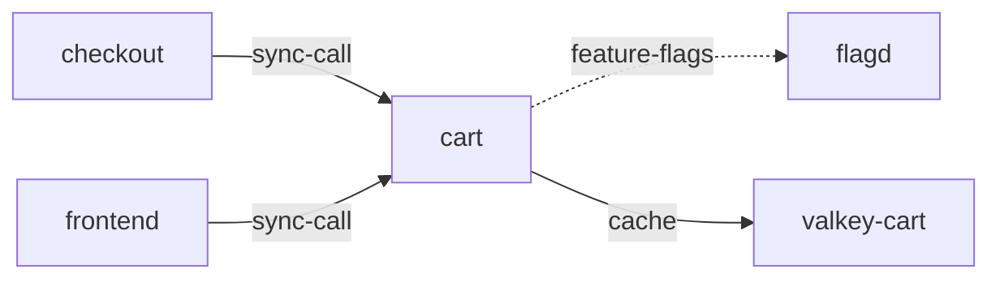

# cart

**Kind:** service [derived: callers]  
**Workload:** Deployment  
**Namespace:** otel-demo  
**Connects:** [flagd](flagd.md) via feature-flags (soft); [valkey-cart](valkey-cart.md) via cache  
**Called by:** [checkout](checkout.md), [frontend](frontend.md)  

## Purpose

Holds shopping-cart contents for frontend and checkout, which are its callers. [derived: callers]

Keeps cart state in valkey-cart via VALKEY_ADDR and reads feature flags from flagd through FLAGD_HOST. [derived: edges] [env: VALKEY_ADDR] [env: FLAGD_HOST]

## If it fails

Frontend cart pages and checkout's cart retrieval both fail, so orders placed through frontend-proxy cannot be assembled. [derived: callers]

## Connections

- **flagd** (feature-flags, soft): named by `FLAGD_HOST` (observed, k8stools)
- **valkey-cart** (cache): named by `VALKEY_ADDR` (observed, k8stools)

## Documentation

No documentation page names this component. [derived: docs source]
