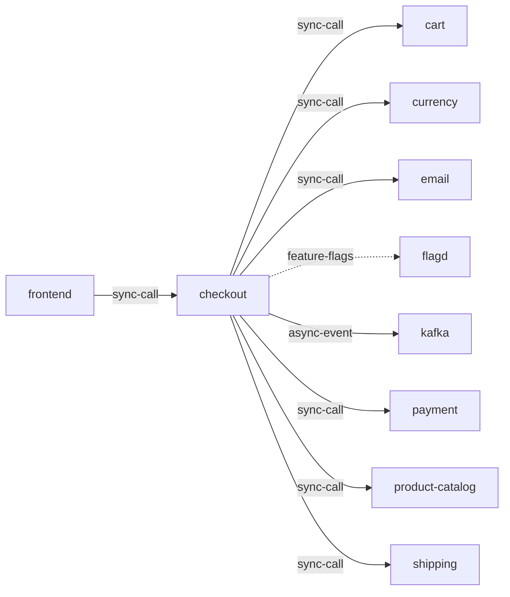

# checkout

**Kind:** service [derived: callers]  
**Workload:** Deployment  
**Namespace:** otel-demo  
**Connects:** [cart](cart.md) via sync-call; [currency](currency.md) via sync-call; [email](email.md) via sync-call; [flagd](flagd.md) via feature-flags (soft); [kafka](kafka.md) via async-event; [payment](payment.md) via sync-call; [product-catalog](product-catalog.md) via sync-call; [shipping](shipping.md) via sync-call  
**Called by:** [frontend](frontend.md)  

## Purpose

Orchestrates order placement for the frontend, calling cart, currency, email, payment, product-catalog and shipping. [derived: callers] [derived: edges] [env: CART_ADDR] [env: CURRENCY_ADDR] [env: EMAIL_ADDR] [env: PAYMENT_ADDR] [env: PRODUCT_CATALOG_ADDR] [env: SHIPPING_ADDR]

Publishes order messages to kafka via KAFKA_ADDR and reads feature flags from flagd through FLAGD_HOST. [derived: edges] [env: KAFKA_ADDR] [env: FLAGD_HOST]

## If it fails

Frontend requests to it fail, so users entering through frontend-proxy cannot complete orders. [derived: callers]

No order messages reach kafka, so accounting and fraud-detection, which consume from it, receive nothing from this path. [derived: edges] [derived: callers] [env: KAFKA_ADDR]

## Connections

- **cart** (sync-call): named by `CART_ADDR` (observed, k8stools)
- **currency** (sync-call): named by `CURRENCY_ADDR` (observed, k8stools)
- **email** (sync-call): named by `EMAIL_ADDR` (observed, k8stools)
- **flagd** (feature-flags, soft): named by `FLAGD_HOST` (observed, k8stools)
- **kafka** (async-event): named by `KAFKA_ADDR` (observed, k8stools)
- **payment** (sync-call): named by `PAYMENT_ADDR` (observed, k8stools)
- **product-catalog** (sync-call): named by `PRODUCT_CATALOG_ADDR` (observed, k8stools)
- **shipping** (sync-call): named by `SHIPPING_ADDR` (observed, k8stools)

## Documentation

No documentation page names this component. [derived: docs source]
