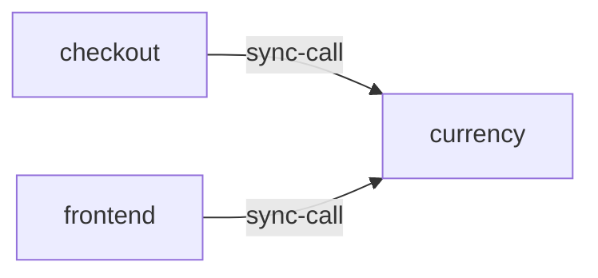

# currency

**Kind:** service [derived: callers]  
**Workload:** Deployment  
**Namespace:** otel-demo  
**Called by:** [checkout](checkout.md), [frontend](frontend.md)  

## Purpose

Performs currency conversion for frontend and checkout, its two callers. [derived: callers]

## If it fails

Frontend price rendering and checkout's conversion step both fail, affecting users reaching the shop through frontend-proxy. [derived: callers]

## Documentation

No documentation page names this component. [derived: docs source]
