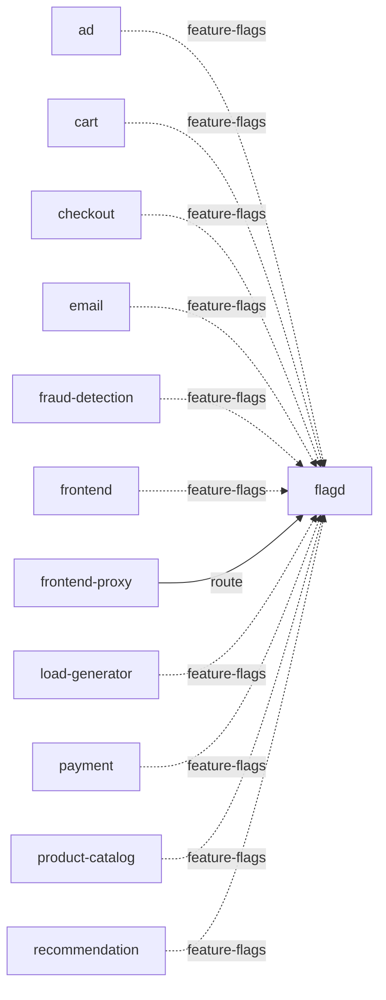

# flagd

**Kind:** feature-flags [derived: callers] [derived: edges]  
**Workload:** Deployment  
**Namespace:** otel-demo  
**Called by:** [ad](ad.md), [cart](cart.md), [checkout](checkout.md), [email](email.md), [fraud-detection](fraud-detection.md), [frontend](frontend.md), [frontend-proxy](frontend-proxy.md), [load-generator](load-generator.md), [payment](payment.md), [product-catalog](product-catalog.md), [recommendation](recommendation.md)  

## Purpose

Supplies feature flag values to ad, cart, checkout, email, fraud-detection, frontend, payment, product-catalog, recommendation and load-generator. [derived: callers]

Its host and UI are also exposed to users as routes on frontend-proxy. [derived: callers] [derived: edges]

## If it fails

Services that read flags carry on with default flag values, since those are edges the callers proceed without. [derived: callers] [derived: edges]

The flagd and flagd-UI routes served by frontend-proxy stop returning content for the operators using them, while the proxy's other routes continue. [derived: callers] [derived: edges]

## Documentation

No documentation page names this component. [derived: docs source]
