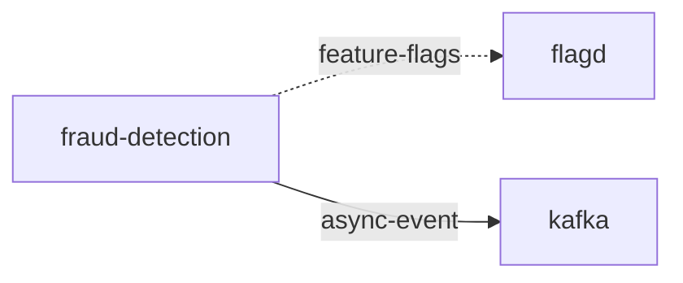

# fraud-detection

**Kind:** service [derived: edges]  
**Workload:** Deployment  
**Namespace:** otel-demo  
**Connects:** [flagd](flagd.md) via feature-flags (soft); [kafka](kafka.md) via async-event  

## Purpose

Consumes messages from kafka via KAFKA_ADDR and reads feature flags from flagd through FLAGD_HOST. [derived: edges] [env: KAFKA_ADDR] [env: FLAGD_HOST]

## If it fails

It has no callers, so no component waits on it; kafka messages it would consume go unprocessed. [derived: callers] [derived: edges]

## Connections

- **flagd** (feature-flags, soft): named by `FLAGD_HOST` (observed, k8stools)
- **kafka** (async-event): named by `KAFKA_ADDR` (observed, k8stools)

## Documentation

No documentation page names this component. [derived: docs source]
