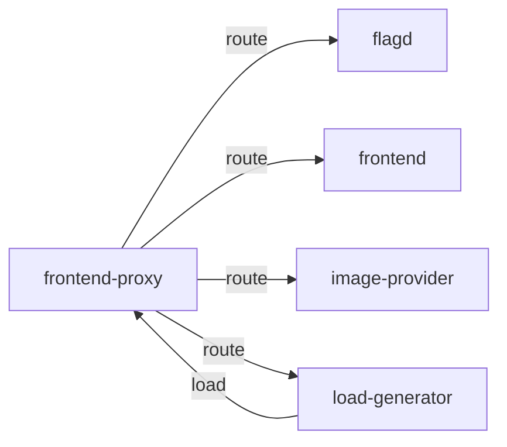

# frontend-proxy

**Kind:** gateway [derived: edges]  
**Workload:** Deployment  
**Namespace:** otel-demo  
**Connects:** [flagd](flagd.md) via route; [frontend](frontend.md) via route; [image-provider](image-provider.md) via route; [load-generator](load-generator.md) via route  
**Called by:** [load-generator](load-generator.md)  

## Purpose

Fronts the deployment and forwards requests to frontend, image-provider, flagd and its UI, and the load-generator web interface. [derived: edges] [env: FRONTEND_HOST] [env: IMAGE_PROVIDER_HOST] [env: FLAGD_HOST] [env: FLAGD_UI_HOST] [env: LOCUST_WEB_HOST]

It is the target of the load-generator's synthetic traffic. [derived: callers]

## If it fails

Every route it carries becomes unreachable at once: the shop frontend, product images, the flagd host and UI, and the load-generator web interface. [derived: edges] [env: FRONTEND_HOST] [env: IMAGE_PROVIDER_HOST] [env: FLAGD_UI_HOST] [env: LOCUST_WEB_HOST]

Load-generator traffic aimed at it no longer reaches the application, so the services behind the proxy see no synthetic requests. [derived: callers]

## Connections

- **flagd** (route): named by `FLAGD_HOST` (observed, k8stools), `FLAGD_UI_HOST` (observed, k8stools)
- **frontend** (route): named by `FRONTEND_HOST` (observed, k8stools)
- **image-provider** (route): named by `IMAGE_PROVIDER_HOST` (observed, k8stools)
- **load-generator** (route): named by `LOCUST_WEB_HOST` (observed, k8stools)

## Documentation

No documentation page names this component. [derived: docs source]
