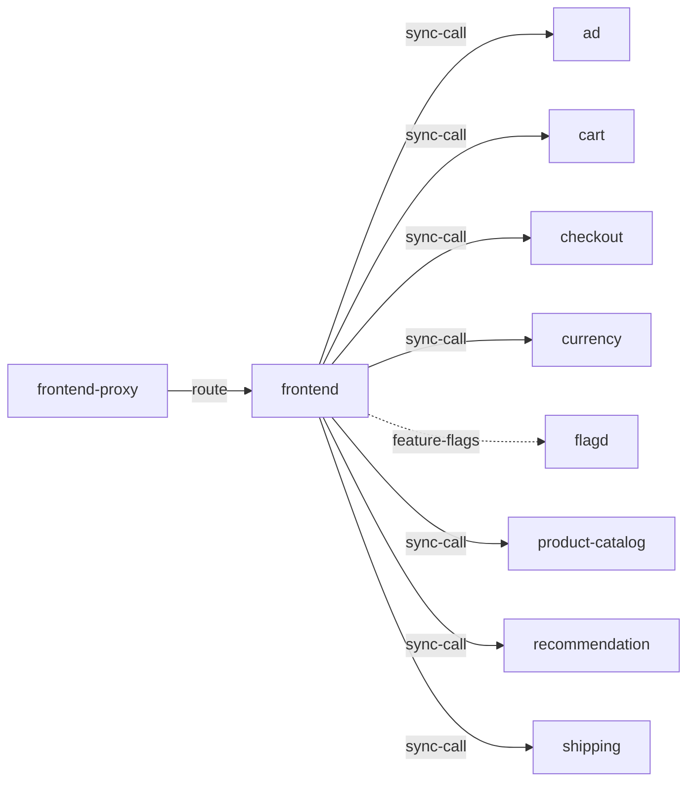

# frontend

**Kind:** service [derived: callers]  
**Workload:** Deployment  
**Namespace:** otel-demo  
**Connects:** [ad](ad.md) via sync-call; [cart](cart.md) via sync-call; [checkout](checkout.md) via sync-call; [currency](currency.md) via sync-call; [flagd](flagd.md) via feature-flags (soft); [product-catalog](product-catalog.md) via sync-call; [recommendation](recommendation.md) via sync-call; [shipping](shipping.md) via sync-call  
**Called by:** [frontend-proxy](frontend-proxy.md)  

## Purpose

Serves the shop application behind frontend-proxy, its only caller. [derived: callers]

Composes pages by calling ad, cart, checkout, currency, product-catalog, recommendation and shipping, and reads feature flags from flagd. [derived: edges] [env: AD_ADDR] [env: CART_ADDR] [env: CHECKOUT_ADDR] [env: CURRENCY_ADDR] [env: PRODUCT_CATALOG_ADDR] [env: RECOMMENDATION_ADDR] [env: SHIPPING_ADDR] [env: FLAGD_HOST]

## If it fails

The frontend-proxy route to it stops serving, so users and the synthetic traffic arriving at the proxy lose the shop itself; the proxy's other routes (image-provider, flagd and its UI, load-generator UI) are unaffected. [derived: callers] [derived: edges]

The services it calls receive no traffic from this path. [derived: edges]

## Connections

- **ad** (sync-call): named by `AD_ADDR` (observed, k8stools)
- **cart** (sync-call): named by `CART_ADDR` (observed, k8stools)
- **checkout** (sync-call): named by `CHECKOUT_ADDR` (observed, k8stools)
- **currency** (sync-call): named by `CURRENCY_ADDR` (observed, k8stools)
- **flagd** (feature-flags, soft): named by `FLAGD_HOST` (observed, k8stools)
- **product-catalog** (sync-call): named by `PRODUCT_CATALOG_ADDR` (observed, k8stools)
- **recommendation** (sync-call): named by `RECOMMENDATION_ADDR` (observed, k8stools)
- **shipping** (sync-call): named by `SHIPPING_ADDR` (observed, k8stools)

## Documentation

No documentation page names this component. [derived: docs source]
