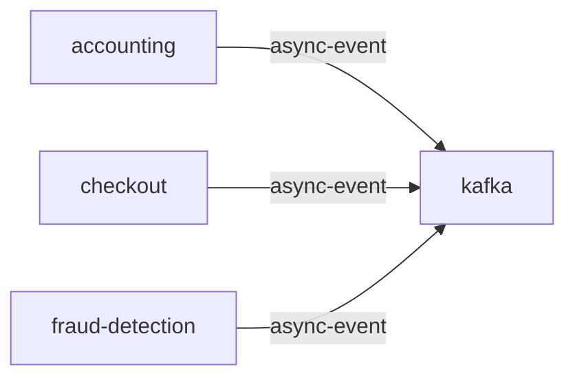

# kafka

**Kind:** queue [derived: callers] [derived: edges]  
**Workload:** Deployment  
**Namespace:** otel-demo  
**Called by:** [accounting](accounting.md), [checkout](checkout.md), [fraud-detection](fraud-detection.md)  

## Purpose

Carries order messages published by checkout to the accounting and fraud-detection consumers. [derived: callers] [derived: edges]

## If it fails

Checkout's publishing fails, and accounting and fraud-detection receive no messages, so accounting writes nothing new to postgresql. [derived: callers] [derived: edges]

## Documentation

No documentation page names this component. [derived: docs source]
