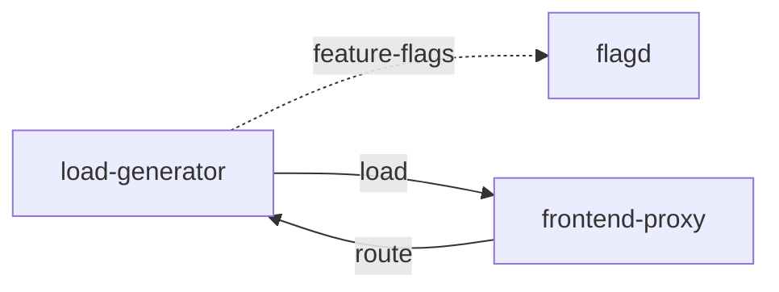

# load-generator

**Kind:** load-generator [derived: edges] [env: LOCUST_HOST]  
**Workload:** Deployment  
**Namespace:** otel-demo  
**Connects:** [flagd](flagd.md) via feature-flags (soft); [frontend-proxy](frontend-proxy.md) via load  
**Called by:** [frontend-proxy](frontend-proxy.md)  

## Purpose

Generates synthetic shop traffic against frontend-proxy via LOCUST_HOST. [derived: edges] [env: LOCUST_HOST]

Exposes a web interface that frontend-proxy routes to, and reads feature flags from flagd through FLAGD_HOST. [derived: callers] [derived: edges] [env: FLAGD_HOST]

## If it fails

Synthetic traffic into frontend-proxy and the services behind it stops. [derived: edges] [env: LOCUST_HOST]

The frontend-proxy route to the load-generator web interface stops serving for its operators, while the proxy's other routes continue. [derived: callers] [derived: edges]

## Connections

- **flagd** (feature-flags, soft): named by `FLAGD_HOST` (observed, k8stools)
- **frontend-proxy** (load): named by `LOCUST_HOST` (observed, k8stools)

## Documentation

No documentation page names this component. [derived: docs source]
