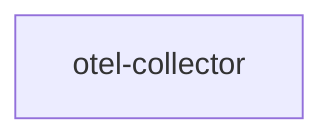

# otel-collector

**Kind:** telemetry [derived: edges]  
**Workload:** Deployment  
**Namespace:** otel-demo  

## Purpose

Deployed as the telemetry collection component of the system; it declares no outbound edges and no callers in this deployment description. [derived: edges] [derived: callers]

## If it fails

No component declares a dependency on it, so request paths between the services are unaffected; telemetry sent toward it is not received. [derived: callers] [derived: edges]

## Documentation

No documentation page names this component. [derived: docs source]
