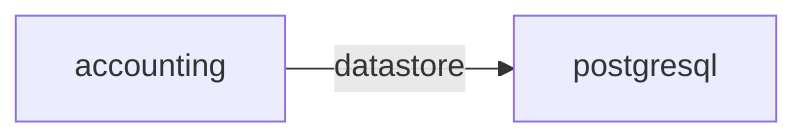

# postgresql

**Kind:** datastore [derived: callers] [derived: edges]  
**Workload:** Deployment  
**Namespace:** otel-demo  
**Called by:** [accounting](accounting.md)  

## Purpose

Stores the persistent records written by accounting, its only caller. [derived: callers] [derived: edges]

## If it fails

Accounting cannot read or write its records; no other component depends on it directly. [derived: callers]

## Documentation

No documentation page names this component. [derived: docs source]
