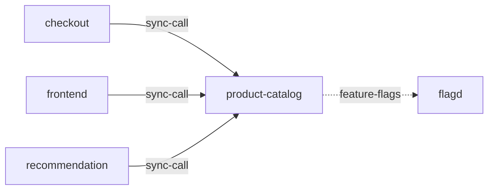

# product-catalog

**Kind:** service [derived: callers]  
**Workload:** Deployment  
**Namespace:** otel-demo  
**Connects:** [flagd](flagd.md) via feature-flags (soft)  
**Called by:** [checkout](checkout.md), [frontend](frontend.md), [recommendation](recommendation.md)  

## Purpose

Provides product data to frontend, checkout and recommendation. [derived: callers]

Reads feature flags from flagd through FLAGD_HOST. [derived: edges] [env: FLAGD_HOST]

## If it fails

Product listing in the frontend, recommendation's product lookups and checkout's item resolution all fail, affecting the whole shop path behind frontend-proxy. [derived: callers]

## Connections

- **flagd** (feature-flags, soft): named by `FLAGD_HOST` (observed, k8stools)

## Documentation

No documentation page names this component. [derived: docs source]
