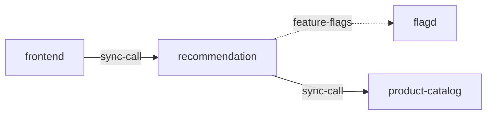

# recommendation

**Kind:** service [derived: callers]  
**Workload:** Deployment  
**Namespace:** otel-demo  
**Connects:** [flagd](flagd.md) via feature-flags (soft); [product-catalog](product-catalog.md) via sync-call  
**Called by:** [frontend](frontend.md)  

## Purpose

Returns product recommendations to the frontend, its only caller. [derived: callers]

Looks up products through product-catalog via PRODUCT_CATALOG_ADDR and reads feature flags from flagd through FLAGD_HOST. [derived: edges] [env: PRODUCT_CATALOG_ADDR] [env: FLAGD_HOST]

## If it fails

Frontend calls to it fail, so recommendation content is missing from pages served to users through frontend-proxy. [derived: callers]

## Connections

- **flagd** (feature-flags, soft): named by `FLAGD_HOST` (observed, k8stools)
- **product-catalog** (sync-call): named by `PRODUCT_CATALOG_ADDR` (observed, k8stools)

## Documentation

No documentation page names this component. [derived: docs source]
