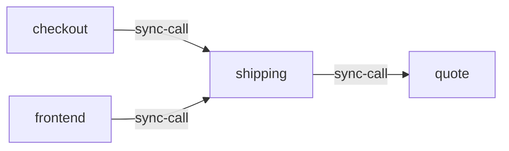

# shipping

**Kind:** service [derived: callers]  
**Workload:** Deployment  
**Namespace:** otel-demo  
**Connects:** [quote](quote.md) via sync-call  
**Called by:** [checkout](checkout.md), [frontend](frontend.md)  

## Purpose

Provides shipping costs and shipment handling to frontend and checkout, its two callers. [derived: callers]

Obtains quotes from the quote service via QUOTE_ADDR. [derived: edges] [env: QUOTE_ADDR]

## If it fails

Frontend shipping estimates and checkout's shipping step both fail, blocking order completion for users arriving through frontend-proxy. [derived: callers]

## Connections

- **quote** (sync-call): named by `QUOTE_ADDR` (observed, k8stools)

## Documentation

No documentation page names this component. [derived: docs source]
