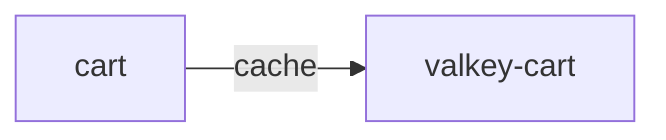

# valkey-cart

**Kind:** cache [derived: callers] [derived: edges]  
**Workload:** Deployment  
**Namespace:** otel-demo  
**Called by:** [cart](cart.md)  

## Purpose

Holds the cart state that the cart service reads and writes; cart is its only caller. [derived: callers] [derived: edges]

## If it fails

Cart cannot serve cart contents, so frontend cart pages and checkout's cart retrieval are affected in turn. [derived: callers] [derived: edges]

## Documentation

No documentation page names this component. [derived: docs source]
